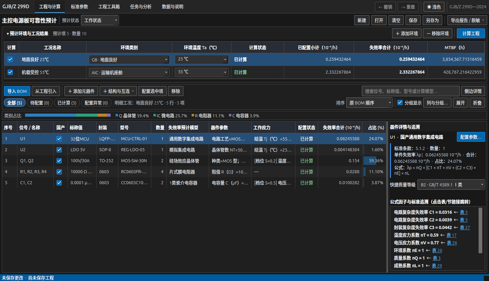
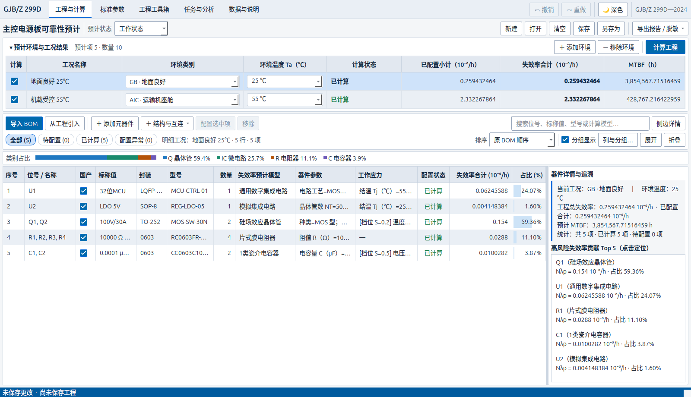
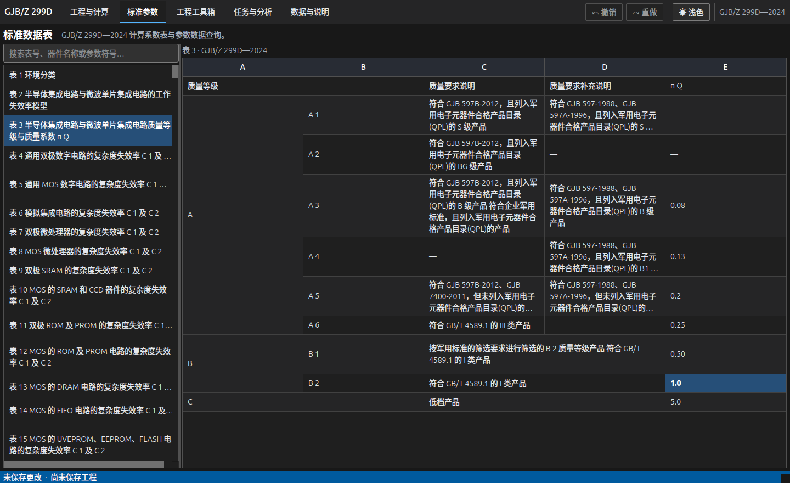
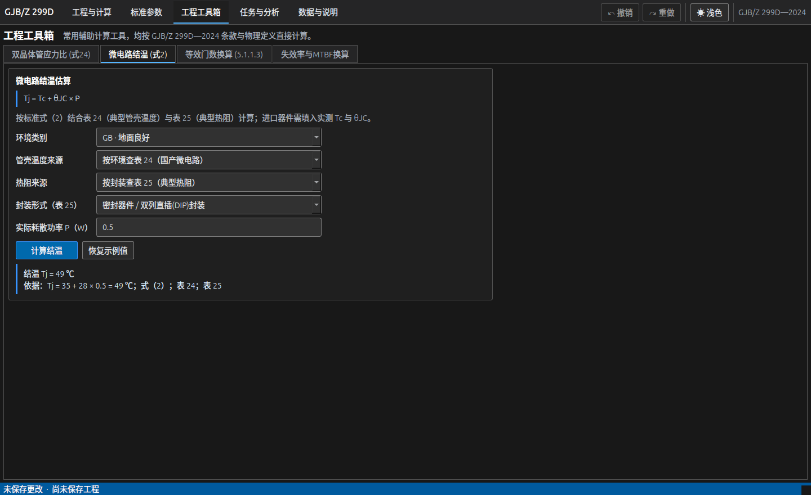
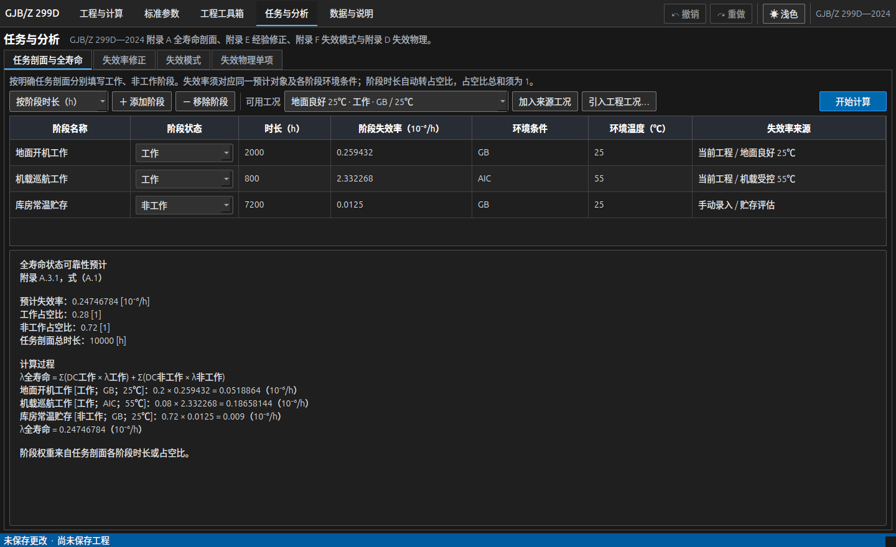

<div align="center">
  
  <h1>GJB299D-Calc (v1.0)</h1>
  <p><strong>GJB/Z 299D—2024《电子设备可靠性预计手册》离线桌面计算工作台</strong></p>
  <p>纯离线运行 · 261 个内置计算模型 · 工作 / 非工作双状态切换 · 因子级标准数据追溯 · 双平台独立免安装发布</p>
</div>

---

## 界面预览

### 深色主题工程工作台（含实时因子追溯与标准表跳转）


### 浅色主题与高风险贡献排序总览


### 内置标准数据表浏览器（高亮定位计算单元格）


### 工程工具箱（双晶体管应力比 / 微电路结温 / 等效门数 / 失效率-MTBF 换算）


### 任务剖面与全寿命状态可靠性预计


---

## 核心功能特性

1. **标准计算模型全覆盖（纯离线）**
   - 内置 `261` 个自动计算模型（模型注册表共 `264` 项，含 `待配置`、`已知单件失效率` 与 `工程模块`），所有系数表、公式常数随本机 SQLite 数据库（[`database/standard_reference.sqlite`](database/standard_reference.sqlite)）分发，全流程零联网、无遥测、无在线激活。
   - **工作状态**：第 5 章及附录 C.2 应力分析法、第 6 章及附录 C.3 元器件计数法。
   - **非工作状态**：附录 B.2 详细预计法、附录 B.3 元器件计数法，支持工作 / 非工作配置双向复用与独立维护。

2. **BOM 智能导入与批量/快捷编辑**
   - 支持 `.xlsx`、`.xls`、`.csv`、`.tsv`（兼容 UTF-8、GB18030、UTF-16 编码）与智能列预映射向导；读取 `.xlsx` / `.xls` 时自动跳过隐藏工作表与隐藏行，避免误将隐藏的 DNP/备选物料计入。
   - 支持中英文逗号、顿号及连字符范围位号自动展开（如 `R1、R2`、`R10-R14`、`C01~C03`），支持阻/容/感标称值自动解析（如 `10k`、`100nF`、`4.7uH`、`4R7`，并在确认为参数值列时支持无单位 3～4 位 EIA 印字码预匹配）。
   - 支持按“标称值 / 封装 / 模型 / 国产进口 / 参数 / 工作应力”智能分组折叠与内联展开，配备完整 `Ctrl+Z` / `Ctrl+Y` 撤销重做栈、带基线版本与指纹校验的 `.autosave.json`（及未命名草稿）自动恢复、与单文件非阻塞超时并发保存锁。

3. **约束联动输入、符号应力表达式与工程工具箱**
   - 依据标准正文对有条件约束和分级取档的参数（如电连接器表 289 `Ⅰ类 ≤ 250 ℃` / `Ⅱ类 ≤ 120 ℃`、集成电路按双极型/MOS 工艺区分复杂度上限及 `3.3 V` 等电源电压 `Vs` 向上归档、等效门数与引出端数 `NP` 向上取档等）提供动态联动过滤、复合输入选择控件及实时范围/报错状态提示（区分红色 `配置异常` 与黄色 `待配置`）。
   - 电应力比支持直接输入数值、四则运算、科学计数法、括号及自定义变量表达式（如 `(U*I/1000)/Pr`），计算时自动向上圆整至标准应力档位并保留精确输入依据。
   - 个别器件按标准模型提供结温 `Tj` / 沟道温度 `Tch`（可下拉或直接输入任意温度，并支持通过管壳温度与热阻/功耗辅助计算）、管壳温度 `Tc`、热点温度 `THS` 及温升 `ΔT` 输入；温度查表自动向上取整至下一高温度档。
   - 内置双晶体管应力比（式 24）、微电路结温估算（式 2）、数字集成电路等效门数换算（条款 5.1.1.3）、失效率与 MTBF 换算，以及外贴微电路辅助计算。

4. **因子级标准追溯与数据表高亮**
   - 右侧“器件详情与追溯”面板实时列出全部计算因子、选定档位与对应标准表号；点击表号链接即可跳转至“标准参数”页并高亮对应参数单元格。
   - 标准数据表搜索支持忽略空格匹配符号与表名（如搜索 `πQ` 自动匹配 `π Q`）。

5. **任务剖面与专项分析**
   - 内置附录 A 全寿命状态可靠性预计（支持引入当前工程多工况或外部 `.json` 工程）、附录 E 经验失效率贝叶斯修正、附录 F 失效模式及频数比分解、附录 D 失效物理单项计算，并随 `.json` 工程文件完整持久化保存（打开时自动重算验证）。

6. **供应商脱敏交付与模块级联引入**
   - 一键导出脱敏交付件（`.xlsx` / `.xls` / `.json`），自动隐去元器件位号、原型号、内部标称参数与私有应力算式，保留标准计算模型名称、公开参数档位及各工况精确预计结果。
   - 支持从外部供应商 `.json` / `.xlsx` / `.xls` 工程引入模块，并基于文件 `SHA-256` 摘要校验源工程快照一致性，防止引入来源被静默篡改。

---

## Excel 导出结构与当前范围说明

> [!IMPORTANT]
> 当前版本的 Excel（`.xlsx` / `.xls`）导出范围**仅覆盖以下两部分**：
> 1. **`预计总览`**：工程元信息（工程名称、依据标准 `GJB/Z 299D—2024`、预计状态、失效率单位、软件版本 `v1.0`）以及各启用工况总失效率与 MTBF 汇总表。
> 2. **各启用工况计算明细（如 `工况 1_GB@25°C`、`地面良好 GB @ 25°C_GB@25°C`）**：按工况分页展示 13 列——`序号`、`位号 / 名称`、`原型号`、`国产/进口`、`数量`、`计算模型`、`参数与公开档位`、`工作应力`（非工作态为 `非工作条件`）、`计算过程 / 说明`、`单件 λp`（或 `λNP`）、`小计 Nλp`（或 `NλNP`）、`占比 (%)` 与 `状态`。
>
> **关于“全寿命状态可靠性预计”等专项分析：** 当前版本**暂不随 Excel 工作簿导出**“全寿命状态可靠性预计”及失效率修正、失效模式、失效物理等专项分析分页；此类分析可在软件“任务与分析”界面内实时计算并随 `.json` 工程文件保存与重现。

### 完整报告 vs. 脱敏交付工作簿对比

| 字段 / 内容 | 完整计算数据导出（XLSX / XLS） | 脱敏交付导出（XLSX / XLS / JSON） |
| :--- | :--- | :--- |
| 工况名称 | 保留用户设置（如 `工况 1`） | 匿名化为 `工况001`、`工况002`… |
| `位号 / 名称` 列 | 正常输出器件位号或名称 | Excel 明细列留空；重新导入软件时按序生成 `000001`… |
| `原型号` 列 | 输出 BOM 制造商料号 | 留空隐藏 |
| `计算模型` 列 | 输出标准计算模型全称 | 正常输出标准计算模型全称（与完整表格保持一致） |
| `参数与公开档位` / 应力 | 输出完整计算参数与原始应力表达式 | 仅保留标准公开参数档位与应力档位 |
| `计算过程 / 说明` / 失效率 | 输出完整计算过程、单件 `λ`、小计及占比 | 隐去内部因子与公式（标注 `供应商提供单件失效率`），保留单件 `λ`、小计、占比与工况总值 |

---

## 快速开始

### 1. 源码运行（开发环境）

- **环境要求**：Python `>= 3.12`（当前使用虚拟环境 `.venv/`），依赖包见 [`requirements.txt`](requirements.txt) / [`pyproject.toml`](pyproject.toml)。

```bash
# 激活环境并安装依赖（如尚未创建虚拟环境）
python3 -m venv .venv
.venv/bin/pip install -r requirements.txt

# 启动图形界面
.venv/bin/python main.py

# 或直接打开指定 .json 工程 / Excel 工作簿 / BOM 文件
.venv/bin/python main.py path/to/project.json
```

提示：软件启动后也可直接将单个 `.json` 工程、导出工作簿或 BOM 表格拖入主窗口打开。

### 2. 使用独立发布包（免安装运行）

`dist/` 目录下的压缩包解压后开箱即用，目录结构仅包含可执行文件与离线标准库：

- **Linux (`GJB299D-Calc-Linux-x86_64.zip`)**：
  ```text
  GJB299D-Calc-Linux-x86_64/
  ├── GJB299D-Calc.run
  └── database/standard_reference.sqlite
  ```
- **Windows (`GJB299D-Calc-Windows-x86_64.zip`)**：
  ```text
  GJB299D-Calc-Windows-x86_64/
  ├── GJB299D-Calc.exe
  └── database/standard_reference.sqlite
  ```

### 3. 双平台独立打包（Linux + Wine Windows）

工程支持在 Linux 下直接一键交叉构建 Linux `.run` 与 Windows `.exe`（通过本工程内 `.wine-win64/` 离线缓存 Python 3.12.8 与全部 `win_amd64` 依赖轮子）：

```bash
# 同时构建 Linux 与 Windows 独立包及 .zip 压缩包
.venv/bin/python -B scripts/build_standalone.py --target all

# 仅构建单平台
.venv/bin/python -B scripts/build_standalone.py --target linux
.venv/bin/python -B scripts/build_standalone.py --target windows
```

在 VS Code 中，也可直接点击底部状态栏的 **`$(tools) Build`** 任务（定义于 [`.vscode/tasks.json`](.vscode/tasks.json)）触发双平台一键构建。

### 4. 代码检查与离线回归测试

```bash
# 静态代码检查
PYTHONDONTWRITEBYTECODE=1 .venv/bin/ruff check --no-cache src tests main.py scripts

# 全量离线测试（208 项：含模型黄金真值、约束联动、I/O 边界、BOM 解析、示例套件、UI 覆盖、Gitee 同步与性能/并发压力测试）
env -u DISPLAY -u WAYLAND_DISPLAY QT_QPA_PLATFORM=offscreen PYTHONDONTWRITEBYTECODE=1 .venv/bin/python -B -m pytest -q -p no:cacheprovider
```

### 5. GitHub -> Gitee 自动同步说明（可选）

仓库已内置 [sync-gitee.yml](.github/workflows/sync-gitee.yml) 与 [sync_gitee_release.py](scripts/sync_gitee_release.py)，默认策略为**云端仅秒级同步文本，大附件推荐本机直传**：

- **GitHub Actions 自动同步**：推送 `main` / `v*` 标签或发布/编辑 GitHub Release 时，自动同步代码、标签以及 Release 标题与说明文本（源代码 `.zip` / `.tar.gz` 压缩包由 GitHub 与 Gitee 各自根据 Tag 自动生成，且更新 Release 说明时不会删除 Gitee 上已有的二进制附件）。
- **大体积二进制包（如 `.zip` 安装包）**：可在本地打包后使用国内网络直传（十秒级完成），或在 GitHub **Actions -> Sync to Gitee -> Run workflow** 手动触发时显式勾选 `sync_assets`：

```bash
GITEE_TOKEN="<你的Gitee私人令牌>" .venv/bin/python -B scripts/sync_gitee_release.py \
  --owner topstar_1 --repo GJBZ299D-Calc --tag v1.0 --assets-dir dist
```

在 GitHub 仓库 **Settings -> Secrets and variables -> Actions** 配置以下 Secret 后即可启用 Actions 自动同步：

- **`GITEE_TOKEN`（必填）**：在 Gitee **个人设置 -> 安全设置 -> 私人令牌** 生成并勾选 `projects` 权限的令牌（企业仓库需确保该账号具备仓库写权限）。
- **`GITEE_USERNAME`（可选）**：生成上述令牌的 Gitee 个人登录用户名（不填时 HTTPS Git 推送默认使用 `oauth2`）。
- **`GITEE_SSH_PRIVATE_KEY`（可选）**：若 Gitee 企业版策略限制 HTTPS 令牌推送代码，可配置具备仓库写权限的账户 SSH 私钥用于 `git push`，Release 仍通过 `GITEE_TOKEN` 调用 OpenAPI v5 同步。

---

## 工程目录结构

```text
GJBZ299D-Calc/
├── .github/
│   └── workflows/
│       └── sync-gitee.yml         # GitHub Actions 自动同步代码、标签与 Release 至 Gitee
├── main.py                        # 桌面应用启动入口
├── pyproject.toml                 # 项目元数据与工具链配置（动态读取 src.__version__）
├── requirements.txt               # 运行时依赖清单
├── LICENSE                        # MIT 开源许可证
├── README.md                      # 项目说明文档
├── database/
│   └── standard_reference.sqlite  # GJB/Z 299D—2024 离线标准数据表与常数库
├── example/                       # 全场景合成示例集（5 类 BOM、7 份工程、5 份导出/脱敏交付样件）
│   └── README.md                  # 示例套件说明与校验指南
├── packaging/
│   └── GJB299D-Calc.spec          # PyInstaller 单文件打包配置
├── picture/                       # README 界面预览截图与项目 Logo
├── scripts/
│   ├── build_standalone.py        # Linux + Wine Windows 双平台离线打包脚本
│   └── sync_gitee_release.py      # Gitee OpenAPI v5 Release 与大文件附件同步脚本
├── standard/                      # GJB/Z 299D—2024 标准文本/PDF 参考源件（仅研发查证，不随包分发）
├── src/
│   ├── assets/                    # 应用图标（.ico/.png/.svg）及表格勾选 SVG 资源
│   ├── app.py                     # QApplication 初始化、字体主题、中文翻译与全局异常保护
│   ├── window.py                  # 主窗口、导航栏、快捷键、拖放、并发保存与撤销重做协调
│   ├── domain.py                  # 工程 / 工况 / 元器件领域模型与严格校验
│   ├── standards.py               # 统一模型计算入口与参数/因子追溯格式化
│   ├── field_editor.py / dialogs.py / batch_dialog.py
│   │                              # 依赖条件动态过滤、复合输入选择控件与单器件/批量编辑对话框
│   ├── models/                    # 按标准章节与附录组织的 261 个计算模型定义
│   ├── analysis_methods/          # 附录 A / D / E / F 专项分析算法与持久化校验
│   ├── workbook_io.py             # .xlsx / .xls 统一报告导出、解析与安全读取
│   ├── bom.py / bom_dialog.py     # BOM 读取、位号范围展开、隐藏行列过滤与两步导入向导
│   ├── redacted_export.py         # 供应商工程脱敏与一致性校验
│   ├── project_modules.py         # 基于 SHA-256 校验的工程模块引入
│   └── ui/                        # BOM 预映射向导、帕累托分类条、检查器、工具箱、撤销与自动保存
└── tests/                         # 架构不变量、全模型与约束、I/O、示例、UI 覆盖与压力测试集
```

---

## 开发者与许可协议

- **开发者**：DuoYuWang（联系邮箱：`thirteenking.wang@gmail.com`）
- **仓库地址**：<https://github.com/13022591351/GJBZ299D-Calc>
- **开源协议**：本项目基于 [MIT License](LICENSE) 开源（Copyright © 2026 DuoYuWang）。
