
<strong>GJB</strong>

<h2 align="center">中华人民共和国国家军用标准</h2>

<table width="100%">
<tr>
<td align="left" valign="bottom"><strong>FL 0102</strong></td>
<td align="right" valign="bottom"><strong>GJB/Z 299D—2024</strong> 代替 GJB/Z 299C—2006、GJB/Z 108A—2006</td>
</tr>
</table>

---

 

<h1 align="center">电子设备可靠性预计手册</h1>

<strong>Reliability prediction handbook for electronic equipment</strong>

 

<table width="100%">
<tr>
<td align="left"><strong>2024–07–05 发布</strong></td>
<td align="right"><strong>2024–10–01 实施</strong></td>
</tr>
</table>

---

<strong>中央军委装备发展部 颁布</strong>

---

<strong>GJB/Z 299D—2024</strong>

<h2 align="center">目 次</h2>

| 章节 | 页码 |
| :--- | ---: |
| 前言 | III |
| 1 范围 | 1 |
| 2 引用文件 | 1 |
| 3 术语和定义、符号 | 11 |
| 3.1 术语和定义 | 11 |
| 3.2 符号 | 12 |
| 4 要求 | 15 |
| 4.1 概述 | 15 |
| 4.2 可靠性预计的前提假设 | 15 |
| 4.3 电子设备可靠性预计的一般程序 | 15 |
| 4.4 环境分类 | 16 |
| 4.5 元器件质量等级与质量系数 | 17 |
| 5 工作状态的元器件应力分析可靠性预计法 | 17 |
| 5.1 微电路 | 17 |
| 5.2 声表面波器件 | 38 |
| 5.3 半导体分立器件 | 39 |
| 5.4 光电子器件 | 70 |
| 5.5 真空电子器件 | 73 |
| 5.6 电阻器 | 78 |
| 5.7 敏感电阻器 | 96 |
| 5.8 电位器 | 98 |
| 5.9 电容器 | 112 |
| 5.10 感性元件 | 136 |
| 5.11 继电器 | 142 |
| 5.12 开关 | 152 |
| 5.13 电连接器 | 154 |
| 5.14 微特电机 | 159 |
| 5.15 印制板、焊接点与 SMT 互连 | 161 |
| 5.16 磁性器件 | 165 |
| 5.17 振荡器和谐振器 | 166 |
| 5.18 滤波器 | 168 |
| 5.19 电池 | 169 |
| 5.20 灯 | 170 |
| 5.21 激光器 | 171 |
| 5.22 压电陀螺 | 172 |
| 5.23 光纤连接器 | 172 |
| 5.24 其他电子元器件 | 173 |
| 6 工作状态的元器件计数可靠性预计法 | 176 |

I

---

<strong>GJB/Z 299D—2024</strong>

| 章节 | 页码 |
| :--- | ---: |
| 附录 A （资料性附录） 电子元器件全寿命状态的可靠性预计 | 213 |
| 附录 B （规范性附录） 电子元器件非工作状态可靠性预计 | 215 |
| 附录 C （资料性附录） 采用进口电子元器件的电子设备可靠性预计 | 286 |
| 附录 D （资料性附录） 基于失效物理的电子设备可靠性预计方法 | 363 |
| 附录 E （资料性附录） 预计失效率修正方法 | 371 |
| 附录 F （资料性附录） 电子元器件失效模式及频数比 | 372 |
| 附录 G （资料性附录） 失效率计算示例 | 387 |

II

---

<strong>GJB/Z 299D—2024</strong>

<h2 align="center">前 言</h2>

本指导性技术文件合并修订并代替 GJB/Z 299C—2006《电子设备可靠性预计手册》和 GJB/Z 108A—2006《电子设备非工作状态可靠性预计手册》。

本指导性技术文件修订时仍保持了 GJB/Z 299C—2006 中元器件应力分析可靠性预计法和元器件计数可靠性预计法的框架结构，与其相比，主要有以下变更：

a) 将原 GJB/Z 299C《电子设备可靠性预计手册》仅适用于工作状态的可靠性预计，通过增加资料性附录和规范性附录调整为适用于全寿命状态的可靠性预计，全寿命可靠性预计模型由工作状态可靠性预计模型、非工作状态可靠性预计模型两部分构成。正文部分仍为仅适用于工作状态的可靠性预计，其他模型和方法在标准中则以附录的方式提供。
b) 细化了可靠性预计质量等级的划分，更新了可靠性预计质量等级引用的生产执行标准，并适当调整了部分元器件类别的质量系数。
c) 调整了各类别元器件的基本失效率数值和 $\pi$ 系数值，更新了 T–S 曲线图。
d) 更新了各类别元器件通用失效率表。
e) 增加了 GaN 微波集成电路、声表面波滤波器、声表面波振荡器、声表面波延迟线、整流二极管、开关二极管、检波二极管、瞬态抑制二极管、雪崩二极管、功率晶体管、开关晶体管、达林顿晶体管、玻璃釉电阻器、箔式电阻器、非线绕精密电位器、氧化铌电解电容器、扼流圈、真空继电器、射频继电器、接触器式继电器、行程开关、温控振荡器、压控振荡器、介电滤波器、GaN 微波场效应晶体管、激光二极管、光电二极管探测器、光电晶体管探测器、砷化镓太阳能电池、氢镍蓄电池共 30 类元器件的可靠性预计模型或参数。
f) 删除了合成电阻器、3 类瓷介电容器、玻璃釉电容器、功率线绕电位器、微波锗检波、微波锗混频二极管的可靠性预计模型。
g) 修改和完善了微电路、普通二极管、双极型晶体管、硅场效应晶体管、光电子器件、线绕电阻器、片式膜电阻器、压敏电阻器、热敏电阻器、光敏电阻器、电感器、变压器、继电器、电连接器、振荡器、激光器、光纤连接器的预计模型或系数。
h) 扩展了微电路、行波管和电连接器的预计范围(最大规模)：
   1) 通用 MOS 数字电路：由原来最高的 500 万门扩展至 1 000 万门；
   2) 存储器：SRAM 由原来最高的 64MB 扩展至 512MB，DRAM 由原来最高的 64MB 扩展至 1GB，EEPROM、UVEPROM、FLASH 由原来的 64MB 扩展至 1GB；
   3) 微处理器：由原来最高的 2.2 亿个晶体管扩展至 14 亿个晶体管；
   4) 封装引脚数：插接阵列由原来最高的 500 扩展至 2 046；
   5) 行波管的频率由原来的 40GHz 扩展至 110GHz，功率由原来的 90kW 扩展至 120kW；
   6) 电连接器接触件数由原来的 100 扩展至 4 000。

本指导性技术文件附录 B 是规范性附录，附录 A、附录 C～附录 G 是资料性附录。

本指导性技术文件由中央军委装备发展部合同监管局提出。

本指导性技术文件起草单位：工业和信息化部电子第五研究所。

本指导性技术文件主要起草人：聂国健、王蕴辉、莫郁薇、任 艳、杨 云、张剑伟、郑丽香、古文刚、翟 芳、于 迪、盛德星、薛海红、段翠霞、林长苓、苏 瑜、杨少华、李坤兰、刘志斯、纪婧如、陈少珠。

III

---

<strong>GJB/Z 299D—2024</strong>

GJB/Z 299 的历次版本发布情况为：

GJB/Z 299—1987、GJB/Z 299A—1991、GJB/Z 299B—1998、GJB/Z 299C—2006；

GJB/Z 108—1998、GJB/Z 108A—2006。

IV

---

<strong>GJB/Z 299D—2024</strong>

<h1 align="center">电子设备可靠性预计手册</h1>

## 1 范围

本指导性技术文件为电子设备和系统的可靠性预计提供了基本数据和方法。

本指导性技术文件适用于电子设备和系统的可靠性预计，其中元器件应力分析可靠性预计法适用于产品已具有详细的元器件清单，并已确定了元器件所承受应力的设备研制阶段；元器件计数可靠性预计法适用于产品研制的初步设计阶段。

本指导性技术文件所提供的元器件失效率数据仅适用于正常工作条件下工作的电子设备可靠性预计；凡过应力使用，超过基本失效率表所列值的任何外推（如超过规定的温度范围，或电应力比大于 1 或等于 0）都是无效的。

本指导性技术文件提供的基本失效率数据未考虑核辐射环境，也未考虑电离辐射的影响。

## 2 引用文件

下列文件中的有关条款通过引用而成为本指导性技术文件的条款。凡注日期或版次的引用文件，其后的任何修改单（不包括勘误的内容）或修订版本都不适用于本指导性技术文件，但提倡使用本指导性技术文件的各方探讨使用其最新版本的可能性。凡不注日期或版次的引用文件，其最新版本适用于本指导性技术文件。

GB/T 2658 小型交流风机通用技术条件  
GB/T 2693 电子设备用固定电容器 第 1 部分：总规范  
GB/T 4588.1 无金属化孔单双面印制板分规范  
GB/T 4588.2 有金属化孔单双面印制板分规范  
GB/T 4588.4 多层印制板分规范  
GB/T 4588.10 有贯穿连接的刚挠双面印制板规范  
GB/T 4589.1 半导体器件分立器件和集成电路总规范  
GB/T 4874 直流固定金属化纸介电容器总规范  
GB/T 5729 电子设备用固定电阻器 第 1 部分：总规范  
GB 5960 阴极射线管总规范  
GB/T 5966 电子设备用固定电容器 第 8 部分：分规范：1 类瓷介固定电容器  
GB/T 5968 电子设备用固定电容器 第 9 部分：分规范：2 类瓷介固定电容器  
GB/T 5993 电子设备用固定电容器 第 4 部分：分规范：非固体或固体电解质铝电容器  
GB/T 6252 电子设备用 A 类调谐可变电容器类型规范  
GB/T 6253 电子设备用 B 类调谐可变电容器类型规范  
GB/T 6254 电子设备用 C 类调谐可变电容器类型规范  
GB/T 6255 空间电荷控制电子管总规范  
GB/T 6261 电子设备用固定电容器 第 5 部分：分规范：额定电压不超过 3000V 的直流云母介质固定电容器试验方法的选择和一般要求  
GB/T 6346 电子设备用固定电容器 第 11 部分：分规范：金属箔式聚乙烯对苯二甲酸乙二醇酯膜介质直流固定电容器  
GB 6492 航天用标准太阳电池  
GB/T 6495.2 光伏器件 第 2 部分：标准太阳电池的要求

1

---

<strong>GJB/Z 299D—2024</strong>

GB/T 6643 通用硬同轴传输线及其法兰连接器总规范  
GB/T 6663 直热式负温度系数热敏电阻器总规范  
GB/T 7153 直热式阶跃型正温度系数热敏电阻器 第 1 部分：总规范  
GB/T 7213 电子设备用固定电容器 第 15 部分：分规范：非固体或固体电解质钽电容器  
GB/T 7332 电子设备用固定电容器 第 2 部分：分规范：金属化聚乙烯对苯二甲酸酯膜介质直流固定电容器  
GB/T 7344 交流伺服电动机通用技术条件  
GB/T 7345 控制微电机基本技术要求  
GB/T 8976 膜集成电路和混合膜集成电路总规范  
GB/T 9020 视频同轴连接器总规范  
GB/T 9320 电子设备用固定电容器 第 8 部分(1)：分规范：1 类高压瓷介电容器  
GB/T 9322 电子设备用固定电容器 第 9 部分(1)：分规范：2 类高压瓷介电容器  
GB/T 9367 彩色广播电视接收机用回扫变压器总技术条件  
GB/T 9368 镉镍碱性蓄电池  
GB/T 9369 镉镍碱性蓄电池组  
GB/T 9536 电子设备用机电开关 第 1 部分：总规范  
GB/T 9537 电子设备用键盘开关 第 1 部分：总规范  
GB/T 9538 带状电缆连接器总规范  
GB/T 9597 电子设备用固定电容器分规范：1 类高功率瓷介电容器  
GB/T 10193 电子设备用压敏电阻器 第 1 部分：总规范  
GB/T 10194 电子设备用压敏电阻器 第 2 部分：浪涌抑制型压敏电阻分规范  
GB/T 10241 旋转变压器通用技术条件  
GB/T 10401 永磁式直流力矩电动机通用技术条件  
GB/T 10402 磁阻式步进电动机通用技术条件  
GB/T 10403 多极和双通道感应移相器通用技术条件  
GB/T 10404 多极和双通道旋转变压器通用技术条件  
GB/T 11010 光谱标准太阳电池  
GB/T 11013 碱性二次电池和电池组圆柱密封镉镍可充单体电池  
GB/T 11313 射频连接器 第 1 部分：总规范：一般要求和试验方法  
GB/T 11478 摄像管总规范  
GB/T 11498 膜集成电路和混合膜集成电路分规范（采用鉴定批准程序）  
GB/T 12078 X 射线管总规范  
GB/T 12564 光电倍增管总规范  
GB/T 12565 半导体器件光电子器件分规范  
GB/T 12632 单晶硅太阳电池总规范  
GB/T 12775 电子设备用圆片瓷介预调可变电容器总规范  
GB/T 12846 脉冲闸流管总规范  
GB/T 12852 磁控管总规范  
GB/T 12859 电子设备用压电陶瓷谐振器总规范  
GB 13139 磁滞同步电动机通用技术条件  
GB/T 13189 旁热式负温度系数热敏电阻器总规范  
GB/T 13265.1 纤维光学隔离器 第 1 部分：总规范  
GB/T 13416 射频传输线（同轴）开关总规范

2

---

<strong>GJB/Z 299D—2024</strong>

GB/T 13706 光电管总规范  
GB/T 13943 荧光显示管总规范  
GB/T 13945 辉光放电显示管总规范  
GB/T 14004 电子设备用固定电容器 第 6 部分：分规范 金属化聚碳酸酯膜介质直流固定电容器  
GB/T 14007 陆地用太阳电池组件总规范  
GB/T 14008 海上用太阳电池组件总规范  
GB/T 14110 闸流管与充气整流管总规范  
GB/T 14121 电子设备用固定电容器 第 3 部分：分规范：片状钽固定电容器  
GB/T 14182 变像管和像增强管总规范  
GB/T 14186 充气稳压管总规范  
GB/T 14515 有贯穿连接的单、双面挠性印制板技术条件  
GB/T 14516 无贯穿连接的单、双面挠性印制板技术条件  
GB/T 14860 通信和电子设备用变压器和电感器总规范  
GB/T 15142 方形开口镉镍单体蓄电池总规范  
GB/T 15287 抑制射频干扰整件滤波器 第 1 部分：总规范  
GB/T 15290 电子设备用电源变压器和滤波扼流圈总技术条件  
GB/T 15298 电子设备用电位器 第 1 部分：总规范  
GB/T 15448 电子设备用固定电容器 第 19 部分：分规范：金属化聚乙烯对苯二甲酸乙二醇酯膜介质直流片式固定电容器  
GB/T 15654 电子设备用膜固定电阻网络 第 1 部分：总规范  
GB/T 16261 印制板总规范  
GB/T 16512 抑制射频干扰固定电感器 第 1 部分：总规范  
GJB 33—1985 半导体分立器件总规范  
GJB 33A—1997 半导体分立器件总规范  
GJB 62—1985 有可靠性指标的精密聚苯乙烯电容器总规范  
GJB 63A—1991 有可靠性指标的固体电解质钽电容器总规范  
GJB 63B—2001 有可靠性指标的固体电解质钽电容器总规范  
GJB 65A—1991 有可靠性指标的电磁继电器总规范  
GJB 65B—1999 有可靠性指标的电磁继电器总规范  
GJB 101A—1997 耐环境快速分离小圆形电连接器总规范  
GJB 142A—1994 机柜用外壳定位小型矩形电连接器总规范  
GJB 142B—2011 外壳定位小矩形电连接器通用规范  
GJB 176—1986 耐环境线簧孔矩形电连接器总规范  
GJB 176A—1998 耐环境线簧孔矩形电连接器总规范  
GJB 177—1986 压接接触矩形电连接器总规范  
GJB 177A—1999 压接接触件矩形电连接器总规范  
GJB 191A—1997 有可靠性指标的云母电容器总规范  
GJB 191B—2009 含宇航级云母固定电容器通用规范  
GJB 192A—1998 有可靠性指标的无包封多层片式瓷介电容器总规范  
GJB 192B—2011 有失效率等级的无包封多层片式瓷介固定电容器通用规范  
GJB 244—1987 有可靠性指标的薄膜固定电阻器总规范  
GJB 244A—2001 有质量等级的薄膜固定电阻器总规范  
GJB 264—1987 机械滤波器总规范

3

---

<strong>GJB/Z 299D—2024</strong>

GJB 265—1987 合成电位器总规范  
GJB 361—1987 控制微电机基本技术要求  
GJB 361A—1997 控制电机通用规范  
GJB 362A—1996 刚性印制板总规范  
GJB 468—1988 有可靠性指标的和没有可靠性指标的Ⅰ类瓷介电容器总规范  
GJB 468A—2011 Ⅰ类瓷介固定电容器通用规范  
GJB 469—1988 镉镍圆柱密封碱性蓄电池总规范  
GJB 517—1988 密封镉镍蓄电池组通用技术条件  
GJB 517A—1998 密封镉镍蓄电池组通用技术条件  
GJB 597—1988 微电路总规范  
GJB 597A—1996 半导体集成电路总规范  
GJB 597B—2012 半导体集成电路通用规范  
GJB 598—1988 耐环境快速分离圆形电连接器总规范  
GJB 598A—1996 耐环境快速分离圆形电连接器总规范  
GJB 599A—1993 耐环境快速分离高密度小圆形电连接器总规范  
GJB 599B—2012 耐环境快速分离高密度小圆形电连接器通用规范  
GJB 600—1988 螺纹连接圆形电连接器总规范  
GJB 600A—2001 螺纹连接圆形电连接器总规范  
GJB 601—1988 热敏电阻器总规范  
GJB 601A—1998 热敏电阻器总规范  
GJB 603—1988 有可靠性指标的铝电解电容器总规范  
GJB 603A—2011 有失效率等级的铝电解电容器通用规范  
GJB 675—1989 有可靠性指标的模制射频固定电感器总规范  
GJB 675A—2002 有和无可靠性指标的模制射频固定电感器通用规范  
GJB 677—1989 同轴和波导可变衰减器总规范  
GJB 680—1989 射频同轴连接器、转接器总规范  
GJB 680A—2009 射频同轴连接器转接器总规范  
GJB 681—1989 射频同轴连接器总规范  
GJB 681A—2002 射频同轴连接器通用规范  
GJB 728—1989 玻璃介质微调可变电容器总规范  
GJB 732—1989 有可靠性指标的塑料膜（或纸—塑料膜）介质（金属、陶瓷或玻璃外壳密封）固定电容器总规范  
GJB 733A—1996 有可靠性指标的非固体电解质固定钽电容器总规范  
GJB 733B—2011 有失效率等级的非固体电解质钽固定电容器通用规范  
GJB 734—1989 旋转开关（电路选择器，小电流容量）总规范  
GJB 734A—2002 旋转开关（电路选择器，小电流容量）通用规范  
GJB 735—1989 密封钮子开关总规范  
GJB 777—1989 交流测速发电机通用规范  
GJB 777A—1997 交流测速发电机通用规范  
GJB 783A—1999 驱动微电机通用规范  
GJB 783B—2011 驱动微电机通用规范  
GJB 787—1989 交流伺服电动机通用规范  
GJB 787A—1999 交流伺服电动机通用规范

4

---

<strong>GJB/Z 299D—2024</strong>

GJB 788—1989 自整角机通用规范  
GJB 788A—1999 自整角机通用规范  
GJB 789—1989 磁滞同步电动机通用规范  
GJB 789A—1999 磁滞同步电动机通用规范  
GJB 809—1990 微动开关通用规范  
GJB 809A—1997 微动开关通用规范  
GJB 916A—2001 锂—二氧化硫电池通用规范  
GJB 916B—2011 军用锂原电池通用规范  
GJB 917—1990 线绕预调电位器总规范  
GJB 917A—2011 线绕预调电位器总规范  
GJB 918—1990 非线绕预调电位器总规范  
GJB 918A—2011 非线绕预调电位器总规范  
GJB 920—1990 膜固定电阻网络总规范  
GJB 920A—2002 膜固定电阻网络总规范  
GJB 922—1990 电子管总规范  
GJB 924—1990 有可靠性指标的 2 类瓷介电容器总规范  
GJB 924A—2012 2 类瓷介电容器通用规范  
GJB 929—1990 旋转变压器通用规范  
GJB 929A—1998 旋转变压器通用规范  
GJB 970—1990 防水快速分离重负荷电连接器总规范  
GJB 971—1990 永磁式直流力矩电动机通用规范  
GJB 971A—1999 永磁式直流力矩电动机通用规范  
GJB 972—1990 有和无可靠性指标的塑料膜介质交直流固定电容器通用规范  
GJB 972A—2002 有和无可靠性指标的塑料膜介质交直流固定电容器通用规范  
GJB 974—1990 多单元按钮开关总规范  
GJB 976—1990 同轴、带状或微带传输线用的射频同轴连接器总规范  
GJB 976A—2009 同轴、带状线或微带传输线用射频同轴连接器通用规范  
GJB 977—1990 同轴波导转换器总规范  
GJB 978A—1997 单列、双列插入式电子元器件插座总规范  
GJB 1042—1990 电磁继电器总规范  
GJB 1042A—2002 电磁继电器总规范  
GJB 1065—1991 射频隔离器总规范  
GJB 1065A—2004 射频隔离器和环行器通用规范  
GJB 1212—1991 射频三同轴连接器总规范  
GJB 1212A—2011 射频三同轴连接器通用规范  
GJB 1214—1991 有可靠性指标的优质金属化塑料膜介质直流、交流或交、直流金属壳密封的固定电容器总规范  
GJB 1214A—2009 含宇航级金属化塑料膜介质密封固定电容器通用规范  
GJB 1312—1991 非固体电解质钽电容器总规范  
GJB 1312A—2001 非固体电解质钽电容器总规范  
GJB 1313—1991 云母电容器总规范  
GJB 1314—1991 2 类瓷介电容器总规范  
GJB 1315—1991 可靠断路钮子开关总规范

5

---

<strong>GJB/Z 299D—2024</strong>

GJB 1421—1992 无接触旋转变压器通用规范  
GJB 1423—1992 小型交流风机通用规范  
GJB 1424—1992 射频微带隔离器总规范  
GJB 1429—1992 热延时继电器总规范  
GJB 1431—1992 空间用单晶硅太阳电池总规范  
GJB 1432A—1999 有可靠性指标的膜式片状固定电阻器总规范  
GJB 1432B—2009 片式膜固定电阻器通用规范  
GJB 1433—1992 瓷介微调可变电容器总规范  
GJB 1434—1992 真空继电器总规范  
GJB 1435—1992 开关电源变压器总规范  
GJB 1436—1992 干簧继电器总规范  
GJB 1438—1992 印制电路连接器及其附件总规范  
GJB 1438A—2006 印制电路连接器及其附件通用规范  
GJB 1457—1992 永磁直流测速发电机通用规范  
GJB 1461—1992 含可靠性指标的电磁继电器总规范  
GJB 1508—1992 石英晶体滤波器总规范  
GJB 1509—1992 同轴线、波导或微带线定向耦合器总规范  
GJB 1509A—2011 定向耦合器通用规范  
GJB 1511—1992 压电陶瓷滤波器总规范  
GJB 1512—1992 按钮开关总规范  
GJB 1512A—2011 按钮开关通用规范  
GJB 1513—1992 混合和固体延时继电器通用规范  
GJB 1513A—2009 混合和固体延时继电器通用规范  
GJB 1514—1992 水银湿簧继电器总规范  
GJB 1515—1992 固体继电器总规范  
GJB 1515A—2001 固体继电器总规范  
GJB 1517—1992 恒温继电器总规范  
GJB 1517A—2011 恒温继电器通用规范  
GJB 1518—1992 射频干扰滤波器总规范  
GJB 1519—1992 双列直插式开关总规范  
GJB 1520—1992 非气密封固体电解质钽电容器总规范  
GJB 1521—1992 小功率脉冲变压器总规范  
GJB 1521A—2013 小功率脉冲变压器通用规范  
GJB 1522—1992 含可靠性指标的降低射频干扰金属壳密封的交流和直流穿心电容器总规范  
GJB 1523—1992 精密线绕电位器总规范  
GJB 1609—1993 指示轮编码开关总规范  
GJB 1641—1993 装甲车辆用直流电动机通用规范  
GJB 1642—1993 自整角伺服力矩机通用规范  
GJB 1648—1993 晶体振荡器总规范  
GJB 1648A—2011 晶体振荡器通用规范  
GJB 1652—1993 特种函数旋转变压器通用规范  
GJB 1658—1993 功率型旋转开关总规范  
GJB 1660—1993 阴极射线管用偏转线圈总规范

6

---

<strong>GJB/Z 299D—2024</strong>

GJB 1661—1993 中频、射频和鉴频变压器总规范  
GJB 1684—1993 减速直流电动机通用规范  
GJB 1780—1993 印制绕组直流伺服电动机通用规范  
GJB 1782—1993 压敏电阻器总规范  
GJB 1786—1993 无槽电枢直流伺服电动机通用规范  
GJB 1862—1994 有可靠性指标的精密固定电阻器总规范  
GJB 1863—1994 无刷直流电动机通用规范  
GJB 1864—1994 射频固定和可变片式电感器总规范  
GJB 1864A—2011 射频固定和可变片式电感器通用规范  
GJB 1865—1994 非线绕精密电位器总规范  
GJB 1865A—2011 非线绕精密电位器总规范  
GJB 1919—1994 耐环境中性圆形光纤光缆连接器总规范  
GJB 1919A—2009 耐环境中性圆形光纤光缆连接器通用规范  
GJB 1929—1994 高稳定薄膜固定电阻器总规范  
GJB 1933—1994 微波铁氧体开关总规范  
GJB 1937—1994 摆动电动机通用规范  
GJB 1939—1994 无刷自整角机通用规范  
GJB 1940—1994 有可靠性指标的高压多层瓷介固定电容器总规范  
GJB 1940A—2012 高压多层瓷介固定电容器通用规范  
GJB 2138—1994 石英晶体元件总规范  
GJB 2138A—2011 石英晶体元件通用规范  
GJB 2143—1994 多极和双通道旋转变压器通用规范  
GJB 2144—1994 多极和双通道感应移相器通用规范  
GJB 2146—1994 发光二极管固体显示器总规范  
GJB 2146A—2011 半导体发光二极管器件通用规范  
GJB 2147—1994 低速同步电动机通用规范  
GJB 2149—1994 有可靠性指标的螺杆驱动线绕预调电位器总规范  
GJB 2162—1994 机械航空时钟规范  
GJB 2163—1994 舰船指针式石英钟规范  
GJB 2181—1994 镉镍蓄电池组通用规范  
GJB 2181A—2012 排气式镉镍蓄电池组通用规范  
GJB 2278—1995 锂—亚硫酰氯电池通用规范  
GJB 2281—1995 带状电缆电连接器总规范  
GJB 2283—1995 有可靠性指标的片式固体电解质钽电容器总规范  
GJB 2283A—2014 片式固体电解质钽固定电容器通用规范  
GJB 2438—1995 混合集成电路总规范  
GJB 2438A—2002 混合集成电路通用规范  
GJB 2441—1995 步进电动机通用规范  
GJB 2441A—2012 步进电动机通用规范  
GJB 2444—1995 双芯对称系列射频同轴连接器和附件总规范  
GJB 2445—1995 电子元器件引线端插座总规范  
GJB 2446—1995 外壳定位超小型矩形电连接器总规范  
GJB 2446A—2011 外壳定位微矩形电连接器通用规范

7

---

<strong>GJB/Z 299D—2024</strong>

GJB 2447—1995 耐振音频电连接器总规范  
GJB 2449—1995 塑封通用电磁继电器总规范  
GJB 2450—1995 非密封钮子开关总规范  
GJB 2450A—2012 钮子开关通用规范  
GJB 2514—1995 军用免维护铅酸蓄电池通用规范  
GJB 2514A—2012 军用铅酸蓄电池通用规范  
GJB 2549—1995 永磁交流伺服电动机通用规范  
GJB 2550—1995 无刷感应移相器通用规范  
GJB 2600—1996 声表面波器件总规范  
GJB 2600A—2009 声表面波器件通用规范  
GJB 2624—1996 指针式石英航空钟通用规范  
GJB 2820—1997 舰用控制继电器通用规范  
GJB 2821—1997 直流伺服电动机通用规范  
GJB 2822—1997 有限转角力矩电动机通用规范  
GJB 2828—1997 功率型线绕固定电阻器总规范  
GJB 2829—1997 音频、电源和大功率脉冲变压器和电感器总规范  
GJB 2829A—2013 音频、电源和大功率脉冲变压器和电感器通用规范  
GJB 2831—1997 氢镍全密封蓄电池通用规范  
GJB 2831A—2009 空间用全密封氢镍蓄电池通用规范  
GJB 2844—1997 航空用时间累加器通用规范  
GJB 2888—1997 有可靠性指标的功率型电磁继电器总规范  
GJB 2888A—2011 有失效率等级的功率型电磁继电器通用规范  
GJB 2889—1997 XC 系列高可靠性小圆形线簧孔电连接器规范  
GJB 2905—1997 耐环境推/拉式快速分离圆形电连接器总规范  
GJB 2905A—2004 耐环境推/拉式快速分离圆形电连接器总规范  
GJB 2912—1997 锂—二氧化锰电池通用规范  
GJB 3015—1997 有可靠性指标的非线绕预调电位器总规范  
GJB 3016—1997 单芯光纤光缆连接器总规范  
GJB 3016A—2011 单芯光纤光缆连接器通用规范  
GJB 3017—1997 膜式高压固定电阻器总规范  
GJB 3027—1997 陆用时间累加器通用规范  
GJB 3145—1998 直流伺服测速机组通用规范  
GJB 3146—1998 稳速直流电动机通用规范  
GJB 3155—1998 镉镍全密封蓄电池组通用规范  
GJB 3156—1998 锂—氧化铜电池通用规范  
GJB 3163—1998 微型异步电动机通用规范  
GJB 3234—1998 耐环境复合材料外壳高密度小圆形电连接器及附件总规范  
GJB 3235—1998 微波铁氧体移相器总规范  
GJB 3251—1998 金属氢化物—镍蓄电池组通用规范  
GJB 3251A—2011 金属氢化物—镍蓄电池组通用规范  
GJB 3285—1998 铅酸蓄电池通用规范  
GJB 3312—1998 微波电子管总规范  
GJB 3312A—2011 微波电子管通用规范

8

---

<strong>GJB/Z 299D—2024</strong>

GJB 3513—1999 无刷稳速直流电动机通用规范  
GJB 3516—1999 钽电解电容器总规范  
GJB 4073—2000 铅—二氧化铅贮备电池通用规范  
GJB 4154—2001 散热器安装功率线绕固定电阻器总规范  
GJB 4157—2001 高可靠瓷介固定电容器总规范  
GJB 4157A—2011 高可靠瓷介固定电容器通用规范  
GJB 4171—2001 铅—二氧化铅贮备电池通用规范  
GJB 4284—2001 阀控式密封铅酸蓄电池通用规范  
GJB 4337—2002 耐环境圆型电连接器总规范  
GJB 4477—2002 锂离子蓄电池组通用规范  
GJB 5025—2003 射频固定和可变电感器通用规范  
GJB 5248—2004 无刷直流伺服电动机驱动器通用规范  
GJB 5371—2005 YGD 系列圆形电源连接器通用规范  
GJB 5437—2005 有可靠性指标的有引线模压固体电解质钽电容器总规范  
GJB 6787—2009 含宇航级零欧姆片式膜固定电阻器通用规范  
GJB 6788—2009 含宇航级的多芯组瓷介固定电容器通用规范  
GJB 6789—2009 空间用锂离子蓄电池通用规范  
GJB 7400—2011 合格制造厂认证用半导体集成电路通用规范  
GJB 7690—2012 有、无失效率等级的表面安装膜固定电阻网络通用规范  
SJ 202—1981 印制板通用技术要求和试验方法  
SJ 332—1973 高可靠姆指式（超小型）收讯放大管总技术条件  
SJ 338—1973 高压整流管总技术条件  
SJ 343—1973 微波气体放电管总技术条件  
SJ 344—1973 低噪声行波管总技术条件  
SJ 345—1973 功率行波管总技术条件  
SJ 346—1973 “O”型返波管总技术条件  
SJ 347—1973 反射速调管总技术条件  
SJ 497—1983 射频连接器总技术条件  
SJ 737—1983 旋转片式开关（低电负荷）总技术条件  
SJ 753—1973 碱性镉镍单体及组合蓄电池  
SJ 1156—1977 直热式普通用负温度系数热敏电阻器总技术条件  
SJ 1241—1977 纸介电容器总技术条件  
SJ 1385—1978 噪声二极管和气体放电噪声管总技术条件  
SJ 1515—1979 微动开关总技术条件  
SJ 1553—1980 测温型负温度系数热敏电阻器总技术条件  
SJ 1557—1980 旁热型负温度系数热敏电阻器总技术条件  
SJ 1559—1980 稳压型负温度系数热敏电阻器总技术条件  
SJ 1583—1980 玻璃介质微调电容器总技术条件  
SJ 1624—1980 微波铁氧体隔离器、环形器总技术条件  
SJ 1704—1981 功率速调管总技术条件  
SJ 1752—1981 指轮开关总技术条件  
SJ 1882—1981 收音机用空气介质可变电容器总技术条件  
SJ 1885—1981 复合介质电容器总技术条件

9

---

<strong>GJB/Z 299D—2024</strong>

SJ 2182—1982 压电滤波器总技术条件  
SJ 2241—1982 同心型微调电容器  
SJ 2307—1983 防雷型氧化锌压敏电阻器总技术条件  
SJ 2308—1983 灭弧型氧化锌压敏电阻器总技术条件  
SJ 2309—1983 消噪型氧化锌压敏电阻器总技术条件  
SJ 2386—1983 干簧继电器总技术条件  
SJ 2407—1983 按钮开关总技术条件  
SJ 2456—1984 电子时间继电器总技术条件  
SJ 2461—1984 黑白电视接收机用偏转线圈总技术条件  
SJ 2470—1984 镉镍圆柱密封碱性蓄电池  
SJ 2533—1984 雷达用高压和大功率脉冲变压器通用技术条件  
SJ 2566—1985 滑动开关总技术条件  
SJ 2587—1985 黑白广播电视接收机用一体化回扫变压器总技术条件  
SJ 2605—1985 电子设备用稳压变压器总技术条件  
SJ 2670—1986 永磁低速同步电动机  
SJ 2697—1986 雷达用高压充电电感通用技术条件  
SJ 2742—1987 电子设备用固定电阻网络第一部分：总规范  
SJ 2916—1988 彩色电视广播接收机用开关电源变压器总技术条件  
SJ 2917—1988 彩色电视广播接收机用枕校变压器总技术条件  
SJ 2918—1988 彩色电视广播接收机用行推动变压器总技术条件  
SJ 2919—1988 彩色电视广播接收机用音频输出变压器总技术条件  
SJ 2920—1988 彩色电视广播接收机用滤波电感器总技术条件  
SJ 2956—1988 电子设备用压电陶瓷滤波器总规范  
SJ 2968—1988 电子设备用声表面波滤波器总规范  
SJ 20023—2000 行波管总规范  
SJ 20037—1992 射频固定和可变电感器总规范  
SJ 20039—1992 小型无刷直流风机通用规范  
SJ 20344—1993 无刷直流力矩电动机通用规范  
SJ 20456—1994 摄像管总规范  
SJ 20457—1994 计数管总规范  
SJ 20458—1994 发射管总规范  
SJ 20459—1994 速调管总规范  
SJ 20460—1994 盘封管总规范  
SJ 20461—1994 脉冲闸流管总规范  
SJ 20462—1994 光电倍增管总规范  
SJ 20463—1994 阴极射线管总规范  
SJ 20463A—2004 阴极射线管通用规范  
SJ 20464—1994 充气微波开关管总规范  
SJ 20471—1994 塑料膜介质直流固定电容器总规范  
SJ 20474—1995 冷阴极触发管总规范  
SJ 20476—1995 过压保护气体放电管总规范  
SJ 20480—1995 磁控管总规范  
SJ 20484—1995 充气稳压管总规范

10

---

<strong>GJB/Z 299D—2024</strong>

SJ 20486—1995 镉镍全密封碱性单体蓄电池总规范  
SJ 20642—1997 半导体光电模块总规范  
SJ 20764—1999 介电滤波器总规范  
SJ 20786—2000 半导体光电组件总规范  
SJ 20794—2000 表面安装膜固定电阻网络总规范  
SJ/T 198—1980 计数管总规范  
SJ/T 2885—2003 电子设备用固定电感器 第 1 部分：总规范  
SJ/T 10169—1991 镉镍方形密封碱性蓄电池总规范  
SJ/T 10286—1991 镉镍扁形密封碱性蓄电池总规范  
SJ/T 10288—1991 镉镍圆柱密封碱性蓄电池  
SJ/T 10474—1994 磁盘驱动器用电动机通用技术条件  
SJ/T 10475—1994 录像机用加载电动机总规范  
SJ/T 10476—1994 录像机用主导轴电动机总规范  
SJ/T 10507—1994 薄膜介质预调可变电容器总规范  
SJ/T 11049—1996 录像机用永磁直流电动机通用规范  
SJ/T 11051—1996 电视广播接收机用印制板规范  
SJ/T 11256—2001 有质量评定的石英晶体振荡器 第 1 部分：总规范  
SJ/Z 9038—1987 电磁干扰滤波器  
SJ/Z 9129—1987 电动机  
SJ/Z 9130—1987 印制线路板

## 3 术语和定义、符号

### 3.1 术语和定义

下列术语和定义适用于本指导性技术文件。

#### 3.1.1 元器件基本失效率 electronic component base failure rate

$\lambda_{\text{b}}$

元器件在电应力和温度应力作用下的失效率，是元器件未计其质量控制等级、环境应力、应用状态、性能额定值和种类、结构等影响因素，仅计温度和电应力比（工作电应力/额定电应力）影响时的失效率。

注：基本失效率通常用温度（$T$）和电应力比（$S$）对元器件失效率影响的关系模型来表示。

#### 3.1.2 元器件工作失效率 electronic component operating failure rate

$\lambda_{\text{p}}$

元器件在应用环境下的失效率。

注：除个别元器件类别外，工作失效率都包含基本失效率和温度、电应力之外的元器件质量控制等级、环境应力、应用状态、性能额定值和种类、结构等失效率影响因素。即，通常由基本失效率乘以上述各因素的调整系数来表示。

#### 3.1.3 环境类别 environmental type

依据电子设备使用和非工作时遇到的气候条件、机械条件、生物条件、化学活性物质以及机械活性物质等的特点及其相似的程度对环境进行划分，形成环境类别。

#### 3.1.4 环境系数 environmental coefficient

$\pi_{\text{E}}$

不同环境类别的环境应力（除温度应力外）对元器件失效率影响的调整系数。

11

---

<strong>GJB/Z 299D—2024</strong>

#### 3.1.5 质量系数 quality coefficient

$\pi_{\text{Q}}$

不同质量等级对元器件工作失效率影响的调整系数。

#### 3.1.6 元器件质量等级 electronic component quality class

元器件装机使用之前，按产品执行标准或供需双方的技术协议，在制造、检验及筛选过程中其质量的控制等级。

#### 3.1.7 通用工作环境温度 generic operating ambient temperature

元器件在某一环境类别下工作时其周围环境温度的通用值。在元器件计数可靠性预计时采用此通用值。

#### 3.1.8 通用失效率 generic failure rate

$\lambda_{\text{G}}$

元器件在某一环境类别中，在通用工作环境温度和常用工作应力下的失效率。

注：在元器件计数可靠性预计时使用此通用失效率。

#### 3.1.9 非工作状态 nonoperating state

可能能工作而不在工作的状态。

#### 3.1.10 元器件非工作基本失效率 electronic component nonoperating base failure rate

$\lambda_{\text{Nb}}$

元器件在非工作状态下仅与元器件种类、结构、工艺等有关的失效率。

#### 3.1.11 元器件非工作失效率 electronic component nonoperating failure rate

$\lambda_{\text{Np}}$

元器件在非工作状态下的失效率。它通常由非工作基本失效率与非工作质量系数、环境系数、温度应力系数、设备电源通—断循环系数等调整系数的乘积来表示。

#### 3.1.12 非工作环境系数 nonoperating environmental coefficient

$\pi_{\text{NE}}$

不同环境类别的环境应力对元器件非工作失效率影响的调整系数。

#### 3.1.13 非工作质量系数 nonoperating quality coefficient

$\pi_{\text{NQ}}$

不同的质量等级对电子元器件非工作失效率影响的调整系数。

#### 3.1.14 非工作温度应力系数 nonoperating temperature coefficient

$\pi_{\text{NT}}$

非工作环境温度对电子元器件非工作失效率影响的调整系数。

### 3.2 符号

下列符号适用于本指导性技术文件。

#### 3.2.1 微电路

$C_1$、$C_2$——电路复杂度失效率；  
$C_3$——封装复杂度失效率；  
$\pi_{\text{A}}$——微波单片集成电路应用系数；  
$\pi_{\text{CYC}}$——UVEPROM、EEPROM、FLASH 的读/写循环率系数；  
$\pi_{\text{F}}$——电路功能系数；  
$\pi_{\text{L}}$——成熟系数，指生产稳定和技术、工艺成熟程度的影响；  
$\pi_{\text{P}}$——微波单片集成电路工艺系数；  
$\pi_{\text{PT}}$——PROM 可编程工艺系数，指编程技术的影响；  
$\pi_{\text{T}}$——温度应力系数，指电路结温对电路（按工艺分类）失效率的影响；  
$\pi_{\text{V}}$——电压应力系数，指电压应力降额的影响因素。

12

---

<strong>GJB/Z 299D—2024</strong>

#### 3.2.2 半导体分立器件

$\pi_{\text{A}}$——应用系数，指应用电路功能的影响；  
$\pi_{\text{B}}$——发射极镇流系数，指发射极不同镇流程度的影响；  
$\pi_{\text{C}}$——结构系数，指不同结构的影响；  
$\pi_{\text{K}}$——种类系数，指不同种类的影响；  
$\pi_{\text{M}}$——匹配网络系数，指晶体管输入、输出匹配网络的影响；  
$\pi_{\text{r}}$——额定功率或额定电流系数，指功率或电流额定值的影响；  
$\pi_{\text{S2}}$——电压应力系数，指外加电压的影响；  
$\pi_{\text{T}}$——温度应力系数，指温度应力的影响。

#### 3.2.3 光电子器件

$\pi_{\text{T}}$——温度应力系数，指温度应力的影响。

#### 3.2.4 真空电子器件

$\pi_{\text{C}}$——结构系数，指磁控管结构的影响；  
$\pi_{\text{L}}$——成熟系数，指产品现场使用成熟程度的影响；  
$\pi_{\text{U}}$——利用率系数，指发射利用率对失效率的影响。

#### 3.2.5 电阻器、敏感电阻器、电位器

$\pi_{\text{C}}$——结构系数，指电位器结构的影响；  
$\pi_{\text{K}}$——种类系数，指电阻器、电位器种类的影响；  
$\pi_{\text{R}}$——阻值系数，指电阻器、电位器阻值的影响；  
$\pi_{\text{T}}$——温度应力系数，指电阻网络、敏感电阻器受温度应力的影响；  
$N_{\text{R}}$——使用中的电阻数（不包括没有使用的电阻）；  
$\pi_{\text{TAPS}}$——引出端系数，指电位器引出端数量的影响。

#### 3.2.6 电容器

$\pi_{\text{ch}}$——表面贴装系数，指贴装形式的影响；  
$\pi_{\text{CV}}$——电容量系数，指电容量的影响；  
$\pi_{\text{K}}$——种类系数，指不同种类的影响；  
$N$——电容器个数；  
$\pi_{\text{SR}}$——串联电阻系数，指电容器在电路中串联电阻的影响。

#### 3.2.7 感性元件

$\pi_{\text{C}}$——结构系数，指不同结构（固定或可变）的影响；  
$\pi_{\text{K}}$——种类系数，指不同种类的影响；  
$\pi_{\text{T}}$——温度应力系数，指温度应力的影响。

#### 3.2.8 继电器

$\pi_{\text{A}}$——机电继电器应用系数，指不同应用场合的影响；  
$\pi_{\text{C}}$——机电继电器结构系数，指不同结构的影响；  
$\pi_{\text{C1}}$——机电继电器触点形式系数，指触点数量与形式的影响；  
$\pi_{\text{C2}}$——固体继电器结构系数；  
$\pi_{\text{CYC}}$——机电继电器动作速率系数；  
$\pi_{\text{L}}$——固体继电器成熟系数；  
$\pi_{\text{P}}$——封装系数；  
$\pi_{\text{r}}$——机电继电器额定负载系数；  
$\pi_{\text{S}}$——固体继电器电应力系数。

13

---

<strong>GJB/Z 299D—2024</strong>

#### 3.2.9 开关

$\pi_{\text{CYC}}$——开关速率系数；  
$\pi_{\text{L}}$——触点负载系数。

#### 3.2.10 电连接器

$\pi_{\text{C}}$——插孔结构系数，指不同插孔结构对其的影响；  
$\pi_{\text{K}}$——插拔系数，指插拔速率的影响；  
$\pi_{\text{P}}$——接触件系数，指接触件数量的影响。

#### 3.2.11 微特电机

$\pi_{\text{T}}$——温度应力系数，指温度应力的影响。

#### 3.2.12 印制板与 SMT 互连

$N$——使用的金属化孔数；  
$\pi_{\text{T}}$——温度应力系数，指温度应力的影响；  
$A$——失效率水平调整系数；  
$d$——从器件中心到最远的焊接点的距离；  
$h$——无管脚器件的焊接点高度；  
$\alpha_{\text{S}}$——电路板底板热膨胀系数；  
$\Delta T$——使用环境温度极值之间的温差；  
$\alpha_{\text{CC}}$——封装材料热膨胀系数；  
$T_{\text{RISE}}$——由于功耗引起的温升；  
$C_{\text{R}}$——温度循环率系数；  
$\pi_{\text{C}}$——复杂度系数。

#### 3.2.13 振荡器

$\pi_{\text{C}}$——控制系数。

#### 3.2.14 滤波器

$\pi_{\text{f}}$——频率系数。

#### 3.2.15 灯

$\pi_{\text{U}}$——利用率系数；  
$\pi_{\text{V}}$——额定电压系数。

#### 3.2.16 激光器

$\pi_{\text{A}}$——应用系数；  
$\pi_{\text{L}}$——成熟系数，指生产稳定和技术、工艺成熟程度的影响。

#### 3.2.17 压电陀螺

$\pi_{\text{A}}$——应用系数；  
$\pi_{\text{C}}$——复杂度系数；  
$\pi_{\text{k}}$——结构系数；  
$\pi_{\text{L}}$——成熟系数。

#### 3.2.18 光纤连接器

$\pi_{\text{L}}$——连接系数；  
$\pi_{\text{m}}$——传输模式系数；  
$\pi_{\text{P}}$——端面形式系数。

#### 3.2.19 电子元器件非工作状态可靠性预计

$\pi_{\text{C}}$——结构系数；  
$\pi_{\text{CYC}}$——设备电源通—断循环系数；

14

---

<strong>GJB/Z 299D—2024</strong>

$\pi_{\text{Nch}}$——非工作表面贴装系数；  
$\pi_{\text{NF}}$——封装系数，电路封装形式、功能引出端数对集成电路非工作失效率影响的调整系数；  
$\pi_{\text{NL}}$——产品成熟系数，生产连续性、生产技术和工艺成熟程度对元器件非工作失效率影响的调整系数；  
$\pi_{\text{Nr}}$——产品性能额定值系数，产品额定功率或额定电流值大小对元器件非工作失效率影响的调整系数。

## 4 要求

### 4.1 概述

本章概述了进行电子设备可靠性预计的前提假设，给出了可靠性预计的一般程序，并规定了设备应用环境分类的定性概念，元器件质量等级划分的原则。

本指导性技术文件提供 7 个附录，各附录情况如下：

a) 附录 A（资料性附录）电子元器件全寿命状态的可靠性预计，为实施全寿命电子元器件的可靠性预计提供一种方法；  
b) 附录 B（规范性附录）电子元器件非工作状态可靠性预计，提供一种进行电子设备非工作状态可靠性预计的方法和依据；  
c) 附录 C（资料性附录）采用进口电子元器件的电子设备可靠性预计，提供一种国产电子设备采用进口电子元器件的可靠性预计方法和依据，指导进行进口电子元器件的可靠性预计；  
d) 附录 D（资料性附录）基于失效物理的电子设备可靠性预计方法，给出基于失效物理的电子设备可靠性预计方法，提供有别于数理统计的参考方法；  
e) 附录 E（资料性附录）预计失效率修正方法，提供基于用户积累的测试数据、现场使用数据等经验信息的失效率水平修正与优化方法，使预计结果更接近产品的真值；  
f) 附录 F（资料性附录）电子元器件失效模式及频数比，支撑装备开展故障模式影响及危害性分析，实施故障预防，支撑装备设计改进；  
g) 附录 G（资料性附录）失效率计算示例，指导装备可靠性预计标准应用。

### 4.2 可靠性预计的前提假设

不同元器件寿命数据具有不同的分布特点，其寿命分布包括指数分布、正态分布、对数正态分布、威布尔分布等，经可靠性工作实践表明，绝大部分电子产品经筛选后，都处于偶然失效期，其失效率可近似为常数，其分布特性可采用指数分布来描述。因此，本标准中开展可靠性预计的前提假设为元器件的失效率是恒定不变的，或是元器件的寿命服从指数分布。

### 4.3 电子设备可靠性预计的一般程序

电子设备可靠性预计的一般程序如下：

a) 建立可靠性模型。参照设备、系统的功能原理，划分在电路功能上相对独立、内部为可靠性串联结构的预计单元，然后确定各预计单元间的可靠性逻辑关系和数据关系，即建立产品可靠性模型。在建立可靠性模型时，为了使底层单元满足可靠性预计的条件，应保证可靠性框图中各单元的下层任何单元或元器件是可靠性串联的关系。  
b) 分析设备中各元器件的所属单元、应用方式、工作环境温度及其他环境应力，以及电应力比等工作应力数据。  
c) 汇编设备的元器件详细清单，当用应力分析法进行可靠性预计时，元器件清单内容包括：元器件名称、型号规格、数量、产品标准或技术文件、性能额定值及有关的设计、工艺、结构参数和工作应力数据等；当用元器件计数法进行预计时，只需要：设备上所用元器件的种类及每类元器件的数量、各种类元器件的质量等级及其质量系数、设备应用的环境类别等信息即可。

15

---

<strong>GJB/Z 299D—2024</strong>

d) 按各种类元器件工作失效率预计模型，计算每个预计单元内各元器件的工作失效率。当用元器件应力分析法进行预计时，不同标准和不同类别的元器件的失效率预计模型不同，应对应查找相应的失效率预计模型，按模型进行预计；当用元器件计数法进行预计时，所有元器件可按式(1)进行预计。

$$\lambda = \sum_{i=1}^{n} N_i (\lambda_{\text{G}i} \pi_{\text{Q}i}) \tag{1}$$

式中：  
$\lambda$ ——元器件工作失效率；  
$n$ ——系统所用元器件的种类数；  
$N_i$ ——第 $i$ 种元器件的数量；  
$\lambda_{\text{G}i}$ ——第 $i$ 种元器件在规定环境下的通用失效率；  
$\pi_{\text{Q}i}$ ——第 $i$ 种元器件的质量等级。

e) 将步骤 b)～d)所得到的数据填入规范化的预计表中。  
f) 将预计单元内元器件的工作失效率相加，由此计算本单元的失效率。  
g) 按设备、系统的可靠性模型，逐级预计设备、系统的平均故障间隔时间(MTBF)与可靠度等可靠性指标。

元器件计数法和应力分析法可靠性预计程序可用图 1 表示。

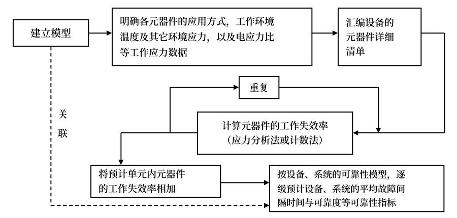

<strong>图 1 电子设备可靠性预计的一般程序</strong>

### 4.4 环境分类

电子设备应用环境分类及其说明见表 1。某些设备在全寿命过程中可能遇到多种环境，此时可靠性预计应按各个环境类别分别进行。如航天设备的应用环境，包括射入、轨道飞行、再入和返回的环境。

<strong>表 1 环境分类</strong>

<table>
  <thead>
    <tr>
      <th>环境类别</th>
      <th>符号</th>
      <th>说明</th>
    </tr>
  </thead>
  <tbody>
    <tr>
      <td>地面良好</td>
      <td>GB</td>
      <td>能保持正常气候条件，机械应力接近于零的地面良好环境，其维护条件良好，如有温湿度控制的实验室或大型地面站等</td>
    </tr>
    <tr>
      <td>导弹发射井</td>
      <td>GMS</td>
      <td>发射井中的导弹及其辅助设备所处的环境</td>
    </tr>
    <tr>
      <td>一般地面固定</td>
      <td>GF1</td>
      <td>在普通的建筑物内或通风较好的固定机架上，受振动、冲击影响很小的环境条件，如固定雷达、通信设备和电视机、收录机等家用电器所处的环境</td>
    </tr>
    <tr>
      <td>恶劣地面固定</td>
      <td>GF2</td>
      <td>只有简陋气候防护设施的地面环境或地下坑道，其环境条件较恶劣，如高温、低温、温差变化大、高湿、霉菌、盐雾和化学气体等</td>
    </tr>
    <tr>
      <td>平稳地面移动</td>
      <td>GM1</td>
      <td>在比较平稳的移动状态下，有所振动与冲击，如在公路上行驶的专用车辆及火车车厢环境</td>
    </tr>
    <tr>
      <td>剧烈地面移动</td>
      <td>GM2</td>
      <td>安装在履带车辆等恶劣地面行驶的专用车辆上，在较剧烈的移动状态下工作，受振动、冲击影响较大，通风及温湿度控制条件受限制，使用中维修条件差，如装甲车内的环境条件</td>
    </tr>
  </tbody>
</table>

16

---

<strong>GJB/Z 299D—2024</strong>

<strong>表 1(续)</strong>

<table>
  <thead>
    <tr>
      <th>环境类别</th>
      <th>符号</th>
      <th>说明</th>
    </tr>
  </thead>
  <tbody>
    <tr>
      <td>背负</td>
      <td>MP</td>
      <td>由人携带的越野环境，维护条件差</td>
    </tr>
    <tr>
      <td>潜艇</td>
      <td>NSB</td>
      <td>潜艇内的环境条件</td>
    </tr>
    <tr>
      <td>舰船良好舱内</td>
      <td>NS1</td>
      <td>行驶时较为平稳，且受盐雾、水汽影响较小的舰船舱内，如近海大型运输船和内河船只的空调舱</td>
    </tr>
    <tr>
      <td>舰船普通舱内</td>
      <td>NS2</td>
      <td>能防风雨的普通舰船舱内，常有较强烈的振动和冲击，如水面战船舱内或甲板以下的环境</td>
    </tr>
    <tr>
      <td>舰船舱外</td>
      <td>NU</td>
      <td>舰船甲板上的典型环境，经常有强烈的冲击和振动，包括无防护、暴露于风雨下的环境</td>
    </tr>
    <tr>
      <td>战斗机座舱</td>
      <td>AIF</td>
      <td>战斗机飞行员座舱环境，无太高的温度、压力和过于强烈的冲击振动</td>
    </tr>
    <tr>
      <td>战斗机无人舱</td>
      <td>AUF</td>
      <td>有高温、高压、强烈的冲击与振动等恶劣环境条件，如战斗机机身、机尾、机翼等部位的设备舱、炸弹舱</td>
    </tr>
    <tr>
      <td>运输机座舱</td>
      <td>AIC</td>
      <td>运输机人员的座舱环境</td>
    </tr>
    <tr>
      <td>运输机无人舱</td>
      <td>AUC</td>
      <td>运输机上无环境条件控制的非载人区域环境</td>
    </tr>
    <tr>
      <td>直升机</td>
      <td>ARW</td>
      <td>在带旋转翼直升机机内或机外安装的环境</td>
    </tr>
    <tr>
      <td>宇宙飞行</td>
      <td>SF</td>
      <td>在地球轨道上飞行，不包括动力飞行和重返大气层，如卫星中电子设备的安装环境</td>
    </tr>
    <tr>
      <td>导弹发射</td>
      <td>ML</td>
      <td>由于导弹发射，火箭飞行、射入轨道及重返大气层或降落伞着陆等引起的噪声、振动、冲击及其他恶劣的环境条件</td>
    </tr>
    <tr>
      <td>导弹飞行</td>
      <td>MF</td>
      <td>与吸气助燃推进导弹、巡航导弹的动力飞行和处于无动力自由飞行导弹相关的环境条件</td>
    </tr>
  </tbody>
</table>

### 4.5 元器件质量等级与质量系数

元器件质量直接影响其失效率，不同质量等级对元器件失效率的影响程度以质量系数 $\pi_{\text{Q}}$ 来表示。从而，元器件工作失效率模型中的 $\pi_{\text{Q}}$ 值取决于元器件的质量等级。

在元器件的标准中一般都规定了元器件在制造、检验及筛选过程中的质量控制水准，按此不同控制水准组织生产和管理的产品，具有不同的质量档次。于是，产品标准是划分其质量等级的主要依据。此外，由于一些设备仍需按已宣布作废或被替代的标准采购，因而在质量等级及系数表的“质量要求补充说明”栏目中给出相关标准。

据此，在第 5 章中对各大类元器件，分别列出其质量等级与质量系数表，规定了不同质量等级产品所遵循的产品标准或其他质量要求。但由于一些高质量等级的标准尚无相应的产品，故其质量系数值暂时空缺。

在使用质量等级表时应注意如下几点：

对已列入军用电子元器件质量认证合格产品目录的产品，若累积维持试验结果表明其可靠性水平比鉴定试验时提高了一个数量级，则其质量系数值可在原来的质量等级中适当减小质量系数值；

按型号工程附加技术条件或附加质量要求，对产品进行更为严格考核试验，其质量系数可在原来的质量等级中适当减小质量系数值，一般可降至原质量系数值的 $3/4 \sim 1/2$；

低档产品指没有完全执行一定的生产标准或无明确的质量控制要求的产品。

## 5 工作状态的元器件应力分析可靠性预计法

### 5.1 微电路

#### 5.1.1 概述

##### 5.1.1.1 微电路分类

本条对半导体集成电路、微波单片集成电路和混合集成电路提供可靠性预计：

17

---

<strong>GJB/Z 299D—2024</strong>

a) 半导体集成电路，包括：
   1) 半导体数字集成电路，可分为：
      ① 通用数字集成电路，包括：
         - TTL、ASTTL、ALSTTL、LSTTL、HTTL、FTTL、ECL、IIL 等双极工艺制作的数字电路；
         - MOS 数字集成电路，包括在蓝宝石、多晶硅、单晶硅等各种衬底上采用 NMOS、PMOS、MNOS、CMOS、HCMOS、HCTMOS、FCTMOS、ACTMOS 等 MOS 工艺制作的数字电路。
      ② 微处理器，包括 CPU、数字信号处理器(DSP)、微控制器。
      ③ 存储器，包括双极、MOS 工艺制作的 SRAM、DRAM、ROM、PROM、EPROM、EEPROM、FLASH、FIFO 存储器和电荷耦合(CCD)等器件。
      ④ 可编程逻辑器件，包括 PLA、PAL、PLD、CPLD、FPGA 等。
   2) 半导体模拟集成电路，包括双极、MOS、BiCMOS 工艺的模拟电路。
b) 微波单片集成电路，包括砷化镓、氮化镓微波单片集成电路。
c) 混合集成电路。

##### 5.1.1.2 微电路复杂程度的表征

通用数字集成电路和可编程逻辑器件以门数表示它们的复杂程度；微处理器以晶体管数表示它们的复杂程度；模拟集成电路以晶体管数表示它们的复杂程度；存储器以位数表示它们的复杂程度，微波单片集成电路以晶体管数表示它们的复杂程度。

##### 5.1.1.3 门数确定

在本条中，门是指：与、或、与非、与或、或非、异或和反相等逻辑功能中的任何一种。如果没有逻辑图，则采用下式通过电路的晶体管数来确定其门数：

a) 双极型电路：门数＝晶体管数/3；
b) CMOS 电路：门数＝晶体管数/3.75；
c) 其他 MOS 电路：门数＝晶体管数/3；
d) J-K 或 R-S 触发器等效于 8 个门，T 或 D 型触发器等效于 6 个门。

#### 5.1.2 半导体集成电路和微波单片集成电路

各类电路工作失效率预计模型见表 2。

特别地，对于 A/D 转换器、D/A 转换器、F/V 转换器、S-D 转换器、R-D 转换器、采样/保持电路等由模拟集成电路和数字集成电路构成的半导体混合信号集成电路，则可由组成电路的模拟集成电路与数字集成电路的工作失效率求和获得。

<strong>表 2 半导体集成电路与微波单片集成电路的工作失效率模型</strong>

<table>
  <thead>
    <tr>
      <th colspan="2">类别</th>
      <th>工作失效率预计模型</th>
    </tr>
  </thead>
  <tbody>
    <tr>
      <td rowspan="3">半导体数字集成电路</td>
      <td>通用数字集成电路、微处理器、SRAM、DRAM、ROM、FIFO、CCD 器件及可编程逻辑器件</td>
      <td><i>λ</i>p = <i>π</i>Q [ <i>C</i>1 <i>π</i>T <i>π</i>V + (<i>C</i>2 + <i>C</i>3) <i>π</i>E ] <i>π</i>L</td>
    </tr>
    <tr>
      <td>PROM</td>
      <td><i>λ</i>p = <i>π</i>Q [ <i>C</i>1 <i>π</i>T <i>π</i>V <i>π</i>PT + (<i>C</i>2 + <i>C</i>3) <i>π</i>E ] <i>π</i>L</td>
    </tr>
    <tr>
      <td>UVEPROM、EEPROM、FLASH</td>
      <td><i>λ</i>p = <i>π</i>Q [ <i>C</i>1 <i>π</i>T <i>π</i>V <i>π</i>CYC + (<i>C</i>2 + <i>C</i>3) <i>π</i>E ] <i>π</i>L</td>
    </tr>
    <tr>
      <td colspan="2">半导体模拟集成电路</td>
      <td><i>λ</i>p = <i>π</i>Q [ <i>C</i>1 <i>π</i>T <i>π</i>V + (<i>C</i>2 + <i>C</i>3) <i>π</i>E ] <i>π</i>L</td>
    </tr>
    <tr>
      <td colspan="2">微波单片集成电路</td>
      <td><i>λ</i>p = <i>π</i>Q [ <i>C</i>1 <i>π</i>T <i>π</i>A <i>π</i>P + <i>C</i>3 <i>π</i>E ] <i>π</i>L</td>
    </tr>
  </tbody>
</table>

18

---

<strong>GJB/Z 299D—2024</strong>

<strong>表 2(续)</strong>

<table>
  <thead>
    <tr>
      <th>类别</th>
      <th>工作失效率预计模型</th>
    </tr>
  </thead>
  <tbody>
    <tr>
      <td colspan="2">
        注：<i>λ</i>p ——工作失效率，10−6/h； 
        <i>π</i>Q ——质量系数，见表 3； 
        <i>C</i>1 及 <i>C</i>2 ——电路复杂度失效率，见表 4～表 15；对微波单片集成电路 <i>C</i>1 取 0.084 4 × 10−6/h； 
        <i>π</i>T ——温度应力系数，见表 16～表 23，其值取决于电路的工艺和电路的结温 <i>T</i>j。 
        <i>T</i>j 为电路在所处任务剖面下最恶劣状态时的结温，℃，可用式(2)计算。
        
<i>T</i>j = <i>T</i>C + <i>R</i>th(j-c) <i>P</i>(2)

        式中： 
        <i>T</i>C ——管壳温度，℃，若不能确定，可参考表 24 所给出的值； 
        <i>R</i>th(j-c) ——结到管壳的热阻，℃/W，若不能确定，可参考表 25 所列的值； 
        <i>P</i> ——电路所承受的实际功率，W； 
        <i>π</i>V ——电压应力系数，见表 26； 
        <i>C</i>3 ——封装复杂度失效率，见表 27； 
        <i>π</i>E ——环境系数，见表 28； 
        <i>π</i>L ——成熟系数，见表 29； 
        <i>π</i>PT ——PROM 电路的可编程工艺系数，见表 30； 
        <i>π</i>CYC ——UVEPROM、EEPROM、FLASH 电路的读\写循环率系数，见表 31； 
        <i>π</i>A ——微波单片集成电路应用系数，见表 32； 
        <i>π</i>P ——微波单片集成电路工艺系数，见表 33。
      </td>
    </tr>
  </tbody>
</table>

<strong>表 3 半导体集成电路与微波单片集成电路质量等级与质量系数 <i>π</i>Q</strong>

<table>
  <thead>
    <tr>
      <th colspan="2">质量等级</th>
      <th>质量要求说明</th>
      <th>质量要求补充说明</th>
      <th><i>π</i>Q</th>
    </tr>
  </thead>
  <tbody>
    <tr>
      <td rowspan="6">A</td>
      <td>A1</td>
      <td>符合 GJB 597B-2012，且列入军用电子元器件合格产品目录(QPL)的 S 级产品</td>
      <td>符合 GJB 597-1988、GJB 597A-1996，且列入军用电子元器件合格产品目录(QPL)的 S 级产品</td>
      <td>—</td>
    </tr>
    <tr>
      <td>A2</td>
      <td>符合 GJB 597B-2012，且列入军用电子元器件合格产品目录(QPL)的 BG 级产品</td>
      <td>—</td>
      <td>—</td>
    </tr>
    <tr>
      <td>A3</td>
      <td>符合 GJB 597B-2012，且列入军用电子元器件合格产品目录(QPL)的 B 级产品 符合企业军用标准，且列入军用电子元器件合格产品目录(QPL)的产品</td>
      <td>符合 GJB 597-1988、GJB 597A-1996，且列入军用电子元器件合格产品目录(QPL)的 B 级产品</td>
      <td>0.08</td>
    </tr>
    <tr>
      <td>A4</td>
      <td>—</td>
      <td>符合 GJB 597-1988、GJB 597A-1996，且列入军用电子元器件合格产品目录(QPL)的 B1 级产品</td>
      <td>0.13</td>
    </tr>
    <tr>
      <td>A5</td>
      <td>符合 GJB 597B-2012、GJB 7400-2011，但未列入军用电子元器件合格产品目录(QPL)的产品</td>
      <td>符合 GJB 597-1988、GJB 597A-1996，但未列入军用电子元器件合格产品目录(QPL)的产品</td>
      <td>0.2</td>
    </tr>
    <tr>
      <td>A6</td>
      <td>符合 GB/T 4589.1 的 III 类产品</td>
      <td>—</td>
      <td>0.25</td>
    </tr>
    <tr>
      <td rowspan="2">B</td>
      <td>B1</td>
      <td colspan="2">按军用标准的筛选要求进行筛选的 B2 质量等级产品 符合 GB/T 4589.1 的 I 类产品</td>
      <td>0.50</td>
    </tr>
    <tr>
      <td>B2</td>
      <td colspan="2">符合 GB/T 4589.1 的 I 类产品</td>
      <td>1.0</td>
    </tr>
    <tr>
      <td colspan="2">C</td>
      <td colspan="2">低档产品</td>
      <td>5.0</td>
    </tr>
  </tbody>
</table>

19

---

<strong>GJB/Z 299D—2024</strong>

<strong>表 4 通用双极数字电路的复杂度失效率 <i>C</i>1 及 <i>C</i>2</strong>

单位为 10−6/h

<table>
  <thead>
    <tr>
      <th>门数 <i>N</i>G</th>
      <th><i>C</i>1</th>
      <th><i>C</i>2</th>
    </tr>
  </thead>
  <tbody>
    <tr><td>50</td><td>0.030 7</td><td>0.008 5</td></tr>
    <tr><td>100</td><td>0.039 4</td><td>0.010 3</td></tr>
    <tr><td>200</td><td>0.050 5</td><td>0.012 4</td></tr>
    <tr><td>300</td><td>0.058 5</td><td>0.013 9</td></tr>
    <tr><td>400</td><td>0.064 8</td><td>0.015 0</td></tr>
    <tr><td>500</td><td>0.070 3</td><td>0.016 0</td></tr>
    <tr><td>600</td><td>0.075 0</td><td>0.016 8</td></tr>
    <tr><td>700</td><td>0.079 3</td><td>0.017 5</td></tr>
    <tr><td>800</td><td>0.083 2</td><td>0.018 2</td></tr>
    <tr><td>900</td><td>0.086 8</td><td>0.018 8</td></tr>
    <tr><td>1 000</td><td>0.090 2</td><td>0.019 3</td></tr>
    <tr><td>3 000</td><td>0.133 9</td><td>0.026 1</td></tr>
    <tr><td>5 000</td><td>0.160 9</td><td>0.030 1</td></tr>
    <tr><td>7 000</td><td>0.181 7</td><td>0.033 0</td></tr>
    <tr><td>9 000</td><td>0.198 9</td><td>0.035 3</td></tr>
    <tr><td>10 000</td><td>0.206 6</td><td>0.036 4</td></tr>
    <tr><td>20 000</td><td>0.265 1</td><td>0.044 0</td></tr>
    <tr><td>30 000</td><td>0.306 8</td><td>0.049 2</td></tr>
    <tr><td>40 000</td><td>0.340 3</td><td>0.053 3</td></tr>
    <tr><td>50 000</td><td>0.368 7</td><td>0.056 6</td></tr>
    <tr><td>60 000</td><td>0.393 7</td><td>0.059 6</td></tr>
  </tbody>
</table>

<strong>表 5 通用 MOS 数字电路的复杂度失效率 <i>C</i>1 及 <i>C</i>2</strong>

单位为 10−6/h

<table>
  <thead>
    <tr>
      <th>门数 <i>N</i>G</th>
      <th><i>C</i>1</th>
      <th><i>C</i>2</th>
    </tr>
  </thead>
  <tbody>
    <tr><td>50</td><td>0.026 6</td><td>0.003 3</td></tr>
    <tr><td>100</td><td>0.031 6</td><td>0.003 9</td></tr>
    <tr><td>200</td><td>0.037 6</td><td>0.004 5</td></tr>
    <tr><td>300</td><td>0.041 6</td><td>0.005 0</td></tr>
    <tr><td>400</td><td>0.044 7</td><td>0.005 3</td></tr>
    <tr><td>500</td><td>0.047 3</td><td>0.005 6</td></tr>
    <tr><td>600</td><td>0.049 5</td><td>0.005 8</td></tr>
    <tr><td>700</td><td>0.051 4</td><td>0.006 0</td></tr>
    <tr><td>800</td><td>0.053 2</td><td>0.006 2</td></tr>
    <tr><td>900</td><td>0.054 8</td><td>0.006 4</td></tr>
    <tr><td>1 000</td><td>0.056 2</td><td>0.006 5</td></tr>
    <tr><td>3 000</td><td>0.074 0</td><td>0.008 4</td></tr>
    <tr><td>5 000</td><td>0.084 1</td><td>0.009 4</td></tr>
    <tr><td>7 000</td><td>0.091 5</td><td>0.010 1</td></tr>
  </tbody>
</table>

20

---

<strong>GJB/Z 299D—2024</strong>

<strong>表 5(续)</strong>

单位为 10−6/h

<table>
  <thead>
    <tr>
      <th>门数 <i>N</i>G</th>
      <th><i>C</i>1</th>
      <th><i>C</i>2</th>
    </tr>
  </thead>
  <tbody>
    <tr><td>9 000</td><td>0.097 4</td><td>0.010 7</td></tr>
    <tr><td>10 000</td><td>0.100 0</td><td>0.011 0</td></tr>
    <tr><td>20 000</td><td>0.118 9</td><td>0.012 9</td></tr>
    <tr><td>30 000</td><td>0.131 6</td><td>0.014 1</td></tr>
    <tr><td>40 000</td><td>0.141 4</td><td>0.015 1</td></tr>
    <tr><td>50 000</td><td>0.149 5</td><td>0.015 9</td></tr>
    <tr><td>60 000</td><td>0.156 5</td><td>0.016 5</td></tr>
    <tr><td>80 000</td><td>0.168 2</td><td>0.017 6</td></tr>
    <tr><td>100 000</td><td>0.177 8</td><td>0.018 6</td></tr>
    <tr><td>300 000</td><td>0.234 0</td><td>0.023 8</td></tr>
    <tr><td>500 000</td><td>0.265 9</td><td>0.026 7</td></tr>
    <tr><td>700 000</td><td>0.289 3</td><td>0.028 9</td></tr>
    <tr><td>900 000</td><td>0.308 0</td><td>0.030 6</td></tr>
    <tr><td>1 000 000</td><td>0.316 2</td><td>0.031 3</td></tr>
    <tr><td>2 000 000</td><td>0.376 1</td><td>0.036 6</td></tr>
    <tr><td>3 000 000</td><td>0.416 2</td><td>0.040 2</td></tr>
    <tr><td>4 000 000</td><td>0.447 2</td><td>0.042 9</td></tr>
    <tr><td>5 000 000</td><td>0.472 9</td><td>0.045 1</td></tr>
    <tr><td>6 000 000</td><td>0.494 9</td><td>0.047 0</td></tr>
    <tr><td>7 000 000</td><td>0.514 4</td><td>0.048 7</td></tr>
    <tr><td>8 000 000</td><td>0.531 8</td><td>0.050 2</td></tr>
    <tr><td>9 000 000</td><td>0.547 7</td><td>0.051 5</td></tr>
    <tr><td>10 000 000</td><td>0.562 3</td><td>0.052 8</td></tr>
  </tbody>
</table>

<strong>表 6 模拟集成电路的复杂度失效率 <i>C</i>1 及 <i>C</i>2</strong>

单位为 10−6/h

<table>
  <thead>
    <tr>
      <th>晶体管数 <i>N</i>T</th>
      <th><i>C</i>1</th>
      <th><i>C</i>2</th>
    </tr>
  </thead>
  <tbody>
    <tr><td>50</td><td>0.115 4</td><td>0.036 6</td></tr>
    <tr><td>100</td><td>0.164 3</td><td>0.049 0</td></tr>
    <tr><td>200</td><td>0.234 0</td><td>0.065 8</td></tr>
    <tr><td>300</td><td>0.287 7</td><td>0.078 1</td></tr>
    <tr><td>400</td><td>0.333 2</td><td>0.088 2</td></tr>
    <tr><td>500</td><td>0.373 3</td><td>0.096 9</td></tr>
    <tr><td>600</td><td>0.409 7</td><td>0.104 7</td></tr>
    <tr><td>700</td><td>0.443 2</td><td>0.111 7</td></tr>
    <tr><td>800</td><td>0.474 4</td><td>0.118 2</td></tr>
    <tr><td>900</td><td>0.503 8</td><td>0.124 3</td></tr>
    <tr><td>1 000</td><td>0.531 6</td><td>0.129 9</td></tr>
    <tr><td>1 200</td><td>0.583 4</td><td>0.140 4</td></tr>
  </tbody>
</table>

21

---

<strong>GJB/Z 299D—2024</strong>

<strong>表 6(续)</strong>

单位为 10−6/h

<table>
  <thead>
    <tr>
      <th>晶体管数 <i>N</i>T</th>
      <th><i>C</i>1</th>
      <th><i>C</i>2</th>
    </tr>
  </thead>
  <tbody>
    <tr><td>1 400</td><td>0.631 1</td><td>0.149 8</td></tr>
    <tr><td>1 600</td><td>0.675 6</td><td>0.158 5</td></tr>
    <tr><td>1 800</td><td>0.717 4</td><td>0.166 6</td></tr>
    <tr><td>2 000</td><td>0.757 0</td><td>0.174 2</td></tr>
    <tr><td>2 500</td><td>0.848 3</td><td>0.191 5</td></tr>
    <tr><td>3 000</td><td>0.930 9</td><td>0.206 8</td></tr>
    <tr><td>3 500</td><td>1.007 1</td><td>0.220 8</td></tr>
    <tr><td>4 000</td><td>1.078 0</td><td>0.233 6</td></tr>
    <tr><td>4 500</td><td>1.144 8</td><td>0.245 6</td></tr>
    <tr><td>5 000</td><td>1.208 0</td><td>0.256 7</td></tr>
  </tbody>
</table>

<strong>表 7 双极微处理器的复杂度失效率 <i>C</i>1 及 <i>C</i>2</strong>

单位为 10−6/h

<table>
  <thead>
    <tr>
      <th>晶体管数 <i>N</i>T</th>
      <th><i>C</i>1</th>
      <th><i>C</i>2</th>
    </tr>
  </thead>
  <tbody>
    <tr><td>100</td><td>0.079 3</td><td>0.030 8</td></tr>
    <tr><td>500</td><td>0.153 4</td><td>0.049 1</td></tr>
    <tr><td>1 000</td><td>0.203 8</td><td>0.060 0</td></tr>
    <tr><td>5 000</td><td>0.394 2</td><td>0.095 8</td></tr>
    <tr><td>10 000</td><td>0.523 8</td><td>0.117 1</td></tr>
    <tr><td>30 000</td><td>0.821 9</td><td>0.161 0</td></tr>
    <tr><td>50 000</td><td>1.013 3</td><td>0.186 7</td></tr>
    <tr><td>70 000</td><td>1.163 2</td><td>0.205 9</td></tr>
    <tr><td>90 000</td><td>1.289 5</td><td>0.221 4</td></tr>
  </tbody>
</table>

<strong>表 8 MOS 微处理器的复杂度失效率 <i>C</i>1 及 <i>C</i>2</strong>

单位为 10−6/h

<table>
  <thead>
    <tr>
      <th>晶体管数 <i>N</i>T</th>
      <th><i>C</i>1</th>
      <th><i>C</i>2</th>
    </tr>
  </thead>
  <tbody>
    <tr><td>100</td><td>0.132 8</td><td>0.023 4</td></tr>
    <tr><td>500</td><td>0.198 6</td><td>0.033 8</td></tr>
    <tr><td>1 000</td><td>0.236 2</td><td>0.039 7</td></tr>
    <tr><td>5 000</td><td>0.353 2</td><td>0.057 4</td></tr>
    <tr><td>10 000</td><td>0.420 0</td><td>0.067 4</td></tr>
    <tr><td>30 000</td><td>0.552 8</td><td>0.086 7</td></tr>
    <tr><td>50 000</td><td>0.628 0</td><td>0.097 6</td></tr>
    <tr><td>70 000</td><td>0.683 2</td><td>0.105 4</td></tr>
    <tr><td>90 000</td><td>0.727 5</td><td>0.111 7</td></tr>
    <tr><td>100 000</td><td>0.746 9</td><td>0.114 4</td></tr>
    <tr><td>500 000</td><td>1.116 8</td><td>0.165 7</td></tr>
    <tr><td>900 000</td><td>1.214 9</td><td>0.179 0</td></tr>
    <tr><td>1 000 000</td><td>1.293 6</td><td>0.189 7</td></tr>
  </tbody>
</table>

22

---

<strong>GJB/Z 299D—2024</strong>

<strong>表 8(续)</strong>

单位为 10−6/h

<table>
  <thead>
    <tr>
      <th>晶体管数 <i>N</i>T</th>
      <th><i>C</i>1</th>
      <th><i>C</i>2</th>
    </tr>
  </thead>
  <tbody>
    <tr><td>3 000 000</td><td>1.328 2</td><td>0.194 3</td></tr>
    <tr><td>4 000 000</td><td>1.748 0</td><td>0.250 2</td></tr>
    <tr><td>5 000 000</td><td>1.878 3</td><td>0.267 3</td></tr>
    <tr><td>6 000 000</td><td>1.986 1</td><td>0.281 4</td></tr>
    <tr><td>7 000 000</td><td>2.078 7</td><td>0.293 4</td></tr>
    <tr><td>8 000 000</td><td>2.160 3</td><td>0.304 0</td></tr>
    <tr><td>9 000 000</td><td>2.233 7</td><td>0.313 5</td></tr>
    <tr><td>10 000 000</td><td>2.300 4</td><td>0.322 1</td></tr>
    <tr><td>20 000 000</td><td>2.361 8</td><td>0.330 0</td></tr>
    <tr><td>40 000 000</td><td>2.808 7</td><td>0.387 0</td></tr>
    <tr><td>60 000 000</td><td>3.340 1</td><td>0.453 9</td></tr>
    <tr><td>80 000 000</td><td>3.696 5</td><td>0.498 3</td></tr>
    <tr><td>100 000 000</td><td>3.972 1</td><td>0.532 3</td></tr>
    <tr><td>120 000 000</td><td>4.200 0</td><td>0.560 4</td></tr>
    <tr><td>140 000 000</td><td>4.395 9</td><td>0.584 4</td></tr>
    <tr><td>160 000 000</td><td>4.568 6</td><td>0.605 5</td></tr>
    <tr><td>180 000 000</td><td>4.723 7</td><td>0.624 4</td></tr>
    <tr><td>200 000 000</td><td>4.864 8</td><td>0.641 5</td></tr>
    <tr><td>220 000 000</td><td>4.994 7</td><td>0.657 2</td></tr>
    <tr><td>250 000 000</td><td>5.281 2</td><td>0.691 8</td></tr>
    <tr><td>280 000 000</td><td>5.433 0</td><td>0.710 1</td></tr>
    <tr><td>320 000 000</td><td>5.617 4</td><td>0.732 3</td></tr>
    <tr><td>360 000 000</td><td>5.785 3</td><td>0.752 4</td></tr>
    <tr><td>400 000 000</td><td>5.939 7</td><td>0.770 8</td></tr>
    <tr><td>500 000 000</td><td>6.280 5</td><td>0.811 4</td></tr>
    <tr><td>600 000 000</td><td>6.573 4</td><td>0.846 2</td></tr>
    <tr><td>700 000 000</td><td>6.831 6</td><td>0.876 7</td></tr>
    <tr><td>800 000 000</td><td>7.063 5</td><td>0.904 1</td></tr>
    <tr><td>900 000 000</td><td>7.274 6</td><td>0.928 9</td></tr>
    <tr><td>1 000 000 000</td><td>7.468 8</td><td>0.951 7</td></tr>
    <tr><td>1 200 000 000</td><td>7.817 1</td><td>0.992 4</td></tr>
  </tbody>
</table>

<strong>表 9 双极 SRAM 的复杂度失效率 <i>C</i>1 及 <i>C</i>2</strong>

单位为 10−6/h

<table>
  <thead>
    <tr>
      <th>位数 <i>N</i>B</th>
      <th><i>C</i>1</th>
      <th><i>C</i>2</th>
    </tr>
  </thead>
  <tbody>
    <tr><td>16</td><td>0.078 6</td><td>0.009 1</td></tr>
    <tr><td>32</td><td>0.098 9</td><td>0.012 2</td></tr>
    <tr><td>64</td><td>0.124 3</td><td>0.016 2</td></tr>
    <tr><td>128</td><td>0.156 2</td><td>0.021 6</td></tr>
  </tbody>
</table>

23

---

<strong>GJB/Z 299D—2024</strong>

<strong>表 9(续)</strong>

单位为 10−6/h

<table>
  <thead>
    <tr>
      <th>位数 <i>N</i>B</th>
      <th><i>C</i>1</th>
      <th><i>C</i>2</th>
    </tr>
  </thead>
  <tbody>
    <tr><td>256</td><td>0.196 3</td><td>0.028 9</td></tr>
    <tr><td>512</td><td>0.246 8</td><td>0.038 5</td></tr>
    <tr><td>1 024</td><td>0.310 2</td><td>0.051 3</td></tr>
    <tr><td>2 048</td><td>0.390 0</td><td>0.068 4</td></tr>
    <tr><td>4 096</td><td>0.490 2</td><td>0.091 2</td></tr>
    <tr><td>8 192</td><td>0.616 2</td><td>0.121 6</td></tr>
    <tr><td>16 384</td><td>0.774 6</td><td>0.162 1</td></tr>
    <tr><td>32 768</td><td>0.973 7</td><td>0.216 2</td></tr>
    <tr><td>65 536</td><td>1.223 9</td><td>0.288 2</td></tr>
    <tr><td>131 072</td><td>2.419 9</td><td>0.323 4</td></tr>
    <tr><td>262 144</td><td>2.958 6</td><td>0.390 0</td></tr>
    <tr><td>524 288</td><td>3.617 3</td><td>0.470 3</td></tr>
    <tr><td>1 048 576</td><td>4.422 7</td><td>0.567 1</td></tr>
  </tbody>
</table>

<strong>表 10 MOS 的 SRAM 和 CCD 器件的复杂度失效率 <i>C</i>1 及 <i>C</i>2</strong>

单位为 10−6/h

<table>
  <thead>
    <tr>
      <th>位数 <i>N</i>B</th>
      <th><i>C</i>1</th>
      <th><i>C</i>2</th>
    </tr>
  </thead>
  <tbody>
    <tr><td>16</td><td>0.039 9</td><td>0.004 7</td></tr>
    <tr><td>32</td><td>0.051 2</td><td>0.006 0</td></tr>
    <tr><td>64</td><td>0.065 7</td><td>0.007 7</td></tr>
    <tr><td>128</td><td>0.084 3</td><td>0.009 8</td></tr>
    <tr><td>256</td><td>0.108 2</td><td>0.012 4</td></tr>
    <tr><td>512</td><td>0.138 9</td><td>0.015 8</td></tr>
    <tr><td>1 024</td><td>0.178 2</td><td>0.020 2</td></tr>
    <tr><td>2 048</td><td>0.228 8</td><td>0.025 7</td></tr>
    <tr><td>4 096</td><td>0.293 6</td><td>0.032 8</td></tr>
    <tr><td>8 192</td><td>0.376 8</td><td>0.041 8</td></tr>
    <tr><td>16 384</td><td>0.483 6</td><td>0.053 3</td></tr>
    <tr><td>32 768</td><td>0.620 7</td><td>0.067 9</td></tr>
    <tr><td>65 536</td><td>0.796 6</td><td>0.086 6</td></tr>
    <tr><td>131 072</td><td>0.864 3</td><td>0.102 0</td></tr>
    <tr><td>262 144</td><td>1.064 1</td><td>0.125 6</td></tr>
    <tr><td>524 288</td><td>1.310 0</td><td>0.154 7</td></tr>
    <tr><td>1 048 576</td><td>1.612 8</td><td>0.190 4</td></tr>
    <tr><td>2 097 152</td><td>1.985 6</td><td>0.234 4</td></tr>
    <tr><td>4 194 304</td><td>2.444 5</td><td>0.288 6</td></tr>
    <tr><td>8 388 608</td><td>3.009 6</td><td>0.355 3</td></tr>
    <tr><td>16 777 216</td><td>3.705 2</td><td>0.437 4</td></tr>
    <tr><td>33 554 432</td><td>4.561 7</td><td>0.538 5</td></tr>
  </tbody>
</table>

24

---

<strong>GJB/Z 299D—2024</strong>

<strong>表 10(续)</strong>

单位为 10−6/h

<table>
  <thead>
    <tr>
      <th>位数 <i>N</i>B</th>
      <th><i>C</i>1</th>
      <th><i>C</i>2</th>
    </tr>
  </thead>
  <tbody>
    <tr><td>67 108 864</td><td>5.616 1</td><td>0.663 0</td></tr>
    <tr><td>134 217 728</td><td>6.914 2</td><td>0.816 3</td></tr>
    <tr><td>268 435 456</td><td>8.512 4</td><td>1.004 9</td></tr>
    <tr><td>536 870 912</td><td>10.480 0</td><td>1.237 2</td></tr>
  </tbody>
</table>

<strong>表 11 双极 ROM 及 PROM 的复杂度失效率 <i>C</i>1 及 <i>C</i>2</strong>

单位为 10−6/h

<table>
  <thead>
    <tr>
      <th>位数 <i>N</i>B</th>
      <th><i>C</i>1</th>
      <th><i>C</i>2</th>
    </tr>
  </thead>
  <tbody>
    <tr><td>16</td><td>0.086 1</td><td>0.003 2</td></tr>
    <tr><td>32</td><td>0.111 3</td><td>0.004 1</td></tr>
    <tr><td>64</td><td>0.143 8</td><td>0.005 3</td></tr>
    <tr><td>128</td><td>0.185 9</td><td>0.006 9</td></tr>
    <tr><td>256</td><td>0.240 2</td><td>0.008 9</td></tr>
    <tr><td>512</td><td>0.310 5</td><td>0.011 5</td></tr>
    <tr><td>1 024</td><td>0.401 3</td><td>0.014 8</td></tr>
    <tr><td>2 048</td><td>0.518 6</td><td>0.019 1</td></tr>
    <tr><td>4 096</td><td>0.670 2</td><td>0.024 7</td></tr>
    <tr><td>8 192</td><td>0.802 2</td><td>0.032 0</td></tr>
    <tr><td>16 384</td><td>0.974 1</td><td>0.041 3</td></tr>
    <tr><td>32 768</td><td>1.182 7</td><td>0.053 4</td></tr>
    <tr><td>65 536</td><td>1.436 0</td><td>0.069 0</td></tr>
    <tr><td>131 072</td><td>1.743 6</td><td>0.089 2</td></tr>
    <tr><td>262 144</td><td>2.117 1</td><td>0.115 3</td></tr>
    <tr><td>524 288</td><td>2.570 6</td><td>0.149 0</td></tr>
    <tr><td>1 048 576</td><td>3.121 2</td><td>0.192 5</td></tr>
  </tbody>
</table>

<strong>表 12 MOS 的 ROM 及 PROM 电路的复杂度失效率 <i>C</i>1 及 <i>C</i>2</strong>

单位为 10−6/h

<table>
  <thead>
    <tr>
      <th>位数 <i>N</i>B</th>
      <th><i>C</i>1</th>
      <th><i>C</i>2</th>
    </tr>
  </thead>
  <tbody>
    <tr><td>16</td><td>0.026 5</td><td>0.002 3</td></tr>
    <tr><td>32</td><td>0.032 8</td><td>0.002 9</td></tr>
    <tr><td>64</td><td>0.040 7</td><td>0.003 6</td></tr>
    <tr><td>128</td><td>0.050 4</td><td>0.004 5</td></tr>
    <tr><td>256</td><td>0.062 5</td><td>0.005 7</td></tr>
    <tr><td>512</td><td>0.077 5</td><td>0.007 1</td></tr>
    <tr><td>1 024</td><td>0.096 0</td><td>0.008 8</td></tr>
    <tr><td>2 048</td><td>0.119 1</td><td>0.011 0</td></tr>
    <tr><td>4 096</td><td>0.147 6</td><td>0.013 7</td></tr>
    <tr><td>8 192</td><td>0.183 0</td><td>0.017 2</td></tr>
    <tr><td>16 384</td><td>0.226 8</td><td>0.021 4</td></tr>
    <tr><td>32 768</td><td>0.281 2</td><td>0.026 7</td></tr>
    <tr><td>65 536</td><td>0.348 6</td><td>0.033 4</td></tr>
  </tbody>
</table>

25

---

<strong>GJB/Z 299D—2024</strong>

<strong>表 12(续)</strong>

单位为 10−6/h

<table>
  <thead>
    <tr>
      <th>位数 <i>N</i>B</th>
      <th><i>C</i>1</th>
      <th><i>C</i>2</th>
    </tr>
  </thead>
  <tbody>
    <tr><td>131 072</td><td>0.432 2</td><td>0.041 7</td></tr>
    <tr><td>262 144</td><td>0.535 8</td><td>0.052 0</td></tr>
    <tr><td>524 288</td><td>0.664 2</td><td>0.064 9</td></tr>
    <tr><td>1 048 576</td><td>0.823 4</td><td>0.081 1</td></tr>
    <tr><td>2 097 152</td><td>1.020 8</td><td>0.101 2</td></tr>
    <tr><td>4 194 304</td><td>1.265 4</td><td>0.126 3</td></tr>
    <tr><td>8 388 608</td><td>1.568 8</td><td>0.157 7</td></tr>
    <tr><td>16 777 216</td><td>1.944 8</td><td>0.196 9</td></tr>
    <tr><td>33 554 432</td><td>2.411 0</td><td>0.245 8</td></tr>
    <tr><td>67 108 864</td><td>2.989 0</td><td>0.306 8</td></tr>
  </tbody>
</table>

<strong>表 13 MOS 的 DRAM 电路的复杂度失效率 <i>C</i>1 及 <i>C</i>2</strong>

单位为 10−6/h

<table>
  <thead>
    <tr>
      <th>位数 <i>N</i>B</th>
      <th><i>C</i>1</th>
      <th><i>C</i>2</th>
    </tr>
  </thead>
  <tbody>
    <tr><td>16</td><td>0.020 4</td><td>0.001 4</td></tr>
    <tr><td>32</td><td>0.026 6</td><td>0.001 8</td></tr>
    <tr><td>64</td><td>0.034 6</td><td>0.002 4</td></tr>
    <tr><td>128</td><td>0.045 0</td><td>0.003 1</td></tr>
    <tr><td>256</td><td>0.058 6</td><td>0.004 0</td></tr>
    <tr><td>512</td><td>0.076 3</td><td>0.005 1</td></tr>
    <tr><td>1 024</td><td>0.099 2</td><td>0.006 6</td></tr>
    <tr><td>2 048</td><td>0.129 1</td><td>0.008 6</td></tr>
    <tr><td>4 096</td><td>0.168 1</td><td>0.011 1</td></tr>
    <tr><td>8 192</td><td>0.218 7</td><td>0.014 3</td></tr>
    <tr><td>16 384</td><td>0.284 6</td><td>0.018 5</td></tr>
    <tr><td>32 768</td><td>0.370 4</td><td>0.023 9</td></tr>
    <tr><td>65 536</td><td>0.482 0</td><td>0.030 9</td></tr>
    <tr><td>131 072</td><td>0.499 5</td><td>0.032 8</td></tr>
    <tr><td>262 144</td><td>0.594 0</td><td>0.039 5</td></tr>
    <tr><td>524 288</td><td>0.706 4</td><td>0.047 6</td></tr>
    <tr><td>1 048 576</td><td>0.840 0</td><td>0.057 4</td></tr>
    <tr><td>2 097 152</td><td>0.998 9</td><td>0.069 2</td></tr>
    <tr><td>4 194 304</td><td>1.187 9</td><td>0.083 5</td></tr>
    <tr><td>8 388 608</td><td>1.412 7</td><td>0.100 7</td></tr>
    <tr><td>16 777 216</td><td>1.680 0</td><td>0.121 4</td></tr>
    <tr><td>33 554 432</td><td>1.997 9</td><td>0.146 4</td></tr>
    <tr><td>67 108 864</td><td>2.375 9</td><td>0.176 5</td></tr>
    <tr><td>134 217 728</td><td>2.825 4</td><td>0.212 8</td></tr>
    <tr><td>268 435 456</td><td>3.360 0</td><td>0.256 6</td></tr>
    <tr><td>536 870 912</td><td>3.995 7</td><td>0.309 5</td></tr>
    <tr><td>1073 741 824</td><td>4.751 8</td><td>0.373 1</td></tr>
  </tbody>
</table>

26

---

<strong>GJB/Z 299D—2024</strong>

<strong>表 14 MOS 的 FIFO 电路的复杂度失效率 <i>C</i>1 及 <i>C</i>2</strong>

单位为 10−6/h

<table>
  <thead>
    <tr>
      <th>位数 <i>N</i>B</th>
      <th><i>C</i>1</th>
      <th><i>C</i>2</th>
    </tr>
  </thead>
  <tbody>
    <tr><td>16</td><td>0.034 8</td><td>0.004 2</td></tr>
    <tr><td>32</td><td>0.044 4</td><td>0.005 3</td></tr>
    <tr><td>64</td><td>0.056 6</td><td>0.006 8</td></tr>
    <tr><td>128</td><td>0.072 1</td><td>0.008 6</td></tr>
    <tr><td>256</td><td>0.091 9</td><td>0.011 0</td></tr>
    <tr><td>512</td><td>0.117 2</td><td>0.014 0</td></tr>
    <tr><td>1 024</td><td>0.149 3</td><td>0.017 8</td></tr>
    <tr><td>2 048</td><td>0.190 3</td><td>0.022 7</td></tr>
    <tr><td>4 096</td><td>0.242 6</td><td>0.028 9</td></tr>
    <tr><td>8 192</td><td>0.309 2</td><td>0.036 9</td></tr>
    <tr><td>16 384</td><td>0.394 1</td><td>0.047 0</td></tr>
    <tr><td>32 768</td><td>0.502 3</td><td>0.059 9</td></tr>
    <tr><td>65 536</td><td>0.640 2</td><td>0.076 4</td></tr>
    <tr><td>131 072</td><td>0.816 0</td><td>0.097 4</td></tr>
    <tr><td>262 144</td><td>1.040 1</td><td>0.124 1</td></tr>
    <tr><td>524 288</td><td>1.325 6</td><td>0.158 2</td></tr>
    <tr><td>1 048 576</td><td>1.689 6</td><td>0.201 6</td></tr>
    <tr><td>2 097 152</td><td>2.153 5</td><td>0.257 0</td></tr>
    <tr><td>4 194 304</td><td>2.744 8</td><td>0.327 5</td></tr>
    <tr><td>8 388 608</td><td>3.498 4</td><td>0.417 4</td></tr>
    <tr><td>16 777 216</td><td>4.458 9</td><td>0.532 0</td></tr>
  </tbody>
</table>

<strong>表 15 MOS 的 UVEPROM、EEPROM、FLASH 电路的复杂度失效率 <i>C</i>1 及 <i>C</i>2</strong>

单位为 10−6/h

<table>
  <thead>
    <tr>
      <th>位数 <i>N</i>B</th>
      <th><i>C</i>1</th>
      <th><i>C</i>2</th>
    </tr>
  </thead>
  <tbody>
    <tr><td>16</td><td>0.014 6</td><td>0.005 0</td></tr>
    <tr><td>32</td><td>0.018 9</td><td>0.006 6</td></tr>
    <tr><td>64</td><td>0.024 6</td><td>0.008 5</td></tr>
    <tr><td>128</td><td>0.032 1</td><td>0.011 1</td></tr>
    <tr><td>256</td><td>0.041 7</td><td>0.014 5</td></tr>
    <tr><td>512</td><td>0.054 3</td><td>0.018 8</td></tr>
    <tr><td>1 024</td><td>0.070 7</td><td>0.024 5</td></tr>
    <tr><td>2 048</td><td>0.092 0</td><td>0.031 9</td></tr>
    <tr><td>4 096</td><td>0.119 7</td><td>0.041 5</td></tr>
    <tr><td>8 192</td><td>0.155 8</td><td>0.054 0</td></tr>
    <tr><td>16 384</td><td>0.202 7</td><td>0.070 3</td></tr>
    <tr><td>32 768</td><td>0.263 8</td><td>0.091 5</td></tr>
    <tr><td>65 536</td><td>0.343 3</td><td>0.119 1</td></tr>
    <tr><td>131 072</td><td>0.425 4</td><td>0.138 9</td></tr>
  </tbody>
</table>

27

---

<strong>GJB/Z 299D—2024</strong>

<strong>表 15(续)</strong>

单位为 10−6/h

<table>
  <thead>
    <tr>
      <th>位数 <i>N</i>B</th>
      <th><i>C</i>1</th>
      <th><i>C</i>2</th>
    </tr>
  </thead>
  <tbody>
    <tr><td>262 144</td><td>0.531 1</td><td>0.173 4</td></tr>
    <tr><td>524 288</td><td>0.663 0</td><td>0.216 5</td></tr>
    <tr><td>1 048 576</td><td>0.827 6</td><td>0.270 2</td></tr>
    <tr><td>2 097 152</td><td>1.033 1</td><td>0.337 3</td></tr>
    <tr><td>4 194 304</td><td>1.289 7</td><td>0.421 1</td></tr>
    <tr><td>8 388 608</td><td>1.609 9</td><td>0.525 7</td></tr>
    <tr><td>16 777 216</td><td>2.009 7</td><td>0.656 2</td></tr>
    <tr><td>33 554 432</td><td>2.508 8</td><td>0.819 2</td></tr>
    <tr><td>67 108 864</td><td>3.131 8</td><td>1.022 6</td></tr>
    <tr><td>134 217 728</td><td>3.909 5</td><td>1.276 6</td></tr>
    <tr><td>268 435 456</td><td>4.880 4</td><td>1.593 6</td></tr>
    <tr><td>536 870 912</td><td>6.092 3</td><td>1.989 3</td></tr>
    <tr><td>1 073 741 824</td><td>7.605 3</td><td>2.483 4</td></tr>
  </tbody>
</table>

<strong>表 16 通用双极数字集成电路的 <i>π</i>T</strong>

<table>
  <thead>
    <tr>
      <th><i>T</i>j ℃</th>
      <th><i>π</i>T</th>
      <th><i>T</i>j ℃</th>
      <th><i>π</i>T</th>
      <th><i>T</i>j ℃</th>
      <th><i>π</i>T</th>
      <th><i>T</i>j ℃</th>
      <th><i>π</i>T</th>
    </tr>
  </thead>
  <tbody>
    <tr><td>25</td><td>0.10</td><td>53</td><td>0.40</td><td>81</td><td>1.30</td><td>115</td><td>4.28</td></tr>
    <tr><td>27</td><td>0.11</td><td>55</td><td>0.44</td><td>83</td><td>1.40</td><td>120</td><td>5.01</td></tr>
    <tr><td>29</td><td>0.12</td><td>57</td><td>0.48</td><td>85</td><td>1.51</td><td>125</td><td>5.85</td></tr>
    <tr><td>31</td><td>0.14</td><td>59</td><td>0.52</td><td>87</td><td>1.63</td><td>130</td><td>6.79</td></tr>
    <tr><td>33</td><td>0.15</td><td>61</td><td>0.57</td><td>89</td><td>1.75</td><td>135</td><td>7.87</td></tr>
    <tr><td>35</td><td>0.17</td><td>63</td><td>0.62</td><td>91</td><td>1.88</td><td>140</td><td>9.08</td></tr>
    <tr><td>37</td><td>0.19</td><td>65</td><td>0.68</td><td>93</td><td>2.03</td><td>145</td><td>10.44</td></tr>
    <tr><td>39</td><td>0.21</td><td>67</td><td>0.74</td><td>95</td><td>2.18</td><td>150</td><td>11.97</td></tr>
    <tr><td>41</td><td>0.23</td><td>69</td><td>0.80</td><td>97</td><td>2.34</td><td>155</td><td>13.67</td></tr>
    <tr><td>43</td><td>0.25</td><td>71</td><td>0.87</td><td>99</td><td>2.51</td><td>160</td><td>15.57</td></tr>
    <tr><td>45</td><td>0.28</td><td>73</td><td>0.95</td><td>101</td><td>2.69</td><td>165</td><td>17.69</td></tr>
    <tr><td>47</td><td>0.30</td><td>75</td><td>1.02</td><td>103</td><td>2.88</td><td>170</td><td>20.03</td></tr>
    <tr><td>49</td><td>0.33</td><td>77</td><td>1.11</td><td>105</td><td>3.08</td><td>175</td><td>22.62</td></tr>
    <tr><td>51</td><td>0.37</td><td>79</td><td>1.20</td><td>110</td><td>3.64</td><td>—</td><td>—</td></tr>
  </tbody>
</table>

<strong>表 17 通用 MOS 数字集成电路的 <i>π</i>T</strong>

<table>
  <thead>
    <tr>
      <th><i>T</i>j ℃</th>
      <th><i>π</i>T</th>
      <th><i>T</i>j ℃</th>
      <th><i>π</i>T</th>
      <th><i>T</i>j ℃</th>
      <th><i>π</i>T</th>
      <th><i>T</i>j ℃</th>
      <th><i>π</i>T</th>
    </tr>
  </thead>
  <tbody>
    <tr><td>25</td><td>0.10</td><td>35</td><td>0.19</td><td>45</td><td>0.34</td><td>55</td><td>0.59</td></tr>
    <tr><td>27</td><td>0.11</td><td>37</td><td>0.21</td><td>47</td><td>0.38</td><td>57</td><td>0.66</td></tr>
    <tr><td>29</td><td>0.13</td><td>39</td><td>0.24</td><td>49</td><td>0.43</td><td>59</td><td>0.73</td></tr>
    <tr><td>31</td><td>0.15</td><td>41</td><td>0.27</td><td>51</td><td>0.48</td><td>61</td><td>0.81</td></tr>
    <tr><td>33</td><td>0.17</td><td>43</td><td>0.30</td><td>53</td><td>0.53</td><td>63</td><td>0.90</td></tr>
  </tbody>
</table>

28

---

<strong>GJB/Z 299D—2024</strong>

<strong>表 17(续)</strong>

<table>
  <thead>
    <tr>
      <th><i>T</i>j ℃</th>
      <th><i>π</i>T</th>
      <th><i>T</i>j ℃</th>
      <th><i>π</i>T</th>
      <th><i>T</i>j ℃</th>
      <th><i>π</i>T</th>
      <th><i>T</i>j ℃</th>
      <th><i>π</i>T</th>
    </tr>
  </thead>
  <tbody>
    <tr><td>65</td><td>1.00</td><td>83</td><td>2.38</td><td>101</td><td>5.20</td><td>140</td><td>22.45</td></tr>
    <tr><td>67</td><td>1.10</td><td>85</td><td>2.60</td><td>103</td><td>5.65</td><td>145</td><td>26.55</td></tr>
    <tr><td>69</td><td>1.22</td><td>87</td><td>2.85</td><td>105</td><td>6.12</td><td>150</td><td>31.28</td></tr>
    <tr><td>71</td><td>1.35</td><td>89</td><td>3.11</td><td>110</td><td>7.48</td><td>155</td><td>36.71</td></tr>
    <tr><td>73</td><td>1.48</td><td>91</td><td>3.40</td><td>115</td><td>9.09</td><td>160</td><td>42.92</td></tr>
    <tr><td>75</td><td>1.63</td><td>93</td><td>3.71</td><td>120</td><td>10.99</td><td>165</td><td>50.00</td></tr>
    <tr><td>77</td><td>1.80</td><td>95</td><td>4.04</td><td>125</td><td>13.23</td><td>170</td><td>58.05</td></tr>
    <tr><td>79</td><td>1.97</td><td>97</td><td>4.40</td><td>130</td><td>15.85</td><td>175</td><td>67.18</td></tr>
    <tr><td>81</td><td>2.17</td><td>99</td><td>4.78</td><td>135</td><td>18.90</td><td>—</td><td>—</td></tr>
  </tbody>
</table>

<strong>表 18 模拟集成电路的 <i>π</i>T</strong>

<table>
  <thead>
    <tr>
      <th><i>T</i>j ℃</th>
      <th><i>π</i>T</th>
      <th><i>T</i>j ℃</th>
      <th><i>π</i>T</th>
      <th><i>T</i>j ℃</th>
      <th><i>π</i>T</th>
      <th><i>T</i>j ℃</th>
      <th><i>π</i>T</th>
    </tr>
  </thead>
  <tbody>
    <tr><td>25</td><td>0.10</td><td>53</td><td>0.88</td><td>81</td><td>5.45</td><td>115</td><td>35.17</td></tr>
    <tr><td>27</td><td>0.12</td><td>55</td><td>1.01</td><td>83</td><td>6.14</td><td>120</td><td>45.02</td></tr>
    <tr><td>29</td><td>0.14</td><td>57</td><td>1.16</td><td>85</td><td>6.91</td><td>125</td><td>57.28</td></tr>
    <tr><td>31</td><td>0.16</td><td>59</td><td>1.33</td><td>87</td><td>7.77</td><td>130</td><td>72.44</td></tr>
    <tr><td>33</td><td>0.19</td><td>61</td><td>1.52</td><td>89</td><td>8.72</td><td>135</td><td>91.08</td></tr>
    <tr><td>35</td><td>0.23</td><td>63</td><td>1.74</td><td>91</td><td>9.78</td><td>140</td><td>113.89</td></tr>
    <tr><td>37</td><td>0.27</td><td>65</td><td>1.99</td><td>93</td><td>10.95</td><td>145</td><td>141.66</td></tr>
    <tr><td>39</td><td>0.31</td><td>67</td><td>2.27</td><td>95</td><td>12.25</td><td>150</td><td>175.28</td></tr>
    <tr><td>41</td><td>0.36</td><td>69</td><td>2.58</td><td>97</td><td>13.68</td><td>155</td><td>215.82</td></tr>
    <tr><td>43</td><td>0.42</td><td>71</td><td>2.94</td><td>99</td><td>15.26</td><td>160</td><td>264.45</td></tr>
    <tr><td>45</td><td>0.49</td><td>73</td><td>3.33</td><td>101</td><td>17.01</td><td>165</td><td>322.53</td></tr>
    <tr><td>47</td><td>0.57</td><td>75</td><td>3.78</td><td>103</td><td>18.93</td><td>170</td><td>391.62</td></tr>
    <tr><td>49</td><td>0.66</td><td>77</td><td>4.27</td><td>105</td><td>21.04</td><td>175</td><td>473.45</td></tr>
    <tr><td>51</td><td>0.76</td><td>79</td><td>4.83</td><td>110</td><td>27.30</td><td>—</td><td>—</td></tr>
  </tbody>
</table>

<strong>表 19 双极微处理器的 <i>π</i>T</strong>

<table>
  <thead>
    <tr>
      <th><i>T</i>j ℃</th>
      <th><i>π</i>T</th>
      <th><i>T</i>j ℃</th>
      <th><i>π</i>T</th>
      <th><i>T</i>j ℃</th>
      <th><i>π</i>T</th>
      <th><i>T</i>j ℃</th>
      <th><i>π</i>T</th>
    </tr>
  </thead>
  <tbody>
    <tr><td>25</td><td>0.10</td><td>43</td><td>0.27</td><td>61</td><td>0.66</td><td>79</td><td>1.46</td></tr>
    <tr><td>27</td><td>0.11</td><td>45</td><td>0.30</td><td>63</td><td>0.72</td><td>81</td><td>1.59</td></tr>
    <tr><td>29</td><td>0.13</td><td>47</td><td>0.33</td><td>65</td><td>0.79</td><td>83</td><td>1.73</td></tr>
    <tr><td>31</td><td>0.14</td><td>49</td><td>0.37</td><td>67</td><td>0.87</td><td>85</td><td>1.88</td></tr>
    <tr><td>33</td><td>0.16</td><td>51</td><td>0.41</td><td>69</td><td>0.95</td><td>87</td><td>2.04</td></tr>
    <tr><td>35</td><td>0.18</td><td>53</td><td>0.45</td><td>71</td><td>1.04</td><td>89</td><td>2.20</td></tr>
    <tr><td>37</td><td>0.20</td><td>55</td><td>0.50</td><td>73</td><td>1.13</td><td>91</td><td>2.39</td></tr>
    <tr><td>39</td><td>0.22</td><td>57</td><td>0.55</td><td>75</td><td>1.24</td><td>93</td><td>2.58</td></tr>
    <tr><td>41</td><td>0.24</td><td>59</td><td>0.60</td><td>77</td><td>1.35</td><td>95</td><td>2.79</td></tr>
  </tbody>
</table>

29

---

<strong>GJB/Z 299D—2024</strong>

<strong>表 19(续)</strong>

<table>
  <thead>
    <tr>
      <th><i>T</i>j ℃</th>
      <th><i>π</i>T</th>
      <th><i>T</i>j ℃</th>
      <th><i>π</i>T</th>
      <th><i>T</i>j ℃</th>
      <th><i>π</i>T</th>
      <th><i>T</i>j ℃</th>
      <th><i>π</i>T</th>
    </tr>
  </thead>
  <tbody>
    <tr><td>97</td><td>3.01</td><td>110</td><td>4.86</td><td>135</td><td>11.19</td><td>160</td><td>23.39</td></tr>
    <tr><td>99</td><td>3.25</td><td>115</td><td>5.79</td><td>140</td><td>13.06</td><td>165</td><td>26.84</td></tr>
    <tr><td>101</td><td>3.50</td><td>120</td><td>6.87</td><td>145</td><td>15.19</td><td>170</td><td>30.70</td></tr>
    <tr><td>103</td><td>3.77</td><td>125</td><td>8.11</td><td>150</td><td>17.60</td><td>175</td><td>35.01</td></tr>
    <tr><td>105</td><td>4.06</td><td>130</td><td>9.55</td><td>155</td><td>20.32</td><td>—</td><td>—</td></tr>
  </tbody>
</table>

<strong>表 20 MOS 微处理器的 <i>π</i>T</strong>

<table>
  <thead>
    <tr>
      <th><i>T</i>j ℃</th>
      <th><i>π</i>T</th>
      <th><i>T</i>j ℃</th>
      <th><i>π</i>T</th>
      <th><i>T</i>j ℃</th>
      <th><i>π</i>T</th>
      <th><i>T</i>j ℃</th>
      <th><i>π</i>T</th>
    </tr>
  </thead>
  <tbody>
    <tr><td>25</td><td>0.10</td><td>53</td><td>0.63</td><td>81</td><td>2.95</td><td>115</td><td>14.27</td></tr>
    <tr><td>27</td><td>0.12</td><td>55</td><td>0.71</td><td>83</td><td>3.26</td><td>120</td><td>17.58</td></tr>
    <tr><td>29</td><td>0.13</td><td>57</td><td>0.80</td><td>85</td><td>3.60</td><td>125</td><td>21.56</td></tr>
    <tr><td>31</td><td>0.15</td><td>59</td><td>0.89</td><td>87</td><td>3.98</td><td>130</td><td>26.30</td></tr>
    <tr><td>33</td><td>0.17</td><td>61</td><td>1.00</td><td>89</td><td>4.39</td><td>135</td><td>31.92</td></tr>
    <tr><td>35</td><td>0.20</td><td>63</td><td>1.12</td><td>91</td><td>4.83</td><td>140</td><td>38.56</td></tr>
    <tr><td>37</td><td>0.23</td><td>65</td><td>1.26</td><td>93</td><td>5.32</td><td>145</td><td>46.38</td></tr>
    <tr><td>39</td><td>0.26</td><td>67</td><td>1.40</td><td>95</td><td>5.84</td><td>150</td><td>55.54</td></tr>
    <tr><td>41</td><td>0.30</td><td>69</td><td>1.57</td><td>97</td><td>6.42</td><td>155</td><td>66.23</td></tr>
    <tr><td>43</td><td>0.34</td><td>71</td><td>1.75</td><td>99</td><td>7.04</td><td>160</td><td>78.66</td></tr>
    <tr><td>45</td><td>0.38</td><td>73</td><td>1.94</td><td>101</td><td>7.72</td><td>165</td><td>93.05</td></tr>
    <tr><td>47</td><td>0.44</td><td>75</td><td>2.16</td><td>103</td><td>8.45</td><td>170</td><td>109.65</td></tr>
    <tr><td>49</td><td>0.49</td><td>77</td><td>2.40</td><td>105</td><td>9.24</td><td>175</td><td>128.75</td></tr>
    <tr><td>51</td><td>0.56</td><td>79</td><td>2.66</td><td>110</td><td>11.51</td><td>—</td><td>—</td></tr>
  </tbody>
</table>

<strong>表 21 双极存储器的 <i>π</i>T</strong>

<table>
  <thead>
    <tr>
      <th><i>T</i>j ℃</th>
      <th><i>π</i>T</th>
      <th><i>T</i>j ℃</th>
      <th><i>π</i>T</th>
      <th><i>T</i>j ℃</th>
      <th><i>π</i>T</th>
      <th><i>T</i>j ℃</th>
      <th><i>π</i>T</th>
    </tr>
  </thead>
  <tbody>
    <tr><td>25</td><td>0.10</td><td>53</td><td>0.45</td><td>81</td><td>1.59</td><td>115</td><td>5.79</td></tr>
    <tr><td>27</td><td>0.11</td><td>55</td><td>0.50</td><td>83</td><td>1.73</td><td>120</td><td>6.87</td></tr>
    <tr><td>29</td><td>0.13</td><td>57</td><td>0.55</td><td>85</td><td>1.88</td><td>125</td><td>8.11</td></tr>
    <tr><td>31</td><td>0.14</td><td>59</td><td>0.60</td><td>87</td><td>2.04</td><td>130</td><td>9.55</td></tr>
    <tr><td>33</td><td>0.16</td><td>61</td><td>0.66</td><td>89</td><td>2.20</td><td>135</td><td>11.19</td></tr>
    <tr><td>35</td><td>0.18</td><td>63</td><td>0.72</td><td>91</td><td>2.39</td><td>140</td><td>13.06</td></tr>
    <tr><td>37</td><td>0.20</td><td>65</td><td>0.79</td><td>93</td><td>2.58</td><td>145</td><td>15.19</td></tr>
    <tr><td>39</td><td>0.22</td><td>67</td><td>0.87</td><td>95</td><td>2.79</td><td>150</td><td>17.60</td></tr>
    <tr><td>41</td><td>0.24</td><td>69</td><td>0.95</td><td>97</td><td>3.01</td><td>155</td><td>20.32</td></tr>
    <tr><td>43</td><td>0.27</td><td>71</td><td>1.04</td><td>99</td><td>3.25</td><td>160</td><td>23.39</td></tr>
    <tr><td>45</td><td>0.30</td><td>73</td><td>1.13</td><td>101</td><td>3.50</td><td>165</td><td>26.84</td></tr>
    <tr><td>47</td><td>0.33</td><td>75</td><td>1.24</td><td>103</td><td>3.77</td><td>170</td><td>30.70</td></tr>
    <tr><td>49</td><td>0.37</td><td>77</td><td>1.35</td><td>105</td><td>4.06</td><td>175</td><td>35.01</td></tr>
    <tr><td>51</td><td>0.41</td><td>79</td><td>1.46</td><td>110</td><td>4.86</td><td>—</td><td>—</td></tr>
  </tbody>
</table>

30

---

<strong>GJB/Z 299D—2024</strong>

<strong>表 22 MOS 存储器的 <i>π</i>T</strong>

<table>
  <thead>
    <tr>
      <th><i>T</i>j ℃</th>
      <th><i>π</i>T</th>
      <th><i>T</i>j ℃</th>
      <th><i>π</i>T</th>
      <th><i>T</i>j ℃</th>
      <th><i>π</i>T</th>
      <th><i>T</i>j ℃</th>
      <th><i>π</i>T</th>
    </tr>
  </thead>
  <tbody>
    <tr><td>25</td><td>0.10</td><td>53</td><td>0.63</td><td>81</td><td>2.95</td><td>115</td><td>14.27</td></tr>
    <tr><td>27</td><td>0.12</td><td>55</td><td>0.71</td><td>83</td><td>3.26</td><td>120</td><td>17.58</td></tr>
    <tr><td>29</td><td>0.13</td><td>57</td><td>0.80</td><td>85</td><td>3.60</td><td>125</td><td>21.56</td></tr>
    <tr><td>31</td><td>0.15</td><td>59</td><td>0.89</td><td>87</td><td>3.98</td><td>130</td><td>26.30</td></tr>
    <tr><td>33</td><td>0.17</td><td>61</td><td>1.00</td><td>89</td><td>4.39</td><td>135</td><td>31.92</td></tr>
    <tr><td>35</td><td>0.20</td><td>63</td><td>1.12</td><td>91</td><td>4.83</td><td>140</td><td>38.56</td></tr>
    <tr><td>37</td><td>0.23</td><td>65</td><td>1.26</td><td>93</td><td>5.32</td><td>145</td><td>46.38</td></tr>
    <tr><td>39</td><td>0.26</td><td>67</td><td>1.40</td><td>95</td><td>5.84</td><td>150</td><td>55.54</td></tr>
    <tr><td>41</td><td>0.30</td><td>69</td><td>1.57</td><td>97</td><td>6.42</td><td>155</td><td>66.23</td></tr>
    <tr><td>43</td><td>0.34</td><td>71</td><td>1.75</td><td>99</td><td>7.04</td><td>160</td><td>78.66</td></tr>
    <tr><td>45</td><td>0.38</td><td>73</td><td>1.94</td><td>101</td><td>7.72</td><td>165</td><td>93.05</td></tr>
    <tr><td>47</td><td>0.44</td><td>75</td><td>2.16</td><td>103</td><td>8.45</td><td>170</td><td>109.65</td></tr>
    <tr><td>49</td><td>0.49</td><td>77</td><td>2.40</td><td>105</td><td>9.24</td><td>175</td><td>128.75</td></tr>
    <tr><td>51</td><td>0.56</td><td>79</td><td>2.66</td><td>110</td><td>11.51</td><td>—</td><td>—</td></tr>
  </tbody>
</table>

<strong>表 23 微波单片集成电路的 <i>π</i>T</strong>

<table>
  <thead>
    <tr>
      <th><i>T</i>ch ℃</th>
      <th><i>π</i>T</th>
      <th><i>T</i>ch ℃</th>
      <th><i>π</i>T</th>
      <th><i>T</i>ch ℃</th>
      <th><i>π</i>T</th>
      <th><i>T</i>ch ℃</th>
      <th><i>π</i>T</th>
    </tr>
  </thead>
  <tbody>
    <tr><td>25</td><td>0.100</td><td>53</td><td>1.452</td><td>81</td><td>13.177</td><td>115</td><td>93.234</td></tr>
    <tr><td>27</td><td>0.123</td><td>55</td><td>1.728</td><td>83</td><td>15.153</td><td>120</td><td>107.219</td></tr>
    <tr><td>29</td><td>0.151</td><td>57</td><td>2.051</td><td>85</td><td>17.426</td><td>125</td><td>128.663</td></tr>
    <tr><td>31</td><td>0.185</td><td>59</td><td>2.430</td><td>87</td><td>20.040</td><td>130</td><td>154.395</td></tr>
    <tr><td>33</td><td>0.226</td><td>61</td><td>2.873</td><td>89</td><td>23.046</td><td>135</td><td>185.274</td></tr>
    <tr><td>35</td><td>0.275</td><td>63</td><td>3.390</td><td>91</td><td>26.503</td><td>140</td><td>222.329</td></tr>
    <tr><td>37</td><td>0.334</td><td>65</td><td>3.992</td><td>93</td><td>30.478</td><td>145</td><td>266.795</td></tr>
    <tr><td>39</td><td>0.405</td><td>67</td><td>4.692</td><td>95</td><td>35.050</td><td>150</td><td>320.154</td></tr>
    <tr><td>41</td><td>0.489</td><td>69</td><td>5.505</td><td>97</td><td>40.308</td><td>155</td><td>384.184</td></tr>
    <tr><td>43</td><td>0.590</td><td>71</td><td>6.446</td><td>99</td><td>46.354</td><td>160</td><td>461.021</td></tr>
    <tr><td>45</td><td>0.709</td><td>73</td><td>7.534</td><td>101</td><td>53.307</td><td>165</td><td>553.226</td></tr>
    <tr><td>47</td><td>0.852</td><td>75</td><td>8.664</td><td>103</td><td>61.303</td><td>170</td><td>663.871</td></tr>
    <tr><td>49</td><td>1.020</td><td>77</td><td>9.963</td><td>105</td><td>70.498</td><td>175</td><td>796.645</td></tr>
    <tr><td>51</td><td>1.218</td><td>79</td><td>11.458</td><td>110</td><td>81.073</td><td>—</td><td>—</td></tr>
    <tr>
      <td colspan="8">注：<i>T</i>ch 为沟道温度，℃。</td>
    </tr>
  </tbody>
</table>

<strong>表 24 半导体集成电路与微波单片集成电路管壳温度的参考值</strong>

单位为摄氏度

<table>
  <tbody>
    <tr>
      <td>环境</td>
      <td>GB</td>
      <td>GMS</td>
      <td>GF1</td>
      <td>GF2</td>
      <td>GM1</td>
      <td>GM2</td>
      <td>MP</td>
      <td>NSB</td>
      <td>NS1</td>
      <td>NS2</td>
    </tr>
    <tr>
      <td><i>T</i>C</td>
      <td>35</td>
      <td>35</td>
      <td>45</td>
      <td>45</td>
      <td>60</td>
      <td>65</td>
      <td>45</td>
      <td>50</td>
      <td>45</td>
      <td>50</td>
    </tr>
    <tr>
      <td>环境</td>
      <td>NU</td>
      <td>AIF</td>
      <td>AUF</td>
      <td>AIC</td>
      <td>AUC</td>
      <td>ARW</td>
      <td>SF</td>
      <td>ML</td>
      <td>MF</td>
      <td>—</td>
    </tr>
    <tr>
      <td><i>T</i>C</td>
      <td>75</td>
      <td>60</td>
      <td>80</td>
      <td>60</td>
      <td>80</td>
      <td>60</td>
      <td>35</td>
      <td>60</td>
      <td>60</td>
      <td>—</td>
    </tr>
  </tbody>
</table>

31

---

<strong>GJB/Z 299D—2024</strong>

<strong>表 25 结到管壳的热阻的参考值</strong>

单位为摄氏度每瓦

<table>
  <thead>
    <tr>
      <th colspan="2">封装形式</th>
      <th><i>R</i>th(j-c)</th>
    </tr>
  </thead>
  <tbody>
    <tr>
      <td rowspan="8">密封器件</td>
      <td>双列直插(DIP)封装</td>
      <td>28</td>
    </tr>
    <tr>
      <td>扁平封装(FP)</td>
      <td>22</td>
    </tr>
    <tr>
      <td>针栅阵列(PGA)封装</td>
      <td>20</td>
    </tr>
    <tr>
      <td>球栅阵列(BGA)封装</td>
      <td>15</td>
    </tr>
    <tr>
      <td>小外形(SO)封装</td>
      <td>20</td>
    </tr>
    <tr>
      <td>芯片载体(LCC)封装</td>
      <td>16</td>
    </tr>
    <tr>
      <td>金属圆形封装</td>
      <td>70</td>
    </tr>
    <tr>
      <td>金属菱形封装</td>
      <td>6</td>
    </tr>
    <tr>
      <td rowspan="6">非密封器件</td>
      <td>双列直插(DIP)封装</td>
      <td>63</td>
    </tr>
    <tr>
      <td>扁平封装(FP)</td>
      <td>45</td>
    </tr>
    <tr>
      <td>针栅阵列(PGA)封装</td>
      <td>38</td>
    </tr>
    <tr>
      <td>球栅阵列(BGA)封装</td>
      <td>35</td>
    </tr>
    <tr>
      <td>小外形(SO)封装</td>
      <td>53</td>
    </tr>
    <tr>
      <td>芯片载体(LCC)封装</td>
      <td>30</td>
    </tr>
  </tbody>
</table>

<strong>表 26 电压应力系数 <i>π</i>V</strong>

<table>
  <tbody>
    <tr>
      <td><i>V</i>s</td>
      <td>≤3</td>
      <td>4</td>
      <td>5</td>
      <td>6</td>
      <td>7</td>
      <td>8</td>
      <td>9</td>
      <td>10</td>
      <td>11</td>
      <td>12</td>
      <td>13</td>
      <td>14</td>
      <td>15</td>
    </tr>
    <tr>
      <td><i>π</i>V</td>
      <td>0.62</td>
      <td>0.70</td>
      <td>0.77</td>
      <td>0.85</td>
      <td>0.92</td>
      <td>1.00</td>
      <td>1.11</td>
      <td>1.23</td>
      <td>1.38</td>
      <td>1.54</td>
      <td>1.7</td>
      <td>1.92</td>
      <td>2.08</td>
    </tr>
    <tr>
      <td colspan="14">注：<i>V</i>s 为实际应用的工作电源电压，V。</td>
    </tr>
  </tbody>
</table>

<strong>表 27 封装复杂度失效率 <i>C</i>3</strong>

单位为 10−6/h

<table>
  <thead>
    <tr>
      <th rowspan="2"><i>N</i>P</th>
      <th colspan="5">密封</th>
      <th colspan="4">非密封</th>
    </tr>
    <tr>
      <th>双列直插 (DIP) 封装</th>
      <th>扁平 (FP) 封装</th>
      <th>插接阵列 (含 PGA、 BGA 和 其他)封装</th>
      <th>表面安装 (LCC、SO 和其他) 封装</th>
      <th>金属壳 封装</th>
      <th>双列直插 (DIP) 封装</th>
      <th>扁平(FP) 封装</th>
      <th>插接阵列 (含 PGA、 BGA 和其 他)封装</th>
      <th>表面安装 (LCC、SO 和其他) 封装</th>
    </tr>
  </thead>
  <tbody>
    <tr><td>2</td><td>—</td><td>—</td><td>—</td><td>—</td><td>0.001 5</td><td>—</td><td>—</td><td>—</td><td>—</td></tr>
    <tr><td>3</td><td>—</td><td>0.003 3</td><td>—</td><td>—</td><td>0.002 8</td><td>—</td><td>0.005 0</td><td>—</td><td>—</td></tr>
    <tr><td>4</td><td>0.008 1</td><td>0.005 4</td><td>0.015 2</td><td>0.033 3</td><td>0.004 5</td><td>0.010 6</td><td>0.008 1</td><td>0.020 5</td><td>0.043 8</td></tr>
    <tr><td>6</td><td>0.013 3</td><td>0.010 9</td><td>0.023 7</td><td>0.052 4</td><td>0.008 5</td><td>0.017 4</td><td>0.016 3</td><td>0.032 4</td><td>0.069 3</td></tr>
    <tr><td>8</td><td>0.019 0</td><td>0.017 9</td><td>0.032 5</td><td>0.072 4</td><td>0.013 3</td><td>0.024 6</td><td>0.026 8</td><td>0.044 7</td><td>0.095 9</td></tr>
    <tr><td>10</td><td>0.024 9</td><td>0.026 2</td><td>0.041 5</td><td>0.092 9</td><td>0.018 9</td><td>0.032 4</td><td>0.039 4</td><td>0.057 3</td><td>0.123 4</td></tr>
    <tr><td>12</td><td>0.031 1</td><td>0.035 9</td><td>0.050 8</td><td>0.114 0</td><td>0.025 2</td><td>0.040 4</td><td>0.053 9</td><td>0.070 3</td><td>0.151 7</td></tr>
    <tr><td>14</td><td>0.037 5</td><td>0.046 8</td><td>0.060 2</td><td>0.135 5</td><td>0.032 2</td><td>0.048 8</td><td>0.070 2</td><td>0.083 6</td><td>0.180 5</td></tr>
    <tr><td>16</td><td>0.044 2</td><td>0.058 9</td><td>0.069 7</td><td>0.157 3</td><td>0.039 7</td><td>0.057 4</td><td>0.088 3</td><td>0.097 1</td><td>0.209 9</td></tr>
    <tr><td>18</td><td>0.051 0</td><td>0.072 1</td><td>0.079 3</td><td>0.179 5</td><td>0.047 8</td><td>0.066 3</td><td>0.108 2</td><td>0.110 8</td><td>0.239 8</td></tr>
    <tr><td>20</td><td>0.058 0</td><td>0.086 4</td><td>0.089 1</td><td>0.202 0</td><td>0.056 5</td><td>0.075 4</td><td>0.129 7</td><td>0.124 6</td><td>0.270 1</td></tr>
    <tr><td>22</td><td>0.065 1</td><td>0.101 8</td><td>0.098 9</td><td>0.224 8</td><td>0.065 7</td><td>0.084 7</td><td>0.152 8</td><td>0.138 7</td><td>0.300 9</td></tr>
  </tbody>
</table>

32

---

<strong>GJB/Z 299D—2024</strong>

<strong>表 27(续)</strong>

单位为 10−6/h

<table>
  <thead>
    <tr>
      <th rowspan="2"><i>N</i>p</th>
      <th colspan="5">密封</th>
      <th colspan="4">非密封</th>
    </tr>
    <tr>
      <th>双列直插 (DIP) 封装</th>
      <th>扁平 (FP) 封装</th>
      <th>插接阵列 (含 PGA、 BGA 和 其他)封装</th>
      <th>表面安装 (LCC、SO 和其他) 封装</th>
      <th>金属壳 封装</th>
      <th>双列直插 (DIP) 封装</th>
      <th>扁平(FP) 封装</th>
      <th>插接阵列 (含 PGA、 BGA 和其 他)封装</th>
      <th>表面安装 (LCC、SO 和其他) 封装</th>
    </tr>
  </thead>
  <tbody>
    <tr><td>24</td><td>0.072 4</td><td>0.118 3</td><td>0.108 8</td><td>0.247 8</td><td>0.075 3</td><td>0.094 2</td><td>0.177 4</td><td>0.152 9</td><td>0.331 9</td></tr>
    <tr><td>28</td><td>0.087 4</td><td>0.154 2</td><td>0.128 9</td><td>0.294 4</td><td>—</td><td>0.113 6</td><td>0.231 3</td><td>0.181 7</td><td>0.395 1</td></tr>
    <tr><td>36</td><td>0.118 8</td><td>0.237 6</td><td>0.170 0</td><td>0.390 2</td><td>—</td><td>0.154 4</td><td>0.356 4</td><td>0.240 7</td><td>0.524 9</td></tr>
    <tr><td>40</td><td>0.135 1</td><td>0.284 8</td><td>0.190 9</td><td>0.439 0</td><td>—</td><td>0.175 6</td><td>0.427 2</td><td>0.270 9</td><td>0.591 2</td></tr>
    <tr><td>48</td><td>0.168 7</td><td>0.389 7</td><td>0.233 3</td><td>0.538 5</td><td>—</td><td>0.219 4</td><td>0.584 5</td><td>0.332 3</td><td>0.726 5</td></tr>
    <tr><td>64</td><td>0.239 7</td><td>0.639 1</td><td>0.320 1</td><td>0.743 2</td><td>—</td><td>0.311 6</td><td>0.958 7</td><td>0.458 6</td><td>1.005 6</td></tr>
    <tr><td>80</td><td>0.314 7</td><td>0.938 2</td><td>0.409 2</td><td>0.954 2</td><td>—</td><td>0.409 1</td><td>1.407 3</td><td>0.588 8</td><td>1.293 9</td></tr>
    <tr><td>100</td><td>0.413 1</td><td>1.377 1</td><td>0.523 0</td><td>1.225 1</td><td>—</td><td>0.537 1</td><td>2.065 7</td><td>0.755 9</td><td>1.665 0</td></tr>
    <tr><td>120</td><td>—</td><td>1.884 4</td><td>0.639 2</td><td>1.502 7</td><td>—</td><td>—</td><td>2.826 5</td><td>0.927 2</td><td>2.046 0</td></tr>
    <tr><td>140</td><td>—</td><td>2.456 5</td><td>0.757 3</td><td>1.785 9</td><td>—</td><td>—</td><td>3.684 7</td><td>1.101 9</td><td>2.435 3</td></tr>
    <tr><td>280</td><td>—</td><td>8.092 5</td><td>1.912 8</td><td>3.881 6</td><td>—</td><td>—</td><td>12.138 7</td><td>2.395 0</td><td>5.329 8</td></tr>
    <tr><td>320</td><td>—</td><td>—</td><td>2.184 5</td><td>4.507 7</td><td>—</td><td>—</td><td>—</td><td>2.781 4</td><td>6.197 8</td></tr>
    <tr><td>432</td><td>—</td><td>—</td><td>2.946 3</td><td>—</td><td>—</td><td>—</td><td>—</td><td>3.892 5</td><td>—</td></tr>
    <tr><td>575</td><td>—</td><td>—</td><td>3.917 8</td><td>—</td><td>—</td><td>—</td><td>—</td><td>5.361 9</td><td>—</td></tr>
    <tr><td>675</td><td>—</td><td>—</td><td>4.598 1</td><td>—</td><td>—</td><td>—</td><td>—</td><td>6.333 6</td><td>—</td></tr>
    <tr><td>728</td><td>—</td><td>—</td><td>4.958 0</td><td>—</td><td>—</td><td>—</td><td>—</td><td>6.869 4</td><td>—</td></tr>
    <tr><td>956</td><td>—</td><td>—</td><td>6.508 5</td><td>—</td><td>—</td><td>—</td><td>—</td><td>9.093 3</td><td>—</td></tr>
    <tr><td>1 144</td><td>—</td><td>—</td><td>7.784 9</td><td>—</td><td>—</td><td>—</td><td>—</td><td>10.798 0</td><td>—</td></tr>
    <tr><td>1 572</td><td>—</td><td>—</td><td>10.440 1</td><td>—</td><td>—</td><td>—</td><td>—</td><td>13.912 3</td><td>—</td></tr>
    <tr><td>1 925</td><td>—</td><td>—</td><td>12.169 1</td><td>—</td><td>—</td><td>—</td><td>—</td><td>15.334 7</td><td>—</td></tr>
    <tr><td>2 046</td><td>—</td><td>—</td><td>12.537 1</td><td>—</td><td>—</td><td>—</td><td>—</td><td>15.586 4</td><td>—</td></tr>
    <tr>
      <td colspan="10">注：<i>N</i>p 为引出端数。</td>
    </tr>
  </tbody>
</table>

<strong>表 28 环境系数 <i>π</i>E</strong>

<table>
  <tbody>
    <tr>
      <td>环境</td>
      <td>GB</td>
      <td>GMS</td>
      <td>GF1</td>
      <td>GF2</td>
      <td>GM1</td>
      <td>GM2</td>
      <td>MP</td>
      <td>NSB</td>
      <td>NS1</td>
      <td>NS2</td>
    </tr>
    <tr>
      <td><i>π</i>E</td>
      <td>1.0</td>
      <td>1.5</td>
      <td>2.4</td>
      <td>6.5</td>
      <td>6.3</td>
      <td>11</td>
      <td>6.8</td>
      <td>7.5</td>
      <td>4.5</td>
      <td>10</td>
    </tr>
    <tr>
      <td>环境</td>
      <td>NU</td>
      <td>AIF</td>
      <td>AUF</td>
      <td>AIC</td>
      <td>AUC</td>
      <td>ARW</td>
      <td>SF</td>
      <td>ML</td>
      <td>MF</td>
      <td>—</td>
    </tr>
    <tr>
      <td><i>π</i>E</td>
      <td>14</td>
      <td>15</td>
      <td>20</td>
      <td>10</td>
      <td>13</td>
      <td>19</td>
      <td>1.2</td>
      <td>32</td>
      <td>15</td>
      <td>—</td>
    </tr>
  </tbody>
</table>

<strong>表 29 成熟系数 <i>π</i>L</strong>

<table>
  <thead>
    <tr>
      <th>成熟程度</th>
      <th>符合相应的标准或技术条件，已稳定生产的产品</th>
      <th>质量尚未稳定的产品</th>
      <th>试制品或新投产的初批次产品；设计或工艺上有重大变更；长期中断生产或生产线有重大变化</th>
    </tr>
  </thead>
  <tbody>
    <tr>
      <td><i>π</i>L</td>
      <td>1.0</td>
      <td>3.0</td>
      <td>10</td>
    </tr>
  </tbody>
</table>

33

---

<strong>GJB/Z 299D—2024</strong>

<strong>表 30 PROM 电路的可编程工艺系数 <i>π</i>PT</strong>

<table>
  <thead>
    <tr>
      <th>位数 <i>N</i>B</th>
      <th>双极 <i>π</i>PT</th>
      <th>MOS <i>π</i>PT</th>
      <th>位数 <i>N</i>B</th>
      <th>双极 <i>π</i>PT</th>
      <th>MOS <i>π</i>PT</th>
    </tr>
  </thead>
  <tbody>
    <tr><td>≤ 512</td><td>1.00</td><td>1.00</td><td>262 144</td><td>1.15</td><td>1.13</td></tr>
    <tr><td>1 024</td><td>1.02</td><td>1.01</td><td>524 288</td><td>1.17</td><td>1.15</td></tr>
    <tr><td>2 048</td><td>1.03</td><td>1.02</td><td>1 048 576</td><td>1.19</td><td>1.17</td></tr>
    <tr><td>4 096</td><td>1.05</td><td>1.04</td><td>2 097 152</td><td>1.20</td><td>1.19</td></tr>
    <tr><td>8 192</td><td>1.06</td><td>1.05</td><td>4 194 304</td><td>1.22</td><td>1.20</td></tr>
    <tr><td>9 216</td><td>1.07</td><td>1.06</td><td>8 388 608</td><td>1.24</td><td>1.22</td></tr>
    <tr><td>16 384</td><td>1.08</td><td>1.07</td><td>16 777 216</td><td>1.26</td><td>1.24</td></tr>
    <tr><td>32 768</td><td>1.10</td><td>1.09</td><td>33 554 432</td><td>1.28</td><td>1.26</td></tr>
    <tr><td>65 536</td><td>1.11</td><td>1.10</td><td>67 108 864</td><td>1.30</td><td>1.27</td></tr>
    <tr><td>131 072</td><td>1.13</td><td>1.12</td><td>—</td><td>—</td><td>—</td></tr>
  </tbody>
</table>

<strong>表 31 UVEPROM、EEPROM、FLASH 电路的读/写循环率系数 <i>π</i>CYC</strong>

<table>
  <thead>
    <tr>
      <th><i>N</i>C</th>
      <th><i>π</i>CYC</th>
      <th><i>N</i>C</th>
      <th><i>π</i>CYC</th>
    </tr>
  </thead>
  <tbody>
    <tr><td>100</td><td>1.01</td><td>20 000</td><td>2.19</td></tr>
    <tr><td>200</td><td>1.01</td><td>30 000</td><td>2.78</td></tr>
    <tr><td>500</td><td>1.03</td><td>100 000</td><td>6.94</td></tr>
    <tr><td>1 000</td><td>1.06</td><td>200 000</td><td>12.9</td></tr>
    <tr><td>3 000</td><td>1.18</td><td>400 000</td><td>24.8</td></tr>
    <tr><td>7 000</td><td>1.42</td><td>500 000</td><td>30.7</td></tr>
    <tr><td>15 000</td><td>1.89</td><td>—</td><td>—</td></tr>
    <tr>
      <td colspan="4">注：<i>N</i>C 为全寿命期内编程循环次数。 UVEPROM 的 <i>π</i>CYC = 1.0。</td>
    </tr>
  </tbody>
</table>

<strong>表 32 微波单片集成电路应用系数 <i>π</i>A</strong>

<table>
  <thead>
    <tr>
      <th>应用</th>
      <th>小功率、开关、低噪声、驱动</th>
      <th>功率型</th>
    </tr>
  </thead>
  <tbody>
    <tr>
      <td><i>π</i>A</td>
      <td>1.0</td>
      <td>8.0</td>
    </tr>
  </tbody>
</table>

<strong>表 33 微波单片集成电路工艺系数 <i>π</i>P</strong>

<table>
  <thead>
    <tr>
      <th>工艺类型</th>
      <th colspan="3">GaAs</th>
      <th>GaN</th>
    </tr>
  </thead>
  <tbody>
    <tr>
      <td>晶体管结构</td>
      <td>MESFET</td>
      <td>HBT</td>
      <td>pHEMT</td>
      <td>HEMT</td>
    </tr>
    <tr>
      <td><i>π</i>P</td>
      <td>1.0</td>
      <td>1.4</td>
      <td>4.4</td>
      <td>0.2</td>
    </tr>
  </tbody>
</table>

#### 5.1.3 混合集成电路

工作失效率预计模型见式(3)。

$$\lambda_{\text{p}} = \lambda_{\text{b}} \pi_{\text{E}} \pi_{\text{Q}} \pi_{\text{L}} \pi_{\text{T}} \pi_{\text{F}} \tag{3}$$

式中：
$\lambda_{\text{p}}$——工作失效率，$10^{-6}/\text{h}$；

34

---

<strong>GJB/Z 299D—2024</strong>

$\lambda_{\text{b}}$——基本失效率，$10^{-6}/\text{h}$；
$\pi_{\text{E}}$——环境系数，见表 34；
$\pi_{\text{Q}}$——质量系数，见表 35；
$\pi_{\text{L}}$——成熟系数，见表 29；
$\pi_{\text{T}}$——温度应力系数，见表 36；
$\pi_{\text{F}}$——电路功能系数，见表 37。

基本失效率 $\lambda_{\text{b}}$ 模型见式(4)。

$$\lambda_{\text{b}} = A_{\text{S}} \lambda_{\text{C}} + \lambda_{\text{RT}} N_{\text{RT}} + \sum \lambda_{\text{DC}} N_{\text{DC}} + \lambda_{\text{SF}} \tag{4}$$

式中：
$A_{\text{S}} \lambda_{\text{C}}$——网络复杂度与衬底面积所导致的失效率，$A_{\text{S}}$ 为衬底面积，$\text{cm}^2$；$\lambda_{\text{C}}$ 为网络复杂度失效率，见表 38；
$\lambda_{\text{RT}} N_{\text{RT}}$——膜电阻总失效率，$\lambda_{\text{RT}}$ 为膜电阻的失效率，见表 39；$N_{\text{RT}}$ 为膜电阻数；
$\sum \lambda_{\text{DC}} N_{\text{DC}}$——外贴元器件失效率之和。外贴元器件包括封装的或未封装的半导体分立器件、半导体集成电路、电容器和电阻器等；$\lambda_{\text{DC}}$ 为外贴元器件失效率，见表 40；$N_{\text{DC}}$ 为外贴某一种类元器件数；
$\lambda_{\text{SF}}$——工艺和封装失效率，见表 41。

<strong>表 34 境系数 <i>π</i>E</strong>

<table>
  <tbody>
    <tr>
      <td>环境</td>
      <td>GB</td>
      <td>GMS</td>
      <td>GF1</td>
      <td>GF2</td>
      <td>GM1</td>
      <td>GM2</td>
      <td>MP</td>
      <td>NSB</td>
      <td>NS1</td>
      <td>NS2</td>
    </tr>
    <tr>
      <td><i>π</i>E</td>
      <td>1.0</td>
      <td>1.5</td>
      <td>2.5</td>
      <td>6.5</td>
      <td>7.0</td>
      <td>11</td>
      <td>8.0</td>
      <td>7.5</td>
      <td>5.0</td>
      <td>10</td>
    </tr>
    <tr>
      <td>环境</td>
      <td>NU</td>
      <td>AIF</td>
      <td>AUF</td>
      <td>AIC</td>
      <td>AUC</td>
      <td>ARW</td>
      <td>SF</td>
      <td>ML</td>
      <td>MF</td>
      <td>—</td>
    </tr>
    <tr>
      <td><i>π</i>E</td>
      <td>14</td>
      <td>15</td>
      <td>20</td>
      <td>10</td>
      <td>13</td>
      <td>19</td>
      <td>1.2</td>
      <td>32</td>
      <td>14</td>
      <td>—</td>
    </tr>
  </tbody>
</table>

<strong>表 35 质量等级与质量系数 <i>π</i>Q</strong>

<table>
  <thead>
    <tr>
      <th colspan="2">质量等级</th>
      <th>质量要求说明</th>
      <th>质量要求补充说明</th>
      <th><i>π</i>Q</th>
    </tr>
  </thead>
  <tbody>
    <tr>
      <td rowspan="7">A</td>
      <td>A1</td>
      <td>符合 GJB 2438A-2002 且列入军用电子元器件合格制造厂目录(QML)的 K 级产品</td>
      <td>符合 GJB 2438-1995 且列入军用电子元器件合格制造厂目录(QML)的 K 级产品</td>
      <td>—</td>
    </tr>
    <tr>
      <td>A2</td>
      <td>符合 GJB 2438A-2002 且列入军用电子元器件合格制造厂目录(QML)的 H 级产品</td>
      <td>符合 GJB 2438-1995 且列入军用电子元器件合格制造厂目录(QML)的 H 级产品</td>
      <td>0.08</td>
    </tr>
    <tr>
      <td>A3</td>
      <td>符合 GJB 2438A-2002 且列入军用电子元器件合格制造厂目录(QML)的 G 级产品</td>
      <td>符合 GJB 2438-1995 且列入军用电子元器件合格制造厂目录(QML)的 H1 级产品</td>
      <td>0.13</td>
    </tr>
    <tr>
      <td>A4</td>
      <td>符合 GJB 2438A-2002 且列入军用电子元器件合格制造厂目录(QML)的 D 级产品</td>
      <td>—</td>
      <td>0.18</td>
    </tr>
    <tr>
      <td>A5</td>
      <td>按军用电子元器件合格制造厂目录(QML)的生产线生产的符合 GJB 2438A-2002 的产品</td>
      <td>按军用电子元器件合格制造厂目录(QML)的生产线生产的符合 GJB 2438-1995 的产品</td>
      <td>0.2</td>
    </tr>
    <tr>
      <td>A6</td>
      <td>未按军用电子元器件合格制造厂目录(QML)的生产线生产的符合 GJB 2438A-2002 的产品</td>
      <td>未按军用电子元器件合格制造厂目录(QML)的生产线生产的符合 GJB 2438-1995 的产品</td>
      <td>0.3</td>
    </tr>
    <tr>
      <td>A7</td>
      <td>符合 GB/T 8976 和 GB/T 11498 质量评定水平为 K 级的产品</td>
      <td>—</td>
      <td>0.4</td>
    </tr>
    <tr>
      <td rowspan="2">B</td>
      <td>B1</td>
      <td colspan="2">符合 GB/T 8976 和 GB/T 11498 质量评定水平为 L 级的产品</td>
      <td>0.5</td>
    </tr>
    <tr>
      <td>B2</td>
      <td colspan="2">符合 GB/T 8976 和 GB/T 11498 质量评定水平为 M 级的产品</td>
      <td>1.0</td>
    </tr>
    <tr>
      <td colspan="2">C</td>
      <td colspan="2">低档产品</td>
      <td>5.0</td>
    </tr>
  </tbody>
</table>

35

---

<strong>GJB/Z 299D—2024</strong>

<strong>表 36 温度应力系数 <i>π</i>T</strong>

<table>
  <thead>
    <tr>
      <th><i>T</i> ℃</th>
      <th><i>π</i>T1</th>
      <th><i>π</i>T2</th>
      <th><i>T</i> ℃</th>
      <th><i>π</i>T1</th>
      <th><i>π</i>T2</th>
    </tr>
  </thead>
  <tbody>
    <tr><td>35</td><td>0.81</td><td>0.31</td><td>110</td><td>7.11</td><td>3.41</td></tr>
    <tr><td>40</td><td>0.97</td><td>0.37</td><td>115</td><td>7.97</td><td>3.87</td></tr>
    <tr><td>45</td><td>1.15</td><td>0.45</td><td>120</td><td>8.91</td><td>4.39</td></tr>
    <tr><td>50</td><td>1.36</td><td>0.54</td><td>125</td><td>9.94</td><td>4.95</td></tr>
    <tr><td>55</td><td>1.60</td><td>0.65</td><td>130</td><td>—</td><td>5.57</td></tr>
    <tr><td>60</td><td>1.87</td><td>0.77</td><td>135</td><td>—</td><td>6.26</td></tr>
    <tr><td>65</td><td>2.17</td><td>0.91</td><td>140</td><td>—</td><td>7.00</td></tr>
    <tr><td>70</td><td>2.52</td><td>1.07</td><td>145</td><td>—</td><td>7.81</td></tr>
    <tr><td>75</td><td>2.90</td><td>1.26</td><td>150</td><td>—</td><td>8.70</td></tr>
    <tr><td>80</td><td>3.33</td><td>1.47</td><td>155</td><td>—</td><td>9.66</td></tr>
    <tr><td>85</td><td>3.82</td><td>1.71</td><td>160</td><td>—</td><td>10.70</td></tr>
    <tr><td>90</td><td>4.35</td><td>1.98</td><td>165</td><td>—</td><td>11.83</td></tr>
    <tr><td>95</td><td>4.94</td><td>2.28</td><td>170</td><td>—</td><td>13.04</td></tr>
    <tr><td>100</td><td>5.60</td><td>2.61</td><td>175</td><td>—</td><td>14.35</td></tr>
    <tr><td>105</td><td>6.32</td><td>2.99</td><td>—</td><td>—</td><td>—</td></tr>
    <tr>
      <td colspan="6">注：若仅知电路封装底座的温度，则取 <i>π</i>T1 的数值；若已知封装内的最高温度，则取 <i>π</i>T2 的数值。</td>
    </tr>
  </tbody>
</table>

<strong>表 37 电路功能系数 <i>π</i>F</strong>

<table>
  <thead>
    <tr>
      <th>电路功能类型</th>
      <th>数字</th>
      <th>高频 (10MHz～1GHz)</th>
      <th>微波 (&gt; 1GHz)</th>
      <th>模拟</th>
      <th>功率</th>
    </tr>
  </thead>
  <tbody>
    <tr>
      <td><i>π</i>F</td>
      <td>1.0</td>
      <td>1.2</td>
      <td>2.0</td>
      <td>2.5</td>
      <td>3.0</td>
    </tr>
  </tbody>
</table>

<strong>表 38 网络复杂度失效率 <i>λ</i>C</strong>

单位为 10−6/h·cm2

<table>
  <thead>
    <tr>
      <th>工艺</th>
      <th>薄膜</th>
      <th>厚膜</th>
    </tr>
  </thead>
  <tbody>
    <tr>
      <td><i>λ</i>C</td>
      <td>0.010</td>
      <td>0.013</td>
    </tr>
  </tbody>
</table>

<strong>表 39 膜电阻的失效率 <i>λ</i>RT</strong>

单位为 10−6/h

<table>
  <thead>
    <tr>
      <th>工艺</th>
      <th>薄膜电阻</th>
      <th>厚膜电阻</th>
    </tr>
  </thead>
  <tbody>
    <tr>
      <td><i>λ</i>RT</td>
      <td>0.000 7</td>
      <td>0.000 9</td>
    </tr>
  </tbody>
</table>

<strong>表 40 外贴元器件的失效率 <i>λ</i>DC</strong>

单位为 10−6/h

<table>
  <thead>
    <tr>
      <th>外贴元器件</th>
      <th><i>λ</i>DC</th>
    </tr>
  </thead>
  <tbody>
    <tr>
      <td colspan="2" align="center">微电路</td>
    </tr>
    <tr>
      <td>半导体集成电路与微波集成电路</td>
      <td><i>λ</i>DC 为从 5.1.2 中算出的相应 <i>λ</i>p，在计算时，取 <i>T</i>C=35℃，<i>π</i>E=1，<i>C</i>3=0，<i>π</i>L=1，质量等级及 <i>π</i>Q 值见表 3</td>
    </tr>
  </tbody>
</table>

36

---

<strong>GJB/Z 299D—2024</strong>

<strong>表 40(续)</strong>

单位为 10−6/h

<table>
  <thead>
    <tr>
      <th>外贴元器件</th>
      <th><i>λ</i>DC</th>
    </tr>
  </thead>
  <tbody>
    <tr><td colspan="2" align="center">半导体分立器件</td></tr>
    <tr><td>整流二极管</td><td>0.007 2</td></tr>
    <tr><td>开关二极管</td><td>0.007 8</td></tr>
    <tr><td>瞬态抑制二极管</td><td>0.008 7</td></tr>
    <tr><td>电压调整、电流调整、电压基准二极管</td><td>0.031</td></tr>
    <tr><td>变容、阶跃、隧道、体效应、PIN 与雪崩二极管</td><td>0.095</td></tr>
    <tr><td>微波硅检波二极管</td><td>0.195</td></tr>
    <tr><td>微波硅混频二极管</td><td>0.244</td></tr>
    <tr><td>小功率晶体管</td><td>0.013</td></tr>
    <tr><td>大功率晶体管</td><td>0.039</td></tr>
    <tr><td>开关晶体管</td><td>0.014</td></tr>
    <tr><td>达林顿晶体管</td><td>0.017</td></tr>
    <tr><td>硅场效应晶体管</td><td>0.092</td></tr>
    <tr><td>微波双极型晶体管</td><td>0.224</td></tr>
    <tr><td>微波场效应晶体管(GaAs)</td><td>0.178</td></tr>
    <tr><td>微波场效应晶体管(GaN)</td><td>0.015</td></tr>
    <tr><td>单结晶体管</td><td>0.091</td></tr>
    <tr><td>闸流晶体管</td><td>0.145</td></tr>
    <tr><td colspan="2" align="center">电阻器</td></tr>
    <tr><td>金属膜电阻器</td><td>0.001 1</td></tr>
    <tr><td>碳膜电阻器</td><td>0.007 5</td></tr>
    <tr><td>玻璃釉电阻器</td><td>0.002 5</td></tr>
    <tr><td>普通线绕电阻器</td><td>0.053 8</td></tr>
    <tr><td>精密线绕电阻器</td><td>0.096 8</td></tr>
    <tr><td>功率线绕电阻器</td><td>0.056 2</td></tr>
    <tr><td>功率非线绕电阻器</td><td>0.051 7</td></tr>
    <tr><td>片式膜电阻器</td><td>0.006 0</td></tr>
    <tr><td colspan="2" align="center">敏感电阻器</td></tr>
    <tr><td>热敏电阻器</td><td>0.027</td></tr>
    <tr><td>压敏电阻器</td><td>0.023</td></tr>
    <tr><td>光敏电阻器</td><td>0.051</td></tr>
    <tr><td colspan="2" align="center">电位器</td></tr>
    <tr><td>普通线绕电位器</td><td>0.286 6</td></tr>
    <tr><td>精密线绕电位器</td><td>0.453 2</td></tr>
    <tr><td>微调线绕电位器</td><td>0.340 2</td></tr>
    <tr><td>有机实芯电位器</td><td>0.075 2</td></tr>
  </tbody>
</table>

37

---

<strong>GJB/Z 299D—2024</strong>

<strong>表 40(续)</strong>

单位为 10−6/h

<table>
  <thead>
    <tr>
      <th>外贴元器件</th>
      <th><i>λ</i>DC</th>
    </tr>
  </thead>
  <tbody>
    <tr><td>合成碳膜电位器</td><td>0.132 9</td></tr>
    <tr><td>玻璃釉电位器</td><td>0.056 3</td></tr>
    <tr><td>非线绕精密电位器</td><td>0.208 4</td></tr>
    <tr><td colspan="2" align="center">电容器</td></tr>
    <tr><td>纸和薄膜电容器</td><td>0.006 4</td></tr>
    <tr><td>云母电容器</td><td>0.004 1</td></tr>
    <tr><td>1 类瓷介电容器</td><td>0.002 4</td></tr>
    <tr><td>2 类瓷介电容器</td><td>0.002 5</td></tr>
    <tr><td>固体钽电解电容器</td><td>0.007 1</td></tr>
    <tr><td>非固体钽电解电容器</td><td>0.018 6</td></tr>
    <tr><td>铝电解电容器</td><td>0.040 9</td></tr>
    <tr><td>氧化铌电解电容器</td><td>0.002 4</td></tr>
    <tr><td colspan="2" align="center">感性元件</td></tr>
    <tr><td>固定电感器</td><td>0.001 0</td></tr>
    <tr><td>片式电感器</td><td>0.001 2</td></tr>
    <tr><td>变压器</td><td>0.006 7</td></tr>
  </tbody>
</table>

<strong>表 41 工艺和封装失效率 <i>λ</i>SF</strong>

单位为 10−6/h

<table>
  <thead>
    <tr>
      <th>工艺</th>
      <th>厚膜</th>
      <th>薄膜</th>
      <th>厚膜–薄膜混合</th>
    </tr>
  </thead>
  <tbody>
    <tr>
      <td><i>λ</i>SF</td>
      <td>0.03</td>
      <td>0.03</td>
      <td>0.045</td>
    </tr>
  </tbody>
</table>

### 5.2 声表面波器件

工作失效率预计模型见式(5)。

$$\lambda_{\text{p}} = \lambda_{\text{b}} \pi_{\text{E}} \pi_{\text{Q}} \tag{5}$$

式中：
$\lambda_{\text{p}}$——工作失效率，$10^{-6}/\text{h}$；
$\lambda_{\text{b}}$——基本失效率，$10^{-6}/\text{h}$，见表 42；
$\pi_{\text{E}}$——环境系数，见表 43；
$\pi_{\text{Q}}$——质量系数，见表 44。

<strong>表 42 基本失效率 <i>λ</i>b</strong>

单位为 10−6/h

<table>
  <thead>
    <tr>
      <th>声表面波器件种类</th>
      <th>滤波器</th>
      <th>振荡器</th>
      <th>延迟线</th>
      <th>其他(谐振器、频率合成器、压缩线)</th>
    </tr>
  </thead>
  <tbody>
    <tr>
      <td><i>π</i>K</td>
      <td>0.191</td>
      <td>0.955</td>
      <td>0.573</td>
      <td>1.91</td>
    </tr>
  </tbody>
</table>

<strong>表 43 环境系数 <i>π</i>E</strong>

<table>
  <tbody>
    <tr>
      <td>环境</td>
      <td>GB</td>
      <td>GMS</td>
      <td>GF1</td>
      <td>GF2</td>
      <td>GM1</td>
      <td>GM2</td>
      <td>MP</td>
      <td>NSB</td>
      <td>NS1</td>
      <td>NS2</td>
    </tr>
    <tr>
      <td><i>π</i>E</td>
      <td>1.0</td>
      <td>1.5</td>
      <td>2.0</td>
      <td>5.0</td>
      <td>6.0</td>
      <td>12</td>
      <td>8.5</td>
      <td>5.0</td>
      <td>4.5</td>
      <td>9</td>
    </tr>
    <tr>
      <td>环境</td>
      <td>NU</td>
      <td>AIF</td>
      <td>AUF</td>
      <td>AIC</td>
      <td>AUC</td>
      <td>ARW</td>
      <td>SF</td>
      <td>ML</td>
      <td>MF</td>
      <td>—</td>
    </tr>
    <tr>
      <td><i>π</i>E</td>
      <td>16</td>
      <td>15</td>
      <td>20</td>
      <td>10</td>
      <td>13</td>
      <td>18</td>
      <td>1.2</td>
      <td>32</td>
      <td>14</td>
      <td>—</td>
    </tr>
  </tbody>
</table>

38

---

<strong>GJB/Z 299D—2024</strong>

<strong>表 44 质量等级与质量系数 <i>π</i>Q</strong>

<table>
  <thead>
    <tr>
      <th colspan="2">质量等级</th>
      <th>质量要求说明</th>
      <th>质量要求补充说明</th>
      <th>质量系数 <i>π</i>Q</th>
    </tr>
  </thead>
  <tbody>
    <tr>
      <td rowspan="4">A</td>
      <td>A1S</td>
      <td>符合 GJB 2600A-2009，且列入军用电子元器件合格产品目录(QPL)的 S 级产品</td>
      <td>符合 GJB 2600-1996，且列入军用电子元器件合格产品目录(QPL)的 S 级产品</td>
      <td>—</td>
    </tr>
    <tr>
      <td>A1B</td>
      <td>符合 GJB 2600A-2009，且列入军用电子元器件合格产品目录(QPL)的 B 级产品 符合企业军用标准，且列入军用电子元器件合格产品目录(QPL)的产品</td>
      <td>符合 GJB 2600-1996，且列入军用电子元器件合格产品目录(QPL)的 B 级产品</td>
      <td>0.13</td>
    </tr>
    <tr>
      <td>A1B1</td>
      <td>—</td>
      <td>符合 GJB 2600-1996，且列入军用电子元器件合格产品目录(QPL)的 B1 级产品</td>
      <td>0.25</td>
    </tr>
    <tr>
      <td>A2</td>
      <td>符合 GJB 2600A-2009，但未列入军用电子元器件合格产品目录(QPL)的产品</td>
      <td>符合 GJB 2600-1996，但未列入军用电子元器件合格产品目录(QPL)的产品</td>
      <td>0.30</td>
    </tr>
    <tr>
      <td rowspan="2">B</td>
      <td>B1</td>
      <td colspan="2">符合 SJ 2968-1988 并通过多于 5 次温度循环(−55℃～125℃)筛选的产品</td>
      <td>0.50</td>
    </tr>
    <tr>
      <td>B2</td>
      <td colspan="2">符合 SJ 2968-1988 的产品</td>
      <td>1.0</td>
    </tr>
    <tr>
      <td colspan="2">C</td>
      <td colspan="2">低档产品</td>
      <td>4.0</td>
    </tr>
  </tbody>
</table>

### 5.3 半导体分立器件

#### 5.3.1 概述

本条其分类见表 45。

<strong>表 45 半导体分立器件的分类</strong>

<table>
  <thead>
    <tr>
      <th colspan="2">器件种类</th>
      <th>分类</th>
    </tr>
  </thead>
  <tbody>
    <tr>
      <td rowspan="8">二极管</td>
      <td rowspan="4">普通二极管</td>
      <td>整流二极管</td>
    </tr>
    <tr>
      <td>开关二极管</td>
    </tr>
    <tr>
      <td>检波二极管</td>
    </tr>
    <tr>
      <td>瞬态抑制二极管</td>
    </tr>
    <tr>
      <td colspan="2">电压调整、电压基准及电流调整二极管</td>
    </tr>
    <tr>
      <td rowspan="3">微波二极管</td>
      <td>检波二极管</td>
    </tr>
    <tr>
      <td>混频二极管</td>
    </tr>
    <tr>
      <td>变容，阶跃，隧道，体效应，PIN，雪崩二极管</td>
    </tr>
    <tr>
      <td rowspan="9">晶体管</td>
      <td rowspan="4">双极型晶体管</td>
      <td>小功率晶体管(&lt; 1W)</td>
    </tr>
    <tr>
      <td>大功率晶体管(≥ 1W)</td>
    </tr>
    <tr>
      <td>开关晶体管</td>
    </tr>
    <tr>
      <td>达林顿晶体管</td>
    </tr>
    <tr>
      <td colspan="2">硅场效应晶体管</td>
    </tr>
    <tr>
      <td colspan="2">单结晶体管</td>
    </tr>
    <tr>
      <td rowspan="2">微波晶体管</td>
      <td>双极型晶体管</td>
    </tr>
    <tr>
      <td>场效应晶体管</td>
    </tr>
    <tr>
      <td colspan="2">闸流晶体管</td>
    </tr>
  </tbody>
</table>

一般地，半导体分立器件的工作失效率预计模型见式(6)。

39

---

<strong>GJB/Z 299D—2024</strong>

$$\lambda_{\text{p}} = \lambda_{\text{b}} \pi_{\text{E}} \pi_{\text{Q}} \pi_{\text{A}} \pi_{\text{S}_2} \pi_{\text{r}} \pi_{\text{C}} \tag{6}$$

式中：
$\lambda_{\text{p}}$——工作失效率，$10^{-6}/\text{h}$；
$\lambda_{\text{b}}$——基本失效率，$10^{-6}/\text{h}$；
$\pi_{\text{E}}$——环境系数；
$\pi_{\text{Q}}$——质量系数，其质量等级见表 46；
$\pi_{\text{A}}$——应用系数；
$\pi_{\text{S}_2}$——电压应力系数；
$\pi_{\text{r}}$——产品性能额定值系数；
$\pi_{\text{C}}$——结构系数。

<strong>表 46 质量等级</strong>

<table>
  <thead>
    <tr>
      <th colspan="2">质量等级</th>
      <th>质量要求说明</th>
      <th>质量要求补充说明</th>
    </tr>
  </thead>
  <tbody>
    <tr>
      <td rowspan="6">A</td>
      <td>A1</td>
      <td>符合 GJB 33A-1997，且列入军用电子元器件合格产品目录(QPL)的 JY 级产品</td>
      <td>—</td>
    </tr>
    <tr>
      <td>A2</td>
      <td>符合 GJB 33A-1997，且列入军用电子元器件合格产品目录(QPL)的 JCT 级产品</td>
      <td>符合 GJB 33-1985，且列入军用电子元器件合格产品目录(QPL)的 GCT 级产品</td>
    </tr>
    <tr>
      <td>A3</td>
      <td>符合 GJB 33A-1997，且列入军用电子元器件合格产品目录(QPL)的 JT 级产品</td>
      <td>符合 GJB 33-1985，且列入军用电子元器件合格产品目录(QPL)的 GT 级产品</td>
    </tr>
    <tr>
      <td>A4</td>
      <td>符合 GJB 33A-1997，且列入军用电子元器件合格产品目录(QPL)的 JP 级产品 符合企业军用标准，且列入军用电子元器件合格产品目录(QPL)的产品</td>
      <td>符合 GJB 33-1985，且列入军用电子元器件合格产品目录(QPL)的 GP 级产品</td>
    </tr>
    <tr>
      <td>A5</td>
      <td>符合 GJB 33A-1997，但未列入军用电子元器件合格产品目录(QPL)的产品</td>
      <td>符合 GJB 33-1985，但未列入军用电子元器件合格产品目录(QPL)的产品</td>
    </tr>
    <tr>
      <td>A6</td>
      <td>符合 GB/T 4589.1 的 Ⅲ 类的产品</td>
      <td>—</td>
    </tr>
    <tr>
      <td rowspan="2">B</td>
      <td>B1</td>
      <td colspan="2">按军用标准的筛选要求进行筛选的 B2 质量等级的产品 符合 GB/T 4589.1 的 Ⅱ 类产品</td>
    </tr>
    <tr>
      <td>B2</td>
      <td colspan="2">符合 GB/T 4589.1 的 Ⅰ 类产品</td>
    </tr>
    <tr>
      <td colspan="2">C</td>
      <td colspan="2">低档产品</td>
    </tr>
  </tbody>
</table>

#### 5.3.2 普通二极管

本条对下列类型二极管进行失效率预计：
a) 整流二极管；
b) 开关二极管；
c) 检波二极管；
d) 瞬态抑制二极管。

工作失效率预计模型见式(7)。

$$\lambda_{\text{p}} = \lambda_{\text{b}} \pi_{\text{E}} \pi_{\text{Q}} \pi_{\text{r}} \pi_{\text{S}_2} \pi_{\text{C}} \tag{7}$$

式中：
$\lambda_{\text{p}}$——工作失效率，$10^{-6}/\text{h}$；
$\lambda_{\text{b}}$——基本失效率，$10^{-6}/\text{h}$，见表 47～表 50 和图 2～图 5；
$\pi_{\text{E}}$——环境系数，见表 51；

40

---

<strong>GJB/Z 299D—2024</strong>

$\pi_{\text{Q}}$——质量系数，见表 52；
$\pi_{\text{r}}$——额定电流系数，见表 53；
$\pi_{\text{S}_2}$——电压应力系数，见表 54；
$\pi_{\text{C}}$——结构系数，见表 55。

<strong>表 47 整流二极管基本失效率 <i>λ</i>b</strong>

单位为 10−6/h

<table>
  <thead>
    <tr>
      <th rowspan="2"><i>T</i> ℃</th>
      <th colspan="10"><i>S</i></th>
    </tr>
    <tr>
      <th>0.1</th>
      <th>0.2</th>
      <th>0.3</th>
      <th>0.4</th>
      <th>0.5</th>
      <th>0.6</th>
      <th>0.7</th>
      <th>0.8</th>
      <th>0.9</th>
      <th>1.0</th>
    </tr>
  </thead>
  <tbody>
    <tr><td>0</td><td>0.003 9</td><td>0.005 7</td><td>0.008 0</td><td>0.010 8</td><td>0.014 3</td><td>0.018 7</td><td>0.024 2</td><td>0.031 6</td><td>0.042 3</td><td>0.060 5</td></tr>
    <tr><td>5</td><td>0.004 5</td><td>0.006 4</td><td>0.008 8</td><td>0.011 9</td><td>0.015 7</td><td>0.020 4</td><td>0.026 4</td><td>0.034 7</td><td>0.047 2</td><td>0.069 8</td></tr>
    <tr><td>10</td><td>0.005 1</td><td>0.007 1</td><td>0.009 8</td><td>0.013 1</td><td>0.017 1</td><td>0.022 2</td><td>0.028 9</td><td>0.038 2</td><td>0.053 2</td><td>0.081 8</td></tr>
    <tr><td>15</td><td>0.005 7</td><td>0.008 0</td><td>0.010 8</td><td>0.014 3</td><td>0.018 7</td><td>0.024 2</td><td>0.031 6</td><td>0.042 3</td><td>0.060 5</td><td>0.097 9</td></tr>
    <tr><td>20</td><td>0.006 4</td><td>0.008 8</td><td>0.011 9</td><td>0.015 7</td><td>0.020 4</td><td>0.026 4</td><td>0.034 7</td><td>0.047 2</td><td>0.069 8</td><td>0.120 1</td></tr>
    <tr><td>25</td><td>0.007 1</td><td>0.009 8</td><td>0.013 1</td><td>0.017 1</td><td>0.022 2</td><td>0.028 9</td><td>0.038 2</td><td>0.053 2</td><td>0.081 8</td><td>0.151 8</td></tr>
    <tr><td>30</td><td>0.008 0</td><td>0.010 8</td><td>0.014 3</td><td>0.018 7</td><td>0.024 2</td><td>0.031 6</td><td>0.042 3</td><td>0.060 5</td><td>0.097 9</td><td>—</td></tr>
    <tr><td>35</td><td>0.008 8</td><td>0.011 9</td><td>0.015 7</td><td>0.020 4</td><td>0.026 4</td><td>0.034 7</td><td>0.047 2</td><td>0.069 8</td><td>0.120 1</td><td>—</td></tr>
    <tr><td>40</td><td>0.009 8</td><td>0.013 1</td><td>0.017 1</td><td>0.022 2</td><td>0.028 9</td><td>0.038 2</td><td>0.053 2</td><td>0.081 8</td><td>0.151 8</td><td>—</td></tr>
    <tr><td>45</td><td>0.010 8</td><td>0.014 3</td><td>0.018 7</td><td>0.024 2</td><td>0.031 6</td><td>0.042 3</td><td>0.060 5</td><td>0.097 9</td><td>—</td><td>—</td></tr>
    <tr><td>50</td><td>0.011 9</td><td>0.015 7</td><td>0.020 4</td><td>0.026 4</td><td>0.034 7</td><td>0.047 2</td><td>0.069 8</td><td>0.120 1</td><td>—</td><td>—</td></tr>
    <tr><td>55</td><td>0.013 1</td><td>0.017 1</td><td>0.022 2</td><td>0.028 9</td><td>0.038 2</td><td>0.053 2</td><td>0.081 8</td><td>0.151 8</td><td>—</td><td>—</td></tr>
    <tr><td>60</td><td>0.014 3</td><td>0.018 7</td><td>0.024 2</td><td>0.031 6</td><td>0.042 3</td><td>0.060 5</td><td>0.097 9</td><td>—</td><td>—</td><td>—</td></tr>
    <tr><td>65</td><td>0.015 7</td><td>0.020 4</td><td>0.026 4</td><td>0.034 7</td><td>0.047 2</td><td>0.069 8</td><td>0.120 1</td><td>—</td><td>—</td><td>—</td></tr>
    <tr><td>70</td><td>0.017 1</td><td>0.022 2</td><td>0.028 9</td><td>0.038 2</td><td>0.053 2</td><td>0.081 8</td><td>0.151 8</td><td>—</td><td>—</td><td>—</td></tr>
    <tr><td>75</td><td>0.018 7</td><td>0.024 2</td><td>0.031 6</td><td>0.042 3</td><td>0.060 5</td><td>0.097 9</td><td>—</td><td>—</td><td>—</td><td>—</td></tr>
    <tr><td>80</td><td>0.020 4</td><td>0.026 4</td><td>0.034 7</td><td>0.047 2</td><td>0.069 8</td><td>0.120 1</td><td>—</td><td>—</td><td>—</td><td>—</td></tr>
    <tr><td>85</td><td>0.022 2</td><td>0.028 9</td><td>0.038 2</td><td>0.053 2</td><td>0.081 8</td><td>0.151 8</td><td>—</td><td>—</td><td>—</td><td>—</td></tr>
    <tr><td>90</td><td>0.024 2</td><td>0.031 6</td><td>0.042 3</td><td>0.060 5</td><td>0.097 9</td><td>—</td><td>—</td><td>—</td><td>—</td><td>—</td></tr>
    <tr><td>95</td><td>0.026 4</td><td>0.034 7</td><td>0.047 2</td><td>0.069 8</td><td>0.120 1</td><td>—</td><td>—</td><td>—</td><td>—</td><td>—</td></tr>
    <tr><td>100</td><td>0.028 9</td><td>0.038 2</td><td>0.053 2</td><td>0.081 8</td><td>0.151 8</td><td>—</td><td>—</td><td>—</td><td>—</td><td>—</td></tr>
    <tr><td>105</td><td>0.031 6</td><td>0.042 3</td><td>0.060 5</td><td>0.097 9</td><td>—</td><td>—</td><td>—</td><td>—</td><td>—</td><td>—</td></tr>
    <tr><td>110</td><td>0.034 7</td><td>0.047 2</td><td>0.069 8</td><td>0.120 1</td><td>—</td><td>—</td><td>—</td><td>—</td><td>—</td><td>—</td></tr>
    <tr><td>115</td><td>0.038 2</td><td>0.053 2</td><td>0.081 8</td><td>0.151 8</td><td>—</td><td>—</td><td>—</td><td>—</td><td>—</td><td>—</td></tr>
    <tr><td>120</td><td>0.042 3</td><td>0.060 5</td><td>0.097 9</td><td>—</td><td>—</td><td>—</td><td>—</td><td>—</td><td>—</td><td>—</td></tr>
    <tr><td>125</td><td>0.047 2</td><td>0.069 8</td><td>0.120 1</td><td>—</td><td>—</td><td>—</td><td>—</td><td>—</td><td>—</td><td>—</td></tr>
    <tr><td>130</td><td>0.053 2</td><td>0.081 8</td><td>0.151 8</td><td>—</td><td>—</td><td>—</td><td>—</td><td>—</td><td>—</td><td>—</td></tr>
    <tr><td>135</td><td>0.060 5</td><td>0.097 9</td><td>—</td><td>—</td><td>—</td><td>—</td><td>—</td><td>—</td><td>—</td><td>—</td></tr>
    <tr><td>140</td><td>0.069 8</td><td>0.120 1</td><td>—</td><td>—</td><td>—</td><td>—</td><td>—</td><td>—</td><td>—</td><td>—</td></tr>
    <tr><td>145</td><td>0.081 8</td><td>0.151 8</td><td>—</td><td>—</td><td>—</td><td>—</td><td>—</td><td>—</td><td>—</td><td>—</td></tr>
    <tr><td>150</td><td>0.097 9</td><td>—</td><td>—</td><td>—</td><td>—</td><td>—</td><td>—</td><td>—</td><td>—</td><td>—</td></tr>
    <tr><td>155</td><td>0.120 1</td><td>—</td><td>—</td><td>—</td><td>—</td><td>—</td><td>—</td><td>—</td><td>—</td><td>—</td></tr>
    <tr><td>160</td><td>0.151 8</td><td>—</td><td>—</td><td>—</td><td>—</td><td>—</td><td>—</td><td>—</td><td>—</td><td>—</td></tr>
    <tr>
      <td colspan="11">注：<i>T</i> 为工作环境温度或带散热片功率器件的管壳温度。 <i>S</i> 为电应力比，见 5.3.10。</td>
    </tr>
  </tbody>
</table>

41

---

<strong>GJB/Z 299D—2024</strong>

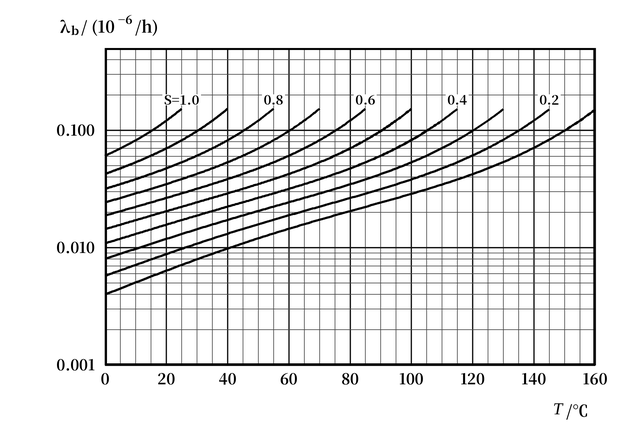

<strong>图 2 整流二极管基本失效率曲线</strong>

<strong>表 48 开关二极管基本失效率 <i>λ</i>b</strong>

单位为 10−6/h

<table>
  <thead>
    <tr>
      <th rowspan="2"><i>T</i> ℃</th>
      <th colspan="10"><i>S</i></th>
    </tr>
    <tr>
      <th>0.1</th>
      <th>0.2</th>
      <th>0.3</th>
      <th>0.4</th>
      <th>0.5</th>
      <th>0.6</th>
      <th>0.7</th>
      <th>0.8</th>
      <th>0.9</th>
      <th>1.0</th>
    </tr>
  </thead>
  <tbody>
    <tr><td>0</td><td>0.004 3</td><td>0.006 2</td><td>0.008 7</td><td>0.011 8</td><td>0.015 6</td><td>0.020 4</td><td>0.026 4</td><td>0.034 5</td><td>0.046 2</td><td>0.066 0</td></tr>
    <tr><td>5</td><td>0.004 9</td><td>0.007 0</td><td>0.009 6</td><td>0.013 0</td><td>0.017 1</td><td>0.022 3</td><td>0.028 8</td><td>0.037 8</td><td>0.051 5</td><td>0.076 1</td></tr>
    <tr><td>10</td><td>0.005 5</td><td>0.007 8</td><td>0.010 7</td><td>0.014 3</td><td>0.018 7</td><td>0.024 3</td><td>0.031 5</td><td>0.041 7</td><td>0.058 0</td><td>0.089 3</td></tr>
    <tr><td>15</td><td>0.006 2</td><td>0.008 7</td><td>0.011 8</td><td>0.015 6</td><td>0.020 4</td><td>0.026 4</td><td>0.034 5</td><td>0.046 2</td><td>0.066 0</td><td>0.106 8</td></tr>
    <tr><td>20</td><td>0.007 0</td><td>0.009 6</td><td>0.013 0</td><td>0.017 1</td><td>0.022 3</td><td>0.028 8</td><td>0.037 8</td><td>0.051 5</td><td>0.076 1</td><td>0.131 0</td></tr>
    <tr><td>25</td><td>0.007 8</td><td>0.010 7</td><td>0.014 3</td><td>0.018 7</td><td>0.024 3</td><td>0.031 5</td><td>0.041 7</td><td>0.058 0</td><td>0.089 3</td><td>0.165 6</td></tr>
    <tr><td>30</td><td>0.008 7</td><td>0.011 8</td><td>0.015 6</td><td>0.020 4</td><td>0.026 4</td><td>0.034 5</td><td>0.046 2</td><td>0.066 0</td><td>0.106 8</td><td>—</td></tr>
    <tr><td>35</td><td>0.009 6</td><td>0.013 0</td><td>0.017 1</td><td>0.022 3</td><td>0.028 8</td><td>0.037 8</td><td>0.051 5</td><td>0.076 1</td><td>0.131 0</td><td>—</td></tr>
    <tr><td>40</td><td>0.010 7</td><td>0.014 3</td><td>0.018 7</td><td>0.024 3</td><td>0.031 5</td><td>0.041 7</td><td>0.058 0</td><td>0.089 3</td><td>0.165 6</td><td>—</td></tr>
    <tr><td>45</td><td>0.011 8</td><td>0.015 6</td><td>0.020 4</td><td>0.026 4</td><td>0.034 5</td><td>0.046 2</td><td>0.066 0</td><td>0.106 8</td><td>—</td><td>—</td></tr>
    <tr><td>50</td><td>0.013 0</td><td>0.017 1</td><td>0.022 3</td><td>0.028 8</td><td>0.037 8</td><td>0.051 5</td><td>0.076 1</td><td>0.131 0</td><td>—</td><td>—</td></tr>
    <tr><td>55</td><td>0.014 3</td><td>0.018 7</td><td>0.024 3</td><td>0.031 5</td><td>0.041 7</td><td>0.058 0</td><td>0.089 3</td><td>0.165 6</td><td>—</td><td>—</td></tr>
    <tr><td>60</td><td>0.015 6</td><td>0.020 4</td><td>0.026 4</td><td>0.034 5</td><td>0.046 2</td><td>0.066 0</td><td>0.106 8</td><td>—</td><td>—</td><td>—</td></tr>
    <tr><td>65</td><td>0.017 1</td><td>0.022 3</td><td>0.028 8</td><td>0.037 8</td><td>0.051 5</td><td>0.076 1</td><td>0.131 0</td><td>—</td><td>—</td><td>—</td></tr>
    <tr><td>70</td><td>0.018 7</td><td>0.024 3</td><td>0.031 5</td><td>0.041 7</td><td>0.058 0</td><td>0.089 3</td><td>0.165 6</td><td>—</td><td>—</td><td>—</td></tr>
    <tr><td>75</td><td>0.020 4</td><td>0.026 4</td><td>0.034 5</td><td>0.046 2</td><td>0.066 0</td><td>0.106 8</td><td>—</td><td>—</td><td>—</td><td>—</td></tr>
    <tr><td>80</td><td>0.022 3</td><td>0.028 8</td><td>0.037 8</td><td>0.051 5</td><td>0.076 1</td><td>0.131 0</td><td>—</td><td>—</td><td>—</td><td>—</td></tr>
    <tr><td>85</td><td>0.024 3</td><td>0.031 5</td><td>0.041 7</td><td>0.058 0</td><td>0.089 3</td><td>0.165 6</td><td>—</td><td>—</td><td>—</td><td>—</td></tr>
    <tr><td>90</td><td>0.026 4</td><td>0.034 5</td><td>0.046 2</td><td>0.066 0</td><td>0.106 8</td><td>—</td><td>—</td><td>—</td><td>—</td><td>—</td></tr>
    <tr><td>95</td><td>0.028 8</td><td>0.037 8</td><td>0.051 5</td><td>0.076 1</td><td>0.131 0</td><td>—</td><td>—</td><td>—</td><td>—</td><td>—</td></tr>
    <tr><td>100</td><td>0.031 5</td><td>0.041 7</td><td>0.058 0</td><td>0.089 3</td><td>0.165 6</td><td>—</td><td>—</td><td>—</td><td>—</td><td>—</td></tr>
    <tr><td>105</td><td>0.034 5</td><td>0.046 2</td><td>0.066 0</td><td>0.106 8</td><td>—</td><td>—</td><td>—</td><td>—</td><td>—</td><td>—</td></tr>
    <tr><td>110</td><td>0.037 8</td><td>0.051 5</td><td>0.076 1</td><td>0.131 0</td><td>—</td><td>—</td><td>—</td><td>—</td><td>—</td><td>—</td></tr>
    <tr><td>115</td><td>0.041 7</td><td>0.058 0</td><td>0.089 3</td><td>0.165 6</td><td>—</td><td>—</td><td>—</td><td>—</td><td>—</td><td>—</td></tr>
  </tbody>
</table>

42

---

<strong>GJB/Z 299D—2024</strong>

<strong>表 48(续)</strong>

单位为 10−6/h

<table>
  <thead>
    <tr>
      <th rowspan="2"><i>T</i> ℃</th>
      <th colspan="10"><i>S</i></th>
    </tr>
    <tr>
      <th>0.1</th>
      <th>0.2</th>
      <th>0.3</th>
      <th>0.4</th>
      <th>0.5</th>
      <th>0.6</th>
      <th>0.7</th>
      <th>0.8</th>
      <th>0.9</th>
      <th>1.0</th>
    </tr>
  </thead>
  <tbody>
    <tr><td>120</td><td>0.046 2</td><td>0.066 0</td><td>0.106 8</td><td>—</td><td>—</td><td>—</td><td>—</td><td>—</td><td>—</td><td>—</td></tr>
    <tr><td>125</td><td>0.051 5</td><td>0.076 1</td><td>0.131 0</td><td>—</td><td>—</td><td>—</td><td>—</td><td>—</td><td>—</td><td>—</td></tr>
    <tr><td>130</td><td>0.058 0</td><td>0.089 3</td><td>0.165 6</td><td>—</td><td>—</td><td>—</td><td>—</td><td>—</td><td>—</td><td>—</td></tr>
    <tr><td>135</td><td>0.066 0</td><td>0.106 8</td><td>—</td><td>—</td><td>—</td><td>—</td><td>—</td><td>—</td><td>—</td><td>—</td></tr>
    <tr><td>140</td><td>0.076 1</td><td>0.131 0</td><td>—</td><td>—</td><td>—</td><td>—</td><td>—</td><td>—</td><td>—</td><td>—</td></tr>
    <tr><td>145</td><td>0.089 3</td><td>0.165 6</td><td>—</td><td>—</td><td>—</td><td>—</td><td>—</td><td>—</td><td>—</td><td>—</td></tr>
    <tr><td>150</td><td>0.106 8</td><td>—</td><td>—</td><td>—</td><td>—</td><td>—</td><td>—</td><td>—</td><td>—</td><td>—</td></tr>
    <tr><td>155</td><td>0.131 0</td><td>—</td><td>—</td><td>—</td><td>—</td><td>—</td><td>—</td><td>—</td><td>—</td><td>—</td></tr>
    <tr><td>160</td><td>0.165 6</td><td>—</td><td>—</td><td>—</td><td>—</td><td>—</td><td>—</td><td>—</td><td>—</td><td>—</td></tr>
    <tr>
      <td colspan="11">注：<i>T</i> 为工作环境温度或带散热片功率器件的管壳温度。 <i>S</i> 为电应力比，见 5.3.10。</td>
    </tr>
  </tbody>
</table>

<strong>图 3 开关二极管基本失效率曲线</strong>

<strong>表 49 检波二极管基本失效率 <i>λ</i>b</strong>

单位为 10−6/h

<table>
  <thead>
    <tr>
      <th rowspan="2"><i>T</i> ℃</th>
      <th colspan="10"><i>S</i></th>
    </tr>
    <tr>
      <th>0.1</th>
      <th>0.2</th>
      <th>0.3</th>
      <th>0.4</th>
      <th>0.5</th>
      <th>0.6</th>
      <th>0.7</th>
      <th>0.8</th>
      <th>0.9</th>
      <th>1.0</th>
    </tr>
  </thead>
  <tbody>
    <tr><td>0</td><td>0.004 2</td><td>0.006 0</td><td>0.008 4</td><td>0.011 5</td><td>0.015 2</td><td>0.019 8</td><td>0.025 7</td><td>0.033 5</td><td>0.044 9</td><td>0.064 1</td></tr>
    <tr><td>5</td><td>0.004 7</td><td>0.006 8</td><td>0.009 4</td><td>0.012 6</td><td>0.016 6</td><td>0.021 6</td><td>0.028 0</td><td>0.036 8</td><td>0.050 1</td><td>0.074 0</td></tr>
    <tr><td>10</td><td>0.005 4</td><td>0.007 6</td><td>0.010 4</td><td>0.013 9</td><td>0.018 2</td><td>0.023 6</td><td>0.030 6</td><td>0.040 5</td><td>0.056 4</td><td>0.086 8</td></tr>
    <tr><td>15</td><td>0.006 0</td><td>0.008 4</td><td>0.011 5</td><td>0.015 2</td><td>0.019 8</td><td>0.025 7</td><td>0.033 5</td><td>0.044 9</td><td>0.064 1</td><td>0.103 9</td></tr>
    <tr><td>20</td><td>0.006 8</td><td>0.009 4</td><td>0.012 6</td><td>0.016 6</td><td>0.021 6</td><td>0.028 0</td><td>0.036 8</td><td>0.050 1</td><td>0.074 0</td><td>0.127 4</td></tr>
    <tr><td>25</td><td>0.007 6</td><td>0.010 4</td><td>0.013 9</td><td>0.018 2</td><td>0.023 6</td><td>0.030 6</td><td>0.040 5</td><td>0.056 4</td><td>0.086 8</td><td>0.161 0</td></tr>
    <tr><td>30</td><td>0.008 4</td><td>0.011 5</td><td>0.015 2</td><td>0.019 8</td><td>0.025 7</td><td>0.033 5</td><td>0.044 9</td><td>0.064 1</td><td>0.103 9</td><td>—</td></tr>
    <tr><td>35</td><td>0.009 4</td><td>0.012 6</td><td>0.016 6</td><td>0.021 6</td><td>0.028 0</td><td>0.036 8</td><td>0.050 1</td><td>0.074 0</td><td>0.127 4</td><td>—</td></tr>
    <tr><td>40</td><td>0.010 4</td><td>0.013 9</td><td>0.018 2</td><td>0.023 6</td><td>0.030 6</td><td>0.040 5</td><td>0.056 4</td><td>0.086 8</td><td>0.161 0</td><td>—</td></tr>
    <tr><td>45</td><td>0.011 5</td><td>0.015 2</td><td>0.019 8</td><td>0.025 7</td><td>0.033 5</td><td>0.044 9</td><td>0.064 1</td><td>0.103 9</td><td>—</td><td>—</td></tr>
    <tr><td>50</td><td>0.012 6</td><td>0.016 6</td><td>0.021 6</td><td>0.028 0</td><td>0.036 8</td><td>0.050 1</td><td>0.074 0</td><td>0.127 4</td><td>—</td><td>—</td></tr>
  </tbody>
</table>

43

---

<strong>GJB/Z 299D—2024</strong>

<strong>表 49(续)</strong>

单位为 10−6/h

<table>
  <thead>
    <tr>
      <th rowspan="2"><i>T</i> ℃</th>
      <th colspan="10"><i>S</i></th>
    </tr>
    <tr>
      <th>0.1</th>
      <th>0.2</th>
      <th>0.3</th>
      <th>0.4</th>
      <th>0.5</th>
      <th>0.6</th>
      <th>0.7</th>
      <th>0.8</th>
      <th>0.9</th>
      <th>1.0</th>
    </tr>
  </thead>
  <tbody>
    <tr><td>55</td><td>0.013 9</td><td>0.018 2</td><td>0.023 6</td><td>0.030 6</td><td>0.040 5</td><td>0.056 4</td><td>0.086 8</td><td>0.161 0</td><td>—</td><td>—</td></tr>
    <tr><td>60</td><td>0.015 2</td><td>0.019 8</td><td>0.025 7</td><td>0.033 5</td><td>0.044 9</td><td>0.064 1</td><td>0.103 9</td><td>—</td><td>—</td><td>—</td></tr>
    <tr><td>65</td><td>0.016 6</td><td>0.021 6</td><td>0.028 0</td><td>0.036 8</td><td>0.050 1</td><td>0.074 0</td><td>0.127 4</td><td>—</td><td>—</td><td>—</td></tr>
    <tr><td>70</td><td>0.018 2</td><td>0.023 6</td><td>0.030 6</td><td>0.040 5</td><td>0.056 4</td><td>0.086 8</td><td>0.161 0</td><td>—</td><td>—</td><td>—</td></tr>
    <tr><td>75</td><td>0.019 8</td><td>0.025 7</td><td>0.033 5</td><td>0.044 9</td><td>0.064 1</td><td>0.103 9</td><td>—</td><td>—</td><td>—</td><td>—</td></tr>
    <tr><td>80</td><td>0.021 6</td><td>0.028 0</td><td>0.036 8</td><td>0.050 1</td><td>0.074 0</td><td>0.127 4</td><td>—</td><td>—</td><td>—</td><td>—</td></tr>
    <tr><td>85</td><td>0.023 6</td><td>0.030 6</td><td>0.040 5</td><td>0.056 4</td><td>0.086 8</td><td>0.161 0</td><td>—</td><td>—</td><td>—</td><td>—</td></tr>
    <tr><td>90</td><td>0.025 7</td><td>0.033 5</td><td>0.044 9</td><td>0.064 1</td><td>0.103 9</td><td>—</td><td>—</td><td>—</td><td>—</td><td>—</td></tr>
    <tr><td>95</td><td>0.028 0</td><td>0.036 8</td><td>0.050 1</td><td>0.074 0</td><td>0.127 4</td><td>—</td><td>—</td><td>—</td><td>—</td><td>—</td></tr>
    <tr><td>100</td><td>0.030 6</td><td>0.040 5</td><td>0.056 4</td><td>0.086 8</td><td>0.161 0</td><td>—</td><td>—</td><td>—</td><td>—</td><td>—</td></tr>
    <tr><td>105</td><td>0.033 5</td><td>0.044 9</td><td>0.064 1</td><td>0.103 9</td><td>—</td><td>—</td><td>—</td><td>—</td><td>—</td><td>—</td></tr>
    <tr><td>110</td><td>0.036 8</td><td>0.050 1</td><td>0.074 0</td><td>0.127 4</td><td>—</td><td>—</td><td>—</td><td>—</td><td>—</td><td>—</td></tr>
    <tr><td>115</td><td>0.040 5</td><td>0.056 4</td><td>0.086 8</td><td>0.161 0</td><td>—</td><td>—</td><td>—</td><td>—</td><td>—</td><td>—</td></tr>
    <tr><td>120</td><td>0.044 9</td><td>0.064 1</td><td>0.103 9</td><td>—</td><td>—</td><td>—</td><td>—</td><td>—</td><td>—</td><td>—</td></tr>
    <tr><td>125</td><td>0.050 1</td><td>0.074 0</td><td>0.127 4</td><td>—</td><td>—</td><td>—</td><td>—</td><td>—</td><td>—</td><td>—</td></tr>
    <tr><td>130</td><td>0.056 4</td><td>0.086 8</td><td>0.161 0</td><td>—</td><td>—</td><td>—</td><td>—</td><td>—</td><td>—</td><td>—</td></tr>
    <tr><td>135</td><td>0.064 1</td><td>0.103 9</td><td>—</td><td>—</td><td>—</td><td>—</td><td>—</td><td>—</td><td>—</td><td>—</td></tr>
    <tr><td>140</td><td>0.074 0</td><td>0.127 4</td><td>—</td><td>—</td><td>—</td><td>—</td><td>—</td><td>—</td><td>—</td><td>—</td></tr>
    <tr><td>145</td><td>0.086 8</td><td>0.161 0</td><td>—</td><td>—</td><td>—</td><td>—</td><td>—</td><td>—</td><td>—</td><td>—</td></tr>
    <tr><td>150</td><td>0.103 9</td><td>—</td><td>—</td><td>—</td><td>—</td><td>—</td><td>—</td><td>—</td><td>—</td><td>—</td></tr>
    <tr><td>155</td><td>0.127 4</td><td>—</td><td>—</td><td>—</td><td>—</td><td>—</td><td>—</td><td>—</td><td>—</td><td>—</td></tr>
    <tr><td>160</td><td>0.161 0</td><td>—</td><td>—</td><td>—</td><td>—</td><td>—</td><td>—</td><td>—</td><td>—</td><td>—</td></tr>
    <tr>
      <td colspan="11">注：<i>T</i> 为工作环境温度或带散热片功率器件的管壳温度。 <i>S</i> 为电应力比，见 5.3.10。</td>
    </tr>
  </tbody>
</table>

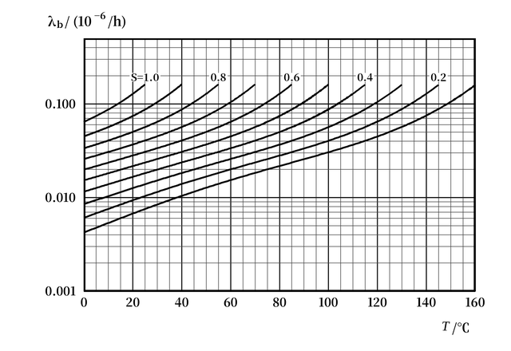

<strong>图 4 检波二极管基本失效率曲线</strong>

44

---

<strong>GJB/Z 299D—2024</strong>

<strong>表 50 瞬态抑制二极管基本失效率 <i>λ</i>b</strong>

单位为 10−6/h

<table>
  <thead>
    <tr>
      <th rowspan="2"><i>T</i> ℃</th>
      <th colspan="10"><i>S</i></th>
    </tr>
    <tr>
      <th>0.1</th>
      <th>0.2</th>
      <th>0.3</th>
      <th>0.4</th>
      <th>0.5</th>
      <th>0.6</th>
      <th>0.7</th>
      <th>0.8</th>
      <th>0.9</th>
      <th>1.0</th>
    </tr>
  </thead>
  <tbody>
    <tr><td>0</td><td>0.004 8</td><td>0.006 9</td><td>0.009 6</td><td>0.013 1</td><td>0.017 4</td><td>0.022 7</td><td>0.029 4</td><td>0.038 3</td><td>0.051 3</td><td>0.073 3</td></tr>
    <tr><td>5</td><td>0.005 4</td><td>0.007 7</td><td>0.010 7</td><td>0.014 4</td><td>0.019 0</td><td>0.024 7</td><td>0.032 1</td><td>0.042 0</td><td>0.057 2</td><td>0.084 6</td></tr>
    <tr><td>10</td><td>0.006 1</td><td>0.008 7</td><td>0.011 9</td><td>0.015 8</td><td>0.020 8</td><td>0.027 0</td><td>0.035 0</td><td>0.046 3</td><td>0.064 4</td><td>0.099 2</td></tr>
    <tr><td>15</td><td>0.006 9</td><td>0.009 6</td><td>0.013 1</td><td>0.017 4</td><td>0.022 7</td><td>0.029 4</td><td>0.038 3</td><td>0.051 3</td><td>0.073 3</td><td>0.118 7</td></tr>
    <tr><td>20</td><td>0.007 7</td><td>0.010 7</td><td>0.014 4</td><td>0.019 0</td><td>0.024 7</td><td>0.032 1</td><td>0.042 0</td><td>0.057 2</td><td>0.084 6</td><td>0.145 6</td></tr>
    <tr><td>25</td><td>0.008 7</td><td>0.011 9</td><td>0.015 8</td><td>0.020 8</td><td>0.027 0</td><td>0.035 0</td><td>0.046 3</td><td>0.064 4</td><td>0.099 2</td><td>0.184 0</td></tr>
    <tr><td>30</td><td>0.009 6</td><td>0.013 1</td><td>0.017 4</td><td>0.022 7</td><td>0.029 4</td><td>0.038 3</td><td>0.051 3</td><td>0.073 3</td><td>0.118 7</td><td>—</td></tr>
    <tr><td>35</td><td>0.010 7</td><td>0.014 4</td><td>0.019 0</td><td>0.024 7</td><td>0.032 1</td><td>0.042 0</td><td>0.057 2</td><td>0.084 6</td><td>0.145 6</td><td>—</td></tr>
    <tr><td>40</td><td>0.011 9</td><td>0.015 8</td><td>0.020 8</td><td>0.027 0</td><td>0.035 0</td><td>0.046 3</td><td>0.064 4</td><td>0.099 2</td><td>0.184 0</td><td>—</td></tr>
    <tr><td>45</td><td>0.013 1</td><td>0.017 4</td><td>0.022 7</td><td>0.029 4</td><td>0.038 3</td><td>0.051 3</td><td>0.073 3</td><td>0.118 7</td><td>—</td><td>—</td></tr>
    <tr><td>50</td><td>0.014 4</td><td>0.019 0</td><td>0.024 7</td><td>0.032 1</td><td>0.042 0</td><td>0.057 2</td><td>0.084 6</td><td>0.145 6</td><td>—</td><td>—</td></tr>
    <tr><td>55</td><td>0.015 8</td><td>0.020 8</td><td>0.027 0</td><td>0.035 0</td><td>0.046 3</td><td>0.064 4</td><td>0.099 2</td><td>0.184 0</td><td>—</td><td>—</td></tr>
    <tr><td>60</td><td>0.017 4</td><td>0.022 7</td><td>0.029 4</td><td>0.038 3</td><td>0.051 3</td><td>0.073 3</td><td>0.118 7</td><td>—</td><td>—</td><td>—</td></tr>
    <tr><td>65</td><td>0.019 0</td><td>0.024 7</td><td>0.032 1</td><td>0.042 0</td><td>0.057 2</td><td>0.084 6</td><td>0.145 6</td><td>—</td><td>—</td><td>—</td></tr>
    <tr><td>70</td><td>0.020 8</td><td>0.027 0</td><td>0.035 0</td><td>0.046 3</td><td>0.064 4</td><td>0.099 2</td><td>0.184 0</td><td>—</td><td>—</td><td>—</td></tr>
    <tr><td>75</td><td>0.022 7</td><td>0.029 4</td><td>0.038 3</td><td>0.051 3</td><td>0.073 3</td><td>0.118 7</td><td>—</td><td>—</td><td>—</td><td>—</td></tr>
    <tr><td>80</td><td>0.024 7</td><td>0.032 1</td><td>0.042 0</td><td>0.057 2</td><td>0.084 6</td><td>0.145 6</td><td>—</td><td>—</td><td>—</td><td>—</td></tr>
    <tr><td>85</td><td>0.027 0</td><td>0.035 0</td><td>0.046 3</td><td>0.064 4</td><td>0.099 2</td><td>0.184 0</td><td>—</td><td>—</td><td>—</td><td>—</td></tr>
    <tr><td>90</td><td>0.029 4</td><td>0.038 3</td><td>0.051 3</td><td>0.073 3</td><td>0.118 7</td><td>—</td><td>—</td><td>—</td><td>—</td><td>—</td></tr>
    <tr><td>95</td><td>0.032 1</td><td>0.042 0</td><td>0.057 2</td><td>0.084 6</td><td>0.145 6</td><td>—</td><td>—</td><td>—</td><td>—</td><td>—</td></tr>
    <tr><td>100</td><td>0.035 0</td><td>0.046 3</td><td>0.064 4</td><td>0.099 2</td><td>0.184 0</td><td>—</td><td>—</td><td>—</td><td>—</td><td>—</td></tr>
    <tr><td>105</td><td>0.038 3</td><td>0.051 3</td><td>0.073 3</td><td>0.118 7</td><td>—</td><td>—</td><td>—</td><td>—</td><td>—</td><td>—</td></tr>
    <tr><td>110</td><td>0.042 0</td><td>0.057 2</td><td>0.084 6</td><td>0.145 6</td><td>—</td><td>—</td><td>—</td><td>—</td><td>—</td><td>—</td></tr>
    <tr><td>115</td><td>0.046 3</td><td>0.064 4</td><td>0.099 2</td><td>0.184 0</td><td>—</td><td>—</td><td>—</td><td>—</td><td>—</td><td>—</td></tr>
    <tr><td>120</td><td>0.051 3</td><td>0.073 3</td><td>0.118 7</td><td>—</td><td>—</td><td>—</td><td>—</td><td>—</td><td>—</td><td>—</td></tr>
    <tr><td>125</td><td>0.057 2</td><td>0.084 6</td><td>0.145 6</td><td>—</td><td>—</td><td>—</td><td>—</td><td>—</td><td>—</td><td>—</td></tr>
    <tr><td>130</td><td>0.064 4</td><td>0.099 2</td><td>0.184 0</td><td>—</td><td>—</td><td>—</td><td>—</td><td>—</td><td>—</td><td>—</td></tr>
    <tr><td>135</td><td>0.073 3</td><td>0.118 7</td><td>—</td><td>—</td><td>—</td><td>—</td><td>—</td><td>—</td><td>—</td><td>—</td></tr>
    <tr><td>140</td><td>0.084 6</td><td>0.145 6</td><td>—</td><td>—</td><td>—</td><td>—</td><td>—</td><td>—</td><td>—</td><td>—</td></tr>
    <tr><td>145</td><td>0.099 2</td><td>0.184 0</td><td>—</td><td>—</td><td>—</td><td>—</td><td>—</td><td>—</td><td>—</td><td>—</td></tr>
    <tr><td>150</td><td>0.118 7</td><td>—</td><td>—</td><td>—</td><td>—</td><td>—</td><td>—</td><td>—</td><td>—</td><td>—</td></tr>
    <tr><td>155</td><td>0.145 6</td><td>—</td><td>—</td><td>—</td><td>—</td><td>—</td><td>—</td><td>—</td><td>—</td><td>—</td></tr>
    <tr><td>160</td><td>0.184 0</td><td>—</td><td>—</td><td>—</td><td>—</td><td>—</td><td>—</td><td>—</td><td>—</td><td>—</td></tr>
    <tr>
      <td colspan="11">注：<i>T</i> 为工作环境温度或带散热片功率器件的管壳温度。 <i>S</i> 为电应力比，见 5.3.10。</td>
    </tr>
  </tbody>
</table>

45

---

<strong>GJB/Z 299D—2024</strong>

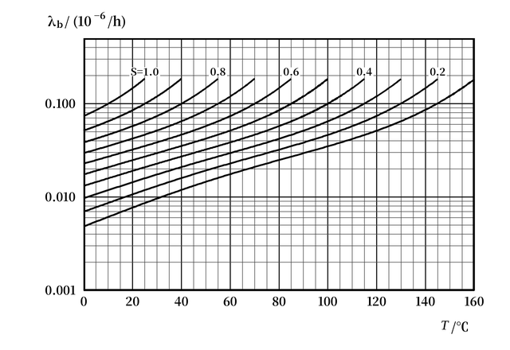

<strong>图 5 瞬态抑制二极管基本失效率曲线</strong>

<strong>表 51 环境系数 <i>π</i>E</strong>

<table>
  <tbody>
    <tr>
      <td>环境</td>
      <td>GB</td>
      <td>GMS</td>
      <td>GF1</td>
      <td>GF2</td>
      <td>GM1</td>
      <td>GM2</td>
      <td>MP</td>
      <td>NSB</td>
      <td>NS1</td>
      <td>NS2</td>
    </tr>
    <tr>
      <td><i>π</i>E</td>
      <td>1.0</td>
      <td>1.2</td>
      <td>1.7</td>
      <td>5.0</td>
      <td>5.5</td>
      <td>11</td>
      <td>7.5</td>
      <td>4.5</td>
      <td>3.0</td>
      <td>6.0</td>
    </tr>
    <tr>
      <td>环境</td>
      <td>NU</td>
      <td>AIF</td>
      <td>AUF</td>
      <td>AIC</td>
      <td>AUC</td>
      <td>ARW</td>
      <td>SF</td>
      <td>ML</td>
      <td>MF</td>
      <td>—</td>
    </tr>
    <tr>
      <td><i>π</i>E</td>
      <td>14</td>
      <td>13</td>
      <td>20</td>
      <td>7.0</td>
      <td>11</td>
      <td>15</td>
      <td>0.5</td>
      <td>28</td>
      <td>15</td>
      <td>—</td>
    </tr>
  </tbody>
</table>

<strong>表 52 质量等级与质量系数 <i>π</i>Q</strong>

<table>
  <thead>
    <tr>
      <th>质量等级</th>
      <th>A2</th>
      <th>A3</th>
      <th>A4</th>
      <th>A5</th>
      <th>A6</th>
      <th>B1</th>
      <th>B2</th>
      <th>C</th>
    </tr>
  </thead>
  <tbody>
    <tr>
      <td><i>π</i>Q</td>
      <td>0.03</td>
      <td>0.05</td>
      <td>0.1</td>
      <td>0.15</td>
      <td>0.2</td>
      <td>0.4</td>
      <td>1.0</td>
      <td>5.0</td>
    </tr>
  </tbody>
</table>

<strong>表 53 额定电流系数 <i>π</i>r</strong>

<table>
  <thead>
    <tr>
      <th>额定电流 <i>I</i> A</th>
      <th><i>I</i> ≤ 1</th>
      <th>1 &lt; <i>I</i> ≤ 3</th>
      <th>3 &lt; <i>I</i> ≤ 10</th>
      <th>10 &lt; <i>I</i> ≤ 20</th>
      <th><i>I</i> &gt; 20</th>
    </tr>
  </thead>
  <tbody>
    <tr>
      <td><i>π</i>r</td>
      <td>1.0</td>
      <td>1.5</td>
      <td>2.0</td>
      <td>3.0</td>
      <td>4.0</td>
    </tr>
  </tbody>
</table>

<strong>表 54 电压应力系数 <i>π</i>S2</strong>

<table>
  <thead>
    <tr>
      <th><i>S</i>2 = 外加反向电压 <i>V</i>R额定反向电压 <i>V</i>RM</th>
      <th>≤ 0.3</th>
      <th>0.4</th>
      <th>0.5</th>
      <th>0.6</th>
      <th>0.7</th>
      <th>0.8</th>
      <th>0.9</th>
      <th>1</th>
    </tr>
  </thead>
  <tbody>
    <tr>
      <td><i>π</i>S2</td>
      <td>0.20</td>
      <td>0.40</td>
      <td>0.70</td>
      <td>1.0</td>
      <td>1.3</td>
      <td>1.8</td>
      <td>2.5</td>
      <td>3.3</td>
    </tr>
  </tbody>
</table>

<strong>表 55 结构系数 <i>π</i>C</strong>

<table>
  <thead>
    <tr>
      <th>接触结构</th>
      <th>冶金键合</th>
      <th>弹性压力</th>
    </tr>
  </thead>
  <tbody>
    <tr>
      <td><i>π</i>C</td>
      <td>1.0</td>
      <td>2.0</td>
    </tr>
  </tbody>
</table>

#### 5.3.3 电压调整、电压基准及电流调整二极管

工作失效率预计模型见式(8)。

$$\lambda_{\text{p}} = \lambda_{\text{b}} \pi_{\text{E}} \pi_{\text{Q}} \pi_{\text{r}} \pi_{\text{A}} \tag{8}$$

式中：
$\lambda_{\text{p}}$——工作失效率，$10^{-6}/\text{h}$；
$\lambda_{\text{b}}$——基本失效率，$10^{-6}/\text{h}$，见表 56 和图 6；

46

---

<strong>GJB/Z 299D—2024</strong>

$\pi_{\text{E}}$——环境系数，见表 57；
$\pi_{\text{Q}}$——质量系数，见表 58；
$\pi_{\text{r}}$——额定电流系数，见表 53；
$\pi_{\text{A}}$——应用系数，见表 59。

<strong>表 56 基本失效率 <i>λ</i>b</strong>

单位为 10−6/h

<table>
  <thead>
    <tr>
      <th rowspan="2"><i>T</i> ℃</th>
      <th colspan="10"><i>S</i></th>
    </tr>
    <tr>
      <th>0.1</th>
      <th>0.2</th>
      <th>0.3</th>
      <th>0.4</th>
      <th>0.5</th>
      <th>0.6</th>
      <th>0.7</th>
      <th>0.8</th>
      <th>0.9</th>
      <th>1.0</th>
    </tr>
  </thead>
  <tbody>
    <tr><td>0</td><td>0.015 6</td><td>0.017 9</td><td>0.020 4</td><td>0.023 0</td><td>0.025 8</td><td>0.029 1</td><td>0.033 0</td><td>0.038 3</td><td>0.046 1</td><td>0.059 0</td></tr>
    <tr><td>5</td><td>0.016 3</td><td>0.018 7</td><td>0.021 2</td><td>0.023 9</td><td>0.026 9</td><td>0.030 3</td><td>0.034 6</td><td>0.040 5</td><td>0.049 6</td><td>0.065 4</td></tr>
    <tr><td>10</td><td>0.017 1</td><td>0.019 5</td><td>0.022 1</td><td>0.024 9</td><td>0.027 9</td><td>0.031 6</td><td>0.036 3</td><td>0.043 1</td><td>0.053 9</td><td>0.073 3</td></tr>
    <tr><td>15</td><td>0.017 9</td><td>0.020 4</td><td>0.023 0</td><td>0.025 8</td><td>0.029 1</td><td>0.033 0</td><td>0.038 3</td><td>0.046 1</td><td>0.059 0</td><td>0.083 4</td></tr>
    <tr><td>20</td><td>0.018 7</td><td>0.021 2</td><td>0.023 9</td><td>0.026 9</td><td>0.030 3</td><td>0.034 6</td><td>0.040 5</td><td>0.049 6</td><td>0.065 4</td><td>0.096 6</td></tr>
    <tr><td>25</td><td>0.019 5</td><td>0.022 1</td><td>0.024 9</td><td>0.027 9</td><td>0.031 6</td><td>0.036 3</td><td>0.043 1</td><td>0.053 9</td><td>0.073 3</td><td>0.113 9</td></tr>
    <tr><td>30</td><td>0.020 4</td><td>0.023 0</td><td>0.025 8</td><td>0.029 1</td><td>0.033 0</td><td>0.038 3</td><td>0.046 1</td><td>0.059 0</td><td>0.083 4</td><td>—</td></tr>
    <tr><td>35</td><td>0.021 2</td><td>0.023 9</td><td>0.026 9</td><td>0.030 3</td><td>0.034 6</td><td>0.040 5</td><td>0.049 6</td><td>0.065 4</td><td>0.096 6</td><td>—</td></tr>
    <tr><td>40</td><td>0.022 1</td><td>0.024 9</td><td>0.027 9</td><td>0.031 6</td><td>0.036 3</td><td>0.043 1</td><td>0.053 9</td><td>0.073 3</td><td>0.113 9</td><td>—</td></tr>
    <tr><td>45</td><td>0.023 0</td><td>0.025 8</td><td>0.029 1</td><td>0.033 0</td><td>0.038 3</td><td>0.046 1</td><td>0.059 0</td><td>0.083 4</td><td>—</td><td>—</td></tr>
    <tr><td>50</td><td>0.023 9</td><td>0.026 9</td><td>0.030 3</td><td>0.034 6</td><td>0.040 5</td><td>0.049 6</td><td>0.065 4</td><td>0.096 6</td><td>—</td><td>—</td></tr>
    <tr><td>55</td><td>0.024 9</td><td>0.027 9</td><td>0.031 6</td><td>0.036 3</td><td>0.043 1</td><td>0.053 9</td><td>0.073 3</td><td>0.113 9</td><td>—</td><td>—</td></tr>
    <tr><td>60</td><td>0.025 8</td><td>0.029 1</td><td>0.033 0</td><td>0.038 3</td><td>0.046 1</td><td>0.059 0</td><td>0.083 4</td><td>—</td><td>—</td><td>—</td></tr>
    <tr><td>65</td><td>0.026 9</td><td>0.030 3</td><td>0.034 6</td><td>0.040 5</td><td>0.049 6</td><td>0.065 4</td><td>0.096 6</td><td>—</td><td>—</td><td>—</td></tr>
    <tr><td>70</td><td>0.027 9</td><td>0.031 6</td><td>0.036 3</td><td>0.043 1</td><td>0.053 9</td><td>0.073 3</td><td>0.113 9</td><td>—</td><td>—</td><td>—</td></tr>
    <tr><td>75</td><td>0.029 1</td><td>0.033 0</td><td>0.038 3</td><td>0.046 1</td><td>0.059 0</td><td>0.083 4</td><td>—</td><td>—</td><td>—</td><td>—</td></tr>
    <tr><td>80</td><td>0.030 3</td><td>0.034 6</td><td>0.040 5</td><td>0.049 6</td><td>0.065 4</td><td>0.096 6</td><td>—</td><td>—</td><td>—</td><td>—</td></tr>
    <tr><td>85</td><td>0.031 6</td><td>0.036 3</td><td>0.043 1</td><td>0.053 9</td><td>0.073 3</td><td>0.113 9</td><td>—</td><td>—</td><td>—</td><td>—</td></tr>
    <tr><td>90</td><td>0.033 0</td><td>0.038 3</td><td>0.046 1</td><td>0.059 0</td><td>0.083 4</td><td>—</td><td>—</td><td>—</td><td>—</td><td>—</td></tr>
    <tr><td>95</td><td>0.034 6</td><td>0.040 5</td><td>0.049 6</td><td>0.065 4</td><td>0.096 6</td><td>—</td><td>—</td><td>—</td><td>—</td><td>—</td></tr>
    <tr><td>100</td><td>0.036 3</td><td>0.043 1</td><td>0.053 9</td><td>0.073 3</td><td>0.113 9</td><td>—</td><td>—</td><td>—</td><td>—</td><td>—</td></tr>
    <tr><td>105</td><td>0.038 3</td><td>0.046 1</td><td>0.059 0</td><td>0.083 4</td><td>—</td><td>—</td><td>—</td><td>—</td><td>—</td><td>—</td></tr>
    <tr><td>110</td><td>0.040 5</td><td>0.049 6</td><td>0.065 4</td><td>0.096 6</td><td>—</td><td>—</td><td>—</td><td>—</td><td>—</td><td>—</td></tr>
    <tr><td>115</td><td>0.043 1</td><td>0.053 9</td><td>0.073 3</td><td>0.113 9</td><td>—</td><td>—</td><td>—</td><td>—</td><td>—</td><td>—</td></tr>
    <tr><td>120</td><td>0.046 1</td><td>0.059 0</td><td>0.083 4</td><td>—</td><td>—</td><td>—</td><td>—</td><td>—</td><td>—</td><td>—</td></tr>
    <tr><td>125</td><td>0.049 6</td><td>0.065 4</td><td>0.096 6</td><td>—</td><td>—</td><td>—</td><td>—</td><td>—</td><td>—</td><td>—</td></tr>
    <tr><td>130</td><td>0.053 9</td><td>0.073 3</td><td>0.113 9</td><td>—</td><td>—</td><td>—</td><td>—</td><td>—</td><td>—</td><td>—</td></tr>
    <tr><td>135</td><td>0.059 0</td><td>0.083 4</td><td>—</td><td>—</td><td>—</td><td>—</td><td>—</td><td>—</td><td>—</td><td>—</td></tr>
    <tr><td>140</td><td>0.065 4</td><td>0.096 6</td><td>—</td><td>—</td><td>—</td><td>—</td><td>—</td><td>—</td><td>—</td><td>—</td></tr>
    <tr><td>145</td><td>0.073 3</td><td>0.113 9</td><td>—</td><td>—</td><td>—</td><td>—</td><td>—</td><td>—</td><td>—</td><td>—</td></tr>
    <tr><td>150</td><td>0.083 4</td><td>—</td><td>—</td><td>—</td><td>—</td><td>—</td><td>—</td><td>—</td><td>—</td><td>—</td></tr>
    <tr><td>155</td><td>0.096 6</td><td>—</td><td>—</td><td>—</td><td>—</td><td>—</td><td>—</td><td>—</td><td>—</td><td>—</td></tr>
    <tr><td>160</td><td>0.113 9</td><td>—</td><td>—</td><td>—</td><td>—</td><td>—</td><td>—</td><td>—</td><td>—</td><td>—</td></tr>
    <tr>
      <td colspan="11">注：<i>T</i> 为工作环境温度或带散热片功率器件的管壳温度。 <i>S</i> 为电应力比，见 5.3.10。</td>
    </tr>
  </tbody>
</table>

47

---

<strong>GJB/Z 299D—2024</strong>

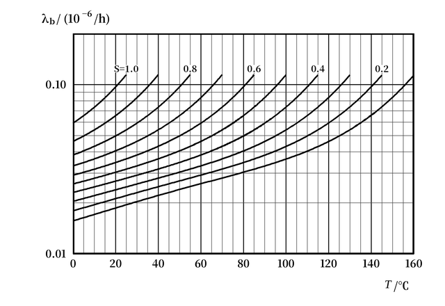

<strong>图 6 电压调整、电压基准及电流调整二极管基本失效率曲线</strong>

<strong>表 57 环境系数 <i>π</i>E</strong>

<table>
  <tbody>
    <tr>
      <td>环境</td>
      <td>GB</td>
      <td>GMS</td>
      <td>GF1</td>
      <td>GF2</td>
      <td>GM1</td>
      <td>GM2</td>
      <td>MP</td>
      <td>NSB</td>
      <td>NS1</td>
      <td>NS2</td>
    </tr>
    <tr>
      <td><i>π</i>E</td>
      <td>1.0</td>
      <td>1.2</td>
      <td>1.7</td>
      <td>5.0</td>
      <td>5.5</td>
      <td>11</td>
      <td>7.5</td>
      <td>4.5</td>
      <td>1.0</td>
      <td>6.0</td>
    </tr>
    <tr>
      <td>环境</td>
      <td>NU</td>
      <td>AIF</td>
      <td>AUF</td>
      <td>AIC</td>
      <td>AUC</td>
      <td>ARW</td>
      <td>SF</td>
      <td>ML</td>
      <td>MF</td>
      <td>—</td>
    </tr>
    <tr>
      <td><i>π</i>E</td>
      <td>14</td>
      <td>13</td>
      <td>20</td>
      <td>7.0</td>
      <td>11</td>
      <td>15</td>
      <td>0.5</td>
      <td>28</td>
      <td>15</td>
      <td>—</td>
    </tr>
  </tbody>
</table>

<strong>表 58 质量等级与质量系数 <i>π</i>Q</strong>

<table>
  <thead>
    <tr>
      <th>质量等级</th>
      <th>A2</th>
      <th>A3</th>
      <th>A4</th>
      <th>A5</th>
      <th>A6</th>
      <th>B1</th>
      <th>B2</th>
      <th>C</th>
    </tr>
  </thead>
  <tbody>
    <tr>
      <td><i>π</i>Q</td>
      <td>0.03</td>
      <td>0.05</td>
      <td>0.1</td>
      <td>0.15</td>
      <td>0.2</td>
      <td>0.5</td>
      <td>1.0</td>
      <td>5.0</td>
    </tr>
  </tbody>
</table>

<strong>表 59 应用系数 <i>π</i>A</strong>

<table>
  <thead>
    <tr>
      <th>应用</th>
      <th>电压调整</th>
      <th>电压基准(温度补偿)</th>
      <th>电流调整</th>
    </tr>
  </thead>
  <tbody>
    <tr>
      <td><i>π</i>A</td>
      <td>0.65</td>
      <td>1.0</td>
      <td>1.2</td>
    </tr>
  </tbody>
</table>

#### 5.3.4 微波二极管

##### 5.3.4.1 微波硅检波、硅混频二极管

工作失效率预计模型见式(9)。

$$\lambda_{\text{p}} = \lambda_{\text{b}} \pi_{\text{E}} \pi_{\text{Q}} \tag{9}$$

式中：
$\lambda_{\text{p}}$——工作失效率，$10^{-6}/\text{h}$；
$\lambda_{\text{b}}$——基本失效率，$10^{-6}/\text{h}$，见表 60、表 61 和图 7、图 8；
$\pi_{\text{E}}$——环境系数，见表 62；
$\pi_{\text{Q}}$——质量系数，见表 63。

<strong>表 60 微波硅检波二极管基本失效率 <i>λ</i>b</strong>

单位为 10−6/h

<table>
  <thead>
    <tr>
      <th rowspan="2"><i>T</i> ℃</th>
      <th colspan="10"><i>S</i></th>
    </tr>
    <tr>
      <th>0.1</th>
      <th>0.2</th>
      <th>0.3</th>
      <th>0.4</th>
      <th>0.5</th>
      <th>0.6</th>
      <th>0.7</th>
      <th>0.8</th>
      <th>0.9</th>
      <th>1.0</th>
    </tr>
  </thead>
  <tbody>
    <tr><td>0</td><td>0.183</td><td>0.194</td><td>0.205</td><td>0.216</td><td>0.229</td><td>0.243</td><td>0.260</td><td>0.285</td><td>0.323</td><td>0.387</td></tr>
    <tr><td>5</td><td>0.187</td><td>0.198</td><td>0.209</td><td>0.221</td><td>0.234</td><td>0.249</td><td>0.269</td><td>0.298</td><td>0.344</td><td>0.426</td></tr>
    <tr><td>10</td><td>0.192</td><td>0.203</td><td>0.214</td><td>0.226</td><td>0.240</td><td>0.256</td><td>0.279</td><td>0.314</td><td>0.371</td><td>0.477</td></tr>
  </tbody>
</table>

48

---

<strong>GJB/Z 299D—2024</strong>

<strong>表 60(续)</strong>

单位为 10−6/h

<table>
  <thead>
    <tr>
      <th rowspan="2"><i>T</i> ℃</th>
      <th colspan="10"><i>S</i></th>
    </tr>
    <tr>
      <th>0.1</th>
      <th>0.2</th>
      <th>0.3</th>
      <th>0.4</th>
      <th>0.5</th>
      <th>0.6</th>
      <th>0.7</th>
      <th>0.8</th>
      <th>0.9</th>
      <th>1.0</th>
    </tr>
  </thead>
  <tbody>
    <tr><td>15</td><td>0.196</td><td>0.207</td><td>0.219</td><td>0.231</td><td>0.246</td><td>0.265</td><td>0.291</td><td>0.333</td><td>0.405</td><td>0.546</td></tr>
    <tr><td>20</td><td>0.200</td><td>0.212</td><td>0.224</td><td>0.237</td><td>0.253</td><td>0.274</td><td>0.305</td><td>0.357</td><td>0.450</td><td>0.641</td></tr>
    <tr><td>25</td><td>0.205</td><td>0.216</td><td>0.229</td><td>0.243</td><td>0.260</td><td>0.285</td><td>0.323</td><td>0.387</td><td>0.509</td><td>0.775</td></tr>
    <tr><td>30</td><td>0.209</td><td>0.221</td><td>0.234</td><td>0.249</td><td>0.269</td><td>0.298</td><td>0.344</td><td>0.426</td><td>0.589</td><td>—</td></tr>
    <tr><td>35</td><td>0.214</td><td>0.226</td><td>0.240</td><td>0.256</td><td>0.279</td><td>0.314</td><td>0.371</td><td>0.477</td><td>0.702</td><td>—</td></tr>
    <tr><td>40</td><td>0.219</td><td>0.231</td><td>0.246</td><td>0.265</td><td>0.291</td><td>0.333</td><td>0.405</td><td>0.546</td><td>—</td><td>—</td></tr>
    <tr><td>45</td><td>0.224</td><td>0.237</td><td>0.253</td><td>0.274</td><td>0.305</td><td>0.357</td><td>0.450</td><td>0.641</td><td>—</td><td>—</td></tr>
    <tr><td>50</td><td>0.229</td><td>0.243</td><td>0.260</td><td>0.285</td><td>0.323</td><td>0.387</td><td>0.509</td><td>0.775</td><td>—</td><td>—</td></tr>
    <tr><td>55</td><td>0.234</td><td>0.249</td><td>0.269</td><td>0.298</td><td>0.344</td><td>0.426</td><td>0.589</td><td>—</td><td>—</td><td>—</td></tr>
    <tr><td>60</td><td>0.240</td><td>0.256</td><td>0.279</td><td>0.314</td><td>0.371</td><td>0.477</td><td>0.702</td><td>—</td><td>—</td><td>—</td></tr>
    <tr><td>65</td><td>0.246</td><td>0.265</td><td>0.291</td><td>0.333</td><td>0.405</td><td>0.546</td><td>—</td><td>—</td><td>—</td><td>—</td></tr>
    <tr><td>70</td><td>0.253</td><td>0.274</td><td>0.305</td><td>0.357</td><td>0.450</td><td>0.641</td><td>—</td><td>—</td><td>—</td><td>—</td></tr>
    <tr><td>75</td><td>0.260</td><td>0.285</td><td>0.323</td><td>0.387</td><td>0.509</td><td>0.775</td><td>—</td><td>—</td><td>—</td><td>—</td></tr>
    <tr><td>80</td><td>0.269</td><td>0.298</td><td>0.344</td><td>0.426</td><td>0.589</td><td>—</td><td>—</td><td>—</td><td>—</td><td>—</td></tr>
    <tr><td>85</td><td>0.279</td><td>0.314</td><td>0.371</td><td>0.477</td><td>0.702</td><td>—</td><td>—</td><td>—</td><td>—</td><td>—</td></tr>
    <tr><td>90</td><td>0.291</td><td>0.333</td><td>0.405</td><td>0.546</td><td>—</td><td>—</td><td>—</td><td>—</td><td>—</td><td>—</td></tr>
    <tr><td>95</td><td>0.305</td><td>0.357</td><td>0.450</td><td>0.641</td><td>—</td><td>—</td><td>—</td><td>—</td><td>—</td><td>—</td></tr>
    <tr><td>100</td><td>0.323</td><td>0.387</td><td>0.509</td><td>0.775</td><td>—</td><td>—</td><td>—</td><td>—</td><td>—</td><td>—</td></tr>
    <tr><td>105</td><td>0.344</td><td>0.426</td><td>0.589</td><td>—</td><td>—</td><td>—</td><td>—</td><td>—</td><td>—</td><td>—</td></tr>
    <tr><td>110</td><td>0.371</td><td>0.477</td><td>0.702</td><td>—</td><td>—</td><td>—</td><td>—</td><td>—</td><td>—</td><td>—</td></tr>
    <tr><td>115</td><td>0.405</td><td>0.546</td><td>—</td><td>—</td><td>—</td><td>—</td><td>—</td><td>—</td><td>—</td><td>—</td></tr>
    <tr><td>120</td><td>0.450</td><td>0.641</td><td>—</td><td>—</td><td>—</td><td>—</td><td>—</td><td>—</td><td>—</td><td>—</td></tr>
    <tr><td>125</td><td>0.509</td><td>0.775</td><td>—</td><td>—</td><td>—</td><td>—</td><td>—</td><td>—</td><td>—</td><td>—</td></tr>
    <tr><td>130</td><td>0.589</td><td>—</td><td>—</td><td>—</td><td>—</td><td>—</td><td>—</td><td>—</td><td>—</td><td>—</td></tr>
    <tr><td>135</td><td>0.702</td><td>—</td><td>—</td><td>—</td><td>—</td><td>—</td><td>—</td><td>—</td><td>—</td><td>—</td></tr>
    <tr>
      <td colspan="11">注：<i>T</i> 为工作环境温度或带散热片功率器件的管壳温度。 　　<i>S</i> 为电应力比，见 5.3.10。</td>
    </tr>
  </tbody>
</table>

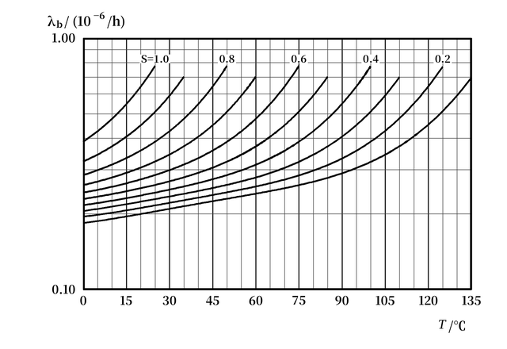

<strong>图 7 微波硅检波二极管基本失效率曲线</strong>

49

---

<strong>GJB/Z 299D—2024</strong>

<strong>表 61 微波硅混频二极管基本失效率 <i>λ</i>b</strong>

单位为 10−6/h

<table>
  <thead>
    <tr>
      <th rowspan="2"><i>T</i> ℃</th>
      <th colspan="10"><i>S</i></th>
    </tr>
    <tr>
      <th>0.1</th>
      <th>0.2</th>
      <th>0.3</th>
      <th>0.4</th>
      <th>0.5</th>
      <th>0.6</th>
      <th>0.7</th>
      <th>0.8</th>
      <th>0.9</th>
      <th>1.0</th>
    </tr>
  </thead>
  <tbody>
    <tr><td>0</td><td>0.227</td><td>0.241</td><td>0.255</td><td>0.270</td><td>0.286</td><td>0.305</td><td>0.328</td><td>0.361</td><td>0.411</td><td>0.493</td></tr>
    <tr><td>5</td><td>0.233</td><td>0.247</td><td>0.261</td><td>0.276</td><td>0.293</td><td>0.313</td><td>0.340</td><td>0.378</td><td>0.438</td><td>0.543</td></tr>
    <tr><td>10</td><td>0.238</td><td>0.252</td><td>0.267</td><td>0.283</td><td>0.300</td><td>0.323</td><td>0.353</td><td>0.399</td><td>0.473</td><td>0.607</td></tr>
    <tr><td>15</td><td>0.244</td><td>0.258</td><td>0.273</td><td>0.289</td><td>0.309</td><td>0.334</td><td>0.369</td><td>0.424</td><td>0.517</td><td>0.691</td></tr>
    <tr><td>20</td><td>0.249</td><td>0.264</td><td>0.279</td><td>0.297</td><td>0.318</td><td>0.346</td><td>0.388</td><td>0.455</td><td>0.573</td><td>0.806</td></tr>
    <tr><td>25</td><td>0.255</td><td>0.270</td><td>0.286</td><td>0.305</td><td>0.328</td><td>0.361</td><td>0.411</td><td>0.493</td><td>0.646</td><td>0.964</td></tr>
    <tr><td>30</td><td>0.261</td><td>0.276</td><td>0.293</td><td>0.313</td><td>0.340</td><td>0.378</td><td>0.438</td><td>0.543</td><td>0.744</td><td>—</td></tr>
    <tr><td>35</td><td>0.267</td><td>0.283</td><td>0.300</td><td>0.323</td><td>0.353</td><td>0.399</td><td>0.473</td><td>0.607</td><td>0.878</td><td>—</td></tr>
    <tr><td>40</td><td>0.273</td><td>0.289</td><td>0.309</td><td>0.334</td><td>0.369</td><td>0.424</td><td>0.517</td><td>0.691</td><td>—</td><td>—</td></tr>
    <tr><td>45</td><td>0.279</td><td>0.297</td><td>0.318</td><td>0.346</td><td>0.388</td><td>0.455</td><td>0.573</td><td>0.806</td><td>—</td><td>—</td></tr>
    <tr><td>50</td><td>0.286</td><td>0.305</td><td>0.328</td><td>0.361</td><td>0.411</td><td>0.493</td><td>0.646</td><td>0.964</td><td>—</td><td>—</td></tr>
    <tr><td>55</td><td>0.293</td><td>0.313</td><td>0.340</td><td>0.378</td><td>0.438</td><td>0.543</td><td>0.744</td><td>—</td><td>—</td><td>—</td></tr>
    <tr><td>60</td><td>0.300</td><td>0.323</td><td>0.353</td><td>0.399</td><td>0.473</td><td>0.607</td><td>0.878</td><td>—</td><td>—</td><td>—</td></tr>
    <tr><td>65</td><td>0.309</td><td>0.334</td><td>0.369</td><td>0.424</td><td>0.517</td><td>0.691</td><td>—</td><td>—</td><td>—</td><td>—</td></tr>
    <tr><td>70</td><td>0.318</td><td>0.346</td><td>0.388</td><td>0.455</td><td>0.573</td><td>0.806</td><td>—</td><td>—</td><td>—</td><td>—</td></tr>
    <tr><td>75</td><td>0.328</td><td>0.361</td><td>0.411</td><td>0.493</td><td>0.646</td><td>0.964</td><td>—</td><td>—</td><td>—</td><td>—</td></tr>
    <tr><td>80</td><td>0.340</td><td>0.378</td><td>0.438</td><td>0.543</td><td>0.744</td><td>—</td><td>—</td><td>—</td><td>—</td><td>—</td></tr>
    <tr><td>85</td><td>0.353</td><td>0.399</td><td>0.473</td><td>0.607</td><td>0.878</td><td>—</td><td>—</td><td>—</td><td>—</td><td>—</td></tr>
    <tr><td>90</td><td>0.369</td><td>0.424</td><td>0.517</td><td>0.691</td><td>—</td><td>—</td><td>—</td><td>—</td><td>—</td><td>—</td></tr>
    <tr><td>95</td><td>0.388</td><td>0.455</td><td>0.573</td><td>0.806</td><td>—</td><td>—</td><td>—</td><td>—</td><td>—</td><td>—</td></tr>
    <tr><td>100</td><td>0.411</td><td>0.493</td><td>0.646</td><td>0.964</td><td>—</td><td>—</td><td>—</td><td>—</td><td>—</td><td>—</td></tr>
    <tr><td>105</td><td>0.438</td><td>0.543</td><td>0.744</td><td>—</td><td>—</td><td>—</td><td>—</td><td>—</td><td>—</td><td>—</td></tr>
    <tr><td>110</td><td>0.473</td><td>0.607</td><td>0.878</td><td>—</td><td>—</td><td>—</td><td>—</td><td>—</td><td>—</td><td>—</td></tr>
    <tr><td>115</td><td>0.517</td><td>0.691</td><td>—</td><td>—</td><td>—</td><td>—</td><td>—</td><td>—</td><td>—</td><td>—</td></tr>
    <tr><td>120</td><td>0.573</td><td>0.806</td><td>—</td><td>—</td><td>—</td><td>—</td><td>—</td><td>—</td><td>—</td><td>—</td></tr>
    <tr><td>125</td><td>0.646</td><td>0.964</td><td>—</td><td>—</td><td>—</td><td>—</td><td>—</td><td>—</td><td>—</td><td>—</td></tr>
    <tr><td>130</td><td>0.744</td><td>—</td><td>—</td><td>—</td><td>—</td><td>—</td><td>—</td><td>—</td><td>—</td><td>—</td></tr>
    <tr><td>135</td><td>0.878</td><td>—</td><td>—</td><td>—</td><td>—</td><td>—</td><td>—</td><td>—</td><td>—</td><td>—</td></tr>
    <tr>
      <td colspan="11">注：<i>T</i> 为工作环境温度或带散热片功率器件的管壳温度。 　　<i>S</i> 为电应力比，见 5.3.10。</td>
    </tr>
  </tbody>
</table>

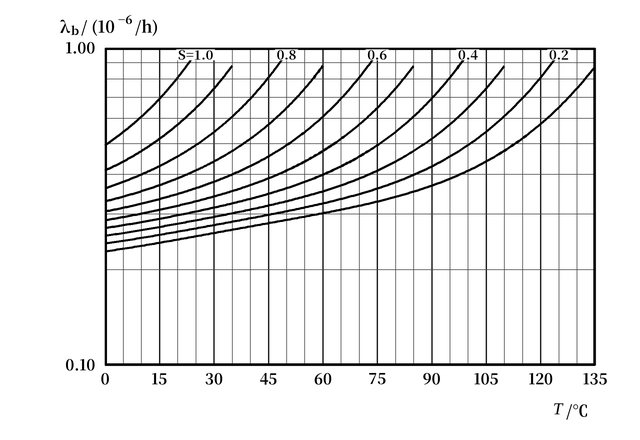

<strong>图 8 微波硅混频二极管基本失效率曲线</strong>

50

---

<strong>GJB/Z 299D—2024</strong>

<strong>表 62 环境系数 <i>π</i>E</strong>

<table>
  <tbody>
    <tr>
      <td>环境</td>
      <td>GB</td>
      <td>GMS</td>
      <td>GF1</td>
      <td>GF2</td>
      <td>GM1</td>
      <td>GM2</td>
      <td>MP</td>
      <td>NSB</td>
      <td>NS1</td>
      <td>NS2</td>
    </tr>
    <tr>
      <td><i>π</i>E</td>
      <td>1.0</td>
      <td>1.2</td>
      <td>2.0</td>
      <td>5.0</td>
      <td>6.0</td>
      <td>15</td>
      <td>7.5</td>
      <td>5.0</td>
      <td>3.5</td>
      <td>7.0</td>
    </tr>
    <tr>
      <td>环境</td>
      <td>NU</td>
      <td>AIF</td>
      <td>AUF</td>
      <td>AIC</td>
      <td>AUC</td>
      <td>ARW</td>
      <td>SF</td>
      <td>ML</td>
      <td>MF</td>
      <td>—</td>
    </tr>
    <tr>
      <td><i>π</i>E</td>
      <td>14</td>
      <td>15</td>
      <td>24</td>
      <td>7.0</td>
      <td>11</td>
      <td>15</td>
      <td>0.60</td>
      <td>28</td>
      <td>15</td>
      <td>—</td>
    </tr>
  </tbody>
</table>

<strong>表 63 质量等级与质量系数 <i>π</i>Q</strong>

<table>
  <thead>
    <tr>
      <th>质量等级</th>
      <th>A3</th>
      <th>A4</th>
      <th>A5</th>
      <th>A6</th>
      <th>B1</th>
      <th>B2</th>
      <th>C</th>
    </tr>
  </thead>
  <tbody>
    <tr>
      <td><i>π</i>Q</td>
      <td>0.06</td>
      <td>0.13</td>
      <td>0.15</td>
      <td>0.25</td>
      <td>0.5</td>
      <td>1.0</td>
      <td>5.0</td>
    </tr>
  </tbody>
</table>

##### 5.3.4.2 其他微波二极管

本条主要对变容、阶跃、隧道、PIN、体效应、雪崩二极管进行失效率预计。

工作失效率预计模型见式(10)。

$$\lambda_{\text{p}} = \lambda_{\text{b}} \pi_{\text{E}} \pi_{\text{Q}} \pi_{\text{K}} \tag{10}$$

式中
$\lambda_{\text{p}}$ ——工作失效率，$10^{-6}/\text{h}$；
$\lambda_{\text{b}}$ ——基本失效率，$10^{-6}/\text{h}$，见表 64 和图 9；
$\pi_{\text{E}}$ ——环境系数，见表 65；
$\pi_{\text{Q}}$ ——质量系数，见表 66；
$\pi_{\text{K}}$ ——种类系数，见表 67。

<strong>表 64 基本失效率 <i>λ</i>b</strong>

单位为 10−6/h

<table>
  <thead>
    <tr>
      <th rowspan="2"><i>T</i> ℃</th>
      <th colspan="10"><i>S</i></th>
    </tr>
    <tr>
      <th>0.1</th>
      <th>0.2</th>
      <th>0.3</th>
      <th>0.4</th>
      <th>0.5</th>
      <th>0.6</th>
      <th>0.7</th>
      <th>0.8</th>
      <th>0.9</th>
      <th>1.0</th>
    </tr>
  </thead>
  <tbody>
    <tr><td>0</td><td>0.093</td><td>0.113</td><td>0.136</td><td>0.162</td><td>0.191</td><td>0.225</td><td>0.266</td><td>0.320</td><td>0.398</td><td>0.526</td></tr>
    <tr><td>5</td><td>0.099</td><td>0.121</td><td>0.145</td><td>0.171</td><td>0.201</td><td>0.237</td><td>0.282</td><td>0.342</td><td>0.434</td><td>0.589</td></tr>
    <tr><td>10</td><td>0.106</td><td>0.128</td><td>0.153</td><td>0.181</td><td>0.213</td><td>0.251</td><td>0.300</td><td>0.368</td><td>0.476</td><td>0.666</td></tr>
    <tr><td>15</td><td>0.113</td><td>0.136</td><td>0.162</td><td>0.191</td><td>0.225</td><td>0.266</td><td>0.320</td><td>0.398</td><td>0.526</td><td>0.765</td></tr>
    <tr><td>20</td><td>0.121</td><td>0.145</td><td>0.171</td><td>0.201</td><td>0.237</td><td>0.282</td><td>0.342</td><td>0.434</td><td>0.589</td><td>0.892</td></tr>
    <tr><td>25</td><td>0.128</td><td>0.153</td><td>0.181</td><td>0.213</td><td>0.251</td><td>0.300</td><td>0.368</td><td>0.476</td><td>0.666</td><td>1.061</td></tr>
    <tr><td>30</td><td>0.136</td><td>0.162</td><td>0.191</td><td>0.225</td><td>0.266</td><td>0.320</td><td>0.398</td><td>0.526</td><td>0.765</td><td>—</td></tr>
    <tr><td>35</td><td>0.145</td><td>0.171</td><td>0.201</td><td>0.237</td><td>0.282</td><td>0.342</td><td>0.434</td><td>0.589</td><td>0.892</td><td>—</td></tr>
    <tr><td>40</td><td>0.153</td><td>0.181</td><td>0.213</td><td>0.251</td><td>0.300</td><td>0.368</td><td>0.476</td><td>0.666</td><td>1.061</td><td>—</td></tr>
    <tr><td>45</td><td>0.162</td><td>0.191</td><td>0.225</td><td>0.266</td><td>0.320</td><td>0.398</td><td>0.526</td><td>0.765</td><td>—</td><td>—</td></tr>
    <tr><td>50</td><td>0.171</td><td>0.201</td><td>0.237</td><td>0.282</td><td>0.342</td><td>0.434</td><td>0.589</td><td>0.892</td><td>—</td><td>—</td></tr>
    <tr><td>55</td><td>0.181</td><td>0.213</td><td>0.251</td><td>0.300</td><td>0.368</td><td>0.476</td><td>0.666</td><td>1.061</td><td>—</td><td>—</td></tr>
    <tr><td>60</td><td>0.191</td><td>0.225</td><td>0.266</td><td>0.320</td><td>0.398</td><td>0.526</td><td>0.765</td><td>—</td><td>—</td><td>—</td></tr>
    <tr><td>65</td><td>0.201</td><td>0.237</td><td>0.282</td><td>0.342</td><td>0.434</td><td>0.589</td><td>0.892</td><td>—</td><td>—</td><td>—</td></tr>
    <tr><td>70</td><td>0.213</td><td>0.251</td><td>0.300</td><td>0.368</td><td>0.476</td><td>0.666</td><td>1.061</td><td>—</td><td>—</td><td>—</td></tr>
    <tr><td>75</td><td>0.225</td><td>0.266</td><td>0.320</td><td>0.398</td><td>0.526</td><td>0.765</td><td>—</td><td>—</td><td>—</td><td>—</td></tr>
    <tr><td>80</td><td>0.237</td><td>0.282</td><td>0.342</td><td>0.434</td><td>0.589</td><td>0.892</td><td>—</td><td>—</td><td>—</td><td>—</td></tr>
  </tbody>
</table>

51

---

<strong>GJB/Z 299D—2024</strong>

<strong>表 64(续)</strong>

单位为 10−6/h

<table>
  <thead>
    <tr>
      <th rowspan="2"><i>T</i> ℃</th>
      <th colspan="10"><i>S</i></th>
    </tr>
    <tr>
      <th>0.1</th>
      <th>0.2</th>
      <th>0.3</th>
      <th>0.4</th>
      <th>0.5</th>
      <th>0.6</th>
      <th>0.7</th>
      <th>0.8</th>
      <th>0.9</th>
      <th>1.0</th>
    </tr>
  </thead>
  <tbody>
    <tr><td>85</td><td>0.251</td><td>0.300</td><td>0.368</td><td>0.476</td><td>0.666</td><td>1.061</td><td>—</td><td>—</td><td>—</td><td>—</td></tr>
    <tr><td>90</td><td>0.266</td><td>0.320</td><td>0.398</td><td>0.526</td><td>0.765</td><td>—</td><td>—</td><td>—</td><td>—</td><td>—</td></tr>
    <tr><td>95</td><td>0.282</td><td>0.342</td><td>0.434</td><td>0.589</td><td>0.892</td><td>—</td><td>—</td><td>—</td><td>—</td><td>—</td></tr>
    <tr><td>100</td><td>0.300</td><td>0.368</td><td>0.476</td><td>0.666</td><td>1.061</td><td>—</td><td>—</td><td>—</td><td>—</td><td>—</td></tr>
    <tr><td>105</td><td>0.320</td><td>0.398</td><td>0.526</td><td>0.765</td><td>—</td><td>—</td><td>—</td><td>—</td><td>—</td><td>—</td></tr>
    <tr><td>110</td><td>0.342</td><td>0.434</td><td>0.589</td><td>0.892</td><td>—</td><td>—</td><td>—</td><td>—</td><td>—</td><td>—</td></tr>
    <tr><td>115</td><td>0.368</td><td>0.476</td><td>0.666</td><td>1.061</td><td>—</td><td>—</td><td>—</td><td>—</td><td>—</td><td>—</td></tr>
    <tr><td>120</td><td>0.398</td><td>0.526</td><td>0.765</td><td>—</td><td>—</td><td>—</td><td>—</td><td>—</td><td>—</td><td>—</td></tr>
    <tr><td>125</td><td>0.434</td><td>0.589</td><td>0.892</td><td>—</td><td>—</td><td>—</td><td>—</td><td>—</td><td>—</td><td>—</td></tr>
    <tr><td>130</td><td>0.476</td><td>0.666</td><td>1.061</td><td>—</td><td>—</td><td>—</td><td>—</td><td>—</td><td>—</td><td>—</td></tr>
    <tr><td>135</td><td>0.526</td><td>0.765</td><td>—</td><td>—</td><td>—</td><td>—</td><td>—</td><td>—</td><td>—</td><td>—</td></tr>
    <tr><td>140</td><td>0.589</td><td>0.892</td><td>—</td><td>—</td><td>—</td><td>—</td><td>—</td><td>—</td><td>—</td><td>—</td></tr>
    <tr><td>145</td><td>0.666</td><td>1.061</td><td>—</td><td>—</td><td>—</td><td>—</td><td>—</td><td>—</td><td>—</td><td>—</td></tr>
    <tr><td>150</td><td>0.765</td><td>—</td><td>—</td><td>—</td><td>—</td><td>—</td><td>—</td><td>—</td><td>—</td><td>—</td></tr>
    <tr><td>155</td><td>0.892</td><td>—</td><td>—</td><td>—</td><td>—</td><td>—</td><td>—</td><td>—</td><td>—</td><td>—</td></tr>
    <tr><td>160</td><td>1.061</td><td>—</td><td>—</td><td>—</td><td>—</td><td>—</td><td>—</td><td>—</td><td>—</td><td>—</td></tr>
    <tr>
      <td colspan="11">注：<i>T</i> 为工作环境温度或带散热片功率器件的管壳温度。 　　<i>S</i> 为电应力比，见 5.3.10。</td>
    </tr>
  </tbody>
</table>

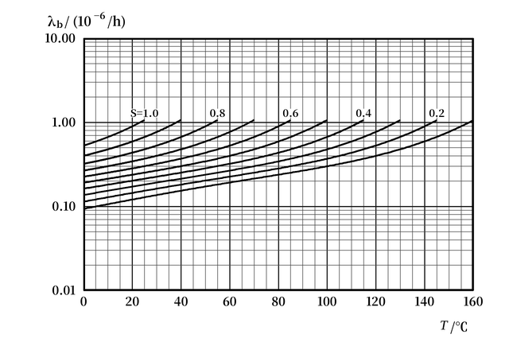

<strong>图 9 变容、阶跃、隧道、PIN、体效应与雪崩二极管基本失效率曲线</strong>

<strong>表 65 环境系数 <i>π</i>E</strong>

<table>
  <tbody>
    <tr>
      <td>环境</td>
      <td>GB</td>
      <td>GMS</td>
      <td>GF1</td>
      <td>GF2</td>
      <td>GM1</td>
      <td>GM2</td>
      <td>MP</td>
      <td>NSB</td>
      <td>NS1</td>
      <td>NS2</td>
    </tr>
    <tr>
      <td><i>π</i>E</td>
      <td>1.0</td>
      <td>1.2</td>
      <td>1.7</td>
      <td>5.0</td>
      <td>5.5</td>
      <td>11</td>
      <td>7.5</td>
      <td>4.5</td>
      <td>3.0</td>
      <td>6.0</td>
    </tr>
    <tr>
      <td>环境</td>
      <td>NU</td>
      <td>AIF</td>
      <td>AUF</td>
      <td>AIC</td>
      <td>AUC</td>
      <td>ARW</td>
      <td>SF</td>
      <td>ML</td>
      <td>MF</td>
      <td>—</td>
    </tr>
    <tr>
      <td><i>π</i>E</td>
      <td>14</td>
      <td>13</td>
      <td>20</td>
      <td>7.0</td>
      <td>11</td>
      <td>15</td>
      <td>0.60</td>
      <td>28</td>
      <td>15</td>
      <td>—</td>
    </tr>
  </tbody>
</table>

52

---

<strong>GJB/Z 299D—2024</strong>

<strong>表 66 质量等级与质量系数 <i>π</i>Q</strong>

<table>
  <thead>
    <tr>
      <th>质量等级</th>
      <th>A2</th>
      <th>A3</th>
      <th>A4</th>
      <th>A5</th>
      <th>A6</th>
      <th>B1</th>
      <th>B2</th>
      <th>C</th>
    </tr>
  </thead>
  <tbody>
    <tr>
      <td><i>π</i>Q</td>
      <td>0.03</td>
      <td>0.05</td>
      <td>0.1</td>
      <td>0.15</td>
      <td>0.2</td>
      <td>0.5</td>
      <td>1.0</td>
      <td>5.0</td>
    </tr>
  </tbody>
</table>

<strong>表 67 种类系数 <i>π</i>K</strong>

<table>
  <thead>
    <tr>
      <th colspan="2">种类</th>
      <th><i>π</i>K</th>
    </tr>
  </thead>
  <tbody>
    <tr>
      <td rowspan="2">变容二极管</td>
      <td>电压控制</td>
      <td>0.5</td>
    </tr>
    <tr>
      <td>倍频器</td>
      <td>2.5</td>
    </tr>
    <tr>
      <td colspan="2">阶跃、隧道二极管</td>
      <td>1.0</td>
    </tr>
    <tr>
      <td rowspan="4">PIN 二极管</td>
      <td><i>P</i> ≤ 10W</td>
      <td>0.5</td>
    </tr>
    <tr>
      <td>10W &lt; <i>P</i> ≤ 100W</td>
      <td>1.3</td>
    </tr>
    <tr>
      <td>100W &lt; <i>P</i> ≤ 1 000W</td>
      <td>2.0</td>
    </tr>
    <tr>
      <td><i>P</i> &gt; 1 000W</td>
      <td>2.4</td>
    </tr>
    <tr>
      <td colspan="2">体效应、雪崩二极管</td>
      <td>5.5</td>
    </tr>
  </tbody>
</table>

#### 5.3.5 双极型晶体管

本条主要包括：小功率晶体管（$< 1\text{W}$）、大功率晶体管（$\ge 1\text{W}$）、开关晶体管与达林顿晶体管。

工作失效率预计模型见式(11)。

$$\lambda_{\text{p}} = \lambda_{\text{b}} \pi_{\text{E}} \pi_{\text{Q}} \pi_{\text{A}} \pi_{\text{S}_2} \pi_{\text{r}} \pi_{\text{C}} \pi_{\text{K}} \tag{11}$$

式中：
$\lambda_{\text{p}}$ ——工作失效率，$10^{-6}/\text{h}$；
$\lambda_{\text{b}}$ ——基本失效率，$10^{-6}/\text{h}$，见表 68～表 70 和图 10～图 12；
$\pi_{\text{E}}$ ——环境系数，见表 71；
$\pi_{\text{Q}}$ ——质量系数，见表 72；
$\pi_{\text{A}}$ ——应用系数，见表 73；
$\pi_{\text{S}_2}$ ——电压应力系数，见表 74；
$\pi_{\text{r}}$ ——额定功率系数，见表 75；
$\pi_{\text{C}}$ ——结构系数，见表 76；
$\pi_{\text{K}}$ ——种类系数，见表 77。

<strong>表 68 小功率晶体管和大功率晶体管基本失效率 <i>λ</i>b</strong>

单位为 10−6/h

<table>
  <thead>
    <tr>
      <th rowspan="2"><i>T</i> ℃</th>
      <th colspan="10"><i>S</i></th>
    </tr>
    <tr>
      <th>0.1</th>
      <th>0.2</th>
      <th>0.3</th>
      <th>0.4</th>
      <th>0.5</th>
      <th>0.6</th>
      <th>0.7</th>
      <th>0.8</th>
      <th>0.9</th>
      <th>1.0</th>
    </tr>
  </thead>
  <tbody>
    <tr><td>0</td><td>0.021</td><td>0.025</td><td>0.029</td><td>0.035</td><td>0.040</td><td>0.047</td><td>0.056</td><td>0.067</td><td>0.083</td><td>0.108</td></tr>
    <tr><td>5</td><td>0.022</td><td>0.026</td><td>0.031</td><td>0.036</td><td>0.042</td><td>0.050</td><td>0.059</td><td>0.071</td><td>0.090</td><td>0.120</td></tr>
    <tr><td>10</td><td>0.023</td><td>0.028</td><td>0.033</td><td>0.038</td><td>0.045</td><td>0.053</td><td>0.063</td><td>0.077</td><td>0.098</td><td>0.135</td></tr>
    <tr><td>15</td><td>0.025</td><td>0.029</td><td>0.035</td><td>0.040</td><td>0.047</td><td>0.056</td><td>0.067</td><td>0.083</td><td>0.108</td><td>0.153</td></tr>
    <tr><td>20</td><td>0.026</td><td>0.031</td><td>0.036</td><td>0.042</td><td>0.050</td><td>0.059</td><td>0.071</td><td>0.090</td><td>0.120</td><td>0.175</td></tr>
    <tr><td>25</td><td>0.028</td><td>0.033</td><td>0.038</td><td>0.045</td><td>0.053</td><td>0.063</td><td>0.077</td><td>0.098</td><td>0.135</td><td>0.204</td></tr>
    <tr><td>30</td><td>0.029</td><td>0.035</td><td>0.040</td><td>0.047</td><td>0.056</td><td>0.067</td><td>0.083</td><td>0.108</td><td>0.153</td><td>—</td></tr>
    <tr><td>35</td><td>0.031</td><td>0.036</td><td>0.042</td><td>0.050</td><td>0.059</td><td>0.071</td><td>0.090</td><td>0.120</td><td>0.175</td><td>—</td></tr>
  </tbody>
</table>

53

---

<strong>GJB/Z 299D—2024</strong>

<strong>表 68(续)</strong>

单位为 10−6/h

<table>
  <thead>
    <tr>
      <th rowspan="2"><i>T</i> ℃</th>
      <th colspan="10"><i>S</i></th>
    </tr>
    <tr>
      <th>0.1</th>
      <th>0.2</th>
      <th>0.3</th>
      <th>0.4</th>
      <th>0.5</th>
      <th>0.6</th>
      <th>0.7</th>
      <th>0.8</th>
      <th>0.9</th>
      <th>1.0</th>
    </tr>
  </thead>
  <tbody>
    <tr><td>40</td><td>0.033</td><td>0.038</td><td>0.045</td><td>0.053</td><td>0.063</td><td>0.077</td><td>0.098</td><td>0.135</td><td>0.204</td><td>—</td></tr>
    <tr><td>45</td><td>0.035</td><td>0.040</td><td>0.047</td><td>0.056</td><td>0.067</td><td>0.083</td><td>0.108</td><td>0.153</td><td>—</td><td>—</td></tr>
    <tr><td>50</td><td>0.036</td><td>0.042</td><td>0.050</td><td>0.059</td><td>0.071</td><td>0.090</td><td>0.120</td><td>0.175</td><td>—</td><td>—</td></tr>
    <tr><td>55</td><td>0.038</td><td>0.045</td><td>0.053</td><td>0.063</td><td>0.077</td><td>0.098</td><td>0.135</td><td>0.204</td><td>—</td><td>—</td></tr>
    <tr><td>60</td><td>0.040</td><td>0.047</td><td>0.056</td><td>0.067</td><td>0.083</td><td>0.108</td><td>0.153</td><td>—</td><td>—</td><td>—</td></tr>
    <tr><td>65</td><td>0.042</td><td>0.050</td><td>0.059</td><td>0.071</td><td>0.090</td><td>0.120</td><td>0.175</td><td>—</td><td>—</td><td>—</td></tr>
    <tr><td>70</td><td>0.045</td><td>0.053</td><td>0.063</td><td>0.077</td><td>0.098</td><td>0.135</td><td>0.204</td><td>—</td><td>—</td><td>—</td></tr>
    <tr><td>75</td><td>0.047</td><td>0.056</td><td>0.067</td><td>0.083</td><td>0.108</td><td>0.153</td><td>—</td><td>—</td><td>—</td><td>—</td></tr>
    <tr><td>80</td><td>0.050</td><td>0.059</td><td>0.071</td><td>0.090</td><td>0.120</td><td>0.175</td><td>—</td><td>—</td><td>—</td><td>—</td></tr>
    <tr><td>85</td><td>0.053</td><td>0.063</td><td>0.077</td><td>0.098</td><td>0.135</td><td>0.204</td><td>—</td><td>—</td><td>—</td><td>—</td></tr>
    <tr><td>90</td><td>0.056</td><td>0.067</td><td>0.083</td><td>0.108</td><td>0.153</td><td>—</td><td>—</td><td>—</td><td>—</td><td>—</td></tr>
    <tr><td>95</td><td>0.059</td><td>0.071</td><td>0.090</td><td>0.120</td><td>0.175</td><td>—</td><td>—</td><td>—</td><td>—</td><td>—</td></tr>
    <tr><td>100</td><td>0.063</td><td>0.077</td><td>0.098</td><td>0.135</td><td>0.204</td><td>—</td><td>—</td><td>—</td><td>—</td><td>—</td></tr>
    <tr><td>105</td><td>0.067</td><td>0.083</td><td>0.108</td><td>0.153</td><td>—</td><td>—</td><td>—</td><td>—</td><td>—</td><td>—</td></tr>
    <tr><td>110</td><td>0.071</td><td>0.090</td><td>0.120</td><td>0.175</td><td>—</td><td>—</td><td>—</td><td>—</td><td>—</td><td>—</td></tr>
    <tr><td>115</td><td>0.077</td><td>0.098</td><td>0.135</td><td>0.204</td><td>—</td><td>—</td><td>—</td><td>—</td><td>—</td><td>—</td></tr>
    <tr><td>120</td><td>0.083</td><td>0.108</td><td>0.153</td><td>—</td><td>—</td><td>—</td><td>—</td><td>—</td><td>—</td><td>—</td></tr>
    <tr><td>125</td><td>0.090</td><td>0.120</td><td>0.175</td><td>—</td><td>—</td><td>—</td><td>—</td><td>—</td><td>—</td><td>—</td></tr>
    <tr><td>130</td><td>0.098</td><td>0.135</td><td>0.204</td><td>—</td><td>—</td><td>—</td><td>—</td><td>—</td><td>—</td><td>—</td></tr>
    <tr><td>135</td><td>0.108</td><td>0.153</td><td>—</td><td>—</td><td>—</td><td>—</td><td>—</td><td>—</td><td>—</td><td>—</td></tr>
    <tr><td>140</td><td>0.120</td><td>0.175</td><td>—</td><td>—</td><td>—</td><td>—</td><td>—</td><td>—</td><td>—</td><td>—</td></tr>
    <tr><td>145</td><td>0.135</td><td>0.204</td><td>—</td><td>—</td><td>—</td><td>—</td><td>—</td><td>—</td><td>—</td><td>—</td></tr>
    <tr><td>150</td><td>0.153</td><td>—</td><td>—</td><td>—</td><td>—</td><td>—</td><td>—</td><td>—</td><td>—</td><td>—</td></tr>
    <tr><td>155</td><td>0.175</td><td>—</td><td>—</td><td>—</td><td>—</td><td>—</td><td>—</td><td>—</td><td>—</td><td>—</td></tr>
    <tr><td>160</td><td>0.204</td><td>—</td><td>—</td><td>—</td><td>—</td><td>—</td><td>—</td><td>—</td><td>—</td><td>—</td></tr>
    <tr>
      <td colspan="11">注：<i>T</i> 为工作环境温度或带散热片功率器件的管壳温度。 　　<i>S</i> 为电应力比，见 5.3.10。</td>
    </tr>
  </tbody>
</table>

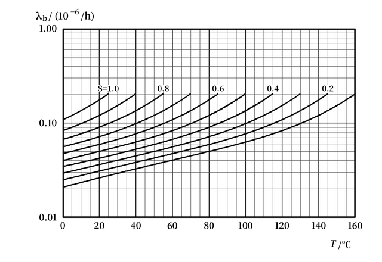

<strong>图 10 小功率晶体管和大功率晶体管基本失效率曲线</strong>

54

---

<strong>GJB/Z 299D—2024</strong>

<strong>表 69 开关晶体管基本失效率 <i>λ</i>b</strong>

单位为 10−6/h

<table>
  <thead>
    <tr>
      <th rowspan="2"><i>T</i> ℃</th>
      <th colspan="10"><i>S</i></th>
    </tr>
    <tr>
      <th>0.1</th>
      <th>0.2</th>
      <th>0.3</th>
      <th>0.4</th>
      <th>0.5</th>
      <th>0.6</th>
      <th>0.7</th>
      <th>0.8</th>
      <th>0.9</th>
      <th>1.0</th>
    </tr>
  </thead>
  <tbody>
    <tr><td>0</td><td>0.022</td><td>0.026</td><td>0.031</td><td>0.037</td><td>0.043</td><td>0.050</td><td>0.059</td><td>0.071</td><td>0.088</td><td>0.115</td></tr>
    <tr><td>5</td><td>0.023</td><td>0.028</td><td>0.033</td><td>0.039</td><td>0.045</td><td>0.053</td><td>0.063</td><td>0.076</td><td>0.096</td><td>0.128</td></tr>
    <tr><td>10</td><td>0.025</td><td>0.030</td><td>0.035</td><td>0.041</td><td>0.048</td><td>0.056</td><td>0.067</td><td>0.082</td><td>0.105</td><td>0.143</td></tr>
    <tr><td>15</td><td>0.026</td><td>0.031</td><td>0.037</td><td>0.043</td><td>0.050</td><td>0.059</td><td>0.071</td><td>0.088</td><td>0.115</td><td>0.163</td></tr>
    <tr><td>20</td><td>0.028</td><td>0.033</td><td>0.039</td><td>0.045</td><td>0.053</td><td>0.063</td><td>0.076</td><td>0.096</td><td>0.128</td><td>0.187</td></tr>
    <tr><td>25</td><td>0.030</td><td>0.035</td><td>0.041</td><td>0.048</td><td>0.056</td><td>0.067</td><td>0.082</td><td>0.105</td><td>0.143</td><td>0.217</td></tr>
    <tr><td>30</td><td>0.031</td><td>0.037</td><td>0.043</td><td>0.050</td><td>0.059</td><td>0.071</td><td>0.088</td><td>0.115</td><td>0.163</td><td>—</td></tr>
    <tr><td>35</td><td>0.033</td><td>0.039</td><td>0.045</td><td>0.053</td><td>0.063</td><td>0.076</td><td>0.096</td><td>0.128</td><td>0.187</td><td>—</td></tr>
    <tr><td>40</td><td>0.035</td><td>0.041</td><td>0.048</td><td>0.056</td><td>0.067</td><td>0.082</td><td>0.105</td><td>0.143</td><td>0.217</td><td>—</td></tr>
    <tr><td>45</td><td>0.037</td><td>0.043</td><td>0.050</td><td>0.059</td><td>0.071</td><td>0.088</td><td>0.115</td><td>0.163</td><td>—</td><td>—</td></tr>
    <tr><td>50</td><td>0.039</td><td>0.045</td><td>0.053</td><td>0.063</td><td>0.076</td><td>0.096</td><td>0.128</td><td>0.187</td><td>—</td><td>—</td></tr>
    <tr><td>55</td><td>0.041</td><td>0.048</td><td>0.056</td><td>0.067</td><td>0.082</td><td>0.105</td><td>0.143</td><td>0.217</td><td>—</td><td>—</td></tr>
    <tr><td>60</td><td>0.043</td><td>0.050</td><td>0.059</td><td>0.071</td><td>0.088</td><td>0.115</td><td>0.163</td><td>—</td><td>—</td><td>—</td></tr>
    <tr><td>65</td><td>0.045</td><td>0.053</td><td>0.063</td><td>0.076</td><td>0.096</td><td>0.128</td><td>0.187</td><td>—</td><td>—</td><td>—</td></tr>
    <tr><td>70</td><td>0.048</td><td>0.056</td><td>0.067</td><td>0.082</td><td>0.105</td><td>0.143</td><td>0.217</td><td>—</td><td>—</td><td>—</td></tr>
    <tr><td>75</td><td>0.050</td><td>0.059</td><td>0.071</td><td>0.088</td><td>0.115</td><td>0.163</td><td>—</td><td>—</td><td>—</td><td>—</td></tr>
    <tr><td>80</td><td>0.053</td><td>0.063</td><td>0.076</td><td>0.096</td><td>0.128</td><td>0.187</td><td>—</td><td>—</td><td>—</td><td>—</td></tr>
    <tr><td>85</td><td>0.056</td><td>0.067</td><td>0.082</td><td>0.105</td><td>0.143</td><td>0.217</td><td>—</td><td>—</td><td>—</td><td>—</td></tr>
    <tr><td>90</td><td>0.059</td><td>0.071</td><td>0.088</td><td>0.115</td><td>0.163</td><td>—</td><td>—</td><td>—</td><td>—</td><td>—</td></tr>
    <tr><td>95</td><td>0.063</td><td>0.076</td><td>0.096</td><td>0.128</td><td>0.187</td><td>—</td><td>—</td><td>—</td><td>—</td><td>—</td></tr>
    <tr><td>100</td><td>0.067</td><td>0.082</td><td>0.105</td><td>0.143</td><td>0.217</td><td>—</td><td>—</td><td>—</td><td>—</td><td>—</td></tr>
    <tr><td>105</td><td>0.071</td><td>0.088</td><td>0.115</td><td>0.163</td><td>—</td><td>—</td><td>—</td><td>—</td><td>—</td><td>—</td></tr>
    <tr><td>110</td><td>0.076</td><td>0.096</td><td>0.128</td><td>0.187</td><td>—</td><td>—</td><td>—</td><td>—</td><td>—</td><td>—</td></tr>
    <tr><td>115</td><td>0.082</td><td>0.105</td><td>0.143</td><td>0.217</td><td>—</td><td>—</td><td>—</td><td>—</td><td>—</td><td>—</td></tr>
    <tr><td>120</td><td>0.088</td><td>0.115</td><td>0.163</td><td>—</td><td>—</td><td>—</td><td>—</td><td>—</td><td>—</td><td>—</td></tr>
    <tr><td>125</td><td>0.096</td><td>0.128</td><td>0.187</td><td>—</td><td>—</td><td>—</td><td>—</td><td>—</td><td>—</td><td>—</td></tr>
    <tr><td>130</td><td>0.105</td><td>0.143</td><td>0.217</td><td>—</td><td>—</td><td>—</td><td>—</td><td>—</td><td>—</td><td>—</td></tr>
    <tr><td>135</td><td>0.115</td><td>0.163</td><td>—</td><td>—</td><td>—</td><td>—</td><td>—</td><td>—</td><td>—</td><td>—</td></tr>
    <tr><td>140</td><td>0.128</td><td>0.187</td><td>—</td><td>—</td><td>—</td><td>—</td><td>—</td><td>—</td><td>—</td><td>—</td></tr>
    <tr><td>145</td><td>0.143</td><td>0.217</td><td>—</td><td>—</td><td>—</td><td>—</td><td>—</td><td>—</td><td>—</td><td>—</td></tr>
    <tr><td>150</td><td>0.163</td><td>—</td><td>—</td><td>—</td><td>—</td><td>—</td><td>—</td><td>—</td><td>—</td><td>—</td></tr>
    <tr><td>155</td><td>0.187</td><td>—</td><td>—</td><td>—</td><td>—</td><td>—</td><td>—</td><td>—</td><td>—</td><td>—</td></tr>
    <tr><td>160</td><td>0.217</td><td>—</td><td>—</td><td>—</td><td>—</td><td>—</td><td>—</td><td>—</td><td>—</td><td>—</td></tr>
    <tr>
      <td colspan="11">注：<i>T</i> 为工作环境温度或带散热片功率器件的管壳温度。 　　<i>S</i> 为电应力比，见 5.3.10。</td>
    </tr>
  </tbody>
</table>

55

---

<strong>GJB/Z 299D—2024</strong>

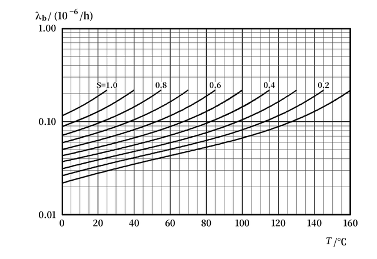

<strong>图 11 开关晶体管基本失效率曲线</strong>

<strong>表 70 达林顿晶体管基本失效率 <i>λ</i>b</strong>

单位为 10−6/h

<table>
  <thead>
    <tr>
      <th rowspan="2"><i>T</i> ℃</th>
      <th colspan="10"><i>S</i></th>
    </tr>
    <tr>
      <th>0.1</th>
      <th>0.2</th>
      <th>0.3</th>
      <th>0.4</th>
      <th>0.5</th>
      <th>0.6</th>
      <th>0.7</th>
      <th>0.8</th>
      <th>0.9</th>
      <th>1.0</th>
    </tr>
  </thead>
  <tbody>
    <tr><td>0</td><td>0.027</td><td>0.032</td><td>0.038</td><td>0.045</td><td>0.052</td><td>0.061</td><td>0.072</td><td>0.087</td><td>0.107</td><td>0.140</td></tr>
    <tr><td>5</td><td>0.029</td><td>0.034</td><td>0.040</td><td>0.047</td><td>0.055</td><td>0.065</td><td>0.076</td><td>0.093</td><td>0.117</td><td>0.156</td></tr>
    <tr><td>10</td><td>0.030</td><td>0.036</td><td>0.043</td><td>0.050</td><td>0.058</td><td>0.068</td><td>0.081</td><td>0.100</td><td>0.127</td><td>0.175</td></tr>
    <tr><td>15</td><td>0.032</td><td>0.038</td><td>0.045</td><td>0.052</td><td>0.061</td><td>0.072</td><td>0.087</td><td>0.107</td><td>0.140</td><td>0.198</td></tr>
    <tr><td>20</td><td>0.034</td><td>0.040</td><td>0.047</td><td>0.055</td><td>0.065</td><td>0.076</td><td>0.093</td><td>0.117</td><td>0.156</td><td>0.228</td></tr>
    <tr><td>25</td><td>0.036</td><td>0.043</td><td>0.050</td><td>0.058</td><td>0.068</td><td>0.081</td><td>0.100</td><td>0.127</td><td>0.175</td><td>0.265</td></tr>
    <tr><td>30</td><td>0.038</td><td>0.045</td><td>0.052</td><td>0.061</td><td>0.072</td><td>0.087</td><td>0.107</td><td>0.140</td><td>0.198</td><td>—</td></tr>
    <tr><td>35</td><td>0.040</td><td>0.047</td><td>0.055</td><td>0.065</td><td>0.076</td><td>0.093</td><td>0.117</td><td>0.156</td><td>0.228</td><td>—</td></tr>
    <tr><td>40</td><td>0.043</td><td>0.050</td><td>0.058</td><td>0.068</td><td>0.081</td><td>0.100</td><td>0.127</td><td>0.175</td><td>0.265</td><td>—</td></tr>
    <tr><td>45</td><td>0.045</td><td>0.052</td><td>0.061</td><td>0.072</td><td>0.087</td><td>0.107</td><td>0.140</td><td>0.198</td><td>—</td><td>—</td></tr>
    <tr><td>50</td><td>0.047</td><td>0.055</td><td>0.065</td><td>0.076</td><td>0.093</td><td>0.117</td><td>0.156</td><td>0.228</td><td>—</td><td>—</td></tr>
    <tr><td>55</td><td>0.050</td><td>0.058</td><td>0.068</td><td>0.081</td><td>0.100</td><td>0.127</td><td>0.175</td><td>0.265</td><td>—</td><td>—</td></tr>
    <tr><td>60</td><td>0.052</td><td>0.061</td><td>0.072</td><td>0.087</td><td>0.107</td><td>0.140</td><td>0.198</td><td>—</td><td>—</td><td>—</td></tr>
    <tr><td>65</td><td>0.055</td><td>0.065</td><td>0.076</td><td>0.093</td><td>0.117</td><td>0.156</td><td>0.228</td><td>—</td><td>—</td><td>—</td></tr>
    <tr><td>70</td><td>0.058</td><td>0.068</td><td>0.081</td><td>0.100</td><td>0.127</td><td>0.175</td><td>0.265</td><td>—</td><td>—</td><td>—</td></tr>
    <tr><td>75</td><td>0.061</td><td>0.072</td><td>0.087</td><td>0.107</td><td>0.140</td><td>0.198</td><td>—</td><td>—</td><td>—</td><td>—</td></tr>
    <tr><td>80</td><td>0.065</td><td>0.076</td><td>0.093</td><td>0.117</td><td>0.156</td><td>0.228</td><td>—</td><td>—</td><td>—</td><td>—</td></tr>
    <tr><td>85</td><td>0.068</td><td>0.081</td><td>0.100</td><td>0.127</td><td>0.175</td><td>0.265</td><td>—</td><td>—</td><td>—</td><td>—</td></tr>
    <tr><td>90</td><td>0.072</td><td>0.087</td><td>0.107</td><td>0.140</td><td>0.198</td><td>—</td><td>—</td><td>—</td><td>—</td><td>—</td></tr>
    <tr><td>95</td><td>0.076</td><td>0.093</td><td>0.117</td><td>0.156</td><td>0.228</td><td>—</td><td>—</td><td>—</td><td>—</td><td>—</td></tr>
    <tr><td>100</td><td>0.081</td><td>0.100</td><td>0.127</td><td>0.175</td><td>0.265</td><td>—</td><td>—</td><td>—</td><td>—</td><td>—</td></tr>
    <tr><td>105</td><td>0.087</td><td>0.107</td><td>0.140</td><td>0.198</td><td>—</td><td>—</td><td>—</td><td>—</td><td>—</td><td>—</td></tr>
    <tr><td>110</td><td>0.093</td><td>0.117</td><td>0.156</td><td>0.228</td><td>—</td><td>—</td><td>—</td><td>—</td><td>—</td><td>—</td></tr>
    <tr><td>115</td><td>0.100</td><td>0.127</td><td>0.175</td><td>0.265</td><td>—</td><td>—</td><td>—</td><td>—</td><td>—</td><td>—</td></tr>
    <tr><td>120</td><td>0.107</td><td>0.140</td><td>0.198</td><td>—</td><td>—</td><td>—</td><td>—</td><td>—</td><td>—</td><td>—</td></tr>
    <tr><td>125</td><td>0.117</td><td>0.156</td><td>0.228</td><td>—</td><td>—</td><td>—</td><td>—</td><td>—</td><td>—</td><td>—</td></tr>
  </tbody>
</table>

56

---

<strong>GJB/Z 299D—2024</strong>

<strong>表 70(续)</strong>

单位为 10−6/h

<table>
  <thead>
    <tr>
      <th rowspan="2"><i>T</i> ℃</th>
      <th colspan="10"><i>S</i></th>
    </tr>
    <tr>
      <th>0.1</th>
      <th>0.2</th>
      <th>0.3</th>
      <th>0.4</th>
      <th>0.5</th>
      <th>0.6</th>
      <th>0.7</th>
      <th>0.8</th>
      <th>0.9</th>
      <th>1.0</th>
    </tr>
  </thead>
  <tbody>
    <tr><td>130</td><td>0.127</td><td>0.175</td><td>0.265</td><td>—</td><td>—</td><td>—</td><td>—</td><td>—</td><td>—</td><td>—</td></tr>
    <tr><td>135</td><td>0.140</td><td>0.198</td><td>—</td><td>—</td><td>—</td><td>—</td><td>—</td><td>—</td><td>—</td><td>—</td></tr>
    <tr><td>140</td><td>0.156</td><td>0.228</td><td>—</td><td>—</td><td>—</td><td>—</td><td>—</td><td>—</td><td>—</td><td>—</td></tr>
    <tr><td>145</td><td>0.175</td><td>0.265</td><td>—</td><td>—</td><td>—</td><td>—</td><td>—</td><td>—</td><td>—</td><td>—</td></tr>
    <tr><td>150</td><td>0.198</td><td>—</td><td>—</td><td>—</td><td>—</td><td>—</td><td>—</td><td>—</td><td>—</td><td>—</td></tr>
    <tr><td>155</td><td>0.228</td><td>—</td><td>—</td><td>—</td><td>—</td><td>—</td><td>—</td><td>—</td><td>—</td><td>—</td></tr>
    <tr><td>160</td><td>0.265</td><td>—</td><td>—</td><td>—</td><td>—</td><td>—</td><td>—</td><td>—</td><td>—</td><td>—</td></tr>
    <tr>
      <td colspan="11">注：<i>T</i> 为工作环境温度或带散热片功率器件的管壳温度。 　　<i>S</i> 为电应力比，见 5.3.10。</td>
    </tr>
  </tbody>
</table>

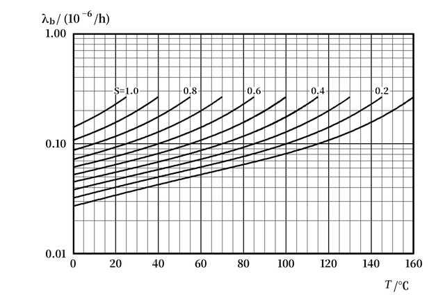

<strong>图 12 达林顿晶体管基本失效率曲线</strong>

<strong>表 71 环境系数 <i>π</i>E</strong>

<table>
  <tbody>
    <tr>
      <td>环境</td>
      <td>GB</td>
      <td>GMS</td>
      <td>GF1</td>
      <td>GF2</td>
      <td>GM1</td>
      <td>GM2</td>
      <td>MP</td>
      <td>NSB</td>
      <td>NS1</td>
      <td>NS2</td>
    </tr>
    <tr>
      <td><i>π</i>E</td>
      <td>1.0</td>
      <td>1.2</td>
      <td>2.0</td>
      <td>5.0</td>
      <td>5.5</td>
      <td>11</td>
      <td>7.5</td>
      <td>5.0</td>
      <td>3.5</td>
      <td>7.0</td>
    </tr>
    <tr>
      <td>环境</td>
      <td>NU</td>
      <td>AIF</td>
      <td>AUF</td>
      <td>AIC</td>
      <td>AUC</td>
      <td>ARW</td>
      <td>SF</td>
      <td>ML</td>
      <td>MF</td>
      <td>—</td>
    </tr>
    <tr>
      <td><i>π</i>E</td>
      <td>14</td>
      <td>15</td>
      <td>24</td>
      <td>7.5</td>
      <td>12</td>
      <td>17</td>
      <td>0.50</td>
      <td>28</td>
      <td>15</td>
      <td>—</td>
    </tr>
  </tbody>
</table>

<strong>表 72 质量等级与质量系数 <i>π</i>Q</strong>

<table>
  <thead>
    <tr>
      <th>质量等级</th>
      <th>A1</th>
      <th>A2</th>
      <th>A3</th>
      <th>A4</th>
      <th>A5</th>
      <th>A6</th>
      <th>B1</th>
      <th>B2</th>
      <th>C</th>
    </tr>
  </thead>
  <tbody>
    <tr>
      <td><i>π</i>Q</td>
      <td>0.015</td>
      <td>0.03</td>
      <td>0.05</td>
      <td>0.1</td>
      <td>0.15</td>
      <td>0.2</td>
      <td>0.4</td>
      <td>1</td>
      <td>5</td>
    </tr>
  </tbody>
</table>

<strong>表 73 应用系数 <i>π</i>A</strong>

<table>
  <thead>
    <tr>
      <th>应用</th>
      <th>线性放大</th>
      <th>高频(200MHz～500MHz)</th>
    </tr>
  </thead>
  <tbody>
    <tr>
      <td><i>π</i>A</td>
      <td>1</td>
      <td>3</td>
    </tr>
  </tbody>
</table>

57

---

<strong>GJB/Z 299D—2024</strong>

<strong>表 74 电压应力系数 <i>π</i>S2</strong>

<table>
  <thead>
    <tr>
      <th><i>S</i>2 = 外加电压 <i>V</i>CE额定电压 <i>V</i>CEO</th>
      <th>1</th>
      <th>0.9</th>
      <th>0.8</th>
      <th>0.7</th>
      <th>0.6</th>
      <th>0.5</th>
      <th>0.4</th>
      <th>0.3</th>
      <th>0.25</th>
      <th>&lt; 0.25</th>
    </tr>
  </thead>
  <tbody>
    <tr>
      <td><i>π</i>S2</td>
      <td>3.0</td>
      <td>2.2</td>
      <td>1.62</td>
      <td>1.2</td>
      <td>0.88</td>
      <td>0.65</td>
      <td>0.48</td>
      <td>0.35</td>
      <td>0.30</td>
      <td>0.30</td>
    </tr>
  </tbody>
</table>

<strong>表 75 额定功率系数 <i>π</i>r</strong>

<table>
  <thead>
    <tr>
      <th>额定功率 <i>P</i> W</th>
      <th><i>P</i> &lt; 0.7</th>
      <th>0.7 ≤ <i>P</i> &lt; 1</th>
      <th>1 ≤ <i>P</i> &lt; 5</th>
      <th>5 ≤ <i>P</i> &lt; 20</th>
      <th>20 ≤ <i>P</i> &lt; 50</th>
      <th>50 ≤ <i>P</i> &lt; 200</th>
      <th><i>P</i> ≥ 200</th>
    </tr>
  </thead>
  <tbody>
    <tr>
      <td><i>π</i>r</td>
      <td>0.80</td>
      <td>1.0</td>
      <td>1.5</td>
      <td>2.2</td>
      <td>3.0</td>
      <td>4.0</td>
      <td>5.5</td>
    </tr>
  </tbody>
</table>

<strong>表 76 结构系数 <i>π</i>C</strong>

<table>
  <thead>
    <tr>
      <th>结构</th>
      <th>双管 (不匹配对或补偿)</th>
      <th>双管 (匹配对)</th>
      <th>单管</th>
      <th>达林顿对</th>
    </tr>
  </thead>
  <tbody>
    <tr>
      <td><i>π</i>C</td>
      <td>0.7</td>
      <td>1.2</td>
      <td>1.0</td>
      <td>0.8</td>
    </tr>
  </tbody>
</table>

<strong>表 77 种类系数 <i>π</i>K</strong>

<table>
  <thead>
    <tr>
      <th>种类</th>
      <th>NPN 型</th>
      <th>PNP 型</th>
    </tr>
  </thead>
  <tbody>
    <tr>
      <td><i>π</i>K</td>
      <td>1.0</td>
      <td>1.8</td>
    </tr>
  </tbody>
</table>

#### 5.3.6 硅场效应晶体管

工作失效率预计模型见式(12)。

$$\lambda_{\text{p}} = \lambda_{\text{b}} \pi_{\text{E}} \pi_{\text{Q}} \pi_{\text{A}} \pi_{\text{r}} \pi_{\text{C}} \pi_{\text{K}} \tag{12}$$

式中：
$\lambda_{\text{p}}$ ——工作失效率，$10^{-6}/\text{h}$；
$\lambda_{\text{b}}$ ——基本失效率，$10^{-6}/\text{h}$，见表 78 和图 13；
$\pi_{\text{E}}$ ——环境系数，见表 79；
$\pi_{\text{Q}}$ ——质量系数，见表 80；
$\pi_{\text{A}}$ ——应用系数，见表 81；
$\pi_{\text{r}}$ ——额定功率系数，见表 82；
$\pi_{\text{C}}$ ——结构系数，见表 83；
$\pi_{\text{K}}$ ——种类系数，见表 84。

<strong>表 78 基本失效率 <i>λ</i>b</strong>

单位为 10−6/h

<table>
  <thead>
    <tr>
      <th rowspan="2"><i>T</i> ℃</th>
      <th colspan="10"><i>S</i></th>
    </tr>
    <tr>
      <th>0.1</th>
      <th>0.2</th>
      <th>0.3</th>
      <th>0.4</th>
      <th>0.5</th>
      <th>0.6</th>
      <th>0.7</th>
      <th>0.8</th>
      <th>0.9</th>
      <th>1.0</th>
    </tr>
  </thead>
  <tbody>
    <tr><td>0</td><td>0.043</td><td>0.052</td><td>0.063</td><td>0.074</td><td>0.088</td><td>0.103</td><td>0.122</td><td>0.147</td><td>0.183</td><td>0.242</td></tr>
    <tr><td>5</td><td>0.046</td><td>0.055</td><td>0.066</td><td>0.079</td><td>0.093</td><td>0.109</td><td>0.130</td><td>0.157</td><td>0.199</td><td>0.271</td></tr>
    <tr><td>10</td><td>0.049</td><td>0.059</td><td>0.070</td><td>0.083</td><td>0.098</td><td>0.115</td><td>0.138</td><td>0.169</td><td>0.219</td><td>0.306</td></tr>
    <tr><td>15</td><td>0.052</td><td>0.063</td><td>0.074</td><td>0.088</td><td>0.103</td><td>0.122</td><td>0.147</td><td>0.183</td><td>0.242</td><td>0.352</td></tr>
    <tr><td>20</td><td>0.055</td><td>0.066</td><td>0.079</td><td>0.093</td><td>0.109</td><td>0.130</td><td>0.157</td><td>0.199</td><td>0.271</td><td>0.410</td></tr>
    <tr><td>25</td><td>0.059</td><td>0.070</td><td>0.083</td><td>0.098</td><td>0.115</td><td>0.138</td><td>0.169</td><td>0.219</td><td>0.306</td><td>0.488</td></tr>
  </tbody>
</table>

58

---

<strong>GJB/Z 299D—2024</strong>

<strong>表 78(续)</strong>

单位为 10−6/h

<table>
  <thead>
    <tr>
      <th rowspan="2"><i>T</i> ℃</th>
      <th colspan="10"><i>S</i></th>
    </tr>
    <tr>
      <th>0.1</th>
      <th>0.2</th>
      <th>0.3</th>
      <th>0.4</th>
      <th>0.5</th>
      <th>0.6</th>
      <th>0.7</th>
      <th>0.8</th>
      <th>0.9</th>
      <th>1.0</th>
    </tr>
  </thead>
  <tbody>
    <tr><td>30</td><td>0.063</td><td>0.074</td><td>0.088</td><td>0.103</td><td>0.122</td><td>0.147</td><td>0.183</td><td>0.242</td><td>0.352</td><td>—</td></tr>
    <tr><td>35</td><td>0.066</td><td>0.079</td><td>0.093</td><td>0.109</td><td>0.130</td><td>0.157</td><td>0.199</td><td>0.271</td><td>0.410</td><td>—</td></tr>
    <tr><td>40</td><td>0.070</td><td>0.083</td><td>0.098</td><td>0.115</td><td>0.138</td><td>0.169</td><td>0.219</td><td>0.306</td><td>0.488</td><td>—</td></tr>
    <tr><td>45</td><td>0.074</td><td>0.088</td><td>0.103</td><td>0.122</td><td>0.147</td><td>0.183</td><td>0.242</td><td>0.352</td><td>—</td><td>—</td></tr>
    <tr><td>50</td><td>0.079</td><td>0.093</td><td>0.109</td><td>0.130</td><td>0.157</td><td>0.199</td><td>0.271</td><td>0.410</td><td>—</td><td>—</td></tr>
    <tr><td>55</td><td>0.083</td><td>0.098</td><td>0.115</td><td>0.138</td><td>0.169</td><td>0.219</td><td>0.306</td><td>0.488</td><td>—</td><td>—</td></tr>
    <tr><td>60</td><td>0.088</td><td>0.103</td><td>0.122</td><td>0.147</td><td>0.183</td><td>0.242</td><td>0.352</td><td>—</td><td>—</td><td>—</td></tr>
    <tr><td>65</td><td>0.093</td><td>0.109</td><td>0.130</td><td>0.157</td><td>0.199</td><td>0.271</td><td>0.410</td><td>—</td><td>—</td><td>—</td></tr>
    <tr><td>70</td><td>0.098</td><td>0.115</td><td>0.138</td><td>0.169</td><td>0.219</td><td>0.306</td><td>0.488</td><td>—</td><td>—</td><td>—</td></tr>
    <tr><td>75</td><td>0.103</td><td>0.122</td><td>0.147</td><td>0.183</td><td>0.242</td><td>0.352</td><td>—</td><td>—</td><td>—</td><td>—</td></tr>
    <tr><td>80</td><td>0.109</td><td>0.130</td><td>0.157</td><td>0.199</td><td>0.271</td><td>0.410</td><td>—</td><td>—</td><td>—</td><td>—</td></tr>
    <tr><td>85</td><td>0.115</td><td>0.138</td><td>0.169</td><td>0.219</td><td>0.306</td><td>0.488</td><td>—</td><td>—</td><td>—</td><td>—</td></tr>
    <tr><td>90</td><td>0.122</td><td>0.147</td><td>0.183</td><td>0.242</td><td>0.352</td><td>—</td><td>—</td><td>—</td><td>—</td><td>—</td></tr>
    <tr><td>95</td><td>0.130</td><td>0.157</td><td>0.199</td><td>0.271</td><td>0.410</td><td>—</td><td>—</td><td>—</td><td>—</td><td>—</td></tr>
    <tr><td>100</td><td>0.138</td><td>0.169</td><td>0.219</td><td>0.306</td><td>0.488</td><td>—</td><td>—</td><td>—</td><td>—</td><td>—</td></tr>
    <tr><td>105</td><td>0.147</td><td>0.183</td><td>0.242</td><td>0.352</td><td>—</td><td>—</td><td>—</td><td>—</td><td>—</td><td>—</td></tr>
    <tr><td>110</td><td>0.157</td><td>0.199</td><td>0.271</td><td>0.410</td><td>—</td><td>—</td><td>—</td><td>—</td><td>—</td><td>—</td></tr>
    <tr><td>115</td><td>0.169</td><td>0.219</td><td>0.306</td><td>0.488</td><td>—</td><td>—</td><td>—</td><td>—</td><td>—</td><td>—</td></tr>
    <tr><td>120</td><td>0.183</td><td>0.242</td><td>0.352</td><td>—</td><td>—</td><td>—</td><td>—</td><td>—</td><td>—</td><td>—</td></tr>
    <tr><td>125</td><td>0.199</td><td>0.271</td><td>0.410</td><td>—</td><td>—</td><td>—</td><td>—</td><td>—</td><td>—</td><td>—</td></tr>
    <tr><td>130</td><td>0.219</td><td>0.306</td><td>0.488</td><td>—</td><td>—</td><td>—</td><td>—</td><td>—</td><td>—</td><td>—</td></tr>
    <tr><td>135</td><td>0.242</td><td>0.352</td><td>—</td><td>—</td><td>—</td><td>—</td><td>—</td><td>—</td><td>—</td><td>—</td></tr>
    <tr><td>140</td><td>0.271</td><td>0.410</td><td>—</td><td>—</td><td>—</td><td>—</td><td>—</td><td>—</td><td>—</td><td>—</td></tr>
    <tr><td>145</td><td>0.306</td><td>0.488</td><td>—</td><td>—</td><td>—</td><td>—</td><td>—</td><td>—</td><td>—</td><td>—</td></tr>
    <tr><td>150</td><td>0.352</td><td>—</td><td>—</td><td>—</td><td>—</td><td>—</td><td>—</td><td>—</td><td>—</td><td>—</td></tr>
    <tr>
      <td colspan="11">注：<i>T</i> 为工作环境温度或带散热片功率器件的管壳温度。 　　<i>S</i> 为电应力比，见 5.3.10。</td>
    </tr>
  </tbody>
</table>

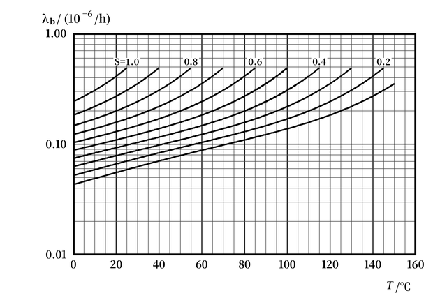

<strong>图 13 硅场效应晶体管基本失效率曲线</strong>

59

---

<strong>GJB/Z 299D—2024</strong>

<strong>表 79 环境系数 <i>π</i>E</strong>

<table>
  <tbody>
    <tr>
      <td>环境</td>
      <td>GB</td>
      <td>GMS</td>
      <td>GF1</td>
      <td>GF2</td>
      <td>GM1</td>
      <td>GM2</td>
      <td>MP</td>
      <td>NSB</td>
      <td>NS1</td>
      <td>NS2</td>
    </tr>
    <tr>
      <td><i>π</i>E</td>
      <td>1.0</td>
      <td>1.2</td>
      <td>2.0</td>
      <td>5.0</td>
      <td>5.5</td>
      <td>11</td>
      <td>7.5</td>
      <td>5.0</td>
      <td>3.5</td>
      <td>7.0</td>
    </tr>
    <tr>
      <td>环境</td>
      <td>NU</td>
      <td>AIF</td>
      <td>AUF</td>
      <td>AIC</td>
      <td>AUC</td>
      <td>ARW</td>
      <td>SF</td>
      <td>ML</td>
      <td>MF</td>
      <td>—</td>
    </tr>
    <tr>
      <td><i>π</i>E</td>
      <td>14</td>
      <td>15</td>
      <td>24</td>
      <td>7.5</td>
      <td>12</td>
      <td>17</td>
      <td>0.60</td>
      <td>28</td>
      <td>15</td>
      <td>—</td>
    </tr>
  </tbody>
</table>

<strong>表 80 质量等级与质量系数 <i>π</i>Q</strong>

<table>
  <thead>
    <tr>
      <th>质量等级</th>
      <th>A2</th>
      <th>A3</th>
      <th>A4</th>
      <th>A5</th>
      <th>A6</th>
      <th>B1</th>
      <th>B2</th>
      <th>C</th>
    </tr>
  </thead>
  <tbody>
    <tr>
      <td><i>π</i>Q</td>
      <td>0.03</td>
      <td>0.05</td>
      <td>0.1</td>
      <td>0.15</td>
      <td>0.2</td>
      <td>0.5</td>
      <td>1.0</td>
      <td>5.0</td>
    </tr>
  </tbody>
</table>

<strong>表 81 应用系数 <i>π</i>A</strong>

<table>
  <thead>
    <tr>
      <th>应用</th>
      <th>线性放大</th>
      <th>开关</th>
      <th>高频 <i>f</i> &gt; 400MHz</th>
    </tr>
  </thead>
  <tbody>
    <tr>
      <td><i>π</i>A</td>
      <td>1.0</td>
      <td>0.5</td>
      <td>0.8</td>
    </tr>
  </tbody>
</table>

<strong>表 82 额定功率系数 <i>π</i>r</strong>

<table>
  <thead>
    <tr>
      <th>额定功率 <i>P</i> W</th>
      <th><i>P</i> ≤ 0.5</th>
      <th>0.5 &lt; <i>P</i> ≤ 1</th>
      <th>1 &lt; <i>P</i> ≤ 5</th>
      <th>5 &lt; <i>P</i> ≤ 20</th>
      <th>20 &lt; <i>P</i> ≤ 50</th>
      <th>50 &lt; <i>P</i> ≤ 200</th>
      <th><i>P</i> &gt; 200</th>
    </tr>
  </thead>
  <tbody>
    <tr>
      <td><i>π</i>r</td>
      <td>0.8</td>
      <td>1.0</td>
      <td>1.5</td>
      <td>2.2</td>
      <td>3.0</td>
      <td>4.0</td>
      <td>5.5</td>
    </tr>
  </tbody>
</table>

<strong>表 83 结构系数 <i>π</i>C</strong>

<table>
  <thead>
    <tr>
      <th>结构</th>
      <th>单管</th>
      <th>双管 (不匹配或补偿)</th>
      <th>双管 (匹配)</th>
      <th>四极管</th>
    </tr>
  </thead>
  <tbody>
    <tr>
      <td><i>π</i>C</td>
      <td>1.0</td>
      <td>0.70</td>
      <td>1.2</td>
      <td>1.1</td>
    </tr>
  </tbody>
</table>

<strong>表 84 种类系数 <i>π</i>K</strong>

<table>
  <thead>
    <tr>
      <th>种类</th>
      <th>结型</th>
      <th>MOS 型</th>
    </tr>
  </thead>
  <tbody>
    <tr>
      <td><i>π</i>K</td>
      <td>0.38</td>
      <td>1.0</td>
    </tr>
  </tbody>
</table>

#### 5.3.7 微波晶体管

##### 5.3.7.1 微波双极型晶体管

工作失效率预计模型见式(13)。

$$\lambda_{\text{p}} = \lambda_{\text{b}} \pi_{\text{E}} \pi_{\text{Q}} \pi_{\text{A}} \pi_{\text{T}} \pi_{\text{M}} \pi_{\text{B}} \tag{13}$$

式中：
$\lambda_{\text{p}}$ ——工作失效率，$10^{-6}/\text{h}$；
$\lambda_{\text{b}}$ ——基本失效率，$10^{-6}/\text{h}$，见表 85；
$\pi_{\text{E}}$ ——环境系数，见表 86；
$\pi_{\text{Q}}$ ——质量系数，见表 87；
$\pi_{\text{A}}$ ——应用系数，见表 88；
$\pi_{\text{T}}$ ——温度应力系数，见表 89 与表 90；

60

---

<strong>GJB/Z 299D—2024</strong>

$\pi_{\text{M}}$ ——匹配网络系数，见表 91；
$\pi_{\text{B}}$ ——发射极镇流系数，见表 92。

<strong>表 85 基本失效率 <i>λ</i>b</strong>

单位为 10−6/h

<table>
  <thead>
    <tr>
      <th rowspan="2">工作 频率 <i>f</i> GHz</th>
      <th colspan="11">输出功率 <i>P</i> W</th>
    </tr>
    <tr>
      <th>&lt; 1.0</th>
      <th>1.0</th>
      <th>5.0</th>
      <th>10</th>
      <th>50</th>
      <th>100</th>
      <th>200</th>
      <th>300</th>
      <th>400</th>
      <th>500</th>
      <th>600</th>
    </tr>
  </thead>
  <tbody>
    <tr><td>0.5</td><td>0.038 8</td><td>0.039 0</td><td>0.039 9</td><td>0.041 0</td><td>0.051 3</td><td>0.067 8</td><td>0.118 4</td><td>0.206 9</td><td>0.361 5</td><td>0.631 6</td><td>1.103 5</td></tr>
    <tr><td>1</td><td>0.046 3</td><td>0.046 6</td><td>0.047 6</td><td>0.049 0</td><td>0.061 2</td><td>0.080 9</td><td>0.141 4</td><td>0.247 0</td><td>0.431 5</td><td>—</td><td>—</td></tr>
    <tr><td>2</td><td>0.066 0</td><td>0.066 3</td><td>0.067 8</td><td>0.069 8</td><td>0.087 2</td><td>0.115 3</td><td>0.201 4</td><td>0.351 9</td><td>—</td><td>—</td><td>—</td></tr>
    <tr><td>3</td><td>0.094 0</td><td>0.094 5</td><td>0.096 7</td><td>0.099 4</td><td>0.124 2</td><td>0.164 2</td><td>0.286 9</td><td>—</td><td>—</td><td>—</td><td>—</td></tr>
    <tr><td>4</td><td>0.133 9</td><td>0.134 7</td><td>0.137 7</td><td>0.141 6</td><td>0.177 0</td><td>0.234 0</td><td>0.408 8</td><td>—</td><td>—</td><td>—</td><td>—</td></tr>
    <tr><td>5</td><td>0.190 8</td><td>0.191 9</td><td>0.196 2</td><td>0.201 8</td><td>0.252 2</td><td>0.333 4</td><td>0.582 4</td><td>—</td><td>—</td><td>—</td><td>—</td></tr>
    <tr><td>6</td><td>0.271 8</td><td>0.273 4</td><td>0.279 5</td><td>0.287 4</td><td>0.359 3</td><td>0.475 0</td><td>0.829 8</td><td>—</td><td>—</td><td>—</td><td>—</td></tr>
    <tr><td>7</td><td>0.387 3</td><td>0.389 5</td><td>0.398 3</td><td>0.409 5</td><td>0.512 0</td><td>0.676 7</td><td>—</td><td>—</td><td>—</td><td>—</td><td>—</td></tr>
    <tr><td>8</td><td>0.551 8</td><td>0.554 9</td><td>0.567 4</td><td>0.583 5</td><td>0.729 4</td><td>0.964 1</td><td>—</td><td>—</td><td>—</td><td>—</td><td>—</td></tr>
    <tr><td>9</td><td>0.786 2</td><td>0.790 6</td><td>0.808 5</td><td>0.831 3</td><td>1.039 2</td><td>—</td><td>—</td><td>—</td><td>—</td><td>—</td><td>—</td></tr>
    <tr><td>10</td><td>1.120 2</td><td>1.126 4</td><td>1.151 9</td><td>1.184 5</td><td>1.480 7</td><td>—</td><td>—</td><td>—</td><td>—</td><td>—</td><td>—</td></tr>
  </tbody>
</table>

<strong>表 86 环境系数 <i>π</i>E</strong>

<table>
  <tbody>
    <tr>
      <td>环境</td>
      <td>GB</td>
      <td>GMS</td>
      <td>GF1</td>
      <td>GF2</td>
      <td>GM1</td>
      <td>GM2</td>
      <td>MP</td>
      <td>NSB</td>
      <td>NS1</td>
      <td>NS2</td>
    </tr>
    <tr>
      <td><i>π</i>E</td>
      <td>1.0</td>
      <td>1.2</td>
      <td>2.0</td>
      <td>5.0</td>
      <td>5.5</td>
      <td>11</td>
      <td>7.5</td>
      <td>5.0</td>
      <td>3.5</td>
      <td>7.8</td>
    </tr>
    <tr>
      <td>环境</td>
      <td>NU</td>
      <td>AIF</td>
      <td>AUF</td>
      <td>AIC</td>
      <td>AUC</td>
      <td>ARW</td>
      <td>SF</td>
      <td>ML</td>
      <td>MF</td>
      <td>—</td>
    </tr>
    <tr>
      <td><i>π</i>E</td>
      <td>14</td>
      <td>15</td>
      <td>24</td>
      <td>7.5</td>
      <td>12</td>
      <td>17</td>
      <td>0.60</td>
      <td>28</td>
      <td>15</td>
      <td>—</td>
    </tr>
  </tbody>
</table>

<strong>表 87 质量等级与质量系数 <i>π</i>Q</strong>

<table>
  <thead>
    <tr>
      <th>质量等级</th>
      <th>A2</th>
      <th>A3</th>
      <th>A4</th>
      <th>A5</th>
      <th>A6</th>
      <th>B1</th>
      <th>B2</th>
      <th>C</th>
    </tr>
  </thead>
  <tbody>
    <tr>
      <td><i>π</i>Q</td>
      <td>0.03</td>
      <td>0.05</td>
      <td>0.10</td>
      <td>0.15</td>
      <td>0.2</td>
      <td>0.5</td>
      <td>1.0</td>
      <td>5.0</td>
    </tr>
  </tbody>
</table>

<strong>表 88 应用系数 <i>π</i>A</strong>

<table>
  <thead>
    <tr>
      <th>应用状态</th>
      <th>占空系数%</th>
      <th><i>π</i>A</th>
    </tr>
  </thead>
  <tbody>
    <tr>
      <td>连续波</td>
      <td>—</td>
      <td>6.0</td>
    </tr>
    <tr>
      <td rowspan="5">脉冲</td>
      <td>≤ 1</td>
      <td>0.66</td>
    </tr>
    <tr>
      <td>5</td>
      <td>1.00</td>
    </tr>
    <tr>
      <td>10</td>
      <td>1.43</td>
    </tr>
    <tr>
      <td>15</td>
      <td>1.86</td>
    </tr>
    <tr>
      <td>20</td>
      <td>2.29</td>
    </tr>
    <tr>
      <td rowspan="3">脉冲</td>
      <td>25</td>
      <td>2.72</td>
    </tr>
    <tr>
      <td>30</td>
      <td>3.15</td>
    </tr>
    <tr>
      <td>&gt; 30</td>
      <td>4.70</td>
    </tr>
  </tbody>
</table>

61

---

<strong>GJB/Z 299D—2024</strong>

<strong>表 89 温度应力系数 <i>π</i>T (金金属化)</strong>

<table>
  <thead>
    <tr>
      <th rowspan="2"><i>T</i> ℃</th>
      <th colspan="4"><i>V</i>Sa</th>
    </tr>
    <tr>
      <th>≤ 0.40</th>
      <th>0.45</th>
      <th>0.50</th>
      <th>0.55</th>
    </tr>
  </thead>
  <tbody>
    <tr><td>0</td><td>1.0</td><td>1.5</td><td>2.0</td><td>2.5</td></tr>
    <tr><td>10</td><td>1.2</td><td>1.8</td><td>2.5</td><td>3.1</td></tr>
    <tr><td>20</td><td>1.5</td><td>2.3</td><td>3.0</td><td>3.8</td></tr>
    <tr><td>30</td><td>1.8</td><td>2.7</td><td>3.6</td><td>4.5</td></tr>
    <tr><td>40</td><td>2.1</td><td>3.2</td><td>4.3</td><td>5.4</td></tr>
    <tr><td>50</td><td>2.5</td><td>3.8</td><td>5.0</td><td>6.3</td></tr>
    <tr><td>60</td><td>2.9</td><td>4.4</td><td>5.9</td><td>7.4</td></tr>
    <tr><td>70</td><td>3.4</td><td>5.1</td><td>6.8</td><td>8.5</td></tr>
    <tr><td>80</td><td>4.0</td><td>6.0</td><td>7.9</td><td>9.9</td></tr>
    <tr><td>90</td><td>4.5</td><td>6.8</td><td>9.1</td><td>11.4</td></tr>
    <tr><td>100</td><td>5.7</td><td>8.6</td><td>10.0</td><td>13.0</td></tr>
    <tr>
      <td colspan="5">注：<i>T</i> 为工作环境温度或带散热片功率器件的管壳温度。 a <i>V</i>S 按式(14)计算：<i>V</i>S = <i>V</i>CE / <i>BV</i>CES ⋯⋯⋯⋯ (14)</td>
    </tr>
  </tbody>
</table>

<strong>表 90 温度应力系数 <i>π</i>T (铝金属化)</strong>

<table>
  <thead>
    <tr>
      <th rowspan="2">T ℃</th>
      <th colspan="4"><i>V</i>Sa</th>
    </tr>
    <tr>
      <th>≤ 0.40</th>
      <th>0.45</th>
      <th>0.50</th>
      <th>0.55</th>
    </tr>
  </thead>
  <tbody>
    <tr><td>0</td><td>1.00</td><td>1.50</td><td>2.00</td><td>2.5</td></tr>
    <tr><td>10</td><td>1.50</td><td>2.25</td><td>3.00</td><td>3.75</td></tr>
    <tr><td>20</td><td>2.20</td><td>3.30</td><td>4.40</td><td>5.51</td></tr>
    <tr><td>30</td><td>3.18</td><td>4.77</td><td>6.36</td><td>7.95</td></tr>
    <tr><td>40</td><td>4.50</td><td>6.75</td><td>9.00</td><td>11.25</td></tr>
    <tr><td>50</td><td>6.27</td><td>9.41</td><td>12.54</td><td>15.68</td></tr>
    <tr><td>60</td><td>8.60</td><td>12.90</td><td>17.20</td><td>21.50</td></tr>
    <tr><td>70</td><td>11.64</td><td>17.46</td><td>23.28</td><td>29.10</td></tr>
    <tr><td>80</td><td>15.53</td><td>23.30</td><td>31.06</td><td>38.83</td></tr>
    <tr><td>90</td><td>20.48</td><td>30.72</td><td>40.96</td><td>51.20</td></tr>
    <tr><td>100</td><td>26.68</td><td>40.02</td><td>53.36</td><td>66.70</td></tr>
    <tr>
      <td colspan="5">注：<i>T</i> 为工作环境温度或带散热片功率器件的管壳温度。 a <i>V</i>S 按式(15)计算：<i>V</i>S = <i>V</i>CE / <i>BV</i>CES ⋯⋯⋯⋯ (15)</td>
    </tr>
  </tbody>
</table>

<strong>表 91 匹配网络系数 <i>π</i>M</strong>

<table>
  <thead>
    <tr>
      <th>匹配形式</th>
      <th>输入、输出匹配</th>
      <th>仅输入或输出匹配</th>
      <th>不匹配</th>
    </tr>
  </thead>
  <tbody>
    <tr>
      <td><i>π</i>M</td>
      <td>1.0</td>
      <td>2.0</td>
      <td>4.0</td>
    </tr>
  </tbody>
</table>

62

---

<strong>GJB/Z 299D—2024</strong>

<strong>表 92 发射极镇流系数 <i>π</i>B</strong>

<table>
  <thead>
    <tr>
      <th>镇流程度</th>
      <th>无镇流</th>
      <th>弱镇流 (4～6<i>kT</i>/<i>QI</i>E)</th>
      <th>中镇流 (6～8<i>kT</i>/<i>QI</i>E)</th>
      <th>强镇流 (8～10<i>kT</i>/<i>QI</i>E)</th>
    </tr>
  </thead>
  <tbody>
    <tr>
      <td><i>π</i>B</td>
      <td>2.0</td>
      <td>1.0</td>
      <td>0.50</td>
      <td>0.30</td>
    </tr>
    <tr>
      <td colspan="5">注：k 为波耳兹曼常数，<i>T</i> 为绝对温度(开)，<i>Q</i> 为电子电荷(库仑)，<i>I</i>E 为发射极电流(安培)。</td>
    </tr>
  </tbody>
</table>

##### 5.3.7.2 微波场效应晶体管

工作失效率预计模型见式(16)。

$$\lambda_{\text{p}} = \lambda_{\text{b}} \pi_{\text{E}} \pi_{\text{Q}} \pi_{\text{A}} \pi_{\text{T}} \pi_{\text{M}} \tag{16}$$

式中：
$\lambda_{\text{p}}$ ——工作失效率，$10^{-6}/\text{h}$；
$\lambda_{\text{b}}$ ——基本失效率，$10^{-6}/\text{h}$，GaAs 微波场效应晶体管的基本失效率，见表 93，GaN 微波场效应晶体管取值为 0.017 8；
$\pi_{\text{E}}$ ——环境系数，见表 94；
$\pi_{\text{Q}}$ ——质量系数，见表 95；
$\pi_{\text{A}}$ ——应用系数，见表 96；
$\pi_{\text{T}}$ ——温度应力系数，见表 97、表 98；
$\pi_{\text{M}}$ ——匹配网络系数，见表 99。

<strong>表 93 GaAs 微波场效应晶体管基本失效率 <i>λ</i>b</strong>

单位为 10−6/h

<table>
  <thead>
    <tr>
      <th rowspan="2">工作频率 <i>f</i> GHz</th>
      <th colspan="8">平均输出功率 <i>P</i> W</th>
    </tr>
    <tr>
      <th>&lt; 0.1</th>
      <th>0.1</th>
      <th>0.5</th>
      <th>1</th>
      <th>2</th>
      <th>4</th>
      <th>6</th>
      <th>8</th>
    </tr>
  </thead>
  <tbody>
    <tr><td>1</td><td>0.145</td><td>0.152</td><td>0.185</td><td>0.236</td><td>0.384</td><td>1.015</td><td>2.682</td><td>7.089</td></tr>
    <tr><td>2</td><td>0.182</td><td>0.191</td><td>0.232</td><td>0.296</td><td>0.481</td><td>1.271</td><td>3.358</td><td>8.877</td></tr>
    <tr><td>3</td><td>0.228</td><td>0.239</td><td>0.290</td><td>0.370</td><td>0.602</td><td>1.591</td><td>4.206</td><td>11.117</td></tr>
    <tr><td>4</td><td>0.285</td><td>0.299</td><td>0.364</td><td>0.464</td><td>0.754</td><td>1.993</td><td>5.267</td><td>13.922</td></tr>
    <tr><td>5</td><td>0.357</td><td>0.375</td><td>0.455</td><td>0.581</td><td>0.944</td><td>2.495</td><td>6.596</td><td>17.435</td></tr>
    <tr><td>6</td><td>0.447</td><td>0.470</td><td>0.570</td><td>0.727</td><td>1.182</td><td>3.125</td><td>8.260</td><td>21.834</td></tr>
    <tr><td>8</td><td>0.702</td><td>0.736</td><td>0.894</td><td>1.141</td><td>1.854</td><td>4.901</td><td>12.955</td><td>34.243</td></tr>
    <tr><td>10</td><td>1.100</td><td>1.155</td><td>1.403</td><td>1.789</td><td>2.908</td><td>7.687</td><td>20.317</td><td>53.703</td></tr>
    <tr><td>12</td><td>1.725</td><td>1.811</td><td>2.200</td><td>2.805</td><td>4.561</td><td>12.055</td><td>31.864</td><td>84.224</td></tr>
    <tr><td>15</td><td>3.389</td><td>3.558</td><td>4.321</td><td>5.510</td><td>8.957</td><td>23.676</td><td>62.582</td><td>165.418</td></tr>
    <tr><td>18</td><td>6.656</td><td>6.987</td><td>8.487</td><td>10.821</td><td>17.593</td><td>46.501</td><td>122.913</td><td>324.887</td></tr>
  </tbody>
</table>

<strong>表 94 环境系数 <i>π</i>E</strong>

<table>
  <tbody>
    <tr>
      <td>环境</td>
      <td>GB</td>
      <td>GMS</td>
      <td>GF1</td>
      <td>GF2</td>
      <td>GM1</td>
      <td>GM2</td>
      <td>MP</td>
      <td>NSB</td>
      <td>NS1</td>
      <td>NS2</td>
    </tr>
    <tr>
      <td><i>π</i>E</td>
      <td>1.0</td>
      <td>1.2</td>
      <td>2.0</td>
      <td>5.0</td>
      <td>5.5</td>
      <td>11</td>
      <td>7.5</td>
      <td>5.0</td>
      <td>3.5</td>
      <td>7.0</td>
    </tr>
    <tr>
      <td>环境</td>
      <td>NU</td>
      <td>AIF</td>
      <td>AUF</td>
      <td>AIC</td>
      <td>AUC</td>
      <td>ARW</td>
      <td>SF</td>
      <td>ML</td>
      <td>MF</td>
      <td>—</td>
    </tr>
    <tr>
      <td><i>π</i>E</td>
      <td>14</td>
      <td>15</td>
      <td>24</td>
      <td>7.5</td>
      <td>12</td>
      <td>17</td>
      <td>0.60</td>
      <td>28</td>
      <td>15</td>
      <td>—</td>
    </tr>
  </tbody>
</table>

63

---

<strong>GJB/Z 299D—2024</strong>

<strong>表 95 质量等级与质量系数 <i>π</i>Q</strong>

<table>
  <thead>
    <tr>
      <th>质量等级</th>
      <th>A2</th>
      <th>A3</th>
      <th>A4</th>
      <th>A5</th>
      <th>A6</th>
      <th>B1</th>
      <th>B2</th>
      <th>C</th>
    </tr>
  </thead>
  <tbody>
    <tr>
      <td><i>π</i>Q</td>
      <td>0.03</td>
      <td>0.05</td>
      <td>0.1</td>
      <td>0.15</td>
      <td>0.2</td>
      <td>0.5</td>
      <td>1</td>
      <td>5</td>
    </tr>
  </tbody>
</table>

<strong>表 96 应用系数 <i>π</i>A</strong>

<table>
  <thead>
    <tr>
      <th rowspan="2"><i>π</i>A</th>
      <th colspan="2">应用</th>
    </tr>
    <tr>
      <th>低功耗或脉冲</th>
      <th>连续</th>
    </tr>
  </thead>
  <tbody>
    <tr>
      <td>GaAs 微波场效应晶体管</td>
      <td>1</td>
      <td>3</td>
    </tr>
    <tr>
      <td>GaN 微波场效应晶体管</td>
      <td>13</td>
      <td>1</td>
    </tr>
  </tbody>
</table>

<strong>表 97 GaAs 微波场效应晶体管温度应力系数 <i>π</i>T</strong>

<table>
  <thead>
    <tr>
      <th><i>T</i></th>
      <th>GaAs 微波场效应晶体管</th>
      <th><i>T</i></th>
      <th>GaAs 微波场效应晶体管</th>
    </tr>
  </thead>
  <tbody>
    <tr><td>≤ 30</td><td>0.22</td><td>90</td><td>2.49</td></tr>
    <tr><td>35</td><td>0.27</td><td>95</td><td>2.95</td></tr>
    <tr><td>40</td><td>0.35</td><td>100</td><td>3.47</td></tr>
    <tr><td>45</td><td>0.43</td><td>105</td><td>4.07</td></tr>
    <tr><td>50</td><td>0.54</td><td>110</td><td>4.75</td></tr>
    <tr><td>55</td><td>0.67</td><td>120</td><td>5.53</td></tr>
    <tr><td>60</td><td>0.82</td><td>125</td><td>6.40</td></tr>
    <tr><td>65</td><td>1.00</td><td>135</td><td>7.39</td></tr>
    <tr><td>70</td><td>1.21</td><td>145</td><td>8.50</td></tr>
    <tr><td>75</td><td>1.46</td><td>155</td><td>9.74</td></tr>
    <tr><td>80</td><td>1.76</td><td>165</td><td>11.13</td></tr>
    <tr><td>85</td><td>2.10</td><td>175</td><td>12.67</td></tr>
    <tr>
      <td colspan="4">注：<i>T</i> 为沟道温度，℃。</td>
    </tr>
  </tbody>
</table>

<strong>表 98 GaN 微波场效应晶体管温度应力系数 <i>π</i>T</strong>

<table>
  <thead>
    <tr>
      <th><i>T</i></th>
      <th>GaN 微波场效应晶体管</th>
      <th><i>T</i></th>
      <th>GaN 微波场效应晶体管</th>
    </tr>
  </thead>
  <tbody>
    <tr><td>≤ 65</td><td>0.000 7</td><td>135</td><td>2.72</td></tr>
    <tr><td>70</td><td>0.001 4</td><td>140</td><td>4.40</td></tr>
    <tr><td>75</td><td>0.002 8</td><td>145</td><td>7.05</td></tr>
    <tr><td>80</td><td>0.005 5</td><td>150</td><td>11.16</td></tr>
    <tr><td>85</td><td>0.010</td><td>155</td><td>17.48</td></tr>
    <tr><td>90</td><td>0.020</td><td>160</td><td>27.10</td></tr>
    <tr><td>95</td><td>0.036</td><td>165</td><td>41.60</td></tr>
    <tr><td>100</td><td>0.065</td><td>170</td><td>63.22</td></tr>
    <tr><td>105</td><td>0.12</td><td>175</td><td>95.20</td></tr>
    <tr><td>110</td><td>0.20</td><td>180</td><td>142.06</td></tr>
    <tr><td>115</td><td>0.35</td><td>185</td><td>210.14</td></tr>
    <tr><td>120</td><td>0.59</td><td>190</td><td>308.24</td></tr>
    <tr><td>125</td><td>1.00</td><td>195</td><td>448.44</td></tr>
    <tr><td>130</td><td>1.66</td><td>200</td><td>647.26</td></tr>
    <tr>
      <td colspan="4">注：<i>T</i> 为沟道温度，℃。</td>
    </tr>
  </tbody>
</table>

64

---

<strong>GJB/Z 299D—2024</strong>

<strong>表 99 匹配网络系数 <i>π</i>M</strong>

<table>
  <thead>
    <tr>
      <th>匹配形式</th>
      <th>输入、输出匹配</th>
      <th>仅输入或输出匹配</th>
      <th>不匹配</th>
    </tr>
  </thead>
  <tbody>
    <tr>
      <td><i>π</i>M</td>
      <td>1</td>
      <td>2</td>
      <td>4</td>
    </tr>
  </tbody>
</table>

#### 5.3.8 单结晶体管

工作失效率预计模型见式(17)。

$$\lambda_{\text{p}} = \lambda_{\text{b}} \pi_{\text{E}} \pi_{\text{Q}} \tag{17}$$

式中：
$\lambda_{\text{p}}$ ——工作失效率，$10^{-6}/\text{h}$；
$\lambda_{\text{b}}$ ——基本失效率，$10^{-6}/\text{h}$，见表 100 和图 14；
$\pi_{\text{E}}$ ——环境系数，见表 101；
$\pi_{\text{Q}}$ ——质量系数，见表 102。

<strong>表 100 基本失效率 <i>λ</i>b</strong>

单位为 10−6/h

<table>
  <thead>
    <tr>
      <th rowspan="2"><i>T</i> ℃</th>
      <th colspan="10"><i>S</i></th>
    </tr>
    <tr>
      <th>0.1</th>
      <th>0.2</th>
      <th>0.3</th>
      <th>0.4</th>
      <th>0.5</th>
      <th>0.6</th>
      <th>0.7</th>
      <th>0.8</th>
      <th>0.9</th>
      <th>1.0</th>
    </tr>
  </thead>
  <tbody>
    <tr><td>0</td><td>0.061</td><td>0.083</td><td>0.110</td><td>0.143</td><td>0.182</td><td>0.230</td><td>0.291</td><td>0.373</td><td>0.493</td><td>0.687</td></tr>
    <tr><td>5</td><td>0.068</td><td>0.091</td><td>0.120</td><td>0.155</td><td>0.197</td><td>0.249</td><td>0.316</td><td>0.408</td><td>0.546</td><td>0.782</td></tr>
    <tr><td>10</td><td>0.075</td><td>0.100</td><td>0.131</td><td>0.168</td><td>0.213</td><td>0.269</td><td>0.343</td><td>0.447</td><td>0.610</td><td>0.899</td></tr>
    <tr><td>15</td><td>0.083</td><td>0.110</td><td>0.143</td><td>0.182</td><td>0.230</td><td>0.291</td><td>0.373</td><td>0.493</td><td>0.687</td><td>1.049</td></tr>
    <tr><td>20</td><td>0.091</td><td>0.120</td><td>0.155</td><td>0.197</td><td>0.249</td><td>0.316</td><td>0.408</td><td>0.546</td><td>0.782</td><td>1.244</td></tr>
    <tr><td>25</td><td>0.100</td><td>0.131</td><td>0.168</td><td>0.213</td><td>0.269</td><td>0.343</td><td>0.447</td><td>0.610</td><td>0.899</td><td>1.502</td></tr>
    <tr><td>30</td><td>0.110</td><td>0.143</td><td>0.182</td><td>0.230</td><td>0.291</td><td>0.373</td><td>0.493</td><td>0.687</td><td>1.049</td><td>—</td></tr>
    <tr><td>35</td><td>0.120</td><td>0.155</td><td>0.197</td><td>0.249</td><td>0.316</td><td>0.408</td><td>0.546</td><td>0.782</td><td>1.244</td><td>—</td></tr>
    <tr><td>40</td><td>0.131</td><td>0.168</td><td>0.213</td><td>0.269</td><td>0.343</td><td>0.447</td><td>0.610</td><td>0.899</td><td>1.502</td><td>—</td></tr>
    <tr><td>45</td><td>0.143</td><td>0.182</td><td>0.230</td><td>0.291</td><td>0.373</td><td>0.493</td><td>0.687</td><td>1.049</td><td>—</td><td>—</td></tr>
    <tr><td>50</td><td>0.155</td><td>0.197</td><td>0.249</td><td>0.316</td><td>0.408</td><td>0.546</td><td>0.782</td><td>1.244</td><td>—</td><td>—</td></tr>
    <tr><td>55</td><td>0.168</td><td>0.213</td><td>0.269</td><td>0.343</td><td>0.447</td><td>0.610</td><td>0.899</td><td>1.502</td><td>—</td><td>—</td></tr>
    <tr><td>60</td><td>0.182</td><td>0.230</td><td>0.291</td><td>0.373</td><td>0.493</td><td>0.687</td><td>1.049</td><td>—</td><td>—</td><td>—</td></tr>
    <tr><td>65</td><td>0.197</td><td>0.249</td><td>0.316</td><td>0.408</td><td>0.546</td><td>0.782</td><td>1.244</td><td>—</td><td>—</td><td>—</td></tr>
    <tr><td>70</td><td>0.213</td><td>0.269</td><td>0.343</td><td>0.447</td><td>0.610</td><td>0.899</td><td>1.502</td><td>—</td><td>—</td><td>—</td></tr>
    <tr><td>75</td><td>0.230</td><td>0.291</td><td>0.373</td><td>0.493</td><td>0.687</td><td>1.049</td><td>—</td><td>—</td><td>—</td><td>—</td></tr>
    <tr><td>80</td><td>0.249</td><td>0.316</td><td>0.408</td><td>0.546</td><td>0.782</td><td>1.244</td><td>—</td><td>—</td><td>—</td><td>—</td></tr>
    <tr><td>85</td><td>0.269</td><td>0.343</td><td>0.447</td><td>0.610</td><td>0.899</td><td>1.502</td><td>—</td><td>—</td><td>—</td><td>—</td></tr>
    <tr><td>90</td><td>0.291</td><td>0.373</td><td>0.493</td><td>0.687</td><td>1.049</td><td>—</td><td>—</td><td>—</td><td>—</td><td>—</td></tr>
    <tr><td>95</td><td>0.316</td><td>0.408</td><td>0.546</td><td>0.782</td><td>1.244</td><td>—</td><td>—</td><td>—</td><td>—</td><td>—</td></tr>
    <tr><td>100</td><td>0.343</td><td>0.447</td><td>0.610</td><td>0.899</td><td>1.502</td><td>—</td><td>—</td><td>—</td><td>—</td><td>—</td></tr>
    <tr><td>105</td><td>0.373</td><td>0.493</td><td>0.687</td><td>1.049</td><td>—</td><td>—</td><td>—</td><td>—</td><td>—</td><td>—</td></tr>
    <tr><td>110</td><td>0.408</td><td>0.546</td><td>0.782</td><td>1.244</td><td>—</td><td>—</td><td>—</td><td>—</td><td>—</td><td>—</td></tr>
    <tr><td>115</td><td>0.447</td><td>0.610</td><td>0.899</td><td>1.502</td><td>—</td><td>—</td><td>—</td><td>—</td><td>—</td><td>—</td></tr>
    <tr><td>120</td><td>0.493</td><td>0.687</td><td>1.049</td><td>—</td><td>—</td><td>—</td><td>—</td><td>—</td><td>—</td><td>—</td></tr>
  </tbody>
</table>

65

---

<strong>GJB/Z 299D—2024</strong>

<strong>表 100(续)</strong>

单位为 10−6/h

<table>
  <thead>
    <tr>
      <th rowspan="2"><i>T</i> ℃</th>
      <th colspan="10"><i>S</i></th>
    </tr>
    <tr>
      <th>0.1</th>
      <th>0.2</th>
      <th>0.3</th>
      <th>0.4</th>
      <th>0.5</th>
      <th>0.6</th>
      <th>0.7</th>
      <th>0.8</th>
      <th>0.9</th>
      <th>1.0</th>
    </tr>
  </thead>
  <tbody>
    <tr><td>125</td><td>0.546</td><td>0.782</td><td>1.244</td><td>—</td><td>—</td><td>—</td><td>—</td><td>—</td><td>—</td><td>—</td></tr>
    <tr><td>130</td><td>0.610</td><td>0.899</td><td>1.502</td><td>—</td><td>—</td><td>—</td><td>—</td><td>—</td><td>—</td><td>—</td></tr>
    <tr><td>135</td><td>0.687</td><td>1.049</td><td>—</td><td>—</td><td>—</td><td>—</td><td>—</td><td>—</td><td>—</td><td>—</td></tr>
    <tr><td>140</td><td>0.782</td><td>1.244</td><td>—</td><td>—</td><td>—</td><td>—</td><td>—</td><td>—</td><td>—</td><td>—</td></tr>
    <tr><td>145</td><td>0.899</td><td>1.502</td><td>—</td><td>—</td><td>—</td><td>—</td><td>—</td><td>—</td><td>—</td><td>—</td></tr>
    <tr><td>150</td><td>1.049</td><td>—</td><td>—</td><td>—</td><td>—</td><td>—</td><td>—</td><td>—</td><td>—</td><td>—</td></tr>
    <tr><td>155</td><td>1.244</td><td>—</td><td>—</td><td>—</td><td>—</td><td>—</td><td>—</td><td>—</td><td>—</td><td>—</td></tr>
    <tr><td>160</td><td>1.502</td><td>—</td><td>—</td><td>—</td><td>—</td><td>—</td><td>—</td><td>—</td><td>—</td><td>—</td></tr>
    <tr>
      <td colspan="11">注：<i>T</i> 为工作环境温度或带散热片功率器件的管壳温度。 　　<i>S</i> 为电应力比，见 5.3.10。</td>
    </tr>
  </tbody>
</table>

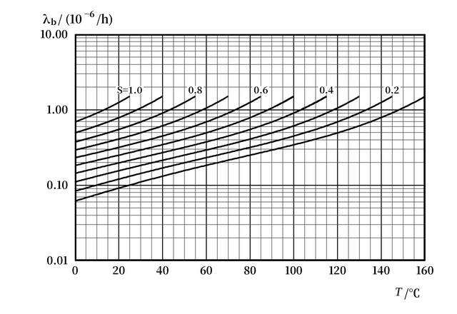

<strong>图 14 单结晶体管基本失效率曲线</strong>

<strong>表 101 环境系数 <i>π</i>E</strong>

<table>
  <tbody>
    <tr>
      <td>环境</td>
      <td>GB</td>
      <td>GMS</td>
      <td>GF1</td>
      <td>GF2</td>
      <td>GM1</td>
      <td>GM2</td>
      <td>MP</td>
      <td>NSB</td>
      <td>NS1</td>
      <td>NS2</td>
    </tr>
    <tr>
      <td><i>π</i>E</td>
      <td>1.0</td>
      <td>1.2</td>
      <td>2.0</td>
      <td>5.0</td>
      <td>5.5</td>
      <td>11</td>
      <td>7.5</td>
      <td>5.0</td>
      <td>3.5</td>
      <td>7.0</td>
    </tr>
    <tr>
      <td>环境</td>
      <td>NU</td>
      <td>AIF</td>
      <td>AUF</td>
      <td>AIC</td>
      <td>AUC</td>
      <td>ARW</td>
      <td>SF</td>
      <td>ML</td>
      <td>MF</td>
      <td>—</td>
    </tr>
    <tr>
      <td><i>π</i>E</td>
      <td>14</td>
      <td>15</td>
      <td>24</td>
      <td>7.5</td>
      <td>12</td>
      <td>17</td>
      <td>0.60</td>
      <td>28</td>
      <td>15</td>
      <td>—</td>
    </tr>
  </tbody>
</table>

<strong>表 102 质量等级与质量系数 <i>π</i>Q</strong>

<table>
  <thead>
    <tr>
      <th>质量等级</th>
      <th>A3</th>
      <th>A4</th>
      <th>A5</th>
      <th>A6</th>
      <th>B1</th>
      <th>B2</th>
      <th>C</th>
    </tr>
  </thead>
  <tbody>
    <tr>
      <td><i>π</i>Q</td>
      <td>0.05</td>
      <td>0.1</td>
      <td>0.15</td>
      <td>0.2</td>
      <td>0.5</td>
      <td>1</td>
      <td>5</td>
    </tr>
  </tbody>
</table>

#### 5.3.9 闸流晶体管

工作失效率预计模型见式(18)。

$$\lambda_{\text{p}} = \lambda_{\text{b}} \pi_{\text{E}} \pi_{\text{Q}} \pi_{\text{r}} \pi_{\text{S}_2} \tag{18}$$

式中：
$\lambda_{\text{p}}$ ——工作失效率，$10^{-6}/\text{h}$；

66

---

<strong>GJB/Z 299D—2024</strong>

$\lambda_{\text{b}}$ ——基本失效率，$10^{-6}/\text{h}$，见表 103 和图 15；
$\pi_{\text{E}}$ ——环境系数，见表 104；
$\pi_{\text{Q}}$ ——质量系数，见表 105；
$\pi_{\text{r}}$ ——额定电流系数，见表 106；
$\pi_{\text{S}_2}$ ——电压应力系数，见表 107。

<strong>表 103 基本失效率 <i>λ</i>b</strong>

单位为 10−6/h

<table>
  <thead>
    <tr>
      <th rowspan="2"><i>T</i> ℃</th>
      <th colspan="10"><i>S</i></th>
    </tr>
    <tr>
      <th>0.1</th>
      <th>0.2</th>
      <th>0.3</th>
      <th>0.4</th>
      <th>0.5</th>
      <th>0.6</th>
      <th>0.7</th>
      <th>0.8</th>
      <th>0.9</th>
      <th>1.0</th>
    </tr>
  </thead>
  <tbody>
    <tr><td>0</td><td>0.033</td><td>0.043</td><td>0.055</td><td>0.069</td><td>0.087</td><td>0.108</td><td>0.136</td><td>0.172</td><td>0.222</td><td>0.294</td></tr>
    <tr><td>5</td><td>0.038</td><td>0.049</td><td>0.062</td><td>0.077</td><td>0.097</td><td>0.121</td><td>0.153</td><td>0.195</td><td>0.254</td><td>0.342</td></tr>
    <tr><td>10</td><td>0.043</td><td>0.055</td><td>0.069</td><td>0.087</td><td>0.108</td><td>0.136</td><td>0.172</td><td>0.222</td><td>0.294</td><td>0.404</td></tr>
    <tr><td>15</td><td>0.049</td><td>0.062</td><td>0.077</td><td>0.097</td><td>0.121</td><td>0.153</td><td>0.195</td><td>0.254</td><td>0.342</td><td>0.482</td></tr>
    <tr><td>20</td><td>0.055</td><td>0.069</td><td>0.087</td><td>0.108</td><td>0.136</td><td>0.172</td><td>0.222</td><td>0.294</td><td>0.404</td><td>0.586</td></tr>
    <tr><td>25</td><td>0.062</td><td>0.077</td><td>0.097</td><td>0.121</td><td>0.153</td><td>0.195</td><td>0.254</td><td>0.342</td><td>0.482</td><td>0.725</td></tr>
    <tr><td>30</td><td>0.069</td><td>0.087</td><td>0.108</td><td>0.136</td><td>0.172</td><td>0.222</td><td>0.294</td><td>0.404</td><td>0.586</td><td>—</td></tr>
    <tr><td>35</td><td>0.077</td><td>0.097</td><td>0.121</td><td>0.153</td><td>0.195</td><td>0.254</td><td>0.342</td><td>0.482</td><td>0.725</td><td>—</td></tr>
    <tr><td>40</td><td>0.087</td><td>0.108</td><td>0.136</td><td>0.172</td><td>0.222</td><td>0.294</td><td>0.404</td><td>0.586</td><td>—</td><td>—</td></tr>
    <tr><td>45</td><td>0.097</td><td>0.121</td><td>0.153</td><td>0.195</td><td>0.254</td><td>0.342</td><td>0.482</td><td>0.725</td><td>—</td><td>—</td></tr>
    <tr><td>50</td><td>0.108</td><td>0.136</td><td>0.172</td><td>0.222</td><td>0.294</td><td>0.404</td><td>0.586</td><td>—</td><td>—</td><td>—</td></tr>
    <tr><td>55</td><td>0.121</td><td>0.153</td><td>0.195</td><td>0.254</td><td>0.342</td><td>0.482</td><td>0.725</td><td>—</td><td>—</td><td>—</td></tr>
    <tr><td>60</td><td>0.136</td><td>0.172</td><td>0.222</td><td>0.294</td><td>0.404</td><td>0.586</td><td>—</td><td>—</td><td>—</td><td>—</td></tr>
    <tr><td>65</td><td>0.153</td><td>0.195</td><td>0.254</td><td>0.342</td><td>0.482</td><td>0.725</td><td>—</td><td>—</td><td>—</td><td>—</td></tr>
    <tr><td>70</td><td>0.172</td><td>0.222</td><td>0.294</td><td>0.404</td><td>0.586</td><td>—</td><td>—</td><td>—</td><td>—</td><td>—</td></tr>
    <tr><td>75</td><td>0.195</td><td>0.254</td><td>0.342</td><td>0.482</td><td>0.725</td><td>—</td><td>—</td><td>—</td><td>—</td><td>—</td></tr>
    <tr><td>80</td><td>0.222</td><td>0.294</td><td>0.404</td><td>0.586</td><td>—</td><td>—</td><td>—</td><td>—</td><td>—</td><td>—</td></tr>
    <tr><td>85</td><td>0.254</td><td>0.342</td><td>0.482</td><td>0.725</td><td>—</td><td>—</td><td>—</td><td>—</td><td>—</td><td>—</td></tr>
    <tr><td>90</td><td>0.294</td><td>0.404</td><td>0.586</td><td>—</td><td>—</td><td>—</td><td>—</td><td>—</td><td>—</td><td>—</td></tr>
    <tr><td>95</td><td>0.342</td><td>0.482</td><td>0.725</td><td>—</td><td>—</td><td>—</td><td>—</td><td>—</td><td>—</td><td>—</td></tr>
    <tr><td>100</td><td>0.404</td><td>0.586</td><td>—</td><td>—</td><td>—</td><td>—</td><td>—</td><td>—</td><td>—</td><td>—</td></tr>
    <tr><td>105</td><td>0.482</td><td>0.725</td><td>—</td><td>—</td><td>—</td><td>—</td><td>—</td><td>—</td><td>—</td><td>—</td></tr>
    <tr><td>110</td><td>0.586</td><td>—</td><td>—</td><td>—</td><td>—</td><td>—</td><td>—</td><td>—</td><td>—</td><td>—</td></tr>
    <tr><td>115</td><td>0.725</td><td>—</td><td>—</td><td>—</td><td>—</td><td>—</td><td>—</td><td>—</td><td>—</td><td>—</td></tr>
    <tr>
      <td colspan="11">注：<i>T</i> 为工作环境温度或带散热片功率器件的管壳温度。 　　<i>S</i> 为电应力比，见 5.3.10。</td>
    </tr>
  </tbody>
</table>

67

---

<strong>GJB/Z 299D—2024</strong>

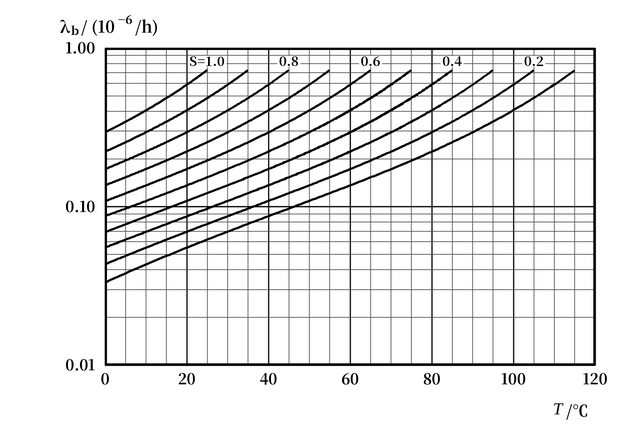

<strong>图 15 闸流晶体管基本失效率曲线</strong>

<strong>表 104 环境系数 <i>π</i>E</strong>

<table>
  <tbody>
    <tr>
      <td>环境</td>
      <td>GB</td>
      <td>GMS</td>
      <td>GF1</td>
      <td>GF2</td>
      <td>GM1</td>
      <td>GM2</td>
      <td>MP</td>
      <td>NSB</td>
      <td>NS1</td>
      <td>NS2</td>
    </tr>
    <tr>
      <td><i>π</i>E</td>
      <td>1.0</td>
      <td>1.2</td>
      <td>2.0</td>
      <td>5.0</td>
      <td>5.5</td>
      <td>11</td>
      <td>7.5</td>
      <td>5.5</td>
      <td>3.5</td>
      <td>7.0</td>
    </tr>
    <tr>
      <td>环境</td>
      <td>NU</td>
      <td>AIF</td>
      <td>AUF</td>
      <td>AIC</td>
      <td>AUC</td>
      <td>ARW</td>
      <td>SF</td>
      <td>ML</td>
      <td>MF</td>
      <td>—</td>
    </tr>
    <tr>
      <td><i>π</i>E</td>
      <td>14</td>
      <td>15</td>
      <td>24</td>
      <td>7.5</td>
      <td>12</td>
      <td>17</td>
      <td>0.6</td>
      <td>28</td>
      <td>15</td>
      <td>—</td>
    </tr>
  </tbody>
</table>

<strong>表 105 质量等级与质量系数 <i>π</i>Q</strong>

<table>
  <thead>
    <tr>
      <th>质量等级</th>
      <th>A3</th>
      <th>A4</th>
      <th>A5</th>
      <th>A6</th>
      <th>B1</th>
      <th>B2</th>
      <th>C</th>
    </tr>
  </thead>
  <tbody>
    <tr>
      <td><i>π</i>Q</td>
      <td>0.05</td>
      <td>0.1</td>
      <td>0.15</td>
      <td>0.2</td>
      <td>0.5</td>
      <td>1</td>
      <td>5</td>
    </tr>
  </tbody>
</table>

<strong>表 106 额定电流系数 <i>π</i>r</strong>

<table>
  <tbody>
    <tr>
      <td>额定平均通态电流 <i>I</i> A</td>
      <td>0.1 &lt; <i>I</i> ≤ 0.5</td>
      <td>0.5 &lt; <i>I</i> ≤ 1</td>
      <td>1 &lt; <i>I</i> ≤ 5</td>
      <td>5 &lt; <i>I</i> ≤ 20</td>
    </tr>
    <tr>
      <td><i>π</i>r</td>
      <td>0.76</td>
      <td>1.0</td>
      <td>1.9</td>
      <td>3.3</td>
    </tr>
    <tr>
      <td>额定平均通态电流 <i>I</i> A</td>
      <td>20 &lt; <i>I</i> ≤ 50</td>
      <td>50 &lt; <i>I</i> ≤ 100</td>
      <td>100 &lt; <i>I</i> ≤ 200</td>
      <td><i>I</i> &gt; 200</td>
    </tr>
    <tr>
      <td><i>π</i>r</td>
      <td>4.8</td>
      <td>6.3</td>
      <td>8.0</td>
      <td>10</td>
    </tr>
  </tbody>
</table>

<strong>表 107 电压应力系数 <i>π</i>S2</strong>

<table>
  <tbody>
    <tr>
      <td><i>S</i>2 = 应用阻塞电压额定阻塞电压</td>
      <td><i>S</i>2 ≤ 0.3</td>
      <td>0.3 &lt; <i>S</i>2 ≤ 0.4</td>
      <td>0.4 &lt; <i>S</i>2 ≤ 0.5</td>
      <td>0.5 &lt; <i>S</i>2 ≤ 0.6</td>
    </tr>
    <tr>
      <td><i>π</i>S2</td>
      <td>0.30</td>
      <td>0.54</td>
      <td>0.81</td>
      <td>1.1</td>
    </tr>
    <tr>
      <td><i>S</i>2 = 应用阻塞电压额定阻塞电压</td>
      <td>0.6 &lt; <i>S</i>2 ≤ 0.7</td>
      <td>0.7 &lt; <i>S</i>2 ≤ 0.8</td>
      <td>0.8 &lt; <i>S</i>2 ≤ 0.9</td>
      <td>0.9 &lt; <i>S</i>2 ≤ 1</td>
    </tr>
    <tr>
      <td><i>π</i>S2</td>
      <td>1.5</td>
      <td>2.0</td>
      <td>2.5</td>
      <td>3.0</td>
    </tr>
  </tbody>
</table>

#### 5.3.10 半导体分立器件失效率预计模型的使用说明

##### 5.3.10.1 器件的额定值

晶体管的额定值一般为最大功率耗散值，二极管的额定值一般为最大允许电流值，通常每种器件规定两个额定温度点，即：$T_{\text{M}}$ 和 $T_{\text{S}}$。

68

---

<strong>GJB/Z 299D—2024</strong>

当工作环境温度或管壳温度高于 $T_{\text{S}}$ 值时，负荷应参照图 16 的降额曲线降额，以便内部升温不超过最高允许结温 $T_{\text{M}}$。最高允许结温通常为 $175^\circ\text{C}\sim 200^\circ\text{C}$（微波管为 $150^\circ\text{C}$）。

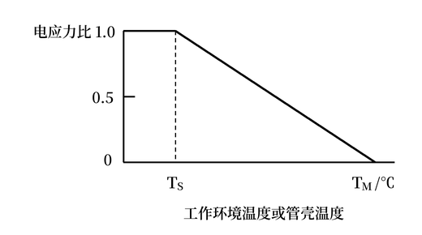

<strong>图 16 典型的降额曲线</strong>

##### 5.3.10.2 电应力调整系数（$C$）和温度（$T$）的校正

以上基本失效率表 47～表 103 是根据典型的额定温度 $T_{\text{M}}$、$T_{\text{S}}$ 值而制定的，如果所要预计的器件的 $T_{\text{M}}$ 较低或 $T_{\text{S}}$ 较高，在应用 $\lambda_{\text{b}}$ 表之前，器件的电应力比和环境温度（$T$）或管壳温度（$T_{\text{C}}$）则应加以调整。

器件的电应力调整系数（$C$）校正：

a) 对于 $T_{\text{S}} = 25^\circ\text{C}$ 及 $T_{\text{M}} = 175^\circ\text{C}\sim 200^\circ\text{C}$ 的器件，则 $C = 1$；

b) 对于 $T_{\text{S}} > 25^\circ\text{C}$ 及 $T_{\text{M}} = 175^\circ\text{C}\sim 200^\circ\text{C}$ 的器件，则按式(19)计算：

$$C = \frac{175 - T_{\text{S}}}{150} \tag{19}$$

c) 对于 $T_{\text{S}} = 25^\circ\text{C}$ 及 $T_{\text{M}} < 175^\circ\text{C}$ 的器件，则按式(20)计算：

$$C = \frac{T_{\text{M}} - 25}{150} \tag{20}$$

d) 对于 $T_{\text{S}} > 25^\circ\text{C}$ 及 $T_{\text{M}} < 175^\circ\text{C}$ 的器件，则按式(21)计算。

$$C = \frac{T_{\text{M}} - T_{\text{S}}}{150} \tag{21}$$

器件的温度（$T$）校正按式(22)计算。

$$T = T + (1 - C) \times 150 \tag{22}$$

##### 5.3.10.3 电应力比的计算

各类半导体分立器件的电应力比计算方法如下：

a) 晶体管的电应力比

对于一个管壳中仅有一个晶体管的器件，电应力按式(23)计算。

$$S = \frac{P_{\text{OP}}}{P_{\text{M}}} C \tag{23}$$

式中：
$P_{\text{OP}}$ ——使用功耗，$\text{W}$；
$P_{\text{M}}$ ——$T_{\text{S}}$ 时的额定功耗，$\text{W}$。

对于一个管壳中装有两个晶体管的器件，管壳中单管 $S$ 按式(24)计算。

$$S = \left[ \frac{P_1}{P_{\text{S}}} + P_2 \left( \frac{2P_{\text{S}} - P_{\text{T}}}{P_{\text{T}} P_{\text{S}}} \right) \right] C \tag{24}$$

69

---

<strong>GJB/Z 299D—2024</strong>

式中：
$S$ ——所要计算的单管的电应力比；
$P_1$ ——所要计算的单管的使用功耗，$\text{W}$；
$P_{\text{S}}$ ——两管中另一个不工作，所要计算的单管在 $T_{\text{S}}$ 时的额定功耗值（单管额定值），$\text{W}$；
$P_2$ ——另一单管的使用功耗，$\text{W}$；
$P_{\text{T}}$ ——两管都工作，在 $T_{\text{S}}$ 时的额定功耗值（两管额定值），$\text{W}$。

b) 普通二极管和闸流晶体管的电应力比按式(25)计算。

$$S = \frac{I_{\text{OP}}}{I_{\text{M}}} C \tag{25}$$

式中：
$I_{\text{OP}}$ ——使用的平均正向电流，$\text{A}$；
$I_{\text{M}}$ ——在 $T_{\text{S}}$ 时的额定平均正向电流，$\text{A}$。

c) 齐纳二极管的电应力比

齐纳二极管的额定值为最大电流或功率，按式(26)计算。

$$S = \frac{P_{\text{OP}}}{P_{\text{M}}} C \text{ 或 } S = \frac{I_{\text{Z(OP)}}}{I_{\text{Z(M)}}} C \tag{26}$$

式中：
$I_{\text{Z(OP)}}$ ——实际使用电流，$\text{A}$；
$I_{\text{Z(M)}}$ ——$T_{\text{S}}$ 时的额定电流，$\text{A}$。

d) 微波混频二极管的电应力比按式(27)计算。

$$S = \frac{J_1}{J_2} \tag{27}$$

式中：
$J_1$ ——工作尖峰漏泄能量，$\text{J}$；
$J_2$ ——$25^\circ\text{C}$ 时额定烧毁能量，$\text{J}$。

e) 微波检波二极管的电应力比按式(28)计算。

$$S = \frac{P_{\text{OP}}}{P_{\text{M}}} \tag{28}$$

f) 变容，阶跃，隧道，体效应与 PIN 二极管的电应力比按式(29)计算。

$$S = \frac{P_{\text{OP}}}{P_{\text{M}}} C \tag{29}$$

### 5.4 光电子器件

工作失效率预计模型见式(30)。

$$\lambda_{\text{p}} = \lambda_{\text{b}} \pi_{\text{E}} \pi_{\text{Q}} \pi_{\text{T}} \tag{30}$$

式中：
$\lambda_{\text{p}}$ ——工作失效率，$10^{-6}/\text{h}$；
$\lambda_{\text{b}}$ ——基本失效率，$10^{-6}/\text{h}$，见表 108；
$\pi_{\text{E}}$ ——环境系数，见表 109；

70

---

<strong>GJB/Z 299D—2024</strong>

$\pi_{\text{Q}}$ ——质量系数，见表 110；
$\pi_{\text{T}}$ ——温度应力系数，见表 111。

<strong>表 108 基本失效率 <i>λ</i>b</strong>

单位为 10−6/h

<table>
  <thead>
    <tr>
      <th colspan="2">种类</th>
      <th><i>λ</i>b</th>
    </tr>
  </thead>
  <tbody>
    <tr>
      <td colspan="2">发光二极管</td>
      <td>0.001 4</td>
    </tr>
    <tr>
      <td colspan="2">红外发光二极管</td>
      <td>0.013</td>
    </tr>
    <tr>
      <td colspan="2">光电二极管</td>
      <td>0.023</td>
    </tr>
    <tr>
      <td colspan="2">激光二极管</td>
      <td>0.045</td>
    </tr>
    <tr>
      <td colspan="2">光电晶体管</td>
      <td>0.073</td>
    </tr>
    <tr>
      <td colspan="2">简单式光电耦合器</td>
      <td>0.04</td>
    </tr>
    <tr>
      <td colspan="2">复合式光电耦合器</td>
      <td>0.16</td>
    </tr>
    <tr>
      <td colspan="2">单位数码管</td>
      <td>0.005 1</td>
    </tr>
    <tr>
      <td colspan="2">多位数码管</td>
      <td>0.004 8 + 0.002 1 × 位数</td>
    </tr>
    <tr>
      <td rowspan="2">光电二极管探测器</td>
      <td>单隔离</td>
      <td>0.024</td>
    </tr>
    <tr>
      <td>双隔离</td>
      <td>0.04</td>
    </tr>
    <tr>
      <td rowspan="2">光电晶体管探测器</td>
      <td>单隔离</td>
      <td>0.008 6</td>
    </tr>
    <tr>
      <td>双隔离</td>
      <td>0.014</td>
    </tr>
    <tr>
      <td colspan="3">注：数码管应按内含芯片数计算其失效率，表内系指单个芯片的数据。</td>
    </tr>
  </tbody>
</table>

<strong>表 109 环境系数 <i>π</i>E</strong>

<table>
  <tbody>
    <tr>
      <td>环境</td>
      <td>GB</td>
      <td>GMS</td>
      <td>GF1</td>
      <td>GF2</td>
      <td>GM1</td>
      <td>GM2</td>
      <td>MP</td>
      <td>NSB</td>
      <td>NS1</td>
      <td>NS2</td>
    </tr>
    <tr>
      <td><i>π</i>E</td>
      <td>1.0</td>
      <td>1.3</td>
      <td>1.8</td>
      <td>3.0</td>
      <td>2.6</td>
      <td>7.0</td>
      <td>4.0</td>
      <td>3.7</td>
      <td>2.2</td>
      <td>5.1</td>
    </tr>
    <tr>
      <td>环境</td>
      <td>NU</td>
      <td>AIF</td>
      <td>AUF</td>
      <td>AIC</td>
      <td>AUC</td>
      <td>ARW</td>
      <td>SF</td>
      <td>ML</td>
      <td>MF</td>
      <td>—</td>
    </tr>
    <tr>
      <td><i>π</i>E</td>
      <td>8.2</td>
      <td>5.6</td>
      <td>8.0</td>
      <td>4.0</td>
      <td>6.0</td>
      <td>12</td>
      <td>1.0</td>
      <td>24</td>
      <td>15</td>
      <td>—</td>
    </tr>
  </tbody>
</table>

<strong>表 110 质量等级与质量系数 <i>π</i>Q</strong>

<table>
  <thead>
    <tr>
      <th colspan="2">质量等级</th>
      <th>质量要求说明</th>
      <th>质量要求补充说明</th>
      <th><i>π</i>Q</th>
    </tr>
  </thead>
  <tbody>
    <tr>
      <td rowspan="3">A</td>
      <td>A1</td>
      <td>符合 GJB 33A—1997，且列入军用电子元器件合格产品目录（QPL）的 JY 级产品</td>
      <td>—</td>
      <td>—</td>
    </tr>
    <tr>
      <td>A2</td>
      <td>符合 GJB 33A—1997，且列入军用电子元器件合格产品目录（QPL）的 JCT 级产品</td>
      <td>符合 GJB 33—1985，且列入军用电子元器件合格产品目录（QPL）的 GCT 级产品</td>
      <td>0.05</td>
    </tr>
    <tr>
      <td>A3</td>
      <td>符合 GJB 33A—1997，且列入军用电子元器件合格产品目录（QPL）的 JT 级产品 符合 SJ 20642—1997，且列入军用电子元器件合格产品目录（QPL）的 M2 级产品 符合 SJ 20786—2000，且列入军用电子元器件合格产品目录（QPL）的 Z 级产品</td>
      <td>符合 GJB 33—1985，且列入军用电子元器件合格产品目录（QPL）的 GT 级产品</td>
      <td>0.08</td>
    </tr>
  </tbody>
</table>

71

---

<strong>GJB/Z 299D—2024</strong>

<strong>表 110(续)</strong>

<table>
  <thead>
    <tr>
      <th colspan="2">质量等级</th>
      <th>质量要求说明</th>
      <th>质量要求补充说明</th>
      <th><i>π</i>Q</th>
    </tr>
  </thead>
  <tbody>
    <tr>
      <td rowspan="3">A</td>
      <td>A4</td>
      <td>符合 GJB 33A—1997，且列入军用电子元器件合格产品目录（QPL）的 JP 级产品 符合 SJ 20642—1997，且列入军用电子元器件合格产品目录（QPL）的 M1 级产品 符合 SJ 20786—2000，且列入军用电子元器件合格产品目录（QPL）的 Z1 级产品 符合 GJB 2438A—2002，且列入军用电子元器件合格产品目录（QPL）的 H 级产品 符合 GJB 2146A—2011，且列入军用电子元器件合格产品目录（QPL）的产品 符合企业军用标准，且列入军用电子元器件合格产品目录（QPL）的产品</td>
      <td>符合 GJB 33—1985，且列入军用电子元器件合格产品目录（QPL）的 GP 级产品 符合 GJB 2146—1994，且列入军用电子元器件合格产品目录（QPL）的产品</td>
      <td>0.15</td>
    </tr>
    <tr>
      <td>A5</td>
      <td>符合 GJB 33A—1997、GJB 2146A—2011、GJB 2438A—2002、SJ 20642—1997、SJ 20786—2000，但未列入军用电子元器件合格产品目录（QPL）的产品</td>
      <td>符合 GJB 33—1985、GJB 2146—1994，但未列入军用电子元器件合格产品目录（QPL）的产品</td>
      <td>0.2</td>
    </tr>
    <tr>
      <td>A6</td>
      <td colspan="2">符合 GB/T 12565 的 Ⅲ 类产品</td>
      <td>0.3</td>
    </tr>
    <tr>
      <td rowspan="2">B</td>
      <td>B1</td>
      <td colspan="2">按军用标准的筛选要求进行筛选的 B2 质量等级的产品 符合 GB/T 12565 的 Ⅱ 类产品</td>
      <td>0.6</td>
    </tr>
    <tr>
      <td>B2</td>
      <td colspan="2">符合 GB/T 12565 的 Ⅰ 类产品</td>
      <td>1.0</td>
    </tr>
    <tr>
      <td colspan="2">C</td>
      <td colspan="2">低档产品</td>
      <td>5.0</td>
    </tr>
  </tbody>
</table>

<strong>表 111 温度应力系数 <i>π</i>T</strong>

<table>
  <thead>
    <tr>
      <th rowspan="2"><i>T</i> ℃</th>
      <th colspan="3"><i>π</i>T</th>
      <th rowspan="2"><i>T</i> ℃</th>
      <th colspan="3"><i>π</i>T</th>
    </tr>
    <tr>
      <th>发光二极管、红外发光二极管、光电二极管、光电晶体管、光电二极管探测器、光电晶体管探测器</th>
      <th>光电耦合器、数码管</th>
      <th>激光二极管</th>
      <th>发光二极管、红外发光二极管、光电二极管、光电晶体管、光电二极管探测器、光电晶体管探测器</th>
      <th>光电耦合器、数码管</th>
      <th>激光二极管</th>
    </tr>
  </thead>
  <tbody>
    <tr><td>25</td><td>1.00</td><td>1.00</td><td>1.00</td><td>80</td><td>4.29</td><td>6.17</td><td>11.33</td></tr>
    <tr><td>30</td><td>1.17</td><td>1.21</td><td>1.29</td><td>85</td><td>4.79</td><td>7.09</td><td>13.61</td></tr>
    <tr><td>35</td><td>1.35</td><td>1.46</td><td>1.66</td><td>90</td><td>5.33</td><td>8.10</td><td>16.27</td></tr>
    <tr><td>40</td><td>1.57</td><td>1.75</td><td>2.11</td><td>95</td><td>5.92</td><td>9.23</td><td>19.36</td></tr>
    <tr><td>45</td><td>1.80</td><td>2.09</td><td>2.66</td><td>100</td><td>6.55</td><td>10.48</td><td>22.92</td></tr>
    <tr><td>50</td><td>2.06</td><td>2.47</td><td>3.34</td><td>105</td><td>7.23</td><td>11.85</td><td>27.02</td></tr>
    <tr><td>55</td><td>2.35</td><td>2.91</td><td>4.16</td><td>110</td><td>7.96</td><td>13.37</td><td>31.72</td></tr>
    <tr><td>60</td><td>2.67</td><td>3.41</td><td>5.14</td><td>115</td><td>8.74</td><td>15.03</td><td>37.09</td></tr>
    <tr><td>65</td><td>3.02</td><td>3.99</td><td>6.32</td><td>120</td><td>9.58</td><td>16.85</td><td>43.18</td></tr>
    <tr><td>70</td><td>3.41</td><td>4.63</td><td>7.72</td><td>125</td><td>10.47</td><td>18.83</td><td>50.09</td></tr>
    <tr><td>75</td><td>3.83</td><td>5.36</td><td>9.38</td><td>—</td><td>—</td><td>—</td><td>—</td></tr>
    <tr>
      <td colspan="8">注：<i>T</i> 为工作环境温度。</td>
    </tr>
  </tbody>
</table>

72

---

<strong>GJB/Z 299D—2024</strong>

### 5.5 真空电子器件

#### 5.5.1 概述

本条主要包括：

a) 普通电子管；

b) 行波管；

c) 磁控管。

真空电子器件的质量等级与质量系数见表 112。

<strong>表 112 质量等级与质量系数 <i>π</i>Q</strong>

<table>
  <thead>
    <tr>
      <th colspan="2">质量等级</th>
      <th>质量要求说明</th>
      <th>质量要求补充说明</th>
      <th><i>π</i>Q</th>
    </tr>
  </thead>
  <tbody>
    <tr>
      <td rowspan="2">A</td>
      <td>A1</td>
      <td>符合 GJB 922—1990、GJB 3312A—2011、SJ 20023—2000、SJ 20456—1994、SJ 20457—1994、SJ 20458—1994、SJ 20459—1994、SJ 20460—1994、SJ 20461—1994、SJ 20462—1994、SJ 20463A—2004、SJ 20464—1994、SJ 20474—1995、SJ 20476—1995、SJ 20480—1995、SJ 20484—1995，且列入军用电子元器件合格产品目录（QPL）的产品 符合企业军用标准，且列入军用电子元器件合格产品目录（QPL）的产品</td>
      <td>符合 GJB 3312—1998、SJ 20463—1994，且列入军用电子元器件合格产品目录（QPL）的产品</td>
      <td>0.3</td>
    </tr>
    <tr>
      <td>A2</td>
      <td>符合 GJB 922—1990、GJB 3312A—2011、SJ 20023—2000、SJ 20456—1994、SJ 20457—1994、SJ 20458—1994、SJ 20459—1994、SJ 20460—1994、SJ 20461—1994、SJ 20462—1994、SJ 20463A—2004、SJ 20464—1994、SJ 20474—1995、SJ 20476—1995、SJ 20480—1995、SJ 20484—1995，但未列入军用电子元器件合格产品目录（QPL）的产品</td>
      <td>符合 GJB 3312—1998、SJ 20463—1994，但未列入军用电子元器件合格产品目录（QPL）的产品</td>
      <td>0.5</td>
    </tr>
    <tr>
      <td colspan="2">B</td>
      <td>符合 GB 5960、GB/T 6255、GB/T 11478、GB/T 12078、GB/T 12564、GB/T 12846、GB/T 12852、GB/T 13706、GB/T 13943、GB/T 13945、GB/T 14110、GB/T 14182、GB/T 14186、SJ/T 198—1980、SJ 332—1973、SJ 338—1973、SJ 343—1973、SJ 344—1973、SJ 345—1973、SJ 346—1973、SJ 347—1973、SJ 1385—1978、SJ 1704—1981 的产品</td>
      <td>—</td>
      <td>1.0</td>
    </tr>
    <tr>
      <td colspan="2">C</td>
      <td colspan="2">低档产品</td>
      <td>4.0</td>
    </tr>
  </tbody>
</table>

#### 5.5.2 普通电子管

不包括行波管和磁控管在内的其他普通电子管工作失效率预计模型见式(31)。

$$\lambda_{\text{p}} = \lambda_{\text{b}} \pi_{\text{E}} \pi_{\text{Q}} \pi_{\text{L}} \tag{31}$$

式中：
$\lambda_{\text{p}}$ ——工作失效率，$10^{-6}/\text{h}$；
$\lambda_{\text{b}}$ ——基本失效率，$10^{-6}/\text{h}$，见表 113～表 115；
$\pi_{\text{E}}$ ——环境系数，见表 116；
$\pi_{\text{Q}}$ ——质量系数，见表 112；
$\pi_{\text{L}}$ ——成熟系数，见表 117。

73

---

<strong>GJB/Z 299D—2024</strong>

<strong>表 113 不包括行波管和磁控管在内的其他普通电子管的基本失效率 <i>λ</i>b</strong>

单位为 10−6/h

<table>
  <thead>
    <tr>
      <th colspan="2">类型</th>
      <th><i>λ</i>b</th>
    </tr>
  </thead>
  <tbody>
    <tr>
      <td colspan="3" align="center">空间电荷控制电子管</td>
    </tr>
    <tr>
      <td rowspan="4">发射管</td>
      <td>超短波</td>
      <td>4.5</td>
    </tr>
    <tr>
      <td>脉冲</td>
      <td>5.4</td>
    </tr>
    <tr>
      <td>分米波</td>
      <td>10.1</td>
    </tr>
    <tr>
      <td>厘米波</td>
      <td>22.5</td>
    </tr>
    <tr>
      <td rowspan="2">调制管</td>
      <td>连续波</td>
      <td>5.2</td>
    </tr>
    <tr>
      <td>脉冲</td>
      <td>11.7</td>
    </tr>
    <tr>
      <td colspan="2">整流管</td>
      <td>3.3</td>
    </tr>
    <tr>
      <td colspan="3" align="center">微波电子管</td>
    </tr>
    <tr>
      <td colspan="2">连续波速调管（CW） 　　当 <i>P</i> 和 <i>f</i> 同时满足下列三个条件时： 　　0.1 ≤ <i>P</i> ≤ 200 　　300 ≤ <i>f</i> ≤ 20 000 　　<i>P</i> ≤ 8.0(106)(<i>f</i>)−1.4 　　<i>P</i> ——平均输出功率，kW； 　　<i>f</i> ——工作频率，MHz。</td>
      <td>见表 114</td>
    </tr>
    <tr>
      <td colspan="2">脉冲速调管 　　当 <i>P</i> 和 <i>f</i> 同时满足下列三个条件时： 　　0.01 ≤ <i>P</i> ≤ 100 　　0.2 ≤ <i>f</i> ≤ 20 　　<i>P</i> ≤ 490 <i>f</i>−1.95 　　<i>P</i> ——峰值输出功率，MW； 　　<i>f</i> ——工作频率，GHz。</td>
      <td>见表 115</td>
    </tr>
    <tr>
      <td rowspan="2">充气微波开关管</td>
      <td>有源管</td>
      <td>30.6</td>
    </tr>
    <tr>
      <td>无源管</td>
      <td>17.85</td>
    </tr>
    <tr>
      <td rowspan="2">返波管</td>
      <td>连续</td>
      <td>33.2</td>
    </tr>
    <tr>
      <td>脉冲</td>
      <td>53.1</td>
    </tr>
    <tr>
      <td colspan="2">正交场放大管</td>
      <td>45.8</td>
    </tr>
    <tr>
      <td colspan="3" align="center">阴极射线管（真空显示器件）</td>
    </tr>
    <tr>
      <td rowspan="2">显示管</td>
      <td>黑白显示管</td>
      <td>0.65</td>
    </tr>
    <tr>
      <td>彩色显示管</td>
      <td>2.61</td>
    </tr>
  </tbody>
</table>

74

---

<strong>GJB/Z 299D—2024</strong>

<strong>表 113(续)</strong>

单位为 10−6/h

<table>
  <thead>
    <tr>
      <th colspan="2">类型</th>
      <th><i>λ</i>b</th>
    </tr>
  </thead>
  <tbody>
    <tr>
      <td colspan="2">示波管</td>
      <td>6.3</td>
    </tr>
    <tr>
      <td colspan="2">指示管</td>
      <td>4.9</td>
    </tr>
    <tr>
      <td colspan="2">摄像管</td>
      <td>29.0</td>
    </tr>
    <tr>
      <td colspan="3" align="center">真空离子器件</td>
    </tr>
    <tr>
      <td colspan="2">闸流管</td>
      <td>57</td>
    </tr>
    <tr>
      <td colspan="2">触发管</td>
      <td>13.9</td>
    </tr>
    <tr>
      <td rowspan="2">放电管</td>
      <td>谐振</td>
      <td>0.24</td>
    </tr>
    <tr>
      <td>非谐振</td>
      <td>0.12</td>
    </tr>
    <tr>
      <td colspan="2">计数管</td>
      <td>5.8</td>
    </tr>
    <tr>
      <td colspan="2">稳压管</td>
      <td>0.38</td>
    </tr>
    <tr>
      <td colspan="3" align="center">真空光电子器件</td>
    </tr>
    <tr>
      <td colspan="2">光电管</td>
      <td>19.8</td>
    </tr>
    <tr>
      <td colspan="2">光电倍增管</td>
      <td>27</td>
    </tr>
    <tr>
      <td colspan="2">像增强管</td>
      <td>25</td>
    </tr>
  </tbody>
</table>

<strong>表 114 连续波速调管的基本失效率 <i>λ</i>b</strong>

单位为 10−6/h

<table>
  <thead>
    <tr>
      <th rowspan="2"><i>P</i> kW</th>
      <th colspan="11"><i>f</i> GHz</th>
    </tr>
    <tr>
      <th>0.3</th>
      <th>0.5</th>
      <th>0.8</th>
      <th>1</th>
      <th>2</th>
      <th>4</th>
      <th>6</th>
      <th>8</th>
      <th>10</th>
      <th>15</th>
      <th>20</th>
    </tr>
  </thead>
  <tbody>
    <tr><td>0.1</td><td>46.17</td><td>46.35</td><td>46.53</td><td>46.71</td><td>47.43</td><td>48.87</td><td>50.31</td><td>51.84</td><td>53.28</td><td>56.88</td><td>60.57</td></tr>
    <tr><td>1</td><td>46.89</td><td>47.07</td><td>47.25</td><td>47.43</td><td>48.15</td><td>49.59</td><td>51.03</td><td>52.56</td><td>54.00</td><td>57.60</td><td>61.29</td></tr>
    <tr><td>5</td><td>50.04</td><td>50.22</td><td>50.40</td><td>50.58</td><td>51.30</td><td>52.74</td><td>54.27</td><td>55.71</td><td>57.15</td><td>60.84</td><td>64.44</td></tr>
    <tr><td>10</td><td>54.00</td><td>54.18</td><td>54.36</td><td>54.54</td><td>55.26</td><td>56.70</td><td>58.23</td><td>59.67</td><td>61.11</td><td>64.8</td><td>—</td></tr>
    <tr><td>20</td><td>61.92</td><td>62.10</td><td>62.28</td><td>62.46</td><td>63.18</td><td>64.62</td><td>66.15</td><td>67.59</td><td>69.03</td><td>—</td><td>—</td></tr>
    <tr><td>30</td><td>69.84</td><td>70.02</td><td>70.20</td><td>70.38</td><td>71.10</td><td>72.54</td><td>74.07</td><td>—</td><td>—</td><td>—</td><td>—</td></tr>
    <tr><td>50</td><td>85.68</td><td>85.86</td><td>86.04</td><td>86.22</td><td>86.94</td><td>—</td><td>—</td><td>—</td><td>—</td><td>—</td><td>—</td></tr>
    <tr><td>80</td><td>109.44</td><td>109.62</td><td>109.8</td><td>109.98</td><td>110.70</td><td>—</td><td>—</td><td>—</td><td>—</td><td>—</td><td>—</td></tr>
    <tr><td>100</td><td>125.28</td><td>125.46</td><td>125.64</td><td>125.82</td><td>126.54</td><td>—</td><td>—</td><td>—</td><td>—</td><td>—</td><td>—</td></tr>
    <tr><td>150</td><td>164.88</td><td>165.06</td><td>165.24</td><td>165.42</td><td>166.14</td><td>—</td><td>—</td><td>—</td><td>—</td><td>—</td><td>—</td></tr>
    <tr><td>200</td><td>204.48</td><td>204.66</td><td>204.84</td><td>205.02</td><td>—</td><td>—</td><td>—</td><td>—</td><td>—</td><td>—</td><td>—</td></tr>
  </tbody>
</table>

75

---

<strong>GJB/Z 299D—2024</strong>

<strong>表 115 脉冲速调管的基本失效率 <i>λ</i>b</strong>

单位为 10−6/h

<table>
  <thead>
    <tr>
      <th rowspan="2"><i>P</i> MW</th>
      <th colspan="12"><i>f</i> GHz</th>
    </tr>
    <tr>
      <th>0.2</th>
      <th>0.4</th>
      <th>0.6</th>
      <th>0.8</th>
      <th>1.0</th>
      <th>2.0</th>
      <th>4.0</th>
      <th>6.0</th>
      <th>8.0</th>
      <th>10</th>
      <th>15</th>
      <th>20</th>
    </tr>
  </thead>
  <tbody>
    <tr><td>0.01</td><td>12.92</td><td>12.92</td><td>12.92</td><td>12.92</td><td>12.92</td><td>13.01</td><td>13.01</td><td>13.10</td><td>13.10</td><td>13.20</td><td>13.29</td><td>13.38</td></tr>
    <tr><td>0.30</td><td>13.10</td><td>13.20</td><td>13.38</td><td>13.47</td><td>13.65</td><td>14.38</td><td>15.74</td><td>17.20</td><td>18.66</td><td>20.11</td><td>23.66</td><td>27.21</td></tr>
    <tr><td>0.80</td><td>13.29</td><td>13.65</td><td>14.11</td><td>14.47</td><td>14.83</td><td>16.74</td><td>20.57</td><td>24.39</td><td>28.21</td><td>32.03</td><td>41.50</td><td>51.05</td></tr>
    <tr><td>1.0</td><td>13.38</td><td>13.83</td><td>14.38</td><td>14.83</td><td>15.29</td><td>17.65</td><td>22.48</td><td>27.21</td><td>32.03</td><td>36.76</td><td>48.69</td><td>60.61</td></tr>
    <tr><td>3.0</td><td>14.38</td><td>15.74</td><td>17.20</td><td>18.66</td><td>20.11</td><td>27.21</td><td>41.50</td><td>55.87</td><td>70.16</td><td>84.45</td><td>—</td><td>—</td></tr>
    <tr><td>5.0</td><td>15.29</td><td>17.65</td><td>20.11</td><td>22.48</td><td>24.84</td><td>36.76</td><td>60.61</td><td>84.45</td><td>108.29</td><td>—</td><td>—</td><td>—</td></tr>
    <tr><td>8.0</td><td>16.74</td><td>20.57</td><td>24.39</td><td>28.21</td><td>32.03</td><td>51.05</td><td>89.18</td><td>127.40</td><td>165.53</td><td>—</td><td>—</td><td>—</td></tr>
    <tr><td>10</td><td>17.65</td><td>22.48</td><td>27.21</td><td>32.03</td><td>36.76</td><td>60.61</td><td>108.29</td><td>155.97</td><td>—</td><td>—</td><td>—</td><td>—</td></tr>
    <tr><td>25</td><td>24.84</td><td>36.76</td><td>48.69</td><td>60.61</td><td>72.53</td><td>132.13</td><td>251.34</td><td>—</td><td>—</td><td>—</td><td>—</td><td>—</td></tr>
    <tr><td>30</td><td>27.21</td><td>41.50</td><td>55.87</td><td>70.16</td><td>84.45</td><td>155.97</td><td>299.03</td><td>—</td><td>—</td><td>—</td><td>—</td><td>—</td></tr>
    <tr><td>40</td><td>32.03</td><td>51.05</td><td>70.16</td><td>89.18</td><td>108.29</td><td>203.66</td><td>—</td><td>—</td><td>—</td><td>—</td><td>—</td><td>—</td></tr>
    <tr><td>60</td><td>41.50</td><td>70.16</td><td>98.74</td><td>127.40</td><td>155.97</td><td>299.03</td><td>—</td><td>—</td><td>—</td><td>—</td><td>—</td><td>—</td></tr>
    <tr><td>80</td><td>51.05</td><td>89.18</td><td>127.40</td><td>165.53</td><td>203.66</td><td>394.39</td><td>—</td><td>—</td><td>—</td><td>—</td><td>—</td><td>—</td></tr>
    <tr><td>100</td><td>60.61</td><td>108.29</td><td>155.97</td><td>203.66</td><td>251.34</td><td>489.76</td><td>—</td><td>—</td><td>—</td><td>—</td><td>—</td><td>—</td></tr>
  </tbody>
</table>

<strong>表 116 环境系数 <i>π</i>E</strong>

<table>
  <tbody>
    <tr>
      <td>环境</td>
      <td>GB</td>
      <td>GMS</td>
      <td>GF1</td>
      <td>GF2</td>
      <td>GM1</td>
      <td>GM2</td>
      <td>MP</td>
      <td>NSB</td>
      <td>NS1</td>
      <td>NS2</td>
    </tr>
    <tr>
      <td><i>π</i>E</td>
      <td>0.55</td>
      <td>0.65</td>
      <td>1.0</td>
      <td>4.0</td>
      <td>5.5</td>
      <td>8.0</td>
      <td>7.0</td>
      <td>4.5</td>
      <td>2.0</td>
      <td>5.0</td>
    </tr>
    <tr>
      <td>环境</td>
      <td>NU</td>
      <td>AIF</td>
      <td>AUF</td>
      <td>AIC</td>
      <td>AUC</td>
      <td>ARW</td>
      <td>SF</td>
      <td>ML</td>
      <td>MF</td>
      <td>—</td>
    </tr>
    <tr>
      <td><i>π</i>E</td>
      <td>10</td>
      <td>8.0</td>
      <td>11</td>
      <td>4.5</td>
      <td>6.0</td>
      <td>20</td>
      <td>0.55</td>
      <td>57</td>
      <td>25</td>
      <td>—</td>
    </tr>
  </tbody>
</table>

<strong>表 117 成熟系数 <i>π</i>L</strong>

<table>
  <thead>
    <tr>
      <th>成熟程度</th>
      <th>符合相应的标准或技术条件，已稳定生产的产品</th>
      <th>质量尚未稳定的产品</th>
      <th>试制品或新投产的初批次产品；设计或工艺上有重大变更；长期中断生产或生产线有重大变化</th>
    </tr>
  </thead>
  <tbody>
    <tr>
      <td><i>π</i>L</td>
      <td>1.0</td>
      <td>3.0</td>
      <td>10</td>
    </tr>
  </tbody>
</table>

#### 5.5.3 行波管

工作失效率预计模型见式(32)。

$$\lambda_{\text{p}} = \lambda_{\text{b}} \pi_{\text{E}} \pi_{\text{Q}} \tag{32}$$

式中：
$\lambda_{\text{p}}$ ——工作失效率，$10^{-6}/\text{h}$；
$\lambda_{\text{b}}$ ——基本失效率，$10^{-6}/\text{h}$，见表 118；
$\pi_{\text{E}}$ ——环境系数，见表 119；
$\pi_{\text{Q}}$ ——质量系数，见表 112。

76

---

<strong>GJB/Z 299D—2024</strong>

<strong>表 118 基本失效率 <i>λ</i>b</strong>

单位为 10−6/h

<table>
  <thead>
    <tr>
      <th rowspan="2"><i>P</i> W</th>
      <th colspan="16"><i>f</i> GHz</th>
    </tr>
    <tr>
      <th>0.1</th>
      <th>1</th>
      <th>2</th>
      <th>4</th>
      <th>8</th>
      <th>12</th>
      <th>16</th>
      <th>20</th>
      <th>25</th>
      <th>30</th>
      <th>35</th>
      <th>40</th>
      <th>50</th>
      <th>70</th>
      <th>90</th>
      <th>110</th>
    </tr>
  </thead>
  <tbody>
    <tr><td>10</td><td>10.0</td><td>10.9</td><td>11.9</td><td>14.4</td><td>21.1</td><td>31.0</td><td>45.3</td><td>66.4</td><td>106.9</td><td>172.2</td><td>277.3</td><td>446.5</td><td>681.3</td><td>2 156.7</td><td>4 351.9</td><td>7 376.2</td></tr>
    <tr><td>100</td><td>10.0</td><td>10.9</td><td>12.0</td><td>14.5</td><td>21.3</td><td>31.1</td><td>45.6</td><td>66.7</td><td>107.5</td><td>173.1</td><td>278.8</td><td>448.9</td><td>685.0</td><td>2 168.4</td><td>4 375.5</td><td>7 416.2</td></tr>
    <tr><td>500</td><td>10.3</td><td>11.2</td><td>12.3</td><td>14.9</td><td>21.8</td><td>31.9</td><td>46.7</td><td>68.4</td><td>110.1</td><td>177.3</td><td>285.5</td><td>459.8</td><td>701.6</td><td>2 221.1</td><td>4 481.8</td><td>7 596.3</td></tr>
    <tr><td>1 000</td><td>10.6</td><td>11.5</td><td>12.7</td><td>15.3</td><td>22.4</td><td>32.9</td><td>48.1</td><td>70.4</td><td>113.4</td><td>182.7</td><td>294.2</td><td>473.9</td><td>723.0</td><td>2 288.7</td><td>4 618.2</td><td>7 827.6</td></tr>
    <tr><td>3 000</td><td>11.9</td><td>13.0</td><td>14.3</td><td>17.3</td><td>25.3</td><td>37.0</td><td>54.2</td><td>79.4</td><td>127.9</td><td>206.0</td><td>331.7</td><td>534.3</td><td>815.1</td><td>2 580.5</td><td>5 207.0</td><td>8 825.6</td></tr>
    <tr><td>5 000</td><td>13.4</td><td>14.6</td><td>16.1</td><td>19.5</td><td>28.5</td><td>41.8</td><td>61.2</td><td>89.5</td><td>144.2</td><td>232.2</td><td>374.0</td><td>602.4</td><td>—</td><td>—</td><td>—</td><td>—</td></tr>
    <tr><td>8 000</td><td>16.1</td><td>17.5</td><td>19.3</td><td>23.3</td><td>34.2</td><td>50.0</td><td>73.2</td><td>107.2</td><td>172.6</td><td>278.0</td><td>447.8</td><td>721.2</td><td>—</td><td>—</td><td>—</td><td>—</td></tr>
    <tr><td>10 000</td><td>18.1</td><td>19.8</td><td>21.7</td><td>26.3</td><td>38.5</td><td>56.4</td><td>82.6</td><td>120.9</td><td>194.7</td><td>313.5</td><td>504.9</td><td>813.1</td><td>—</td><td>—</td><td>—</td><td>—</td></tr>
    <tr><td>15 000</td><td>24.5</td><td>26.7</td><td>29.3</td><td>35.5</td><td>52.0</td><td>76.1</td><td>111.4</td><td>163.1</td><td>262.8</td><td>423.2</td><td>681.5</td><td>1 097.6</td><td>—</td><td>—</td><td>—</td><td>—</td></tr>
    <tr><td>20 000</td><td>33.0</td><td>36.0</td><td>39.6</td><td>47.9</td><td>70.2</td><td>102.7</td><td>150.4</td><td>220.2</td><td>354.7</td><td>571.2</td><td>919.9</td><td>1 481.6</td><td>—</td><td>—</td><td>—</td><td>—</td></tr>
    <tr><td>30 000</td><td>60.2</td><td>65.6</td><td>72.2</td><td>87.3</td><td>127.9</td><td>187.2</td><td>274.1</td><td>401.3</td><td>646.3</td><td>1 040.8</td><td>1 676.2</td><td>2 699.5</td><td>—</td><td>—</td><td>—</td><td>—</td></tr>
    <tr><td>40 000</td><td>109.7</td><td>119.5</td><td>131.5</td><td>159.1</td><td>233.0</td><td>341.1</td><td>499.4</td><td>731.1</td><td>1 177.5</td><td>1 896.4</td><td>3 054.2</td><td>4 918.8</td><td>—</td><td>—</td><td>—</td><td>—</td></tr>
    <tr><td>45 000</td><td>148.1</td><td>161.4</td><td>177.5</td><td>214.8</td><td>314.5</td><td>460.4</td><td>674.1</td><td>986.9</td><td>1 589.5</td><td>2 559.9</td><td>—</td><td>—</td><td>—</td><td>—</td><td>—</td><td>—</td></tr>
    <tr><td>50 000</td><td>199.9</td><td>217.8</td><td>239.6</td><td>289.9</td><td>424.5</td><td>621.5</td><td>909.9</td><td>1 332.2</td><td>2 145.5</td><td>—</td><td>—</td><td>—</td><td>—</td><td>—</td><td>—</td><td>—</td></tr>
    <tr><td>70 000</td><td>663.7</td><td>723.2</td><td>795.5</td><td>962.6</td><td>1 409.3</td><td>2 063.3</td><td>—</td><td>—</td><td>—</td><td>—</td><td>—</td><td>—</td><td>—</td><td>—</td><td>—</td><td>—</td></tr>
    <tr><td>90 000</td><td>2 203.6</td><td>2 401.0</td><td>2 641.1</td><td>—</td><td>—</td><td>—</td><td>—</td><td>—</td><td>—</td><td>—</td><td>—</td><td>—</td><td>—</td><td>—</td><td>—</td><td>—</td></tr>
    <tr><td>120000</td><td>7 812.4</td><td>8 543.7</td><td>—</td><td>—</td><td>—</td><td>—</td><td>—</td><td>—</td><td>—</td><td>—</td><td>—</td><td>—</td><td>—</td><td>—</td><td>—</td><td>—</td></tr>
    <tr>
      <td colspan="17">注：<i>P</i> 一般为额定功率，如果是脉冲式行波管则为峰值功率。 　　<i>f</i> 为工作频率，当工作频率是一段频率或两个不同频率时，则取两端频率的算术平均值或两个频率的几何平均值。</td>
    </tr>
  </tbody>
</table>

<strong>表 119 环境系数 <i>π</i>E</strong>

<table>
  <tbody>
    <tr>
      <td>环境</td>
      <td>GB</td>
      <td>GMS</td>
      <td>GF1</td>
      <td>GF2</td>
      <td>GM1</td>
      <td>GM2</td>
      <td>MP</td>
      <td>NSB</td>
      <td>NS1</td>
      <td>NS2</td>
    </tr>
    <tr>
      <td><i>π</i>E</td>
      <td>1.0</td>
      <td>1.3</td>
      <td>2.0</td>
      <td>5.0</td>
      <td>6.0</td>
      <td>11</td>
      <td>9.0</td>
      <td>6.0</td>
      <td>2.5</td>
      <td>7.0</td>
    </tr>
    <tr>
      <td>环境</td>
      <td>NU</td>
      <td>AIF</td>
      <td>AUF</td>
      <td>AIC</td>
      <td>AUC</td>
      <td>ARW</td>
      <td>SF</td>
      <td>ML</td>
      <td>MF</td>
      <td>—</td>
    </tr>
    <tr>
      <td><i>π</i>E</td>
      <td>17</td>
      <td>16</td>
      <td>22</td>
      <td>8.0</td>
      <td>12</td>
      <td>36</td>
      <td>0.5</td>
      <td>66</td>
      <td>33</td>
      <td>—</td>
    </tr>
  </tbody>
</table>

#### 5.5.4 磁控管

工作失效率预计模型见式(33)。

$$\lambda_{\text{p}} = \lambda_{\text{b}} \pi_{\text{E}} \pi_{\text{Q}} \pi_{\text{U}} \pi_{\text{C}} \tag{33}$$

式中：
$\lambda_{\text{p}}$ ——工作失效率，$10^{-6}/\text{h}$；
$\lambda_{\text{b}}$ ——基本失效率，$10^{-6}/\text{h}$，对于连续波磁控管（额定功率小于 $5\text{kW}$），$\lambda_{\text{b}} = 26.2$，对于脉冲磁控管，见表 120；
$\pi_{\text{E}}$ ——环境系数，见表 121；
$\pi_{\text{Q}}$ ——质量系数，见表 112；
$\pi_{\text{U}}$ ——利用率系数，见表 122；
$\pi_{\text{C}}$ ——结构系数，见表 123。

77

---

<strong>GJB/Z 299D—2024</strong>

<strong>表 120 脉冲磁控管基本失效率 <i>λ</i>b</strong>

单位为 10−6/h

<table>
  <thead>
    <tr>
      <th rowspan="2"><i>P</i> MW</th>
      <th colspan="10"><i>f</i> GHz</th>
    </tr>
    <tr>
      <th>0.1</th>
      <th>0.5</th>
      <th>1</th>
      <th>5</th>
      <th>10</th>
      <th>30</th>
      <th>50</th>
      <th>70</th>
      <th>90</th>
      <th>110</th>
    </tr>
  </thead>
  <tbody>
    <tr><td>0.01</td><td>1.50</td><td>4.88</td><td>8.08</td><td>26.19</td><td>43.44</td><td>96.86</td><td>140.62</td><td>179.78</td><td>215.98</td><td>250.05</td></tr>
    <tr><td>0.05</td><td>2.07</td><td>6.72</td><td>11.16</td><td>36.13</td><td>59.93</td><td>133.63</td><td>194.03</td><td>248.05</td><td>297.99</td><td>345.01</td></tr>
    <tr><td>0.1</td><td>2.39</td><td>7.73</td><td>12.82</td><td>41.51</td><td>68.83</td><td>153.50</td><td>222.88</td><td>284.93</td><td>342.30</td><td>396.31</td></tr>
    <tr><td>0.3</td><td>2.98</td><td>9.63</td><td>15.97</td><td>51.70</td><td>85.75</td><td>191.22</td><td>277.64</td><td>354.94</td><td>426.42</td><td>493.70</td></tr>
    <tr><td>0.5</td><td>3.29</td><td>10.66</td><td>17.69</td><td>57.26</td><td>94.98</td><td>211.79</td><td>307.51</td><td>393.13</td><td>472.29</td><td>546.80</td></tr>
    <tr><td>1</td><td>3.78</td><td>12.25</td><td>20.32</td><td>65.77</td><td>109.10</td><td>243.29</td><td>353.23</td><td>451.59</td><td>542.52</td><td>628.11</td></tr>
    <tr><td>3</td><td>4.71</td><td>15.26</td><td>25.30</td><td>81.94</td><td>135.91</td><td>303.07</td><td>440.04</td><td>562.56</td><td>675.84</td><td>782.45</td></tr>
    <tr><td>5</td><td>5.22</td><td>16.90</td><td>28.03</td><td>90.75</td><td>150.53</td><td>335.67</td><td>487.37</td><td>623.07</td><td>748.53</td><td>866.62</td></tr>
    <tr><td>6</td><td>5.41</td><td>17.53</td><td>29.07</td><td>94.12</td><td>156.12</td><td>348.13</td><td>505.47</td><td>646.20</td><td>776.32</td><td>898.80</td></tr>
    <tr>
      <td colspan="11">注：<i>P</i> 为额定峰值功率。 　　<i>f</i> 为工作频率。</td>
    </tr>
  </tbody>
</table>

<strong>表 121 环境系数 <i>π</i>E</strong>

<table>
  <tbody>
    <tr>
      <td>环境</td>
      <td>GB</td>
      <td>GMS</td>
      <td>GF1</td>
      <td>GF2</td>
      <td>GM1</td>
      <td>GM2</td>
      <td>MP</td>
      <td>NSB</td>
      <td>NS1</td>
      <td>NS2</td>
    </tr>
    <tr>
      <td><i>π</i>E</td>
      <td>1.0</td>
      <td>1.3</td>
      <td>2.0</td>
      <td>5.0</td>
      <td>5.5</td>
      <td>10</td>
      <td>9.0</td>
      <td>8.0</td>
      <td>4.0</td>
      <td>9.5</td>
    </tr>
    <tr>
      <td>环境</td>
      <td>NU</td>
      <td>AIF</td>
      <td>AUF</td>
      <td>AIC</td>
      <td>AUC</td>
      <td>ARW</td>
      <td>SF</td>
      <td>ML</td>
      <td>MF</td>
      <td>—</td>
    </tr>
    <tr>
      <td><i>π</i>E</td>
      <td>18</td>
      <td>16</td>
      <td>22</td>
      <td>8.0</td>
      <td>11.5</td>
      <td>40</td>
      <td>1.0</td>
      <td>133</td>
      <td>65</td>
      <td>—</td>
    </tr>
  </tbody>
</table>

<strong>表 122 利用率系数 <i>π</i>U</strong>

<table>
  <tbody>
    <tr>
      <td>利用率 <i>U</i></td>
      <td>0</td>
      <td>0.1</td>
      <td>0.2</td>
      <td>0.3</td>
      <td>0.4</td>
      <td>0.5</td>
    </tr>
    <tr>
      <td><i>π</i>U</td>
      <td>0.44</td>
      <td>0.50</td>
      <td>0.55</td>
      <td>0.61</td>
      <td>0.66</td>
      <td>0.72</td>
    </tr>
    <tr>
      <td>利用率 <i>U</i></td>
      <td>0.6</td>
      <td>0.7</td>
      <td>0.8</td>
      <td>0.9</td>
      <td>1.0</td>
      <td>—</td>
    </tr>
    <tr>
      <td><i>π</i>U</td>
      <td>0.78</td>
      <td>0.83</td>
      <td>0.89</td>
      <td>0.94</td>
      <td>1.0</td>
      <td>—</td>
    </tr>
    <tr>
      <td colspan="7">注：<i>U</i> = 发射时间/灯丝工作时间。</td>
    </tr>
  </tbody>
</table>

<strong>表 123 结构系数 <i>π</i>C</strong>

<table>
  <thead>
    <tr>
      <th>类型</th>
      <th>连续波磁控管（额定功率小于 5kW）</th>
      <th>同轴脉冲磁控管</th>
      <th>普通脉冲磁控管</th>
    </tr>
  </thead>
  <tbody>
    <tr>
      <td><i>π</i>C</td>
      <td>1.0</td>
      <td>1.0</td>
      <td>5.4</td>
    </tr>
  </tbody>
</table>

### 5.6 电阻器

#### 5.6.1 概述

本条包括下列固定电阻器：

a) 金属膜电阻器；

b) 碳膜电阻器（功率 $P \le 2\text{W}$）；

c) 玻璃釉电阻器（功率 $P \le 2\text{W}$）；

d) 线绕电阻器，包括普通线绕电阻器、精密线绕电阻器；

e) 功率线绕电阻器；

78

---

<strong>GJB/Z 299D—2024</strong>

f) 箔式电阻器，包括普通金属箔电阻器、精密金属箔电阻器；

g) 功率非线绕电阻器（功率 $P > 2\text{W}$）；

h) 片式膜电阻器；

i) 电阻网络。

一般地，电阻器的工作失效率预计模型见式(34)。

$$\lambda_{\text{p}} = \lambda_{\text{b}} \pi_{\text{E}} \pi_{\text{Q}} \pi_{\text{R}} \tag{34}$$

式中：
$\lambda_{\text{p}}$ ——工作失效率，$10^{-6}/\text{h}$；
$\lambda_{\text{b}}$ ——基本失效率，$10^{-6}/\text{h}$；
$\pi_{\text{E}}$ ——环境系数；
$\pi_{\text{Q}}$ ——质量系数，其质量等级见表 124；
$\pi_{\text{R}}$ ——阻值系数。

<strong>表 124 电阻器的质量等级</strong>

<table>
  <thead>
    <tr>
      <th colspan="2">质量等级</th>
      <th>质量要求说明</th>
      <th>质量要求补充说明</th>
    </tr>
  </thead>
  <tbody>
    <tr>
      <td rowspan="5">A</td>
      <td>A1T</td>
      <td>符合 GJB 244A—2001、GJB 1432B—2009、GJB 6787—2009，且列入军用电子元器件合格产品目录（QPL）的 T 级产品</td>
      <td>—</td>
    </tr>
    <tr>
      <td>A1S</td>
      <td>符合 GJB 244A—2001、GJB 1432B—2009、GJB 7690—2012 且列入军用电子元器件合格产品目录（QPL）的 S 级产品 符合 GJB 1862—1994，且列入军用电子元器件合格产品目录（QPL）的 B 级产品 符合 GJB 6787—2009，且列入军用电子元器件合格产品目录（QPL）的 H 级产品 符合 SJ 20794—2000，且列入军用电子元器件合格产品目录（QPL）的 S 级产品</td>
      <td>符合 GJB 1432A—1999，且列入军用电子元器件合格产品目录（QPL）的 S 级产品 符合 GJB 244—1987，且列入军用电子元器件合格产品目录（QPL）的 B 级产品</td>
    </tr>
    <tr>
      <td>A1R</td>
      <td>符合 GJB 244A—2001、GJB 1432B—2009、GJB 7690—2012，且列入军用电子元器件合格产品目录（QPL）的 R 级产品 符合 GJB 1862—1994，且列入军用电子元器件合格产品目录（QPL）的 Q 级产品 符合 SJ 20794—2000，且列入军用电子元器件合格产品目录（QPL）的 R 级产品</td>
      <td>符合 GJB 1432A—1999，且列入军用电子元器件合格产品目录（QPL）的 R 级产品 符合 GJB 244—1987，且列入军用电子元器件合格产品目录（QPL）的 Q 级产品</td>
    </tr>
    <tr>
      <td>A1P</td>
      <td>符合 GJB 244A—2001、GJB 1432B—2009、GJB 7690—2012，且列入军用电子元器件合格产品目录（QPL）的 P 级产品 符合 GJB 1862—1994，且列入军用电子元器件合格产品目录（QPL）的 L 级产品 符合 SJ 20794—2000，且列入军用电子元器件合格产品目录（QPL）的 P 级产品</td>
      <td>符合 GJB 1432A—1999，且列入军用电子元器件合格产品目录（QPL）的 P 级产品 符合 GJB 244—1987，且列入军用电子元器件合格产品目录（QPL）的 L 级产品</td>
    </tr>
    <tr>
      <td>A1M</td>
      <td>符合 GJB 244A—2001、GJB 1432B—2009、GJB 7690—2012，且列入军用电子元器件合格产品目录（QPL）的 M 级产品 符合 GJB 1862—1994，且列入军用电子元器件合格产品目录（QPL）的 W 级产品 符合 GJB 920A—2002、SJ 20794—2000，且列入军用电子元器件合格产品目录（QPL）的 M 级产品 符合 GJB 1929—1994、GJB 2828—1997、GJB 3017—1997、GJB 4154—2001，且列入军用电子元器件合格产品目录（QPL）的产品 符合企业军用标准，且列入军用电子元器件合格产品目录（QPL）的产品</td>
      <td>符合 GJB 1432A—1999，且列入军用电子元器件合格产品目录（QPL）的 M 级产品 符合 GJB 244—1987，且列入军用电子元器件合格产品目录（QPL）的 W 级产品 符合 GJB 920—1990，且列入军用电子元器件合格产品目录（QPL）的产品</td>
    </tr>
  </tbody>
</table>

79

---

<strong>GJB/Z 299D—2024</strong>

<strong>表 124(续)</strong>

<table>
  <thead>
    <tr>
      <th colspan="2">质量等级</th>
      <th>质量要求说明</th>
      <th>质量要求补充说明</th>
    </tr>
  </thead>
  <tbody>
    <tr>
      <td>A</td>
      <td>A2</td>
      <td>符合 GJB 244A—2001、GJB 920A—2002、GJB 1432B—2009、GJB 1862—1994、GJB 1929—1994、GJB 2828—1997、GJB 3017—1997、GJB 4154—2001、GJB 6787—2009、GJB 7690—2012、SJ 20794—2000，但未列入军用电子元器件合格产品目录（QPL）的产品</td>
      <td>符合 GJB 244—1987、GJB 920—1990、GJB 1432A—1999，但未列入军用电子元器件合格产品目录（QPL）的产品</td>
    </tr>
    <tr>
      <td rowspan="2">B</td>
      <td>B1</td>
      <td colspan="2">按军用标准的筛选要求进行筛选的 B2 质量等级的产品</td>
    </tr>
    <tr>
      <td>B2</td>
      <td colspan="2">符合 GB/T 5729、GB/T 15654、SJ 2742—1987 的产品</td>
    </tr>
    <tr>
      <td colspan="2">C</td>
      <td colspan="2">低档产品</td>
    </tr>
  </tbody>
</table>

#### 5.6.2 金属膜电阻器

工作失效率预计模型见式(35)。

$$\lambda_{\text{p}} = \lambda_{\text{b}} \pi_{\text{E}} \pi_{\text{Q}} \pi_{\text{R}} \tag{35}$$

式中：
$\lambda_{\text{p}}$ ——工作失效率，$10^{-6}/\text{h}$；
$\lambda_{\text{b}}$ ——基本失效率，$10^{-6}/\text{h}$，见表 125、表 126 和图 17、图 18；
$\pi_{\text{E}}$ ——环境系数，见表 127；
$\pi_{\text{Q}}$ ——质量系数，见表 128；
$\pi_{\text{R}}$ ——阻值系数，见表 129。

<strong>表 125 基本失效率 <i>λ</i>b（额定温度 70℃）</strong>

单位为 10−6/h

<table>
  <thead>
    <tr>
      <th rowspan="2"><i>T</i> ℃</th>
      <th colspan="10"><i>S</i></th>
    </tr>
    <tr>
      <th>0.1</th>
      <th>0.2</th>
      <th>0.3</th>
      <th>0.4</th>
      <th>0.5</th>
      <th>0.6</th>
      <th>0.7</th>
      <th>0.8</th>
      <th>0.9</th>
      <th>1.0</th>
    </tr>
  </thead>
  <tbody>
    <tr><td>0</td><td>0.000 67</td><td>0.000 72</td><td>0.000 77</td><td>0.000 82</td><td>0.000 88</td><td>0.000 94</td><td>0.001 01</td><td>0.001 07</td><td>0.001 15</td><td>0.001 23</td></tr>
    <tr><td>5</td><td>0.000 72</td><td>0.000 77</td><td>0.000 82</td><td>0.000 88</td><td>0.000 94</td><td>0.001 01</td><td>0.001 08</td><td>0.001 16</td><td>0.001 24</td><td>0.001 33</td></tr>
    <tr><td>10</td><td>0.000 77</td><td>0.000 82</td><td>0.000 88</td><td>0.000 95</td><td>0.001 01</td><td>0.001 09</td><td>0.001 16</td><td>0.001 25</td><td>0.001 34</td><td>0.001 43</td></tr>
    <tr><td>15</td><td>0.000 82</td><td>0.000 88</td><td>0.000 94</td><td>0.001 01</td><td>0.001 09</td><td>0.001 17</td><td>0.001 25</td><td>0.001 34</td><td>0.001 44</td><td>0.001 54</td></tr>
    <tr><td>20</td><td>0.000 88</td><td>0.000 94</td><td>0.001 01</td><td>0.001 08</td><td>0.001 17</td><td>0.001 25</td><td>0.001 34</td><td>0.001 44</td><td>0.001 55</td><td>0.001 67</td></tr>
    <tr><td>25</td><td>0.000 93</td><td>0.001 00</td><td>0.001 08</td><td>0.001 16</td><td>0.001 25</td><td>0.001 34</td><td>0.001 45</td><td>0.001 56</td><td>0.001 67</td><td>0.001 80</td></tr>
    <tr><td>30</td><td>0.001 00</td><td>0.001 07</td><td>0.001 16</td><td>0.001 25</td><td>0.001 34</td><td>0.001 44</td><td>0.001 56</td><td>0.001 67</td><td>0.001 80</td><td>0.001 94</td></tr>
    <tr><td>35</td><td>0.001 06</td><td>0.001 15</td><td>0.001 24</td><td>0.001 33</td><td>0.001 44</td><td>0.001 55</td><td>0.001 67</td><td>0.001 80</td><td>0.001 94</td><td>0.002 10</td></tr>
    <tr><td>40</td><td>0.001 14</td><td>0.001 23</td><td>0.001 32</td><td>0.001 43</td><td>0.001 54</td><td>0.001 67</td><td>0.001 80</td><td>0.001 94</td><td>0.002 10</td><td>0.002 26</td></tr>
    <tr><td>45</td><td>0.001 21</td><td>0.001 31</td><td>0.001 42</td><td>0.001 53</td><td>0.001 66</td><td>0.001 79</td><td>0.001 93</td><td>0.002 09</td><td>0.002 26</td><td>0.002 44</td></tr>
    <tr><td>50</td><td>0.001 30</td><td>0.001 40</td><td>0.001 52</td><td>0.001 64</td><td>0.001 78</td><td>0.001 92</td><td>0.002 08</td><td>0.002 25</td><td>0.002 44</td><td>0.002 64</td></tr>
    <tr><td>55</td><td>0.001 38</td><td>0.001 50</td><td>0.001 62</td><td>0.001 76</td><td>0.001 91</td><td>0.002 06</td><td>0.002 24</td><td>0.002 42</td><td>0.002 63</td><td>0.002 84</td></tr>
    <tr><td>60</td><td>0.001 48</td><td>0.001 60</td><td>0.001 74</td><td>0.001 88</td><td>0.002 04</td><td>0.002 22</td><td>0.002 41</td><td>0.002 61</td><td>0.002 83</td><td>0.003 07</td></tr>
    <tr><td>65</td><td>0.001 58</td><td>0.001 71</td><td>0.001 86</td><td>0.002 02</td><td>0.002 19</td><td>0.002 38</td><td>0.002 59</td><td>0.002 81</td><td>0.003 05</td><td>0.003 31</td></tr>
    <tr><td>70</td><td>0.001 68</td><td>0.001 83</td><td>0.001 99</td><td>0.002 16</td><td>0.002 35</td><td>0.002 56</td><td>0.002 78</td><td>0.003 02</td><td>0.003 29</td><td>0.003 58</td></tr>
    <tr><td>75</td><td>0.001 80</td><td>0.001 96</td><td>0.002 13</td><td>0.002 32</td><td>0.002 52</td><td>0.002 75</td><td>0.002 99</td><td>0.003 26</td><td>0.003 55</td><td>0.003 86</td></tr>
    <tr><td>80</td><td>0.001 92</td><td>0.002 09</td><td>0.002 28</td><td>0.002 48</td><td>0.002 71</td><td>0.002 95</td><td>0.003 22</td><td>0.003 51</td><td>0.003 82</td><td>—</td></tr>
  </tbody>
</table>

80

---

<strong>GJB/Z 299D—2024</strong>

<strong>表 125 (续)</strong>

单位为 10−6/h

<table>
  <thead>
    <tr>
      <th rowspan="2"><i>T</i> ℃</th>
      <th colspan="10"><i>S</i></th>
    </tr>
    <tr>
      <th>0.1</th>
      <th>0.2</th>
      <th>0.3</th>
      <th>0.4</th>
      <th>0.5</th>
      <th>0.6</th>
      <th>0.7</th>
      <th>0.8</th>
      <th>0.9</th>
      <th>1.0</th>
    </tr>
  </thead>
  <tbody>
    <tr><td>85</td><td>0.002 05</td><td>0.002 23</td><td>0.002 44</td><td>0.002 66</td><td>0.002 90</td><td>0.003 17</td><td>0.003 46</td><td>0.003 78</td><td>—</td><td>—</td></tr>
    <tr><td>90</td><td>0.002 19</td><td>0.002 39</td><td>0.002 61</td><td>0.002 85</td><td>0.003 12</td><td>0.003 40</td><td>0.003 72</td><td>—</td><td>—</td><td>—</td></tr>
    <tr><td>95</td><td>0.002 33</td><td>0.002 55</td><td>0.002 79</td><td>0.003 06</td><td>0.003 34</td><td>0.003 66</td><td>—</td><td>—</td><td>—</td><td>—</td></tr>
    <tr><td>100</td><td>0.002 49</td><td>0.002 73</td><td>0.002 99</td><td>0.003 27</td><td>0.003 59</td><td>—</td><td>—</td><td>—</td><td>—</td><td>—</td></tr>
    <tr><td>105</td><td>0.002 66</td><td>0.002 92</td><td>0.003 20</td><td>0.003 51</td><td>—</td><td>—</td><td>—</td><td>—</td><td>—</td><td>—</td></tr>
    <tr><td>110</td><td>0.002 84</td><td>0.003 12</td><td>0.003 42</td><td>—</td><td>—</td><td>—</td><td>—</td><td>—</td><td>—</td><td>—</td></tr>
    <tr><td>115</td><td>0.003 03</td><td>0.003 33</td><td>—</td><td>—</td><td>—</td><td>—</td><td>—</td><td>—</td><td>—</td><td>—</td></tr>
    <tr><td>120</td><td>0.003 24</td><td>—</td><td>—</td><td>—</td><td>—</td><td>—</td><td>—</td><td>—</td><td>—</td><td>—</td></tr>
    <tr>
      <td colspan="11" align="left">注：<i>T</i> 为工作环境温度。 &emsp;&emsp;<i>S</i> 为实际功耗与额定功耗的比值。</td>
    </tr>
  </tbody>
</table>

<strong>表 126 基本失效率 <i>λ</i>b (额定温度 125℃)</strong>

单位为 10−6/h

<table>
  <thead>
    <tr>
      <th rowspan="2"><i>T</i> ℃</th>
      <th colspan="10"><i>S</i></th>
    </tr>
    <tr>
      <th>0.1</th>
      <th>0.2</th>
      <th>0.3</th>
      <th>0.4</th>
      <th>0.5</th>
      <th>0.6</th>
      <th>0.7</th>
      <th>0.8</th>
      <th>0.9</th>
      <th>1.0</th>
    </tr>
  </thead>
  <tbody>
    <tr><td>0</td><td>0.000 42</td><td>0.000 44</td><td>0.000 47</td><td>0.000 51</td><td>0.000 54</td><td>0.000 58</td><td>0.000 62</td><td>0.000 66</td><td>0.000 71</td><td>0.000 76</td></tr>
    <tr><td>10</td><td>0.000 47</td><td>0.000 50</td><td>0.000 53</td><td>0.000 57</td><td>0.000 61</td><td>0.000 66</td><td>0.000 70</td><td>0.000 75</td><td>0.000 81</td><td>0.000 87</td></tr>
    <tr><td>20</td><td>0.000 52</td><td>0.000 56</td><td>0.000 60</td><td>0.000 65</td><td>0.000 69</td><td>0.000 74</td><td>0.000 80</td><td>0.000 86</td><td>0.000 92</td><td>0.000 99</td></tr>
    <tr><td>30</td><td>0.000 58</td><td>0.000 63</td><td>0.000 68</td><td>0.000 73</td><td>0.000 78</td><td>0.000 84</td><td>0.000 91</td><td>0.000 98</td><td>0.001 05</td><td>0.001 13</td></tr>
    <tr><td>40</td><td>0.000 65</td><td>0.000 70</td><td>0.000 76</td><td>0.000 82</td><td>0.000 89</td><td>0.000 96</td><td>0.001 03</td><td>0.001 11</td><td>0.001 20</td><td>0.001 30</td></tr>
    <tr><td>50</td><td>0.000 73</td><td>0.000 79</td><td>0.000 86</td><td>0.000 93</td><td>0.001 00</td><td>0.001 08</td><td>0.001 17</td><td>0.001 27</td><td>0.001 37</td><td>0.001 49</td></tr>
    <tr><td>60</td><td>0.000 82</td><td>0.000 89</td><td>0.000 96</td><td>0.001 04</td><td>0.001 13</td><td>0.001 23</td><td>0.001 33</td><td>0.001 45</td><td>0.001 57</td><td>0.001 70</td></tr>
    <tr><td>70</td><td>0.000 92</td><td>0.001 00</td><td>0.001 08</td><td>0.001 18</td><td>0.001 28</td><td>0.001 39</td><td>0.001 51</td><td>0.001 65</td><td>0.001 79</td><td>0.001 95</td></tr>
    <tr><td>80</td><td>0.001 03</td><td>0.001 12</td><td>0.001 22</td><td>0.001 33</td><td>0.001 45</td><td>0.001 58</td><td>0.001 72</td><td>0.001 88</td><td>0.002 04</td><td>0.002 23</td></tr>
    <tr><td>90</td><td>0.001 15</td><td>0.001 25</td><td>0.001 37</td><td>0.001 50</td><td>0.001 64</td><td>0.001 79</td><td>0.001 95</td><td>0.002 14</td><td>0.002 33</td><td>—</td></tr>
    <tr><td>100</td><td>0.001 29</td><td>0.001 41</td><td>0.001 54</td><td>0.001 69</td><td>0.001 85</td><td>0.002 03</td><td>0.002 22</td><td>0.002 43</td><td>—</td><td>—</td></tr>
    <tr><td>110</td><td>0.001 44</td><td>0.001 58</td><td>0.001 74</td><td>0.001 91</td><td>0.002 09</td><td>0.002 30</td><td>0.002 52</td><td>—</td><td>—</td><td>—</td></tr>
    <tr><td>120</td><td>0.001 61</td><td>0.001 77</td><td>0.001 95</td><td>0.002 15</td><td>0.002 37</td><td>0.002 60</td><td>—</td><td>—</td><td>—</td><td>—</td></tr>
    <tr><td>130</td><td>0.001 80</td><td>0.001 99</td><td>0.002 20</td><td>0.002 42</td><td>0.002 68</td><td>—</td><td>—</td><td>—</td><td>—</td><td>—</td></tr>
    <tr><td>140</td><td>0.002 02</td><td>0.002 23</td><td>0.002 47</td><td>0.002 73</td><td>—</td><td>—</td><td>—</td><td>—</td><td>—</td><td>—</td></tr>
    <tr><td>150</td><td>0.002 26</td><td>0.002 51</td><td>0.002 78</td><td>—</td><td>—</td><td>—</td><td>—</td><td>—</td><td>—</td><td>—</td></tr>
    <tr><td>160</td><td>0.002 53</td><td>0.002 82</td><td>—</td><td>—</td><td>—</td><td>—</td><td>—</td><td>—</td><td>—</td><td>—</td></tr>
    <tr><td>170</td><td>0.002 84</td><td>—</td><td>—</td><td>—</td><td>—</td><td>—</td><td>—</td><td>—</td><td>—</td><td>—</td></tr>
    <tr>
      <td colspan="11" align="left">注：<i>T</i> 为工作环境温度。 &emsp;&emsp;<i>S</i> 为实际功耗与额定功耗的比值。</td>
    </tr>
  </tbody>
</table>

81

---

<strong>GJB/Z 299D—2024</strong>

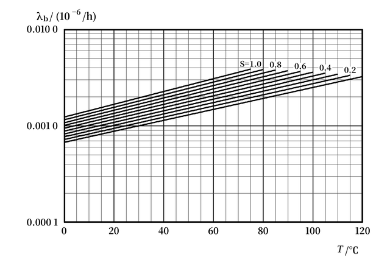

<strong>图 17 额定温度为 70℃的金属膜电阻器基本失效率曲线</strong>

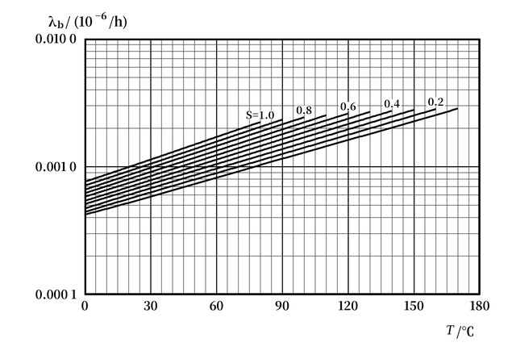

<strong>图 18 额定温度为 125℃的金属膜电阻器基本失效率曲线</strong>

<strong>表 127 环境系数 <i>π</i>E</strong>

<table>
  <tbody>
    <tr>
      <td>环境</td>
      <td>GB</td>
      <td>GMS</td>
      <td>GF1</td>
      <td>GF2</td>
      <td>GM1</td>
      <td>GM2</td>
      <td>MP</td>
      <td>NSB</td>
      <td>NS1</td>
      <td>NS2</td>
    </tr>
    <tr>
      <td><i>π</i>E</td>
      <td>1.0</td>
      <td>1.1</td>
      <td>1.8</td>
      <td>3.0</td>
      <td>4.0</td>
      <td>6.0</td>
      <td>5.6</td>
      <td>3.8</td>
      <td>2.5</td>
      <td>4.5</td>
    </tr>
    <tr>
      <td>环境</td>
      <td>NU</td>
      <td>AIF</td>
      <td>AUF</td>
      <td>AIC</td>
      <td>AUC</td>
      <td>ARW</td>
      <td>SF</td>
      <td>ML</td>
      <td>MF</td>
      <td>—</td>
    </tr>
    <tr>
      <td><i>π</i>E</td>
      <td>10</td>
      <td>5.0</td>
      <td>11</td>
      <td>2.5</td>
      <td>6.1</td>
      <td>12.5</td>
      <td>0.50</td>
      <td>26</td>
      <td>15</td>
      <td>—</td>
    </tr>
  </tbody>
</table>

<strong>表 128 质量等级与质量系数 <i>π</i>Q</strong>

<table>
  <thead>
    <tr>
      <th colspan="2">质量等级</th>
      <th><i>π</i>Q</th>
    </tr>
  </thead>
  <tbody>
    <tr>
      <td rowspan="3">A</td>
      <td>A1P</td>
      <td>0.05</td>
    </tr>
    <tr>
      <td>A1M</td>
      <td>0.1</td>
    </tr>
    <tr>
      <td>A2</td>
      <td>0.2</td>
    </tr>
    <tr>
      <td rowspan="2">B</td>
      <td>B1</td>
      <td>0.6</td>
    </tr>
    <tr>
      <td>B2</td>
      <td>1.0</td>
    </tr>
    <tr>
      <td colspan="2">C</td>
      <td>4.0</td>
    </tr>
  </tbody>
</table>

82

---

<strong>GJB/Z 299D—2024</strong>

<strong>表 129 阻值系数 <i>π</i>R</strong>

<table>
  <thead>
    <tr>
      <th>阻值范围</th>
      <th><i>π</i>R</th>
    </tr>
  </thead>
  <tbody>
    <tr>
      <td><i>R</i> ≤ 100kΩ</td>
      <td>1.0</td>
    </tr>
    <tr>
      <td>100kΩ &lt; <i>R</i> ≤ 1MΩ</td>
      <td>1.6</td>
    </tr>
    <tr>
      <td>1MΩ &lt; <i>R</i> ≤ 10MΩ</td>
      <td>3.0</td>
    </tr>
    <tr>
      <td><i>R</i> &gt; 10MΩ</td>
      <td>4.0</td>
    </tr>
  </tbody>
</table>

#### 5.6.3 碳膜电阻器 ($P \le 2\text{W}$)

工作失效率预计模型见式(36)。

$$\lambda_{\text{p}} = \lambda_{\text{b}} \pi_{\text{E}} \pi_{\text{Q}} \pi_{\text{R}} \tag{36}$$

式中：
$\lambda_{\text{p}}$ ——工作失效率，$10^{-6}/\text{h}$；
$\lambda_{\text{b}}$ ——基本失效率，$10^{-6}/\text{h}$，见表 130 和图 19；
$\pi_{\text{E}}$ ——环境系数，见表 131；
$\pi_{\text{Q}}$ ——质量系数，见表 132；
$\pi_{\text{R}}$ ——阻值系数，见表 133。

<strong>表 130 基本失效率 <i>λ</i>b</strong>

单位为 10−6/h

<table>
  <thead>
    <tr>
      <th rowspan="2"><i>T</i> ℃</th>
      <th colspan="10"><i>S</i></th>
    </tr>
    <tr>
      <th>0.1</th>
      <th>0.2</th>
      <th>0.3</th>
      <th>0.4</th>
      <th>0.5</th>
      <th>0.6</th>
      <th>0.7</th>
      <th>0.8</th>
      <th>0.9</th>
      <th>1</th>
    </tr>
  </thead>
  <tbody>
    <tr><td>0</td><td>0.003 2</td><td>0.003 6</td><td>0.004 0</td><td>0.004 4</td><td>0.004 8</td><td>0.005 3</td><td>0.005 9</td><td>0.006 5</td><td>0.007 2</td><td>0.008 0</td></tr>
    <tr><td>5</td><td>0.003 3</td><td>0.003 7</td><td>0.004 1</td><td>0.004 5</td><td>0.005 0</td><td>0.005 5</td><td>0.006 1</td><td>0.006 7</td><td>0.007 5</td><td>0.008 3</td></tr>
    <tr><td>10</td><td>0.003 4</td><td>0.003 8</td><td>0.004 2</td><td>0.004 6</td><td>0.005 1</td><td>0.005 7</td><td>0.006 3</td><td>0.007 0</td><td>0.007 8</td><td>0.008 6</td></tr>
    <tr><td>15</td><td>0.003 5</td><td>0.003 9</td><td>0.004 3</td><td>0.004 8</td><td>0.005 3</td><td>0.005 9</td><td>0.006 5</td><td>0.007 3</td><td>0.008 1</td><td>0.009 0</td></tr>
    <tr><td>20</td><td>0.003 6</td><td>0.004 0</td><td>0.004 4</td><td>0.004 9</td><td>0.005 5</td><td>0.006 1</td><td>0.006 8</td><td>0.007 6</td><td>0.008 4</td><td>0.009 4</td></tr>
    <tr><td>25</td><td>0.003 7</td><td>0.004 1</td><td>0.004 6</td><td>0.005 1</td><td>0.005 7</td><td>0.006 3</td><td>0.007 0</td><td>0.007 9</td><td>0.008 8</td><td>0.009 8</td></tr>
    <tr><td>30</td><td>0.003 8</td><td>0.004 2</td><td>0.004 7</td><td>0.005 3</td><td>0.005 9</td><td>0.006 6</td><td>0.007 3</td><td>0.008 2</td><td>0.009 1</td><td>0.010 2</td></tr>
    <tr><td>35</td><td>0.003 9</td><td>0.004 3</td><td>0.004 9</td><td>0.005 4</td><td>0.006 1</td><td>0.006 8</td><td>0.007 6</td><td>0.008 5</td><td>0.009 6</td><td>0.010 7</td></tr>
    <tr><td>40</td><td>0.004 0</td><td>0.004 5</td><td>0.005 0</td><td>0.005 6</td><td>0.006 3</td><td>0.007 1</td><td>0.007 9</td><td>0.008 9</td><td>0.010 0</td><td>0.011 2</td></tr>
    <tr><td>45</td><td>0.004 1</td><td>0.004 6</td><td>0.005 2</td><td>0.005 8</td><td>0.006 6</td><td>0.007 4</td><td>0.008 3</td><td>0.009 3</td><td>0.010 5</td><td>0.011 7</td></tr>
    <tr><td>50</td><td>0.004 3</td><td>0.004 8</td><td>0.005 4</td><td>0.006 1</td><td>0.006 8</td><td>0.007 7</td><td>0.008 7</td><td>0.009 7</td><td>0.011 0</td><td>0.012 3</td></tr>
    <tr><td>55</td><td>0.004 4</td><td>0.005 0</td><td>0.005 6</td><td>0.006 3</td><td>0.007 1</td><td>0.008 0</td><td>0.009 0</td><td>0.010 2</td><td>0.011 5</td><td>0.013 0</td></tr>
    <tr><td>60</td><td>0.004 6</td><td>0.005 1</td><td>0.005 8</td><td>0.006 6</td><td>0.007 4</td><td>0.008 4</td><td>0.009 5</td><td>0.010 7</td><td>0.012 1</td><td>0.013 7</td></tr>
    <tr><td>65</td><td>0.004 7</td><td>0.005 3</td><td>0.006 1</td><td>0.006 8</td><td>0.007 8</td><td>0.008 8</td><td>0.009 9</td><td>0.011 2</td><td>0.012 7</td><td>0.014 4</td></tr>
    <tr><td>70</td><td>0.004 9</td><td>0.005 6</td><td>0.006 3</td><td>0.007 1</td><td>0.008 1</td><td>0.009 2</td><td>0.010 4</td><td>0.011 8</td><td>0.013 4</td><td>0.015 2</td></tr>
    <tr><td>75</td><td>0.005 1</td><td>0.005 8</td><td>0.006 6</td><td>0.007 5</td><td>0.008 5</td><td>0.009 6</td><td>0.011 0</td><td>0.012 4</td><td>0.014 1</td><td>—</td></tr>
    <tr><td>80</td><td>0.005 3</td><td>0.006 0</td><td>0.006 9</td><td>0.007 8</td><td>0.008 9</td><td>0.010 1</td><td>0.011 5</td><td>0.013 1</td><td>—</td><td>—</td></tr>
    <tr><td>85</td><td>0.005 5</td><td>0.006 3</td><td>0.007 2</td><td>0.008 2</td><td>0.009 3</td><td>0.010 7</td><td>0.012 1</td><td>—</td><td>—</td><td>—</td></tr>
    <tr><td>90</td><td>0.005 8</td><td>0.006 6</td><td>0.007 5</td><td>0.008 6</td><td>0.009 8</td><td>0.011 2</td><td>—</td><td>—</td><td>—</td><td>—</td></tr>
    <tr><td>95</td><td>0.006 0</td><td>0.006 9</td><td>0.007 9</td><td>0.009 0</td><td>0.010 3</td><td>—</td><td>—</td><td>—</td><td>—</td><td>—</td></tr>
    <tr><td>100</td><td>0.006 3</td><td>0.007 2</td><td>0.008 3</td><td>0.009 5</td><td>—</td><td>—</td><td>—</td><td>—</td><td>—</td><td>—</td></tr>
  </tbody>
</table>

83

---

<strong>GJB/Z 299D—2024</strong>

<strong>表 130 (续)</strong>

单位为 10−6/h

<table>
  <thead>
    <tr>
      <th rowspan="2"><i>T</i> ℃</th>
      <th colspan="10"><i>S</i></th>
    </tr>
    <tr>
      <th>0.1</th>
      <th>0.2</th>
      <th>0.3</th>
      <th>0.4</th>
      <th>0.5</th>
      <th>0.6</th>
      <th>0.7</th>
      <th>0.8</th>
      <th>0.9</th>
      <th>1</th>
    </tr>
  </thead>
  <tbody>
    <tr><td>105</td><td>0.006 6</td><td>0.007 6</td><td>0.008 7</td><td>0.010 0</td><td>—</td><td>—</td><td>—</td><td>—</td><td>—</td><td>—</td></tr>
    <tr><td>110</td><td>0.007 0</td><td>0.008 0</td><td>0.009 2</td><td>—</td><td>—</td><td>—</td><td>—</td><td>—</td><td>—</td><td>—</td></tr>
    <tr><td>115</td><td>0.007 3</td><td>0.008 4</td><td>—</td><td>—</td><td>—</td><td>—</td><td>—</td><td>—</td><td>—</td><td>—</td></tr>
    <tr><td>120</td><td>0.007 7</td><td>—</td><td>—</td><td>—</td><td>—</td><td>—</td><td>—</td><td>—</td><td>—</td><td>—</td></tr>
    <tr>
      <td colspan="11" align="left">注：<i>T</i> 为工作环境温度。 &emsp;&emsp;<i>S</i> 为实际功耗与额定功耗的比值。</td>
    </tr>
  </tbody>
</table>

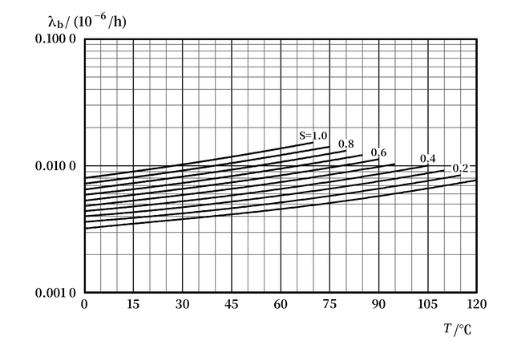

<strong>图 19 碳膜电阻器 (功率 <i>P</i> ≤ 2W) 基本失效率曲线</strong>

<strong>表 131 环境系数 <i>π</i>E</strong>

<table>
  <tbody>
    <tr>
      <td>环境</td>
      <td>GB</td>
      <td>GMS</td>
      <td>GF1</td>
      <td>GF2</td>
      <td>GM1</td>
      <td>GM2</td>
      <td>MP</td>
      <td>NSB</td>
      <td>NS1</td>
      <td>NS2</td>
    </tr>
    <tr>
      <td><i>π</i>E</td>
      <td>1.0</td>
      <td>1.1</td>
      <td>1.8</td>
      <td>3.0</td>
      <td>4.0</td>
      <td>6.0</td>
      <td>5.6</td>
      <td>3.8</td>
      <td>2.5</td>
      <td>4.5</td>
    </tr>
    <tr>
      <td>环境</td>
      <td>NU</td>
      <td>AIF</td>
      <td>AUF</td>
      <td>AIC</td>
      <td>AUC</td>
      <td>ARW</td>
      <td>SF</td>
      <td>ML</td>
      <td>MF</td>
      <td>—</td>
    </tr>
    <tr>
      <td><i>π</i>E</td>
      <td>10</td>
      <td>5.0</td>
      <td>11</td>
      <td>2.5</td>
      <td>6.1</td>
      <td>12.5</td>
      <td>0.50</td>
      <td>26</td>
      <td>15</td>
      <td>—</td>
    </tr>
  </tbody>
</table>

<strong>表 132 质量等级与质量系数 <i>π</i>Q</strong>

<table>
  <thead>
    <tr>
      <th colspan="2">质量等级</th>
      <th><i>π</i>Q</th>
    </tr>
  </thead>
  <tbody>
    <tr>
      <td>A</td>
      <td>A2</td>
      <td>0.20</td>
    </tr>
    <tr>
      <td rowspan="2">B</td>
      <td>B1</td>
      <td>0.60</td>
    </tr>
    <tr>
      <td>B2</td>
      <td>1.0</td>
    </tr>
    <tr>
      <td colspan="2">C</td>
      <td>4.0</td>
    </tr>
  </tbody>
</table>

<strong>表 133 阻值系数 <i>π</i>R</strong>

<table>
  <thead>
    <tr>
      <th>阻值范围</th>
      <th><i>π</i>R</th>
    </tr>
  </thead>
  <tbody>
    <tr>
      <td><i>R</i> ≤ 100kΩ</td>
      <td>1.0</td>
    </tr>
    <tr>
      <td>100kΩ &lt; <i>R</i> ≤ 1MΩ</td>
      <td>1.6</td>
    </tr>
    <tr>
      <td>1MΩ &lt; <i>R</i> ≤ 10MΩ</td>
      <td>3.0</td>
    </tr>
    <tr>
      <td><i>R</i> &gt; 10MΩ</td>
      <td>4.0</td>
    </tr>
  </tbody>
</table>

84

---

<strong>GJB/Z 299D—2024</strong>

#### 5.6.4 玻璃釉电阻器 ($P \le 2\text{W}$)

玻璃釉电阻器工作失效率预计模型见式(37)。

$$\lambda_{\text{p}} = \lambda_{\text{b}} \pi_{\text{E}} \pi_{\text{Q}} \pi_{\text{R}} \tag{37}$$

式中：
$\lambda_{\text{p}}$ ——工作失效率，$10^{-6}/\text{h}$；
$\lambda_{\text{b}}$ ——基本失效率，$10^{-6}/\text{h}$，见表 134 和图 20；
$\pi_{\text{E}}$ ——环境系数，见表 135；
$\pi_{\text{Q}}$ ——质量系数，见表 136；
$\pi_{\text{R}}$ ——阻值系数，见表 137。

<strong>表 134 基本失效率 <i>λ</i>b</strong>

单位为 10−6/h

<table>
  <thead>
    <tr>
      <th rowspan="2"><i>T</i> ℃</th>
      <th colspan="10"><i>S</i></th>
    </tr>
    <tr>
      <th>0.1</th>
      <th>0.2</th>
      <th>0.3</th>
      <th>0.4</th>
      <th>0.5</th>
      <th>0.6</th>
      <th>0.7</th>
      <th>0.8</th>
      <th>0.9</th>
      <th>1</th>
    </tr>
  </thead>
  <tbody>
    <tr><td>0</td><td>0.001 02</td><td>0.001 13</td><td>0.001 24</td><td>0.001 37</td><td>0.001 52</td><td>0.001 68</td><td>0.001 86</td><td>0.002 05</td><td>0.002 27</td><td>0.002 51</td></tr>
    <tr><td>5</td><td>0.001 05</td><td>0.001 17</td><td>0.001 29</td><td>0.001 43</td><td>0.001 58</td><td>0.001 75</td><td>0.001 94</td><td>0.002 15</td><td>0.002 38</td><td>0.002 63</td></tr>
    <tr><td>10</td><td>0.001 09</td><td>0.001 21</td><td>0.001 34</td><td>0.001 49</td><td>0.001 65</td><td>0.001 83</td><td>0.002 03</td><td>0.002 25</td><td>0.002 50</td><td>0.002 77</td></tr>
    <tr><td>15</td><td>0.001 13</td><td>0.001 25</td><td>0.001 39</td><td>0.001 55</td><td>0.001 72</td><td>0.001 91</td><td>0.002 12</td><td>0.002 36</td><td>0.002 62</td><td>0.002 91</td></tr>
    <tr><td>20</td><td>0.001 17</td><td>0.001 30</td><td>0.001 45</td><td>0.001 61</td><td>0.001 79</td><td>0.002 00</td><td>0.002 22</td><td>0.002 47</td><td>0.002 75</td><td>0.003 06</td></tr>
    <tr><td>25</td><td>0.001 21</td><td>0.001 35</td><td>0.001 50</td><td>0.001 67</td><td>0.001 87</td><td>0.002 08</td><td>0.002 32</td><td>0.002 59</td><td>0.002 89</td><td>0.003 22</td></tr>
    <tr><td>30</td><td>0.001 25</td><td>0.001 39</td><td>0.001 56</td><td>0.001 74</td><td>0.001 95</td><td>0.002 17</td><td>0.002 43</td><td>0.002 71</td><td>0.003 03</td><td>0.003 39</td></tr>
    <tr><td>35</td><td>0.001 29</td><td>0.001 45</td><td>0.001 62</td><td>0.001 81</td><td>0.002 03</td><td>0.002 27</td><td>0.002 54</td><td>0.002 84</td><td>0.003 18</td><td>0.003 56</td></tr>
    <tr><td>40</td><td>0.001 34</td><td>0.001 50</td><td>0.001 68</td><td>0.001 88</td><td>0.002 11</td><td>0.002 37</td><td>0.002 66</td><td>0.002 98</td><td>0.003 34</td><td>0.003 75</td></tr>
    <tr><td>45</td><td>0.001 38</td><td>0.001 55</td><td>0.001 74</td><td>0.001 96</td><td>0.002 20</td><td>0.002 47</td><td>0.002 78</td><td>0.003 12</td><td>0.003 51</td><td>0.003 94</td></tr>
    <tr><td>50</td><td>0.001 43</td><td>0.001 61</td><td>0.001 81</td><td>0.002 04</td><td>0.002 29</td><td>0.002 58</td><td>0.002 91</td><td>0.003 27</td><td>0.003 68</td><td>0.004 15</td></tr>
    <tr><td>55</td><td>0.001 48</td><td>0.001 67</td><td>0.001 88</td><td>0.002 12</td><td>0.002 39</td><td>0.002 70</td><td>0.003 04</td><td>0.003 43</td><td>0.003 87</td><td>0.004 36</td></tr>
    <tr><td>60</td><td>0.001 53</td><td>0.001 73</td><td>0.001 95</td><td>0.002 21</td><td>0.002 49</td><td>0.002 82</td><td>0.003 18</td><td>0.003 59</td><td>0.004 06</td><td>0.004 59</td></tr>
    <tr><td>65</td><td>0.001 58</td><td>0.001 79</td><td>0.002 03</td><td>0.002 29</td><td>0.002 60</td><td>0.002 94</td><td>0.003 33</td><td>0.003 77</td><td>0.004 26</td><td>0.004 82</td></tr>
    <tr><td>70</td><td>0.001 64</td><td>0.001 86</td><td>0.002 11</td><td>0.002 39</td><td>0.002 71</td><td>0.003 07</td><td>0.003 48</td><td>0.003 95</td><td>0.004 47</td><td>0.005 07</td></tr>
    <tr><td>75</td><td>0.001 69</td><td>0.001 92</td><td>0.002 19</td><td>0.002 48</td><td>0.002 82</td><td>0.003 20</td><td>0.003 64</td><td>0.004 13</td><td>0.004 70</td><td>—</td></tr>
    <tr><td>80</td><td>0.001 75</td><td>0.001 99</td><td>0.002 27</td><td>0.002 58</td><td>0.002 94</td><td>0.003 34</td><td>0.003 81</td><td>0.004 33</td><td>—</td><td>—</td></tr>
    <tr><td>85</td><td>0.001 81</td><td>0.002 07</td><td>0.002 36</td><td>0.002 69</td><td>0.003 06</td><td>0.003 49</td><td>0.003 98</td><td>—</td><td>—</td><td>—</td></tr>
    <tr><td>90</td><td>0.001 88</td><td>0.002 14</td><td>0.002 45</td><td>0.002 79</td><td>0.003 19</td><td>0.003 65</td><td>—</td><td>—</td><td>—</td><td>—</td></tr>
    <tr><td>95</td><td>0.001 94</td><td>0.002 22</td><td>0.002 54</td><td>0.002 91</td><td>0.003 33</td><td>—</td><td>—</td><td>—</td><td>—</td><td>—</td></tr>
    <tr><td>100</td><td>0.002 01</td><td>0.002 30</td><td>0.002 64</td><td>0.003 02</td><td>—</td><td>—</td><td>—</td><td>—</td><td>—</td><td>—</td></tr>
    <tr><td>105</td><td>0.002 08</td><td>0.002 38</td><td>0.002 74</td><td>0.003 14</td><td>—</td><td>—</td><td>—</td><td>—</td><td>—</td><td>—</td></tr>
    <tr><td>110</td><td>0.002 15</td><td>0.002 47</td><td>0.002 84</td><td>—</td><td>—</td><td>—</td><td>—</td><td>—</td><td>—</td><td>—</td></tr>
    <tr><td>115</td><td>0.002 22</td><td>0.002 56</td><td>—</td><td>—</td><td>—</td><td>—</td><td>—</td><td>—</td><td>—</td><td>—</td></tr>
    <tr><td>120</td><td>0.002 30</td><td>—</td><td>—</td><td>—</td><td>—</td><td>—</td><td>—</td><td>—</td><td>—</td><td>—</td></tr>
    <tr>
      <td colspan="11" align="left">注：<i>T</i> 为工作环境温度。 &emsp;&emsp;<i>S</i> 为实际功耗与额定功耗的比值。</td>
    </tr>
  </tbody>
</table>

85

---

<strong>GJB/Z 299D—2024</strong>

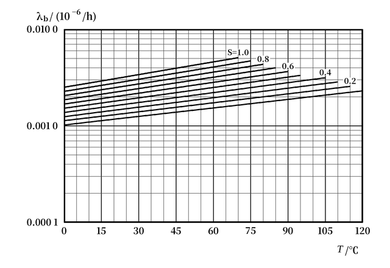

<strong>图 20 玻璃釉电阻器 (功率 <i>P</i> ≤ 2W) 基本失效率曲线</strong>

<strong>表 135 环境系数 <i>π</i>E</strong>

<table>
  <tbody>
    <tr>
      <td>环境</td>
      <td>GB</td>
      <td>GMS</td>
      <td>GF1</td>
      <td>GF2</td>
      <td>GM1</td>
      <td>GM2</td>
      <td>MP</td>
      <td>NSB</td>
      <td>NS1</td>
      <td>NS2</td>
    </tr>
    <tr>
      <td><i>π</i>E</td>
      <td>1.0</td>
      <td>1.1</td>
      <td>1.8</td>
      <td>3.0</td>
      <td>4.0</td>
      <td>6.0</td>
      <td>5.6</td>
      <td>3.8</td>
      <td>2.5</td>
      <td>4.5</td>
    </tr>
    <tr>
      <td>环境</td>
      <td>NU</td>
      <td>AIF</td>
      <td>AUF</td>
      <td>AIC</td>
      <td>AUC</td>
      <td>ARW</td>
      <td>SF</td>
      <td>ML</td>
      <td>MF</td>
      <td>—</td>
    </tr>
    <tr>
      <td><i>π</i>E</td>
      <td>10</td>
      <td>5.0</td>
      <td>11</td>
      <td>2.5</td>
      <td>6.1</td>
      <td>12.5</td>
      <td>0.5</td>
      <td>26</td>
      <td>15</td>
      <td>—</td>
    </tr>
  </tbody>
</table>

<strong>表 136 质量等级与质量系数 <i>π</i>Q</strong>

<table>
  <thead>
    <tr>
      <th colspan="2">质量等级</th>
      <th><i>π</i>Q</th>
    </tr>
  </thead>
  <tbody>
    <tr>
      <td>A</td>
      <td>A2</td>
      <td>0.2</td>
    </tr>
    <tr>
      <td rowspan="2">B</td>
      <td>B1</td>
      <td>0.6</td>
    </tr>
    <tr>
      <td>B2</td>
      <td>1.0</td>
    </tr>
    <tr>
      <td colspan="2">C</td>
      <td>4.0</td>
    </tr>
  </tbody>
</table>

<strong>表 137 阻值系数 <i>π</i>R</strong>

<table>
  <thead>
    <tr>
      <th>阻值范围</th>
      <th><i>π</i>R</th>
    </tr>
  </thead>
  <tbody>
    <tr>
      <td><i>R</i> ≤ 100kΩ</td>
      <td>1.0</td>
    </tr>
    <tr>
      <td>100kΩ &lt; <i>R</i> ≤ 1MΩ</td>
      <td>1.6</td>
    </tr>
    <tr>
      <td>1MΩ &lt; <i>R</i> ≤ 10MΩ</td>
      <td>3.0</td>
    </tr>
    <tr>
      <td><i>R</i> &gt; 10MΩ</td>
      <td>4.0</td>
    </tr>
  </tbody>
</table>

#### 5.6.5 线绕电阻器

本条包括：
a) 普通线绕电阻器；
b) 精密线绕电阻器。

工作失效率预计模型见式(38)。

$$\lambda_{\text{p}} = \lambda_{\text{b}} \pi_{\text{E}} \pi_{\text{Q}} \pi_{\text{R}} \pi_{\text{K}} \tag{38}$$

86

---

<strong>GJB/Z 299D—2024</strong>

式中：
$\lambda_{\text{p}}$ ——工作失效率，$10^{-6}/\text{h}$；
$\lambda_{\text{b}}$ ——基本失效率，$10^{-6}/\text{h}$，见表 138 和图 21；
$\pi_{\text{E}}$ ——环境系数，见表 139；
$\pi_{\text{Q}}$ ——质量系数，见表 140；
$\pi_{\text{R}}$ ——阻值系数，见表 141；
$\pi_{\text{K}}$ ——种类系数，见表 142。

<strong>表 138 基本失效率 <i>λ</i>b</strong>

单位为 10−6/h

<table>
  <thead>
    <tr>
      <th rowspan="2"><i>T</i> ℃</th>
      <th colspan="10"><i>S</i></th>
    </tr>
    <tr>
      <th>0.1</th>
      <th>0.2</th>
      <th>0.3</th>
      <th>0.4</th>
      <th>0.5</th>
      <th>0.6</th>
      <th>0.7</th>
      <th>0.8</th>
      <th>0.9</th>
      <th>1.0</th>
    </tr>
  </thead>
  <tbody>
    <tr><td>0</td><td>0.025 7</td><td>0.027 2</td><td>0.029 3</td><td>0.032 0</td><td>0.035 4</td><td>0.039 6</td><td>0.044 6</td><td>0.050 8</td><td>0.058 4</td><td>0.067 6</td></tr>
    <tr><td>5</td><td>0.026 2</td><td>0.027 8</td><td>0.030 0</td><td>0.032 9</td><td>0.036 5</td><td>0.040 9</td><td>0.046 3</td><td>0.052 9</td><td>0.061 0</td><td>0.070 9</td></tr>
    <tr><td>10</td><td>0.026 8</td><td>0.028 5</td><td>0.030 9</td><td>0.033 9</td><td>0.037 7</td><td>0.042 4</td><td>0.048 2</td><td>0.055 3</td><td>0.063 9</td><td>0.074 6</td></tr>
    <tr><td>15</td><td>0.027 6</td><td>0.029 4</td><td>0.031 9</td><td>0.035 1</td><td>0.039 1</td><td>0.044 1</td><td>0.050 3</td><td>0.057 9</td><td>0.067 3</td><td>0.078 8</td></tr>
    <tr><td>20</td><td>0.028 5</td><td>0.030 4</td><td>0.033 0</td><td>0.036 4</td><td>0.040 7</td><td>0.046 1</td><td>0.052 7</td><td>0.060 9</td><td>0.071 0</td><td>0.083 6</td></tr>
    <tr><td>25</td><td>0.029 5</td><td>0.031 5</td><td>0.034 3</td><td>0.038 0</td><td>0.042 6</td><td>0.048 3</td><td>0.055 5</td><td>0.064 3</td><td>0.075 3</td><td>0.089 0</td></tr>
    <tr><td>30</td><td>0.030 7</td><td>0.032 8</td><td>0.035 9</td><td>0.039 8</td><td>0.044 7</td><td>0.050 9</td><td>0.058 7</td><td>0.068 3</td><td>0.080 3</td><td>0.095 3</td></tr>
    <tr><td>35</td><td>0.032 1</td><td>0.034 4</td><td>0.037 7</td><td>0.041 9</td><td>0.047 2</td><td>0.054 0</td><td>0.062 4</td><td>0.072 9</td><td>0.086 0</td><td>0.102 5</td></tr>
    <tr><td>40</td><td>0.033 8</td><td>0.036 3</td><td>0.039 8</td><td>0.044 3</td><td>0.050 2</td><td>0.057 5</td><td>0.066 7</td><td>0.078 2</td><td>0.092 7</td><td>0.111 0</td></tr>
    <tr><td>45</td><td>0.035 8</td><td>0.038 5</td><td>0.042 3</td><td>0.047 3</td><td>0.053 6</td><td>0.061 7</td><td>0.071 8</td><td>0.084 5</td><td>0.100 6</td><td>0.120 9</td></tr>
    <tr><td>50</td><td>0.038 2</td><td>0.041 1</td><td>0.045 3</td><td>0.050 7</td><td>0.057 8</td><td>0.066 6</td><td>0.077 9</td><td>0.092 0</td><td>0.109 9</td><td>0.132 7</td></tr>
    <tr><td>55</td><td>0.041 0</td><td>0.044 3</td><td>0.048 8</td><td>0.054 9</td><td>0.062 7</td><td>0.072 6</td><td>0.085 1</td><td>0.100 9</td><td>0.121 1</td><td>0.146 8</td></tr>
    <tr><td>60</td><td>0.044 5</td><td>0.048 1</td><td>0.053 2</td><td>0.059 9</td><td>0.068 6</td><td>0.079 7</td><td>0.093 8</td><td>0.111 7</td><td>0.134 6</td><td>0.163 9</td></tr>
    <tr><td>65</td><td>0.048 7</td><td>0.052 7</td><td>0.058 4</td><td>0.066 0</td><td>0.075 8</td><td>0.088 4</td><td>0.104 4</td><td>0.124 8</td><td>0.151 0</td><td>0.184 7</td></tr>
    <tr><td>70</td><td>0.053 8</td><td>0.058 4</td><td>0.064 9</td><td>0.073 5</td><td>0.084 7</td><td>0.099 0</td><td>0.117 4</td><td>0.141 0</td><td>0.171 3</td><td>0.210 5</td></tr>
    <tr><td>75</td><td>0.060 2</td><td>0.065 4</td><td>0.072 9</td><td>0.082 8</td><td>0.095 7</td><td>0.112 3</td><td>0.133 6</td><td>0.161 1</td><td>0.196 6</td><td>0.242 6</td></tr>
    <tr><td>80</td><td>0.068 2</td><td>0.074 3</td><td>0.082 9</td><td>0.094 5</td><td>0.109 5</td><td>0.129 0</td><td>0.154 1</td><td>0.186 5</td><td>0.228 5</td><td>—</td></tr>
    <tr><td>85</td><td>0.078 4</td><td>0.085 5</td><td>0.095 7</td><td>0.109 3</td><td>0.127 1</td><td>0.150 2</td><td>0.180 1</td><td>0.218 9</td><td>—</td><td>—</td></tr>
    <tr><td>90</td><td>0.091 4</td><td>0.099 9</td><td>0.112 1</td><td>0.128 4</td><td>0.149 8</td><td>0.177 6</td><td>0.213 8</td><td>—</td><td>—</td><td>—</td></tr>
    <tr><td>95</td><td>0.108 4</td><td>0.118 7</td><td>0.133 5</td><td>0.153 3</td><td>0.179 5</td><td>0.213 6</td><td>—</td><td>—</td><td>—</td><td>—</td></tr>
    <tr><td>100</td><td>0.131 0</td><td>0.143 7</td><td>0.161 9</td><td>0.186 5</td><td>0.219 0</td><td>—</td><td>—</td><td>—</td><td>—</td><td>—</td></tr>
    <tr><td>105</td><td>0.161 4</td><td>0.177 3</td><td>0.200 4</td><td>0.231 5</td><td>—</td><td>—</td><td>—</td><td>—</td><td>—</td><td>—</td></tr>
    <tr><td>110</td><td>0.203 2</td><td>0.223 7</td><td>0.253 4</td><td>—</td><td>—</td><td>—</td><td>—</td><td>—</td><td>—</td><td>—</td></tr>
    <tr>
      <td colspan="11" align="left">注：<i>T</i> 为工作环境温度。 &emsp;&emsp;<i>S</i> 为实际功耗与额定功耗的比值。</td>
    </tr>
  </tbody>
</table>

87

---

<strong>GJB/Z 299D—2024</strong>

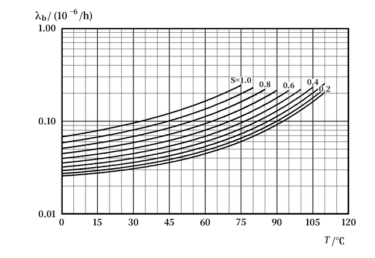

<strong>图 21 线绕电阻器基本失效率曲线</strong>

<strong>表 139 环境系数 <i>π</i>E</strong>

<table>
  <tbody>
    <tr>
      <td>环境</td>
      <td>GB</td>
      <td>GMS</td>
      <td>GF1</td>
      <td>GF2</td>
      <td>GM1</td>
      <td>GM2</td>
      <td>MP</td>
      <td>NSB</td>
      <td>NS1</td>
      <td>NS2</td>
    </tr>
    <tr>
      <td><i>π</i>E</td>
      <td>1.0</td>
      <td>1.1</td>
      <td>2.1</td>
      <td>3.5</td>
      <td>4.5</td>
      <td>8.0</td>
      <td>7.5</td>
      <td>4.5</td>
      <td>3.0</td>
      <td>5.0</td>
    </tr>
    <tr>
      <td>环境</td>
      <td>NU</td>
      <td>AIF</td>
      <td>AUF</td>
      <td>AIC</td>
      <td>AUC</td>
      <td>ARW</td>
      <td>SF</td>
      <td>ML</td>
      <td>MF</td>
      <td>—</td>
    </tr>
    <tr>
      <td><i>π</i>E</td>
      <td>12</td>
      <td>6.0</td>
      <td>13</td>
      <td>5.6</td>
      <td>10.5</td>
      <td>14.7</td>
      <td>1.0</td>
      <td>34</td>
      <td>15</td>
      <td>—</td>
    </tr>
  </tbody>
</table>

<strong>表 140 质量等级与质量系数 <i>π</i>Q</strong>

<table>
  <thead>
    <tr>
      <th colspan="2">质量等级</th>
      <th><i>π</i>Q</th>
    </tr>
  </thead>
  <tbody>
    <tr>
      <td rowspan="2">A</td>
      <td>A1M</td>
      <td>0.1</td>
    </tr>
    <tr>
      <td>A2</td>
      <td>0.2</td>
    </tr>
    <tr>
      <td rowspan="2">B</td>
      <td>B1</td>
      <td>0.6</td>
    </tr>
    <tr>
      <td>B2</td>
      <td>1.0</td>
    </tr>
    <tr>
      <td colspan="2">C</td>
      <td>4.0</td>
    </tr>
  </tbody>
</table>

<strong>表 141 阻值系数 <i>π</i>R</strong>

<table>
  <thead>
    <tr>
      <th>阻值范围</th>
      <th><i>π</i>R</th>
    </tr>
  </thead>
  <tbody>
    <tr>
      <td><i>R</i> ≤ 10kΩ</td>
      <td>1.0</td>
    </tr>
    <tr>
      <td>10kΩ &lt; <i>R</i> ≤ 100kΩ</td>
      <td>1.5</td>
    </tr>
    <tr>
      <td>100kΩ &lt; <i>R</i> ≤ 1MΩ</td>
      <td>3.5</td>
    </tr>
    <tr>
      <td>1MΩ &lt; <i>R</i> ≤ 10MΩ</td>
      <td>6.0</td>
    </tr>
    <tr>
      <td><i>R</i> &gt; 10MΩ</td>
      <td>8.0</td>
    </tr>
  </tbody>
</table>

<strong>表 142 种类系数 <i>π</i>K</strong>

<table>
  <thead>
    <tr>
      <th>种类</th>
      <th><i>π</i>K</th>
    </tr>
  </thead>
  <tbody>
    <tr>
      <td>普通线绕</td>
      <td>1.0</td>
    </tr>
    <tr>
      <td>精密线绕</td>
      <td>1.6</td>
    </tr>
  </tbody>
</table>

88

---

<strong>GJB/Z 299D—2024</strong>

#### 5.6.6 功率线绕电阻器

工作失效率预计模型见式(39)。

$$\lambda_{\text{p}} = \lambda_{\text{b}} \pi_{\text{E}} \pi_{\text{Q}} \pi_{\text{R}} \tag{39}$$

式中：
$\lambda_{\text{p}}$ ——工作失效率，$10^{-6}/\text{h}$；
$\lambda_{\text{b}}$ ——基本失效率，$10^{-6}/\text{h}$，见表 143 和图 22；
$\pi_{\text{E}}$ ——环境系数，见表 144；
$\pi_{\text{Q}}$ ——质量系数，见表 145；
$\pi_{\text{R}}$ ——阻值系数，见表 146。

<strong>表 143 基本失效率 <i>λ</i>b</strong>

单位为 10−6/h

<table>
  <thead>
    <tr>
      <th rowspan="2"><i>T</i> ℃</th>
      <th colspan="10"><i>S</i></th>
    </tr>
    <tr>
      <th>0.1</th>
      <th>0.2</th>
      <th>0.3</th>
      <th>0.4</th>
      <th>0.5</th>
      <th>0.6</th>
      <th>0.7</th>
      <th>0.8</th>
      <th>0.9</th>
      <th>1.0</th>
    </tr>
  </thead>
  <tbody>
    <tr><td>0</td><td>0.021 1</td><td>0.025 8</td><td>0.031 5</td><td>0.038 5</td><td>0.047 0</td><td>0.057 4</td><td>0.070 1</td><td>0.085 6</td><td>0.104 5</td><td>0.127 7</td></tr>
    <tr><td>10</td><td>0.022 5</td><td>0.027 7</td><td>0.034 1</td><td>0.041 9</td><td>0.051 6</td><td>0.063 4</td><td>0.078 1</td><td>0.096 1</td><td>0.118 2</td><td>0.145 4</td></tr>
    <tr><td>20</td><td>0.024 0</td><td>0.029 8</td><td>0.036 9</td><td>0.045 8</td><td>0.056 7</td><td>0.070 3</td><td>0.087 1</td><td>0.108 0</td><td>0.133 9</td><td>0.165 9</td></tr>
    <tr><td>30</td><td>0.025 7</td><td>0.032 1</td><td>0.040 1</td><td>0.050 1</td><td>0.062 5</td><td>0.078 1</td><td>0.097 5</td><td>0.121 7</td><td>0.152 0</td><td>0.189 7</td></tr>
    <tr><td>40</td><td>0.027 6</td><td>0.034 7</td><td>0.043 7</td><td>0.054 9</td><td>0.069 1</td><td>0.086 9</td><td>0.109 3</td><td>0.137 4</td><td>0.172 9</td><td>—</td></tr>
    <tr><td>50</td><td>0.029 7</td><td>0.037 6</td><td>0.047 6</td><td>0.060 4</td><td>0.076 5</td><td>0.096 9</td><td>0.122 7</td><td>0.155 5</td><td>0.197 0</td><td>—</td></tr>
    <tr><td>60</td><td>0.032 0</td><td>0.040 8</td><td>0.052 1</td><td>0.066 5</td><td>0.084 8</td><td>0.108 2</td><td>0.138 2</td><td>0.176 3</td><td>0.225 0</td><td>—</td></tr>
    <tr><td>70</td><td>0.034 5</td><td>0.044 4</td><td>0.057 0</td><td>0.073 3</td><td>0.094 3</td><td>0.121 2</td><td>0.155 8</td><td>0.200 3</td><td>0.257 5</td><td>—</td></tr>
    <tr><td>80</td><td>0.037 3</td><td>0.048 3</td><td>0.062 6</td><td>0.081 1</td><td>0.105 0</td><td>0.136 0</td><td>0.176 1</td><td>0.228 0</td><td>—</td><td>—</td></tr>
    <tr><td>90</td><td>0.040 4</td><td>0.052 8</td><td>0.068 8</td><td>0.089 8</td><td>0.117 1</td><td>0.152 8</td><td>0.199 4</td><td>0.260 1</td><td>—</td><td>—</td></tr>
    <tr><td>100</td><td>0.043 9</td><td>0.057 7</td><td>0.075 8</td><td>0.099 7</td><td>0.131 0</td><td>0.172 2</td><td>0.226 3</td><td>0.297 4</td><td>—</td><td>—</td></tr>
    <tr><td>110</td><td>0.047 8</td><td>0.063 3</td><td>0.083 7</td><td>0.110 9</td><td>0.146 8</td><td>0.194 3</td><td>0.257 3</td><td>—</td><td>—</td><td>—</td></tr>
    <tr><td>120</td><td>0.052 1</td><td>0.069 5</td><td>0.092 7</td><td>0.123 6</td><td>0.164 8</td><td>0.219 8</td><td>0.293 1</td><td>—</td><td>—</td><td>—</td></tr>
    <tr><td>130</td><td>0.056 9</td><td>0.076 5</td><td>0.102 7</td><td>0.138 0</td><td>0.185 4</td><td>0.249 1</td><td>—</td><td>—</td><td>—</td><td>—</td></tr>
    <tr><td>140</td><td>0.062 3</td><td>0.084 3</td><td>0.114 2</td><td>0.154 5</td><td>0.209 1</td><td>0.282 9</td><td>—</td><td>—</td><td>—</td><td>—</td></tr>
    <tr><td>150</td><td>0.068 4</td><td>0.093 2</td><td>0.127 1</td><td>0.173 2</td><td>0.236 2</td><td>0.322 0</td><td>—</td><td>—</td><td>—</td><td>—</td></tr>
    <tr><td>160</td><td>0.075 2</td><td>0.103 2</td><td>0.141 8</td><td>0.194 7</td><td>0.267 4</td><td>—</td><td>—</td><td>—</td><td>—</td><td>—</td></tr>
    <tr><td>170</td><td>0.082 8</td><td>0.114 6</td><td>0.158 5</td><td>0.219 2</td><td>0.303 3</td><td>—</td><td>—</td><td>—</td><td>—</td><td>—</td></tr>
    <tr><td>180</td><td>0.091 4</td><td>0.127 4</td><td>0.177 5</td><td>0.247 4</td><td>0.344 7</td><td>—</td><td>—</td><td>—</td><td>—</td><td>—</td></tr>
    <tr><td>190</td><td>0.101 1</td><td>0.141 9</td><td>0.199 2</td><td>0.279 7</td><td>—</td><td>—</td><td>—</td><td>—</td><td>—</td><td>—</td></tr>
    <tr><td>200</td><td>0.112 1</td><td>0.158 5</td><td>0.224 1</td><td>0.316 9</td><td>—</td><td>—</td><td>—</td><td>—</td><td>—</td><td>—</td></tr>
    <tr><td>210</td><td>0.124 4</td><td>0.177 3</td><td>0.252 5</td><td>0.359 8</td><td>—</td><td>—</td><td>—</td><td>—</td><td>—</td><td>—</td></tr>
    <tr><td>220</td><td>0.138 5</td><td>0.198 7</td><td>0.285 2</td><td>—</td><td>—</td><td>—</td><td>—</td><td>—</td><td>—</td><td>—</td></tr>
    <tr><td>230</td><td>0.154 4</td><td>0.223 3</td><td>0.322 7</td><td>—</td><td>—</td><td>—</td><td>—</td><td>—</td><td>—</td><td>—</td></tr>
    <tr><td>240</td><td>0.172 6</td><td>0.251 3</td><td>—</td><td>—</td><td>—</td><td>—</td><td>—</td><td>—</td><td>—</td><td>—</td></tr>
    <tr><td>250</td><td>0.193 2</td><td>0.283 5</td><td>—</td><td>—</td><td>—</td><td>—</td><td>—</td><td>—</td><td>—</td><td>—</td></tr>
    <tr><td>260</td><td>0.216 8</td><td>0.320 4</td><td>—</td><td>—</td><td>—</td><td>—</td><td>—</td><td>—</td><td>—</td><td>—</td></tr>
    <tr><td>270</td><td>0.243 8</td><td>—</td><td>—</td><td>—</td><td>—</td><td>—</td><td>—</td><td>—</td><td>—</td><td>—</td></tr>
    <tr><td>280</td><td>0.274 6</td><td>—</td><td>—</td><td>—</td><td>—</td><td>—</td><td>—</td><td>—</td><td>—</td><td>—</td></tr>
    <tr><td>290</td><td>0.310 0</td><td>—</td><td>—</td><td>—</td><td>—</td><td>—</td><td>—</td><td>—</td><td>—</td><td>—</td></tr>
    <tr>
      <td colspan="11" align="left">注：<i>T</i> 为工作环境温度。 &emsp;&emsp;<i>S</i> 为实际功耗与额定功耗的比值。</td>
    </tr>
  </tbody>
</table>

89

---

<strong>GJB/Z 299D—2024</strong>

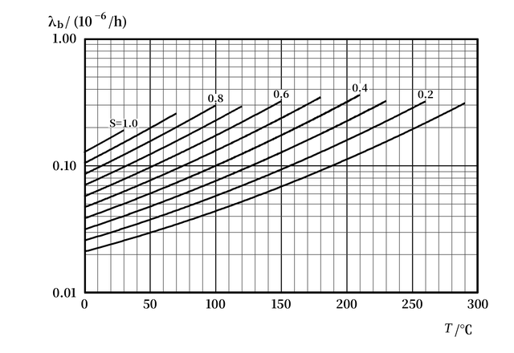

<strong>图 22 功率线绕电阻器基本失效率曲线</strong>

<strong>表 144 环境系数 <i>π</i>E</strong>

<table>
  <tbody>
    <tr>
      <td>环境</td>
      <td>GB</td>
      <td>GMS</td>
      <td>GF1</td>
      <td>GF2</td>
      <td>GM1</td>
      <td>GM2</td>
      <td>MP</td>
      <td>NSB</td>
      <td>NS1</td>
      <td>NS2</td>
    </tr>
    <tr>
      <td><i>π</i>E</td>
      <td>1.0</td>
      <td>1.1</td>
      <td>1.5</td>
      <td>3.0</td>
      <td>4.0</td>
      <td>6.5</td>
      <td>6.8</td>
      <td>4.2</td>
      <td>2.5</td>
      <td>4.5</td>
    </tr>
    <tr>
      <td>环境</td>
      <td>NU</td>
      <td>AIF</td>
      <td>AUF</td>
      <td>AIC</td>
      <td>AUC</td>
      <td>ARW</td>
      <td>SF</td>
      <td>ML</td>
      <td>MF</td>
      <td>—</td>
    </tr>
    <tr>
      <td><i>π</i>E</td>
      <td>10</td>
      <td>5.0</td>
      <td>12</td>
      <td>2.7</td>
      <td>6.0</td>
      <td>13.6</td>
      <td>1.0</td>
      <td>30</td>
      <td>15</td>
      <td>—</td>
    </tr>
  </tbody>
</table>

<strong>表 145 质量等级与质量系数 <i>π</i>Q</strong>

<table>
  <thead>
    <tr>
      <th colspan="2">质量等级</th>
      <th><i>π</i>Q</th>
    </tr>
  </thead>
  <tbody>
    <tr>
      <td rowspan="2">A</td>
      <td>A1M</td>
      <td>0.1</td>
    </tr>
    <tr>
      <td>A2</td>
      <td>0.2</td>
    </tr>
    <tr>
      <td rowspan="2">B</td>
      <td>B1</td>
      <td>0.6</td>
    </tr>
    <tr>
      <td>B2</td>
      <td>1.0</td>
    </tr>
    <tr>
      <td colspan="2">C</td>
      <td>5.0</td>
    </tr>
  </tbody>
</table>

<strong>表 146 阻值系数 <i>π</i>R</strong>

<table>
  <thead>
    <tr>
      <th>阻值范围</th>
      <th><i>π</i>R</th>
    </tr>
  </thead>
  <tbody>
    <tr>
      <td><i>R</i> ≤ 1kΩ</td>
      <td>1.0</td>
    </tr>
    <tr>
      <td>1kΩ &lt; <i>R</i> ≤ 10kΩ</td>
      <td>1.4</td>
    </tr>
    <tr>
      <td>10kΩ &lt; <i>R</i> ≤ 150kΩ</td>
      <td>2.0</td>
    </tr>
    <tr>
      <td><i>R</i> &gt; 150kΩ</td>
      <td>2.3</td>
    </tr>
  </tbody>
</table>

#### 5.6.7 箔式电阻器

箔式电阻器包括：
a) 普通金属箔电阻器；
b) 精密金属箔电阻器。

工作失效率预计模型见式(40)。

$$\lambda_{\text{p}} = \lambda_{\text{b}} \pi_{\text{E}} \pi_{\text{Q}} \pi_{\text{R}} \pi_{\text{K}} \tag{40}$$

90

---

<strong>GJB/Z 299D—2024</strong>

式中：
$\lambda_{\text{p}}$ ——工作失效率，$10^{-6}/\text{h}$；
$\lambda_{\text{b}}$ ——基本失效率，$10^{-6}/\text{h}$，见表 147 和图 23；
$\pi_{\text{E}}$ ——环境系数，见表 148；
$\pi_{\text{Q}}$ ——质量系数，见表 149；
$\pi_{\text{R}}$ ——阻值系数，见表 150；
$\pi_{\text{K}}$ ——种类系数，见表 151。

<strong>表 147 基本失效率 <i>λ</i>b</strong>

单位为 10−6/h

<table>
  <thead>
    <tr>
      <th rowspan="2"><i>T</i> ℃</th>
      <th colspan="10"><i>S</i></th>
    </tr>
    <tr>
      <th>0.1</th>
      <th>0.2</th>
      <th>0.3</th>
      <th>0.4</th>
      <th>0.5</th>
      <th>0.6</th>
      <th>0.7</th>
      <th>0.8</th>
      <th>0.9</th>
      <th>1.0</th>
    </tr>
  </thead>
  <tbody>
    <tr><td>0</td><td>0.003 27</td><td>0.003 46</td><td>0.003 73</td><td>0.004 08</td><td>0.004 51</td><td>0.005 04</td><td>0.005 68</td><td>0.006 47</td><td>0.007 43</td><td>0.008 60</td></tr>
    <tr><td>5</td><td>0.003 32</td><td>0.003 52</td><td>0.003 80</td><td>0.004 16</td><td>0.004 62</td><td>0.005 17</td><td>0.005 86</td><td>0.006 70</td><td>0.007 72</td><td>0.008 97</td></tr>
    <tr><td>10</td><td>0.003 37</td><td>0.003 58</td><td>0.003 88</td><td>0.004 26</td><td>0.004 74</td><td>0.005 33</td><td>0.006 05</td><td>0.006 94</td><td>0.008 03</td><td>0.009 37</td></tr>
    <tr><td>15</td><td>0.003 44</td><td>0.003 66</td><td>0.003 97</td><td>0.004 37</td><td>0.004 87</td><td>0.005 50</td><td>0.006 27</td><td>0.007 22</td><td>0.008 38</td><td>0.009 82</td></tr>
    <tr><td>20</td><td>0.003 52</td><td>0.003 75</td><td>0.004 07</td><td>0.004 50</td><td>0.005 03</td><td>0.005 69</td><td>0.006 51</td><td>0.007 52</td><td>0.008 77</td><td>0.010 32</td></tr>
    <tr><td>25</td><td>0.003 60</td><td>0.003 85</td><td>0.004 19</td><td>0.004 64</td><td>0.005 20</td><td>0.005 91</td><td>0.006 78</td><td>0.007 86</td><td>0.009 20</td><td>0.010 87</td></tr>
    <tr><td>30</td><td>0.003 71</td><td>0.003 97</td><td>0.004 33</td><td>0.004 80</td><td>0.005 40</td><td>0.006 15</td><td>0.007 08</td><td>0.008 25</td><td>0.009 69</td><td>0.011 50</td></tr>
    <tr><td>35</td><td>0.003 83</td><td>0.004 10</td><td>0.004 48</td><td>0.004 99</td><td>0.005 63</td><td>0.006 43</td><td>0.007 43</td><td>0.008 68</td><td>0.010 25</td><td>0.012 21</td></tr>
    <tr><td>40</td><td>0.003 96</td><td>0.004 26</td><td>0.004 67</td><td>0.005 20</td><td>0.005 89</td><td>0.006 75</td><td>0.007 83</td><td>0.009 18</td><td>0.010 88</td><td>0.013 02</td></tr>
    <tr><td>45</td><td>0.004 13</td><td>0.004 44</td><td>0.004 88</td><td>0.005 45</td><td>0.006 18</td><td>0.007 11</td><td>0.008 28</td><td>0.009 75</td><td>0.011 60</td><td>0.013 94</td></tr>
    <tr><td>50</td><td>0.004 32</td><td>0.004 65</td><td>0.005 12</td><td>0.005 74</td><td>0.006 53</td><td>0.007 54</td><td>0.008 81</td><td>0.010 41</td><td>0.012 43</td><td>0.015 01</td></tr>
    <tr><td>55</td><td>0.004 54</td><td>0.004 90</td><td>0.005 41</td><td>0.006 08</td><td>0.006 94</td><td>0.008 03</td><td>0.009 42</td><td>0.011 17</td><td>0.013 40</td><td>0.016 25</td></tr>
    <tr><td>60</td><td>0.004 80</td><td>0.005 19</td><td>0.005 74</td><td>0.006 47</td><td>0.007 41</td><td>0.008 61</td><td>0.010 13</td><td>0.012 07</td><td>0.014 54</td><td>0.017 70</td></tr>
    <tr><td>65</td><td>0.005 11</td><td>0.005 54</td><td>0.006 14</td><td>0.006 94</td><td>0.007 97</td><td>0.009 29</td><td>0.010 97</td><td>0.013 12</td><td>0.015 88</td><td>0.019 42</td></tr>
    <tr><td>70</td><td>0.005 49</td><td>0.005 95</td><td>0.006 61</td><td>0.007 49</td><td>0.008 63</td><td>0.010 10</td><td>0.011 97</td><td>0.014 38</td><td>0.017 47</td><td>0.021 46</td></tr>
    <tr><td>75</td><td>0.005 93</td><td>0.006 45</td><td>0.007 18</td><td>0.008 16</td><td>0.009 43</td><td>0.011 07</td><td>0.013 17</td><td>0.015 88</td><td>0.019 38</td><td>0.023 91</td></tr>
    <tr><td>80</td><td>0.006 47</td><td>0.007 05</td><td>0.007 87</td><td>0.008 96</td><td>0.010 39</td><td>0.012 24</td><td>0.014 62</td><td>0.017 70</td><td>0.021 69</td><td>0.026 89</td></tr>
    <tr><td>85</td><td>0.007 13</td><td>0.007 78</td><td>0.008 70</td><td>0.009 94</td><td>0.011 57</td><td>0.013 67</td><td>0.016 39</td><td>0.019 92</td><td>0.024 51</td><td>0.030 53</td></tr>
    <tr><td>90</td><td>0.007 94</td><td>0.008 68</td><td>0.009 73</td><td>0.011 15</td><td>0.013 01</td><td>0.015 43</td><td>0.018 57</td><td>0.022 66</td><td>0.028 01</td><td>—</td></tr>
    <tr><td>95</td><td>0.008 94</td><td>0.009 79</td><td>0.011 01</td><td>0.012 65</td><td>0.014 80</td><td>0.017 62</td><td>0.021 28</td><td>0.026 08</td><td>—</td><td>—</td></tr>
    <tr><td>100</td><td>0.010 20</td><td>0.011 19</td><td>0.012 61</td><td>0.014 53</td><td>0.017 06</td><td>0.020 37</td><td>0.024 71</td><td>—</td><td>—</td><td>—</td></tr>
    <tr><td>105</td><td>0.011 80</td><td>0.012 96</td><td>0.014 64</td><td>0.016 92</td><td>0.019 93</td><td>0.023 89</td><td>—</td><td>—</td><td>—</td><td>—</td></tr>
    <tr><td>110</td><td>0.013 85</td><td>0.015 25</td><td>0.017 27</td><td>0.020 01</td><td>0.023 65</td><td>—</td><td>—</td><td>—</td><td>—</td><td>—</td></tr>
    <tr><td>120</td><td>0.020 08</td><td>0.022 19</td><td>0.025 26</td><td>0.029 44</td><td>—</td><td>—</td><td>—</td><td>—</td><td>—</td><td>—</td></tr>
    <tr>
      <td colspan="11" align="left">注：<i>T</i> 为工作环境温度。 &emsp;&emsp;<i>S</i> 为实际功耗与额定功耗的比值。</td>
    </tr>
  </tbody>
</table>

91

---

<strong>GJB/Z 299D—2024</strong>

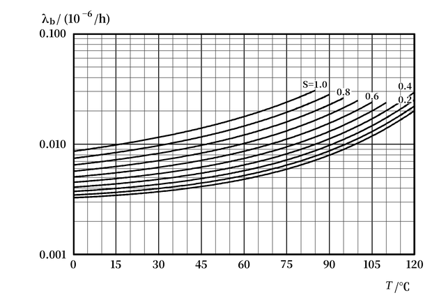

<strong>图 23 箔式电阻器基本失效率曲线</strong>

<strong>表 148 环境系数 <i>π</i>E</strong>

<table>
  <tbody>
    <tr>
      <td>环境</td>
      <td>GB</td>
      <td>GMS</td>
      <td>GF1</td>
      <td>GF2</td>
      <td>GM1</td>
      <td>GM2</td>
      <td>MP</td>
      <td>NSB</td>
      <td>NS1</td>
      <td>NS2</td>
    </tr>
    <tr>
      <td><i>π</i>E</td>
      <td>1.0</td>
      <td>1.1</td>
      <td>1.8</td>
      <td>3.0</td>
      <td>4.0</td>
      <td>6.0</td>
      <td>5.6</td>
      <td>4.2</td>
      <td>3.0</td>
      <td>5.0</td>
    </tr>
    <tr>
      <td>环境</td>
      <td>NU</td>
      <td>AIF</td>
      <td>AUF</td>
      <td>AIC</td>
      <td>AUC</td>
      <td>ARW</td>
      <td>SF</td>
      <td>ML</td>
      <td>MF</td>
      <td>—</td>
    </tr>
    <tr>
      <td><i>π</i>E</td>
      <td>12</td>
      <td>6.0</td>
      <td>13</td>
      <td>5.0</td>
      <td>8.5</td>
      <td>14.0</td>
      <td>1.0</td>
      <td>30</td>
      <td>15</td>
      <td>—</td>
    </tr>
  </tbody>
</table>

<strong>表 149 质量等级与质量系数 <i>π</i>Q</strong>

<table>
  <thead>
    <tr>
      <th colspan="2">质量等级</th>
      <th><i>π</i>Q</th>
    </tr>
  </thead>
  <tbody>
    <tr>
      <td rowspan="2">A</td>
      <td>A1M</td>
      <td>0.1</td>
    </tr>
    <tr>
      <td>A2</td>
      <td>0.2</td>
    </tr>
    <tr>
      <td rowspan="2">B</td>
      <td>B1</td>
      <td>0.6</td>
    </tr>
    <tr>
      <td>B2</td>
      <td>1.0</td>
    </tr>
    <tr>
      <td colspan="2">C</td>
      <td>4.0</td>
    </tr>
  </tbody>
</table>

<strong>表 150 阻值系数 <i>π</i>R</strong>

<table>
  <thead>
    <tr>
      <th>阻值范围</th>
      <th><i>π</i>R</th>
    </tr>
  </thead>
  <tbody>
    <tr>
      <td><i>R</i> ≤ 1kΩ</td>
      <td>1.0</td>
    </tr>
    <tr>
      <td>1kΩ &lt; <i>R</i> ≤ 10kΩ</td>
      <td>1.4</td>
    </tr>
    <tr>
      <td>10kΩ &lt; <i>R</i> ≤ 150kΩ</td>
      <td>2.0</td>
    </tr>
    <tr>
      <td><i>R</i> &gt; 150kΩ</td>
      <td>2.5</td>
    </tr>
  </tbody>
</table>

<strong>表 151 种类系数 <i>π</i>K</strong>

<table>
  <tbody>
    <tr>
      <td>种类</td>
      <td>普通箔式</td>
      <td>精密箔式</td>
    </tr>
    <tr>
      <td><i>π</i>K</td>
      <td>1.0</td>
      <td>1.8</td>
    </tr>
  </tbody>
</table>

#### 5.6.8 功率非线绕电阻器

工作失效率预计模型见式(41)。

$$\lambda_{\text{p}} = \lambda_{\text{b}} \pi_{\text{E}} \pi_{\text{Q}} \pi_{\text{R}} \tag{41}$$

92

---

<strong>GJB/Z 299D—2024</strong>

式中：
$\lambda_{\text{p}}$ ——工作失效率，$10^{-6}/\text{h}$；
$\lambda_{\text{b}}$ ——基本失效率，$10^{-6}/\text{h}$，见表 152 和图 24；
$\pi_{\text{E}}$ ——环境系数，见表 153；
$\pi_{\text{Q}}$ ——质量系数，见表 154；
$\pi_{\text{R}}$ ——阻值系数，见表 155。

<strong>表 152 基本失效率 <i>λ</i>b</strong>

单位为 10−6/h

<table>
  <thead>
    <tr>
      <th rowspan="2"><i>T</i> ℃</th>
      <th colspan="10"><i>S</i></th>
    </tr>
    <tr>
      <th>0.1</th>
      <th>0.2</th>
      <th>0.3</th>
      <th>0.4</th>
      <th>0.5</th>
      <th>0.6</th>
      <th>0.7</th>
      <th>0.8</th>
      <th>0.9</th>
      <th>1.0</th>
    </tr>
  </thead>
  <tbody>
    <tr><td>0</td><td>0.036 8</td><td>0.038 5</td><td>0.040 6</td><td>0.043 0</td><td>0.045 8</td><td>0.049 0</td><td>0.052 6</td><td>0.056 6</td><td>0.061 1</td><td>0.066 1</td></tr>
    <tr><td>5</td><td>0.037 1</td><td>0.038 8</td><td>0.041 0</td><td>0.043 5</td><td>0.046 4</td><td>0.049 7</td><td>0.053 4</td><td>0.057 5</td><td>0.062 2</td><td>0.067 4</td></tr>
    <tr><td>10</td><td>0.037 4</td><td>0.039 2</td><td>0.041 4</td><td>0.044 0</td><td>0.047 0</td><td>0.050 4</td><td>0.054 2</td><td>0.058 5</td><td>0.063 4</td><td>0.068 8</td></tr>
    <tr><td>15</td><td>0.037 7</td><td>0.039 5</td><td>0.041 8</td><td>0.044 5</td><td>0.047 6</td><td>0.051 1</td><td>0.055 1</td><td>0.059 5</td><td>0.064 6</td><td>0.070 2</td></tr>
    <tr><td>20</td><td>0.038 0</td><td>0.039 9</td><td>0.042 2</td><td>0.045 0</td><td>0.048 2</td><td>0.051 8</td><td>0.055 9</td><td>0.060 6</td><td>0.065 8</td><td>0.071 7</td></tr>
    <tr><td>25</td><td>0.038 3</td><td>0.040 2</td><td>0.042 7</td><td>0.045 5</td><td>0.048 8</td><td>0.052 6</td><td>0.056 8</td><td>0.061 6</td><td>0.067 1</td><td>0.073 2</td></tr>
    <tr><td>30</td><td>0.038 6</td><td>0.040 6</td><td>0.043 1</td><td>0.046 1</td><td>0.049 5</td><td>0.053 3</td><td>0.057 8</td><td>0.062 8</td><td>0.068 4</td><td>0.074 8</td></tr>
    <tr><td>35</td><td>0.038 9</td><td>0.041 0</td><td>0.043 6</td><td>0.046 6</td><td>0.050 1</td><td>0.054 1</td><td>0.058 7</td><td>0.063 9</td><td>0.069 8</td><td>0.076 4</td></tr>
    <tr><td>40</td><td>0.039 3</td><td>0.041 4</td><td>0.044 1</td><td>0.047 2</td><td>0.050 8</td><td>0.055 0</td><td>0.059 7</td><td>0.065 1</td><td>0.071 2</td><td>0.078 1</td></tr>
    <tr><td>45</td><td>0.039 7</td><td>0.041 9</td><td>0.044 6</td><td>0.047 8</td><td>0.051 5</td><td>0.055 8</td><td>0.060 7</td><td>0.066 3</td><td>0.072 6</td><td>—</td></tr>
    <tr><td>50</td><td>0.040 0</td><td>0.042 3</td><td>0.045 1</td><td>0.048 4</td><td>0.052 3</td><td>0.056 7</td><td>0.061 8</td><td>0.067 5</td><td>—</td><td>—</td></tr>
    <tr><td>55</td><td>0.040 4</td><td>0.042 7</td><td>0.045 6</td><td>0.049 0</td><td>0.053 0</td><td>0.057 6</td><td>0.062 8</td><td>0.068 8</td><td>—</td><td>—</td></tr>
    <tr><td>60</td><td>0.040 8</td><td>0.043 2</td><td>0.046 2</td><td>0.049 7</td><td>0.053 8</td><td>0.058 5</td><td>0.064 0</td><td>—</td><td>—</td><td>—</td></tr>
    <tr><td>65</td><td>0.041 2</td><td>0.043 7</td><td>0.046 7</td><td>0.050 4</td><td>0.054 6</td><td>0.059 5</td><td>0.065 1</td><td>—</td><td>—</td><td>—</td></tr>
    <tr><td>70</td><td>0.041 7</td><td>0.044 2</td><td>0.047 3</td><td>0.051 1</td><td>0.055 4</td><td>0.060 5</td><td>—</td><td>—</td><td>—</td><td>—</td></tr>
    <tr><td>75</td><td>0.042 1</td><td>0.044 7</td><td>0.047 9</td><td>0.051 8</td><td>0.056 3</td><td>—</td><td>—</td><td>—</td><td>—</td><td>—</td></tr>
    <tr><td>80</td><td>0.042 5</td><td>0.045 2</td><td>0.048 5</td><td>0.052 5</td><td>0.057 2</td><td>—</td><td>—</td><td>—</td><td>—</td><td>—</td></tr>
    <tr><td>85</td><td>0.043 0</td><td>0.045 8</td><td>0.049 2</td><td>0.053 3</td><td>—</td><td>—</td><td>—</td><td>—</td><td>—</td><td>—</td></tr>
    <tr><td>90</td><td>0.043 5</td><td>0.046 3</td><td>0.049 9</td><td>—</td><td>—</td><td>—</td><td>—</td><td>—</td><td>—</td><td>—</td></tr>
    <tr><td>95</td><td>0.044 0</td><td>0.046 9</td><td>0.050 5</td><td>—</td><td>—</td><td>—</td><td>—</td><td>—</td><td>—</td><td>—</td></tr>
    <tr><td>100</td><td>0.044 5</td><td>0.047 5</td><td>—</td><td>—</td><td>—</td><td>—</td><td>—</td><td>—</td><td>—</td><td>—</td></tr>
    <tr>
      <td colspan="11" align="left">注：<i>T</i> 为工作环境温度。 &emsp;&emsp;<i>S</i> 为实际功耗与额定功耗的比值。</td>
    </tr>
  </tbody>
</table>

93

---

<strong>GJB/Z 299D—2024</strong>

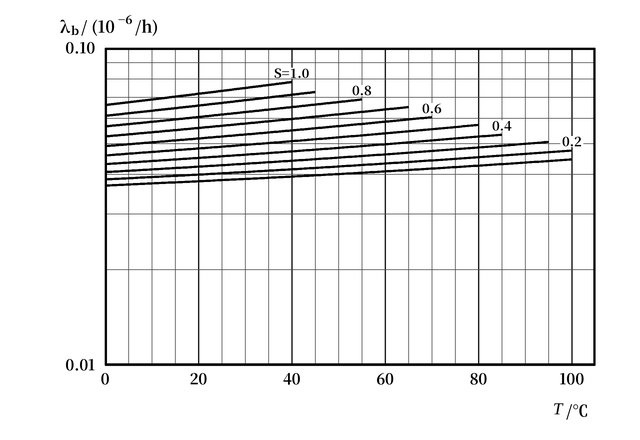

<strong>图 24 功率非线绕电阻器基本失效率曲线</strong>

<strong>表 153 环境系数 <i>π</i>E</strong>

<table>
  <tbody>
    <tr>
      <td>环境</td>
      <td>GB</td>
      <td>GMS</td>
      <td>GF1</td>
      <td>GF2</td>
      <td>GM1</td>
      <td>GM2</td>
      <td>MP</td>
      <td>NSB</td>
      <td>NS1</td>
      <td>NS2</td>
    </tr>
    <tr>
      <td><i>π</i>E</td>
      <td>1.0</td>
      <td>1.1</td>
      <td>1.8</td>
      <td>3.0</td>
      <td>4.0</td>
      <td>6.5</td>
      <td>6.6</td>
      <td>4.0</td>
      <td>2.5</td>
      <td>4.5</td>
    </tr>
    <tr>
      <td>环境</td>
      <td>NU</td>
      <td>AIF</td>
      <td>AUF</td>
      <td>AIC</td>
      <td>AUC</td>
      <td>ARW</td>
      <td>SF</td>
      <td>ML</td>
      <td>MF</td>
      <td>—</td>
    </tr>
    <tr>
      <td><i>π</i>E</td>
      <td>10</td>
      <td>5.0</td>
      <td>12</td>
      <td>4.0</td>
      <td>9.4</td>
      <td>14</td>
      <td>1.0</td>
      <td>30</td>
      <td>15</td>
      <td>—</td>
    </tr>
  </tbody>
</table>

<strong>表 154 质量等级与质量系数 <i>π</i>Q</strong>

<table>
  <thead>
    <tr>
      <th colspan="2">质量等级</th>
      <th><i>π</i>Q</th>
    </tr>
  </thead>
  <tbody>
    <tr>
      <td rowspan="2">A</td>
      <td>A1M</td>
      <td>0.15</td>
    </tr>
    <tr>
      <td>A2</td>
      <td>0.2</td>
    </tr>
    <tr>
      <td rowspan="2">B</td>
      <td>B1</td>
      <td>0.6</td>
    </tr>
    <tr>
      <td>B2</td>
      <td>1.0</td>
    </tr>
    <tr>
      <td colspan="2">C</td>
      <td>4.0</td>
    </tr>
  </tbody>
</table>

<strong>表 155 阻值系数 <i>π</i>R</strong>

<table>
  <thead>
    <tr>
      <th>阻值范围</th>
      <th><i>π</i>R</th>
    </tr>
  </thead>
  <tbody>
    <tr>
      <td><i>R</i> ≤ 100Ω</td>
      <td>1.0</td>
    </tr>
    <tr>
      <td>100Ω &lt; <i>R</i> ≤ 10kΩ</td>
      <td>1.2</td>
    </tr>
    <tr>
      <td>10kΩ &lt; <i>R</i> ≤ 100kΩ</td>
      <td>1.7</td>
    </tr>
    <tr>
      <td>100kΩ &lt; <i>R</i> ≤ 1MΩ</td>
      <td>2.4</td>
    </tr>
    <tr>
      <td>1MΩ &lt; <i>R</i> ≤ 10MΩ</td>
      <td>5.0</td>
    </tr>
    <tr>
      <td><i>R</i> &gt; 10MΩ</td>
      <td>7.0</td>
    </tr>
  </tbody>
</table>

#### 5.6.9 片式膜电阻器

工作失效率预计模型见式(42)。

$$\lambda_{\text{p}} = \lambda_{\text{b}} \pi_{\text{E}} \pi_{\text{Q}} \pi_{\text{R}} \pi_{\text{K}} \tag{42}$$

式中：
$\lambda_{\text{p}}$ ——工作失效率，$10^{-6}/\text{h}$；
$\lambda_{\text{b}}$ ——基本失效率，$10^{-6}/\text{h}$；取值为 $0.006$；

94

---

<strong>GJB/Z 299D—2024</strong>

$\pi_{\text{E}}$ ——环境系数，见表 156；
$\pi_{\text{Q}}$ ——质量系数，见表 157；
$\pi_{\text{R}}$ ——阻值系数，见表 158；
$\pi_{\text{K}}$ ——种类系数，见表 159。

<strong>表 156 环境系数 <i>π</i>E</strong>

<table>
  <tbody>
    <tr>
      <td>环境</td>
      <td>GB</td>
      <td>GMS</td>
      <td>GF1</td>
      <td>GF2</td>
      <td>GM1</td>
      <td>GM2</td>
      <td>MP</td>
      <td>NSB</td>
      <td>NS1</td>
      <td>NS2</td>
    </tr>
    <tr>
      <td><i>π</i>E</td>
      <td>1.0</td>
      <td>1.1</td>
      <td>2.0</td>
      <td>3.2</td>
      <td>5.2</td>
      <td>6.7</td>
      <td>6.1</td>
      <td>4.5</td>
      <td>2.8</td>
      <td>5.0</td>
    </tr>
    <tr>
      <td>环境</td>
      <td>NU</td>
      <td>AIF</td>
      <td>AUF</td>
      <td>AIC</td>
      <td>AUC</td>
      <td>ARW</td>
      <td>SF</td>
      <td>ML</td>
      <td>MF</td>
      <td>—</td>
    </tr>
    <tr>
      <td><i>π</i>E</td>
      <td>10</td>
      <td>6.6</td>
      <td>11.5</td>
      <td>3.4</td>
      <td>6.4</td>
      <td>14.3</td>
      <td>0.5</td>
      <td>29</td>
      <td>15</td>
      <td>—</td>
    </tr>
  </tbody>
</table>

<strong>表 157 质量等级与质量系数 <i>π</i>Q</strong>

<table>
  <thead>
    <tr>
      <th colspan="2">质量等级</th>
      <th><i>π</i>Q</th>
    </tr>
  </thead>
  <tbody>
    <tr>
      <td rowspan="3">A</td>
      <td>A1P</td>
      <td>0.05</td>
    </tr>
    <tr>
      <td>A1M</td>
      <td>0.10</td>
    </tr>
    <tr>
      <td>A2</td>
      <td>0.25</td>
    </tr>
    <tr>
      <td rowspan="2">B</td>
      <td>B1</td>
      <td>0.60</td>
    </tr>
    <tr>
      <td>B2</td>
      <td>1.0</td>
    </tr>
    <tr>
      <td colspan="2">C</td>
      <td>4.0</td>
    </tr>
  </tbody>
</table>

<strong>表 158 阻值系数 <i>π</i>R</strong>

<table>
  <thead>
    <tr>
      <th>阻值范围</th>
      <th><i>π</i>R</th>
    </tr>
  </thead>
  <tbody>
    <tr>
      <td><i>R</i> ≤ 100kΩ</td>
      <td>1.0</td>
    </tr>
    <tr>
      <td>100kΩ &lt; <i>R</i> ≤ 1MΩ</td>
      <td>1.3</td>
    </tr>
    <tr>
      <td><i>R</i> &gt; 1MΩ</td>
      <td>1.8</td>
    </tr>
  </tbody>
</table>

<strong>表 159 种类系数 <i>π</i>K</strong>

<table>
  <thead>
    <tr>
      <th>种类</th>
      <th><i>π</i>K</th>
    </tr>
  </thead>
  <tbody>
    <tr>
      <td>薄膜</td>
      <td>1.0</td>
    </tr>
    <tr>
      <td>厚膜</td>
      <td>1.2</td>
    </tr>
  </tbody>
</table>

#### 5.6.10 电阻网络

本条所指的电阻网络包括由单个分立元件组成的电阻网络，也包括厚膜和薄膜电阻网络。

工作失效率预计模型见式(43)。

$$\lambda_{\text{p}} = \lambda_{\text{b}} N_{\text{R}} \pi_{\text{T}} \pi_{\text{E}} \pi_{\text{Q}} \tag{43}$$

式中：
$\lambda_{\text{p}}$ ——工作失效率，$10^{-6}/\text{h}$；
$\lambda_{\text{b}}$ ——基本失效率，$10^{-6}/\text{h}$，见表 160；
$N_{\text{R}}$ ——使用中的电阻数(不包括没有使用的电阻)；
$\pi_{\text{T}}$ ——温度应力系数，见表 161；
$\pi_{\text{E}}$ ——环境系数，见表 162；
$\pi_{\text{Q}}$ ——质量系数，见表 163。

95

---

<strong>GJB/Z 299D—2024</strong>

<strong>表 160 基本失效率 <i>λ</i>b</strong>

单位为 10−6/h

<table>
  <tbody>
    <tr>
      <td>类型</td>
      <td>单个分立元件</td>
      <td>厚薄膜</td>
    </tr>
    <tr>
      <td><i>λ</i>b</td>
      <td>0.001 8</td>
      <td>0.001</td>
    </tr>
  </tbody>
</table>

<strong>表 161 温度应力系数 <i>π</i>T</strong>

<table>
  <thead>
    <tr>
      <th><i>T</i>P ℃</th>
      <th><i>π</i>T</th>
      <th><i>T</i>P ℃</th>
      <th><i>π</i>T</th>
      <th><i>T</i>P ℃</th>
      <th><i>π</i>T</th>
    </tr>
  </thead>
  <tbody>
    <tr><td>25</td><td>1.00</td><td>60</td><td>4.18</td><td>95</td><td>13.31</td></tr>
    <tr><td>30</td><td>1.25</td><td>65</td><td>5.00</td><td>100</td><td>15.43</td></tr>
    <tr><td>35</td><td>1.56</td><td>70</td><td>5.96</td><td>105</td><td>17.81</td></tr>
    <tr><td>40</td><td>1.92</td><td>75</td><td>7.06</td><td>110</td><td>20.49</td></tr>
    <tr><td>45</td><td>2.35</td><td>80</td><td>8.33</td><td>115</td><td>23.48</td></tr>
    <tr><td>50</td><td>2.87</td><td>85</td><td>9.78</td><td>120</td><td>26.82</td></tr>
    <tr><td>55</td><td>3.47</td><td>90</td><td>11.43</td><td>125</td><td>30.54</td></tr>
    <tr>
      <td colspan="6" align="left">注：<i>T</i>P 为工作温度(壳温)。如果 <i>T</i>P 未知，则可用 <i>T</i>P = <i>T</i> + 55 ·<i>S</i> 估算。<i>T</i> 为工作环境温度，℃；<i>S</i> 为总工作功率与额定功率之比。</td>
    </tr>
  </tbody>
</table>

<strong>表 162 环境系数 <i>π</i>E</strong>

<table>
  <tbody>
    <tr>
      <td>环境</td>
      <td>GB</td>
      <td>GMS</td>
      <td>GF1</td>
      <td>GF2</td>
      <td>GM1</td>
      <td>GM2</td>
      <td>MP</td>
      <td>NSB</td>
      <td>NS1</td>
      <td>NS2</td>
    </tr>
    <tr>
      <td><i>π</i>E</td>
      <td>1.0</td>
      <td>1.1</td>
      <td>1.8</td>
      <td>3.0</td>
      <td>4.0</td>
      <td>6.0</td>
      <td>5.6</td>
      <td>3.8</td>
      <td>2.5</td>
      <td>4.5</td>
    </tr>
    <tr>
      <td>环境</td>
      <td>NU</td>
      <td>AIF</td>
      <td>AUF</td>
      <td>AIC</td>
      <td>AUC</td>
      <td>ARW</td>
      <td>SF</td>
      <td>ML</td>
      <td>MF</td>
      <td>—</td>
    </tr>
    <tr>
      <td><i>π</i>E</td>
      <td>10</td>
      <td>5.0</td>
      <td>11</td>
      <td>2.5</td>
      <td>6.1</td>
      <td>12.5</td>
      <td>1.0</td>
      <td>26</td>
      <td>15</td>
      <td>—</td>
    </tr>
  </tbody>
</table>

<strong>表 163 质量等级与质量系数 <i>π</i>Q</strong>

<table>
  <thead>
    <tr>
      <th colspan="2">质量等级</th>
      <th><i>π</i>Q</th>
    </tr>
  </thead>
  <tbody>
    <tr>
      <td rowspan="3">A</td>
      <td>A1P</td>
      <td>0.05</td>
    </tr>
    <tr>
      <td>A1M</td>
      <td>0.1</td>
    </tr>
    <tr>
      <td>A2</td>
      <td>0.2</td>
    </tr>
    <tr>
      <td rowspan="2">B</td>
      <td>B1</td>
      <td>0.6</td>
    </tr>
    <tr>
      <td>B2</td>
      <td>1.0</td>
    </tr>
    <tr>
      <td colspan="2">C</td>
      <td>5.0</td>
    </tr>
  </tbody>
</table>

### 5.7 敏感电阻器

本条包括下列类型敏感电阻器：
a) 热敏电阻器；
b) 压敏电阻器；
c) 光敏电阻器。

一般地，敏感电阻器的工作失效率预计模型见式(44)。

$$\lambda_{\text{p}} = \lambda_{\text{b}} \pi_{\text{E}} \pi_{\text{Q}} \pi_{\text{T}} \tag{44}$$

式中：
$\lambda_{\text{p}}$ ——工作失效率，$10^{-6}/\text{h}$；
$\lambda_{\text{b}}$ ——基本失效率，$10^{-6}/\text{h}$，见表 164；
$\pi_{\text{E}}$ ——环境系数，见表 165；
$\pi_{\text{Q}}$ ——质量系数，见表 166；

96

---

<strong>GJB/Z 299D—2024</strong>

$\pi_{\text{T}}$ ——温度应力系数，见表 167 和表 168。

<strong>表 164 基本失效率 <i>λ</i>b</strong>

单位为 10−6/h

<table>
  <thead>
    <tr>
      <th>类别</th>
      <th>热敏电阻器</th>
      <th>压敏电阻器</th>
      <th>光敏电阻器</th>
    </tr>
  </thead>
  <tbody>
    <tr>
      <td align="center"><i>λ</i>b</td>
      <td align="center">0.039</td>
      <td align="center">0.035</td>
      <td align="center">0.078</td>
    </tr>
  </tbody>
</table>

<strong>表 165 环境系数 <i>π</i>E</strong>

<table>
  <tbody>
    <tr>
      <th align="center">环境</th>
      <th align="center">GB</th>
      <th align="center">GMS</th>
      <th align="center">GF1</th>
      <th align="center">GF2</th>
      <th align="center">GM1</th>
      <th align="center">GM2</th>
      <th align="center">MP</th>
      <th align="center">NSB</th>
      <th align="center">NS1</th>
      <th align="center">NS2</th>
    </tr>
    <tr>
      <td align="center"><i>π</i>E</td>
      <td align="center">1.0</td>
      <td align="center">1.3</td>
      <td align="center">2.5</td>
      <td align="center">4.5</td>
      <td align="center">6.0</td>
      <td align="center">7.8</td>
      <td align="center">6.9</td>
      <td align="center">5.0</td>
      <td align="center">3.2</td>
      <td align="center">7.0</td>
    </tr>
    <tr>
      <th align="center">环境</th>
      <th align="center">NU</th>
      <th align="center">AIF</th>
      <th align="center">AUF</th>
      <th align="center">AIC</th>
      <th align="center">AUC</th>
      <th align="center">ARW</th>
      <th align="center">SF</th>
      <th align="center">ML</th>
      <th align="center">MF</th>
      <th align="center">—</th>
    </tr>
    <tr>
      <td align="center"><i>π</i>E</td>
      <td align="center">9.6</td>
      <td align="center">7.5</td>
      <td align="center">12</td>
      <td align="center">3.2</td>
      <td align="center">4.6</td>
      <td align="center">20</td>
      <td align="center">1.0</td>
      <td align="center">35</td>
      <td align="center">15</td>
      <td align="center">—</td>
    </tr>
  </tbody>
</table>

<strong>表 166 质量等级与质量系数 <i>π</i>Q</strong>

<table>
  <thead>
    <tr>
      <th colspan="2">质量等级</th>
      <th>质量要求说明</th>
      <th>质量要求补充说明</th>
      <th><i>π</i>Q</th>
    </tr>
  </thead>
  <tbody>
    <tr>
      <td rowspan="2" align="center">A</td>
      <td align="center">A1</td>
      <td align="left">符合 GJB 601A—1998、GJB 1782—1993，且列入军用电子元器件合格产品目录(QPL)的产品 符合企业军用标准，且列入军用电子元器件合格产品目录(QPL)的产品</td>
      <td align="left">符合 GJB 601—1988，且列入军用电子元器件合格产品目录(QPL)的产品</td>
      <td align="center">0.1</td>
    </tr>
    <tr>
      <td align="center">A2</td>
      <td align="left">符合 GJB 601A—1998、GJB 1782—1993，但未列入军用电子元器件合格产品目录(QPL)的产品</td>
      <td align="left">符合 GJB 601—1988，但未列入军用电子元器件合格产品目录(QPL)的产品</td>
      <td align="center">0.2</td>
    </tr>
    <tr>
      <td rowspan="2" align="center">B</td>
      <td align="center">B1</td>
      <td colspan="2" align="left">按军用标准的筛选要求进行筛选的 B2 质量等级的产品</td>
      <td align="center">0.6</td>
    </tr>
    <tr>
      <td align="center">B2</td>
      <td colspan="2" align="left">符合 GB/T 6663、GB/T 7153、GB/T 10193、GB/T 10194、GB/T 13189、SJ 1156—1977、SJ 1553—1980、SJ 1557—1980、SJ 1559—1980、SJ 2307—1983、SJ 2308—1983、SJ 2309—1983 的产品</td>
      <td align="center">1.0</td>
    </tr>
    <tr>
      <td colspan="2" align="center">C</td>
      <td colspan="2" align="left">低档产品</td>
      <td align="center">5.0</td>
    </tr>
  </tbody>
</table>

<strong>表 167 热敏电阻器温度应力系数 <i>π</i>T</strong>

<table>
  <thead>
    <tr>
      <th><i>T</i> ℃</th>
      <th><i>π</i>T</th>
      <th><i>T</i> ℃</th>
      <th><i>π</i>T</th>
      <th><i>T</i> ℃</th>
      <th><i>π</i>T</th>
    </tr>
  </thead>
  <tbody>
    <tr>
      <td align="center">25</td>
      <td align="center">0.65</td>
      <td align="center">65</td>
      <td align="center">1.6</td>
      <td align="center">100</td>
      <td align="center">2.7</td>
    </tr>
    <tr>
      <td align="center">30</td>
      <td align="center">0.7</td>
      <td align="center">70</td>
      <td align="center">1.75</td>
      <td align="center">105</td>
      <td align="center">2.9</td>
    </tr>
    <tr>
      <td align="center">35</td>
      <td align="center">0.85</td>
      <td align="center">75</td>
      <td align="center">1.9</td>
      <td align="center">110</td>
      <td align="center">3.1</td>
    </tr>
    <tr>
      <td align="center">40</td>
      <td align="center">1.00</td>
      <td align="center">80</td>
      <td align="center">2.05</td>
      <td align="center">115</td>
      <td align="center">3.5</td>
    </tr>
    <tr>
      <td align="center">45</td>
      <td align="center">1.15</td>
      <td align="center">85</td>
      <td align="center">2.2</td>
      <td align="center">120</td>
      <td align="center">4.0</td>
    </tr>
    <tr>
      <td align="center">55</td>
      <td align="center">1.3</td>
      <td align="center">90</td>
      <td align="center">2.35</td>
      <td align="center">125</td>
      <td align="center">4.5</td>
    </tr>
    <tr>
      <td align="center">60</td>
      <td align="center">1.45</td>
      <td align="center">95</td>
      <td align="center">2.5</td>
      <td align="center">—</td>
      <td align="center">—</td>
    </tr>
    <tr>
      <td colspan="6" align="left">注：<i>T</i> 为工作环境温度。</td>
    </tr>
  </tbody>
</table>

<strong>表 168 压敏和光敏电阻器温度应力系数 <i>π</i>T</strong>

<table>
  <thead>
    <tr>
      <th><i>T</i> ℃</th>
      <th><i>π</i>T</th>
      <th><i>T</i> ℃</th>
      <th><i>π</i>T</th>
      <th><i>T</i> ℃</th>
      <th><i>π</i>T</th>
    </tr>
  </thead>
  <tbody>
    <tr>
      <td align="center">25</td>
      <td align="center">0.6</td>
      <td align="center">65</td>
      <td align="center">1.60</td>
      <td align="center">100</td>
      <td align="center">2.70</td>
    </tr>
    <tr>
      <td align="center">30</td>
      <td align="center">0.65</td>
      <td align="center">70</td>
      <td align="center">1.75</td>
      <td align="center">105</td>
      <td align="center">2.90</td>
    </tr>
    <tr>
      <td align="center">35</td>
      <td align="center">0.8</td>
      <td align="center">75</td>
      <td align="center">1.90</td>
      <td align="center">110</td>
      <td align="center">3.10</td>
    </tr>
    <tr>
      <td align="center">40</td>
      <td align="center">1.00</td>
      <td align="center">80</td>
      <td align="center">2.05</td>
      <td align="center">115</td>
      <td align="center">3.50</td>
    </tr>
    <tr>
      <td align="center">45</td>
      <td align="center">1.15</td>
      <td align="center">85</td>
      <td align="center">2.20</td>
      <td align="center">120</td>
      <td align="center">4.00</td>
    </tr>
    <tr>
      <td align="center">55</td>
      <td align="center">1.30</td>
      <td align="center">90</td>
      <td align="center">2.35</td>
      <td align="center">125</td>
      <td align="center">4.50</td>
    </tr>
    <tr>
      <td align="center">60</td>
      <td align="center">1.45</td>
      <td align="center">95</td>
      <td align="center">2.50</td>
      <td align="center">—</td>
      <td align="center">—</td>
    </tr>
    <tr>
      <td colspan="6" align="left">注：<i>T</i> 为工作环境温度。</td>
    </tr>
  </tbody>
</table>

97

---

<strong>GJB/Z 299D—2024</strong>

### 5.8 电位器

#### 5.8.1 概述

本条对下列电位器的工作失效率进行预计：

a) 线绕电位器：
   1) 普通线绕电位器；
   2) 精密线绕电位器；
   3) 微调线绕电位器。

b) 非线绕电位器：
   1) 有机实芯电位器；
   2) 合成碳膜电位器；
   3) 玻璃釉电位器；
   4) 非线绕精密电位器。

电位器通用工作失效率预计模型见式(45)。

$$\lambda_{\text{p}} = \lambda_{\text{b}} \pi_{\text{E}} \pi_{\text{Q}} \pi_{\text{R}} \pi_{\text{K}} \pi_{\text{C}} \pi_{\text{TAPS}} \tag{45}$$

式中：
$\lambda_{\text{p}}$ ——工作失效率，$10^{-6}/\text{h}$；
$\lambda_{\text{b}}$ ——基本失效率，$10^{-6}/\text{h}$；
$\pi_{\text{E}}$ ——环境系数；
$\pi_{\text{Q}}$ ——质量系数，其质量等级见表 169；
$\pi_{\text{R}}$ ——阻值系数；
$\pi_{\text{K}}$ ——种类系数；
$\pi_{\text{C}}$ ——结构系数；
$\pi_{\text{TAPS}}$ ——引出端系数，见表 170。

<strong>表 169 质量等级</strong>

<table>
  <thead>
    <tr>
      <th colspan="2">质量等级</th>
      <th>质量要求说明</th>
      <th>质量要求补充说明</th>
    </tr>
  </thead>
  <tbody>
    <tr>
      <td rowspan="4" align="center">A</td>
      <td align="center">A1S</td>
      <td align="left">符合 GJB 3015—1997，且列入军用电子元器件合格产品目录(QPL)的 S 级产品 符合 GJB 2149—1994，且列入军用电子元器件合格产品目录(QPL)的 B 级产品</td>
      <td align="center">—</td>
    </tr>
    <tr>
      <td align="center">A1R</td>
      <td align="left">符合 GJB 3015—1997，且列入军用电子元器件合格产品目录(QPL)的 R 级产品 符合 GJB 2149—1994，且列入军用电子元器件合格产品目录(QPL)的 Q 级产品</td>
      <td align="center">—</td>
    </tr>
    <tr>
      <td align="center">A1P</td>
      <td align="left">符合 GJB 3015—1997，且列入军用电子元器件合格产品目录(QPL)的 P 级产品 符合 GJB 2149—1994，且列入军用电子元器件合格产品目录(QPL)的 L 级产品</td>
      <td align="center">—</td>
    </tr>
    <tr>
      <td align="center">A1M</td>
      <td align="left">符合 GJB 3015—1997，且列入军用电子元器件合格产品目录(QPL)的 M 级产品 符合 GJB 2149—1994，且列入军用电子元器件合格产品目录(QPL)的 W 级产品 符合 GJB 265—1987、GJB 917A—2011、GJB 918A—2011、GJB 1523—1992、GJB 1865A—2011，且列入军用电子元器件合格产品目录(QPL)的产品 符合企业军用标准，且列入军用电子元器件合格产品目录(QPL)的产品</td>
      <td align="left">符合 GJB 917—1990、GJB 918—1990、GJB 1865—1994，且列入军用电子元器件合格产品目录(QPL)的产品</td>
    </tr>
  </tbody>
</table>

98

---

<strong>GJB/Z 299D—2024</strong>

<strong>表 169(续)</strong>

<table>
  <thead>
    <tr>
      <th colspan="2">质量等级</th>
      <th>质量要求说明</th>
      <th>质量要求补充说明</th>
    </tr>
  </thead>
  <tbody>
    <tr>
      <td align="center">A</td>
      <td align="center">A2</td>
      <td align="left">符合 GJB 265—1987、GJB 917A—2011、GJB 918A—2011、GJB 1523—1992、GJB 1865A—2011、GJB 2149—1994、GJB 3015—1997，但未列入军用电子元器件合格产品目录(QPL)的产品</td>
      <td align="left">符合 GJB 917—1990、GJB 918—1990、GJB 1865—1994，但未列入军用电子元器件合格产品目录(QPL)的产品</td>
    </tr>
    <tr>
      <td rowspan="2" align="center">B</td>
      <td align="center">B1</td>
      <td colspan="2" align="left">按军用标准的筛选要求进行筛选的 B2 质量等级的产品</td>
    </tr>
    <tr>
      <td align="center">B2</td>
      <td colspan="2" align="left">符合 GB/T 15298 的产品</td>
    </tr>
    <tr>
      <td colspan="2" align="center">C</td>
      <td colspan="2" align="left">低档产品</td>
    </tr>
  </tbody>
</table>

<strong>表 170 引出端系数 <i>π</i>TAPSa</strong>

<table>
  <thead>
    <tr>
      <th><i>N</i></th>
      <th><i>π</i>TAPS</th>
      <th><i>N</i></th>
      <th><i>π</i>TAPS</th>
    </tr>
  </thead>
  <tbody>
    <tr>
      <td align="center">3</td>
      <td align="center">1.00</td>
      <td align="center">10</td>
      <td align="center">2.06</td>
    </tr>
    <tr>
      <td align="center">4</td>
      <td align="center">1.11</td>
      <td align="center">11</td>
      <td align="center">2.25</td>
    </tr>
    <tr>
      <td align="center">5</td>
      <td align="center">1.24</td>
      <td align="center">12</td>
      <td align="center">2.45</td>
    </tr>
    <tr>
      <td align="center">6</td>
      <td align="center">1.38</td>
      <td align="center">13</td>
      <td align="center">2.67</td>
    </tr>
    <tr>
      <td align="center">7</td>
      <td align="center">1.53</td>
      <td align="center">14</td>
      <td align="center">2.88</td>
    </tr>
    <tr>
      <td align="center">8</td>
      <td align="center">1.69</td>
      <td align="center">15</td>
      <td align="center">3.12</td>
    </tr>
    <tr>
      <td align="center">9</td>
      <td align="center">1.87</td>
      <td align="center">16</td>
      <td align="center">3.35</td>
    </tr>
    <tr>
      <td colspan="4" align="left">
        注：<i>N</i> 是电位器引出端数，包括滑动引出端和固定引出端。 
        a <i>π</i>TAPS 按式(46)计算：
        
<i>π</i>TAPS = <i>N</i>3/225 + 0.792(46)

      </td>
    </tr>
  </tbody>
</table>

#### 5.8.2 普通线绕电位器

工作失效率预计模型见式(47)。

$$\lambda_{\text{p}} = \lambda_{\text{b}} \pi_{\text{E}} \pi_{\text{Q}} \pi_{\text{R}} \pi_{\text{TAPS}} \tag{47}$$

式中：
$\lambda_{\text{p}}$ ——工作失效率，$10^{-6}/\text{h}$；
$\lambda_{\text{b}}$ ——基本失效率，$10^{-6}/\text{h}$，见表 171 和图 25；
$\pi_{\text{E}}$ ——环境系数，见表 172；
$\pi_{\text{Q}}$ ——质量系数，见表 173；
$\pi_{\text{R}}$ ——阻值系数，见表 174；
$\pi_{\text{TAPS}}$ ——引出端系数，见表 170。

<strong>表 171 基本失效率 <i>λ</i>b</strong>

单位为 10−6/h

<table>
  <thead>
    <tr>
      <th rowspan="2"><i>T</i> ℃</th>
      <th colspan="10"><i>S</i></th>
    </tr>
    <tr>
      <th>0.1</th>
      <th>0.2</th>
      <th>0.3</th>
      <th>0.4</th>
      <th>0.5</th>
      <th>0.6</th>
      <th>0.7</th>
      <th>0.8</th>
      <th>0.9</th>
      <th>1.0</th>
    </tr>
  </thead>
  <tbody>
    <tr>
      <td align="center">0</td>
      <td align="center">0.122 3</td>
      <td align="center">0.131 0</td>
      <td align="center">0.140 5</td>
      <td align="center">0.150 6</td>
      <td align="center">0.161 4</td>
      <td align="center">0.173 0</td>
      <td align="center">0.185 5</td>
      <td align="center">0.198 8</td>
      <td align="center">0.213 1</td>
      <td align="center">0.228 4</td>
    </tr>
    <tr>
      <td align="center">5</td>
      <td align="center">0.126 1</td>
      <td align="center">0.136 0</td>
      <td align="center">0.146 6</td>
      <td align="center">0.158 1</td>
      <td align="center">0.170 4</td>
      <td align="center">0.183 8</td>
      <td align="center">0.198 1</td>
      <td align="center">0.213 6</td>
      <td align="center">0.230 4</td>
      <td align="center">0.248 4</td>
    </tr>
    <tr>
      <td align="center">10</td>
      <td align="center">0.130 4</td>
      <td align="center">0.141 5</td>
      <td align="center">0.153 5</td>
      <td align="center">0.166 6</td>
      <td align="center">0.180 7</td>
      <td align="center">0.196 0</td>
      <td align="center">0.212 7</td>
      <td align="center">0.230 8</td>
      <td align="center">0.250 4</td>
      <td align="center">0.271 6</td>
    </tr>
    <tr>
      <td align="center">15</td>
      <td align="center">0.135 2</td>
      <td align="center">0.147 7</td>
      <td align="center">0.161 3</td>
      <td align="center">0.176 1</td>
      <td align="center">0.192 4</td>
      <td align="center">0.210 1</td>
      <td align="center">0.229 4</td>
      <td align="center">0.250 6</td>
      <td align="center">0.273 7</td>
      <td align="center">0.298 9</td>
    </tr>
    <tr>
      <td align="center">20</td>
      <td align="center">0.140 5</td>
      <td align="center">0.154 6</td>
      <td align="center">0.170 0</td>
      <td align="center">0.187 0</td>
      <td align="center">0.205 7</td>
      <td align="center">0.226 2</td>
      <td align="center">0.248 8</td>
      <td align="center">0.273 6</td>
      <td align="center">0.300 9</td>
      <td align="center">0.331 0</td>
    </tr>
  </tbody>
</table>

99

---

<strong>GJB/Z 299D—2024</strong>

<strong>表 171(续)</strong>

单位为 10−6/h

<table>
  <thead>
    <tr>
      <th rowspan="2"><i>T</i> ℃</th>
      <th colspan="10"><i>S</i></th>
    </tr>
    <tr>
      <th>0.1</th>
      <th>0.2</th>
      <th>0.3</th>
      <th>0.4</th>
      <th>0.5</th>
      <th>0.6</th>
      <th>0.7</th>
      <th>0.8</th>
      <th>0.9</th>
      <th>1.0</th>
    </tr>
  </thead>
  <tbody>
    <tr>
      <td align="center">25</td>
      <td align="center">0.146 5</td>
      <td align="center">0.162 3</td>
      <td align="center">0.179 9</td>
      <td align="center">0.199 3</td>
      <td align="center">0.220 9</td>
      <td align="center">0.244 7</td>
      <td align="center">0.271 2</td>
      <td align="center">0.300 5</td>
      <td align="center">0.333 0</td>
      <td align="center">0.369 0</td>
    </tr>
    <tr>
      <td align="center">30</td>
      <td align="center">0.153 2</td>
      <td align="center">0.171 1</td>
      <td align="center">0.191 1</td>
      <td align="center">0.213 4</td>
      <td align="center">0.238 3</td>
      <td align="center">0.266 2</td>
      <td align="center">0.297 3</td>
      <td align="center">0.332 1</td>
      <td align="center">0.370 9</td>
      <td align="center">0.414 3</td>
    </tr>
    <tr>
      <td align="center">35</td>
      <td align="center">0.160 6</td>
      <td align="center">0.180 9</td>
      <td align="center">0.203 8</td>
      <td align="center">0.229 5</td>
      <td align="center">0.258 5</td>
      <td align="center">0.291 1</td>
      <td align="center">0.327 9</td>
      <td align="center">0.369 3</td>
      <td align="center">0.416 0</td>
      <td align="center">0.468 5</td>
    </tr>
    <tr>
      <td align="center">40</td>
      <td align="center">0.169 0</td>
      <td align="center">0.192 1</td>
      <td align="center">0.218 3</td>
      <td align="center">0.248 0</td>
      <td align="center">0.281 8</td>
      <td align="center">0.320 2</td>
      <td align="center">0.363 9</td>
      <td align="center">0.413 5</td>
      <td align="center">0.469 8</td>
      <td align="center">0.533 9</td>
    </tr>
    <tr>
      <td align="center">45</td>
      <td align="center">0.178 5</td>
      <td align="center">0.204 7</td>
      <td align="center">0.234 8</td>
      <td align="center">0.269 3</td>
      <td align="center">0.308 9</td>
      <td align="center">0.354 3</td>
      <td align="center">0.406 4</td>
      <td align="center">0.466 2</td>
      <td align="center">0.534 7</td>
      <td align="center">0.613 3</td>
    </tr>
    <tr>
      <td align="center">50</td>
      <td align="center">0.189 2</td>
      <td align="center">0.219 1</td>
      <td align="center">0.253 8</td>
      <td align="center">0.294 0</td>
      <td align="center">0.340 6</td>
      <td align="center">0.394 6</td>
      <td align="center">0.457 1</td>
      <td align="center">0.529 5</td>
      <td align="center">0.613 3</td>
      <td align="center">0.710 5</td>
    </tr>
    <tr>
      <td align="center">55</td>
      <td align="center">0.201 3</td>
      <td align="center">0.235 6</td>
      <td align="center">0.275 8</td>
      <td align="center">0.322 8</td>
      <td align="center">0.377 8</td>
      <td align="center">0.442 3</td>
      <td align="center">0.517 7</td>
      <td align="center">0.605 9</td>
      <td align="center">0.709 3</td>
      <td align="center">0.830 2</td>
    </tr>
    <tr>
      <td align="center">60</td>
      <td align="center">0.215 0</td>
      <td align="center">0.254 4</td>
      <td align="center">0.301 1</td>
      <td align="center">0.356 4</td>
      <td align="center">0.421 7</td>
      <td align="center">0.499 1</td>
      <td align="center">0.590 7</td>
      <td align="center">0.699 0</td>
      <td align="center">0.827 3</td>
      <td align="center">0.979 1</td>
    </tr>
    <tr>
      <td align="center">65</td>
      <td align="center">0.230 6</td>
      <td align="center">0.276 1</td>
      <td align="center">0.330 6</td>
      <td align="center">0.395 8</td>
      <td align="center">0.473 9</td>
      <td align="center">0.567 3</td>
      <td align="center">0.679 2</td>
      <td align="center">0.813 2</td>
      <td align="center">0.973 6</td>
      <td align="center">1.165 6</td>
    </tr>
    <tr>
      <td align="center">70</td>
      <td align="center">0.248 5</td>
      <td align="center">0.301 2</td>
      <td align="center">0.365 0</td>
      <td align="center">0.442 4</td>
      <td align="center">0.536 1</td>
      <td align="center">0.649 7</td>
      <td align="center">0.787 4</td>
      <td align="center">0.954 3</td>
      <td align="center">1.156 5</td>
      <td align="center">1.401 6</td>
    </tr>
    <tr>
      <td align="center">75</td>
      <td align="center">0.269 0</td>
      <td align="center">0.330 3</td>
      <td align="center">0.405 4</td>
      <td align="center">0.497 7</td>
      <td align="center">0.610 9</td>
      <td align="center">0.749 9</td>
      <td align="center">0.920 5</td>
      <td align="center">1.130 0</td>
      <td align="center">1.387 1</td>
      <td align="center">1.702 8</td>
    </tr>
    <tr>
      <td align="center">80</td>
      <td align="center">0.292 7</td>
      <td align="center">0.364 1</td>
      <td align="center">0.453 1</td>
      <td align="center">0.563 7</td>
      <td align="center">0.701 3</td>
      <td align="center">0.872 6</td>
      <td align="center">1.085 7</td>
      <td align="center">1.350 8</td>
      <td align="center">1.680 7</td>
      <td align="center">2.091 1</td>
    </tr>
    <tr>
      <td align="center">85</td>
      <td align="center">0.320 0</td>
      <td align="center">0.403 8</td>
      <td align="center">0.509 6</td>
      <td align="center">0.643 1</td>
      <td align="center">0.811 5</td>
      <td align="center">1.024 0</td>
      <td align="center">1.292 2</td>
      <td align="center">1.630 7</td>
      <td align="center">2.057 8</td>
      <td align="center">2.596 8</td>
    </tr>
    <tr>
      <td align="center">90</td>
      <td align="center">0.351 8</td>
      <td align="center">0.450 5</td>
      <td align="center">0.577 0</td>
      <td align="center">0.739 1</td>
      <td align="center">0.946 6</td>
      <td align="center">1.212 4</td>
      <td align="center">1.552 8</td>
      <td align="center">1.988 8</td>
      <td align="center">2.547 3</td>
      <td align="center">—</td>
    </tr>
    <tr>
      <td align="center">95</td>
      <td align="center">0.388 8</td>
      <td align="center">0.505 8</td>
      <td align="center">0.658 0</td>
      <td align="center">0.856 0</td>
      <td align="center">1.113 6</td>
      <td align="center">1.448 7</td>
      <td align="center">1.884 6</td>
      <td align="center">2.451 6</td>
      <td align="center">—</td>
      <td align="center">—</td>
    </tr>
    <tr>
      <td align="center">100</td>
      <td align="center">0.432 3</td>
      <td align="center">0.571 7</td>
      <td align="center">0.755 9</td>
      <td align="center">0.999 5</td>
      <td align="center">1.321 7</td>
      <td align="center">1.747 6</td>
      <td align="center">—</td>
      <td align="center">—</td>
      <td align="center">—</td>
      <td align="center">—</td>
    </tr>
    <tr>
      <td align="center">105</td>
      <td align="center">0.483 6</td>
      <td align="center">0.650 5</td>
      <td align="center">0.875 0</td>
      <td align="center">1.176 9</td>
      <td align="center">1.583 0</td>
      <td align="center">—</td>
      <td align="center">—</td>
      <td align="center">—</td>
      <td align="center">—</td>
      <td align="center">—</td>
    </tr>
    <tr>
      <td align="center">110</td>
      <td align="center">0.544 4</td>
      <td align="center">0.745 5</td>
      <td align="center">1.020 8</td>
      <td align="center">1.397 9</td>
      <td align="center">—</td>
      <td align="center">—</td>
      <td align="center">—</td>
      <td align="center">—</td>
      <td align="center">—</td>
      <td align="center">—</td>
    </tr>
    <tr>
      <td align="center">115</td>
      <td align="center">0.616 9</td>
      <td align="center">0.860 7</td>
      <td align="center">1.200 9</td>
      <td align="center">—</td>
      <td align="center">—</td>
      <td align="center">—</td>
      <td align="center">—</td>
      <td align="center">—</td>
      <td align="center">—</td>
      <td align="center">—</td>
    </tr>
    <tr>
      <td align="center">120</td>
      <td align="center">0.703 9</td>
      <td align="center">—</td>
      <td align="center">—</td>
      <td align="center">—</td>
      <td align="center">—</td>
      <td align="center">—</td>
      <td align="center">—</td>
      <td align="center">—</td>
      <td align="center">—</td>
      <td align="center">—</td>
    </tr>
    <tr>
      <td colspan="11" align="left">
        注：<i>T</i> 为工作环境温度。 
        &emsp;&emsp;<i>S</i> 为实际功耗与额定功耗的比值。
      </td>
    </tr>
  </tbody>
</table>

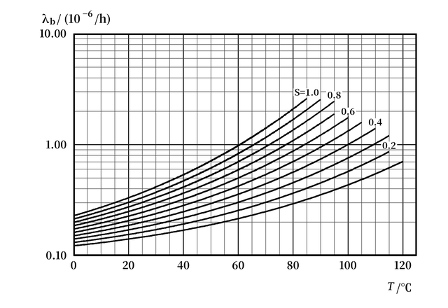

<strong>图 25 普通线绕电位器基本失效率曲线</strong>

<strong>表 172 环境系数 <i>π</i>E</strong>

<table>
  <tbody>
    <tr>
      <th align="center">环境</th>
      <th align="center">GB</th>
      <th align="center">GMS</th>
      <th align="center">GF1</th>
      <th align="center">GF2</th>
      <th align="center">GM1</th>
      <th align="center">GM2</th>
      <th align="center">MP</th>
      <th align="center">NSB</th>
      <th align="center">NS1</th>
      <th align="center">NS2</th>
    </tr>
    <tr>
      <td align="center"><i>π</i>E</td>
      <td align="center">1.0</td>
      <td align="center">1.2</td>
      <td align="center">2.0</td>
      <td align="center">3.0</td>
      <td align="center">5.3</td>
      <td align="center">10.6</td>
      <td align="center">8.0</td>
      <td align="center">4.2</td>
      <td align="center">3.0</td>
      <td align="center">4.7</td>
    </tr>
    <tr>
      <th align="center">环境</th>
      <th align="center">NU</th>
      <th align="center">AIF</th>
      <th align="center">AUF</th>
      <th align="center">AIC</th>
      <th align="center">AUC</th>
      <th align="center">ARW</th>
      <th align="center">SF</th>
      <th align="center">ML</th>
      <th align="center">MF</th>
      <th align="center">—</th>
    </tr>
    <tr>
      <td align="center"><i>π</i>E</td>
      <td align="center">9.4</td>
      <td align="center">9.3</td>
      <td align="center">13.3</td>
      <td align="center">4.4</td>
      <td align="center">8.0</td>
      <td align="center">16.4</td>
      <td align="center">1.0</td>
      <td align="center">—</td>
      <td align="center">—</td>
      <td align="center">—</td>
    </tr>
  </tbody>
</table>

100

---

<strong>GJB/Z 299D—2024</strong>

<strong>表 173 质量等级与质量系数 <i>π</i>Q</strong>

<table>
  <thead>
    <tr>
      <th colspan="2">质量等级</th>
      <th><i>π</i>Q</th>
    </tr>
  </thead>
  <tbody>
    <tr>
      <td rowspan="2" align="center">A</td>
      <td align="center">A1M</td>
      <td align="center">0.13</td>
    </tr>
    <tr>
      <td align="center">A2</td>
      <td align="center">0.2</td>
    </tr>
    <tr>
      <td rowspan="2" align="center">B</td>
      <td align="center">B1</td>
      <td align="center">0.6</td>
    </tr>
    <tr>
      <td align="center">B2</td>
      <td align="center">1.0</td>
    </tr>
    <tr>
      <td colspan="2" align="center">C</td>
      <td align="center">4.0</td>
    </tr>
  </tbody>
</table>

<strong>表 174 阻值系数 <i>π</i>R</strong>

<table>
  <thead>
    <tr>
      <th>阻值范围</th>
      <th><i>π</i>R</th>
    </tr>
  </thead>
  <tbody>
    <tr>
      <td align="center"><i>R</i> ≤ 2kΩ</td>
      <td align="center">1.0</td>
    </tr>
    <tr>
      <td align="center">2kΩ &lt; <i>R</i> ≤ 10kΩ</td>
      <td align="center">1.5</td>
    </tr>
    <tr>
      <td align="center">10kΩ &lt; <i>R</i> ≤ 20kΩ</td>
      <td align="center">2.0</td>
    </tr>
    <tr>
      <td align="center"><i>R</i> &gt; 20kΩ</td>
      <td align="center">2.5</td>
    </tr>
  </tbody>
</table>

#### 5.8.3 精密线绕电位器

工作失效率预计模型见式(48)。

$$\lambda_{\text{p}} = \lambda_{\text{b}} \pi_{\text{E}} \pi_{\text{Q}} \pi_{\text{R}} \pi_{\text{TAPS}} \tag{48}$$

式中：
$\lambda_{\text{p}}$ ——工作失效率，$10^{-6}/\text{h}$；
$\lambda_{\text{b}}$ ——基本失效率，$10^{-6}/\text{h}$，见表 175 和图 26；
$\pi_{\text{E}}$ ——环境系数，见表 176；
$\pi_{\text{Q}}$ ——质量系数，见表 177；
$\pi_{\text{R}}$ ——阻值系数，见表 178；
$\pi_{\text{TAPS}}$ ——引出端系数，见表 170。

<strong>表 175 基本失效率 <i>λ</i>b</strong>

单位为 10−6/h

<table>
  <thead>
    <tr>
      <th rowspan="2"><i>T</i> ℃</th>
      <th colspan="10"><i>S</i></th>
    </tr>
    <tr>
      <th>0.1</th>
      <th>0.2</th>
      <th>0.3</th>
      <th>0.4</th>
      <th>0.5</th>
      <th>0.6</th>
      <th>0.7</th>
      <th>0.8</th>
      <th>0.9</th>
      <th>1.0</th>
    </tr>
  </thead>
  <tbody>
    <tr>
      <td align="center">0</td>
      <td align="center">0.204 6</td>
      <td align="center">0.212 2</td>
      <td align="center">0.220 1</td>
      <td align="center">0.228 2</td>
      <td align="center">0.236 7</td>
      <td align="center">0.245 5</td>
      <td align="center">0.254 6</td>
      <td align="center">0.264 1</td>
      <td align="center">0.273 9</td>
      <td align="center">0.284 1</td>
    </tr>
    <tr>
      <td align="center">5</td>
      <td align="center">0.213 1</td>
      <td align="center">0.221 5</td>
      <td align="center">0.230 3</td>
      <td align="center">0.239 4</td>
      <td align="center">0.248 9</td>
      <td align="center">0.258 8</td>
      <td align="center">0.269 1</td>
      <td align="center">0.279 7</td>
      <td align="center">0.290 8</td>
      <td align="center">0.302 4</td>
    </tr>
    <tr>
      <td align="center">10</td>
      <td align="center">0.222 5</td>
      <td align="center">0.231 9</td>
      <td align="center">0.241 7</td>
      <td align="center">0.251 9</td>
      <td align="center">0.262 6</td>
      <td align="center">0.273 7</td>
      <td align="center">0.285 2</td>
      <td align="center">0.297 3</td>
      <td align="center">0.309 8</td>
      <td align="center">0.322 9</td>
    </tr>
    <tr>
      <td align="center">15</td>
      <td align="center">0.232 9</td>
      <td align="center">0.243 4</td>
      <td align="center">0.254 4</td>
      <td align="center">0.265 8</td>
      <td align="center">0.277 8</td>
      <td align="center">0.290 3</td>
      <td align="center">0.303 4</td>
      <td align="center">0.317 0</td>
      <td align="center">0.331 3</td>
      <td align="center">0.346 2</td>
    </tr>
    <tr>
      <td align="center">20</td>
      <td align="center">0.244 6</td>
      <td align="center">0.256 3</td>
      <td align="center">0.268 5</td>
      <td align="center">0.281 4</td>
      <td align="center">0.294 9</td>
      <td align="center">0.309 0</td>
      <td align="center">0.323 8</td>
      <td align="center">0.339 3</td>
      <td align="center">0.355 5</td>
      <td align="center">0.372 6</td>
    </tr>
    <tr>
      <td align="center">25</td>
      <td align="center">0.257 5</td>
      <td align="center">0.270 6</td>
      <td align="center">0.284 4</td>
      <td align="center">0.298 9</td>
      <td align="center">0.314 1</td>
      <td align="center">0.330 1</td>
      <td align="center">0.346 8</td>
      <td align="center">0.364 5</td>
      <td align="center">0.383 0</td>
      <td align="center">0.402 5</td>
    </tr>
    <tr>
      <td align="center">30</td>
      <td align="center">0.272 0</td>
      <td align="center">0.286 7</td>
      <td align="center">0.302 2</td>
      <td align="center">0.318 5</td>
      <td align="center">0.335 7</td>
      <td align="center">0.353 8</td>
      <td align="center">0.372 9</td>
      <td align="center">0.393 1</td>
      <td align="center">0.414 3</td>
      <td align="center">0.436 7</td>
    </tr>
    <tr>
      <td align="center">35</td>
      <td align="center">0.288 2</td>
      <td align="center">0.304 7</td>
      <td align="center">0.322 1</td>
      <td align="center">0.340 6</td>
      <td align="center">0.360 1</td>
      <td align="center">0.380 8</td>
      <td align="center">0.402 6</td>
      <td align="center">0.425 7</td>
      <td align="center">0.450 1</td>
      <td align="center">0.475 9</td>
    </tr>
    <tr>
      <td align="center">40</td>
      <td align="center">0.306 3</td>
      <td align="center">0.324 9</td>
      <td align="center">0.344 6</td>
      <td align="center">0.365 6</td>
      <td align="center">0.387 8</td>
      <td align="center">0.411 4</td>
      <td align="center">0.436 3</td>
      <td align="center">0.462 8</td>
      <td align="center">0.491 0</td>
      <td align="center">0.520 8</td>
    </tr>
    <tr>
      <td align="center">45</td>
      <td align="center">0.326 7</td>
      <td align="center">0.347 7</td>
      <td align="center">0.370 1</td>
      <td align="center">0.393 9</td>
      <td align="center">0.419 2</td>
      <td align="center">0.446 2</td>
      <td align="center">0.474 9</td>
      <td align="center">0.505 5</td>
      <td align="center">0.538 0</td>
      <td align="center">0.572 6</td>
    </tr>
    <tr>
      <td align="center">50</td>
      <td align="center">0.349 7</td>
      <td align="center">0.373 5</td>
      <td align="center">0.398 9</td>
      <td align="center">0.426 1</td>
      <td align="center">0.455 1</td>
      <td align="center">0.486 1</td>
      <td align="center">0.519 2</td>
      <td align="center">0.554 5</td>
      <td align="center">0.592 3</td>
      <td align="center">0.632 6</td>
    </tr>
    <tr>
      <td align="center">55</td>
      <td align="center">0.375 7</td>
      <td align="center">0.402 7</td>
      <td align="center">0.431 7</td>
      <td align="center">0.462 8</td>
      <td align="center">0.496 1</td>
      <td align="center">0.531 8</td>
      <td align="center">0.570 1</td>
      <td align="center">0.611 1</td>
      <td align="center">0.655 1</td>
      <td align="center">—</td>
    </tr>
  </tbody>
</table>

101

---

<strong>GJB/Z 299D—2024</strong>

<strong>表 175(续)</strong>

单位为 10−6/h

<table>
  <thead>
    <tr>
      <th rowspan="2"><i>T</i> ℃</th>
      <th colspan="10"><i>S</i></th>
    </tr>
    <tr>
      <th>0.1</th>
      <th>0.2</th>
      <th>0.3</th>
      <th>0.4</th>
      <th>0.5</th>
      <th>0.6</th>
      <th>0.7</th>
      <th>0.8</th>
      <th>0.9</th>
      <th>1.0</th>
    </tr>
  </thead>
  <tbody>
    <tr>
      <td align="center">60</td>
      <td align="center">0.405 2</td>
      <td align="center">0.436 0</td>
      <td align="center">0.469 1</td>
      <td align="center">0.504 8</td>
      <td align="center">0.543 2</td>
      <td align="center">0.584 5</td>
      <td align="center">0.629 0</td>
      <td align="center">0.676 8</td>
      <td align="center">—</td>
      <td align="center">—</td>
    </tr>
    <tr>
      <td align="center">65</td>
      <td align="center">0.438 7</td>
      <td align="center">0.473 9</td>
      <td align="center">0.512 0</td>
      <td align="center">0.553 1</td>
      <td align="center">0.597 5</td>
      <td align="center">0.645 5</td>
      <td align="center">0.697 3</td>
      <td align="center">—</td>
      <td align="center">—</td>
      <td align="center">—</td>
    </tr>
    <tr>
      <td align="center">70</td>
      <td align="center">0.476 9</td>
      <td align="center">0.517 3</td>
      <td align="center">0.561 2</td>
      <td align="center">0.608 7</td>
      <td align="center">0.660 3</td>
      <td align="center">0.716 2</td>
      <td align="center">—</td>
      <td align="center">—</td>
      <td align="center">—</td>
      <td align="center">—</td>
    </tr>
    <tr>
      <td align="center">75</td>
      <td align="center">0.520 7</td>
      <td align="center">0.567 2</td>
      <td align="center">0.617 9</td>
      <td align="center">0.673 1</td>
      <td align="center">0.733 2</td>
      <td align="center">—</td>
      <td align="center">—</td>
      <td align="center">—</td>
      <td align="center">—</td>
      <td align="center">—</td>
    </tr>
    <tr>
      <td align="center">80</td>
      <td align="center">0.571 0</td>
      <td align="center">0.624 8</td>
      <td align="center">0.683 6</td>
      <td align="center">0.747 9</td>
      <td align="center">—</td>
      <td align="center">—</td>
      <td align="center">—</td>
      <td align="center">—</td>
      <td align="center">—</td>
      <td align="center">—</td>
    </tr>
    <tr>
      <td align="center">85</td>
      <td align="center">0.629 1</td>
      <td align="center">0.691 4</td>
      <td align="center">0.760 0</td>
      <td align="center">—</td>
      <td align="center">—</td>
      <td align="center">—</td>
      <td align="center">—</td>
      <td align="center">—</td>
      <td align="center">—</td>
      <td align="center">—</td>
    </tr>
    <tr>
      <td align="center">90</td>
      <td align="center">0.696 3</td>
      <td align="center">0.768 9</td>
      <td align="center">—</td>
      <td align="center">—</td>
      <td align="center">—</td>
      <td align="center">—</td>
      <td align="center">—</td>
      <td align="center">—</td>
      <td align="center">—</td>
      <td align="center">—</td>
    </tr>
    <tr>
      <td align="center">95</td>
      <td align="center">0.774 5</td>
      <td align="center">—</td>
      <td align="center">—</td>
      <td align="center">—</td>
      <td align="center">—</td>
      <td align="center">—</td>
      <td align="center">—</td>
      <td align="center">—</td>
      <td align="center">—</td>
      <td align="center">—</td>
    </tr>
    <tr>
      <td colspan="11" align="left">
        注：<i>T</i> 为工作环境温度。 
        &emsp;&emsp;<i>S</i> 为实际功耗与额定功耗的比值。
      </td>
    </tr>
  </tbody>
</table>

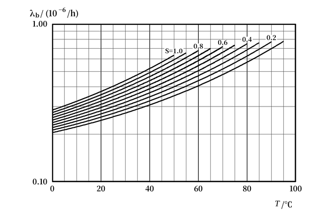

<strong>图 26 精密线绕电位器基本失效率曲线</strong>

<strong>表 176 环境系数 <i>π</i>E</strong>

<table>
  <tbody>
    <tr>
      <th align="center">环境</th>
      <th align="center">GB</th>
      <th align="center">GMS</th>
      <th align="center">GF1</th>
      <th align="center">GF2</th>
      <th align="center">GM1</th>
      <th align="center">GM2</th>
      <th align="center">MP</th>
      <th align="center">NSB</th>
      <th align="center">NS1</th>
      <th align="center">NS2</th>
    </tr>
    <tr>
      <td align="center"><i>π</i>E</td>
      <td align="center">1.0</td>
      <td align="center">1.2</td>
      <td align="center">2.0</td>
      <td align="center">3.0</td>
      <td align="center">4.0</td>
      <td align="center">7.3</td>
      <td align="center">6.0</td>
      <td align="center">4.8</td>
      <td align="center">3.0</td>
      <td align="center">5.6</td>
    </tr>
    <tr>
      <th align="center">环境</th>
      <th align="center">NU</th>
      <th align="center">AIF</th>
      <th align="center">AUF</th>
      <th align="center">AIC</th>
      <th align="center">AUC</th>
      <th align="center">ARW</th>
      <th align="center">SF</th>
      <th align="center">ML</th>
      <th align="center">MF</th>
      <th align="center">—</th>
    </tr>
    <tr>
      <td align="center"><i>π</i>E</td>
      <td align="center">11.2</td>
      <td align="center">9.3</td>
      <td align="center">13.3</td>
      <td align="center">5.9</td>
      <td align="center">9.6</td>
      <td align="center">26</td>
      <td align="center">1.0</td>
      <td align="center">53</td>
      <td align="center">20</td>
      <td align="center">—</td>
    </tr>
  </tbody>
</table>

<strong>表 177 质量等级与质量系数 <i>π</i>Q</strong>

<table>
  <thead>
    <tr>
      <th colspan="2">质量等级</th>
      <th><i>π</i>Q</th>
    </tr>
  </thead>
  <tbody>
    <tr>
      <td rowspan="2" align="center">A</td>
      <td align="center">A1M</td>
      <td align="center">0.1</td>
    </tr>
    <tr>
      <td align="center">A2</td>
      <td align="center">0.2</td>
    </tr>
    <tr>
      <td rowspan="2" align="center">B</td>
      <td align="center">B1</td>
      <td align="center">0.5</td>
    </tr>
    <tr>
      <td align="center">B2</td>
      <td align="center">1.0</td>
    </tr>
    <tr>
      <td colspan="2" align="center">C</td>
      <td align="center">4.0</td>
    </tr>
  </tbody>
</table>

102

---

<strong>GJB/Z 299D—2024</strong>

<strong>表 178 阻值系数 <i>π</i>R</strong>

<table>
  <thead>
    <tr>
      <th>阻值范围</th>
      <th><i>π</i>R</th>
    </tr>
  </thead>
  <tbody>
    <tr>
      <td align="center"><i>R</i> ≤ 20kΩ</td>
      <td align="center">1.0</td>
    </tr>
    <tr>
      <td align="center">20kΩ &lt; <i>R</i> ≤ 50kΩ</td>
      <td align="center">1.5</td>
    </tr>
    <tr>
      <td align="center">50kΩ &lt; <i>R</i> ≤ 100kΩ</td>
      <td align="center">2.0</td>
    </tr>
    <tr>
      <td align="center">100kΩ &lt; <i>R</i> ≤ 200kΩ</td>
      <td align="center">2.5</td>
    </tr>
    <tr>
      <td align="center">200kΩ &lt; <i>R</i> ≤ 500kΩ</td>
      <td align="center">3.5</td>
    </tr>
    <tr>
      <td align="center"><i>R</i> &gt; 500kΩ</td>
      <td align="center">4.2</td>
    </tr>
  </tbody>
</table>

#### 5.8.4 微调线绕电位器

工作失效率预计模型见式(49)。

$$\lambda_{\text{p}} = \lambda_{\text{b}} \pi_{\text{E}} \pi_{\text{Q}} \pi_{\text{R}} \pi_{\text{TAPS}} \tag{49}$$

式中：
$\lambda_{\text{p}}$ ——工作失效率，$10^{-6}/\text{h}$；
$\lambda_{\text{b}}$ ——基本失效率，$10^{-6}/\text{h}$，见表 179 和图 27；
$\pi_{\text{E}}$ ——环境系数，见表 180；
$\pi_{\text{Q}}$ ——质量系数，见表 181；
$\pi_{\text{R}}$ ——阻值系数，见表 182；
$\pi_{\text{TAPS}}$ ——引出端系数，见表 170。

<strong>表 179 基本失效率 <i>λ</i>b</strong>

单位为 10−6/h

<table>
  <thead>
    <tr>
      <th rowspan="2"><i>T</i> ℃</th>
      <th colspan="10"><i>S</i></th>
    </tr>
    <tr>
      <th>0.1</th>
      <th>0.2</th>
      <th>0.3</th>
      <th>0.4</th>
      <th>0.5</th>
      <th>0.6</th>
      <th>0.7</th>
      <th>0.8</th>
      <th>0.9</th>
      <th>1.0</th>
    </tr>
  </thead>
  <tbody>
    <tr>
      <td align="center">0</td>
      <td align="center">0.150 6</td>
      <td align="center">0.166 4</td>
      <td align="center">0.184 0</td>
      <td align="center">0.203 3</td>
      <td align="center">0.224 7</td>
      <td align="center">0.248 3</td>
      <td align="center">0.274 4</td>
      <td align="center">0.303 3</td>
      <td align="center">0.335 2</td>
      <td align="center">0.370 4</td>
    </tr>
    <tr>
      <td align="center">5</td>
      <td align="center">0.154 6</td>
      <td align="center">0.171 2</td>
      <td align="center">0.189 6</td>
      <td align="center">0.209 9</td>
      <td align="center">0.232 4</td>
      <td align="center">0.257 3</td>
      <td align="center">0.284 9</td>
      <td align="center">0.315 4</td>
      <td align="center">0.349 2</td>
      <td align="center">0.386 6</td>
    </tr>
    <tr>
      <td align="center">10</td>
      <td align="center">0.159 0</td>
      <td align="center">0.176 4</td>
      <td align="center">0.195 7</td>
      <td align="center">0.217 1</td>
      <td align="center">0.240 8</td>
      <td align="center">0.267 1</td>
      <td align="center">0.296 2</td>
      <td align="center">0.328 6</td>
      <td align="center">0.364 5</td>
      <td align="center">0.404 3</td>
    </tr>
    <tr>
      <td align="center">15</td>
      <td align="center">0.163 9</td>
      <td align="center">0.182 1</td>
      <td align="center">0.202 4</td>
      <td align="center">0.224 9</td>
      <td align="center">0.249 9</td>
      <td align="center">0.277 7</td>
      <td align="center">0.308 7</td>
      <td align="center">0.343 0</td>
      <td align="center">0.381 2</td>
      <td align="center">0.423 6</td>
    </tr>
    <tr>
      <td align="center">20</td>
      <td align="center">0.169 2</td>
      <td align="center">0.188 4</td>
      <td align="center">0.209 8</td>
      <td align="center">0.233 5</td>
      <td align="center">0.260 0</td>
      <td align="center">0.289 5</td>
      <td align="center">0.322 2</td>
      <td align="center">0.358 8</td>
      <td align="center">0.399 4</td>
      <td align="center">0.444 7</td>
    </tr>
    <tr>
      <td align="center">25</td>
      <td align="center">0.175 1</td>
      <td align="center">0.195 3</td>
      <td align="center">0.217 9</td>
      <td align="center">0.243 0</td>
      <td align="center">0.271 0</td>
      <td align="center">0.302 3</td>
      <td align="center">0.337 2</td>
      <td align="center">0.376 0</td>
      <td align="center">0.419 4</td>
      <td align="center">0.467 8</td>
    </tr>
    <tr>
      <td align="center">30</td>
      <td align="center">0.181 7</td>
      <td align="center">0.203 0</td>
      <td align="center">0.226 8</td>
      <td align="center">0.253 4</td>
      <td align="center">0.283 2</td>
      <td align="center">0.316 4</td>
      <td align="center">0.353 6</td>
      <td align="center">0.395 1</td>
      <td align="center">0.441 4</td>
      <td align="center">0.493 2</td>
    </tr>
    <tr>
      <td align="center">35</td>
      <td align="center">0.188 9</td>
      <td align="center">0.211 4</td>
      <td align="center">0.236 7</td>
      <td align="center">0.264 9</td>
      <td align="center">0.296 6</td>
      <td align="center">0.332 0</td>
      <td align="center">0.371 6</td>
      <td align="center">0.416 0</td>
      <td align="center">0.465 7</td>
      <td align="center">0.521 3</td>
    </tr>
    <tr>
      <td align="center">40</td>
      <td align="center">0.196 8</td>
      <td align="center">0.220 7</td>
      <td align="center">0.247 6</td>
      <td align="center">0.277 6</td>
      <td align="center">0.311 4</td>
      <td align="center">0.349 2</td>
      <td align="center">0.391 6</td>
      <td align="center">0.439 2</td>
      <td align="center">0.492 5</td>
      <td align="center">0.552 4</td>
    </tr>
    <tr>
      <td align="center">45</td>
      <td align="center">0.205 7</td>
      <td align="center">0.231 1</td>
      <td align="center">0.259 6</td>
      <td align="center">0.291 7</td>
      <td align="center">0.327 7</td>
      <td align="center">0.368 2</td>
      <td align="center">0.413 7</td>
      <td align="center">0.464 8</td>
      <td align="center">0.522 3</td>
      <td align="center">0.586 8</td>
    </tr>
    <tr>
      <td align="center">50</td>
      <td align="center">0.215 5</td>
      <td align="center">0.242 6</td>
      <td align="center">0.273 0</td>
      <td align="center">0.307 3</td>
      <td align="center">0.345 9</td>
      <td align="center">0.389 4</td>
      <td align="center">0.438 3</td>
      <td align="center">0.493 3</td>
      <td align="center">0.555 3</td>
      <td align="center">0.625 0</td>
    </tr>
    <tr>
      <td align="center">55</td>
      <td align="center">0.226 5</td>
      <td align="center">0.255 4</td>
      <td align="center">0.288 0</td>
      <td align="center">0.324 7</td>
      <td align="center">0.366 2</td>
      <td align="center">0.412 9</td>
      <td align="center">0.465 6</td>
      <td align="center">0.525 1</td>
      <td align="center">0.592 1</td>
      <td align="center">0.667 7</td>
    </tr>
    <tr>
      <td align="center">60</td>
      <td align="center">0.238 7</td>
      <td align="center">0.269 6</td>
      <td align="center">0.304 6</td>
      <td align="center">0.344 1</td>
      <td align="center">0.388 8</td>
      <td align="center">0.439 2</td>
      <td align="center">0.496 2</td>
      <td align="center">0.560 6</td>
      <td align="center">0.633 3</td>
      <td align="center">0.715 4</td>
    </tr>
    <tr>
      <td align="center">65</td>
      <td align="center">0.252 3</td>
      <td align="center">0.285 6</td>
      <td align="center">0.323 3</td>
      <td align="center">0.365 9</td>
      <td align="center">0.414 1</td>
      <td align="center">0.468 6</td>
      <td align="center">0.530 4</td>
      <td align="center">0.600 3</td>
      <td align="center">0.679 5</td>
      <td align="center">0.769 0</td>
    </tr>
    <tr>
      <td align="center">70</td>
      <td align="center">0.267 7</td>
      <td align="center">0.303 5</td>
      <td align="center">0.344 1</td>
      <td align="center">0.390 2</td>
      <td align="center">0.442 5</td>
      <td align="center">0.501 7</td>
      <td align="center">0.568 9</td>
      <td align="center">0.645 0</td>
      <td align="center">0.731 4</td>
      <td align="center">0.829 3</td>
    </tr>
    <tr>
      <td align="center">75</td>
      <td align="center">0.284 9</td>
      <td align="center">0.323 7</td>
      <td align="center">0.367 7</td>
      <td align="center">0.417 6</td>
      <td align="center">0.474 4</td>
      <td align="center">0.538 9</td>
      <td align="center">0.612 2</td>
      <td align="center">0.695 4</td>
      <td align="center">0.790 0</td>
      <td align="center">0.897 4</td>
    </tr>
    <tr>
      <td align="center">80</td>
      <td align="center">0.304 4</td>
      <td align="center">0.346 4</td>
      <td align="center">0.394 2</td>
      <td align="center">0.448 6</td>
      <td align="center">0.510 5</td>
      <td align="center">0.581 0</td>
      <td align="center">0.661 2</td>
      <td align="center">0.752 5</td>
      <td align="center">0.856 3</td>
      <td align="center">0.974 5</td>
    </tr>
    <tr>
      <td align="center">85</td>
      <td align="center">0.326 3</td>
      <td align="center">0.372 1</td>
      <td align="center">0.424 2</td>
      <td align="center">0.483 6</td>
      <td align="center">0.551 4</td>
      <td align="center">0.628 7</td>
      <td align="center">0.716 8</td>
      <td align="center">0.817 2</td>
      <td align="center">0.931 7</td>
      <td align="center">1.062 3</td>
    </tr>
  </tbody>
</table>

103

---

<strong>GJB/Z 299D—2024</strong>

<strong>表 179(续)</strong>

单位为 10−6/h

<table>
  <thead>
    <tr>
      <th rowspan="2"><i>T</i> ℃</th>
      <th colspan="10"><i>S</i></th>
    </tr>
    <tr>
      <th>0.1</th>
      <th>0.2</th>
      <th>0.3</th>
      <th>0.4</th>
      <th>0.5</th>
      <th>0.6</th>
      <th>0.7</th>
      <th>0.8</th>
      <th>0.9</th>
      <th>1.0</th>
    </tr>
  </thead>
  <tbody>
    <tr>
      <td align="center">90</td>
      <td align="center">0.351 3</td>
      <td align="center">0.401 2</td>
      <td align="center">0.458 3</td>
      <td align="center">0.523 5</td>
      <td align="center">0.597 9</td>
      <td align="center">0.683 0</td>
      <td align="center">0.780 1</td>
      <td align="center">0.891 0</td>
      <td align="center">1.017 7</td>
      <td align="center">—</td>
    </tr>
    <tr>
      <td align="center">95</td>
      <td align="center">0.379 7</td>
      <td align="center">0.434 5</td>
      <td align="center">0.497 2</td>
      <td align="center">0.568 9</td>
      <td align="center">0.651 0</td>
      <td align="center">0.744 9</td>
      <td align="center">0.852 4</td>
      <td align="center">0.975 4</td>
      <td align="center">—</td>
      <td align="center">—</td>
    </tr>
    <tr>
      <td align="center">100</td>
      <td align="center">0.412 1</td>
      <td align="center">0.472 4</td>
      <td align="center">0.541 6</td>
      <td align="center">0.620 9</td>
      <td align="center">0.711 8</td>
      <td align="center">0.816 0</td>
      <td align="center">—</td>
      <td align="center">—</td>
      <td align="center">—</td>
      <td align="center">—</td>
    </tr>
    <tr>
      <td align="center">105</td>
      <td align="center">0.449 3</td>
      <td align="center">0.516 0</td>
      <td align="center">0.592 6</td>
      <td align="center">0.680 6</td>
      <td align="center">0.781 7</td>
      <td align="center">—</td>
      <td align="center">—</td>
      <td align="center">—</td>
      <td align="center">—</td>
      <td align="center">—</td>
    </tr>
    <tr>
      <td align="center">110</td>
      <td align="center">0.492 0</td>
      <td align="center">0.566 1</td>
      <td align="center">0.651 4</td>
      <td align="center">0.749 5</td>
      <td align="center">—</td>
      <td align="center">—</td>
      <td align="center">—</td>
      <td align="center">—</td>
      <td align="center">—</td>
      <td align="center">—</td>
    </tr>
    <tr>
      <td align="center">115</td>
      <td align="center">0.541 5</td>
      <td align="center">0.624 2</td>
      <td align="center">0.719 5</td>
      <td align="center">—</td>
      <td align="center">—</td>
      <td align="center">—</td>
      <td align="center">—</td>
      <td align="center">—</td>
      <td align="center">—</td>
      <td align="center">—</td>
    </tr>
    <tr>
      <td align="center">120</td>
      <td align="center">0.598 8</td>
      <td align="center">—</td>
      <td align="center">—</td>
      <td align="center">—</td>
      <td align="center">—</td>
      <td align="center">—</td>
      <td align="center">—</td>
      <td align="center">—</td>
      <td align="center">—</td>
      <td align="center">—</td>
    </tr>
    <tr>
      <td colspan="11" align="left">
        注：<i>T</i> 为工作环境温度。 
        &emsp;&emsp;<i>S</i> 为实际功耗与额定功耗的比值。
      </td>
    </tr>
  </tbody>
</table>

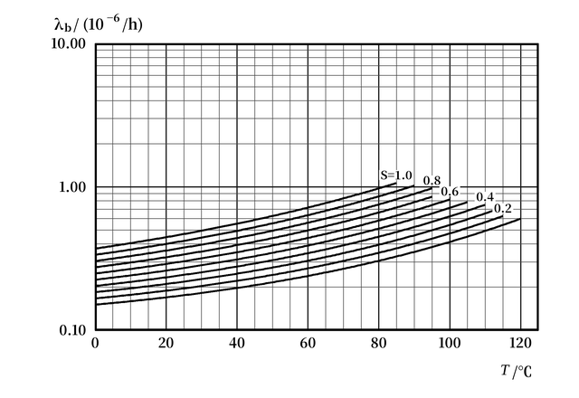

<strong>图 27 微调线绕电位器基本失效率曲线</strong>

<strong>表 180 环境系数 <i>π</i>E</strong>

<table>
  <tbody>
    <tr>
      <th align="center">环境</th>
      <th align="center">GB</th>
      <th align="center">GMS</th>
      <th align="center">GF1</th>
      <th align="center">GF2</th>
      <th align="center">GM1</th>
      <th align="center">GM2</th>
      <th align="center">MP</th>
      <th align="center">NSB</th>
      <th align="center">NS1</th>
      <th align="center">NS2</th>
    </tr>
    <tr>
      <td align="center"><i>π</i>E</td>
      <td align="center">1.0</td>
      <td align="center">1.2</td>
      <td align="center">1.8</td>
      <td align="center">3.0</td>
      <td align="center">4.0</td>
      <td align="center">6.5</td>
      <td align="center">5.5</td>
      <td align="center">3.5</td>
      <td align="center">2.5</td>
      <td align="center">3.8</td>
    </tr>
    <tr>
      <th align="center">环境</th>
      <th align="center">NU</th>
      <th align="center">AIF</th>
      <th align="center">AUF</th>
      <th align="center">AIC</th>
      <th align="center">AUC</th>
      <th align="center">ARW</th>
      <th align="center">SF</th>
      <th align="center">ML</th>
      <th align="center">MF</th>
      <th align="center">—</th>
    </tr>
    <tr>
      <td align="center"><i>π</i>E</td>
      <td align="center">7.6</td>
      <td align="center">6.7</td>
      <td align="center">13.3</td>
      <td align="center">4.3</td>
      <td align="center">7.8</td>
      <td align="center">16.4</td>
      <td align="center">1.0</td>
      <td align="center">34</td>
      <td align="center">15</td>
      <td align="center">—</td>
    </tr>
  </tbody>
</table>

<strong>表 181 质量等级与质量系数 <i>π</i>Q</strong>

<table>
  <thead>
    <tr>
      <th colspan="2">质量等级</th>
      <th><i>π</i>Q</th>
    </tr>
  </thead>
  <tbody>
    <tr>
      <td rowspan="2" align="center">A</td>
      <td align="center">A1M</td>
      <td align="center">0.15</td>
    </tr>
    <tr>
      <td align="center">A2</td>
      <td align="center">0.20</td>
    </tr>
    <tr>
      <td rowspan="2" align="center">B</td>
      <td align="center">B1</td>
      <td align="center">0.50</td>
    </tr>
    <tr>
      <td align="center">B2</td>
      <td align="center">1.0</td>
    </tr>
    <tr>
      <td colspan="2" align="center">C</td>
      <td align="center">4.0</td>
    </tr>
  </tbody>
</table>

104

---

<strong>GJB/Z 299D—2024</strong>

<strong>表 182 阻值系数 <i>π</i>R</strong>

<table>
  <thead>
    <tr>
      <th>阻值范围</th>
      <th><i>π</i>R</th>
    </tr>
  </thead>
  <tbody>
    <tr>
      <td align="center"><i>R</i> ≤ 2kΩ</td>
      <td align="center">1.0</td>
    </tr>
    <tr>
      <td align="center">2kΩ &lt; <i>R</i> ≤ 10kΩ</td>
      <td align="center">1.5</td>
    </tr>
    <tr>
      <td align="center">10kΩ &lt; <i>R</i> ≤ 20kΩ</td>
      <td align="center">2.0</td>
    </tr>
    <tr>
      <td align="center"><i>R</i> &gt; 20kΩ</td>
      <td align="center">2.5</td>
    </tr>
  </tbody>
</table>

#### 5.8.5 有机实芯电位器

工作失效率预计模型见式(50)。

$$\lambda_{\text{p}} = \lambda_{\text{b}} \pi_{\text{E}} \pi_{\text{Q}} \pi_{\text{R}} \pi_{\text{K}} \pi_{\text{C}} \pi_{\text{TAPS}} \tag{50}$$

式中：
$\lambda_{\text{p}}$ ——工作失效率，$10^{-6}/\text{h}$；
$\lambda_{\text{b}}$ ——基本失效率，$10^{-6}/\text{h}$，见表 183 和图 28；
$\pi_{\text{E}}$ ——环境系数，见表 184；
$\pi_{\text{Q}}$ ——质量系数，见表 185；
$\pi_{\text{R}}$ ——阻值系数，见表 186；
$\pi_{\text{K}}$ ——种类系数，见表 187；
$\pi_{\text{C}}$ ——结构系数，见表 188；
$\pi_{\text{TAPS}}$ ——引出端系数，见表 170。

<strong>表 183 基本失效率 <i>λ</i>b</strong>

单位为 10−6/h

<table>
  <thead>
    <tr>
      <th rowspan="2"><i>T</i> ℃</th>
      <th colspan="10"><i>S</i></th>
    </tr>
    <tr>
      <th>0.1</th>
      <th>0.2</th>
      <th>0.3</th>
      <th>0.4</th>
      <th>0.5</th>
      <th>0.6</th>
      <th>0.7</th>
      <th>0.8</th>
      <th>0.9</th>
      <th>1.0</th>
    </tr>
  </thead>
  <tbody>
    <tr>
      <td align="center">0</td>
      <td align="center">0.039 5</td>
      <td align="center">0.041 2</td>
      <td align="center">0.043 0</td>
      <td align="center">0.044 9</td>
      <td align="center">0.046 9</td>
      <td align="center">0.049 0</td>
      <td align="center">0.051 1</td>
      <td align="center">0.053 4</td>
      <td align="center">0.055 8</td>
      <td align="center">0.058 2</td>
    </tr>
    <tr>
      <td align="center">5</td>
      <td align="center">0.041 0</td>
      <td align="center">0.043 0</td>
      <td align="center">0.045 1</td>
      <td align="center">0.047 3</td>
      <td align="center">0.049 7</td>
      <td align="center">0.052 1</td>
      <td align="center">0.054 7</td>
      <td align="center">0.057 3</td>
      <td align="center">0.060 1</td>
      <td align="center">0.063 1</td>
    </tr>
    <tr>
      <td align="center">10</td>
      <td align="center">0.042 8</td>
      <td align="center">0.045 1</td>
      <td align="center">0.047 6</td>
      <td align="center">0.050 2</td>
      <td align="center">0.052 9</td>
      <td align="center">0.055 8</td>
      <td align="center">0.058 8</td>
      <td align="center">0.062 0</td>
      <td align="center">0.065 4</td>
      <td align="center">0.068 9</td>
    </tr>
    <tr>
      <td align="center">15</td>
      <td align="center">0.044 9</td>
      <td align="center">0.047 6</td>
      <td align="center">0.050 5</td>
      <td align="center">0.053 5</td>
      <td align="center">0.056 7</td>
      <td align="center">0.060 1</td>
      <td align="center">0.063 8</td>
      <td align="center">0.067 6</td>
      <td align="center">0.071 7</td>
      <td align="center">0.076 0</td>
    </tr>
    <tr>
      <td align="center">20</td>
      <td align="center">0.047 3</td>
      <td align="center">0.050 5</td>
      <td align="center">0.053 8</td>
      <td align="center">0.057 4</td>
      <td align="center">0.061 3</td>
      <td align="center">0.065 4</td>
      <td align="center">0.069 7</td>
      <td align="center">0.074 4</td>
      <td align="center">0.079 3</td>
      <td align="center">0.084 6</td>
    </tr>
    <tr>
      <td align="center">25</td>
      <td align="center">0.050 2</td>
      <td align="center">0.053 9</td>
      <td align="center">0.057 9</td>
      <td align="center">0.062 1</td>
      <td align="center">0.066 7</td>
      <td align="center">0.071 6</td>
      <td align="center">0.076 9</td>
      <td align="center">0.082 6</td>
      <td align="center">0.088 7</td>
      <td align="center">0.095 2</td>
    </tr>
    <tr>
      <td align="center">30</td>
      <td align="center">0.053 6</td>
      <td align="center">0.057 9</td>
      <td align="center">0.062 7</td>
      <td align="center">0.067 8</td>
      <td align="center">0.073 3</td>
      <td align="center">0.079 2</td>
      <td align="center">0.085 7</td>
      <td align="center">0.092 7</td>
      <td align="center">0.100 2</td>
      <td align="center">0.108 4</td>
    </tr>
    <tr>
      <td align="center">35</td>
      <td align="center">0.057 6</td>
      <td align="center">0.062 8</td>
      <td align="center">0.068 4</td>
      <td align="center">0.074 6</td>
      <td align="center">0.081 2</td>
      <td align="center">0.088 5</td>
      <td align="center">0.096 5</td>
      <td align="center">0.105 1</td>
      <td align="center">0.114 6</td>
      <td align="center">0.124 9</td>
    </tr>
    <tr>
      <td align="center">40</td>
      <td align="center">0.062 4</td>
      <td align="center">0.068 6</td>
      <td align="center">0.075 4</td>
      <td align="center">0.082 8</td>
      <td align="center">0.091 0</td>
      <td align="center">0.100 0</td>
      <td align="center">0.109 9</td>
      <td align="center">0.120 8</td>
      <td align="center">0.132 7</td>
      <td align="center">0.145 8</td>
    </tr>
    <tr>
      <td align="center">45</td>
      <td align="center">0.068 2</td>
      <td align="center">0.075 7</td>
      <td align="center">0.083 9</td>
      <td align="center">0.093 0</td>
      <td align="center">0.103 1</td>
      <td align="center">0.114 3</td>
      <td align="center">0.126 7</td>
      <td align="center">0.140 5</td>
      <td align="center">0.155 8</td>
      <td align="center">0.172 7</td>
    </tr>
    <tr>
      <td align="center">50</td>
      <td align="center">0.075 3</td>
      <td align="center">0.084 3</td>
      <td align="center">0.094 3</td>
      <td align="center">0.105 6</td>
      <td align="center">0.118 2</td>
      <td align="center">0.132 3</td>
      <td align="center">0.148 1</td>
      <td align="center">0.165 8</td>
      <td align="center">0.185 6</td>
      <td align="center">0.207 8</td>
    </tr>
    <tr>
      <td align="center">55</td>
      <td align="center">0.083 9</td>
      <td align="center">0.094 9</td>
      <td align="center">0.107 3</td>
      <td align="center">0.121 4</td>
      <td align="center">0.137 3</td>
      <td align="center">0.155 3</td>
      <td align="center">0.175 6</td>
      <td align="center">0.198 7</td>
      <td align="center">0.224 7</td>
      <td align="center">0.254 1</td>
    </tr>
    <tr>
      <td align="center">60</td>
      <td align="center">0.094 5</td>
      <td align="center">0.108 1</td>
      <td align="center">0.123 6</td>
      <td align="center">0.141 4</td>
      <td align="center">0.161 7</td>
      <td align="center">0.185 0</td>
      <td align="center">0.211 5</td>
      <td align="center">0.241 9</td>
      <td align="center">0.276 7</td>
      <td align="center">0.316 5</td>
    </tr>
    <tr>
      <td align="center">65</td>
      <td align="center">0.107 7</td>
      <td align="center">0.124 7</td>
      <td align="center">0.144 3</td>
      <td align="center">0.167 1</td>
      <td align="center">0.193 4</td>
      <td align="center">0.223 8</td>
      <td align="center">0.259 1</td>
      <td align="center">0.299 9</td>
      <td align="center">0.347 1</td>
      <td align="center">0.401 8</td>
    </tr>
    <tr>
      <td align="center">70</td>
      <td align="center">0.124 4</td>
      <td align="center">0.145 9</td>
      <td align="center">0.171 0</td>
      <td align="center">0.200 5</td>
      <td align="center">0.235 0</td>
      <td align="center">0.275 6</td>
      <td align="center">0.323 1</td>
      <td align="center">0.378 8</td>
      <td align="center">0.444 1</td>
      <td align="center">0.520 6</td>
    </tr>
    <tr>
      <td align="center">75</td>
      <td align="center">0.145 7</td>
      <td align="center">0.173 1</td>
      <td align="center">0.205 8</td>
      <td align="center">0.244 6</td>
      <td align="center">0.290 8</td>
      <td align="center">0.345 6</td>
      <td align="center">0.410 8</td>
      <td align="center">0.488 2</td>
      <td align="center">0.580 3</td>
      <td align="center">—</td>
    </tr>
    <tr>
      <td align="center">80</td>
      <td align="center">0.173 1</td>
      <td align="center">0.208 9</td>
      <td align="center">0.251 9</td>
      <td align="center">0.303 9</td>
      <td align="center">0.366 5</td>
      <td align="center">0.442 1</td>
      <td align="center">0.533 2</td>
      <td align="center">0.643 2</td>
      <td align="center">—</td>
      <td align="center">—</td>
    </tr>
    <tr>
      <td align="center">85</td>
      <td align="center">0.209 2</td>
      <td align="center">0.256 3</td>
      <td align="center">0.314 0</td>
      <td align="center">0.384 8</td>
      <td align="center">0.471 5</td>
      <td align="center">0.577 7</td>
      <td align="center">0.707 8</td>
      <td align="center">—</td>
      <td align="center">—</td>
      <td align="center">—</td>
    </tr>
    <tr>
      <td align="center">90</td>
      <td align="center">0.257 2</td>
      <td align="center">0.320 4</td>
      <td align="center">0.399 2</td>
      <td align="center">0.497 5</td>
      <td align="center">0.619 8</td>
      <td align="center">0.772 3</td>
      <td align="center">—</td>
      <td align="center">—</td>
      <td align="center">—</td>
      <td align="center">—</td>
    </tr>
  </tbody>
</table>

105

---

<strong>GJB/Z 299D—2024</strong>

<strong>表 183(续)</strong>

单位为 10−6/h

<table>
  <thead>
    <tr>
      <th rowspan="2"><i>T</i> ℃</th>
      <th colspan="10"><i>S</i></th>
    </tr>
    <tr>
      <th>0.1</th>
      <th>0.2</th>
      <th>0.3</th>
      <th>0.4</th>
      <th>0.5</th>
      <th>0.6</th>
      <th>0.7</th>
      <th>0.8</th>
      <th>0.9</th>
      <th>1.0</th>
    </tr>
  </thead>
  <tbody>
    <tr>
      <td align="center">95</td>
      <td align="center">0.322 1</td>
      <td align="center">0.408 6</td>
      <td align="center">0.518 4</td>
      <td align="center">0.657 6</td>
      <td align="center">0.834 1</td>
      <td align="center">—</td>
      <td align="center">—</td>
      <td align="center">—</td>
      <td align="center">—</td>
      <td align="center">—</td>
    </tr>
    <tr>
      <td align="center">100</td>
      <td align="center">0.411 8</td>
      <td align="center">0.532 5</td>
      <td align="center">0.688 5</td>
      <td align="center">0.890 2</td>
      <td align="center">1.151 0</td>
      <td align="center">—</td>
      <td align="center">—</td>
      <td align="center">—</td>
      <td align="center">—</td>
      <td align="center">—</td>
    </tr>
    <tr>
      <td align="center">105</td>
      <td align="center">0.538 1</td>
      <td align="center">0.710 0</td>
      <td align="center">0.936 9</td>
      <td align="center">1.236 3</td>
      <td align="center">—</td>
      <td align="center">—</td>
      <td align="center">—</td>
      <td align="center">—</td>
      <td align="center">—</td>
      <td align="center">—</td>
    </tr>
    <tr>
      <td align="center">110</td>
      <td align="center">0.719 7</td>
      <td align="center">0.970 5</td>
      <td align="center">1.308 6</td>
      <td align="center">—</td>
      <td align="center">—</td>
      <td align="center">—</td>
      <td align="center">—</td>
      <td align="center">—</td>
      <td align="center">—</td>
      <td align="center">—</td>
    </tr>
    <tr>
      <td align="center">115</td>
      <td align="center">0.987 1</td>
      <td align="center">1.362 1</td>
      <td align="center">—</td>
      <td align="center">—</td>
      <td align="center">—</td>
      <td align="center">—</td>
      <td align="center">—</td>
      <td align="center">—</td>
      <td align="center">—</td>
      <td align="center">—</td>
    </tr>
    <tr>
      <td align="center">120</td>
      <td align="center">1.390 9</td>
      <td align="center">—</td>
      <td align="center">—</td>
      <td align="center">—</td>
      <td align="center">—</td>
      <td align="center">—</td>
      <td align="center">—</td>
      <td align="center">—</td>
      <td align="center">—</td>
      <td align="center">—</td>
    </tr>
    <tr>
      <td colspan="11" align="left">
        注：<i>T</i> 为工作环境温度。 
        &emsp;&emsp;<i>S</i> 为实际功耗与额定功耗的比值。
      </td>
    </tr>
  </tbody>
</table>

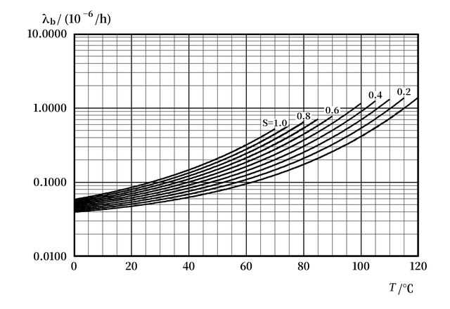

<strong>图 28 有机实芯电位器基本失效率曲线</strong>

<strong>表 184 环境系数 <i>π</i>E</strong>

<table>
  <tbody>
    <tr>
      <th align="center">环境</th>
      <th align="center">GB</th>
      <th align="center">GMS</th>
      <th align="center">GF1</th>
      <th align="center">GF2</th>
      <th align="center">GM1</th>
      <th align="center">GM2</th>
      <th align="center">MP</th>
      <th align="center">NSB</th>
      <th align="center">NS1</th>
      <th align="center">NS2</th>
    </tr>
    <tr>
      <td align="center"><i>π</i>E</td>
      <td align="center">1.0</td>
      <td align="center">1.1</td>
      <td align="center">1.5</td>
      <td align="center">3.0</td>
      <td align="center">5.6</td>
      <td align="center">11.3</td>
      <td align="center">8.5</td>
      <td align="center">4.5</td>
      <td align="center">2.5</td>
      <td align="center">5.3</td>
    </tr>
    <tr>
      <th align="center">环境</th>
      <th align="center">NU</th>
      <th align="center">AIF</th>
      <th align="center">AUF</th>
      <th align="center">AIC</th>
      <th align="center">AUC</th>
      <th align="center">ARW</th>
      <th align="center">SF</th>
      <th align="center">ML</th>
      <th align="center">MF</th>
      <th align="center">—</th>
    </tr>
    <tr>
      <td align="center"><i>π</i>E</td>
      <td align="center">10.6</td>
      <td align="center">11</td>
      <td align="center">14.7</td>
      <td align="center">7.5</td>
      <td align="center">9.0</td>
      <td align="center">18</td>
      <td align="center">1.0</td>
      <td align="center">47.3</td>
      <td align="center">20</td>
      <td align="center">—</td>
    </tr>
  </tbody>
</table>

<strong>表 185 质量等级与质量系数 <i>π</i>Q</strong>

<table>
  <thead>
    <tr>
      <th colspan="2">质量等级</th>
      <th><i>π</i>Q</th>
    </tr>
  </thead>
  <tbody>
    <tr>
      <td rowspan="2" align="center">A</td>
      <td align="center">A1M</td>
      <td align="center">0.1</td>
    </tr>
    <tr>
      <td align="center">A2</td>
      <td align="center">0.2</td>
    </tr>
    <tr>
      <td rowspan="2" align="center">B</td>
      <td align="center">B1</td>
      <td align="center">0.5</td>
    </tr>
    <tr>
      <td align="center">B2</td>
      <td align="center">1.0</td>
    </tr>
    <tr>
      <td colspan="2" align="center">C</td>
      <td align="center">4.0</td>
    </tr>
  </tbody>
</table>

<strong>表 186 阻值系数 <i>π</i>R</strong>

<table>
  <thead>
    <tr>
      <th>阻值范围</th>
      <th><i>π</i>R</th>
    </tr>
  </thead>
  <tbody>
    <tr>
      <td align="center"><i>R</i> ≤ 50kΩ</td>
      <td align="center">1.0</td>
    </tr>
    <tr>
      <td align="center">50kΩ &lt; <i>R</i> ≤ 200kΩ</td>
      <td align="center">1.2</td>
    </tr>
    <tr>
      <td align="center">200kΩ &lt; <i>R</i> ≤ 500kΩ</td>
      <td align="center">1.5</td>
    </tr>
    <tr>
      <td align="center">500kΩ &lt; <i>R</i> ≤ 1MΩ</td>
      <td align="center">2.0</td>
    </tr>
    <tr>
      <td align="center"><i>R</i> &gt; 1MΩ</td>
      <td align="center">2.3</td>
    </tr>
  </tbody>
</table>

106

---

<strong>GJB/Z 299D—2024</strong>

<strong>表 187 种类系数 <i>π</i>K</strong>

<table>
  <thead>
    <tr>
      <th>种类</th>
      <th><i>π</i>K</th>
    </tr>
  </thead>
  <tbody>
    <tr>
      <td align="center">微调</td>
      <td align="center">0.44</td>
    </tr>
    <tr>
      <td align="center">低功率</td>
      <td align="center">1.0</td>
    </tr>
    <tr>
      <td align="center">开关</td>
      <td align="center">2.0</td>
    </tr>
  </tbody>
</table>

<strong>表 188 结构系数 <i>π</i>C</strong>

<table>
  <thead>
    <tr>
      <th>结构类型</th>
      <th><i>π</i>C</th>
    </tr>
  </thead>
  <tbody>
    <tr>
      <td align="center">密封</td>
      <td align="center">0.5</td>
    </tr>
    <tr>
      <td align="center">非密封</td>
      <td align="center">1.0</td>
    </tr>
  </tbody>
</table>

#### 5.8.6 合成碳膜电位器

工作失效率预计模型见式(51)。

$$\lambda_{\text{p}} = \lambda_{\text{b}} \pi_{\text{E}} \pi_{\text{Q}} \pi_{\text{R}} \pi_{\text{K}} \pi_{\text{C}} \pi_{\text{TAPS}} \tag{51}$$

式中：
$\lambda_{\text{p}}$ ——工作失效率，$10^{-6}/\text{h}$；
$\lambda_{\text{b}}$ ——基本失效率，$10^{-6}/\text{h}$，见表 189 和图 29；
$\pi_{\text{E}}$ ——环境系数，见表 190；
$\pi_{\text{Q}}$ ——质量系数，见表 191；
$\pi_{\text{R}}$ ——阻值系数，见表 192；
$\pi_{\text{K}}$ ——种类系数，见表 193；
$\pi_{\text{C}}$ ——结构系数，见表 194；
$\pi_{\text{TAPS}}$ ——引出端系数，见表 170。

<strong>表 189 基本失效率 <i>λ</i>b</strong>

单位为 10−6/h

<table>
  <thead>
    <tr>
      <th rowspan="2"><i>T</i> ℃</th>
      <th colspan="10"><i>S</i></th>
    </tr>
    <tr>
      <th>0.1</th>
      <th>0.2</th>
      <th>0.3</th>
      <th>0.4</th>
      <th>0.5</th>
      <th>0.6</th>
      <th>0.7</th>
      <th>0.8</th>
      <th>0.9</th>
      <th>1.0</th>
    </tr>
  </thead>
  <tbody>
    <tr>
      <td align="center">0</td>
      <td align="center">0.065 2</td>
      <td align="center">0.070 3</td>
      <td align="center">0.075 9</td>
      <td align="center">0.081 9</td>
      <td align="center">0.088 4</td>
      <td align="center">0.095 5</td>
      <td align="center">0.103 0</td>
      <td align="center">0.111 2</td>
      <td align="center">0.120 0</td>
      <td align="center">0.129 5</td>
    </tr>
    <tr>
      <td align="center">5</td>
      <td align="center">0.067 1</td>
      <td align="center">0.073 1</td>
      <td align="center">0.079 6</td>
      <td align="center">0.086 8</td>
      <td align="center">0.094 5</td>
      <td align="center">0.103 0</td>
      <td align="center">0.112 2</td>
      <td align="center">0.122 2</td>
      <td align="center">0.133 2</td>
      <td align="center">0.145 1</td>
    </tr>
    <tr>
      <td align="center">10</td>
      <td align="center">0.069 3</td>
      <td align="center">0.076 3</td>
      <td align="center">0.084 0</td>
      <td align="center">0.092 5</td>
      <td align="center">0.101 8</td>
      <td align="center">0.112 0</td>
      <td align="center">0.123 3</td>
      <td align="center">0.135 7</td>
      <td align="center">0.149 4</td>
      <td align="center">0.164 5</td>
    </tr>
    <tr>
      <td align="center">15</td>
      <td align="center">0.071 9</td>
      <td align="center">0.080 0</td>
      <td align="center">0.089 1</td>
      <td align="center">0.099 2</td>
      <td align="center">0.110 4</td>
      <td align="center">0.123 0</td>
      <td align="center">0.136 9</td>
      <td align="center">0.152 4</td>
      <td align="center">0.169 7</td>
      <td align="center">0.188 9</td>
    </tr>
    <tr>
      <td align="center">20</td>
      <td align="center">0.074 9</td>
      <td align="center">0.084 4</td>
      <td align="center">0.095 1</td>
      <td align="center">0.107 2</td>
      <td align="center">0.120 9</td>
      <td align="center">0.136 3</td>
      <td align="center">0.153 6</td>
      <td align="center">0.173 1</td>
      <td align="center">0.195 2</td>
      <td align="center">0.220 0</td>
    </tr>
    <tr>
      <td align="center">25</td>
      <td align="center">0.078 3</td>
      <td align="center">0.089 5</td>
      <td align="center">0.102 3</td>
      <td align="center">0.116 9</td>
      <td align="center">0.133 5</td>
      <td align="center">0.152 6</td>
      <td align="center">0.174 4</td>
      <td align="center">0.199 3</td>
      <td align="center">0.227 7</td>
      <td align="center">0.260 2</td>
    </tr>
    <tr>
      <td align="center">30</td>
      <td align="center">0.082 3</td>
      <td align="center">0.095 5</td>
      <td align="center">0.110 8</td>
      <td align="center">0.128 5</td>
      <td align="center">0.149 0</td>
      <td align="center">0.172 9</td>
      <td align="center">0.200 5</td>
      <td align="center">0.232 6</td>
      <td align="center">0.269 7</td>
      <td align="center">0.312 9</td>
    </tr>
    <tr>
      <td align="center">35</td>
      <td align="center">0.087 1</td>
      <td align="center">0.102 6</td>
      <td align="center">0.121 0</td>
      <td align="center">0.142 6</td>
      <td align="center">0.168 2</td>
      <td align="center">0.198 2</td>
      <td align="center">0.233 7</td>
      <td align="center">0.275 5</td>
      <td align="center">0.324 8</td>
      <td align="center">0.383 0</td>
    </tr>
    <tr>
      <td align="center">40</td>
      <td align="center">0.092 6</td>
      <td align="center">0.111 1</td>
      <td align="center">0.133 3</td>
      <td align="center">0.160 0</td>
      <td align="center">0.192 0</td>
      <td align="center">0.230 4</td>
      <td align="center">0.276 5</td>
      <td align="center">0.331 8</td>
      <td align="center">0.398 2</td>
      <td align="center">0.477 9</td>
    </tr>
    <tr>
      <td align="center">45</td>
      <td align="center">0.099 1</td>
      <td align="center">0.121 2</td>
      <td align="center">0.148 3</td>
      <td align="center">0.181 5</td>
      <td align="center">0.222 0</td>
      <td align="center">0.271 7</td>
      <td align="center">0.332 4</td>
      <td align="center">0.406 7</td>
      <td align="center">0.497 7</td>
      <td align="center">0.608 9</td>
    </tr>
    <tr>
      <td align="center">50</td>
      <td align="center">0.106 8</td>
      <td align="center">0.133 4</td>
      <td align="center">0.166 7</td>
      <td align="center">0.208 4</td>
      <td align="center">0.260 4</td>
      <td align="center">0.325 4</td>
      <td align="center">0.406 6</td>
      <td align="center">0.508 1</td>
      <td align="center">0.634 9</td>
      <td align="center">0.793 4</td>
    </tr>
    <tr>
      <td align="center">55</td>
      <td align="center">0.116 0</td>
      <td align="center">0.148 3</td>
      <td align="center">0.189 6</td>
      <td align="center">0.242 4</td>
      <td align="center">0.309 9</td>
      <td align="center">0.396 2</td>
      <td align="center">0.506 6</td>
      <td align="center">0.647 7</td>
      <td align="center">0.828 2</td>
      <td align="center">1.058 9</td>
    </tr>
    <tr>
      <td align="center">60</td>
      <td align="center">0.127 0</td>
      <td align="center">0.166 4</td>
      <td align="center">0.218 2</td>
      <td align="center">0.286 0</td>
      <td align="center">0.374 8</td>
      <td align="center">0.491 3</td>
      <td align="center">0.644 0</td>
      <td align="center">0.844 1</td>
      <td align="center">—</td>
      <td align="center">—</td>
    </tr>
    <tr>
      <td align="center">65</td>
      <td align="center">0.140 3</td>
      <td align="center">0.188 9</td>
      <td align="center">0.254 4</td>
      <td align="center">0.342 6</td>
      <td align="center">0.461 3</td>
      <td align="center">0.621 1</td>
      <td align="center">0.836 4</td>
      <td align="center">—</td>
      <td align="center">—</td>
      <td align="center">—</td>
    </tr>
    <tr>
      <td align="center">70</td>
      <td align="center">0.156 5</td>
      <td align="center">0.217 0</td>
      <td align="center">0.300 9</td>
      <td align="center">0.417 1</td>
      <td align="center">0.578 3</td>
      <td align="center">—</td>
      <td align="center">—</td>
      <td align="center">—</td>
      <td align="center">—</td>
      <td align="center">—</td>
    </tr>
    <tr>
      <td align="center">75</td>
      <td align="center">0.176 5</td>
      <td align="center">0.252 5</td>
      <td align="center">0.361 3</td>
      <td align="center">—</td>
      <td align="center">—</td>
      <td align="center">—</td>
      <td align="center">—</td>
      <td align="center">—</td>
      <td align="center">—</td>
      <td align="center">—</td>
    </tr>
    <tr>
      <td align="center">80</td>
      <td align="center">0.201 2</td>
      <td align="center">0.297 9</td>
      <td align="center">—</td>
      <td align="center">—</td>
      <td align="center">—</td>
      <td align="center">—</td>
      <td align="center">—</td>
      <td align="center">—</td>
      <td align="center">—</td>
      <td align="center">—</td>
    </tr>
    <tr>
      <td colspan="11" align="left">
        注：<i>T</i> 为工作环境温度。 
        &emsp;&emsp;<i>S</i> 为实际功耗与额定功耗的比值。
      </td>
    </tr>
  </tbody>
</table>

107

---

<strong>GJB/Z 299D—2024</strong>

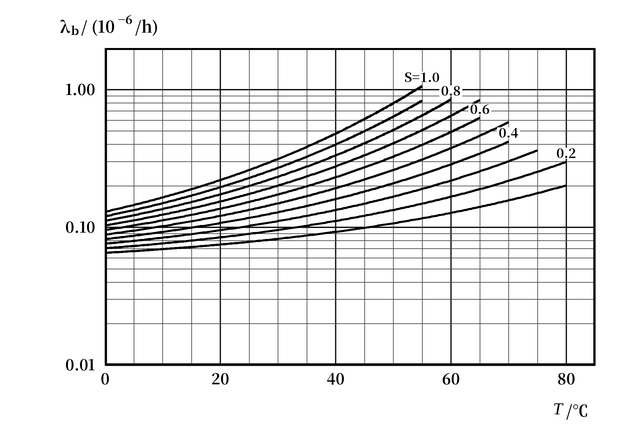

<strong>图 29 合成碳膜电位器基本失效率曲线</strong>

<strong>表 190 环境系数 <i>π</i>E</strong>

<table>
  <tbody>
    <tr>
      <th align="center">环境</th>
      <th align="center">GB</th>
      <th align="center">GMS</th>
      <th align="center">GF1</th>
      <th align="center">GF2</th>
      <th align="center">GM1</th>
      <th align="center">GM2</th>
      <th align="center">MP</th>
      <th align="center">NSB</th>
      <th align="center">NS1</th>
      <th align="center">NS2</th>
    </tr>
    <tr>
      <td align="center"><i>π</i>E</td>
      <td align="center">1.0</td>
      <td align="center">1.1</td>
      <td align="center">1.5</td>
      <td align="center">3.0</td>
      <td align="center">5.6</td>
      <td align="center">11.3</td>
      <td align="center">8.5</td>
      <td align="center">5.5</td>
      <td align="center">3.0</td>
      <td align="center">6.7</td>
    </tr>
    <tr>
      <th align="center">环境</th>
      <th align="center">NU</th>
      <th align="center">AIF</th>
      <th align="center">AUF</th>
      <th align="center">AIC</th>
      <th align="center">AUC</th>
      <th align="center">ARW</th>
      <th align="center">SF</th>
      <th align="center">ML</th>
      <th align="center">MF</th>
      <th align="center">—</th>
    </tr>
    <tr>
      <td align="center"><i>π</i>E</td>
      <td align="center">13.4</td>
      <td align="center">12.4</td>
      <td align="center">16.5</td>
      <td align="center">8.5</td>
      <td align="center">10.2</td>
      <td align="center">20</td>
      <td align="center">1.0</td>
      <td align="center">—</td>
      <td align="center">—</td>
      <td align="center">—</td>
    </tr>
  </tbody>
</table>

<strong>表 191 质量等级与质量系数 <i>π</i>Q</strong>

<table>
  <thead>
    <tr>
      <th colspan="2">质量等级</th>
      <th><i>π</i>Q</th>
    </tr>
  </thead>
  <tbody>
    <tr>
      <td align="center">A</td>
      <td align="center">A2</td>
      <td align="center">0.2</td>
    </tr>
    <tr>
      <td rowspan="2" align="center">B</td>
      <td align="center">B1</td>
      <td align="center">0.5</td>
    </tr>
    <tr>
      <td align="center">B2</td>
      <td align="center">1.0</td>
    </tr>
    <tr>
      <td colspan="2" align="center">C</td>
      <td align="center">6.0</td>
    </tr>
  </tbody>
</table>

<strong>表 192 阻值系数 <i>π</i>R</strong>

<table>
  <thead>
    <tr>
      <th>阻值范围</th>
      <th><i>π</i>R</th>
    </tr>
  </thead>
  <tbody>
    <tr>
      <td align="center"><i>R</i> ≤ 50kΩ</td>
      <td align="center">1.0</td>
    </tr>
    <tr>
      <td align="center">50kΩ &lt; <i>R</i> ≤ 200kΩ</td>
      <td align="center">1.2</td>
    </tr>
    <tr>
      <td align="center">200kΩ &lt; <i>R</i> ≤ 500kΩ</td>
      <td align="center">1.5</td>
    </tr>
    <tr>
      <td align="center">500kΩ &lt; <i>R</i> ≤ 1MΩ</td>
      <td align="center">2.0</td>
    </tr>
    <tr>
      <td align="center"><i>R</i> &gt; 1MΩ</td>
      <td align="center">2.3</td>
    </tr>
  </tbody>
</table>

<strong>表 193 种类系数 <i>π</i>K</strong>

<table>
  <thead>
    <tr>
      <th>种类</th>
      <th><i>π</i>K</th>
    </tr>
  </thead>
  <tbody>
    <tr>
      <td align="center">微调</td>
      <td align="center">0.7</td>
    </tr>
    <tr>
      <td align="center">低功率</td>
      <td align="center">1.0</td>
    </tr>
    <tr>
      <td align="center">开关</td>
      <td align="center">2.0</td>
    </tr>
  </tbody>
</table>

<strong>表 194 结构系数 <i>π</i>C</strong>

<table>
  <thead>
    <tr>
      <th>结构类型</th>
      <th><i>π</i>C</th>
    </tr>
  </thead>
  <tbody>
    <tr>
      <td align="center">密封</td>
      <td align="center">0.5</td>
    </tr>
    <tr>
      <td align="center">敞露</td>
      <td align="center">1.0</td>
    </tr>
  </tbody>
</table>

108

---

<strong>GJB/Z 299D—2024</strong>

#### 5.8.7 玻璃釉电位器

工作失效率预计模型见式(52)。

$$\lambda_{\text{p}} = \lambda_{\text{b}} \pi_{\text{E}} \pi_{\text{Q}} \pi_{\text{R}} \pi_{\text{K}} \pi_{\text{TAPS}} \tag{52}$$

式中：
$\lambda_{\text{p}}$ ——工作失效率，$10^{-6}/\text{h}$；
$\lambda_{\text{b}}$ ——基本失效率，$10^{-6}/\text{h}$，见表 195 和图 30；
$\pi_{\text{E}}$ ——环境系数，见表 196；
$\pi_{\text{Q}}$ ——质量系数，见表 197；
$\pi_{\text{R}}$ ——阻值系数，见表 198；
$\pi_{\text{K}}$ ——种类系数，见表 199；
$\pi_{\text{TAPS}}$ ——引出端系数，见表 170。

<strong>表 195 基本失效率 <i>λ</i>b</strong>

单位为 10−6/h

<table>
  <thead>
    <tr>
      <th rowspan="2"><i>T</i> ℃</th>
      <th colspan="10"><i>S</i></th>
    </tr>
    <tr>
      <th>0.1</th>
      <th>0.2</th>
      <th>0.3</th>
      <th>0.4</th>
      <th>0.5</th>
      <th>0.6</th>
      <th>0.7</th>
      <th>0.8</th>
      <th>0.9</th>
      <th>1.0</th>
    </tr>
  </thead>
  <tbody>
    <tr>
      <td align="center">0</td>
      <td align="center">0.038 3</td>
      <td align="center">0.039 7</td>
      <td align="center">0.041 2</td>
      <td align="center">0.042 8</td>
      <td align="center">0.044 4</td>
      <td align="center">0.046 1</td>
      <td align="center">0.047 8</td>
      <td align="center">0.049 6</td>
      <td align="center">0.051 5</td>
      <td align="center">0.053 5</td>
    </tr>
    <tr>
      <td align="center">5</td>
      <td align="center">0.038 8</td>
      <td align="center">0.040 3</td>
      <td align="center">0.041 9</td>
      <td align="center">0.043 6</td>
      <td align="center">0.045 3</td>
      <td align="center">0.047 1</td>
      <td align="center">0.049 0</td>
      <td align="center">0.050 9</td>
      <td align="center">0.052 9</td>
      <td align="center">0.055 0</td>
    </tr>
    <tr>
      <td align="center">10</td>
      <td align="center">0.039 4</td>
      <td align="center">0.041 0</td>
      <td align="center">0.042 7</td>
      <td align="center">0.044 5</td>
      <td align="center">0.046 3</td>
      <td align="center">0.048 3</td>
      <td align="center">0.050 3</td>
      <td align="center">0.052 3</td>
      <td align="center">0.054 5</td>
      <td align="center">0.056 8</td>
    </tr>
    <tr>
      <td align="center">15</td>
      <td align="center">0.040 0</td>
      <td align="center">0.041 8</td>
      <td align="center">0.043 6</td>
      <td align="center">0.045 5</td>
      <td align="center">0.047 4</td>
      <td align="center">0.049 5</td>
      <td align="center">0.051 6</td>
      <td align="center">0.053 9</td>
      <td align="center">0.056 2</td>
      <td align="center">0.058 7</td>
    </tr>
    <tr>
      <td align="center">20</td>
      <td align="center">0.040 8</td>
      <td align="center">0.042 6</td>
      <td align="center">0.044 6</td>
      <td align="center">0.046 6</td>
      <td align="center">0.048 7</td>
      <td align="center">0.050 9</td>
      <td align="center">0.053 2</td>
      <td align="center">0.055 6</td>
      <td align="center">0.058 1</td>
      <td align="center">0.060 7</td>
    </tr>
    <tr>
      <td align="center">25</td>
      <td align="center">0.041 6</td>
      <td align="center">0.043 6</td>
      <td align="center">0.045 7</td>
      <td align="center">0.047 8</td>
      <td align="center">0.050 1</td>
      <td align="center">0.052 4</td>
      <td align="center">0.054 9</td>
      <td align="center">0.057 5</td>
      <td align="center">0.060 2</td>
      <td align="center">0.063 1</td>
    </tr>
    <tr>
      <td align="center">30</td>
      <td align="center">0.042 6</td>
      <td align="center">0.044 7</td>
      <td align="center">0.046 9</td>
      <td align="center">0.049 2</td>
      <td align="center">0.051 6</td>
      <td align="center">0.054 1</td>
      <td align="center">0.056 8</td>
      <td align="center">0.059 6</td>
      <td align="center">0.062 5</td>
      <td align="center">0.065 6</td>
    </tr>
    <tr>
      <td align="center">35</td>
      <td align="center">0.043 7</td>
      <td align="center">0.045 9</td>
      <td align="center">0.048 2</td>
      <td align="center">0.050 7</td>
      <td align="center">0.053 3</td>
      <td align="center">0.056 1</td>
      <td align="center">0.058 9</td>
      <td align="center">0.062 0</td>
      <td align="center">0.065 1</td>
      <td align="center">0.068 5</td>
    </tr>
    <tr>
      <td align="center">40</td>
      <td align="center">0.044 9</td>
      <td align="center">0.047 3</td>
      <td align="center">0.049 8</td>
      <td align="center">0.052 4</td>
      <td align="center">0.055 2</td>
      <td align="center">0.058 2</td>
      <td align="center">0.061 3</td>
      <td align="center">0.064 6</td>
      <td align="center">0.068 0</td>
      <td align="center">0.071 7</td>
    </tr>
    <tr>
      <td align="center">45</td>
      <td align="center">0.046 2</td>
      <td align="center">0.048 8</td>
      <td align="center">0.051 5</td>
      <td align="center">0.054 4</td>
      <td align="center">0.057 4</td>
      <td align="center">0.060 6</td>
      <td align="center">0.064 0</td>
      <td align="center">0.067 5</td>
      <td align="center">0.071 3</td>
      <td align="center">0.075 2</td>
    </tr>
    <tr>
      <td align="center">50</td>
      <td align="center">0.047 8</td>
      <td align="center">0.050 5</td>
      <td align="center">0.053 5</td>
      <td align="center">0.056 6</td>
      <td align="center">0.059 8</td>
      <td align="center">0.063 3</td>
      <td align="center">0.067 0</td>
      <td align="center">0.070 8</td>
      <td align="center">0.074 9</td>
      <td align="center">0.079 3</td>
    </tr>
    <tr>
      <td align="center">55</td>
      <td align="center">0.049 5</td>
      <td align="center">0.052 5</td>
      <td align="center">0.055 7</td>
      <td align="center">0.059 0</td>
      <td align="center">0.062 6</td>
      <td align="center">0.066 3</td>
      <td align="center">0.070 3</td>
      <td align="center">0.074 6</td>
      <td align="center">0.079 0</td>
      <td align="center">0.083 8</td>
    </tr>
    <tr>
      <td align="center">60</td>
      <td align="center">0.051 6</td>
      <td align="center">0.054 8</td>
      <td align="center">0.058 2</td>
      <td align="center">0.061 8</td>
      <td align="center">0.065 7</td>
      <td align="center">0.069 8</td>
      <td align="center">0.074 2</td>
      <td align="center">0.078 8</td>
      <td align="center">0.083 7</td>
      <td align="center">0.088 9</td>
    </tr>
    <tr>
      <td align="center">65</td>
      <td align="center">0.053 8</td>
      <td align="center">0.057 3</td>
      <td align="center">0.061 1</td>
      <td align="center">0.065 0</td>
      <td align="center">0.069 2</td>
      <td align="center">0.073 7</td>
      <td align="center">0.078 5</td>
      <td align="center">0.083 6</td>
      <td align="center">0.089 0</td>
      <td align="center">0.094 8</td>
    </tr>
    <tr>
      <td align="center">70</td>
      <td align="center">0.056 5</td>
      <td align="center">0.060 3</td>
      <td align="center">0.064 3</td>
      <td align="center">0.068 7</td>
      <td align="center">0.073 3</td>
      <td align="center">0.078 2</td>
      <td align="center">0.083 5</td>
      <td align="center">0.089 1</td>
      <td align="center">0.095 1</td>
      <td align="center">0.101 5</td>
    </tr>
    <tr>
      <td align="center">75</td>
      <td align="center">0.059 5</td>
      <td align="center">0.063 6</td>
      <td align="center">0.068 1</td>
      <td align="center">0.072 8</td>
      <td align="center">0.077 9</td>
      <td align="center">0.083 4</td>
      <td align="center">0.089 2</td>
      <td align="center">0.095 4</td>
      <td align="center">0.102 1</td>
      <td align="center">—</td>
    </tr>
    <tr>
      <td align="center">80</td>
      <td align="center">0.062 9</td>
      <td align="center">0.067 5</td>
      <td align="center">0.072 4</td>
      <td align="center">0.077 6</td>
      <td align="center">0.083 3</td>
      <td align="center">0.089 3</td>
      <td align="center">0.095 8</td>
      <td align="center">0.102 7</td>
      <td align="center">—</td>
      <td align="center">—</td>
    </tr>
    <tr>
      <td align="center">85</td>
      <td align="center">0.067 0</td>
      <td align="center">0.072 0</td>
      <td align="center">0.077 4</td>
      <td align="center">0.083 2</td>
      <td align="center">0.089 5</td>
      <td align="center">0.096 2</td>
      <td align="center">0.103 4</td>
      <td align="center">—</td>
      <td align="center">—</td>
      <td align="center">—</td>
    </tr>
    <tr>
      <td align="center">90</td>
      <td align="center">0.071 6</td>
      <td align="center">0.077 2</td>
      <td align="center">0.083 2</td>
      <td align="center">0.089 7</td>
      <td align="center">0.096 6</td>
      <td align="center">0.104 2</td>
      <td align="center">—</td>
      <td align="center">—</td>
      <td align="center">—</td>
      <td align="center">—</td>
    </tr>
    <tr>
      <td align="center">95</td>
      <td align="center">0.077 1</td>
      <td align="center">0.083 3</td>
      <td align="center">0.090 0</td>
      <td align="center">0.097 2</td>
      <td align="center">0.105 1</td>
      <td align="center">—</td>
      <td align="center">—</td>
      <td align="center">—</td>
      <td align="center">—</td>
      <td align="center">—</td>
    </tr>
    <tr>
      <td align="center">100</td>
      <td align="center">0.083 4</td>
      <td align="center">0.090 4</td>
      <td align="center">0.097 9</td>
      <td align="center">0.106 1</td>
      <td align="center">0.115 0</td>
      <td align="center">—</td>
      <td align="center">—</td>
      <td align="center">—</td>
      <td align="center">—</td>
      <td align="center">—</td>
    </tr>
    <tr>
      <td align="center">105</td>
      <td align="center">0.091 0</td>
      <td align="center">0.098 8</td>
      <td align="center">0.107 4</td>
      <td align="center">0.116 6</td>
      <td align="center">—</td>
      <td align="center">—</td>
      <td align="center">—</td>
      <td align="center">—</td>
      <td align="center">—</td>
      <td align="center">—</td>
    </tr>
    <tr>
      <td align="center">110</td>
      <td align="center">0.099 9</td>
      <td align="center">0.108 8</td>
      <td align="center">0.118 6</td>
      <td align="center">—</td>
      <td align="center">—</td>
      <td align="center">—</td>
      <td align="center">—</td>
      <td align="center">—</td>
      <td align="center">—</td>
      <td align="center">—</td>
    </tr>
    <tr>
      <td align="center">115</td>
      <td align="center">0.110 6</td>
      <td align="center">0.120 8</td>
      <td align="center">—</td>
      <td align="center">—</td>
      <td align="center">—</td>
      <td align="center">—</td>
      <td align="center">—</td>
      <td align="center">—</td>
      <td align="center">—</td>
      <td align="center">—</td>
    </tr>
    <tr>
      <td align="center">120</td>
      <td align="center">0.123 5</td>
      <td align="center">—</td>
      <td align="center">—</td>
      <td align="center">—</td>
      <td align="center">—</td>
      <td align="center">—</td>
      <td align="center">—</td>
      <td align="center">—</td>
      <td align="center">—</td>
      <td align="center">—</td>
    </tr>
    <tr>
      <td colspan="11" align="left">
        注：<i>T</i> 为工作环境温度。 
        &emsp;&emsp;<i>S</i> 为实际功耗与额定功耗的比值。
      </td>
    </tr>
  </tbody>
</table>

109

---

<strong>GJB/Z 299D—2024</strong>

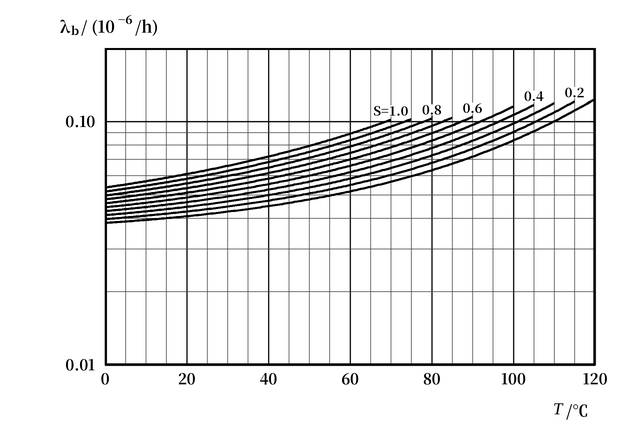

<strong>图 30 玻璃釉电位器基本失效率曲线</strong>

<strong>表 196 环境系数 <i>π</i>E</strong>

<table>
  <tbody>
    <tr>
      <th align="center">环境</th>
      <th align="center">GB</th>
      <th align="center">GMS</th>
      <th align="center">GF1</th>
      <th align="center">GF2</th>
      <th align="center">GM1</th>
      <th align="center">GM2</th>
      <th align="center">MP</th>
      <th align="center">NSB</th>
      <th align="center">NS1</th>
      <th align="center">NS2</th>
    </tr>
    <tr>
      <td align="center"><i>π</i>E</td>
      <td align="center">1.0</td>
      <td align="center">1.2</td>
      <td align="center">2.0</td>
      <td align="center">3.5</td>
      <td align="center">3.6</td>
      <td align="center">7.3</td>
      <td align="center">6.0</td>
      <td align="center">3.5</td>
      <td align="center">2.0</td>
      <td align="center">3.8</td>
    </tr>
    <tr>
      <th align="center">环境</th>
      <th align="center">NU</th>
      <th align="center">AIF</th>
      <th align="center">AUF</th>
      <th align="center">AIC</th>
      <th align="center">AUC</th>
      <th align="center">ARW</th>
      <th align="center">SF</th>
      <th align="center">ML</th>
      <th align="center">MF</th>
      <th align="center">—</th>
    </tr>
    <tr>
      <td align="center"><i>π</i>E</td>
      <td align="center">7.6</td>
      <td align="center">6.7</td>
      <td align="center">16.7</td>
      <td align="center">3.4</td>
      <td align="center">11</td>
      <td align="center">19</td>
      <td align="center">1.0</td>
      <td align="center">40.7</td>
      <td align="center">20</td>
      <td align="center">—</td>
    </tr>
  </tbody>
</table>

<strong>表 197 质量等级与质量系数 <i>π</i>Q</strong>

<table>
  <thead>
    <tr>
      <th colspan="2">质量等级</th>
      <th><i>π</i>Q</th>
    </tr>
  </thead>
  <tbody>
    <tr>
      <td rowspan="2" align="center">A</td>
      <td align="center">A1M</td>
      <td align="center">0.1</td>
    </tr>
    <tr>
      <td align="center">A2</td>
      <td align="center">0.2</td>
    </tr>
    <tr>
      <td rowspan="2" align="center">B</td>
      <td align="center">B1</td>
      <td align="center">0.5</td>
    </tr>
    <tr>
      <td align="center">B2</td>
      <td align="center">1.0</td>
    </tr>
    <tr>
      <td colspan="2" align="center">C</td>
      <td align="center">4.0</td>
    </tr>
  </tbody>
</table>

<strong>表 198 阻值系数 <i>π</i>R</strong>

<table>
  <thead>
    <tr>
      <th>阻值范围</th>
      <th><i>π</i>R</th>
    </tr>
  </thead>
  <tbody>
    <tr>
      <td align="center"><i>R</i> ≤ 50kΩ</td>
      <td align="center">1.0</td>
    </tr>
    <tr>
      <td align="center">50kΩ &lt; <i>R</i> ≤ 200kΩ</td>
      <td align="center">1.2</td>
    </tr>
    <tr>
      <td align="center">200kΩ &lt; <i>R</i> ≤ 500kΩ</td>
      <td align="center">1.5</td>
    </tr>
    <tr>
      <td align="center">500kΩ &lt; <i>R</i> ≤ 1MΩ</td>
      <td align="center">2.0</td>
    </tr>
    <tr>
      <td align="center"><i>R</i> &gt; 1MΩ</td>
      <td align="center">2.3</td>
    </tr>
  </tbody>
</table>

<strong>表 199 种类系数 <i>π</i>K</strong>

<table>
  <thead>
    <tr>
      <th>种类</th>
      <th><i>π</i>K</th>
    </tr>
  </thead>
  <tbody>
    <tr>
      <td align="center">微调</td>
      <td align="center">0.44</td>
    </tr>
    <tr>
      <td align="center">普通型</td>
      <td align="center">1.0</td>
    </tr>
  </tbody>
</table>

#### 5.8.8 非线绕精密电位器

非线绕精密电位器主要指导电塑料电位器，工作失效率预计模型见式(53)。

$$\lambda_{\text{p}} = \lambda_{\text{b}} \pi_{\text{E}} \pi_{\text{Q}} \pi_{\text{R}} \pi_{\text{TAPS}} \tag{53}$$

110

---

<strong>GJB/Z 299D—2024</strong>

式中：
$\lambda_{\text{p}}$ ——工作失效率，$10^{-6}/\text{h}$；
$\lambda_{\text{b}}$ ——基本失效率，$10^{-6}/\text{h}$，见表 200 和图 31；
$\pi_{\text{E}}$ ——环境系数，见表 201；
$\pi_{\text{Q}}$ ——质量系数，见表 202；
$\pi_{\text{R}}$ ——阻值系数，见表 203；
$\pi_{\text{TAPS}}$ ——引出端系数，见表 170。

<strong>表 200 基本失效率 <i>λ</i>b</strong>

单位为 10−6/h

<table>
  <thead>
    <tr>
      <th rowspan="2"><i>T</i> ℃</th>
      <th colspan="10"><i>S</i></th>
    </tr>
    <tr>
      <th>0.1</th>
      <th>0.2</th>
      <th>0.3</th>
      <th>0.4</th>
      <th>0.5</th>
      <th>0.6</th>
      <th>0.7</th>
      <th>0.8</th>
      <th>0.9</th>
      <th>1.0</th>
    </tr>
  </thead>
  <tbody>
    <tr>
      <td align="center">0</td>
      <td align="center">0.092 3</td>
      <td align="center">0.102 0</td>
      <td align="center">0.112 7</td>
      <td align="center">0.124 5</td>
      <td align="center">0.137 6</td>
      <td align="center">0.152 1</td>
      <td align="center">0.168 1</td>
      <td align="center">0.185 8</td>
      <td align="center">0.205 3</td>
      <td align="center">0.226 9</td>
    </tr>
    <tr>
      <td align="center">5</td>
      <td align="center">0.094 7</td>
      <td align="center">0.104 9</td>
      <td align="center">0.116 1</td>
      <td align="center">0.128 6</td>
      <td align="center">0.142 3</td>
      <td align="center">0.157 6</td>
      <td align="center">0.174 5</td>
      <td align="center">0.193 2</td>
      <td align="center">0.213 9</td>
      <td align="center">0.236 8</td>
    </tr>
    <tr>
      <td align="center">10</td>
      <td align="center">0.097 4</td>
      <td align="center">0.108 1</td>
      <td align="center">0.119 9</td>
      <td align="center">0.133 0</td>
      <td align="center">0.147 5</td>
      <td align="center">0.163 6</td>
      <td align="center">0.181 5</td>
      <td align="center">0.201 3</td>
      <td align="center">0.223 3</td>
      <td align="center">0.247 6</td>
    </tr>
    <tr>
      <td align="center">15</td>
      <td align="center">0.100 4</td>
      <td align="center">0.111 6</td>
      <td align="center">0.124 0</td>
      <td align="center">0.137 8</td>
      <td align="center">0.153 1</td>
      <td align="center">0.170 1</td>
      <td align="center">0.189 1</td>
      <td align="center">0.210 1</td>
      <td align="center">0.233 5</td>
      <td align="center">0.259 4</td>
    </tr>
    <tr>
      <td align="center">20</td>
      <td align="center">0.103 7</td>
      <td align="center">0.115 4</td>
      <td align="center">0.128 5</td>
      <td align="center">0.143 0</td>
      <td align="center">0.159 3</td>
      <td align="center">0.177 3</td>
      <td align="center">0.197 4</td>
      <td align="center">0.219 7</td>
      <td align="center">0.244 6</td>
      <td align="center">0.272 4</td>
    </tr>
    <tr>
      <td align="center">25</td>
      <td align="center">0.107 3</td>
      <td align="center">0.119 7</td>
      <td align="center">0.133 5</td>
      <td align="center">0.148 8</td>
      <td align="center">0.166 0</td>
      <td align="center">0.185 2</td>
      <td align="center">0.206 5</td>
      <td align="center">0.230 3</td>
      <td align="center">0.256 9</td>
      <td align="center">0.286 5</td>
    </tr>
    <tr>
      <td align="center">30</td>
      <td align="center">0.111 3</td>
      <td align="center">0.124 3</td>
      <td align="center">0.138 9</td>
      <td align="center">0.155 2</td>
      <td align="center">0.173 5</td>
      <td align="center">0.193 8</td>
      <td align="center">0.216 6</td>
      <td align="center">0.242 0</td>
      <td align="center">0.270 4</td>
      <td align="center">0.302 1</td>
    </tr>
    <tr>
      <td align="center">35</td>
      <td align="center">0.115 7</td>
      <td align="center">0.129 5</td>
      <td align="center">0.145 0</td>
      <td align="center">0.162 3</td>
      <td align="center">0.181 7</td>
      <td align="center">0.203 4</td>
      <td align="center">0.227 6</td>
      <td align="center">0.254 8</td>
      <td align="center">0.285 3</td>
      <td align="center">0.319 3</td>
    </tr>
    <tr>
      <td align="center">40</td>
      <td align="center">0.120 6</td>
      <td align="center">0.135 2</td>
      <td align="center">0.151 6</td>
      <td align="center">0.170 1</td>
      <td align="center">0.190 7</td>
      <td align="center">0.213 9</td>
      <td align="center">0.239 9</td>
      <td align="center">0.269 0</td>
      <td align="center">0.301 7</td>
      <td align="center">0.338 3</td>
    </tr>
    <tr>
      <td align="center">45</td>
      <td align="center">0.126 0</td>
      <td align="center">0.141 5</td>
      <td align="center">0.159 0</td>
      <td align="center">0.178 7</td>
      <td align="center">0.200 8</td>
      <td align="center">0.225 6</td>
      <td align="center">0.253 4</td>
      <td align="center">0.284 7</td>
      <td align="center">0.319 9</td>
      <td align="center">0.359 4</td>
    </tr>
    <tr>
      <td align="center">50</td>
      <td align="center">0.132 0</td>
      <td align="center">0.148 6</td>
      <td align="center">0.167 2</td>
      <td align="center">0.188 3</td>
      <td align="center">0.211 9</td>
      <td align="center">0.238 5</td>
      <td align="center">0.268 5</td>
      <td align="center">0.302 2</td>
      <td align="center">0.340 1</td>
      <td align="center">0.382 9</td>
    </tr>
    <tr>
      <td align="center">55</td>
      <td align="center">0.138 7</td>
      <td align="center">0.156 4</td>
      <td align="center">0.176 4</td>
      <td align="center">0.198 9</td>
      <td align="center">0.224 3</td>
      <td align="center">0.252 9</td>
      <td align="center">0.285 2</td>
      <td align="center">0.321 6</td>
      <td align="center">0.362 7</td>
      <td align="center">0.409 0</td>
    </tr>
    <tr>
      <td align="center">60</td>
      <td align="center">0.146 2</td>
      <td align="center">0.165 2</td>
      <td align="center">0.186 6</td>
      <td align="center">0.210 8</td>
      <td align="center">0.238 1</td>
      <td align="center">0.269 0</td>
      <td align="center">0.303 9</td>
      <td align="center">0.343 4</td>
      <td align="center">0.387 9</td>
      <td align="center">0.438 2</td>
    </tr>
    <tr>
      <td align="center">65</td>
      <td align="center">0.154 6</td>
      <td align="center">0.174 9</td>
      <td align="center">0.198 0</td>
      <td align="center">0.224 1</td>
      <td align="center">0.253 6</td>
      <td align="center">0.287 1</td>
      <td align="center">0.324 9</td>
      <td align="center">0.367 7</td>
      <td align="center">0.416 2</td>
      <td align="center">0.471 0</td>
    </tr>
    <tr>
      <td align="center">70</td>
      <td align="center">0.164 0</td>
      <td align="center">0.185 9</td>
      <td align="center">0.210 8</td>
      <td align="center">0.239 0</td>
      <td align="center">0.271 0</td>
      <td align="center">0.307 3</td>
      <td align="center">0.348 4</td>
      <td align="center">0.395 1</td>
      <td align="center">0.448 0</td>
      <td align="center">0.508 0</td>
    </tr>
    <tr>
      <td align="center">75</td>
      <td align="center">0.174 5</td>
      <td align="center">0.198 3</td>
      <td align="center">0.225 2</td>
      <td align="center">0.255 8</td>
      <td align="center">0.290 6</td>
      <td align="center">0.330 1</td>
      <td align="center">0.375 0</td>
      <td align="center">0.426 0</td>
      <td align="center">0.483 9</td>
      <td align="center">0.549 7</td>
    </tr>
    <tr>
      <td align="center">80</td>
      <td align="center">0.186 4</td>
      <td align="center">0.212 2</td>
      <td align="center">0.241 5</td>
      <td align="center">0.274 8</td>
      <td align="center">0.312 7</td>
      <td align="center">0.355 9</td>
      <td align="center">0.405 0</td>
      <td align="center">0.460 9</td>
      <td align="center">0.524 5</td>
      <td align="center">0.596 9</td>
    </tr>
    <tr>
      <td align="center">85</td>
      <td align="center">0.199 9</td>
      <td align="center">0.227 9</td>
      <td align="center">0.259 8</td>
      <td align="center">0.296 3</td>
      <td align="center">0.337 8</td>
      <td align="center">0.385 1</td>
      <td align="center">0.439 1</td>
      <td align="center">0.500 6</td>
      <td align="center">0.570 7</td>
      <td align="center">0.650 7</td>
    </tr>
    <tr>
      <td align="center">90</td>
      <td align="center">0.215 2</td>
      <td align="center">0.245 8</td>
      <td align="center">0.280 7</td>
      <td align="center">0.320 6</td>
      <td align="center">0.366 2</td>
      <td align="center">0.418 3</td>
      <td align="center">0.477 8</td>
      <td align="center">0.545 8</td>
      <td align="center">0.623 4</td>
      <td align="center">—</td>
    </tr>
    <tr>
      <td align="center">95</td>
      <td align="center">0.232 6</td>
      <td align="center">0.266 1</td>
      <td align="center">0.304 5</td>
      <td align="center">0.348 5</td>
      <td align="center">0.398 8</td>
      <td align="center">0.456 3</td>
      <td align="center">0.522 1</td>
      <td align="center">0.597 5</td>
      <td align="center">—</td>
      <td align="center">—</td>
    </tr>
    <tr>
      <td align="center">100</td>
      <td align="center">0.252 4</td>
      <td align="center">0.289 4</td>
      <td align="center">0.331 7</td>
      <td align="center">0.380 3</td>
      <td align="center">0.436 0</td>
      <td align="center">0.499 8</td>
      <td align="center">—</td>
      <td align="center">—</td>
      <td align="center">—</td>
      <td align="center">—</td>
    </tr>
    <tr>
      <td align="center">105</td>
      <td align="center">0.275 2</td>
      <td align="center">0.316 1</td>
      <td align="center">0.363 0</td>
      <td align="center">0.416 9</td>
      <td align="center">0.478 8</td>
      <td align="center">—</td>
      <td align="center">—</td>
      <td align="center">—</td>
      <td align="center">—</td>
      <td align="center">—</td>
    </tr>
    <tr>
      <td align="center">110</td>
      <td align="center">0.301 4</td>
      <td align="center">0.346 8</td>
      <td align="center">0.399 0</td>
      <td align="center">0.459 1</td>
      <td align="center">—</td>
      <td align="center">—</td>
      <td align="center">—</td>
      <td align="center">—</td>
      <td align="center">—</td>
      <td align="center">—</td>
    </tr>
    <tr>
      <td align="center">115</td>
      <td align="center">0.331 7</td>
      <td align="center">0.382 3</td>
      <td align="center">0.440 7</td>
      <td align="center">—</td>
      <td align="center">—</td>
      <td align="center">—</td>
      <td align="center">—</td>
      <td align="center">—</td>
      <td align="center">—</td>
      <td align="center">—</td>
    </tr>
    <tr>
      <td align="center">120</td>
      <td align="center">0.366 8</td>
      <td align="center">—</td>
      <td align="center">—</td>
      <td align="center">—</td>
      <td align="center">—</td>
      <td align="center">—</td>
      <td align="center">—</td>
      <td align="center">—</td>
      <td align="center">—</td>
      <td align="center">—</td>
    </tr>
    <tr>
      <td colspan="11" align="left">
        注：<i>T</i> 为工作环境温度。 
        &emsp;&emsp;<i>S</i> 为实际功耗与额定功耗的比值。
      </td>
    </tr>
  </tbody>
</table>

111

---

<strong>GJB/Z 299D—2024</strong>

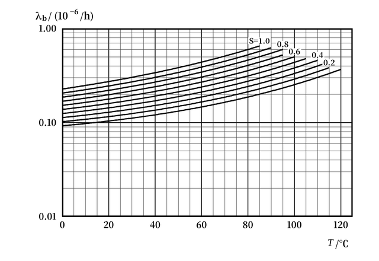

<strong>图 31 非线绕精密电位器基本失效率曲线</strong>

<strong>表 201 环境系数 <i>π</i>E</strong>

<table>
  <tbody>
    <tr>
      <th align="center">环境</th>
      <th align="center">GB</th>
      <th align="center">GMS</th>
      <th align="center">GF1</th>
      <th align="center">GF2</th>
      <th align="center">GM1</th>
      <th align="center">GM2</th>
      <th align="center">MP</th>
      <th align="center">NSB</th>
      <th align="center">NS1</th>
      <th align="center">NS2</th>
    </tr>
    <tr>
      <td align="center"><i>π</i>E</td>
      <td align="center">1</td>
      <td align="center">1.2</td>
      <td align="center">2</td>
      <td align="center">3</td>
      <td align="center">4</td>
      <td align="center">7.3</td>
      <td align="center">6</td>
      <td align="center">4.8</td>
      <td align="center">3</td>
      <td align="center">5.6</td>
    </tr>
    <tr>
      <th align="center">环境</th>
      <th align="center">NU</th>
      <th align="center">AIF</th>
      <th align="center">AUF</th>
      <th align="center">AIC</th>
      <th align="center">AUC</th>
      <th align="center">ARW</th>
      <th align="center">SF</th>
      <th align="center">ML</th>
      <th align="center">MF</th>
      <th align="center">—</th>
    </tr>
    <tr>
      <td align="center"><i>π</i>E</td>
      <td align="center">11.2</td>
      <td align="center">9.3</td>
      <td align="center">13.3</td>
      <td align="center">5.9</td>
      <td align="center">9.6</td>
      <td align="center">26</td>
      <td align="center">1</td>
      <td align="center">—</td>
      <td align="center">—</td>
      <td align="center">—</td>
    </tr>
  </tbody>
</table>

<strong>表 202 质量等级与质量系数 <i>π</i>Q</strong>

<table>
  <thead>
    <tr>
      <th colspan="2">质量等级</th>
      <th><i>π</i>Q</th>
    </tr>
  </thead>
  <tbody>
    <tr>
      <td rowspan="2" align="center">A</td>
      <td align="center">A1M</td>
      <td align="center">0.1</td>
    </tr>
    <tr>
      <td align="center">A2</td>
      <td align="center">0.2</td>
    </tr>
    <tr>
      <td rowspan="2" align="center">B</td>
      <td align="center">B1</td>
      <td align="center">0.5</td>
    </tr>
    <tr>
      <td align="center">B2</td>
      <td align="center">1.0</td>
    </tr>
    <tr>
      <td colspan="2" align="center">C</td>
      <td align="center">4.0</td>
    </tr>
  </tbody>
</table>

<strong>表 203 阻值系数 <i>π</i>R</strong>

<table>
  <thead>
    <tr>
      <th>阻值范围</th>
      <th><i>π</i>R</th>
    </tr>
  </thead>
  <tbody>
    <tr>
      <td align="center"><i>R</i> ≤ 2kΩ</td>
      <td align="center">1.0</td>
    </tr>
    <tr>
      <td align="center">2kΩ &lt; <i>R</i> ≤ 20kΩ</td>
      <td align="center">1.5</td>
    </tr>
    <tr>
      <td align="center"><i>R</i> &gt; 20kΩ</td>
      <td align="center">2.0</td>
    </tr>
  </tbody>
</table>

### 5.9 电容器

#### 5.9.1 概述

本条包括下列类型电容器：

a) 纸和薄膜电容器；
b) 云母电容器；
c) 1 类瓷介电容器；
d) 2 类瓷介电容器；

112

---

<strong>GJB/Z 299D—2024</strong>

e) 铝电解电容器；
f) 固体钽电解电容器；
g) 非固体钽电解电容器；
h) 氧化铌电解电容器；
i) 可变电容器；
j) 电容网络。

一般电容器工作失效率预计模型见式(54)。

$$\lambda_{\text{P}} = \lambda_{\text{b}}\pi_{\text{E}}\pi_{\text{Q}}\pi_{\text{CV}}\pi_{\text{SR}}\pi_{\text{K}}\pi_{\text{ch}} \tag{54}$$

式中：
$\lambda_{\text{P}}$ ——工作失效率，$10^{-6}/\text{h}$；
$\lambda_{\text{b}}$ ——基本失效率，$10^{-6}/\text{h}$；
$\pi_{\text{E}}$ ——环境系数；
$\pi_{\text{Q}}$ ——质量系数；
$\pi_{\text{CV}}$ ——电容量系数；
$\pi_{\text{SR}}$ ——串联电阻系数；
$\pi_{\text{K}}$ ——种类系数；
$\pi_{\text{ch}}$ ——表面贴装系数，见表 204。

<strong>表 204 表面贴装系数 <i>π</i>ch</strong>

<table>
  <thead>
    <tr>
      <th rowspan="2">电容器种类</th>
      <th colspan="2"><i>π</i>ch</th>
    </tr>
    <tr>
      <th>片式</th>
      <th>有引线(包含有引线 SMT，通孔式)</th>
    </tr>
  </thead>
  <tbody>
    <tr>
      <td align="center">薄膜电容器</td>
      <td align="center">1.2</td>
      <td align="center">1.0</td>
    </tr>
    <tr>
      <td align="center">云母电容器</td>
      <td align="center">1.3</td>
      <td align="center">1.0</td>
    </tr>
    <tr>
      <td align="center">1 类瓷介电容器</td>
      <td align="center">1.3</td>
      <td align="center">1.0</td>
    </tr>
    <tr>
      <td align="center">2 类瓷介电容器</td>
      <td align="center">1.3</td>
      <td align="center">1.0</td>
    </tr>
    <tr>
      <td align="center">铝电解电容器</td>
      <td align="center">1.2</td>
      <td align="center">1.0</td>
    </tr>
    <tr>
      <td align="center">固体钽电解电容器</td>
      <td align="center">1.2</td>
      <td align="center">1.0</td>
    </tr>
    <tr>
      <td align="center">氧化铌电解电容器</td>
      <td align="center">1.2</td>
      <td align="center">1.0</td>
    </tr>
  </tbody>
</table>

#### 5.9.2 纸和薄膜电容器

纸和薄膜电容器主要包括：纸介电容器、薄膜电容器以及纸-膜复合介质电容器等。
工作失效率预计模型见式(55)。

$$\lambda_{\text{P}} = \lambda_{\text{b}}\pi_{\text{E}}\pi_{\text{Q}}\pi_{\text{CV}}\pi_{\text{K}}\pi_{\text{ch}} \tag{55}$$

式中：
$\lambda_{\text{P}}$ ——工作失效率，$10^{-6}/\text{h}$；
$\lambda_{\text{b}}$ ——基本失效率，$10^{-6}/\text{h}$，见表 205～表 207 和图 32～图 34；
$\pi_{\text{E}}$ ——环境系数，见表 208；
$\pi_{\text{Q}}$ ——质量系数，见表 209；
$\pi_{\text{CV}}$ ——电容量系数，见表 210；

113

---

<strong>GJB/Z 299D—2024</strong>

$\pi_{\text{K}}$ ——种类系数，见表 211；
$\pi_{\text{ch}}$ ——表面贴装系数，见表 204。

<strong>表 205 基本失效率 <i>λ</i>b (额定温度为 65℃)</strong>

单位为 10−6/h

<table>
  <thead>
    <tr>
      <th rowspan="2"><i>T</i> ℃</th>
      <th colspan="10"><i>S</i></th>
    </tr>
    <tr>
      <th>0.1</th>
      <th>0.2</th>
      <th>0.3</th>
      <th>0.4</th>
      <th>0.5</th>
      <th>0.6</th>
      <th>0.7</th>
      <th>0.8</th>
      <th>0.9</th>
      <th>1.0</th>
    </tr>
  </thead>
  <tbody>
    <tr><td align="center">0</td><td align="center">0.001 47</td><td align="center">0.001 52</td><td align="center">0.001 82</td><td align="center">0.002 94</td><td align="center">0.005 96</td><td align="center">0.012 64</td><td align="center">0.025 61</td><td align="center">0.048 53</td><td align="center">0.086 27</td><td align="center">0.145 09</td></tr>
    <tr><td align="center">5</td><td align="center">0.001 50</td><td align="center">0.001 55</td><td align="center">0.001 86</td><td align="center">0.003 00</td><td align="center">0.006 08</td><td align="center">0.012 90</td><td align="center">0.026 14</td><td align="center">0.049 54</td><td align="center">0.088 08</td><td align="center">0.148 12</td></tr>
    <tr><td align="center">10</td><td align="center">0.001 55</td><td align="center">0.001 59</td><td align="center">0.001 91</td><td align="center">0.003 09</td><td align="center">0.006 26</td><td align="center">0.013 27</td><td align="center">0.026 89</td><td align="center">0.050 95</td><td align="center">0.090 58</td><td align="center">0.152 33</td></tr>
    <tr><td align="center">15</td><td align="center">0.001 61</td><td align="center">0.001 65</td><td align="center">0.001 98</td><td align="center">0.003 21</td><td align="center">0.006 50</td><td align="center">0.013 78</td><td align="center">0.027 92</td><td align="center">0.052 92</td><td align="center">0.094 08</td><td align="center">0.158 21</td></tr>
    <tr><td align="center">20</td><td align="center">0.001 69</td><td align="center">0.001 74</td><td align="center">0.002 09</td><td align="center">0.003 37</td><td align="center">0.006 84</td><td align="center">0.014 50</td><td align="center">0.029 38</td><td align="center">0.055 68</td><td align="center">0.098 99</td><td align="center">0.166 47</td></tr>
    <tr><td align="center">25</td><td align="center">0.001 81</td><td align="center">0.001 86</td><td align="center">0.002 23</td><td align="center">0.003 61</td><td align="center">0.007 32</td><td align="center">0.015 52</td><td align="center">0.031 45</td><td align="center">0.059 60</td><td align="center">0.105 96</td><td align="center">0.178 19</td></tr>
    <tr><td align="center">30</td><td align="center">0.001 98</td><td align="center">0.002 04</td><td align="center">0.002 45</td><td align="center">0.003 95</td><td align="center">0.008 01</td><td align="center">0.016 99</td><td align="center">0.034 43</td><td align="center">0.065 25</td><td align="center">0.115 99</td><td align="center">0.195 06</td></tr>
    <tr><td align="center">35</td><td align="center">0.002 23</td><td align="center">0.002 30</td><td align="center">0.002 76</td><td align="center">0.004 46</td><td align="center">0.009 03</td><td align="center">0.019 15</td><td align="center">0.038 81</td><td align="center">0.073 54</td><td align="center">0.130 74</td><td align="center">0.219 86</td></tr>
    <tr><td align="center">40</td><td align="center">0.002 61</td><td align="center">0.002 69</td><td align="center">0.003 23</td><td align="center">0.005 22</td><td align="center">0.010 57</td><td align="center">0.022 42</td><td align="center">0.045 44</td><td align="center">0.086 11</td><td align="center">0.153 08</td><td align="center">0.257 44</td></tr>
    <tr><td align="center">45</td><td align="center">0.003 21</td><td align="center">0.003 31</td><td align="center">0.003 97</td><td align="center">0.006 42</td><td align="center">0.013 00</td><td align="center">0.027 58</td><td align="center">0.055 89</td><td align="center">0.105 91</td><td align="center">0.188 28</td><td align="center">0.316 63</td></tr>
    <tr><td align="center">50</td><td align="center">0.004 21</td><td align="center">0.004 34</td><td align="center">0.005 20</td><td align="center">0.008 41</td><td align="center">0.017 04</td><td align="center">0.036 14</td><td align="center">0.073 24</td><td align="center">0.138 79</td><td align="center">0.246 74</td><td align="center">0.414 93</td></tr>
    <tr><td align="center">55</td><td align="center">0.005 98</td><td align="center">0.006 17</td><td align="center">0.007 40</td><td align="center">0.011 96</td><td align="center">0.024 22</td><td align="center">0.051 38</td><td align="center">0.104 11</td><td align="center">0.197 30</td><td align="center">0.350 74</td><td align="center">0.589 84</td></tr>
    <tr><td align="center">60</td><td align="center">0.009 44</td><td align="center">0.009 73</td><td align="center">0.011 67</td><td align="center">0.018 86</td><td align="center">0.038 21</td><td align="center">0.081 04</td><td align="center">0.164 21</td><td align="center">0.311 21</td><td align="center">0.553 24</td><td align="center">0.930 38</td></tr>
    <tr><td align="center">65</td><td align="center">0.017 00</td><td align="center">0.017 51</td><td align="center">0.021 01</td><td align="center">0.033 96</td><td align="center">0.068 81</td><td align="center">0.145 94</td><td align="center">0.295 72</td><td align="center">0.560 42</td><td align="center">0.996 27</td><td align="center">1.675 42</td></tr>
    <tr>
      <td colspan="11">注：<i>T</i> 为工作环境温度。 &emsp;&emsp;<i>S</i> 为实际工作电压与额定电压的比值。</td>
    </tr>
  </tbody>
</table>

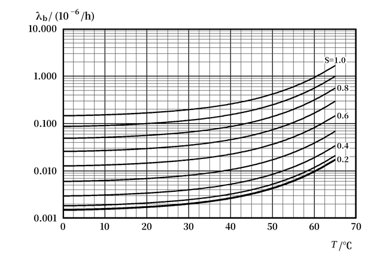

<strong>图 32 纸和薄膜电容器基本失效率曲线(额定温度为 65℃)</strong>

<strong>表 206 基本失效率 <i>λ</i>b (额定温度为 85℃)</strong>

单位为 10−6/h

<table>
  <thead>
    <tr>
      <th rowspan="2"><i>T</i> ℃</th>
      <th colspan="10"><i>S</i></th>
    </tr>
    <tr>
      <th>0.1</th>
      <th>0.2</th>
      <th>0.3</th>
      <th>0.4</th>
      <th>0.5</th>
      <th>0.6</th>
      <th>0.7</th>
      <th>0.8</th>
      <th>0.9</th>
      <th>1.0</th>
    </tr>
  </thead>
  <tbody>
    <tr><td align="center">0</td><td align="center">0.001 42</td><td align="center">0.001 47</td><td align="center">0.001 76</td><td align="center">0.002 84</td><td align="center">0.005 76</td><td align="center">0.012 21</td><td align="center">0.024 74</td><td align="center">0.046 88</td><td align="center">0.083 35</td><td align="center">0.140 17</td></tr>
    <tr><td align="center">5</td><td align="center">0.001 43</td><td align="center">0.001 48</td><td align="center">0.001 77</td><td align="center">0.002 86</td><td align="center">0.005 80</td><td align="center">0.012 30</td><td align="center">0.024 92</td><td align="center">0.047 23</td><td align="center">0.083 96</td><td align="center">0.141 20</td></tr>
    <tr><td align="center">10</td><td align="center">0.001 45</td><td align="center">0.001 49</td><td align="center">0.001 79</td><td align="center">0.002 89</td><td align="center">0.005 86</td><td align="center">0.012 42</td><td align="center">0.025 17</td><td align="center">0.047 70</td><td align="center">0.084 80</td><td align="center">0.142 61</td></tr>
    <tr><td align="center">15</td><td align="center">0.001 47</td><td align="center">0.001 51</td><td align="center">0.001 81</td><td align="center">0.002 93</td><td align="center">0.005 94</td><td align="center">0.012 59</td><td align="center">0.025 51</td><td align="center">0.048 35</td><td align="center">0.085 95</td><td align="center">0.144 55</td></tr>
    <tr><td align="center">20</td><td align="center">0.001 49</td><td align="center">0.001 54</td><td align="center">0.001 85</td><td align="center">0.002 98</td><td align="center">0.006 04</td><td align="center">0.012 82</td><td align="center">0.025 98</td><td align="center">0.049 23</td><td align="center">0.087 52</td><td align="center">0.147 18</td></tr>
    <tr><td align="center">25</td><td align="center">0.001 53</td><td align="center">0.001 58</td><td align="center">0.001 89</td><td align="center">0.003 06</td><td align="center">0.006 19</td><td align="center">0.013 13</td><td align="center">0.026 61</td><td align="center">0.050 44</td><td align="center">0.089 66</td><td align="center">0.150 78</td></tr>
    <tr><td align="center">30</td><td align="center">0.001 58</td><td align="center">0.001 63</td><td align="center">0.001 95</td><td align="center">0.003 16</td><td align="center">0.006 39</td><td align="center">0.013 56</td><td align="center">0.027 48</td><td align="center">0.052 08</td><td align="center">0.092 59</td><td align="center">0.155 71</td></tr>
    <tr><td align="center">35</td><td align="center">0.001 65</td><td align="center">0.001 70</td><td align="center">0.002 04</td><td align="center">0.003 29</td><td align="center">0.006 67</td><td align="center">0.014 15</td><td align="center">0.028 68</td><td align="center">0.054 35</td><td align="center">0.096 61</td><td align="center">0.162 48</td></tr>
  </tbody>
</table>

114

---

<strong>GJB/Z 299D—2024</strong>

<strong>表 206(续)</strong>

单位为 10−6/h

<table>
  <thead>
    <tr>
      <th rowspan="2"><i>T</i> ℃</th>
      <th colspan="10"><i>S</i></th>
    </tr>
    <tr>
      <th>0.1</th>
      <th>0.2</th>
      <th>0.3</th>
      <th>0.4</th>
      <th>0.5</th>
      <th>0.6</th>
      <th>0.7</th>
      <th>0.8</th>
      <th>0.9</th>
      <th>1.0</th>
    </tr>
  </thead>
  <tbody>
    <tr><td align="center">40</td><td align="center">0.001 74</td><td align="center">0.001 80</td><td align="center">0.002 16</td><td align="center">0.003 48</td><td align="center">0.007 06</td><td align="center">0.014 97</td><td align="center">0.030 33</td><td align="center">0.057 48</td><td align="center">0.102 18</td><td align="center">0.171 84</td></tr>
    <tr><td align="center">45</td><td align="center">0.001 88</td><td align="center">0.001 93</td><td align="center">0.002 32</td><td align="center">0.003 75</td><td align="center">0.007 60</td><td align="center">0.016 11</td><td align="center">0.032 65</td><td align="center">0.061 87</td><td align="center">0.109 98</td><td align="center">0.184 96</td></tr>
    <tr><td align="center">50</td><td align="center">0.002 07</td><td align="center">0.002 13</td><td align="center">0.002 55</td><td align="center">0.004 13</td><td align="center">0.008 36</td><td align="center">0.017 74</td><td align="center">0.035 94</td><td align="center">0.068 10</td><td align="center">0.121 07</td><td align="center">0.203 61</td></tr>
    <tr><td align="center">55</td><td align="center">0.002 34</td><td align="center">0.002 41</td><td align="center">0.002 89</td><td align="center">0.004 68</td><td align="center">0.009 48</td><td align="center">0.020 10</td><td align="center">0.040 72</td><td align="center">0.077 17</td><td align="center">0.137 19</td><td align="center">0.230 71</td></tr>
    <tr><td align="center">60</td><td align="center">0.002 75</td><td align="center">0.002 84</td><td align="center">0.003 40</td><td align="center">0.005 50</td><td align="center">0.011 14</td><td align="center">0.023 63</td><td align="center">0.047 88</td><td align="center">0.090 74</td><td align="center">0.161 30</td><td align="center">0.271 26</td></tr>
    <tr><td align="center">65</td><td align="center">0.003 39</td><td align="center">0.003 49</td><td align="center">0.004 19</td><td align="center">0.006 78</td><td align="center">0.013 73</td><td align="center">0.029 12</td><td align="center">0.059 01</td><td align="center">0.111 83</td><td align="center">0.198 80</td><td align="center">0.334 32</td></tr>
    <tr><td align="center">70</td><td align="center">0.004 44</td><td align="center">0.004 57</td><td align="center">0.005 49</td><td align="center">0.008 87</td><td align="center">0.017 96</td><td align="center">0.038 10</td><td align="center">0.077 20</td><td align="center">0.146 31</td><td align="center">0.260 09</td><td align="center">0.437 39</td></tr>
    <tr><td align="center">75</td><td align="center">0.006 26</td><td align="center">0.006 45</td><td align="center">0.007 74</td><td align="center">0.012 51</td><td align="center">0.025 35</td><td align="center">0.053 76</td><td align="center">0.108 93</td><td align="center">0.206 44</td><td align="center">0.366 99</td><td align="center">0.617 16</td></tr>
    <tr><td align="center">80</td><td align="center">0.009 72</td><td align="center">0.010 01</td><td align="center">0.012 01</td><td align="center">0.019 42</td><td align="center">0.039 34</td><td align="center">0.083 43</td><td align="center">0.169 06</td><td align="center">0.320 39</td><td align="center">0.569 56</td><td align="center">0.957 82</td></tr>
    <tr><td align="center">85</td><td align="center">0.017 00</td><td align="center">0.017 51</td><td align="center">0.021 01</td><td align="center">0.033 96</td><td align="center">0.068 81</td><td align="center">0.145 94</td><td align="center">0.295 72</td><td align="center">0.560 42</td><td align="center">0.996 27</td><td align="center">1.675 42</td></tr>
    <tr>
      <td colspan="11">注：<i>T</i> 为工作环境温度。 &emsp;&emsp;<i>S</i> 为实际工作电压与额定电压的比值。</td>
    </tr>
  </tbody>
</table>

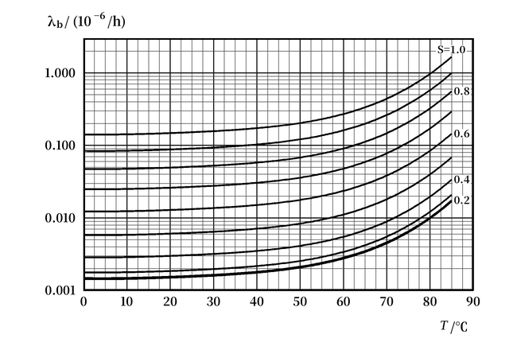

<strong>图 33 纸和薄膜电容器基本失效率曲线(额定温度为 85℃)</strong>

<strong>表 207 基本失效率 <i>λ</i>b (额定温度为 100℃)</strong>

单位为 10−6/h

<table>
  <thead>
    <tr>
      <th rowspan="2"><i>T</i> ℃</th>
      <th colspan="10"><i>S</i></th>
    </tr>
    <tr>
      <th>0.1</th>
      <th>0.2</th>
      <th>0.3</th>
      <th>0.4</th>
      <th>0.5</th>
      <th>0.6</th>
      <th>0.7</th>
      <th>0.8</th>
      <th>0.9</th>
      <th>1.0</th>
    </tr>
  </thead>
  <tbody>
    <tr><td align="center">0</td><td align="center">0.001 41</td><td align="center">0.001 45</td><td align="center">0.001 74</td><td align="center">0.002 81</td><td align="center">0.005 70</td><td align="center">0.012 09</td><td align="center">0.024 50</td><td align="center">0.046 42</td><td align="center">0.082 53</td><td align="center">0.138 78</td></tr>
    <tr><td align="center">5</td><td align="center">0.001 41</td><td align="center">0.001 46</td><td align="center">0.001 75</td><td align="center">0.002 82</td><td align="center">0.005 72</td><td align="center">0.012 13</td><td align="center">0.024 58</td><td align="center">0.046 58</td><td align="center">0.082 82</td><td align="center">0.139 27</td></tr>
    <tr><td align="center">10</td><td align="center">0.001 42</td><td align="center">0.001 46</td><td align="center">0.001 75</td><td align="center">0.002 84</td><td align="center">0.005 75</td><td align="center">0.012 19</td><td align="center">0.024 70</td><td align="center">0.046 81</td><td align="center">0.083 21</td><td align="center">0.139 93</td></tr>
    <tr><td align="center">15</td><td align="center">0.001 43</td><td align="center">0.001 47</td><td align="center">0.001 77</td><td align="center">0.002 86</td><td align="center">0.005 78</td><td align="center">0.012 27</td><td align="center">0.024 86</td><td align="center">0.047 11</td><td align="center">0.083 75</td><td align="center">0.140 84</td></tr>
    <tr><td align="center">20</td><td align="center">0.001 44</td><td align="center">0.001 48</td><td align="center">0.001 78</td><td align="center">0.002 88</td><td align="center">0.005 83</td><td align="center">0.012 37</td><td align="center">0.025 07</td><td align="center">0.047 52</td><td align="center">0.084 47</td><td align="center">0.142 06</td></tr>
    <tr><td align="center">25</td><td align="center">0.001 46</td><td align="center">0.001 50</td><td align="center">0.001 80</td><td align="center">0.002 91</td><td align="center">0.005 90</td><td align="center">0.012 52</td><td align="center">0.025 36</td><td align="center">0.048 07</td><td align="center">0.085 45</td><td align="center">0.143 71</td></tr>
    <tr><td align="center">30</td><td align="center">0.001 48</td><td align="center">0.001 53</td><td align="center">0.001 83</td><td align="center">0.002 96</td><td align="center">0.005 99</td><td align="center">0.012 71</td><td align="center">0.025 76</td><td align="center">0.048 81</td><td align="center">0.086 78</td><td align="center">0.145 93</td></tr>
    <tr><td align="center">35</td><td align="center">0.001 51</td><td align="center">0.001 56</td><td align="center">0.001 87</td><td align="center">0.003 02</td><td align="center">0.006 12</td><td align="center">0.012 97</td><td align="center">0.026 29</td><td align="center">0.049 82</td><td align="center">0.088 56</td><td align="center">0.148 93</td></tr>
    <tr><td align="center">40</td><td align="center">0.001 55</td><td align="center">0.001 60</td><td align="center">0.001 92</td><td align="center">0.003 10</td><td align="center">0.006 28</td><td align="center">0.013 32</td><td align="center">0.027 00</td><td align="center">0.051 17</td><td align="center">0.090 96</td><td align="center">0.152 97</td></tr>
    <tr><td align="center">45</td><td align="center">0.001 61</td><td align="center">0.001 66</td><td align="center">0.001 99</td><td align="center">0.003 21</td><td align="center">0.006 51</td><td align="center">0.013 80</td><td align="center">0.027 96</td><td align="center">0.053 00</td><td align="center">0.094 21</td><td align="center">0.158 44</td></tr>
  </tbody>
</table>

115

---

<strong>GJB/Z 299D—2024</strong>

<strong>表 207(续)</strong>

单位为 10−6/h

<table>
  <thead>
    <tr>
      <th rowspan="2"><i>T</i> ℃</th>
      <th colspan="10"><i>S</i></th>
    </tr>
    <tr>
      <th>0.1</th>
      <th>0.2</th>
      <th>0.3</th>
      <th>0.4</th>
      <th>0.5</th>
      <th>0.6</th>
      <th>0.7</th>
      <th>0.8</th>
      <th>0.9</th>
      <th>1.0</th>
    </tr>
  </thead>
  <tbody>
    <tr><td align="center">50</td><td align="center">0.001 68</td><td align="center">0.001 73</td><td align="center">0.002 08</td><td align="center">0.003 36</td><td align="center">0.006 81</td><td align="center">0.014 45</td><td align="center">0.029 28</td><td align="center">0.055 48</td><td align="center">0.098 64</td><td align="center">0.165 88</td></tr>
    <tr><td align="center">55</td><td align="center">0.001 79</td><td align="center">0.001 84</td><td align="center">0.002 21</td><td align="center">0.003 57</td><td align="center">0.007 23</td><td align="center">0.015 34</td><td align="center">0.031 08</td><td align="center">0.058 90</td><td align="center">0.104 70</td><td align="center">0.176 08</td></tr>
    <tr><td align="center">60</td><td align="center">0.001 93</td><td align="center">0.001 99</td><td align="center">0.002 39</td><td align="center">0.003 86</td><td align="center">0.007 81</td><td align="center">0.016 57</td><td align="center">0.033 58</td><td align="center">0.063 63</td><td align="center">0.113 12</td><td align="center">0.190 24</td></tr>
    <tr><td align="center">65</td><td align="center">0.002 13</td><td align="center">0.002 20</td><td align="center">0.002 64</td><td align="center">0.004 26</td><td align="center">0.008 63</td><td align="center">0.018 31</td><td align="center">0.037 10</td><td align="center">0.070 32</td><td align="center">0.125 00</td><td align="center">0.210 21</td></tr>
    <tr><td align="center">70</td><td align="center">0.002 43</td><td align="center">0.002 50</td><td align="center">0.003 00</td><td align="center">0.004 85</td><td align="center">0.009 82</td><td align="center">0.020 82</td><td align="center">0.042 19</td><td align="center">0.079 95</td><td align="center">0.142 12</td><td align="center">0.239 01</td></tr>
    <tr><td align="center">75</td><td align="center">0.002 86</td><td align="center">0.002 94</td><td align="center">0.003 53</td><td align="center">0.005 71</td><td align="center">0.011 57</td><td align="center">0.024 54</td><td align="center">0.049 73</td><td align="center">0.094 24</td><td align="center">0.167 53</td><td align="center">0.281 73</td></tr>
    <tr><td align="center">80</td><td align="center">0.003 53</td><td align="center">0.003 63</td><td align="center">0.004 36</td><td align="center">0.007 05</td><td align="center">0.014 27</td><td align="center">0.030 27</td><td align="center">0.061 34</td><td align="center">0.116 25</td><td align="center">0.206 67</td><td align="center">0.347 55</td></tr>
    <tr><td align="center">85</td><td align="center">0.004 61</td><td align="center">0.004 75</td><td align="center">0.005 69</td><td align="center">0.009 20</td><td align="center">0.018 64</td><td align="center">0.039 54</td><td align="center">0.080 13</td><td align="center">0.151 85</td><td align="center">0.269 94</td><td align="center">0.453 96</td></tr>
    <tr><td align="center">90</td><td align="center">0.006 46</td><td align="center">0.006 66</td><td align="center">0.007 99</td><td align="center">0.012 91</td><td align="center">0.026 16</td><td align="center">0.055 48</td><td align="center">0.112 42</td><td align="center">0.213 05</td><td align="center">0.378 75</td><td align="center">0.636 94</td></tr>
    <tr><td align="center">95</td><td align="center">0.009 91</td><td align="center">0.010 21</td><td align="center">0.012 26</td><td align="center">0.019 81</td><td align="center">0.040 13</td><td align="center">0.085 12</td><td align="center">0.172 47</td><td align="center">0.326 86</td><td align="center">0.581 06</td><td align="center">0.977 17</td></tr>
    <tr><td align="center">100</td><td align="center">0.017 00</td><td align="center">0.017 51</td><td align="center">0.021 01</td><td align="center">0.033 96</td><td align="center">0.068 81</td><td align="center">0.145 94</td><td align="center">0.295 72</td><td align="center">0.560 42</td><td align="center">0.996 27</td><td align="center">1.675 42</td></tr>
    <tr>
      <td colspan="11">注：<i>T</i> 为工作环境温度。 &emsp;&emsp;<i>S</i> 为实际工作电压与额定电压的比值。</td>
    </tr>
  </tbody>
</table>

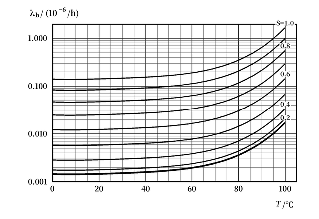

<strong>图 34 纸和薄膜电容器基本失效率曲线(额定温度为 100℃)</strong>

<strong>表 208 环境系数 <i>π</i>E</strong>

<table>
  <tbody>
    <tr>
      <td align="center">环境</td>
      <td align="center">GB</td>
      <td align="center">GMS</td>
      <td align="center">GF1</td>
      <td align="center">GF2</td>
      <td align="center">GM1</td>
      <td align="center">GM2</td>
      <td align="center">MP</td>
      <td align="center">NSB</td>
      <td align="center">NS1</td>
      <td align="center">NS2</td>
    </tr>
    <tr>
      <td align="center"><i>π</i>E</td>
      <td align="center">1.0</td>
      <td align="center">1.1</td>
      <td align="center">2.4</td>
      <td align="center">4.8</td>
      <td align="center">4.8</td>
      <td align="center">9.6</td>
      <td align="center">7.0</td>
      <td align="center">4.5</td>
      <td align="center">2.8</td>
      <td align="center">5.7</td>
    </tr>
    <tr>
      <td align="center">环境</td>
      <td align="center">NU</td>
      <td align="center">AIF</td>
      <td align="center">AUF</td>
      <td align="center">AIC</td>
      <td align="center">AUC</td>
      <td align="center">ARW</td>
      <td align="center">SF</td>
      <td align="center">ML</td>
      <td align="center">MF</td>
      <td align="center">—</td>
    </tr>
    <tr>
      <td align="center"><i>π</i>E</td>
      <td align="center">11.5</td>
      <td align="center">8.0</td>
      <td align="center">21</td>
      <td align="center">6.0</td>
      <td align="center">10</td>
      <td align="center">15</td>
      <td align="center">1.0</td>
      <td align="center">31</td>
      <td align="center">15</td>
      <td align="center">—</td>
    </tr>
  </tbody>
</table>

<strong>表 209 质量等级与质量系数 <i>π</i>Q</strong>

<table>
  <thead>
    <tr>
      <th colspan="2">质量等级</th>
      <th>质量要求说明</th>
      <th>质量要求补充说明</th>
      <th><i>π</i>Q</th>
    </tr>
  </thead>
  <tbody>
    <tr>
      <td rowspan="3" align="center">A</td>
      <td align="center">A1T</td>
      <td>符合 GJB 1214A—2009 且列入军用电子元器件合格产品目录(QPL)的 T 级产品</td>
      <td align="center">—</td>
      <td align="center">—</td>
    </tr>
    <tr>
      <td align="center">A1S</td>
      <td>符合 GJB 972A—2002、GJB 1214A—2009 且列入军用电子元器件合格产品目录(QPL)的 S 级产品 符合 GJB 62—1985、GJB 732—1989，且列入军用电子元器件合格产品目录(QPL)的 B 级产品</td>
      <td>符合 GJB 972—1990、GJB 1214—1991 且列入军用电子元器件合格产品目录(QPL)的 B 级产品</td>
      <td align="center">—</td>
    </tr>
    <tr>
      <td align="center">A1R</td>
      <td>符合 GJB 972A—2002、GJB 1214A—2009 且列入军用电子元器件合格产品目录(QPL)的 R 级产品 符合 GJB 62—1985、GJB 732—1989，且列入军用电子元器件合格产品目录(QPL)的 Q 产品</td>
      <td>符合 GJB 972—1990、GJB 1214—1991 且列入军用电子元器件合格产品目录(QPL)的 Q 级产品</td>
      <td align="center">—</td>
    </tr>
  </tbody>
</table>

116

---

<strong>GJB/Z 299D—2024</strong>

<strong>表 209(续)</strong>

<table>
  <thead>
    <tr>
      <th colspan="2">质量等级</th>
      <th>质量要求说明</th>
      <th>质量要求补充说明</th>
      <th><i>π</i>Q</th>
    </tr>
  </thead>
  <tbody>
    <tr>
      <td rowspan="3" align="center">A</td>
      <td align="center">A1P</td>
      <td>符合 GJB 972A—2002、GJB 1214A—2009 且列入军用电子元器件合格产品目录(QPL)的 P 级产品 符合 GJB 62—1985、GJB 732—1989，且列入军用电子元器件合格产品目录(QPL)的 L 产品</td>
      <td>符合 GJB 972—1990、GJB 1214—1991 且列入军用电子元器件合格产品目录(QPL)的 L 级产品</td>
      <td align="center">0.03</td>
    </tr>
    <tr>
      <td align="center">A1M</td>
      <td>符合 GJB 972A—2002、GJB 1214A—2009 且列入军用电子元器件合格产品目录(QPL)的 M 级产品 符合 GJB 62—1985、GJB 732—1989，且列入军用电子元器件合格产品目录(QPL)的 W 产品 符合企业军用标准，且列入军用电子元器件合格产品目录(QPL)的产品</td>
      <td>符合 GJB 972—1990、GJB 1214—1991 且列入军用电子元器件合格产品目录(QPL)的 W 级产品</td>
      <td align="center">0.1</td>
    </tr>
    <tr>
      <td align="center">A2</td>
      <td>符合 GJB 62—1985、GJB 732—1989、GJB 972A—2002、GJB 1214A—2009、GJB 1522—1992，但未列入军用电子元器件合格产品目录(QPL)的产品</td>
      <td>符合 GJB 972—1990、GJB 1214—1991，但未列入军用电子元器件合格产品目录(QPL)的产品</td>
      <td align="center">0.2</td>
    </tr>
    <tr>
      <td rowspan="2" align="center">B</td>
      <td align="center">B1</td>
      <td colspan="2">按军用标准的筛选要求进行筛选的 B2 质量等级的产品</td>
      <td align="center">0.5</td>
    </tr>
    <tr>
      <td align="center">B2</td>
      <td colspan="2">符合 GB/T 2693、GB/T 4874、GB/T 6346、GB/T 7332、GB/T 14004、GB/T 15448、SJ 1885—1981、SJ 20471—1994 的产品</td>
      <td align="center">1.0</td>
    </tr>
    <tr>
      <td rowspan="2" align="center">C</td>
      <td align="center">C1</td>
      <td colspan="2">符合 SJ 1241—1977 的产品</td>
      <td align="center">3.0</td>
    </tr>
    <tr>
      <td align="center">C2</td>
      <td colspan="2">低档产品</td>
      <td align="center">5.0</td>
    </tr>
  </tbody>
</table>

<strong>表 210 电容量系数 <i>π</i>CV</strong>

<table>
  <thead>
    <tr>
      <th colspan="2">纸介电容器</th>
      <th colspan="2">薄膜电容器</th>
    </tr>
    <tr>
      <th>电容量 <i>C</i></th>
      <th><i>π</i>CV</th>
      <th>电容量 <i>C</i></th>
      <th><i>π</i>CV</th>
    </tr>
  </thead>
  <tbody>
    <tr>
      <td align="center"><i>C</i> ≤ 0.000 47μF</td>
      <td align="center">0.50</td>
      <td align="center"><i>C</i> ≤ 10pF</td>
      <td align="center">0.50</td>
    </tr>
    <tr>
      <td align="center">0.000 47μF &lt; <i>C</i> ≤ 0.01μF</td>
      <td align="center">0.75</td>
      <td align="center">10pF &lt; <i>C</i> ≤ 470pF</td>
      <td align="center">0.75</td>
    </tr>
    <tr>
      <td align="center">0.01μF &lt; <i>C</i> ≤ 0.068μF</td>
      <td align="center">1.0</td>
      <td align="center">470pF &lt; <i>C</i> ≤ 0.004 7μF</td>
      <td align="center">1.0</td>
    </tr>
    <tr>
      <td align="center">0.068μF &lt; <i>C</i> ≤ 0.33μF</td>
      <td align="center">1.3</td>
      <td align="center">0.004 7μF &lt; <i>C</i> ≤ 0.047μF</td>
      <td align="center">1.3</td>
    </tr>
    <tr>
      <td align="center">0.33μF &lt; <i>C</i> ≤ 1.5μF</td>
      <td align="center">1.6</td>
      <td align="center">0.047μF &lt; <i>C</i> ≤ 0.22μF</td>
      <td align="center">1.6</td>
    </tr>
    <tr>
      <td align="center">1.5μF &lt; <i>C</i> ≤ 4.7μF</td>
      <td align="center">1.9</td>
      <td align="center">0.22μF &lt; <i>C</i> ≤ 1μF</td>
      <td align="center">1.9</td>
    </tr>
    <tr>
      <td align="center">4.7μF &lt; <i>C</i> ≤ 10μF</td>
      <td align="center">2.2</td>
      <td align="center">1μF &lt; <i>C</i> ≤ 3.3μF</td>
      <td align="center">2.2</td>
    </tr>
    <tr>
      <td align="center"><i>C</i> &gt; 10μF</td>
      <td align="center">2.4</td>
      <td align="center"><i>C</i> &gt; 3.3μF</td>
      <td align="center">2.4</td>
    </tr>
  </tbody>
</table>

<strong>表 211 种类系数 <i>π</i>K</strong>

<table>
  <thead>
    <tr>
      <th>种类</th>
      <th><i>π</i>K</th>
    </tr>
  </thead>
  <tbody>
    <tr>
      <td>聚苯乙烯，聚四氟乙烯，聚碳酸酯</td>
      <td align="center">0.3</td>
    </tr>
    <tr>
      <td>涤纶、聚丙烯等有机膜，纸-膜复合介质</td>
      <td align="center">1.0</td>
    </tr>
    <tr>
      <td>纸介，金属化纸介</td>
      <td align="center">1.3</td>
    </tr>
  </tbody>
</table>

#### 5.9.3 云母电容器

工作失效率预计模型见式(56)。

$$\lambda_{\text{P}} = \lambda_{\text{b}}\pi_{\text{E}}\pi_{\text{Q}}\pi_{\text{CV}}\pi_{\text{ch}} \tag{56}$$

式中：
$\lambda_{\text{P}}$ ——工作失效率，$10^{-6}/\text{h}$；
$\lambda_{\text{b}}$ ——基本失效率，$10^{-6}/\text{h}$，见表 212、表 213 和图 35、图 36；

117

---

<strong>GJB/Z 299D—2024</strong>

$\pi_{\text{E}}$ ——环境系数，见表 214；
$\pi_{\text{Q}}$ ——质量系数，见表 215；
$\pi_{\text{CV}}$ ——电容量系数，见表 216；
$\pi_{\text{ch}}$ ——表面贴装系数，见表 204。

<strong>表 212 基本失效率 <i>λ</i>b (额定温度为 70℃)</strong>

单位为 10−6/h

<table>
  <thead>
    <tr>
      <th rowspan="2"><i>T</i> ℃</th>
      <th colspan="10"><i>S</i></th>
    </tr>
    <tr>
      <th>0.1</th>
      <th>0.2</th>
      <th>0.3</th>
      <th>0.4</th>
      <th>0.5</th>
      <th>0.6</th>
      <th>0.7</th>
      <th>0.8</th>
      <th>0.9</th>
      <th>1.0</th>
    </tr>
  </thead>
  <tbody>
    <tr><td align="center">0</td><td align="center">0.000 35</td><td align="center">0.000 39</td><td align="center">0.000 49</td><td align="center">0.000 69</td><td align="center">0.001 02</td><td align="center">0.001 51</td><td align="center">0.002 20</td><td align="center">0.003 11</td><td align="center">0.004 29</td><td align="center">0.005 75</td></tr>
    <tr><td align="center">5</td><td align="center">0.000 44</td><td align="center">0.000 49</td><td align="center">0.000 62</td><td align="center">0.000 87</td><td align="center">0.001 29</td><td align="center">0.001 91</td><td align="center">0.002 78</td><td align="center">0.003 93</td><td align="center">0.005 41</td><td align="center">0.007 27</td></tr>
    <tr><td align="center">10</td><td align="center">0.000 56</td><td align="center">0.000 62</td><td align="center">0.000 78</td><td align="center">0.001 10</td><td align="center">0.001 63</td><td align="center">0.002 41</td><td align="center">0.003 51</td><td align="center">0.004 97</td><td align="center">0.006 84</td><td align="center">0.009 17</td></tr>
    <tr><td align="center">15</td><td align="center">0.000 71</td><td align="center">0.000 78</td><td align="center">0.000 99</td><td align="center">0.001 39</td><td align="center">0.002 06</td><td align="center">0.003 05</td><td align="center">0.004 43</td><td align="center">0.006 27</td><td align="center">0.008 63</td><td align="center">0.011 58</td></tr>
    <tr><td align="center">20</td><td align="center">0.000 89</td><td align="center">0.000 99</td><td align="center">0.001 25</td><td align="center">0.001 76</td><td align="center">0.002 60</td><td align="center">0.003 85</td><td align="center">0.005 59</td><td align="center">0.007 92</td><td align="center">0.010 90</td><td align="center">0.014 63</td></tr>
    <tr><td align="center">25</td><td align="center">0.001 13</td><td align="center">0.001 25</td><td align="center">0.001 58</td><td align="center">0.002 22</td><td align="center">0.003 28</td><td align="center">0.004 86</td><td align="center">0.007 06</td><td align="center">0.010 00</td><td align="center">0.013 76</td><td align="center">0.018 47</td></tr>
    <tr><td align="center">30</td><td align="center">0.001 42</td><td align="center">0.001 58</td><td align="center">0.001 99</td><td align="center">0.002 81</td><td align="center">0.004 14</td><td align="center">0.006 14</td><td align="center">0.008 92</td><td align="center">0.012 62</td><td align="center">0.017 38</td><td align="center">0.023 32</td></tr>
    <tr><td align="center">35</td><td align="center">0.001 80</td><td align="center">0.001 99</td><td align="center">0.002 52</td><td align="center">0.003 54</td><td align="center">0.005 23</td><td align="center">0.007 75</td><td align="center">0.011 26</td><td align="center">0.015 94</td><td align="center">0.021 95</td><td align="center">0.029 45</td></tr>
    <tr><td align="center">40</td><td align="center">0.002 27</td><td align="center">0.002 52</td><td align="center">0.003 18</td><td align="center">0.004 47</td><td align="center">0.006 60</td><td align="center">0.009 78</td><td align="center">0.014 22</td><td align="center">0.020 13</td><td align="center">0.027 71</td><td align="center">0.037 18</td></tr>
    <tr><td align="center">45</td><td align="center">0.002 87</td><td align="center">0.003 18</td><td align="center">0.004 02</td><td align="center">0.005 65</td><td align="center">0.008 34</td><td align="center">0.012 35</td><td align="center">0.017 96</td><td align="center">0.025 41</td><td align="center">0.034 99</td><td align="center">0.046 95</td></tr>
    <tr><td align="center">50</td><td align="center">0.003 62</td><td align="center">0.004 01</td><td align="center">0.005 07</td><td align="center">0.007 13</td><td align="center">0.010 53</td><td align="center">0.015 60</td><td align="center">0.022 68</td><td align="center">0.032 09</td><td align="center">0.044 18</td><td align="center">0.059 28</td></tr>
    <tr><td align="center">55</td><td align="center">0.004 57</td><td align="center">0.005 07</td><td align="center">0.006 40</td><td align="center">0.009 00</td><td align="center">0.013 30</td><td align="center">0.019 70</td><td align="center">0.028 63</td><td align="center">0.040 52</td><td align="center">0.055 79</td><td align="center">0.074 85</td></tr>
    <tr><td align="center">60</td><td align="center">0.005 77</td><td align="center">0.006 40</td><td align="center">0.008 08</td><td align="center">0.011 37</td><td align="center">0.016 79</td><td align="center">0.024 87</td><td align="center">0.036 15</td><td align="center">0.051 16</td><td align="center">0.070 44</td><td align="center">0.094 51</td></tr>
    <tr><td align="center">65</td><td align="center">0.007 29</td><td align="center">0.008 08</td><td align="center">0.010 21</td><td align="center">0.014 36</td><td align="center">0.021 20</td><td align="center">0.031 40</td><td align="center">0.045 65</td><td align="center">0.064 60</td><td align="center">0.088 94</td><td align="center">0.119 34</td></tr>
    <tr><td align="center">70</td><td align="center">0.009 21</td><td align="center">0.010 20</td><td align="center">0.012 89</td><td align="center">0.018 13</td><td align="center">0.026 77</td><td align="center">0.039 65</td><td align="center">0.057 64</td><td align="center">0.081 57</td><td align="center">0.112 31</td><td align="center">0.150 69</td></tr>
    <tr>
      <td colspan="11">注：<i>T</i> 为工作环境温度。 &emsp;&emsp;<i>S</i> 为实际工作电压与额定电压的比值。</td>
    </tr>
  </tbody>
</table>

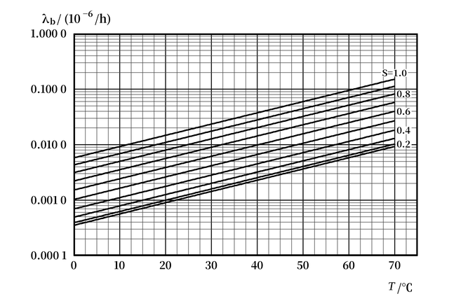

<strong>图 35 云母电容器基本失效率曲线(额定温度为 70℃)</strong>

<strong>表 213 基本失效率 <i>λ</i>b (额定温度为 85℃)</strong>

单位为 10−6/h

<table>
  <thead>
    <tr>
      <th rowspan="2"><i>T</i> ℃</th>
      <th colspan="10"><i>S</i></th>
    </tr>
    <tr>
      <th>0.1</th>
      <th>0.2</th>
      <th>0.3</th>
      <th>0.4</th>
      <th>0.5</th>
      <th>0.6</th>
      <th>0.7</th>
      <th>0.8</th>
      <th>0.9</th>
      <th>1.0</th>
    </tr>
  </thead>
  <tbody>
    <tr><td align="center">0</td><td align="center">0.000 21</td><td align="center">0.000 23</td><td align="center">0.000 29</td><td align="center">0.000 41</td><td align="center">0.000 60</td><td align="center">0.000 89</td><td align="center">0.001 29</td><td align="center">0.001 83</td><td align="center">0.002 52</td><td align="center">0.003 37</td></tr>
    <tr><td align="center">5</td><td align="center">0.000 26</td><td align="center">0.000 29</td><td align="center">0.000 36</td><td align="center">0.000 51</td><td align="center">0.000 75</td><td align="center">0.001 11</td><td align="center">0.001 61</td><td align="center">0.002 28</td><td align="center">0.003 14</td><td align="center">0.004 22</td></tr>
    <tr><td align="center">10</td><td align="center">0.000 32</td><td align="center">0.000 36</td><td align="center">0.000 45</td><td align="center">0.000 63</td><td align="center">0.000 94</td><td align="center">0.001 39</td><td align="center">0.002 02</td><td align="center">0.002 86</td><td align="center">0.003 93</td><td align="center">0.005 28</td></tr>
    <tr><td align="center">15</td><td align="center">0.000 40</td><td align="center">0.000 45</td><td align="center">0.000 56</td><td align="center">0.000 79</td><td align="center">0.001 17</td><td align="center">0.001 74</td><td align="center">0.002 52</td><td align="center">0.003 57</td><td align="center">0.004 92</td><td align="center">0.006 60</td></tr>
  </tbody>
</table>

118

---

<strong>GJB/Z 299D—2024</strong>

<strong>表 213(续)</strong>

单位为 10−6/h

<table>
  <thead>
    <tr>
      <th rowspan="2"><i>T</i> ℃</th>
      <th colspan="10"><i>S</i></th>
    </tr>
    <tr>
      <th>0.1</th>
      <th>0.2</th>
      <th>0.3</th>
      <th>0.4</th>
      <th>0.5</th>
      <th>0.6</th>
      <th>0.7</th>
      <th>0.8</th>
      <th>0.9</th>
      <th>1.0</th>
    </tr>
  </thead>
  <tbody>
    <tr><td align="center">20</td><td align="center">0.000 50</td><td align="center">0.000 56</td><td align="center">0.000 71</td><td align="center">0.000 99</td><td align="center">0.001 47</td><td align="center">0.002 17</td><td align="center">0.003 16</td><td align="center">0.004 47</td><td align="center">0.006 15</td><td align="center">0.008 25</td></tr>
    <tr><td align="center">25</td><td align="center">0.000 63</td><td align="center">0.000 70</td><td align="center">0.000 88</td><td align="center">0.001 24</td><td align="center">0.001 83</td><td align="center">0.002 71</td><td align="center">0.003 95</td><td align="center">0.005 58</td><td align="center">0.007 69</td><td align="center">0.010 32</td></tr>
    <tr><td align="center">30</td><td align="center">0.000 79</td><td align="center">0.000 87</td><td align="center">0.001 10</td><td align="center">0.001 55</td><td align="center">0.002 29</td><td align="center">0.003 39</td><td align="center">0.004 93</td><td align="center">0.006 98</td><td align="center">0.009 61</td><td align="center">0.012 90</td></tr>
    <tr><td align="center">35</td><td align="center">0.000 99</td><td align="center">0.001 09</td><td align="center">0.001 38</td><td align="center">0.001 94</td><td align="center">0.002 86</td><td align="center">0.004 24</td><td align="center">0.006 17</td><td align="center">0.008 73</td><td align="center">0.012 02</td><td align="center">0.016 13</td></tr>
    <tr><td align="center">40</td><td align="center">0.001 23</td><td align="center">0.001 36</td><td align="center">0.001 72</td><td align="center">0.002 43</td><td align="center">0.003 58</td><td align="center">0.005 31</td><td align="center">0.007 71</td><td align="center">0.010 92</td><td align="center">0.015 03</td><td align="center">0.020 17</td></tr>
    <tr><td align="center">45</td><td align="center">0.001 54</td><td align="center">0.001 71</td><td align="center">0.002 16</td><td align="center">0.003 03</td><td align="center">0.004 48</td><td align="center">0.006 64</td><td align="center">0.009 65</td><td align="center">0.013 65</td><td align="center">0.018 79</td><td align="center">0.025 22</td></tr>
    <tr><td align="center">50</td><td align="center">0.001 93</td><td align="center">0.002 13</td><td align="center">0.002 70</td><td align="center">0.003 79</td><td align="center">0.005 60</td><td align="center">0.008 30</td><td align="center">0.012 06</td><td align="center">0.017 07</td><td align="center">0.023 50</td><td align="center">0.031 53</td></tr>
    <tr><td align="center">55</td><td align="center">0.002 41</td><td align="center">0.002 67</td><td align="center">0.003 37</td><td align="center">0.004 74</td><td align="center">0.007 00</td><td align="center">0.010 38</td><td align="center">0.015 08</td><td align="center">0.021 34</td><td align="center">0.029 38</td><td align="center">0.039 43</td></tr>
    <tr><td align="center">60</td><td align="center">0.003 01</td><td align="center">0.003 34</td><td align="center">0.004 22</td><td align="center">0.005 93</td><td align="center">0.008 76</td><td align="center">0.012 97</td><td align="center">0.018 86</td><td align="center">0.026 69</td><td align="center">0.036 74</td><td align="center">0.049 30</td></tr>
    <tr><td align="center">65</td><td align="center">0.003 77</td><td align="center">0.004 17</td><td align="center">0.005 27</td><td align="center">0.007 42</td><td align="center">0.010 95</td><td align="center">0.016 22</td><td align="center">0.023 58</td><td align="center">0.033 37</td><td align="center">0.045 94</td><td align="center">0.061 64</td></tr>
    <tr><td align="center">70</td><td align="center">0.004 71</td><td align="center">0.005 22</td><td align="center">0.006 59</td><td align="center">0.009 27</td><td align="center">0.013 69</td><td align="center">0.020 28</td><td align="center">0.029 48</td><td align="center">0.041 73</td><td align="center">0.057 45</td><td align="center">0.077 08</td></tr>
    <tr><td align="center">75</td><td align="center">0.005 89</td><td align="center">0.006 52</td><td align="center">0.008 24</td><td align="center">0.011 59</td><td align="center">0.017 12</td><td align="center">0.025 36</td><td align="center">0.036 87</td><td align="center">0.052 17</td><td align="center">0.071 83</td><td align="center">0.096 38</td></tr>
    <tr><td align="center">80</td><td align="center">0.007 36</td><td align="center">0.008 15</td><td align="center">0.010 31</td><td align="center">0.014 50</td><td align="center">0.021 41</td><td align="center">0.031 71</td><td align="center">0.046 10</td><td align="center">0.065 24</td><td align="center">0.089 82</td><td align="center">0.120 51</td></tr>
    <tr><td align="center">85</td><td align="center">0.009 21</td><td align="center">0.010 20</td><td align="center">0.012 89</td><td align="center">0.018 13</td><td align="center">0.026 77</td><td align="center">0.039 65</td><td align="center">0.057 64</td><td align="center">0.081 57</td><td align="center">0.112 31</td><td align="center">0.150 69</td></tr>
    <tr>
      <td colspan="11">注：<i>T</i> 为工作环境温度。 &emsp;&emsp;<i>S</i> 为实际工作电压与额定电压的比值。</td>
    </tr>
  </tbody>
</table>

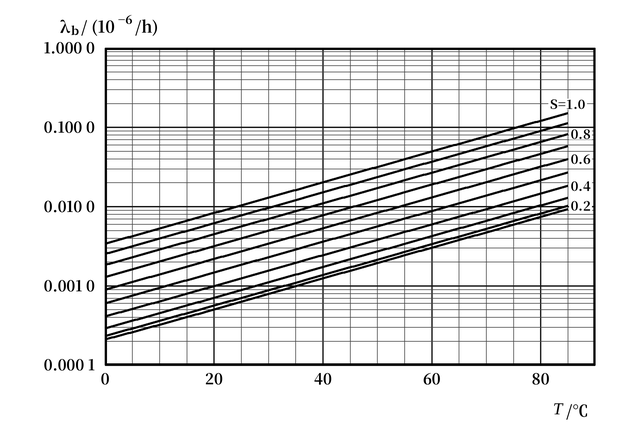

<strong>图 36 云母电容器基本失效率曲线(额定温度为 85℃)</strong>

<strong>表 214 环境系数 <i>π</i>E</strong>

<table>
  <tbody>
    <tr>
      <td align="center">环境</td>
      <td align="center">GB</td>
      <td align="center">GMS</td>
      <td align="center">GF1</td>
      <td align="center">GF2</td>
      <td align="center">GM1</td>
      <td align="center">GM2</td>
      <td align="center">MP</td>
      <td align="center">NSB</td>
      <td align="center">NS1</td>
      <td align="center">NS2</td>
    </tr>
    <tr>
      <td align="center"><i>π</i>E</td>
      <td align="center">1.0</td>
      <td align="center">1.1</td>
      <td align="center">1.8</td>
      <td align="center">2.5</td>
      <td align="center">3.2</td>
      <td align="center">4.6</td>
      <td align="center">4.2</td>
      <td align="center">2.8</td>
      <td align="center">1.9</td>
      <td align="center">3.7</td>
    </tr>
    <tr>
      <td align="center">环境</td>
      <td align="center">NU</td>
      <td align="center">AIF</td>
      <td align="center">AUF</td>
      <td align="center">AIC</td>
      <td align="center">AUC</td>
      <td align="center">ARW</td>
      <td align="center">SF</td>
      <td align="center">ML</td>
      <td align="center">MF</td>
      <td align="center">—</td>
    </tr>
    <tr>
      <td align="center"><i>π</i>E</td>
      <td align="center">5.7</td>
      <td align="center">4.1</td>
      <td align="center">8.0</td>
      <td align="center">3.2</td>
      <td align="center">6.0</td>
      <td align="center">7.0</td>
      <td align="center">1.0</td>
      <td align="center">11</td>
      <td align="center">5</td>
      <td align="center">—</td>
    </tr>
  </tbody>
</table>

<strong>表 215 质量等级与质量系数 <i>π</i>Q</strong>

<table>
  <thead>
    <tr>
      <th colspan="2">质量等级</th>
      <th>质量要求说明</th>
      <th>质量要求补充说明</th>
      <th><i>π</i>Q</th>
    </tr>
  </thead>
  <tbody>
    <tr>
      <td rowspan="3" align="center">A</td>
      <td align="center">A1T</td>
      <td>符合 GJB 191B—2009，且列入军用电子元器件合格产品目录(QPL)的 T 级产品</td>
      <td align="center">—</td>
      <td align="center">—</td>
    </tr>
    <tr>
      <td align="center">A1S</td>
      <td>符合 GJB 191B—2009，且列入军用电子元器件合格产品目录(QPL)的 S 级产品</td>
      <td>符合 GJB 191A—1997，且列入军用电子元器件合格产品目录(QPL)的 S 级产品</td>
      <td align="center">—</td>
    </tr>
    <tr>
      <td align="center">A1R</td>
      <td>符合 GJB 191B—2009，且列入军用电子元器件合格产品目录(QPL)的 R 级产品</td>
      <td>符合 GJB 191A—1997，且列入军用电子元器件合格产品目录(QPL)的 R 级产品</td>
      <td align="center">—</td>
    </tr>
  </tbody>
</table>

119

---

<strong>GJB/Z 299D—2024</strong>

<strong>表 215(续)</strong>

<table>
  <thead>
    <tr>
      <th colspan="2">质量等级</th>
      <th>质量要求说明</th>
      <th>质量要求补充说明</th>
      <th><i>π</i>Q</th>
    </tr>
  </thead>
  <tbody>
    <tr>
      <td rowspan="3" align="center">A</td>
      <td align="center">A1P</td>
      <td>符合 GJB 191B—2009，且列入军用电子元器件合格产品目录(QPL)的 P 级产品</td>
      <td>符合 GJB 191A—1997，且列入军用电子元器件合格产品目录(QPL)的 P 级产品</td>
      <td align="center">0.03</td>
    </tr>
    <tr>
      <td align="center">A1M</td>
      <td>符合 GJB 191B—2009，且列入军用电子元器件合格产品目录(QPL)的 M 级产品 符合 GJB 1313—1991，且列入军用电子元器件合格产品目录(QPL)的产品 符合企业军用标准，且列入军用电子元器件合格产品目录(QPL)的产品</td>
      <td>符合 GJB 191A—1997，且列入军用电子元器件合格产品目录(QPL)的 M 级产品</td>
      <td align="center">0.1</td>
    </tr>
    <tr>
      <td align="center">A2</td>
      <td>符合 GJB 191B—2009、GJB 1313—1991，但未列入军用电子元器件合格产品目录(QPL)的产品</td>
      <td>符合 GJB 191A—1997，但未列入军用电子元器件合格产品目录(QPL)的产品</td>
      <td align="center">0.2</td>
    </tr>
    <tr>
      <td rowspan="2" align="center">B</td>
      <td align="center">B1</td>
      <td colspan="2">按军用标准的筛选要求进行筛选的 B2 质量等级的产品</td>
      <td align="center">0.5</td>
    </tr>
    <tr>
      <td align="center">B2</td>
      <td colspan="2">符合 GB/T 2693、GB/T 6261 的产品</td>
      <td align="center">1.0</td>
    </tr>
    <tr>
      <td colspan="2" align="center">C</td>
      <td colspan="2">低档产品</td>
      <td align="center">5.0</td>
    </tr>
  </tbody>
</table>

<strong>表 216 电容量系数 <i>π</i>CV</strong>

<table>
  <thead>
    <tr>
      <th>电容量 <i>C</i></th>
      <th><i>π</i>CV</th>
    </tr>
  </thead>
  <tbody>
    <tr>
      <td align="center"><i>C</i> ≤ 10pF</td>
      <td align="center">0.4</td>
    </tr>
    <tr>
      <td align="center">10pF &lt; <i>C</i> ≤ 150pF</td>
      <td align="center">0.7</td>
    </tr>
    <tr>
      <td align="center">150pF &lt; <i>C</i> ≤ 750pF</td>
      <td align="center">1.0</td>
    </tr>
    <tr>
      <td align="center">750pF &lt; <i>C</i> ≤ 0.002 2μF</td>
      <td align="center">1.3</td>
    </tr>
    <tr>
      <td align="center">0.002 2μF &lt; <i>C</i> ≤ 0.005 6μF</td>
      <td align="center">1.6</td>
    </tr>
    <tr>
      <td align="center">0.005 6μF &lt; <i>C</i> ≤ 0.011μF</td>
      <td align="center">1.9</td>
    </tr>
    <tr>
      <td align="center">0.011μF &lt; <i>C</i> ≤ 0.022μF</td>
      <td align="center">2.2</td>
    </tr>
    <tr>
      <td align="center">0.022μF &lt; <i>C</i> ≤ 0.039μF</td>
      <td align="center">2.5</td>
    </tr>
    <tr>
      <td align="center">0.039μF &lt; <i>C</i> ≤ 0.062μF</td>
      <td align="center">2.8</td>
    </tr>
    <tr>
      <td align="center"><i>C</i> &gt; 0.062μF</td>
      <td align="center">3.0</td>
    </tr>
  </tbody>
</table>

#### 5.9.4 1 类瓷介电容器

工作失效率预计模型见式(57)。

$$\lambda_{\text{P}} = \lambda_{\text{b}}\pi_{\text{E}}\pi_{\text{Q}}\pi_{\text{CV}}\pi_{\text{ch}} \tag{57}$$

式中：
$\lambda_{\text{P}}$ ——工作失效率，$10^{-6}/\text{h}$；
$\lambda_{\text{b}}$ ——基本失效率，$10^{-6}/\text{h}$，见表 217 和图 37；
$\pi_{\text{E}}$ ——环境系数，见表 218；
$\pi_{\text{Q}}$ ——质量系数，见表 219；
$\pi_{\text{CV}}$ ——电容量系数，见表 220；
$\pi_{\text{ch}}$ ——表面贴装系数，见表 204。

<strong>表 217 基本失效率 <i>λ</i>b</strong>

单位为 10−6/h

<table>
  <thead>
    <tr>
      <th rowspan="2"><i>T</i> ℃</th>
      <th colspan="10"><i>S</i></th>
    </tr>
    <tr>
      <th>0.1</th>
      <th>0.2</th>
      <th>0.3</th>
      <th>0.4</th>
      <th>0.5</th>
      <th>0.6</th>
      <th>0.7</th>
      <th>0.8</th>
      <th>0.9</th>
      <th>1.0</th>
    </tr>
  </thead>
  <tbody>
    <tr><td align="center">0</td><td align="center">0.000 17</td><td align="center">0.000 22</td><td align="center">0.000 33</td><td align="center">0.000 56</td><td align="center">0.000 94</td><td align="center">0.001 50</td><td align="center">0.002 29</td><td align="center">0.003 33</td><td align="center">0.004 68</td><td align="center">0.006 35</td></tr>
    <tr><td align="center">5</td><td align="center">0.000 20</td><td align="center">0.000 25</td><td align="center">0.000 39</td><td align="center">0.000 66</td><td align="center">0.001 10</td><td align="center">0.001 75</td><td align="center">0.002 67</td><td align="center">0.003 89</td><td align="center">0.005 45</td><td align="center">0.007 41</td></tr>
  </tbody>
</table>

120

---

<strong>GJB/Z 299D—2024</strong>

<strong>表 217(续)</strong>

单位为 10−6/h

<table>
  <thead>
    <tr>
      <th rowspan="2"><i>T</i> ℃</th>
      <th colspan="10"><i>S</i></th>
    </tr>
    <tr>
      <th>0.1</th>
      <th>0.2</th>
      <th>0.3</th>
      <th>0.4</th>
      <th>0.5</th>
      <th>0.6</th>
      <th>0.7</th>
      <th>0.8</th>
      <th>0.9</th>
      <th>1.0</th>
    </tr>
  </thead>
  <tbody>
    <tr><td align="center">10</td><td align="center">0.000 24</td><td align="center">0.000 29</td><td align="center">0.000 45</td><td align="center">0.000 77</td><td align="center">0.001 28</td><td align="center">0.002 04</td><td align="center">0.003 11</td><td align="center">0.004 53</td><td align="center">0.006 36</td><td align="center">0.008 64</td></tr>
    <tr><td align="center">15</td><td align="center">0.000 27</td><td align="center">0.000 34</td><td align="center">0.000 53</td><td align="center">0.000 89</td><td align="center">0.001 49</td><td align="center">0.002 38</td><td align="center">0.003 63</td><td align="center">0.005 29</td><td align="center">0.007 41</td><td align="center">0.010 07</td></tr>
    <tr><td align="center">20</td><td align="center">0.000 32</td><td align="center">0.000 40</td><td align="center">0.000 62</td><td align="center">0.001 04</td><td align="center">0.001 74</td><td align="center">0.002 78</td><td align="center">0.004 23</td><td align="center">0.006 16</td><td align="center">0.008 65</td><td align="center">0.011 75</td></tr>
    <tr><td align="center">25</td><td align="center">0.000 37</td><td align="center">0.000 47</td><td align="center">0.000 72</td><td align="center">0.001 21</td><td align="center">0.002 03</td><td align="center">0.003 24</td><td align="center">0.004 93</td><td align="center">0.007 19</td><td align="center">0.010 08</td><td align="center">0.013 70</td></tr>
    <tr><td align="center">30</td><td align="center">0.000 44</td><td align="center">0.000 54</td><td align="center">0.000 84</td><td align="center">0.001 42</td><td align="center">0.002 36</td><td align="center">0.003 78</td><td align="center">0.005 75</td><td align="center">0.008 38</td><td align="center">0.011 76</td><td align="center">0.015 97</td></tr>
    <tr><td align="center">35</td><td align="center">0.000 51</td><td align="center">0.000 63</td><td align="center">0.000 98</td><td align="center">0.001 65</td><td align="center">0.002 76</td><td align="center">0.004 41</td><td align="center">0.006 71</td><td align="center">0.009 77</td><td align="center">0.013 71</td><td align="center">0.018 62</td></tr>
    <tr><td align="center">40</td><td align="center">0.000 59</td><td align="center">0.000 74</td><td align="center">0.001 14</td><td align="center">0.001 92</td><td align="center">0.003 21</td><td align="center">0.005 14</td><td align="center">0.007 82</td><td align="center">0.011 40</td><td align="center">0.015 98</td><td align="center">0.021 71</td></tr>
    <tr><td align="center">45</td><td align="center">0.000 69</td><td align="center">0.000 86</td><td align="center">0.001 33</td><td align="center">0.002 24</td><td align="center">0.003 75</td><td align="center">0.005 99</td><td align="center">0.009 12</td><td align="center">0.013 29</td><td align="center">0.018 64</td><td align="center">0.025 32</td></tr>
    <tr><td align="center">50</td><td align="center">0.000 80</td><td align="center">0.001 01</td><td align="center">0.001 55</td><td align="center">0.002 62</td><td align="center">0.004 37</td><td align="center">0.006 99</td><td align="center">0.010 64</td><td align="center">0.015 50</td><td align="center">0.021 73</td><td align="center">0.029 52</td></tr>
    <tr><td align="center">55</td><td align="center">0.000 94</td><td align="center">0.001 17</td><td align="center">0.001 81</td><td align="center">0.003 05</td><td align="center">0.005 10</td><td align="center">0.008 15</td><td align="center">0.012 40</td><td align="center">0.018 07</td><td align="center">0.025 34</td><td align="center">0.034 43</td></tr>
    <tr><td align="center">60</td><td align="center">0.001 09</td><td align="center">0.001 37</td><td align="center">0.002 11</td><td align="center">0.003 56</td><td align="center">0.005 94</td><td align="center">0.009 50</td><td align="center">0.014 46</td><td align="center">0.021 07</td><td align="center">0.029 55</td><td align="center">0.040 14</td></tr>
    <tr><td align="center">65</td><td align="center">0.001 28</td><td align="center">0.001 60</td><td align="center">0.002 46</td><td align="center">0.004 15</td><td align="center">0.006 93</td><td align="center">0.011 08</td><td align="center">0.016 86</td><td align="center">0.024 57</td><td align="center">0.034 46</td><td align="center">0.046 81</td></tr>
    <tr><td align="center">70</td><td align="center">0.001 49</td><td align="center">0.001 86</td><td align="center">0.002 87</td><td align="center">0.004 84</td><td align="center">0.008 08</td><td align="center">0.012 92</td><td align="center">0.019 67</td><td align="center">0.028 65</td><td align="center">0.040 18</td><td align="center">0.054 58</td></tr>
    <tr><td align="center">75</td><td align="center">0.001 74</td><td align="center">0.002 17</td><td align="center">0.003 35</td><td align="center">0.005 64</td><td align="center">0.009 42</td><td align="center">0.015 06</td><td align="center">0.022 93</td><td align="center">0.033 40</td><td align="center">0.046 85</td><td align="center">0.063 65</td></tr>
    <tr><td align="center">80</td><td align="center">0.002 02</td><td align="center">0.002 53</td><td align="center">0.003 90</td><td align="center">0.006 58</td><td align="center">0.010 98</td><td align="center">0.017 56</td><td align="center">0.026 74</td><td align="center">0.038 95</td><td align="center">0.054 63</td><td align="center">0.074 22</td></tr>
    <tr><td align="center">85</td><td align="center">0.002 36</td><td align="center">0.002 95</td><td align="center">0.004 55</td><td align="center">0.007 67</td><td align="center">0.012 81</td><td align="center">0.020 48</td><td align="center">0.031 18</td><td align="center">0.045 42</td><td align="center">0.063 71</td><td align="center">0.086 54</td></tr>
    <tr>
      <td colspan="11">注：<i>T</i> 为工作环境温度。 &emsp;&emsp;<i>S</i> 为实际工作电压与额定电压的比值。</td>
    </tr>
  </tbody>
</table>

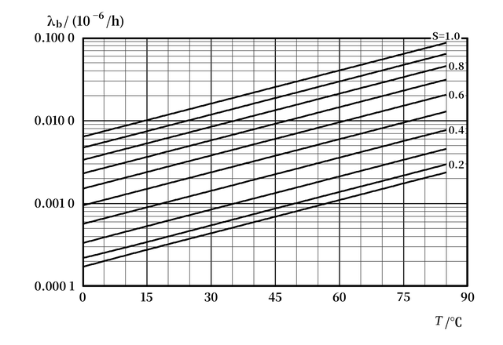

<strong>图 37 1 类瓷介电容器基本失效率曲线</strong>

<strong>表 218 环境系数 <i>π</i>E</strong>

<table>
  <tbody>
    <tr>
      <td align="center">环境</td>
      <td align="center">GB</td>
      <td align="center">GMS</td>
      <td align="center">GF1</td>
      <td align="center">GF2</td>
      <td align="center">GM1</td>
      <td align="center">GM2</td>
      <td align="center">MP</td>
      <td align="center">NSB</td>
      <td align="center">NS1</td>
      <td align="center">NS2</td>
    </tr>
    <tr>
      <td align="center"><i>π</i>E</td>
      <td align="center">1.0</td>
      <td align="center">1.2</td>
      <td align="center">2.4</td>
      <td align="center">4.1</td>
      <td align="center">4.6</td>
      <td align="center">7.6</td>
      <td align="center">7.0</td>
      <td align="center">4.0</td>
      <td align="center">2.3</td>
      <td align="center">4.7</td>
    </tr>
    <tr>
      <td align="center">环境</td>
      <td align="center">NU</td>
      <td align="center">AIF</td>
      <td align="center">AUF</td>
      <td align="center">AIC</td>
      <td align="center">AUC</td>
      <td align="center">ARW</td>
      <td align="center">SF</td>
      <td align="center">ML</td>
      <td align="center">MF</td>
      <td align="center">—</td>
    </tr>
    <tr>
      <td align="center"><i>π</i>E</td>
      <td align="center">10.2</td>
      <td align="center">6.7</td>
      <td align="center">12</td>
      <td align="center">3.4</td>
      <td align="center">7.5</td>
      <td align="center">10.5</td>
      <td align="center">1.0</td>
      <td align="center">17</td>
      <td align="center">8</td>
      <td align="center">—</td>
    </tr>
  </tbody>
</table>

<strong>表 219 质量等级与质量系数 <i>π</i>Q</strong>

<table>
  <thead>
    <tr>
      <th colspan="2">质量等级</th>
      <th>质量要求说明</th>
      <th>质量要求补充说明</th>
      <th><i>π</i>Q</th>
    </tr>
  </thead>
  <tbody>
    <tr>
      <td align="center">A</td>
      <td align="center">A1S</td>
      <td>符合 GJB 192B—2011、GJB 468A—2011、GJB 6788—2009，且列入军用电子元器件合格产品目录(QPL)的 S 级产品 符合 GJB 4157A—2011，且列入军用电子元器件合格产品目录(QPL)的产品</td>
      <td>符合 GJB 192A—1998，且列入军用电子元器件合格产品目录(QPL)的 S 级产品 符合 GJB 468—1988、GJB 1940—1994，且列入军用电子元器件合格产品目录(QPL)的 B 级产品 符合 GJB 4157—2001，且列入军用电子元器件合格产品目录(QPL)的产品</td>
      <td align="center">—</td>
    </tr>
  </tbody>
</table>

121

---

<strong>GJB/Z 299D—2024</strong>

<strong>表 219(续)</strong>

<table>
  <thead>
    <tr>
      <th colspan="2">质量等级</th>
      <th>质量要求说明</th>
      <th>质量要求补充说明</th>
      <th><i>π</i>Q</th>
    </tr>
  </thead>
  <tbody>
    <tr>
      <td rowspan="4" align="center">A</td>
      <td align="center">A1R</td>
      <td>符合 GJB 192B—2011、GJB 468A—2011，且列入军用电子元器件合格产品目录(QPL)的 R 级产品</td>
      <td>符合 GJB 192A—1998，且列入军用电子元器件合格产品目录(QPL)的 R 级产品 符合 GJB 468—1988、GJB 1940—1994，且列入军用电子元器件合格产品目录(QPL)的 Q 级产品</td>
      <td align="center">—</td>
    </tr>
    <tr>
      <td align="center">A1P</td>
      <td>符合 GJB 192B—2011、GJB 468A—2011，且列入军用电子元器件合格产品目录(QPL)的 P 级产品 符合 GJB 4157A—2011，但未列入军用电子元器件合格产品目录(QPL)的产品</td>
      <td>符合 GJB 192A—1998，且列入军用电子元器件合格产品目录(QPL)的 P 级产品 符合 GJB 468—1988、GJB 1940—1994，且列入军用电子元器件合格产品目录(QPL)的 L 级产品 符合 GJB 4157—2001，但未列入军用电子元器件合格产品目录(QPL)的产品</td>
      <td align="center">0.03</td>
    </tr>
    <tr>
      <td align="center">A1M</td>
      <td>符合 GJB 192B—2011、GJB 468A—2011，且列入军用电子元器件合格产品目录(QPL)的 M 级产品 符合 GJB 6788—2009，且列入军用电子元器件合格产品目录(QPL)的 K 级产品 符合 GJB 1940A—2012，且列入军用电子元器件合格产品目录(QPL)的产品 符合企业军用标准，且列入军用电子元器件合格产品目录(QPL)的产品</td>
      <td>符合 GJB 192A—1998，且列入军用电子元器件合格产品目录(QPL)的 M 级产品 符合 GJB 468—1988、GJB 1940—1994，且列入军用电子元器件合格产品目录(QPL)的 W 级产品</td>
      <td align="center">0.1</td>
    </tr>
    <tr>
      <td align="center">A2</td>
      <td>符合 GJB 192B—2011、GJB 468A—2011、GJB 1940A—2012，但未列入军用电子元器件合格产品目录(QPL)的产品 符合 GJB 6788—2009，但未列入军用电子元器件合格产品目录(QPL)的 K 级产品</td>
      <td>符合 GJB 192A—1998、GJB 468—1988、GJB 1940—1994，但未列入军用电子元器件合格产品目录(QPL)的产品</td>
      <td align="center">0.2</td>
    </tr>
    <tr>
      <td rowspan="2" align="center">B</td>
      <td align="center">B1</td>
      <td colspan="2">按军用标准的筛选要求进行筛选的 B2 质量等级的产品</td>
      <td align="center">0.5</td>
    </tr>
    <tr>
      <td align="center">B2</td>
      <td colspan="2">符合 GB/T 2693、GB/T 5966、GB/T 9320、GB/T 9597 的产品</td>
      <td align="center">1.0</td>
    </tr>
    <tr>
      <td colspan="2" align="center">C</td>
      <td colspan="2">低档产品</td>
      <td align="center">5.0</td>
    </tr>
  </tbody>
</table>

<strong>表 220 电容量系数 <i>π</i>CV</strong>

<table>
  <thead>
    <tr>
      <th>电容量 <i>C</i></th>
      <th><i>π</i>CV</th>
    </tr>
  </thead>
  <tbody>
    <tr>
      <td align="center"><i>C</i> ≤ 7.5pF</td>
      <td align="center">0.50</td>
    </tr>
    <tr>
      <td align="center">7.5pF &lt; <i>C</i> ≤ 91pF</td>
      <td align="center">0.75</td>
    </tr>
    <tr>
      <td align="center">91pF &lt; <i>C</i> ≤ 470pF</td>
      <td align="center">1.0</td>
    </tr>
    <tr>
      <td align="center">470pF &lt; <i>C</i> ≤ 2 000pF</td>
      <td align="center">1.3</td>
    </tr>
    <tr>
      <td align="center">2 000pF &lt; <i>C</i> ≤ 0.006 2μF</td>
      <td align="center">1.6</td>
    </tr>
    <tr>
      <td align="center">0.006 2μF &lt; <i>C</i> ≤ 0.016μF</td>
      <td align="center">1.9</td>
    </tr>
    <tr>
      <td align="center">0.016μF &lt; <i>C</i> ≤ 0.039μF</td>
      <td align="center">2.2</td>
    </tr>
    <tr>
      <td align="center"><i>C</i> &gt; 0.039μF</td>
      <td align="center">2.4</td>
    </tr>
  </tbody>
</table>

#### 5.9.5 2 类瓷介电容器

工作失效率预计模型见式(58)。

$$\lambda_{\text{P}} = \lambda_{\text{b}}\pi_{\text{E}}\pi_{\text{Q}}\pi_{\text{CV}}\pi_{\text{ch}} \tag{58}$$

式中：
$\lambda_{\text{P}}$ ——工作失效率，$10^{-6}/\text{h}$；
$\lambda_{\text{b}}$ ——基本失效率，$10^{-6}/\text{h}$，见表 221、表 222 和图 38、图 39；

122

---

<strong>GJB/Z 299D—2024</strong>

$\pi_{\text{E}}$ ——环境系数，见表 223；
$\pi_{\text{Q}}$ ——质量系数，见表 224；
$\pi_{\text{CV}}$ ——电容量系数，见表 225；
$\pi_{\text{ch}}$ ——表面贴装系数，见表 204。

<strong>表 221 基本失效率 <i>λ</i>b (额定温度为 85℃)</strong>

单位为 10−6/h

<table>
  <thead>
    <tr>
      <th rowspan="2"><i>T</i> ℃</th>
      <th colspan="10"><i>S</i></th>
    </tr>
    <tr>
      <th>0.1</th>
      <th>0.2</th>
      <th>0.3</th>
      <th>0.4</th>
      <th>0.5</th>
      <th>0.6</th>
      <th>0.7</th>
      <th>0.8</th>
      <th>0.9</th>
      <th>1.0</th>
    </tr>
  </thead>
  <tbody>
    <tr><td align="center">0</td><td align="center">0.000 42</td><td align="center">0.000 53</td><td align="center">0.000 81</td><td align="center">0.001 37</td><td align="center">0.002 29</td><td align="center">0.003 67</td><td align="center">0.005 58</td><td align="center">0.008 13</td><td align="center">0.011 40</td><td align="center">0.015 49</td></tr>
    <tr><td align="center">5</td><td align="center">0.000 43</td><td align="center">0.000 54</td><td align="center">0.000 83</td><td align="center">0.001 39</td><td align="center">0.002 33</td><td align="center">0.003 72</td><td align="center">0.005 66</td><td align="center">0.008 25</td><td align="center">0.011 57</td><td align="center">0.015 71</td></tr>
    <tr><td align="center">10</td><td align="center">0.000 43</td><td align="center">0.000 54</td><td align="center">0.000 84</td><td align="center">0.001 41</td><td align="center">0.002 36</td><td align="center">0.003 77</td><td align="center">0.005 74</td><td align="center">0.008 36</td><td align="center">0.011 73</td><td align="center">0.015 93</td></tr>
    <tr><td align="center">15</td><td align="center">0.000 44</td><td align="center">0.000 55</td><td align="center">0.000 85</td><td align="center">0.001 43</td><td align="center">0.002 39</td><td align="center">0.003 82</td><td align="center">0.005 82</td><td align="center">0.008 48</td><td align="center">0.011 89</td><td align="center">0.016 16</td></tr>
    <tr><td align="center">20</td><td align="center">0.000 45</td><td align="center">0.000 56</td><td align="center">0.000 86</td><td align="center">0.001 45</td><td align="center">0.002 42</td><td align="center">0.003 88</td><td align="center">0.005 90</td><td align="center">0.008 60</td><td align="center">0.012 06</td><td align="center">0.016 38</td></tr>
    <tr><td align="center">25</td><td align="center">0.000 45</td><td align="center">0.000 57</td><td align="center">0.000 87</td><td align="center">0.001 47</td><td align="center">0.002 46</td><td align="center">0.003 93</td><td align="center">0.005 99</td><td align="center">0.008 72</td><td align="center">0.012 23</td><td align="center">0.016 61</td></tr>
    <tr><td align="center">30</td><td align="center">0.000 46</td><td align="center">0.000 57</td><td align="center">0.000 89</td><td align="center">0.001 49</td><td align="center">0.002 49</td><td align="center">0.003 99</td><td align="center">0.006 07</td><td align="center">0.008 84</td><td align="center">0.012 40</td><td align="center">0.016 85</td></tr>
    <tr><td align="center">35</td><td align="center">0.000 47</td><td align="center">0.000 58</td><td align="center">0.000 90</td><td align="center">0.001 51</td><td align="center">0.002 53</td><td align="center">0.004 04</td><td align="center">0.006 16</td><td align="center">0.008 97</td><td align="center">0.012 58</td><td align="center">0.017 08</td></tr>
    <tr><td align="center">40</td><td align="center">0.000 47</td><td align="center">0.000 59</td><td align="center">0.000 91</td><td align="center">0.001 54</td><td align="center">0.002 56</td><td align="center">0.004 10</td><td align="center">0.006 24</td><td align="center">0.009 09</td><td align="center">0.012 75</td><td align="center">0.017 32</td></tr>
    <tr><td align="center">45</td><td align="center">0.000 48</td><td align="center">0.000 60</td><td align="center">0.000 92</td><td align="center">0.001 56</td><td align="center">0.002 60</td><td align="center">0.004 16</td><td align="center">0.006 33</td><td align="center">0.009 22</td><td align="center">0.012 93</td><td align="center">0.017 57</td></tr>
    <tr><td align="center">50</td><td align="center">0.000 49</td><td align="center">0.000 61</td><td align="center">0.000 94</td><td align="center">0.001 58</td><td align="center">0.002 64</td><td align="center">0.004 22</td><td align="center">0.006 42</td><td align="center">0.009 35</td><td align="center">0.013 11</td><td align="center">0.017 82</td></tr>
    <tr><td align="center">55</td><td align="center">0.000 49</td><td align="center">0.000 62</td><td align="center">0.000 95</td><td align="center">0.001 60</td><td align="center">0.002 67</td><td align="center">0.004 27</td><td align="center">0.006 51</td><td align="center">0.009 48</td><td align="center">0.013 30</td><td align="center">0.018 07</td></tr>
    <tr><td align="center">60</td><td align="center">0.000 50</td><td align="center">0.000 62</td><td align="center">0.000 96</td><td align="center">0.001 62</td><td align="center">0.002 71</td><td align="center">0.004 33</td><td align="center">0.006 60</td><td align="center">0.009 61</td><td align="center">0.013 49</td><td align="center">0.018 32</td></tr>
    <tr><td align="center">65</td><td align="center">0.000 51</td><td align="center">0.000 63</td><td align="center">0.000 98</td><td align="center">0.001 65</td><td align="center">0.002 75</td><td align="center">0.004 40</td><td align="center">0.006 69</td><td align="center">0.009 75</td><td align="center">0.013 68</td><td align="center">0.018 58</td></tr>
    <tr><td align="center">70</td><td align="center">0.000 51</td><td align="center">0.000 64</td><td align="center">0.000 99</td><td align="center">0.001 67</td><td align="center">0.002 79</td><td align="center">0.004 46</td><td align="center">0.006 79</td><td align="center">0.009 89</td><td align="center">0.013 87</td><td align="center">0.018 84</td></tr>
    <tr><td align="center">75</td><td align="center">0.000 52</td><td align="center">0.000 65</td><td align="center">0.001 00</td><td align="center">0.001 69</td><td align="center">0.002 83</td><td align="center">0.004 52</td><td align="center">0.006 88</td><td align="center">0.010 03</td><td align="center">0.014 06</td><td align="center">0.019 10</td></tr>
    <tr><td align="center">80</td><td align="center">0.000 53</td><td align="center">0.000 66</td><td align="center">0.001 02</td><td align="center">0.001 72</td><td align="center">0.002 87</td><td align="center">0.004 58</td><td align="center">0.006 98</td><td align="center">0.010 17</td><td align="center">0.014 26</td><td align="center">0.019 37</td></tr>
    <tr><td align="center">85</td><td align="center">0.000 54</td><td align="center">0.000 67</td><td align="center">0.001 03</td><td align="center">0.001 74</td><td align="center">0.002 91</td><td align="center">0.004 65</td><td align="center">0.007 08</td><td align="center">0.010 31</td><td align="center">0.014 46</td><td align="center">0.019 65</td></tr>
    <tr>
      <td colspan="11">注：<i>T</i> 为工作环境温度。 &emsp;&emsp;<i>S</i> 为实际工作电压与额定电压的比值。</td>
    </tr>
  </tbody>
</table>

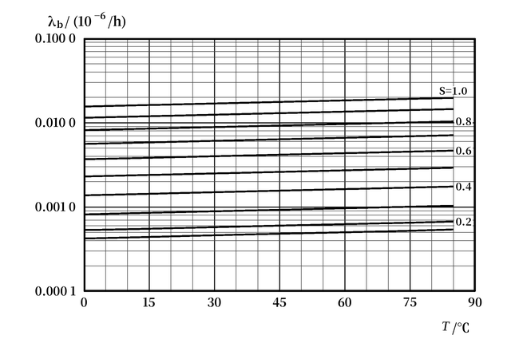

<strong>图 38 2 类瓷介电容器基本失效率曲线(额定温度为 85℃)</strong>

123

---

<strong>GJB/Z 299D—2024</strong>

<strong>表 222 基本失效率 <i>λ</i>b (额定温度为 125℃)</strong>

单位为 10−6/h

<table>
  <thead>
    <tr>
      <th rowspan="2"><i>T</i> ℃</th>
      <th colspan="10"><i>S</i></th>
    </tr>
    <tr>
      <th>0.1</th>
      <th>0.2</th>
      <th>0.3</th>
      <th>0.4</th>
      <th>0.5</th>
      <th>0.6</th>
      <th>0.7</th>
      <th>0.8</th>
      <th>0.9</th>
      <th>1.0</th>
    </tr>
  </thead>
  <tbody>
    <tr><td align="center">0</td><td align="center">0.000 39</td><td align="center">0.000 49</td><td align="center">0.000 75</td><td align="center">0.001 27</td><td align="center">0.002 12</td><td align="center">0.003 40</td><td align="center">0.005 17</td><td align="center">0.007 53</td><td align="center">0.010 56</td><td align="center">0.014 35</td></tr>
    <tr><td align="center">5</td><td align="center">0.000 40</td><td align="center">0.000 50</td><td align="center">0.000 76</td><td align="center">0.001 29</td><td align="center">0.002 15</td><td align="center">0.003 44</td><td align="center">0.005 24</td><td align="center">0.007 63</td><td align="center">0.010 70</td><td align="center">0.014 53</td></tr>
    <tr><td align="center">10</td><td align="center">0.000 40</td><td align="center">0.000 50</td><td align="center">0.000 77</td><td align="center">0.001 30</td><td align="center">0.002 18</td><td align="center">0.003 48</td><td align="center">0.005 30</td><td align="center">0.007 72</td><td align="center">0.010 83</td><td align="center">0.014 72</td></tr>
    <tr><td align="center">15</td><td align="center">0.000 41</td><td align="center">0.000 51</td><td align="center">0.000 78</td><td align="center">0.001 32</td><td align="center">0.002 21</td><td align="center">0.003 53</td><td align="center">0.005 37</td><td align="center">0.007 82</td><td align="center">0.010 97</td><td align="center">0.014 90</td></tr>
    <tr><td align="center">20</td><td align="center">0.000 41</td><td align="center">0.000 51</td><td align="center">0.000 79</td><td align="center">0.001 34</td><td align="center">0.002 23</td><td align="center">0.003 57</td><td align="center">0.005 44</td><td align="center">0.007 92</td><td align="center">0.011 11</td><td align="center">0.015 09</td></tr>
    <tr><td align="center">25</td><td align="center">0.000 42</td><td align="center">0.000 52</td><td align="center">0.000 80</td><td align="center">0.001 35</td><td align="center">0.002 26</td><td align="center">0.003 62</td><td align="center">0.005 51</td><td align="center">0.008 02</td><td align="center">0.011 25</td><td align="center">0.015 28</td></tr>
    <tr><td align="center">30</td><td align="center">0.000 42</td><td align="center">0.000 53</td><td align="center">0.000 81</td><td align="center">0.001 37</td><td align="center">0.002 29</td><td align="center">0.003 66</td><td align="center">0.005 57</td><td align="center">0.008 12</td><td align="center">0.011 39</td><td align="center">0.015 47</td></tr>
    <tr><td align="center">35</td><td align="center">0.000 43</td><td align="center">0.000 53</td><td align="center">0.000 82</td><td align="center">0.001 39</td><td align="center">0.002 32</td><td align="center">0.003 71</td><td align="center">0.005 65</td><td align="center">0.008 22</td><td align="center">0.011 53</td><td align="center">0.015 67</td></tr>
    <tr><td align="center">40</td><td align="center">0.000 43</td><td align="center">0.000 54</td><td align="center">0.000 83</td><td align="center">0.001 41</td><td align="center">0.002 35</td><td align="center">0.003 75</td><td align="center">0.005 72</td><td align="center">0.008 33</td><td align="center">0.011 68</td><td align="center">0.015 87</td></tr>
    <tr><td align="center">45</td><td align="center">0.000 44</td><td align="center">0.000 55</td><td align="center">0.000 84</td><td align="center">0.001 42</td><td align="center">0.002 38</td><td align="center">0.003 80</td><td align="center">0.005 79</td><td align="center">0.008 43</td><td align="center">0.011 83</td><td align="center">0.016 07</td></tr>
    <tr><td align="center">50</td><td align="center">0.000 44</td><td align="center">0.000 55</td><td align="center">0.000 86</td><td align="center">0.001 44</td><td align="center">0.002 41</td><td align="center">0.003 85</td><td align="center">0.005 86</td><td align="center">0.008 54</td><td align="center">0.011 98</td><td align="center">0.016 27</td></tr>
    <tr><td align="center">55</td><td align="center">0.000 45</td><td align="center">0.000 56</td><td align="center">0.000 87</td><td align="center">0.001 46</td><td align="center">0.002 44</td><td align="center">0.003 90</td><td align="center">0.005 94</td><td align="center">0.008 65</td><td align="center">0.012 13</td><td align="center">0.016 48</td></tr>
    <tr><td align="center">60</td><td align="center">0.000 45</td><td align="center">0.000 57</td><td align="center">0.000 88</td><td align="center">0.001 48</td><td align="center">0.002 47</td><td align="center">0.003 95</td><td align="center">0.006 01</td><td align="center">0.008 76</td><td align="center">0.012 28</td><td align="center">0.016 69</td></tr>
    <tr><td align="center">65</td><td align="center">0.000 46</td><td align="center">0.000 58</td><td align="center">0.000 89</td><td align="center">0.001 50</td><td align="center">0.002 50</td><td align="center">0.004 00</td><td align="center">0.006 09</td><td align="center">0.008 87</td><td align="center">0.012 44</td><td align="center">0.016 90</td></tr>
    <tr><td align="center">70</td><td align="center">0.000 47</td><td align="center">0.000 58</td><td align="center">0.000 90</td><td align="center">0.001 52</td><td align="center">0.002 53</td><td align="center">0.004 05</td><td align="center">0.006 16</td><td align="center">0.008 98</td><td align="center">0.012 59</td><td align="center">0.017 11</td></tr>
    <tr><td align="center">75</td><td align="center">0.000 47</td><td align="center">0.000 59</td><td align="center">0.000 91</td><td align="center">0.001 54</td><td align="center">0.002 56</td><td align="center">0.004 10</td><td align="center">0.006 24</td><td align="center">0.009 09</td><td align="center">0.012 75</td><td align="center">0.017 33</td></tr>
    <tr><td align="center">80</td><td align="center">0.000 48</td><td align="center">0.000 60</td><td align="center">0.000 92</td><td align="center">0.001 55</td><td align="center">0.002 60</td><td align="center">0.004 15</td><td align="center">0.006 32</td><td align="center">0.009 21</td><td align="center">0.012 92</td><td align="center">0.017 54</td></tr>
    <tr><td align="center">85</td><td align="center">0.000 48</td><td align="center">0.000 61</td><td align="center">0.000 93</td><td align="center">0.001 57</td><td align="center">0.002 63</td><td align="center">0.004 20</td><td align="center">0.006 40</td><td align="center">0.009 32</td><td align="center">0.013 08</td><td align="center">0.017 77</td></tr>
    <tr><td align="center">90</td><td align="center">0.000 49</td><td align="center">0.000 61</td><td align="center">0.000 95</td><td align="center">0.001 59</td><td align="center">0.002 66</td><td align="center">0.004 26</td><td align="center">0.006 48</td><td align="center">0.009 44</td><td align="center">0.013 24</td><td align="center">0.017 99</td></tr>
    <tr><td align="center">95</td><td align="center">0.000 50</td><td align="center">0.000 62</td><td align="center">0.000 96</td><td align="center">0.001 61</td><td align="center">0.002 70</td><td align="center">0.004 31</td><td align="center">0.006 56</td><td align="center">0.009 56</td><td align="center">0.013 41</td><td align="center">0.018 22</td></tr>
    <tr><td align="center">100</td><td align="center">0.000 50</td><td align="center">0.000 63</td><td align="center">0.000 97</td><td align="center">0.001 63</td><td align="center">0.002 73</td><td align="center">0.004 37</td><td align="center">0.006 65</td><td align="center">0.009 68</td><td align="center">0.013 58</td><td align="center">0.018 45</td></tr>
    <tr><td align="center">105</td><td align="center">0.000 51</td><td align="center">0.000 64</td><td align="center">0.000 98</td><td align="center">0.001 66</td><td align="center">0.002 77</td><td align="center">0.004 42</td><td align="center">0.006 73</td><td align="center">0.009 81</td><td align="center">0.013 75</td><td align="center">0.018 68</td></tr>
    <tr><td align="center">110</td><td align="center">0.000 52</td><td align="center">0.000 64</td><td align="center">0.000 99</td><td align="center">0.001 68</td><td align="center">0.002 80</td><td align="center">0.004 48</td><td align="center">0.006 82</td><td align="center">0.009 93</td><td align="center">0.013 93</td><td align="center">0.018 92</td></tr>
    <tr><td align="center">115</td><td align="center">0.000 52</td><td align="center">0.000 65</td><td align="center">0.001 01</td><td align="center">0.001 70</td><td align="center">0.002 84</td><td align="center">0.004 53</td><td align="center">0.006 90</td><td align="center">0.010 05</td><td align="center">0.014 10</td><td align="center">0.019 16</td></tr>
    <tr><td align="center">120</td><td align="center">0.000 53</td><td align="center">0.000 66</td><td align="center">0.001 02</td><td align="center">0.001 72</td><td align="center">0.002 87</td><td align="center">0.004 59</td><td align="center">0.006 99</td><td align="center">0.010 18</td><td align="center">0.014 28</td><td align="center">0.019 40</td></tr>
    <tr><td align="center">125</td><td align="center">0.000 54</td><td align="center">0.000 67</td><td align="center">0.001 03</td><td align="center">0.001 74</td><td align="center">0.002 91</td><td align="center">0.004 65</td><td align="center">0.007 08</td><td align="center">0.010 31</td><td align="center">0.014 46</td><td align="center">0.019 65</td></tr>
    <tr>
      <td colspan="11">注：<i>T</i> 为工作环境温度。 &emsp;&emsp;<i>S</i> 为实际工作电压与额定电压的比值。</td>
    </tr>
  </tbody>
</table>

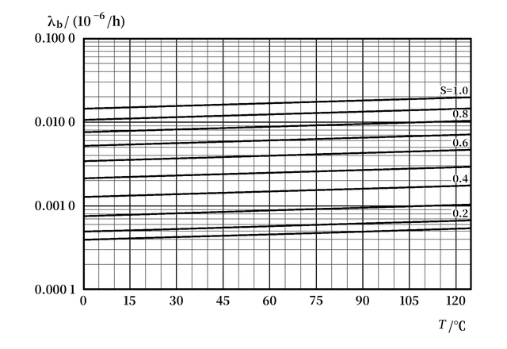

<strong>图 39 2 类瓷介电容器基本失效率曲线(额定温度为 125℃)</strong>

124

---

<strong>GJB/Z 299D—2024</strong>

<strong>表 223 环境系数 <i>π</i>E</strong>

<table>
  <tbody>
    <tr>
      <td align="center">环境</td>
      <td align="center">GB</td>
      <td align="center">GMS</td>
      <td align="center">GF1</td>
      <td align="center">GF2</td>
      <td align="center">GM1</td>
      <td align="center">GM2</td>
      <td align="center">MP</td>
      <td align="center">NSB</td>
      <td align="center">NS1</td>
      <td align="center">NS2</td>
    </tr>
    <tr>
      <td align="center"><i>π</i>E</td>
      <td align="center">1.0</td>
      <td align="center">1.2</td>
      <td align="center">2.8</td>
      <td align="center">4.6</td>
      <td align="center">5.1</td>
      <td align="center">8.1</td>
      <td align="center">7.0</td>
      <td align="center">4.9</td>
      <td align="center">2.9</td>
      <td align="center">5.7</td>
    </tr>
    <tr>
      <td align="center">环境</td>
      <td align="center">NU</td>
      <td align="center">AIF</td>
      <td align="center">AUF</td>
      <td align="center">AIC</td>
      <td align="center">AUC</td>
      <td align="center">ARW</td>
      <td align="center">SF</td>
      <td align="center">ML</td>
      <td align="center">MF</td>
      <td align="center">—</td>
    </tr>
    <tr>
      <td align="center"><i>π</i>E</td>
      <td align="center">9.1</td>
      <td align="center">7.7</td>
      <td align="center">14</td>
      <td align="center">6.0</td>
      <td align="center">10.2</td>
      <td align="center">12</td>
      <td align="center">1.0</td>
      <td align="center">17</td>
      <td align="center">8</td>
      <td align="center">—</td>
    </tr>
  </tbody>
</table>

<strong>表 224 质量等级与质量系数 <i>π</i>Q</strong>

<table>
  <thead>
    <tr>
      <th colspan="2">质量等级</th>
      <th>质量要求说明</th>
      <th>质量要求补充说明</th>
      <th><i>π</i>Q</th>
    </tr>
  </thead>
  <tbody>
    <tr>
      <td rowspan="5" align="center">A</td>
      <td align="center">A1S</td>
      <td>符合 GJB 192B—2011、GJB 924A—2012、GJB 6788—2009，且列入军用电子元器件合格产品目录(QPL)的 S 级产品 符合 GJB 4157A—2011，且列入军用电子元器件合格产品目录(QPL)的产品</td>
      <td>符合 GJB 192A—1998，且列入军用电子元器件合格产品目录(QPL)的 S 级产品 符合 GJB 924—1990、GJB 1940—1994，且列入军用电子元器件合格产品目录(QPL)的 B 级产品 符合 GJB 4157—2001，且列入军用电子元器件合格产品目录(QPL)的产品</td>
      <td align="center">—</td>
    </tr>
    <tr>
      <td align="center">A1R</td>
      <td>符合 GJB 192B—2011、GJB 924A—2012，且列入军用电子元器件合格产品目录(QPL)的 R 级产品</td>
      <td>符合 GJB 192A—1998，且列入军用电子元器件合格产品目录(QPL)的 R 级产品 符合 GJB 924—1990、GJB 1940—1994，且列入军用电子元器件合格产品目录(QPL)的 Q 级产品</td>
      <td align="center">—</td>
    </tr>
    <tr>
      <td align="center">A1P</td>
      <td>符合 GJB 192B—2011、GJB 924A—2012，且列入军用电子元器件合格产品目录(QPL)的 P 级产品 符合 GJB 4157A—2011，但未列入军用电子元器件合格产品目录(QPL)的产品</td>
      <td>符合 GJB 192A—1998，且列入军用电子元器件合格产品目录(QPL)的 P 级产品 符合 GJB 924—1990、GJB 1940—1994，且列入军用电子元器件合格产品目录(QPL)的 L 级产品 符合 GJB 4157—2001，但未列入军用电子元器件合格产品目录(QPL)的产品</td>
      <td align="center">0.03</td>
    </tr>
    <tr>
      <td align="center">A1M</td>
      <td>符合 GJB 192B—2011、GJB 924A—2012，且列入军用电子元器件合格产品目录(QPL)的 M 级产品 符合 GJB 6788—2009，且列入军用电子元器件合格产品目录(QPL)的 K 级产品 符合 GJB 1314—1991、GJB 1940A—2012，且列入军用电子元器件合格产品目录(QPL)的产品 符合企业军用标准，且列入军用电子元器件合格产品目录(QPL)的产品</td>
      <td>符合 GJB 192A—1998，且列入军用电子元器件合格产品目录(QPL)的 M 级产品 符合 GJB 924—1990、GJB 1940—1994，且列入军用电子元器件合格产品目录(QPL)的 W 级产品</td>
      <td align="center">0.10</td>
    </tr>
    <tr>
      <td align="center">A2</td>
      <td>符合 GJB 192B—2011、GJB 924—1990、GJB 1314—1991、GJB 1940A—2012，但未列入军用电子元器件合格产品目录(QPL)的产品 符合 GJB 6788—2009，但未列入军用电子元器件合格产品目录(QPL)的 K 级产品</td>
      <td>符合 GJB 192A—1998、GJB 1940—1994，但未列入军用电子元器件合格产品目录(QPL)的产品</td>
      <td align="center">0.2</td>
    </tr>
    <tr>
      <td rowspan="2" align="center">B</td>
      <td align="center">B1</td>
      <td colspan="2">按军用标准的筛选要求进行筛选的 B2 质量等级的产品</td>
      <td align="center">0.5</td>
    </tr>
    <tr>
      <td align="center">B2</td>
      <td colspan="2">符合 GB/T 2693、GB/T 5968、GB/T 9322 的产品</td>
      <td align="center">1.0</td>
    </tr>
    <tr>
      <td colspan="2" align="center">C</td>
      <td colspan="2">低档产品</td>
      <td align="center">5.0</td>
    </tr>
  </tbody>
</table>

<strong>表 225 电容量系数 <i>π</i>CV</strong>

<table>
  <thead>
    <tr>
      <th>电容量 <i>C</i></th>
      <th><i>π</i>CV</th>
    </tr>
  </thead>
  <tbody>
    <tr>
      <td align="center"><i>C</i> ≤ 240pF</td>
      <td align="center">0.50</td>
    </tr>
    <tr>
      <td align="center">240pF &lt; <i>C</i> ≤ 0.003 3μF</td>
      <td align="center">0.75</td>
    </tr>
    <tr>
      <td align="center">0.003 3μF &lt; <i>C</i> ≤ 0.016μF</td>
      <td align="center">1.0</td>
    </tr>
    <tr>
      <td align="center">0.016μF &lt; <i>C</i> ≤ 0.082μF</td>
      <td align="center">1.3</td>
    </tr>
    <tr>
      <td align="center">0.082μF &lt; <i>C</i> ≤ 0.27μF</td>
      <td align="center">1.6</td>
    </tr>
  </tbody>
</table>

125

---

<strong>GJB/Z 299D—2024</strong>

<strong>表 225(续)</strong>

<table>
  <thead>
    <tr>
      <th>电容量 <i>C</i></th>
      <th><i>π</i>CV</th>
    </tr>
  </thead>
  <tbody>
    <tr>
      <td align="center">0.27μF &lt; <i>C</i> ≤ 0.75μF</td>
      <td align="center">1.9</td>
    </tr>
    <tr>
      <td align="center">0.75μF &lt; <i>C</i> ≤ 1.8μF</td>
      <td align="center">2.2</td>
    </tr>
    <tr>
      <td align="center"><i>C</i> &gt; 1.8μF</td>
      <td align="center">2.4</td>
    </tr>
  </tbody>
</table>

#### 5.9.6 铝电解电容器

工作失效率预计模型见式(59)。

$$\lambda_{\text{P}} = \lambda_{\text{b}}\pi_{\text{E}}\pi_{\text{Q}}\pi_{\text{CV}}\pi_{\text{ch}} \tag{59}$$

式中：
$\lambda_{\text{P}}$ ——工作失效率，$10^{-6}/\text{h}$；
$\lambda_{\text{b}}$ ——基本失效率，$10^{-6}/\text{h}$，见表 226 和图 40；
$\pi_{\text{E}}$ ——环境系数，见表 227；
$\pi_{\text{Q}}$ ——质量系数，见表 228；
$\pi_{\text{CV}}$ ——电容量系数，见表 229；
$\pi_{\text{ch}}$ ——表面贴装系数，见表 204。

<strong>表 226 基本失效率 <i>λ</i>b</strong>

单位为 10−6/h

<table>
  <thead>
    <tr>
      <th rowspan="2"><i>T</i> ℃</th>
      <th colspan="10"><i>S</i></th>
    </tr>
    <tr>
      <th>0.1</th>
      <th>0.2</th>
      <th>0.3</th>
      <th>0.4</th>
      <th>0.5</th>
      <th>0.6</th>
      <th>0.7</th>
      <th>0.8</th>
      <th>0.9</th>
      <th>1.0</th>
    </tr>
  </thead>
  <tbody>
    <tr><td align="center">0</td><td align="center">0.011 6</td><td align="center">0.012 1</td><td align="center">0.013 4</td><td align="center">0.016 0</td><td align="center">0.020 2</td><td align="center">0.026 6</td><td align="center">0.035 4</td><td align="center">0.047 1</td><td align="center">0.062 2</td><td align="center">0.081 0</td></tr>
    <tr><td align="center">5</td><td align="center">0.012 8</td><td align="center">0.013 3</td><td align="center">0.014 7</td><td align="center">0.017 6</td><td align="center">0.022 2</td><td align="center">0.029 2</td><td align="center">0.038 8</td><td align="center">0.051 7</td><td align="center">0.068 3</td><td align="center">0.088 9</td></tr>
    <tr><td align="center">10</td><td align="center">0.014 1</td><td align="center">0.014 7</td><td align="center">0.016 3</td><td align="center">0.019 5</td><td align="center">0.024 6</td><td align="center">0.032 3</td><td align="center">0.043 0</td><td align="center">0.057 3</td><td align="center">0.075 6</td><td align="center">0.098 5</td></tr>
    <tr><td align="center">15</td><td align="center">0.015 8</td><td align="center">0.016 5</td><td align="center">0.018 3</td><td align="center">0.021 7</td><td align="center">0.027 5</td><td align="center">0.036 1</td><td align="center">0.048 1</td><td align="center">0.064 0</td><td align="center">0.084 5</td><td align="center">0.110 1</td></tr>
    <tr><td align="center">20</td><td align="center">0.017 8</td><td align="center">0.018 6</td><td align="center">0.020 6</td><td align="center">0.024 5</td><td align="center">0.031 0</td><td align="center">0.040 7</td><td align="center">0.054 3</td><td align="center">0.072 3</td><td align="center">0.095 4</td><td align="center">0.124 3</td></tr>
    <tr><td align="center">25</td><td align="center">0.020 3</td><td align="center">0.021 2</td><td align="center">0.023 5</td><td align="center">0.028 0</td><td align="center">0.035 4</td><td align="center">0.046 5</td><td align="center">0.061 9</td><td align="center">0.082 4</td><td align="center">0.108 8</td><td align="center">0.141 7</td></tr>
    <tr><td align="center">30</td><td align="center">0.023 5</td><td align="center">0.024 4</td><td align="center">0.027 1</td><td align="center">0.032 3</td><td align="center">0.040 9</td><td align="center">0.053 6</td><td align="center">0.071 4</td><td align="center">0.095 1</td><td align="center">0.125 5</td><td align="center">0.163 5</td></tr>
    <tr><td align="center">35</td><td align="center">0.027 4</td><td align="center">0.028 5</td><td align="center">0.031 7</td><td align="center">0.037 7</td><td align="center">0.047 7</td><td align="center">0.062 6</td><td align="center">0.083 4</td><td align="center">0.111 1</td><td align="center">0.146 6</td><td align="center">0.190 9</td></tr>
    <tr><td align="center">40</td><td align="center">0.032 4</td><td align="center">0.033 8</td><td align="center">0.037 4</td><td align="center">0.044 6</td><td align="center">0.056 4</td><td align="center">0.074 0</td><td align="center">0.098 6</td><td align="center">0.131 3</td><td align="center">0.173 4</td><td align="center">0.225 8</td></tr>
    <tr><td align="center">45</td><td align="center">0.038 9</td><td align="center">0.040 5</td><td align="center">0.044 9</td><td align="center">0.053 5</td><td align="center">0.067 6</td><td align="center">0.088 8</td><td align="center">0.118 2</td><td align="center">0.157 5</td><td align="center">0.207 9</td><td align="center">0.270 8</td></tr>
    <tr><td align="center">50</td><td align="center">0.047 3</td><td align="center">0.049 2</td><td align="center">0.054 6</td><td align="center">0.065 1</td><td align="center">0.082 3</td><td align="center">0.108 0</td><td align="center">0.143 9</td><td align="center">0.191 6</td><td align="center">0.252 9</td><td align="center">0.329 4</td></tr>
    <tr><td align="center">55</td><td align="center">0.058 4</td><td align="center">0.060 8</td><td align="center">0.067 5</td><td align="center">0.080 4</td><td align="center">0.101 7</td><td align="center">0.133 4</td><td align="center">0.177 7</td><td align="center">0.236 7</td><td align="center">0.312 4</td><td align="center">0.407 0</td></tr>
    <tr><td align="center">60</td><td align="center">0.073 3</td><td align="center">0.076 4</td><td align="center">0.084 7</td><td align="center">0.101 0</td><td align="center">0.127 7</td><td align="center">0.167 6</td><td align="center">0.223 2</td><td align="center">0.297 3</td><td align="center">0.392 4</td><td align="center">0.511 1</td></tr>
    <tr><td align="center">65</td><td align="center">0.093 7</td><td align="center">0.097 6</td><td align="center">0.108 3</td><td align="center">0.129 0</td><td align="center">0.163 2</td><td align="center">0.214 1</td><td align="center">0.285 2</td><td align="center">0.379 9</td><td align="center">0.501 4</td><td align="center">0.653 2</td></tr>
    <tr><td align="center">70</td><td align="center">0.122 0</td><td align="center">0.127 1</td><td align="center">0.141 0</td><td align="center">0.167 9</td><td align="center">0.212 4</td><td align="center">0.278 7</td><td align="center">0.371 3</td><td align="center">0.494 5</td><td align="center">0.652 7</td><td align="center">0.850 2</td></tr>
    <tr><td align="center">75</td><td align="center">0.162 0</td><td align="center">0.168 7</td><td align="center">0.187 1</td><td align="center">0.222 9</td><td align="center">0.281 9</td><td align="center">0.370 0</td><td align="center">0.492 9</td><td align="center">0.656 4</td><td align="center">0.866 4</td><td align="center">1.128 6</td></tr>
    <tr><td align="center">80</td><td align="center">0.219 5</td><td align="center">0.228 6</td><td align="center">0.253 5</td><td align="center">0.302 1</td><td align="center">0.382 0</td><td align="center">0.501 4</td><td align="center">0.667 9</td><td align="center">0.889 5</td><td align="center">1.174 0</td><td align="center">1.529 3</td></tr>
    <tr><td align="center">85</td><td align="center">0.304 0</td><td align="center">0.316 7</td><td align="center">0.351 2</td><td align="center">0.418 4</td><td align="center">0.529 1</td><td align="center">0.694 4</td><td align="center">0.925 0</td><td align="center">1.231 9</td><td align="center">1.626 0</td><td align="center">2.118 1</td></tr>
    <tr>
      <td colspan="11">注：<i>T</i> 为工作环境温度。 &emsp;&emsp;<i>S</i> 为实际工作电压与额定电压的比值。</td>
    </tr>
  </tbody>
</table>

126

---

<strong>GJB/Z 299D—2024</strong>

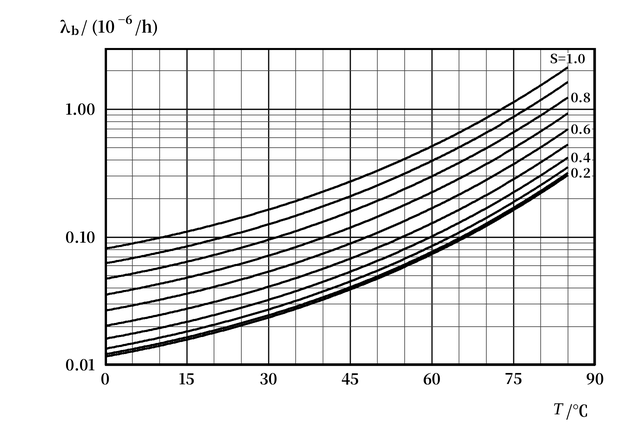

<strong>图 40 铝电解电容器基本失效率曲线</strong>

<strong>表 227 环境系数 <i>π</i>E</strong>

<table>
  <tbody>
    <tr>
      <td align="center">环境</td>
      <td align="center">GB</td>
      <td align="center">GMS</td>
      <td align="center">GF1</td>
      <td align="center">GF2</td>
      <td align="center">GM1</td>
      <td align="center">GM2</td>
      <td align="center">MP</td>
      <td align="center">NSB</td>
      <td align="center">NS1</td>
      <td align="center">NS2</td>
    </tr>
    <tr>
      <td align="center"><i>π</i>E</td>
      <td align="center">1.0</td>
      <td align="center">1.2</td>
      <td align="center">2.4</td>
      <td align="center">4.0</td>
      <td align="center">4.2</td>
      <td align="center">10.4</td>
      <td align="center">9.0</td>
      <td align="center">5.1</td>
      <td align="center">3.0</td>
      <td align="center">6.1</td>
    </tr>
    <tr>
      <td align="center">环境</td>
      <td align="center">NU</td>
      <td align="center">AIF</td>
      <td align="center">AUF</td>
      <td align="center">AIC</td>
      <td align="center">AUC</td>
      <td align="center">ARW</td>
      <td align="center">SF</td>
      <td align="center">ML</td>
      <td align="center">MF</td>
      <td align="center">—</td>
    </tr>
    <tr>
      <td align="center"><i>π</i>E</td>
      <td align="center">12.7</td>
      <td align="center">11.8</td>
      <td align="center">21</td>
      <td align="center">9.0</td>
      <td align="center">15</td>
      <td align="center">18</td>
      <td align="center">1.0</td>
      <td align="center">21</td>
      <td align="center">10</td>
      <td align="center">—</td>
    </tr>
  </tbody>
</table>

<strong>表 228 质量等级与质量系数 <i>π</i>Q</strong>

<table>
  <thead>
    <tr>
      <th colspan="2">质量等级</th>
      <th>质量要求说明</th>
      <th>质量要求补充说明</th>
      <th><i>π</i>Q</th>
    </tr>
  </thead>
  <tbody>
    <tr>
      <td rowspan="5" align="center">A</td>
      <td align="center">A1S</td>
      <td>符合 GJB 603A—2011，且列入军用电子元器件合格产品目录(QPL)的 S 级产品</td>
      <td>符合 GJB 603—1988，且列入军用电子元器件合格产品目录(QPL)的 B 级产品</td>
      <td align="center">—</td>
    </tr>
    <tr>
      <td align="center">A1R</td>
      <td>符合 GJB 603A—2011，且列入军用电子元器件合格产品目录(QPL)的 R 级产品</td>
      <td>符合 GJB 603—1988，且列入军用电子元器件合格产品目录(QPL)的 Q 级产品</td>
      <td align="center">—</td>
    </tr>
    <tr>
      <td align="center">A1P</td>
      <td>符合 GJB 603A—2011，且列入军用电子元器件合格产品目录(QPL)的 P 级产品</td>
      <td>符合 GJB 603—1988，且列入军用电子元器件合格产品目录(QPL)的 L 级产品</td>
      <td align="center">0.03</td>
    </tr>
    <tr>
      <td align="center">A1M</td>
      <td>符合 GJB 603A—2011，且列入军用电子元器件合格产品目录(QPL)的 M 级产品 符合 GJB 3516—1999，且列入军用电子元器件合格产品目录(QPL)的产品 符合企业军用标准，且列入军用电子元器件合格产品目录(QPL)的产品</td>
      <td>符合 GJB 603—1988，且列入军用电子元器件合格产品目录(QPL)的 W 级产品</td>
      <td align="center">0.1</td>
    </tr>
    <tr>
      <td align="center">A2</td>
      <td>符合 GJB 603A—2011、GJB 3516—1999，但未列入军用电子元器件合格产品目录(QPL)的产品</td>
      <td>符合 GJB 603—1988，但未列入军用电子元器件合格产品目录(QPL)的产品</td>
      <td align="center">0.2</td>
    </tr>
    <tr>
      <td rowspan="2" align="center">B</td>
      <td align="center">B1</td>
      <td colspan="2">按军用标准筛选的要求进行筛选的 B2 质量等级的产品</td>
      <td align="center">0.5</td>
    </tr>
    <tr>
      <td align="center">B2</td>
      <td colspan="2">符合 GB/T 2693、GB/T 5993 的产品</td>
      <td align="center">1.0</td>
    </tr>
    <tr>
      <td colspan="2" align="center">C</td>
      <td colspan="2">低档产品</td>
      <td align="center">5.0</td>
    </tr>
  </tbody>
</table>

<strong>表 229 电容量系数 <i>π</i>CV</strong>

<table>
  <thead>
    <tr>
      <th>电容量 <i>C</i> μF</th>
      <th><i>π</i>CV</th>
    </tr>
  </thead>
  <tbody>
    <tr>
      <td align="center"><i>C</i> ≤ 1</td>
      <td align="center">0.40</td>
    </tr>
    <tr>
      <td align="center">1 &lt; <i>C</i> ≤ 20</td>
      <td align="center">0.70</td>
    </tr>
  </tbody>
</table>

127

---

<strong>GJB/Z 299D—2024</strong>

<strong>表 229(续)</strong>

<table>
  <thead>
    <tr>
      <th>电容量 <i>C</i> μF</th>
      <th><i>π</i>CV</th>
    </tr>
  </thead>
  <tbody>
    <tr>
      <td align="center">20 &lt; <i>C</i> ≤ 100</td>
      <td align="center">1.0</td>
    </tr>
    <tr>
      <td align="center">100 &lt; <i>C</i> ≤ 470</td>
      <td align="center">1.3</td>
    </tr>
    <tr>
      <td align="center">470 &lt; <i>C</i> ≤ 1 500</td>
      <td align="center">1.6</td>
    </tr>
    <tr>
      <td align="center">1 500 &lt; <i>C</i> ≤ 3 000</td>
      <td align="center">1.9</td>
    </tr>
    <tr>
      <td align="center">3 000 &lt; <i>C</i> ≤ 6 800</td>
      <td align="center">2.2</td>
    </tr>
    <tr>
      <td align="center">6 800 &lt; <i>C</i> ≤ 10 000</td>
      <td align="center">2.5</td>
    </tr>
    <tr>
      <td align="center">10 000 &lt; <i>C</i> ≤ 20 000</td>
      <td align="center">2.8</td>
    </tr>
    <tr>
      <td align="center"><i>C</i> &gt; 20 000</td>
      <td align="center">3.0</td>
    </tr>
  </tbody>
</table>

#### 5.9.7 固体钽电解电容器

工作失效率预计模型见式(60)。

$$\lambda_{\text{P}} = \lambda_{\text{b}}\pi_{\text{E}}\pi_{\text{Q}}\pi_{\text{CV}}\pi_{\text{SR}}\pi_{\text{ch}} \tag{60}$$

式中：
$\lambda_{\text{P}}$ ——工作失效率，$10^{-6}/\text{h}$；
$\lambda_{\text{b}}$ ——基本失效率，$10^{-6}/\text{h}$，见表 230 和图 41；
$\pi_{\text{E}}$ ——环境系数，见表 231；
$\pi_{\text{Q}}$ ——质量系数，见表 232；
$\pi_{\text{CV}}$ ——电容量系数，见表 233；
$\pi_{\text{SR}}$ ——串联电阻系数，见表 234；
$\pi_{\text{ch}}$ ——表面贴装系数，见表 204。

<strong>表 230 基本失效率 <i>λ</i>b</strong>

单位为 10−6/h

<table>
  <thead>
    <tr>
      <th rowspan="2"><i>T</i> ℃</th>
      <th colspan="10"><i>S</i></th>
    </tr>
    <tr>
      <th>0.1</th>
      <th>0.2</th>
      <th>0.3</th>
      <th>0.4</th>
      <th>0.5</th>
      <th>0.6</th>
      <th>0.7</th>
      <th>0.8</th>
      <th>0.9</th>
      <th>1.0</th>
    </tr>
  </thead>
  <tbody>
    <tr><td align="center">0</td><td align="center">0.001 7</td><td align="center">0.001 9</td><td align="center">0.002 4</td><td align="center">0.003 4</td><td align="center">0.005 0</td><td align="center">0.007 4</td><td align="center">0.010 8</td><td align="center">0.015 3</td><td align="center">0.021 1</td><td align="center">0.028 3</td></tr>
    <tr><td align="center">5</td><td align="center">0.001 8</td><td align="center">0.002 0</td><td align="center">0.002 5</td><td align="center">0.003 5</td><td align="center">0.005 2</td><td align="center">0.007 7</td><td align="center">0.011 3</td><td align="center">0.015 9</td><td align="center">0.021 9</td><td align="center">0.029 4</td></tr>
    <tr><td align="center">10</td><td align="center">0.001 9</td><td align="center">0.002 1</td><td align="center">0.002 6</td><td align="center">0.003 7</td><td align="center">0.005 5</td><td align="center">0.008 1</td><td align="center">0.011 8</td><td align="center">0.016 7</td><td align="center">0.023 0</td><td align="center">0.030 8</td></tr>
    <tr><td align="center">15</td><td align="center">0.002 0</td><td align="center">0.002 2</td><td align="center">0.002 8</td><td align="center">0.003 9</td><td align="center">0.005 8</td><td align="center">0.008 6</td><td align="center">0.012 4</td><td align="center">0.017 6</td><td align="center">0.024 2</td><td align="center">0.032 5</td></tr>
    <tr><td align="center">20</td><td align="center">0.002 1</td><td align="center">0.002 3</td><td align="center">0.003 0</td><td align="center">0.004 2</td><td align="center">0.006 1</td><td align="center">0.009 1</td><td align="center">0.013 2</td><td align="center">0.018 7</td><td align="center">0.025 8</td><td align="center">0.034 6</td></tr>
    <tr><td align="center">25</td><td align="center">0.002 3</td><td align="center">0.002 5</td><td align="center">0.003 2</td><td align="center">0.004 5</td><td align="center">0.006 6</td><td align="center">0.009 8</td><td align="center">0.014 2</td><td align="center">0.020 1</td><td align="center">0.027 6</td><td align="center">0.037 1</td></tr>
    <tr><td align="center">30</td><td align="center">0.002 5</td><td align="center">0.002 7</td><td align="center">0.003 4</td><td align="center">0.004 8</td><td align="center">0.007 1</td><td align="center">0.010 6</td><td align="center">0.015 4</td><td align="center">0.021 8</td><td align="center">0.030 0</td><td align="center">0.040 2</td></tr>
    <tr><td align="center">35</td><td align="center">0.002 7</td><td align="center">0.003 0</td><td align="center">0.003 8</td><td align="center">0.005 3</td><td align="center">0.007 8</td><td align="center">0.011 6</td><td align="center">0.016 9</td><td align="center">0.023 9</td><td align="center">0.032 9</td><td align="center">0.044 1</td></tr>
    <tr><td align="center">40</td><td align="center">0.003 0</td><td align="center">0.003 3</td><td align="center">0.004 2</td><td align="center">0.005 9</td><td align="center">0.008 7</td><td align="center">0.012 9</td><td align="center">0.018 7</td><td align="center">0.026 5</td><td align="center">0.036 5</td><td align="center">0.048 9</td></tr>
    <tr><td align="center">45</td><td align="center">0.003 4</td><td align="center">0.003 7</td><td align="center">0.004 7</td><td align="center">0.006 6</td><td align="center">0.009 8</td><td align="center">0.014 5</td><td align="center">0.021 1</td><td align="center">0.029 8</td><td align="center">0.041 1</td><td align="center">0.055 1</td></tr>
    <tr><td align="center">50</td><td align="center">0.003 9</td><td align="center">0.004 3</td><td align="center">0.005 4</td><td align="center">0.007 6</td><td align="center">0.011 2</td><td align="center">0.016 6</td><td align="center">0.024 1</td><td align="center">0.034 2</td><td align="center">0.047 0</td><td align="center">0.063 1</td></tr>
    <tr><td align="center">55</td><td align="center">0.004 5</td><td align="center">0.005 0</td><td align="center">0.006 3</td><td align="center">0.008 8</td><td align="center">0.013 1</td><td align="center">0.019 3</td><td align="center">0.028 1</td><td align="center">0.039 8</td><td align="center">0.054 8</td><td align="center">0.073 5</td></tr>
    <tr><td align="center">60</td><td align="center">0.005 3</td><td align="center">0.005 9</td><td align="center">0.007 5</td><td align="center">0.010 5</td><td align="center">0.015 5</td><td align="center">0.023 0</td><td align="center">0.033 4</td><td align="center">0.047 3</td><td align="center">0.065 1</td><td align="center">0.087 3</td></tr>
    <tr><td align="center">65</td><td align="center">0.006 5</td><td align="center">0.007 2</td><td align="center">0.009 1</td><td align="center">0.012 8</td><td align="center">0.018 8</td><td align="center">0.027 9</td><td align="center">0.040 6</td><td align="center">0.057 4</td><td align="center">0.079 1</td><td align="center">0.106 1</td></tr>
    <tr><td align="center">70</td><td align="center">0.008 1</td><td align="center">0.008 9</td><td align="center">0.011 3</td><td align="center">0.015 9</td><td align="center">0.023 5</td><td align="center">0.034 8</td><td align="center">0.050 5</td><td align="center">0.071 5</td><td align="center">0.098 4</td><td align="center">0.132 1</td></tr>
    <tr><td align="center">75</td><td align="center">0.010 3</td><td align="center">0.011 4</td><td align="center">0.014 4</td><td align="center">0.020 3</td><td align="center">0.030 0</td><td align="center">0.044 5</td><td align="center">0.064 6</td><td align="center">0.091 4</td><td align="center">0.125 9</td><td align="center">0.168 9</td></tr>
  </tbody>
</table>

128

---

<strong>GJB/Z 299D—2024</strong>

<strong>表 230(续)</strong>

单位为 10−6/h

<table>
  <thead>
    <tr>
      <th rowspan="2"><i>T</i> ℃</th>
      <th colspan="10"><i>S</i></th>
    </tr>
    <tr>
      <th>0.1</th>
      <th>0.2</th>
      <th>0.3</th>
      <th>0.4</th>
      <th>0.5</th>
      <th>0.6</th>
      <th>0.7</th>
      <th>0.8</th>
      <th>0.9</th>
      <th>1.0</th>
    </tr>
  </thead>
  <tbody>
    <tr>
      <td align="center">80</td>
      <td align="center">0.013 6</td>
      <td align="center">0.015 1</td>
      <td align="center">0.019 0</td>
      <td align="center">0.026 8</td>
      <td align="center">0.039 5</td>
      <td align="center">0.058 6</td>
      <td align="center">0.085 2</td>
      <td align="center">0.120 5</td>
      <td align="center">0.165 9</td>
      <td align="center">0.222 6</td>
    </tr>
    <tr>
      <td align="center">85</td>
      <td align="center">0.018 5</td>
      <td align="center">0.020 5</td>
      <td align="center">0.025 9</td>
      <td align="center">0.036 5</td>
      <td align="center">0.053 9</td>
      <td align="center">0.079 8</td>
      <td align="center">0.116 0</td>
      <td align="center">—</td>
      <td align="center">—</td>
      <td align="center">—</td>
    </tr>
    <tr>
      <td align="center">90</td>
      <td align="center">0.026 2</td>
      <td align="center">0.029 0</td>
      <td align="center">0.036 6</td>
      <td align="center">0.051 5</td>
      <td align="center">0.076 1</td>
      <td align="center">0.112 8</td>
      <td align="center">0.163 9</td>
      <td align="center">—</td>
      <td align="center">—</td>
      <td align="center">—</td>
    </tr>
    <tr>
      <td align="center">95</td>
      <td align="center">0.038 5</td>
      <td align="center">0.042 7</td>
      <td align="center">0.053 9</td>
      <td align="center">0.075 8</td>
      <td align="center">0.112 0</td>
      <td align="center">0.165 9</td>
      <td align="center">—</td>
      <td align="center">—</td>
      <td align="center">—</td>
      <td align="center">—</td>
    </tr>
    <tr>
      <td align="center">100</td>
      <td align="center">0.059 2</td>
      <td align="center">0.065 6</td>
      <td align="center">0.082 9</td>
      <td align="center">0.116 6</td>
      <td align="center">0.172 2</td>
      <td align="center">0.255 0</td>
      <td align="center">—</td>
      <td align="center">—</td>
      <td align="center">—</td>
      <td align="center">—</td>
    </tr>
    <tr>
      <td align="center">105</td>
      <td align="center">0.095 6</td>
      <td align="center">0.105 9</td>
      <td align="center">0.133 8</td>
      <td align="center">0.188 2</td>
      <td align="center">0.277 9</td>
      <td align="center">—</td>
      <td align="center">—</td>
      <td align="center">—</td>
      <td align="center">—</td>
      <td align="center">—</td>
    </tr>
    <tr>
      <td align="center">110</td>
      <td align="center">0.162 8</td>
      <td align="center">0.180 3</td>
      <td align="center">0.227 9</td>
      <td align="center">0.320 6</td>
      <td align="center">—</td>
      <td align="center">—</td>
      <td align="center">—</td>
      <td align="center">—</td>
      <td align="center">—</td>
      <td align="center">—</td>
    </tr>
    <tr>
      <td align="center">115</td>
      <td align="center">0.294 0</td>
      <td align="center">0.325 6</td>
      <td align="center">0.411 5</td>
      <td align="center">—</td>
      <td align="center">—</td>
      <td align="center">—</td>
      <td align="center">—</td>
      <td align="center">—</td>
      <td align="center">—</td>
      <td align="center">—</td>
    </tr>
    <tr>
      <td align="center">120</td>
      <td align="center">0.566 0</td>
      <td align="center">0.627 0</td>
      <td align="center">—</td>
      <td align="center">—</td>
      <td align="center">—</td>
      <td align="center">—</td>
      <td align="center">—</td>
      <td align="center">—</td>
      <td align="center">—</td>
      <td align="center">—</td>
    </tr>
    <tr>
      <td align="center">125</td>
      <td align="center">1.169 2</td>
      <td align="center">—</td>
      <td align="center">—</td>
      <td align="center">—</td>
      <td align="center">—</td>
      <td align="center">—</td>
      <td align="center">—</td>
      <td align="center">—</td>
      <td align="center">—</td>
      <td align="center">—</td>
    </tr>
    <tr>
      <td colspan="11">注：<i>T</i> 为工作环境温度。 　　<i>S</i> 为实际工作电压与额定电压的比值。</td>
    </tr>
  </tbody>
</table>

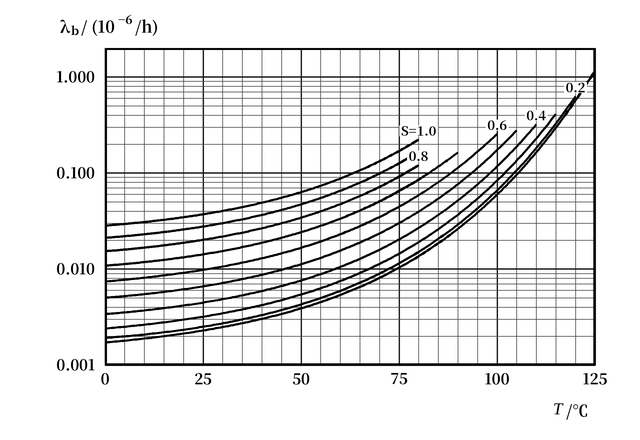

<strong>图 41 固体钽电解电容器基本失效率曲线</strong>

<strong>表 231 环境系数 <i>π</i>E</strong>

<table>
  <tbody>
    <tr>
      <td align="center">环境</td>
      <td align="center">GB</td>
      <td align="center">GMS</td>
      <td align="center">GF1</td>
      <td align="center">GF2</td>
      <td align="center">GM1</td>
      <td align="center">GM2</td>
      <td align="center">MP</td>
      <td align="center">NSB</td>
      <td align="center">NS1</td>
      <td align="center">NS2</td>
    </tr>
    <tr>
      <td align="center"><i>π</i>E</td>
      <td align="center">1.0</td>
      <td align="center">1.2</td>
      <td align="center">2.4</td>
      <td align="center">3.5</td>
      <td align="center">3.5</td>
      <td align="center">6.5</td>
      <td align="center">6.0</td>
      <td align="center">3.8</td>
      <td align="center">2.3</td>
      <td align="center">4.5</td>
    </tr>
    <tr>
      <td align="center">环境</td>
      <td align="center">NU</td>
      <td align="center">AIF</td>
      <td align="center">AUF</td>
      <td align="center">AIC</td>
      <td align="center">AUC</td>
      <td align="center">ARW</td>
      <td align="center">SF</td>
      <td align="center">ML</td>
      <td align="center">MF</td>
      <td align="center">—</td>
    </tr>
    <tr>
      <td align="center"><i>π</i>E</td>
      <td align="center">8.5</td>
      <td align="center">8.3</td>
      <td align="center">15</td>
      <td align="center">5.5</td>
      <td align="center">8.0</td>
      <td align="center">12</td>
      <td align="center">1.0</td>
      <td align="center">19</td>
      <td align="center">9</td>
      <td align="center">—</td>
    </tr>
  </tbody>
</table>

<strong>表 232 质量等级与质量系数 <i>π</i>Q</strong>

<table>
  <thead>
    <tr>
      <th colspan="2">质量等级</th>
      <th>质量要求说明</th>
      <th>质量要求补充说明</th>
      <th><i>π</i>Q</th>
    </tr>
  </thead>
  <tbody>
    <tr>
      <td rowspan="3" align="center">A</td>
      <td align="center">A1T</td>
      <td>符合 GJB 2283A—2014，且列入军用电子元器件合格产品目录（QPL）的 T 级产品</td>
      <td align="center">—</td>
      <td align="center">—</td>
    </tr>
    <tr>
      <td align="center">A1S</td>
      <td>符合 GJB 63B—2001、GJB 2283A—2014、GJB 5437—2005，且列入军用电子元器件合格产品目录（QPL）的 S 级产品</td>
      <td>符合 GJB 2283—1995，且列入军用电子元器件合格产品目录（QPL）的 S 级产品 符合 GJB 63A—1991，且列入军用电子元器件合格产品目录（QPL）的 B 级产品</td>
      <td align="center">—</td>
    </tr>
    <tr>
      <td align="center">A1R</td>
      <td>符合 GJB 63B—2001、GJB 2283A—2014、GJB 5437—2005，且列入军用电子元器件合格产品目录（QPL）的 R 级产品</td>
      <td>符合 GJB 2283—1995，且列入军用电子元器件合格产品目录（QPL）的 R 级产品 符合 GJB 63A—1991，且列入军用电子元器件合格产品目录（QPL）的 Q 级产品</td>
      <td align="center">—</td>
    </tr>
  </tbody>
</table>

129

---

<strong>GJB/Z 299D—2024</strong>

<strong>表 232(续)</strong>

<table>
  <thead>
    <tr>
      <th colspan="2">质量等级</th>
      <th>质量要求说明</th>
      <th>质量要求补充说明</th>
      <th><i>π</i>Q</th>
    </tr>
  </thead>
  <tbody>
    <tr>
      <td rowspan="3" align="center">A</td>
      <td align="center">A1P</td>
      <td>符合 GJB 63B—2001、GJB 2283A—2014、GJB 5437—2005，且列入军用电子元器件合格产品目录（QPL）的 P 级产品</td>
      <td>符合 GJB 2283—1995，且列入军用电子元器件合格产品目录（QPL）的 P 级产品 符合 GJB 63A—1991，且列入军用电子元器件合格产品目录（QPL）的 L 级产品</td>
      <td align="center">0.03</td>
    </tr>
    <tr>
      <td align="center">A1M</td>
      <td>符合 GJB 63B—2001、GJB 2283A—2014、GJB 5437—2005，且列入军用电子元器件合格产品目录（QPL）的 M 级产品 符合 GJB 1520—1992，且列入军用电子元器件合格产品目录（QPL）的产品 符合企业军用标准，且列入军用电子元器件合格产品目录（QPL）的产品</td>
      <td>符合 GJB 2283—1995，且列入军用电子元器件合格产品目录（QPL）的 M 级产品 符合 GJB 63A—1991，且列入军用电子元器件合格产品目录（QPL）的 W 级产品</td>
      <td align="center">0.1</td>
    </tr>
    <tr>
      <td align="center">A2</td>
      <td>符合 GJB 63B—2001、GJB 1520—1992、GJB 2283A—2014、GJB 5437—2005，但未列入军用电子元器件合格产品目录（QPL）的产品</td>
      <td>符合 GJB 63A—1991、GJB 2283—1995，但未列入军用电子元器件合格产品目录（QPL）的产品</td>
      <td align="center">0.2</td>
    </tr>
    <tr>
      <td rowspan="2" align="center">B</td>
      <td align="center">B1</td>
      <td colspan="2">按军用标准的筛选要求进行筛选的 B2 质量等级的产品</td>
      <td align="center">0.5</td>
    </tr>
    <tr>
      <td align="center">B2</td>
      <td colspan="2">符合 GB/T 2693、GB/T 7213、GB/T 14121 的产品</td>
      <td align="center">1.0</td>
    </tr>
    <tr>
      <td colspan="2" align="center">C</td>
      <td colspan="2">低档产品</td>
      <td align="center">5.0</td>
    </tr>
  </tbody>
</table>

<strong>表 233 电容量系数 <i>π</i>CV</strong>

<table>
  <thead>
    <tr>
      <th>电容量 <i>C</i> μF</th>
      <th><i>π</i>CV</th>
    </tr>
  </thead>
  <tbody>
    <tr>
      <td align="center"><i>C</i> ≤ 0.47</td>
      <td align="center">0.50</td>
    </tr>
    <tr>
      <td align="center">0.47 &lt; <i>C</i> ≤ 3.3</td>
      <td align="center">0.75</td>
    </tr>
    <tr>
      <td align="center">3.3 &lt; <i>C</i> ≤ 15</td>
      <td align="center">1.0</td>
    </tr>
    <tr>
      <td align="center">15 &lt; <i>C</i> ≤ 47</td>
      <td align="center">1.3</td>
    </tr>
    <tr>
      <td align="center">47 &lt; <i>C</i> ≤ 100</td>
      <td align="center">1.6</td>
    </tr>
    <tr>
      <td align="center">100 &lt; <i>C</i> ≤ 220</td>
      <td align="center">1.9</td>
    </tr>
    <tr>
      <td align="center">220 &lt; <i>C</i> ≤ 500</td>
      <td align="center">2.2</td>
    </tr>
    <tr>
      <td align="center"><i>C</i> &gt; 500</td>
      <td align="center">2.6</td>
    </tr>
  </tbody>
</table>

<strong>表 234 串联电阻系数 <i>π</i>SR</strong>

<table>
  <thead>
    <tr>
      <th>串联电阻 <i>R</i> Ω/V</th>
      <th><i>π</i>SR</th>
    </tr>
  </thead>
  <tbody>
    <tr>
      <td align="center">3.0 ≤ <i>R</i></td>
      <td align="center">0.07</td>
    </tr>
    <tr>
      <td align="center">2.0 ≤ <i>R</i> &lt; 3</td>
      <td align="center">0.1</td>
    </tr>
    <tr>
      <td align="center">1.0 ≤ <i>R</i> &lt; 2</td>
      <td align="center">0.2</td>
    </tr>
    <tr>
      <td align="center">0.8 ≤ <i>R</i> &lt; 1</td>
      <td align="center">0.3</td>
    </tr>
    <tr>
      <td align="center">0.6 ≤ <i>R</i> &lt; 0.8</td>
      <td align="center">0.4</td>
    </tr>
    <tr>
      <td align="center">0.4 ≤ <i>R</i> &lt; 0.6</td>
      <td align="center">0.6</td>
    </tr>
    <tr>
      <td align="center">0.2 ≤ <i>R</i> &lt; 0.4</td>
      <td align="center">0.8</td>
    </tr>
    <tr>
      <td align="center"><i>R</i> &lt; 0.2</td>
      <td align="center">1.0</td>
    </tr>
    <tr>
      <td colspan="2">注：串联电阻 <i>R</i> 是电容器与电源之间的回路电阻除以电容器的工作电压。</td>
    </tr>
  </tbody>
</table>

130

---

<strong>GJB/Z 299D—2024</strong>

#### 5.9.8 非固体钽电解电容器

工作失效率预计模型见式(61)。

$$\lambda_{\text{p}} = \lambda_{\text{b}}\pi_{\text{E}}\pi_{\text{Q}}\pi_{\text{CV}} \tag{61}$$

式中：
$\lambda_{\text{p}}$ ——工作失效率，$10^{-6}/\text{h}$；
$\lambda_{\text{b}}$ ——基本失效率，$10^{-6}/\text{h}$，见表 235 和图 42；
$\pi_{\text{E}}$ ——环境系数，见表 236；
$\pi_{\text{Q}}$ ——质量系数，见表 237；
$\pi_{\text{CV}}$ ——电容量系数，见表 238。

<strong>表 235 基本失效率 <i>λ</i>b</strong>

单位为 10−6/h

<table>
  <thead>
    <tr>
      <th rowspan="2"><i>T</i> ℃</th>
      <th colspan="10"><i>S</i></th>
    </tr>
    <tr>
      <th>0.1</th>
      <th>0.2</th>
      <th>0.3</th>
      <th>0.4</th>
      <th>0.5</th>
      <th>0.6</th>
      <th>0.7</th>
      <th>0.8</th>
      <th>0.9</th>
      <th>1.0</th>
    </tr>
  </thead>
  <tbody>
    <tr>
      <td align="center">0</td>
      <td align="center">0.004 5</td>
      <td align="center">0.005 0</td>
      <td align="center">0.006 3</td>
      <td align="center">0.008 8</td>
      <td align="center">0.013 1</td>
      <td align="center">0.019 3</td>
      <td align="center">0.028 1</td>
      <td align="center">0.039 8</td>
      <td align="center">0.054 8</td>
      <td align="center">0.073 5</td>
    </tr>
    <tr>
      <td align="center">5</td>
      <td align="center">0.004 7</td>
      <td align="center">0.005 2</td>
      <td align="center">0.006 5</td>
      <td align="center">0.009 2</td>
      <td align="center">0.013 6</td>
      <td align="center">0.020 1</td>
      <td align="center">0.029 3</td>
      <td align="center">0.041 4</td>
      <td align="center">0.057 0</td>
      <td align="center">0.076 5</td>
    </tr>
    <tr>
      <td align="center">10</td>
      <td align="center">0.004 9</td>
      <td align="center">0.005 4</td>
      <td align="center">0.006 9</td>
      <td align="center">0.009 6</td>
      <td align="center">0.014 2</td>
      <td align="center">0.021 1</td>
      <td align="center">0.030 7</td>
      <td align="center">0.043 4</td>
      <td align="center">0.059 8</td>
      <td align="center">0.080 2</td>
    </tr>
    <tr>
      <td align="center">15</td>
      <td align="center">0.005 2</td>
      <td align="center">0.005 7</td>
      <td align="center">0.007 2</td>
      <td align="center">0.010 2</td>
      <td align="center">0.015 0</td>
      <td align="center">0.022 3</td>
      <td align="center">0.032 4</td>
      <td align="center">0.045 8</td>
      <td align="center">0.063 0</td>
      <td align="center">0.084 6</td>
    </tr>
    <tr>
      <td align="center">20</td>
      <td align="center">0.005 5</td>
      <td align="center">0.006 1</td>
      <td align="center">0.007 7</td>
      <td align="center">0.010 8</td>
      <td align="center">0.016 0</td>
      <td align="center">0.023 7</td>
      <td align="center">0.034 4</td>
      <td align="center">0.048 7</td>
      <td align="center">0.067 0</td>
      <td align="center">0.090 0</td>
    </tr>
    <tr>
      <td align="center">25</td>
      <td align="center">0.005 9</td>
      <td align="center">0.006 5</td>
      <td align="center">0.008 3</td>
      <td align="center">0.011 6</td>
      <td align="center">0.017 1</td>
      <td align="center">0.025 4</td>
      <td align="center">0.036 9</td>
      <td align="center">0.052 3</td>
      <td align="center">0.071 9</td>
      <td align="center">0.096 5</td>
    </tr>
    <tr>
      <td align="center">30</td>
      <td align="center">0.006 4</td>
      <td align="center">0.007 1</td>
      <td align="center">0.008 9</td>
      <td align="center">0.012 6</td>
      <td align="center">0.018 6</td>
      <td align="center">0.027 5</td>
      <td align="center">0.040 0</td>
      <td align="center">0.056 6</td>
      <td align="center">0.078 0</td>
      <td align="center">0.104 6</td>
    </tr>
    <tr>
      <td align="center">35</td>
      <td align="center">0.007 0</td>
      <td align="center">0.007 8</td>
      <td align="center">0.009 8</td>
      <td align="center">0.013 8</td>
      <td align="center">0.020 4</td>
      <td align="center">0.030 2</td>
      <td align="center">0.043 9</td>
      <td align="center">0.062 1</td>
      <td align="center">0.085 5</td>
      <td align="center">0.114 7</td>
    </tr>
    <tr>
      <td align="center">40</td>
      <td align="center">0.007 8</td>
      <td align="center">0.008 6</td>
      <td align="center">0.010 9</td>
      <td align="center">0.015 3</td>
      <td align="center">0.022 6</td>
      <td align="center">0.033 5</td>
      <td align="center">0.048 7</td>
      <td align="center">0.068 9</td>
      <td align="center">0.094 9</td>
      <td align="center">0.127 4</td>
    </tr>
    <tr>
      <td align="center">45</td>
      <td align="center">0.008 8</td>
      <td align="center">0.009 7</td>
      <td align="center">0.012 3</td>
      <td align="center">0.017 3</td>
      <td align="center">0.025 5</td>
      <td align="center">0.037 8</td>
      <td align="center">0.054 9</td>
      <td align="center">0.077 7</td>
      <td align="center">0.106 9</td>
      <td align="center">0.143 5</td>
    </tr>
    <tr>
      <td align="center">50</td>
      <td align="center">0.010 0</td>
      <td align="center">0.011 1</td>
      <td align="center">0.014 0</td>
      <td align="center">0.019 8</td>
      <td align="center">0.029 2</td>
      <td align="center">0.043 2</td>
      <td align="center">0.062 8</td>
      <td align="center">0.088 9</td>
      <td align="center">0.122 4</td>
      <td align="center">0.164 2</td>
    </tr>
    <tr>
      <td align="center">55</td>
      <td align="center">0.011 7</td>
      <td align="center">0.012 9</td>
      <td align="center">0.016 4</td>
      <td align="center">0.023 0</td>
      <td align="center">0.034 0</td>
      <td align="center">0.050 3</td>
      <td align="center">0.073 2</td>
      <td align="center">0.103 5</td>
      <td align="center">0.142 5</td>
      <td align="center">0.191 3</td>
    </tr>
    <tr>
      <td align="center">60</td>
      <td align="center">0.013 9</td>
      <td align="center">0.015 4</td>
      <td align="center">0.019 4</td>
      <td align="center">0.027 3</td>
      <td align="center">0.040 4</td>
      <td align="center">0.059 8</td>
      <td align="center">0.086 9</td>
      <td align="center">0.123 0</td>
      <td align="center">0.169 4</td>
      <td align="center">0.227 3</td>
    </tr>
    <tr>
      <td align="center">65</td>
      <td align="center">0.016 9</td>
      <td align="center">0.018 7</td>
      <td align="center">0.023 6</td>
      <td align="center">0.033 2</td>
      <td align="center">0.049 0</td>
      <td align="center">0.072 7</td>
      <td align="center">0.105 6</td>
      <td align="center">0.149 5</td>
      <td align="center">0.205 8</td>
      <td align="center">0.276 1</td>
    </tr>
    <tr>
      <td align="center">70</td>
      <td align="center">0.021 0</td>
      <td align="center">0.023 3</td>
      <td align="center">0.029 4</td>
      <td align="center">0.041 3</td>
      <td align="center">0.061 0</td>
      <td align="center">0.090 4</td>
      <td align="center">0.131 5</td>
      <td align="center">0.186 0</td>
      <td align="center">0.256 1</td>
      <td align="center">0.343 7</td>
    </tr>
    <tr>
      <td align="center">75</td>
      <td align="center">0.026 9</td>
      <td align="center">0.029 7</td>
      <td align="center">0.037 6</td>
      <td align="center">0.052 9</td>
      <td align="center">0.078 1</td>
      <td align="center">0.115 7</td>
      <td align="center">0.168 1</td>
      <td align="center">0.237 9</td>
      <td align="center">0.327 6</td>
      <td align="center">0.439 5</td>
    </tr>
    <tr>
      <td align="center">80</td>
      <td align="center">0.035 4</td>
      <td align="center">0.039 2</td>
      <td align="center">0.049 5</td>
      <td align="center">0.069 7</td>
      <td align="center">0.102 9</td>
      <td align="center">0.152 4</td>
      <td align="center">0.221 6</td>
      <td align="center">0.313 6</td>
      <td align="center">0.431 7</td>
      <td align="center">0.579 3</td>
    </tr>
    <tr>
      <td align="center">85</td>
      <td align="center">0.048 2</td>
      <td align="center">0.053 4</td>
      <td align="center">0.067 5</td>
      <td align="center">0.094 9</td>
      <td align="center">0.140 2</td>
      <td align="center">0.207 7</td>
      <td align="center">0.301 8</td>
      <td align="center">0.427 2</td>
      <td align="center">0.588 1</td>
      <td align="center">0.789 1</td>
    </tr>
    <tr>
      <td colspan="11">注：<i>T</i> 为工作环境温度。 　　<i>S</i> 为实际工作电压与额定电压的比值。</td>
    </tr>
  </tbody>
</table>

131

---

<strong>GJB/Z 299D—2024</strong>

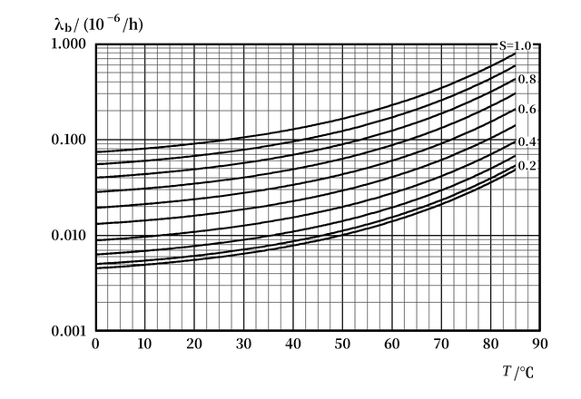

<strong>图 42 非固体钽电解电容器基本失效率曲线</strong>

<strong>表 236 环境系数 <i>π</i>E</strong>

<table>
  <tbody>
    <tr>
      <td align="center">环境</td>
      <td align="center">GB</td>
      <td align="center">GMS</td>
      <td align="center">GF1</td>
      <td align="center">GF2</td>
      <td align="center">GM1</td>
      <td align="center">GM2</td>
      <td align="center">MP</td>
      <td align="center">NSB</td>
      <td align="center">NS1</td>
      <td align="center">NS2</td>
    </tr>
    <tr>
      <td align="center"><i>π</i>E</td>
      <td align="center">1.0</td>
      <td align="center">1.2</td>
      <td align="center">2.7</td>
      <td align="center">3.8</td>
      <td align="center">3.8</td>
      <td align="center">7.1</td>
      <td align="center">6.0</td>
      <td align="center">3.7</td>
      <td align="center">2.5</td>
      <td align="center">4.9</td>
    </tr>
    <tr>
      <td align="center">环境</td>
      <td align="center">NU</td>
      <td align="center">AIF</td>
      <td align="center">AUF</td>
      <td align="center">AIC</td>
      <td align="center">AUC</td>
      <td align="center">ARW</td>
      <td align="center">SF</td>
      <td align="center">ML</td>
      <td align="center">MF</td>
      <td align="center">—</td>
    </tr>
    <tr>
      <td align="center"><i>π</i>E</td>
      <td align="center">9.3</td>
      <td align="center">10.3</td>
      <td align="center">16</td>
      <td align="center">5.6</td>
      <td align="center">10.2</td>
      <td align="center">13</td>
      <td align="center">1.0</td>
      <td align="center">21</td>
      <td align="center">10</td>
      <td align="center">—</td>
    </tr>
  </tbody>
</table>

<strong>表 237 质量等级与质量系数 <i>π</i>Q</strong>

<table>
  <thead>
    <tr>
      <th colspan="2">质量等级</th>
      <th>质量要求说明</th>
      <th>质量要求补充说明</th>
      <th><i>π</i>Q</th>
    </tr>
  </thead>
  <tbody>
    <tr>
      <td rowspan="5" align="center">A</td>
      <td align="center">A1S</td>
      <td>符合 GJB 733B—2011，且列入军用电子元器件合格产品目录（QPL）的 S 级产品</td>
      <td>符合 GJB 733A—1996，且列入军用电子元器件合格产品目录（QPL）的 S 级产品</td>
      <td align="center">—</td>
    </tr>
    <tr>
      <td align="center">A1R</td>
      <td>符合 GJB 733B—2011，且列入军用电子元器件合格产品目录（QPL）的 R 级产品</td>
      <td>符合 GJB 733A—1996，且列入军用电子元器件合格产品目录（QPL）的 R 级产品</td>
      <td align="center">—</td>
    </tr>
    <tr>
      <td align="center">A1P</td>
      <td>符合 GJB 733B—2011，且列入军用电子元器件合格产品目录（QPL）的 P 级产品</td>
      <td>符合 GJB 733A—1996，且列入军用电子元器件合格产品目录（QPL）的 P 级产品</td>
      <td align="center">0.03</td>
    </tr>
    <tr>
      <td align="center">A1M</td>
      <td>符合 GJB 733B—2011，且列入军用电子元器件合格产品目录（QPL）的 M 级产品 符合 GJB 1312A—2001，且列入军用电子元器件合格产品目录（QPL）的产品 符合企业军用标准，且列入军用电子元器件合格产品目录（QPL）的产品</td>
      <td>符合 GJB 733A—1996，且列入军用电子元器件合格产品目录（QPL）的 M 级产品 符合 GJB 1312—1991，且列入军用电子元器件合格产品目录（QPL）的产品</td>
      <td align="center">0.1</td>
    </tr>
    <tr>
      <td align="center">A2</td>
      <td>符合 GJB 733B—2011、GJB 1312A—2001，但未列入军用电子元器件合格产品目录（QPL）的产品</td>
      <td>符合 GJB 733A—1996、GJB 1312—1991，但未列入军用电子元器件合格产品目录（QPL）的产品</td>
      <td align="center">0.2</td>
    </tr>
    <tr>
      <td rowspan="2" align="center">B</td>
      <td align="center">B1</td>
      <td colspan="2">按军用标准的筛选要求进行筛选的 B2 质量等级的产品</td>
      <td align="center">0.5</td>
    </tr>
    <tr>
      <td align="center">B2</td>
      <td colspan="2">符合 GB/T 2693、GB/T 7213 的产品</td>
      <td align="center">1.0</td>
    </tr>
    <tr>
      <td colspan="2" align="center">C</td>
      <td colspan="2">低档产品</td>
      <td align="center">5.0</td>
    </tr>
  </tbody>
</table>

132

---

<strong>GJB/Z 299D—2024</strong>

<strong>表 238 电容量系数 <i>π</i>CV</strong>

<table>
  <thead>
    <tr>
      <th>电容量 <i>C</i> μF</th>
      <th><i>π</i>CV</th>
    </tr>
  </thead>
  <tbody>
    <tr>
      <td align="center"><i>C</i> ≤ 0.22</td>
      <td align="center">0.75</td>
    </tr>
    <tr>
      <td align="center">0.22 &lt; <i>C</i> ≤ 100</td>
      <td align="center">1.0</td>
    </tr>
    <tr>
      <td align="center">100 &lt; <i>C</i> ≤ 1 000</td>
      <td align="center">1.3</td>
    </tr>
    <tr>
      <td align="center"><i>C</i> &gt; 1 000</td>
      <td align="center">1.6</td>
    </tr>
  </tbody>
</table>

#### 5.9.9 氧化铌电解电容器

工作失效率预计模型见式(62)。

$$\lambda_{\text{p}} = \lambda_{\text{b}}\pi_{\text{E}}\pi_{\text{Q}}\pi_{\text{CV}}\pi_{\text{SR}}\pi_{\text{ch}} \tag{62}$$

式中：
$\lambda_{\text{p}}$ ——工作失效率，$10^{-6}/\text{h}$；
$\lambda_{\text{b}}$ ——基本失效率，$10^{-6}/\text{h}$，见表 239 和图 43；
$\pi_{\text{E}}$ ——环境系数，见表 240；
$\pi_{\text{Q}}$ ——质量系数，见表 241；
$\pi_{\text{CV}}$ ——电容量系数，见表 242；
$\pi_{\text{SR}}$ ——串联电阻系数，见表 243；
$\pi_{\text{ch}}$ ——表面贴装系数，见表 204。

<strong>表 239 基本失效率 <i>λ</i>b</strong>

单位为 10−6/h

<table>
  <thead>
    <tr>
      <th rowspan="2"><i>T</i> ℃</th>
      <th colspan="10"><i>S</i></th>
    </tr>
    <tr>
      <th>0.1</th>
      <th>0.2</th>
      <th>0.3</th>
      <th>0.4</th>
      <th>0.5</th>
      <th>0.6</th>
      <th>0.7</th>
      <th>0.8</th>
      <th>0.9</th>
      <th>1.0</th>
    </tr>
  </thead>
  <tbody>
    <tr>
      <td align="center">0</td>
      <td align="center">0.000 58</td>
      <td align="center">0.000 64</td>
      <td align="center">0.000 81</td>
      <td align="center">0.001 13</td>
      <td align="center">0.001 67</td>
      <td align="center">0.002 48</td>
      <td align="center">0.003 60</td>
      <td align="center">0.005 10</td>
      <td align="center">0.007 02</td>
      <td align="center">0.009 42</td>
    </tr>
    <tr>
      <td align="center">5</td>
      <td align="center">0.000 60</td>
      <td align="center">0.000 66</td>
      <td align="center">0.000 84</td>
      <td align="center">0.001 18</td>
      <td align="center">0.001 74</td>
      <td align="center">0.002 58</td>
      <td align="center">0.003 75</td>
      <td align="center">0.005 31</td>
      <td align="center">0.007 31</td>
      <td align="center">0.009 81</td>
    </tr>
    <tr>
      <td align="center">10</td>
      <td align="center">0.000 63</td>
      <td align="center">0.000 70</td>
      <td align="center">0.000 88</td>
      <td align="center">0.001 24</td>
      <td align="center">0.001 82</td>
      <td align="center">0.002 70</td>
      <td align="center">0.003 93</td>
      <td align="center">0.005 56</td>
      <td align="center">0.007 66</td>
      <td align="center">0.010 27</td>
    </tr>
    <tr>
      <td align="center">15</td>
      <td align="center">0.000 66</td>
      <td align="center">0.000 73</td>
      <td align="center">0.000 93</td>
      <td align="center">0.001 30</td>
      <td align="center">0.001 92</td>
      <td align="center">0.002 85</td>
      <td align="center">0.004 14</td>
      <td align="center">0.005 87</td>
      <td align="center">0.008 08</td>
      <td align="center">0.010 84</td>
    </tr>
    <tr>
      <td align="center">20</td>
      <td align="center">0.000 70</td>
      <td align="center">0.000 78</td>
      <td align="center">0.000 99</td>
      <td align="center">0.001 39</td>
      <td align="center">0.002 05</td>
      <td align="center">0.003 03</td>
      <td align="center">0.004 41</td>
      <td align="center">0.006 24</td>
      <td align="center">0.008 59</td>
      <td align="center">0.011 52</td>
    </tr>
    <tr>
      <td align="center">25</td>
      <td align="center">0.000 76</td>
      <td align="center">0.000 84</td>
      <td align="center">0.001 06</td>
      <td align="center">0.001 49</td>
      <td align="center">0.002 20</td>
      <td align="center">0.003 25</td>
      <td align="center">0.004 73</td>
      <td align="center">0.006 69</td>
      <td align="center">0.009 22</td>
      <td align="center">0.012 36</td>
    </tr>
    <tr>
      <td align="center">30</td>
      <td align="center">0.000 82</td>
      <td align="center">0.000 91</td>
      <td align="center">0.001 15</td>
      <td align="center">0.001 61</td>
      <td align="center">0.002 38</td>
      <td align="center">0.003 53</td>
      <td align="center">0.005 13</td>
      <td align="center">0.007 26</td>
      <td align="center">0.009 99</td>
      <td align="center">0.013 40</td>
    </tr>
    <tr>
      <td align="center">35</td>
      <td align="center">0.000 90</td>
      <td align="center">0.000 99</td>
      <td align="center">0.001 26</td>
      <td align="center">0.001 77</td>
      <td align="center">0.002 61</td>
      <td align="center">0.003 87</td>
      <td align="center">0.005 62</td>
      <td align="center">0.007 95</td>
      <td align="center">0.010 95</td>
      <td align="center">0.014 69</td>
    </tr>
    <tr>
      <td align="center">40</td>
      <td align="center">0.001 00</td>
      <td align="center">0.001 10</td>
      <td align="center">0.001 40</td>
      <td align="center">0.001 96</td>
      <td align="center">0.002 90</td>
      <td align="center">0.004 29</td>
      <td align="center">0.006 24</td>
      <td align="center">0.008 83</td>
      <td align="center">0.012 16</td>
      <td align="center">0.016 31</td>
    </tr>
    <tr>
      <td align="center">45</td>
      <td align="center">0.001 12</td>
      <td align="center">0.001 24</td>
      <td align="center">0.001 57</td>
      <td align="center">0.002 21</td>
      <td align="center">0.003 26</td>
      <td align="center">0.004 84</td>
      <td align="center">0.007 03</td>
      <td align="center">0.009 95</td>
      <td align="center">0.013 70</td>
      <td align="center">0.018 38</td>
    </tr>
    <tr>
      <td align="center">50</td>
      <td align="center">0.001 28</td>
      <td align="center">0.001 42</td>
      <td align="center">0.001 80</td>
      <td align="center">0.002 53</td>
      <td align="center">0.003 74</td>
      <td align="center">0.005 53</td>
      <td align="center">0.008 04</td>
      <td align="center">0.011 39</td>
      <td align="center">0.015 67</td>
      <td align="center">0.021 03</td>
    </tr>
    <tr>
      <td align="center">55</td>
      <td align="center">0.001 50</td>
      <td align="center">0.001 66</td>
      <td align="center">0.002 10</td>
      <td align="center">0.002 95</td>
      <td align="center">0.004 35</td>
      <td align="center">0.006 45</td>
      <td align="center">0.009 37</td>
      <td align="center">0.013 26</td>
      <td align="center">0.018 26</td>
      <td align="center">0.024 50</td>
    </tr>
    <tr>
      <td align="center">60</td>
      <td align="center">0.001 78</td>
      <td align="center">0.001 97</td>
      <td align="center">0.002 49</td>
      <td align="center">0.003 50</td>
      <td align="center">0.005 17</td>
      <td align="center">0.007 66</td>
      <td align="center">0.011 14</td>
      <td align="center">0.015 76</td>
      <td align="center">0.021 70</td>
      <td align="center">0.029 11</td>
    </tr>
    <tr>
      <td align="center">65</td>
      <td align="center">0.002 16</td>
      <td align="center">0.002 39</td>
      <td align="center">0.003 02</td>
      <td align="center">0.004 25</td>
      <td align="center">0.006 28</td>
      <td align="center">0.009 31</td>
      <td align="center">0.013 53</td>
      <td align="center">0.019 15</td>
      <td align="center">0.026 36</td>
      <td align="center">0.035 37</td>
    </tr>
    <tr>
      <td align="center">70</td>
      <td align="center">0.002 69</td>
      <td align="center">0.002 98</td>
      <td align="center">0.003 77</td>
      <td align="center">0.005 30</td>
      <td align="center">0.007 82</td>
      <td align="center">0.011 59</td>
      <td align="center">0.016 84</td>
      <td align="center">0.023 83</td>
      <td align="center">0.032 81</td>
      <td align="center">0.044 02</td>
    </tr>
    <tr>
      <td align="center">75</td>
      <td align="center">0.003 44</td>
      <td align="center">0.003 81</td>
      <td align="center">0.004 82</td>
      <td align="center">0.006 77</td>
      <td align="center">0.010 00</td>
      <td align="center">0.014 82</td>
      <td align="center">0.021 54</td>
      <td align="center">0.030 48</td>
      <td align="center">0.041 96</td>
      <td align="center">0.056 31</td>
    </tr>
    <tr>
      <td align="center">80</td>
      <td align="center">0.004 53</td>
      <td align="center">0.005 02</td>
      <td align="center">0.006 35</td>
      <td align="center">0.008 93</td>
      <td align="center">0.013 18</td>
      <td align="center">0.019 53</td>
      <td align="center">0.028 38</td>
      <td align="center">0.040 17</td>
      <td align="center">0.055 30</td>
      <td align="center">0.074 20</td>
    </tr>
    <tr>
      <td align="center">85</td>
      <td align="center">0.006 18</td>
      <td align="center">0.006 84</td>
      <td align="center">0.008 65</td>
      <td align="center">0.012 16</td>
      <td align="center">0.017 96</td>
      <td align="center">0.026 60</td>
      <td align="center">0.038 67</td>
      <td align="center">—</td>
      <td align="center">—</td>
      <td align="center">—</td>
    </tr>
    <tr>
      <td align="center">90</td>
      <td align="center">0.008 73</td>
      <td align="center">0.009 67</td>
      <td align="center">0.012 22</td>
      <td align="center">0.017 18</td>
      <td align="center">0.025 37</td>
      <td align="center">0.037 59</td>
      <td align="center">0.054 63</td>
      <td align="center">—</td>
      <td align="center">—</td>
      <td align="center">—</td>
    </tr>
    <tr>
      <td align="center">95</td>
      <td align="center">0.012 84</td>
      <td align="center">0.014 22</td>
      <td align="center">0.017 97</td>
      <td align="center">0.025 28</td>
      <td align="center">0.037 32</td>
      <td align="center">0.055 29</td>
      <td align="center">—</td>
      <td align="center">—</td>
      <td align="center">—</td>
      <td align="center">—</td>
    </tr>
    <tr>
      <td align="center">100</td>
      <td align="center">0.019 74</td>
      <td align="center">0.021 86</td>
      <td align="center">0.027 63</td>
      <td align="center">0.038 86</td>
      <td align="center">0.057 39</td>
      <td align="center">0.085 02</td>
      <td align="center">—</td>
      <td align="center">—</td>
      <td align="center">—</td>
      <td align="center">—</td>
    </tr>
  </tbody>
</table>

133

---

<strong>GJB/Z 299D—2024</strong>

<strong>表 239(续)</strong>

单位为 10−6/h

<table>
  <thead>
    <tr>
      <th rowspan="2"><i>T</i> ℃</th>
      <th colspan="10"><i>S</i></th>
    </tr>
    <tr>
      <th>0.1</th>
      <th>0.2</th>
      <th>0.3</th>
      <th>0.4</th>
      <th>0.5</th>
      <th>0.6</th>
      <th>0.7</th>
      <th>0.8</th>
      <th>0.9</th>
      <th>1.0</th>
    </tr>
  </thead>
  <tbody>
    <tr>
      <td align="center">105</td>
      <td align="center">0.031 86</td>
      <td align="center">0.035 29</td>
      <td align="center">0.044 61</td>
      <td align="center">0.062 74</td>
      <td align="center">0.092 64</td>
      <td align="center">—</td>
      <td align="center">—</td>
      <td align="center">—</td>
      <td align="center">—</td>
      <td align="center">—</td>
    </tr>
    <tr>
      <td align="center">110</td>
      <td align="center">0.054 26</td>
      <td align="center">0.060 11</td>
      <td align="center">0.075 97</td>
      <td align="center">0.106 85</td>
      <td align="center">—</td>
      <td align="center">—</td>
      <td align="center">—</td>
      <td align="center">—</td>
      <td align="center">—</td>
      <td align="center">—</td>
    </tr>
    <tr>
      <td align="center">115</td>
      <td align="center">0.097 99</td>
      <td align="center">0.108 54</td>
      <td align="center">0.137 18</td>
      <td align="center">—</td>
      <td align="center">—</td>
      <td align="center">—</td>
      <td align="center">—</td>
      <td align="center">—</td>
      <td align="center">—</td>
      <td align="center">—</td>
    </tr>
    <tr>
      <td align="center">120</td>
      <td align="center">0.188 68</td>
      <td align="center">0.209 00</td>
      <td align="center">—</td>
      <td align="center">—</td>
      <td align="center">—</td>
      <td align="center">—</td>
      <td align="center">—</td>
      <td align="center">—</td>
      <td align="center">—</td>
      <td align="center">—</td>
    </tr>
    <tr>
      <td align="center">125</td>
      <td align="center">0.389 72</td>
      <td align="center">—</td>
      <td align="center">—</td>
      <td align="center">—</td>
      <td align="center">—</td>
      <td align="center">—</td>
      <td align="center">—</td>
      <td align="center">—</td>
      <td align="center">—</td>
      <td align="center">—</td>
    </tr>
    <tr>
      <td colspan="11">注：<i>T</i> 为工作环境温度。 　　<i>S</i> 为实际工作电压与额定电压的比值。</td>
    </tr>
  </tbody>
</table>

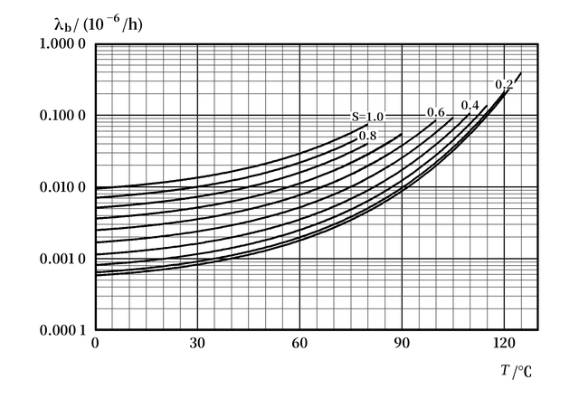

<strong>图 43 氧化铌电解电容器基本失效率曲线</strong>

<strong>表 240 环境系数 <i>π</i>E</strong>

<table>
  <tbody>
    <tr>
      <td align="center">环境</td>
      <td align="center">GB</td>
      <td align="center">GMS</td>
      <td align="center">GF1</td>
      <td align="center">GF2</td>
      <td align="center">GM1</td>
      <td align="center">GM2</td>
      <td align="center">MP</td>
      <td align="center">NSB</td>
      <td align="center">NS1</td>
      <td align="center">NS2</td>
    </tr>
    <tr>
      <td align="center"><i>π</i>E</td>
      <td align="center">1.0</td>
      <td align="center">1.2</td>
      <td align="center">2.5</td>
      <td align="center">3.7</td>
      <td align="center">3.7</td>
      <td align="center">7.0</td>
      <td align="center">6.0</td>
      <td align="center">3.8</td>
      <td align="center">2.4</td>
      <td align="center">4.6</td>
    </tr>
    <tr>
      <td align="center">环境</td>
      <td align="center">NU</td>
      <td align="center">AIF</td>
      <td align="center">AUF</td>
      <td align="center">AIC</td>
      <td align="center">AUC</td>
      <td align="center">ARW</td>
      <td align="center">SF</td>
      <td align="center">ML</td>
      <td align="center">MF</td>
      <td align="center">—</td>
    </tr>
    <tr>
      <td align="center"><i>π</i>E</td>
      <td align="center">8.8</td>
      <td align="center">9.3</td>
      <td align="center">15</td>
      <td align="center">5.5</td>
      <td align="center">8.0</td>
      <td align="center">12</td>
      <td align="center">1.0</td>
      <td align="center">19</td>
      <td align="center">9</td>
      <td align="center">—</td>
    </tr>
  </tbody>
</table>

<strong>表 241 质量等级与质量系数 <i>π</i>Q</strong>

<table>
  <thead>
    <tr>
      <th colspan="2">质量等级</th>
      <th>质量要求说明</th>
      <th>质量要求补充说明</th>
      <th><i>π</i>Q</th>
    </tr>
  </thead>
  <tbody>
    <tr>
      <td rowspan="6" align="center">A</td>
      <td align="center">A1T</td>
      <td>符合 GJB 2283A—2014，且列入军用电子元器件合格产品目录（QPL）的 T 级产品</td>
      <td align="center">—</td>
      <td align="center">—</td>
    </tr>
    <tr>
      <td align="center">A1S</td>
      <td>符合 GJB 2283A—2014，且列入军用电子元器件合格产品目录（QPL）的 S 级产品</td>
      <td>符合 GJB 2283—1995，且列入军用电子元器件合格产品目录（QPL）的 S 级产品</td>
      <td align="center">—</td>
    </tr>
    <tr>
      <td align="center">A1R</td>
      <td>符合 GJB 2283A—2014，且列入军用电子元器件合格产品目录（QPL）的 R 级产品</td>
      <td>符合 GJB 2283—1995，且列入军用电子元器件合格产品目录（QPL）的 R 级产品</td>
      <td align="center">—</td>
    </tr>
    <tr>
      <td align="center">A1P</td>
      <td>符合 GJB 2283A—2014，且列入军用电子元器件合格产品目录（QPL）的 P 级产品</td>
      <td>符合 GJB 2283—1995，且列入军用电子元器件合格产品目录（QPL）的 P 级产品</td>
      <td align="center">—</td>
    </tr>
    <tr>
      <td align="center">A1M</td>
      <td>符合 GJB 2283A—2014，且列入军用电子元器件合格产品目录（QPL）的 M 级产品 符合企业军用标准，且列入军用电子元器件合格产品目录（QPL）的产品</td>
      <td>符合 GJB 2283—1995，且列入军用电子元器件合格产品目录（QPL）的 M 级产品</td>
      <td align="center">—</td>
    </tr>
    <tr>
      <td align="center">A2</td>
      <td>符合 GJB 2283A—2014，但未列入军用电子元器件合格产品目录（QPL）的产品</td>
      <td>符合 GJB 2283—1995，但未列入军用电子元器件合格产品目录（QPL）的产品</td>
      <td align="center">0.2</td>
    </tr>
    <tr>
      <td rowspan="2" align="center">B</td>
      <td align="center">B1</td>
      <td colspan="2">按军用标准的筛选要求进行筛选的 B2 质量等级的产品</td>
      <td align="center">0.5</td>
    </tr>
    <tr>
      <td align="center">B2</td>
      <td colspan="2">符合 GB/T 2693、GB/T 14121 的产品</td>
      <td align="center">1.0</td>
    </tr>
    <tr>
      <td colspan="2" align="center">C</td>
      <td colspan="2">低档产品</td>
      <td align="center">5.0</td>
    </tr>
  </tbody>
</table>

134

---

<strong>GJB/Z 299D—2024</strong>

<strong>表 242 电容量系数 <i>π</i>CV</strong>

<table>
  <thead>
    <tr>
      <th>电容量 <i>C</i> μF</th>
      <th><i>π</i>CV</th>
    </tr>
  </thead>
  <tbody>
    <tr>
      <td align="center">3.3 &lt; <i>C</i> ≤ 15</td>
      <td align="center">1.0</td>
    </tr>
    <tr>
      <td align="center">15 &lt; <i>C</i> ≤ 47</td>
      <td align="center">1.3</td>
    </tr>
    <tr>
      <td align="center">47 &lt; <i>C</i> ≤ 100</td>
      <td align="center">1.6</td>
    </tr>
    <tr>
      <td align="center">100 &lt; <i>C</i> ≤ 220</td>
      <td align="center">1.9</td>
    </tr>
    <tr>
      <td align="center">220 &lt; <i>C</i> ≤ 500</td>
      <td align="center">2.2</td>
    </tr>
    <tr>
      <td align="center"><i>C</i> &gt; 500</td>
      <td align="center">2.6</td>
    </tr>
  </tbody>
</table>

<strong>表 243 串联电阻系数 <i>π</i>SR</strong>

<table>
  <thead>
    <tr>
      <th>串联电阻 <i>R</i> Ω/V</th>
      <th><i>π</i>SR</th>
    </tr>
  </thead>
  <tbody>
    <tr>
      <td align="center">3.0 ≤ <i>R</i></td>
      <td align="center">0.07</td>
    </tr>
    <tr>
      <td align="center">2.0 ≤ <i>R</i> &lt; 3</td>
      <td align="center">0.1</td>
    </tr>
    <tr>
      <td align="center">1.0 ≤ <i>R</i> &lt; 2</td>
      <td align="center">0.2</td>
    </tr>
    <tr>
      <td align="center">0.8 ≤ <i>R</i> &lt; 1</td>
      <td align="center">0.3</td>
    </tr>
    <tr>
      <td align="center">0.6 ≤ <i>R</i> &lt; 0.8</td>
      <td align="center">0.4</td>
    </tr>
    <tr>
      <td align="center">0.4 ≤ <i>R</i> &lt; 0.6</td>
      <td align="center">0.6</td>
    </tr>
    <tr>
      <td align="center">0.2 ≤ <i>R</i> &lt; 0.4</td>
      <td align="center">0.8</td>
    </tr>
    <tr>
      <td align="center"><i>R</i> &lt; 0.2</td>
      <td align="center">1.0</td>
    </tr>
    <tr>
      <td colspan="2">注：串联电阻 <i>R</i> 是电容器与电源之间的回路电阻除以电容器的工作电压。</td>
    </tr>
  </tbody>
</table>

#### 5.9.10 可变电容器

工作失效率预计模型见式(63)。

$$\lambda_{\text{p}} = \lambda_{\text{b}}\pi_{\text{E}}\pi_{\text{Q}} \tag{63}$$

式中：
$\lambda_{\text{p}}$ ——工作失效率，$10^{-6}/\text{h}$；
$\lambda_{\text{b}}$ ——基本失效率，$10^{-6}/\text{h}$，见表 244；
$\pi_{\text{E}}$ ——环境系数，见表 245；
$\pi_{\text{Q}}$ ——质量系数，见表 246。

<strong>表 244 基本失效率 <i>λ</i>b</strong>

单位为 10−6/h

<table>
  <thead>
    <tr>
      <th>类型</th>
      <th><i>λ</i>b</th>
    </tr>
  </thead>
  <tbody>
    <tr>
      <td align="center">瓷介微调</td>
      <td align="center">0.07</td>
    </tr>
    <tr>
      <td align="center">玻璃介质微调</td>
      <td align="center">0.15</td>
    </tr>
    <tr>
      <td align="center">空气介质微调</td>
      <td align="center">0.23</td>
    </tr>
  </tbody>
</table>

<strong>表 245 环境系数 <i>π</i>E</strong>

<table>
  <tbody>
    <tr>
      <td align="center">环境</td>
      <td align="center">GB</td>
      <td align="center">GMS</td>
      <td align="center">GF1</td>
      <td align="center">GF2</td>
      <td align="center">GM1</td>
      <td align="center">GM2</td>
      <td align="center">MP</td>
      <td align="center">NSB</td>
      <td align="center">NS1</td>
      <td align="center">NS2</td>
    </tr>
    <tr>
      <td align="center"><i>π</i>E</td>
      <td align="center">1.0</td>
      <td align="center">1.1</td>
      <td align="center">2.4</td>
      <td align="center">4.8</td>
      <td align="center">4.8</td>
      <td align="center">9.6</td>
      <td align="center">7.0</td>
      <td align="center">4.5</td>
      <td align="center">2.8</td>
      <td align="center">5.7</td>
    </tr>
    <tr>
      <td align="center">环境</td>
      <td align="center">NU</td>
      <td align="center">AIF</td>
      <td align="center">AUF</td>
      <td align="center">AIC</td>
      <td align="center">AUC</td>
      <td align="center">ARW</td>
      <td align="center">SF</td>
      <td align="center">ML</td>
      <td align="center">MF</td>
      <td align="center">—</td>
    </tr>
    <tr>
      <td align="center"><i>π</i>E</td>
      <td align="center">11.5</td>
      <td align="center">8.0</td>
      <td align="center">21</td>
      <td align="center">6.0</td>
      <td align="center">10</td>
      <td align="center">15</td>
      <td align="center">—</td>
      <td align="center">—</td>
      <td align="center">—</td>
      <td align="center">—</td>
    </tr>
  </tbody>
</table>

135

---

<strong>GJB/Z 299D—2024</strong>

<strong>表 246 质量等级与质量系数 <i>π</i>Q</strong>

<table>
  <thead>
    <tr>
      <th colspan="2">质量等级</th>
      <th>质量要求说明</th>
      <th>质量要求补充说明</th>
      <th><i>π</i>Q</th>
    </tr>
  </thead>
  <tbody>
    <tr>
      <td rowspan="2" align="center">A</td>
      <td align="center">A1</td>
      <td>符合 GJB 728—1989、GJB 1433—1992 且列入军用电子元器件合格产品目录（QPL）的产品 符合企业军用标准，且列入军用电子元器件合格产品目录（QPL）的产品</td>
      <td align="center">—</td>
      <td align="center">0.25</td>
    </tr>
    <tr>
      <td align="center">A2</td>
      <td>符合 GJB 728—1989、GJB 1433—1992，但未列入军用电子元器件合格产品目录（QPL）的产品</td>
      <td align="center">—</td>
      <td align="center">0.35</td>
    </tr>
    <tr>
      <td rowspan="2" align="center">B</td>
      <td align="center">B1</td>
      <td colspan="2">按军用标准的筛选要求进行筛选的 B2 质量等级的产品</td>
      <td align="center">0.75</td>
    </tr>
    <tr>
      <td align="center">B2</td>
      <td colspan="2">符合 GB/T 6252、GB/T 6253、GB/T 6254、GB/T 12775、SJ 1583—1980、SJ 1882—1981、SJ 2241—1982、SJ/T 10507—1994 的产品</td>
      <td align="center">1.0</td>
    </tr>
    <tr>
      <td colspan="2" align="center">C</td>
      <td colspan="2">低档产品</td>
      <td align="center">3.0</td>
    </tr>
  </tbody>
</table>

#### 5.9.11 电容网络

工作失效率预计模型见式(64)。

$$\lambda_{\text{p}} = N\lambda_{\text{p(单)}} \tag{64}$$

式中：
$\lambda_{\text{p}}$ ——工作失效率，$10^{-6}/\text{h}$；
$N$ ——电容器个数；
$\lambda_{\text{p(单)}}$ ——单个电容器的工作失效率，$10^{-6}/\text{h}$。单个电容器的具体工作失效率参见表 205～表 244。

### 5.10 感性元件

#### 5.10.1 概述

本条对下列感性元件提供失效率预计：
a) 电感器：
　　1) 固定电感器；
　　2) 可变电感器；
　　3) 扼流圈。
b) 片式电感器。
c) 变压器：
　　1) 电源变压器；
　　2) 脉冲变压器；
　　3) 高压变压器；
　　4) 音频变压器；
　　5) 中频变压器；
　　6) 射频变压器。
感性元件的质量等级见表 247，其绝缘等级与额定工作温度的对应关系见表 248。

136

---

<strong>GJB/Z 299D—2024</strong>

<strong>表 247 质量等级 <i>π</i>Q</strong>

<table>
  <thead>
    <tr>
      <th colspan="2">质量等级</th>
      <th>质量要求说明</th>
      <th>质量要求补充说明</th>
    </tr>
  </thead>
  <tbody>
    <tr>
      <td rowspan="2" align="center">A</td>
      <td align="center">A1</td>
      <td>符合 GJB 675A—2002、GJB 1435—1992、GJB 1521A—2013、GJB 1660—1993、GJB 1661—1993、GJB 1864A—2011、GJB 2829A—2013、GJB 5025—2003、SJ 20037—1992，且列入军用电子元器件合格产品目录（QPL）的产品 符合企业军用标准，且列入军用电子元器件合格产品目录（QPL）的产品</td>
      <td>符合 GJB 675—1989、GJB 1521—1992、GJB 1864—1994、GJB 2829—1997，且列入军用电子元器件合格产品目录（QPL）的产品</td>
    </tr>
    <tr>
      <td align="center">A2</td>
      <td>符合 GJB 675A—2002、GJB 1435—1992、GJB 1521A—2013、GJB 1660—1993、GJB 1661—1993、GJB 1864A—2011、GJB 2829A—2013、GJB 5025—2003、SJ 20037—1992，但未列入军用电子元器件合格产品目录（QPL）的产品</td>
      <td>符合 GJB 675—1989、GJB 1521—1992、GJB 1864—1994、GJB 2829—1997，但未列入军用电子元器件合格产品目录（QPL）的产品</td>
    </tr>
    <tr>
      <td rowspan="2" align="center">B</td>
      <td align="center">B1</td>
      <td colspan="2">符合 GB/T 9367、GB/T 14860、GB/T 15290、GB/T 16512 的产品或按军用标准的筛选要求进行筛选的 B2 质量等级的产品</td>
    </tr>
    <tr>
      <td align="center">B2</td>
      <td colspan="2">符合 SJ 2461—1984、SJ 2533—1984、SJ 2587—1985、SJ 2605—1985、SJ 2697—1986、SJ/T 2885—2003、SJ 2916—1988、SJ 2917—1988、SJ 2918—1988、SJ 2919—1988、SJ 2920—1988 的产品</td>
    </tr>
    <tr>
      <td colspan="2" align="center">C</td>
      <td colspan="2">低档产品</td>
    </tr>
  </tbody>
</table>

<strong>表 248 绝缘等级与额定工作温度</strong>

单位为摄氏度

<table>
  <thead>
    <tr>
      <th>绝缘等级</th>
      <th>绝缘材料</th>
      <th>额定工作温度</th>
    </tr>
  </thead>
  <tbody>
    <tr>
      <td align="center">Y</td>
      <td>木材、棉花、纸、纤维等天然的纺织品，以醋酸纤维和聚酰胺为基础的纺织品，以及易于热分解和溶化点较低的塑料（脲醛树脂）</td>
      <td align="center">90</td>
    </tr>
    <tr>
      <td align="center">A</td>
      <td>工作于矿物油中的和用油或油树脂复合胶浸过的 Y 级材料，漆包线、漆布、漆丝的绝缘及油性漆、沥青漆等</td>
      <td align="center">105</td>
    </tr>
    <tr>
      <td align="center">E</td>
      <td>聚脂薄膜和 A 级材料复合、玻璃布、油性树脂漆、聚乙烯醇缩醛高强度漆包线、乙酸乙烯耐热漆包线</td>
      <td align="center">120</td>
    </tr>
    <tr>
      <td align="center">B</td>
      <td>聚脂薄膜、经合适树脂粘合式浸渍涂复的云母、玻璃纤维、石棉等，聚脂漆、聚脂漆包线</td>
      <td align="center">130</td>
    </tr>
    <tr>
      <td align="center">F</td>
      <td>以有机纤维材料补强和石棉补强的云母片制品，玻璃丝和石棉，玻璃漆布，以玻璃丝布和石棉纤维为基础的层压制品，以无机材料作补强和石棉补强的云母粉制品，化学热稳定性较好的聚脂和醇酸类材料，复合硅有机聚脂漆</td>
      <td align="center">155</td>
    </tr>
    <tr>
      <td align="center">H</td>
      <td>无补强或以无机材料为补强的云母制品、加厚的 F 级材料、复合云母、有机硅云母制品、硅有机漆、硅有机橡胶聚酰亚胺复合玻璃布、复合薄膜、聚酰亚胺漆等</td>
      <td align="center">180</td>
    </tr>
    <tr>
      <td align="center">C</td>
      <td>不采用任何有机粘合剂及浸渍剂的无机物如石英、石棉、云母、玻璃和电瓷材料等</td>
      <td align="center">&gt; 180</td>
    </tr>
  </tbody>
</table>

#### 5.10.2 电感器

本条对下列电感器类型提供失效率预计：
a) 固定电感器；
b) 可变电感器；
c) 扼流圈。
工作失效率预计模型见式(65)。

$$\lambda_{\text{p}} = \lambda_{\text{b}}\pi_{\text{E}}\pi_{\text{Q}}\pi_{\text{C}} \tag{65}$$

式中：
$\lambda_{\text{p}}$ ——工作失效率，$10^{-6}/\text{h}$；
$\lambda_{\text{b}}$ ——基本失效率，$10^{-6}/\text{h}$，基本失效率见表 249 和图 44；
$\pi_{\text{E}}$ ——环境系数，见表 250；
$\pi_{\text{Q}}$ ——质量系数，见表 251；
$\pi_{\text{C}}$ ——结构系数，见表 252。

137

---

<strong>GJB/Z 299D—2024</strong>

<strong>表 249 基本失效率 <i>λ</i>b</strong>

单位为 10−6/h

<table>
  <thead>
    <tr>
      <th rowspan="4"><i>T</i>HS ℃</th>
      <th colspan="4">绝缘等级</th>
    </tr>
    <tr>
      <th>Y</th>
      <th>A</th>
      <th>E、B</th>
      <th>F</th>
    </tr>
    <tr>
      <th colspan="4">额定工作温度</th>
    </tr>
    <tr>
      <th>90℃</th>
      <th>105℃</th>
      <th>120℃、130℃</th>
      <th>155℃</th>
    </tr>
  </thead>
  <tbody>
    <tr>
      <td align="center">25</td>
      <td align="center">0.003 0</td>
      <td align="center">0.002 4</td>
      <td align="center">0.001 8</td>
      <td align="center">0.001 7</td>
    </tr>
    <tr>
      <td align="center">30</td>
      <td align="center">0.003 3</td>
      <td align="center">0.002 6</td>
      <td align="center">0.001 9</td>
      <td align="center">0.001 7</td>
    </tr>
    <tr>
      <td align="center">35</td>
      <td align="center">0.003 8</td>
      <td align="center">0.002 8</td>
      <td align="center">0.002 0</td>
      <td align="center">0.001 8</td>
    </tr>
    <tr>
      <td align="center">40</td>
      <td align="center">0.004 3</td>
      <td align="center">0.003 1</td>
      <td align="center">0.002 1</td>
      <td align="center">0.001 9</td>
    </tr>
    <tr>
      <td align="center">45</td>
      <td align="center">0.005 0</td>
      <td align="center">0.003 4</td>
      <td align="center">0.002 2</td>
      <td align="center">0.001 9</td>
    </tr>
    <tr>
      <td align="center">50</td>
      <td align="center">0.005 7</td>
      <td align="center">0.003 7</td>
      <td align="center">0.002 3</td>
      <td align="center">0.002 0</td>
    </tr>
    <tr>
      <td align="center">55</td>
      <td align="center">0.006 7</td>
      <td align="center">0.004 1</td>
      <td align="center">0.002 4</td>
      <td align="center">0.002 1</td>
    </tr>
    <tr>
      <td align="center">60</td>
      <td align="center">0.007 9</td>
      <td align="center">0.004 5</td>
      <td align="center">0.002 5</td>
      <td align="center">0.002 2</td>
    </tr>
    <tr>
      <td align="center">65</td>
      <td align="center">0.009 5</td>
      <td align="center">0.005 0</td>
      <td align="center">0.002 7</td>
      <td align="center">0.002 3</td>
    </tr>
    <tr>
      <td align="center">70</td>
      <td align="center">0.011 5</td>
      <td align="center">0.005 6</td>
      <td align="center">0.002 8</td>
      <td align="center">0.002 4</td>
    </tr>
    <tr>
      <td align="center">75</td>
      <td align="center">0.014 0</td>
      <td align="center">0.006 3</td>
      <td align="center">0.003 0</td>
      <td align="center">0.002 5</td>
    </tr>
    <tr>
      <td align="center">80</td>
      <td align="center">0.017 3</td>
      <td align="center">0.007 1</td>
      <td align="center">0.003 1</td>
      <td align="center">0.002 6</td>
    </tr>
    <tr>
      <td align="center">85</td>
      <td align="center">0.021 6</td>
      <td align="center">0.008 2</td>
      <td align="center">0.003 3</td>
      <td align="center">0.002 7</td>
    </tr>
    <tr>
      <td align="center">90</td>
      <td align="center">0.027 4</td>
      <td align="center">0.009 4</td>
      <td align="center">0.003 5</td>
      <td align="center">0.002 8</td>
    </tr>
    <tr>
      <td align="center">95</td>
      <td align="center">—</td>
      <td align="center">0.010 8</td>
      <td align="center">0.003 7</td>
      <td align="center">0.003 0</td>
    </tr>
    <tr>
      <td align="center">100</td>
      <td align="center">—</td>
      <td align="center">0.012 6</td>
      <td align="center">0.004 0</td>
      <td align="center">0.003 1</td>
    </tr>
    <tr>
      <td align="center">105</td>
      <td align="center">—</td>
      <td align="center">0.014 8</td>
      <td align="center">0.004 2</td>
      <td align="center">0.003 3</td>
    </tr>
    <tr>
      <td align="center">110</td>
      <td align="center">—</td>
      <td align="center">—</td>
      <td align="center">0.004 5</td>
      <td align="center">0.003 5</td>
    </tr>
    <tr>
      <td align="center">115</td>
      <td align="center">—</td>
      <td align="center">—</td>
      <td align="center">0.004 8</td>
      <td align="center">0.003 7</td>
    </tr>
    <tr>
      <td align="center">120</td>
      <td align="center">—</td>
      <td align="center">—</td>
      <td align="center">0.005 1</td>
      <td align="center">0.003 9</td>
    </tr>
    <tr>
      <td align="center">125</td>
      <td align="center">—</td>
      <td align="center">—</td>
      <td align="center">0.005 5</td>
      <td align="center">0.004 1</td>
    </tr>
    <tr>
      <td align="center">130</td>
      <td align="center">—</td>
      <td align="center">—</td>
      <td align="center">0.005 9</td>
      <td align="center">0.004 4</td>
    </tr>
    <tr>
      <td align="center">135</td>
      <td align="center">—</td>
      <td align="center">—</td>
      <td align="center">—</td>
      <td align="center">0.004 7</td>
    </tr>
    <tr>
      <td align="center">140</td>
      <td align="center">—</td>
      <td align="center">—</td>
      <td align="center">—</td>
      <td align="center">0.005 0</td>
    </tr>
    <tr>
      <td align="center">145</td>
      <td align="center">—</td>
      <td align="center">—</td>
      <td align="center">—</td>
      <td align="center">0.005 3</td>
    </tr>
    <tr>
      <td align="center">150</td>
      <td align="center">—</td>
      <td align="center">—</td>
      <td align="center">—</td>
      <td align="center">0.005 7</td>
    </tr>
    <tr>
      <td align="center">155</td>
      <td align="center">—</td>
      <td align="center">—</td>
      <td align="center">—</td>
      <td align="center">0.006 1</td>
    </tr>
    <tr>
      <td colspan="5">注：<i>T</i>HS 为热点温度，<i>T</i>HS = <i>T</i> + 1.1Δ<i>T</i>，其中 <i>T</i> 为工作环境温度，Δ<i>T</i> 为平均温升。Δ<i>T</i> 按基础规范中“温升”测量方法（如 GB 8554、SJ 2533 等）进行测量，或采用如下的近似值：对于大功率射频线圈 Δ<i>T</i> ≈ 12℃，对于小功率射频线圈、电感器 Δ<i>T</i> ≈ 5℃。</td>
    </tr>
  </tbody>
</table>

138

---

<strong>GJB/Z 299D—2024</strong>

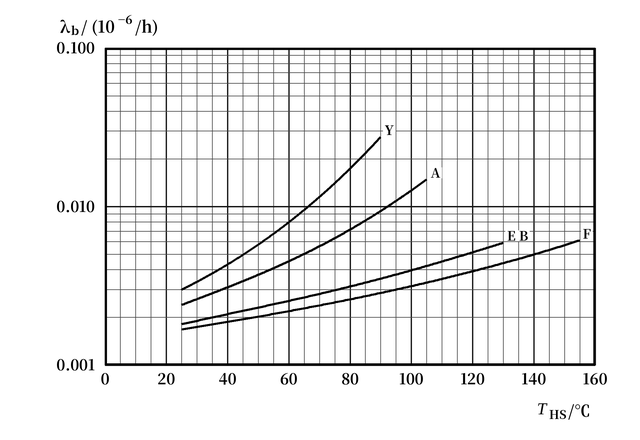

<strong>图 44 电感器基本失效率曲线</strong>

<strong>表 250 环境系数 <i>π</i>E</strong>

<table>
  <tbody>
    <tr>
      <td align="center">环境</td>
      <td align="center">GB</td>
      <td align="center">GMS</td>
      <td align="center">GF1</td>
      <td align="center">GF2</td>
      <td align="center">GM1</td>
      <td align="center">GM2</td>
      <td align="center">MP</td>
      <td align="center">NSB</td>
      <td align="center">NS1</td>
      <td align="center">NS2</td>
    </tr>
    <tr>
      <td align="center"><i>π</i>E</td>
      <td align="center">1.0</td>
      <td align="center">1.4</td>
      <td align="center">2.0</td>
      <td align="center">6.0</td>
      <td align="center">8.0</td>
      <td align="center">16</td>
      <td align="center">10</td>
      <td align="center">7.0</td>
      <td align="center">2.8</td>
      <td align="center">8.0</td>
    </tr>
    <tr>
      <td align="center">环境</td>
      <td align="center">NU</td>
      <td align="center">AIF</td>
      <td align="center">AUF</td>
      <td align="center">AIC</td>
      <td align="center">AUC</td>
      <td align="center">ARW</td>
      <td align="center">SF</td>
      <td align="center">ML</td>
      <td align="center">MF</td>
      <td align="center">—</td>
    </tr>
    <tr>
      <td align="center"><i>π</i>E</td>
      <td align="center">17</td>
      <td align="center">15</td>
      <td align="center">20</td>
      <td align="center">12</td>
      <td align="center">16</td>
      <td align="center">19</td>
      <td align="center">1.0</td>
      <td align="center">40</td>
      <td align="center">15</td>
      <td align="center">—</td>
    </tr>
  </tbody>
</table>

<strong>表 251 质量等级与质量系数 <i>π</i>Q</strong>

<table>
  <thead>
    <tr>
      <th colspan="2">质量等级</th>
      <th><i>π</i>Q</th>
    </tr>
  </thead>
  <tbody>
    <tr>
      <td align="center">A</td>
      <td align="center">A2</td>
      <td align="center">0.3</td>
    </tr>
    <tr>
      <td rowspan="2" align="center">B</td>
      <td align="center">B1</td>
      <td align="center">0.6</td>
    </tr>
    <tr>
      <td align="center">B2</td>
      <td align="center">1.0</td>
    </tr>
    <tr>
      <td colspan="2" align="center">C</td>
      <td align="center">3.0</td>
    </tr>
  </tbody>
</table>

<strong>表 252 结构系数 <i>π</i>C</strong>

<table>
  <tbody>
    <tr>
      <td align="center">结构</td>
      <td align="center">固定电感器</td>
      <td align="center">可变电感器</td>
      <td align="center">扼流圈</td>
    </tr>
    <tr>
      <td align="center"><i>π</i>C</td>
      <td align="center">1.0</td>
      <td align="center">2.0</td>
      <td align="center">3.0</td>
    </tr>
  </tbody>
</table>

#### 5.10.3 片式电感器

工作失效率预计模型见式(66)。

$$\lambda_{\text{p}} = \lambda_{\text{b}}\pi_{\text{E}}\pi_{\text{Q}}\pi_{\text{T}} \tag{66}$$

式中：
$\lambda_{\text{p}}$ ——工作失效率，$10^{-6}/\text{h}$；
$\lambda_{\text{b}}$ ——基本失效率，$10^{-6}/\text{h}$；取值为 $0.002$；
$\pi_{\text{E}}$ ——环境系数，见表 253；
$\pi_{\text{Q}}$ ——质量系数，见表 254；
$\pi_{\text{T}}$ ——温度应力系数，见表 255。

139

---

<strong>GJB/Z 299D—2024</strong>

<strong>表 253 环境系数 <i>π</i>E</strong>

<table>
  <tbody>
    <tr>
      <td align="center">环境</td>
      <td align="center">GB</td>
      <td align="center">GMS</td>
      <td align="center">GF1</td>
      <td align="center">GF2</td>
      <td align="center">GM1</td>
      <td align="center">GM2</td>
      <td align="center">MP</td>
      <td align="center">NSB</td>
      <td align="center">NS1</td>
      <td align="center">NS2</td>
    </tr>
    <tr>
      <td align="center"><i>π</i>E</td>
      <td align="center">1.0</td>
      <td align="center">1.3</td>
      <td align="center">2.0</td>
      <td align="center">6.0</td>
      <td align="center">5.5</td>
      <td align="center">10</td>
      <td align="center">6.5</td>
      <td align="center">7.0</td>
      <td align="center">2.8</td>
      <td align="center">8.0</td>
    </tr>
    <tr>
      <td align="center">环境</td>
      <td align="center">NU</td>
      <td align="center">AIF</td>
      <td align="center">AUF</td>
      <td align="center">AIC</td>
      <td align="center">AUC</td>
      <td align="center">ARW</td>
      <td align="center">SF</td>
      <td align="center">ML</td>
      <td align="center">MF</td>
      <td align="center">—</td>
    </tr>
    <tr>
      <td align="center"><i>π</i>E</td>
      <td align="center">18</td>
      <td align="center">15</td>
      <td align="center">21</td>
      <td align="center">11</td>
      <td align="center">14</td>
      <td align="center">16</td>
      <td align="center">1.0</td>
      <td align="center">40</td>
      <td align="center">15</td>
      <td align="center">—</td>
    </tr>
  </tbody>
</table>

<strong>表 254 质量等级与质量系数 <i>π</i>Q</strong>

<table>
  <thead>
    <tr>
      <th colspan="2">质量等级</th>
      <th><i>π</i>Q</th>
    </tr>
  </thead>
  <tbody>
    <tr>
      <td rowspan="2" align="center">A</td>
      <td align="center">A1</td>
      <td align="center">0.4</td>
    </tr>
    <tr>
      <td align="center">A2</td>
      <td align="center">0.6</td>
    </tr>
    <tr>
      <td rowspan="2" align="center">B</td>
      <td align="center">B1</td>
      <td align="center">0.8</td>
    </tr>
    <tr>
      <td align="center">B2</td>
      <td align="center">1.0</td>
    </tr>
    <tr>
      <td colspan="2" align="center">C</td>
      <td align="center">3.5</td>
    </tr>
  </tbody>
</table>

<strong>表 255 温度应力系数 <i>π</i>T</strong>

<table>
  <thead>
    <tr>
      <th><i>T</i>HS ℃</th>
      <th><i>π</i>T</th>
      <th><i>T</i>HS ℃</th>
      <th><i>π</i>T</th>
      <th><i>T</i>HS ℃</th>
      <th><i>π</i>T</th>
    </tr>
  </thead>
  <tbody>
    <tr>
      <td align="center">20</td>
      <td align="center">0.93</td>
      <td align="center">80</td>
      <td align="center">1.9</td>
      <td align="center">140</td>
      <td align="center">3.3</td>
    </tr>
    <tr>
      <td align="center">30</td>
      <td align="center">1.1</td>
      <td align="center">90</td>
      <td align="center">2.2</td>
      <td align="center">150</td>
      <td align="center">3.5</td>
    </tr>
    <tr>
      <td align="center">40</td>
      <td align="center">1.2</td>
      <td align="center">100</td>
      <td align="center">2.4</td>
      <td align="center">160</td>
      <td align="center">3.8</td>
    </tr>
    <tr>
      <td align="center">50</td>
      <td align="center">1.4</td>
      <td align="center">110</td>
      <td align="center">2.6</td>
      <td align="center">170</td>
      <td align="center">4.1</td>
    </tr>
    <tr>
      <td align="center">60</td>
      <td align="center">1.6</td>
      <td align="center">120</td>
      <td align="center">2.8</td>
      <td align="center">180</td>
      <td align="center">4.3</td>
    </tr>
    <tr>
      <td align="center">70</td>
      <td align="center">1.8</td>
      <td align="center">130</td>
      <td align="center">3.1</td>
      <td align="center">190</td>
      <td align="center">4.6</td>
    </tr>
    <tr>
      <td colspan="6">注：<i>T</i>HS 为热点温度，<i>T</i>HS = <i>T</i> + 1.1Δ<i>T</i>，其中 <i>T</i> 为工作环境温度，Δ<i>T</i> 为平均温升。Δ<i>T</i> 按基础规范中“温升”测量方法（如 GB 8554、SJ 2533 等）进行测量，或采用如下的近似值：对于大功率射频线圈 Δ<i>T</i> ≈ 12℃，对于小功率射频线圈、电感器 Δ<i>T</i> ≈ 5℃。</td>
    </tr>
  </tbody>
</table>

#### 5.10.4 变压器

本条对下列变压器类型的工作失效率进行预计：
a) 电源变压器；
b) 脉冲变压器；
c) 高压变压器；
d) 音频变压器；
e) 中频变压器；
f) 射频变压器。
工作失效率预计模型见式(67)。

$$\lambda_{\text{p}} = \lambda_{\text{b}}\pi_{\text{E}}\pi_{\text{Q}}\pi_{\text{K}} \tag{67}$$

式中：
$\lambda_{\text{p}}$ ——工作失效率，$10^{-6}/\text{h}$；
$\lambda_{\text{b}}$ ——基本失效率，$10^{-6}/\text{h}$，见表 256 和图 45；
$\pi_{\text{E}}$ ——环境系数，见表 257；
$\pi_{\text{Q}}$ ——质量系数，见表 258；
$\pi_{\text{K}}$ ——种类系数，见表 259。

140

---

<strong>GJB/Z 299D—2024</strong>

<strong>表 256 基本失效率 <i>λ</i>b</strong>

单位为 10−6/h

<table>
  <thead>
    <tr>
      <th rowspan="4"><i>T</i>HS</th>
      <th colspan="6">绝缘等级</th>
    </tr>
    <tr>
      <th>Y</th>
      <th>A</th>
      <th>E、B</th>
      <th>F</th>
      <th>H</th>
      <th>C</th>
    </tr>
    <tr>
      <th colspan="6">额定工作温度</th>
    </tr>
    <tr>
      <th>90℃</th>
      <th>105℃</th>
      <th>120℃、130℃</th>
      <th>155℃</th>
      <th>180℃</th>
      <th>&gt; 180℃</th>
    </tr>
  </thead>
  <tbody>
    <tr>
      <td align="center">25</td>
      <td align="center">0.011 1</td>
      <td align="center">0.008 8</td>
      <td align="center">0.006 9</td>
      <td align="center">0.005 7</td>
      <td align="center">0.004 6</td>
      <td align="center">0.003 6</td>
    </tr>
    <tr>
      <td align="center">30</td>
      <td align="center">0.012 4</td>
      <td align="center">0.009 5</td>
      <td align="center">0.007 2</td>
      <td align="center">0.005 9</td>
      <td align="center">0.004 7</td>
      <td align="center">0.003 6</td>
    </tr>
    <tr>
      <td align="center">35</td>
      <td align="center">0.014 0</td>
      <td align="center">0.010 3</td>
      <td align="center">0.007 6</td>
      <td align="center">0.006 1</td>
      <td align="center">0.004 8</td>
      <td align="center">0.003 7</td>
    </tr>
    <tr>
      <td align="center">40</td>
      <td align="center">0.016 0</td>
      <td align="center">0.011 1</td>
      <td align="center">0.007 9</td>
      <td align="center">0.006 3</td>
      <td align="center">0.004 9</td>
      <td align="center">0.003 8</td>
    </tr>
    <tr>
      <td align="center">45</td>
      <td align="center">0.018 3</td>
      <td align="center">0.012 2</td>
      <td align="center">0.008 3</td>
      <td align="center">0.006 5</td>
      <td align="center">0.005 0</td>
      <td align="center">0.003 9</td>
    </tr>
    <tr>
      <td align="center">50</td>
      <td align="center">0.021 3</td>
      <td align="center">0.013 3</td>
      <td align="center">0.008 7</td>
      <td align="center">0.006 8</td>
      <td align="center">0.005 1</td>
      <td align="center">0.004 0</td>
    </tr>
    <tr>
      <td align="center">55</td>
      <td align="center">0.024 9</td>
      <td align="center">0.014 7</td>
      <td align="center">0.009 1</td>
      <td align="center">0.007 1</td>
      <td align="center">0.005 2</td>
      <td align="center">0.004 0</td>
    </tr>
    <tr>
      <td align="center">60</td>
      <td align="center">0.029 4</td>
      <td align="center">0.016 3</td>
      <td align="center">0.009 6</td>
      <td align="center">0.007 3</td>
      <td align="center">0.005 4</td>
      <td align="center">0.004 1</td>
    </tr>
    <tr>
      <td align="center">65</td>
      <td align="center">0.035 1</td>
      <td align="center">0.018 1</td>
      <td align="center">0.010 1</td>
      <td align="center">0.007 7</td>
      <td align="center">0.005 5</td>
      <td align="center">0.004 2</td>
    </tr>
    <tr>
      <td align="center">70</td>
      <td align="center">0.042 4</td>
      <td align="center">0.020 3</td>
      <td align="center">0.010 6</td>
      <td align="center">0.008 0</td>
      <td align="center">0.005 7</td>
      <td align="center">0.004 3</td>
    </tr>
    <tr>
      <td align="center">75</td>
      <td align="center">0.051 8</td>
      <td align="center">0.022 9</td>
      <td align="center">0.011 2</td>
      <td align="center">0.008 4</td>
      <td align="center">0.005 8</td>
      <td align="center">0.004 5</td>
    </tr>
    <tr>
      <td align="center">80</td>
      <td align="center">0.064 0</td>
      <td align="center">0.025 9</td>
      <td align="center">0.011 8</td>
      <td align="center">0.008 7</td>
      <td align="center">0.005 9</td>
      <td align="center">0.004 6</td>
    </tr>
    <tr>
      <td align="center">85</td>
      <td align="center">0.080 0</td>
      <td align="center">0.029 6</td>
      <td align="center">0.012 5</td>
      <td align="center">0.009 2</td>
      <td align="center">0.006 1</td>
      <td align="center">0.004 7</td>
    </tr>
    <tr>
      <td align="center">90</td>
      <td align="center">0.101 4</td>
      <td align="center">0.034 0</td>
      <td align="center">0.013 3</td>
      <td align="center">0.009 6</td>
      <td align="center">0.006 3</td>
      <td align="center">0.004 8</td>
    </tr>
    <tr>
      <td align="center">95</td>
      <td align="center">—</td>
      <td align="center">0.039 3</td>
      <td align="center">0.014 1</td>
      <td align="center">0.010 1</td>
      <td align="center">0.006 4</td>
      <td align="center">0.004 9</td>
    </tr>
    <tr>
      <td align="center">100</td>
      <td align="center">—</td>
      <td align="center">0.045 7</td>
      <td align="center">0.015 0</td>
      <td align="center">0.010 6</td>
      <td align="center">0.006 6</td>
      <td align="center">0.005 1</td>
    </tr>
    <tr>
      <td align="center">105</td>
      <td align="center">—</td>
      <td align="center">0.053 7</td>
      <td align="center">0.016 0</td>
      <td align="center">0.011 2</td>
      <td align="center">0.006 8</td>
      <td align="center">0.005 2</td>
    </tr>
    <tr>
      <td align="center">110</td>
      <td align="center">—</td>
      <td align="center">—</td>
      <td align="center">0.017 0</td>
      <td align="center">0.011 8</td>
      <td align="center">0.007 0</td>
      <td align="center">0.005 4</td>
    </tr>
    <tr>
      <td align="center">115</td>
      <td align="center">—</td>
      <td align="center">—</td>
      <td align="center">0.018 2</td>
      <td align="center">0.012 5</td>
      <td align="center">0.007 2</td>
      <td align="center">0.005 6</td>
    </tr>
    <tr>
      <td align="center">120</td>
      <td align="center">—</td>
      <td align="center">—</td>
      <td align="center">0.019 4</td>
      <td align="center">0.013 3</td>
      <td align="center">0.007 3</td>
      <td align="center">0.005 7</td>
    </tr>
    <tr>
      <td align="center">125</td>
      <td align="center">—</td>
      <td align="center">—</td>
      <td align="center">0.020 8</td>
      <td align="center">0.014 1</td>
      <td align="center">0.007 6</td>
      <td align="center">0.005 9</td>
    </tr>
    <tr>
      <td align="center">130</td>
      <td align="center">—</td>
      <td align="center">—</td>
      <td align="center">0.022 3</td>
      <td align="center">0.015 0</td>
      <td align="center">0.007 8</td>
      <td align="center">0.006 1</td>
    </tr>
    <tr>
      <td align="center">135</td>
      <td align="center">—</td>
      <td align="center">—</td>
      <td align="center">—</td>
      <td align="center">0.015 9</td>
      <td align="center">0.008 0</td>
      <td align="center">0.006 3</td>
    </tr>
    <tr>
      <td align="center">140</td>
      <td align="center">—</td>
      <td align="center">—</td>
      <td align="center">—</td>
      <td align="center">0.017 0</td>
      <td align="center">0.008 2</td>
      <td align="center">0.006 5</td>
    </tr>
    <tr>
      <td align="center">145</td>
      <td align="center">—</td>
      <td align="center">—</td>
      <td align="center">—</td>
      <td align="center">0.018 1</td>
      <td align="center">0.008 5</td>
      <td align="center">0.006 7</td>
    </tr>
    <tr>
      <td align="center">150</td>
      <td align="center">—</td>
      <td align="center">—</td>
      <td align="center">—</td>
      <td align="center">0.019 4</td>
      <td align="center">0.008 7</td>
      <td align="center">0.007 0</td>
    </tr>
    <tr>
      <td align="center">155</td>
      <td align="center">—</td>
      <td align="center">—</td>
      <td align="center">—</td>
      <td align="center">0.020 8</td>
      <td align="center">0.009 0</td>
      <td align="center">0.007 2</td>
    </tr>
    <tr>
      <td align="center">160</td>
      <td align="center">—</td>
      <td align="center">—</td>
      <td align="center">—</td>
      <td align="center">—</td>
      <td align="center">0.009 2</td>
      <td align="center">0.007 5</td>
    </tr>
    <tr>
      <td align="center">165</td>
      <td align="center">—</td>
      <td align="center">—</td>
      <td align="center">—</td>
      <td align="center">—</td>
      <td align="center">0.009 5</td>
      <td align="center">0.007 8</td>
    </tr>
    <tr>
      <td align="center">170</td>
      <td align="center">—</td>
      <td align="center">—</td>
      <td align="center">—</td>
      <td align="center">—</td>
      <td align="center">0.009 8</td>
      <td align="center">0.008 1</td>
    </tr>
    <tr>
      <td align="center">175</td>
      <td align="center">—</td>
      <td align="center">—</td>
      <td align="center">—</td>
      <td align="center">—</td>
      <td align="center">0.010 1</td>
      <td align="center">0.008 4</td>
    </tr>
    <tr>
      <td align="center">180</td>
      <td align="center">—</td>
      <td align="center">—</td>
      <td align="center">—</td>
      <td align="center">—</td>
      <td align="center">0.010 4</td>
      <td align="center">0.008 7</td>
    </tr>
    <tr>
      <td align="center">185</td>
      <td align="center">—</td>
      <td align="center">—</td>
      <td align="center">—</td>
      <td align="center">—</td>
      <td align="center">—</td>
      <td align="center">0.009 1</td>
    </tr>
    <tr>
      <td align="center">190</td>
      <td align="center">—</td>
      <td align="center">—</td>
      <td align="center">—</td>
      <td align="center">—</td>
      <td align="center">—</td>
      <td align="center">0.009 4</td>
    </tr>
  </tbody>
</table>

141

---

<strong>GJB/Z 299D—2024</strong>

<strong>表 256(续)</strong>

单位为 10−6/h

<table>
  <thead>
    <tr>
      <th rowspan="4"><i>T</i>HS</th>
      <th colspan="6">绝缘等级</th>
    </tr>
    <tr>
      <th>Y</th>
      <th>A</th>
      <th>E、B</th>
      <th>F</th>
      <th>H</th>
      <th>C</th>
    </tr>
    <tr>
      <th colspan="6">额定工作温度</th>
    </tr>
    <tr>
      <th>90℃</th>
      <th>105℃</th>
      <th>120℃、130℃</th>
      <th>155℃</th>
      <th>180℃</th>
      <th>&gt; 180℃</th>
    </tr>
  </thead>
  <tbody>
    <tr>
      <td align="center">195</td>
      <td align="center">—</td>
      <td align="center">—</td>
      <td align="center">—</td>
      <td align="center">—</td>
      <td align="center">—</td>
      <td align="center">0.009 8</td>
    </tr>
    <tr>
      <td align="center">200</td>
      <td align="center">—</td>
      <td align="center">—</td>
      <td align="center">—</td>
      <td align="center">—</td>
      <td align="center">—</td>
      <td align="center">0.010 3</td>
    </tr>
    <tr>
      <td colspan="7">注：<i>T</i>HS 为热点温度，<i>T</i>HS = <i>T</i> + 1.1Δ<i>T</i>，其中 <i>T</i> 为工作环境温度，Δ<i>T</i> 为平均温升。Δ<i>T</i> 按基础规范中“温升”测量方法（如 GB 8554、SJ 2533 等）进行测量，或采用如下方法进行估算：Δ<i>T</i> = 7.5<i>W</i>L/(<i>W</i>t)0.6 或 Δ<i>T</i> = 7.5<i>W</i>I/(<i>W</i>t)0.6，其中，<i>W</i>L 为变压器重量，kg；<i>W</i>t 为消耗功率，W；<i>W</i>I 为输入功率，W。</td>
    </tr>
  </tbody>
</table>

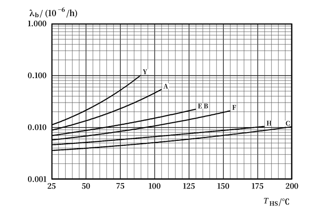

<strong>图 45 变压器基本失效率曲线</strong>

<strong>表 257 环境系数 <i>π</i>E</strong>

<table>
  <tbody>
    <tr>
      <td align="center">环境</td>
      <td align="center">GB</td>
      <td align="center">GMS</td>
      <td align="center">GF1</td>
      <td align="center">GF2</td>
      <td align="center">GM1</td>
      <td align="center">GM2</td>
      <td align="center">MP</td>
      <td align="center">NSB</td>
      <td align="center">NS1</td>
      <td align="center">NS2</td>
    </tr>
    <tr>
      <td align="center"><i>π</i>E</td>
      <td align="center">1.0</td>
      <td align="center">1.4</td>
      <td align="center">2.0</td>
      <td align="center">6.0</td>
      <td align="center">8.0</td>
      <td align="center">16</td>
      <td align="center">10</td>
      <td align="center">7.0</td>
      <td align="center">2.8</td>
      <td align="center">9.0</td>
    </tr>
    <tr>
      <td align="center">环境</td>
      <td align="center">NU</td>
      <td align="center">AIF</td>
      <td align="center">AUF</td>
      <td align="center">AIC</td>
      <td align="center">AUC</td>
      <td align="center">ARW</td>
      <td align="center">SF</td>
      <td align="center">ML</td>
      <td align="center">MF</td>
      <td align="center">—</td>
    </tr>
    <tr>
      <td align="center"><i>π</i>E</td>
      <td align="center">19</td>
      <td align="center">15</td>
      <td align="center">21</td>
      <td align="center">12</td>
      <td align="center">16</td>
      <td align="center">20</td>
      <td align="center">1.0</td>
      <td align="center">40</td>
      <td align="center">15</td>
      <td align="center">—</td>
    </tr>
  </tbody>
</table>

<strong>表 258 质量等级与质量系数 <i>π</i>Q</strong>

<table>
  <thead>
    <tr>
      <th colspan="2">质量等级</th>
      <th><i>π</i>Q</th>
    </tr>
  </thead>
  <tbody>
    <tr>
      <td rowspan="2" align="center">A</td>
      <td align="center">A1</td>
      <td align="center">0.15</td>
    </tr>
    <tr>
      <td align="center">A2</td>
      <td align="center">0.3</td>
    </tr>
    <tr>
      <td rowspan="2" align="center">B</td>
      <td align="center">B1</td>
      <td align="center">0.6</td>
    </tr>
    <tr>
      <td align="center">B2</td>
      <td align="center">1.0</td>
    </tr>
    <tr>
      <td colspan="2" align="center">C</td>
      <td align="center">3.5</td>
    </tr>
  </tbody>
</table>

<strong>表 259 种类系数 <i>π</i>K</strong>

<table>
  <tbody>
    <tr>
      <td align="center">种类</td>
      <td align="center">小功率脉冲变压器</td>
      <td align="center">音频变压器 中频变压器</td>
      <td align="center">电源变压器 大功率脉冲变压器</td>
      <td align="center">高压变压器 射频变压器</td>
    </tr>
    <tr>
      <td align="center"><i>π</i>K</td>
      <td align="center">1.0</td>
      <td align="center">2.0</td>
      <td align="center">5.0</td>
      <td align="center">6.0</td>
    </tr>
  </tbody>
</table>

### 5.11 继电器

#### 5.11.1 机电继电器

本条对下列类型机电继电器的工作失效率进行预计：

142

---

<strong>GJB/Z 299D—2024</strong>

a) 电磁继电器；
b) 真空继电器；
c) 簧管式继电器；
d) 特种继电器，包括：温度继电器、延时继电器、风速继电器、射频继电器；
e) 接触器式继电器。
工作失效率预计模型见式(68)。

$$\lambda_{\text{p}} = \lambda_{\text{b}}\pi_{\text{E}}\pi_{\text{Q}}\pi_{\text{CI}}\pi_{\text{r}}\pi_{\text{CYC}}\pi_{\text{A}}\pi_{\text{C}}\pi_{\text{P}} \tag{68}$$

式中：
$\lambda_{\text{p}}$ ——工作失效率，$10^{-6}/\text{h}$；
$\lambda_{\text{b}}$ ——基本失效率，$10^{-6}/\text{h}$，见表 260～表 265 及图 46～图 51；
$\pi_{\text{E}}$ ——环境系数，见表 266；
$\pi_{\text{Q}}$ ——质量系数，见表 267；
$\pi_{\text{CI}}$ ——触点形式系数，见表 268；
$\pi_{\text{r}}$ ——额定负载系数，见表 269；
$\pi_{\text{CYC}}$ ——动作速率系数，见表 270；
$\pi_{\text{A}}$ ——应用系数，见表 271；
$\pi_{\text{C}}$ ——结构系数，见表 272；
$\pi_{\text{P}}$ ——封装系数，见表 273。

<strong>表 260 阻性负载基本失效率 <i>λ</i>b（额定温度 85℃）</strong>

单位为 10−6/h

<table>
  <thead>
    <tr>
      <th rowspan="2"><i>T</i> ℃</th>
      <th colspan="11"><i>S</i></th>
    </tr>
    <tr>
      <th>0.05</th>
      <th>0.1</th>
      <th>0.2</th>
      <th>0.3</th>
      <th>0.4</th>
      <th>0.5</th>
      <th>0.6</th>
      <th>0.7</th>
      <th>0.8</th>
      <th>0.9</th>
      <th>1.0</th>
    </tr>
  </thead>
  <tbody>
    <tr>
      <td align="center">0</td>
      <td align="center">0.051 2</td>
      <td align="center">0.051 8</td>
      <td align="center">0.054 2</td>
      <td align="center">0.058 7</td>
      <td align="center">0.065 4</td>
      <td align="center">0.075 3</td>
      <td align="center">0.089 4</td>
      <td align="center">0.109 6</td>
      <td align="center">0.138 5</td>
      <td align="center">0.180 7</td>
      <td align="center">0.243 1</td>
    </tr>
    <tr>
      <td align="center">5</td>
      <td align="center">0.052 2</td>
      <td align="center">0.052 8</td>
      <td align="center">0.055 3</td>
      <td align="center">0.059 8</td>
      <td align="center">0.066 8</td>
      <td align="center">0.076 8</td>
      <td align="center">0.091 2</td>
      <td align="center">0.111 8</td>
      <td align="center">0.141 3</td>
      <td align="center">0.184 3</td>
      <td align="center">0.248 0</td>
    </tr>
    <tr>
      <td align="center">10</td>
      <td align="center">0.053 4</td>
      <td align="center">0.054 0</td>
      <td align="center">0.056 6</td>
      <td align="center">0.061 2</td>
      <td align="center">0.068 3</td>
      <td align="center">0.078 6</td>
      <td align="center">0.093 3</td>
      <td align="center">0.114 4</td>
      <td align="center">0.144 6</td>
      <td align="center">0.188 6</td>
      <td align="center">0.253 7</td>
    </tr>
    <tr>
      <td align="center">15</td>
      <td align="center">0.054 8</td>
      <td align="center">0.055 4</td>
      <td align="center">0.058 1</td>
      <td align="center">0.062 8</td>
      <td align="center">0.070 1</td>
      <td align="center">0.080 7</td>
      <td align="center">0.095 8</td>
      <td align="center">0.117 4</td>
      <td align="center">0.148 4</td>
      <td align="center">0.193 5</td>
      <td align="center">0.260 4</td>
    </tr>
    <tr>
      <td align="center">20</td>
      <td align="center">0.056 4</td>
      <td align="center">0.057 1</td>
      <td align="center">0.059 8</td>
      <td align="center">0.064 7</td>
      <td align="center">0.072 2</td>
      <td align="center">0.083 1</td>
      <td align="center">0.098 6</td>
      <td align="center">0.120 8</td>
      <td align="center">0.152 8</td>
      <td align="center">0.199 2</td>
      <td align="center">0.268 1</td>
    </tr>
    <tr>
      <td align="center">25</td>
      <td align="center">0.058 3</td>
      <td align="center">0.059 0</td>
      <td align="center">0.061 8</td>
      <td align="center">0.066 9</td>
      <td align="center">0.074 6</td>
      <td align="center">0.085 8</td>
      <td align="center">0.101 9</td>
      <td align="center">0.124 9</td>
      <td align="center">0.157 9</td>
      <td align="center">0.205 9</td>
      <td align="center">0.277 1</td>
    </tr>
    <tr>
      <td align="center">30</td>
      <td align="center">0.060 5</td>
      <td align="center">0.061 2</td>
      <td align="center">0.064 2</td>
      <td align="center">0.069 4</td>
      <td align="center">0.077 4</td>
      <td align="center">0.089 1</td>
      <td align="center">0.105 8</td>
      <td align="center">0.129 6</td>
      <td align="center">0.163 9</td>
      <td align="center">0.213 8</td>
      <td align="center">0.287 6</td>
    </tr>
    <tr>
      <td align="center">35</td>
      <td align="center">0.063 1</td>
      <td align="center">0.063 9</td>
      <td align="center">0.066 9</td>
      <td align="center">0.072 4</td>
      <td align="center">0.080 7</td>
      <td align="center">0.092 9</td>
      <td align="center">0.110 4</td>
      <td align="center">0.135 2</td>
      <td align="center">0.170 9</td>
      <td align="center">0.222 9</td>
      <td align="center">0.300 0</td>
    </tr>
    <tr>
      <td align="center">40</td>
      <td align="center">0.066 2</td>
      <td align="center">0.067 0</td>
      <td align="center">0.070 2</td>
      <td align="center">0.075 9</td>
      <td align="center">0.084 6</td>
      <td align="center">0.097 4</td>
      <td align="center">0.115 7</td>
      <td align="center">0.141 8</td>
      <td align="center">0.179 2</td>
      <td align="center">0.233 7</td>
      <td align="center">0.314 5</td>
    </tr>
    <tr>
      <td align="center">45</td>
      <td align="center">0.069 8</td>
      <td align="center">0.070 6</td>
      <td align="center">0.074 0</td>
      <td align="center">0.080 0</td>
      <td align="center">0.089 2</td>
      <td align="center">0.102 7</td>
      <td align="center">0.122 0</td>
      <td align="center">0.149 5</td>
      <td align="center">0.188 9</td>
      <td align="center">0.246 4</td>
      <td align="center">0.331 6</td>
    </tr>
    <tr>
      <td align="center">50</td>
      <td align="center">0.074 0</td>
      <td align="center">0.074 9</td>
      <td align="center">0.078 5</td>
      <td align="center">0.084 9</td>
      <td align="center">0.094 7</td>
      <td align="center">0.109 0</td>
      <td align="center">0.129 4</td>
      <td align="center">0.158 6</td>
      <td align="center">0.200 5</td>
      <td align="center">0.261 5</td>
      <td align="center">0.351 9</td>
    </tr>
    <tr>
      <td align="center">55</td>
      <td align="center">0.079 1</td>
      <td align="center">0.080 1</td>
      <td align="center">0.083 9</td>
      <td align="center">0.090 7</td>
      <td align="center">0.101 2</td>
      <td align="center">0.116 5</td>
      <td align="center">0.138 3</td>
      <td align="center">0.169 5</td>
      <td align="center">0.214 2</td>
      <td align="center">0.279 4</td>
      <td align="center">0.376 0</td>
    </tr>
    <tr>
      <td align="center">60</td>
      <td align="center">0.085 2</td>
      <td align="center">0.086 2</td>
      <td align="center">0.090 3</td>
      <td align="center">0.097 7</td>
      <td align="center">0.109 0</td>
      <td align="center">0.125 4</td>
      <td align="center">0.148 9</td>
      <td align="center">0.182 5</td>
      <td align="center">0.230 7</td>
      <td align="center">0.300 9</td>
      <td align="center">0.404 9</td>
    </tr>
    <tr>
      <td align="center">65</td>
      <td align="center">0.092 5</td>
      <td align="center">0.093 6</td>
      <td align="center">0.098 1</td>
      <td align="center">0.106 1</td>
      <td align="center">0.118 3</td>
      <td align="center">0.136 2</td>
      <td align="center">0.161 8</td>
      <td align="center">0.198 2</td>
      <td align="center">0.250 5</td>
      <td align="center">0.326 8</td>
      <td align="center">0.439 7</td>
    </tr>
    <tr>
      <td align="center">70</td>
      <td align="center">0.101 4</td>
      <td align="center">0.102 6</td>
      <td align="center">0.107 5</td>
      <td align="center">0.116 3</td>
      <td align="center">0.129 7</td>
      <td align="center">0.149 3</td>
      <td align="center">0.177 3</td>
      <td align="center">0.217 2</td>
      <td align="center">0.274 6</td>
      <td align="center">0.358 1</td>
      <td align="center">0.481 9</td>
    </tr>
    <tr>
      <td align="center">75</td>
      <td align="center">0.112 3</td>
      <td align="center">0.113 6</td>
      <td align="center">0.119 1</td>
      <td align="center">0.128 7</td>
      <td align="center">0.143 6</td>
      <td align="center">0.165 3</td>
      <td align="center">0.196 3</td>
      <td align="center">0.240 5</td>
      <td align="center">0.304 1</td>
      <td align="center">0.396 6</td>
      <td align="center">0.533 6</td>
    </tr>
    <tr>
      <td align="center">80</td>
      <td align="center">0.125 7</td>
      <td align="center">0.127 2</td>
      <td align="center">0.133 3</td>
      <td align="center">0.144 1</td>
      <td align="center">0.160 8</td>
      <td align="center">0.185 1</td>
      <td align="center">0.219 8</td>
      <td align="center">0.269 3</td>
      <td align="center">0.340 4</td>
      <td align="center">0.444 0</td>
      <td align="center">0.597 5</td>
    </tr>
    <tr>
      <td align="center">85</td>
      <td align="center">0.142 5</td>
      <td align="center">0.144 2</td>
      <td align="center">0.151 1</td>
      <td align="center">0.163 4</td>
      <td align="center">0.182 2</td>
      <td align="center">0.209 8</td>
      <td align="center">0.249 1</td>
      <td align="center">0.305 2</td>
      <td align="center">0.385 8</td>
      <td align="center">0.503 2</td>
      <td align="center">0.677 1</td>
    </tr>
    <tr>
      <td colspan="12">注：<i>T</i> 为工作环境温度。 　　<i>S</i> 为实际触点负载电流与额定触点负载电流的比值。</td>
    </tr>
  </tbody>
</table>

143

---

<strong>GJB/Z 299D—2024</strong>

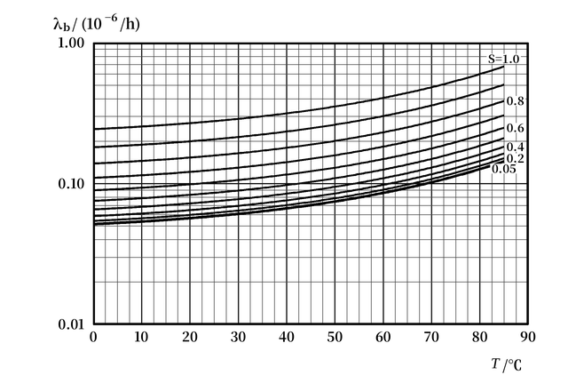

<strong>图 46 机电继电器阻性负载基本失效率曲线（额定温度 85℃）</strong>

<strong>表 261 感性负载基本失效率 <i>λ</i>b（额定温度 85℃）</strong>

单位为 10−6/h

<table>
  <thead>
    <tr>
      <th rowspan="2"><i>T</i> ℃</th>
      <th colspan="8"><i>S</i></th>
    </tr>
    <tr>
      <th>0.05</th>
      <th>0.1</th>
      <th>0.2</th>
      <th>0.3</th>
      <th>0.4</th>
      <th>0.5</th>
      <th>0.6</th>
      <th>0.7</th>
    </tr>
  </thead>
  <tbody>
    <tr>
      <td align="center">0</td>
      <td align="center">0.051 8</td>
      <td align="center">0.054 2</td>
      <td align="center">0.065 4</td>
      <td align="center">0.089 4</td>
      <td align="center">0.138 5</td>
      <td align="center">0.243 1</td>
      <td align="center">0.483 5</td>
      <td align="center">1.089 6</td>
    </tr>
    <tr>
      <td align="center">5</td>
      <td align="center">0.052 8</td>
      <td align="center">0.055 3</td>
      <td align="center">0.066 8</td>
      <td align="center">0.091 2</td>
      <td align="center">0.141 3</td>
      <td align="center">0.248 0</td>
      <td align="center">0.493 3</td>
      <td align="center">1.111 6</td>
    </tr>
    <tr>
      <td align="center">10</td>
      <td align="center">0.054 0</td>
      <td align="center">0.056 6</td>
      <td align="center">0.068 3</td>
      <td align="center">0.093 3</td>
      <td align="center">0.144 6</td>
      <td align="center">0.253 7</td>
      <td align="center">0.504 6</td>
      <td align="center">1.137 1</td>
    </tr>
    <tr>
      <td align="center">15</td>
      <td align="center">0.055 4</td>
      <td align="center">0.058 1</td>
      <td align="center">0.070 1</td>
      <td align="center">0.095 8</td>
      <td align="center">0.148 4</td>
      <td align="center">0.260 4</td>
      <td align="center">0.517 8</td>
      <td align="center">1.166 9</td>
    </tr>
    <tr>
      <td align="center">20</td>
      <td align="center">0.057 1</td>
      <td align="center">0.059 8</td>
      <td align="center">0.072 2</td>
      <td align="center">0.098 6</td>
      <td align="center">0.152 8</td>
      <td align="center">0.268 1</td>
      <td align="center">0.533 2</td>
      <td align="center">1.201 5</td>
    </tr>
    <tr>
      <td align="center">25</td>
      <td align="center">0.059 0</td>
      <td align="center">0.061 8</td>
      <td align="center">0.074 6</td>
      <td align="center">0.101 9</td>
      <td align="center">0.157 9</td>
      <td align="center">0.277 1</td>
      <td align="center">0.551 1</td>
      <td align="center">1.241 9</td>
    </tr>
    <tr>
      <td align="center">30</td>
      <td align="center">0.061 2</td>
      <td align="center">0.064 2</td>
      <td align="center">0.077 4</td>
      <td align="center">0.105 8</td>
      <td align="center">0.163 9</td>
      <td align="center">0.287 6</td>
      <td align="center">0.572 0</td>
      <td align="center">1.289 1</td>
    </tr>
    <tr>
      <td align="center">35</td>
      <td align="center">0.063 9</td>
      <td align="center">0.066 9</td>
      <td align="center">0.080 7</td>
      <td align="center">0.110 4</td>
      <td align="center">0.170 9</td>
      <td align="center">0.300 0</td>
      <td align="center">0.596 6</td>
      <td align="center">1.344 4</td>
    </tr>
    <tr>
      <td align="center">40</td>
      <td align="center">0.067 0</td>
      <td align="center">0.070 2</td>
      <td align="center">0.084 6</td>
      <td align="center">0.115 7</td>
      <td align="center">0.179 2</td>
      <td align="center">0.314 5</td>
      <td align="center">0.625 4</td>
      <td align="center">1.409 4</td>
    </tr>
    <tr>
      <td align="center">45</td>
      <td align="center">0.070 6</td>
      <td align="center">0.074 0</td>
      <td align="center">0.089 2</td>
      <td align="center">0.122 0</td>
      <td align="center">0.188 9</td>
      <td align="center">0.331 6</td>
      <td align="center">0.659 5</td>
      <td align="center">1.486 1</td>
    </tr>
    <tr>
      <td align="center">50</td>
      <td align="center">0.074 9</td>
      <td align="center">0.078 5</td>
      <td align="center">0.094 7</td>
      <td align="center">0.129 4</td>
      <td align="center">0.200 5</td>
      <td align="center">0.351 9</td>
      <td align="center">0.699 8</td>
      <td align="center">1.577 0</td>
    </tr>
    <tr>
      <td align="center">55</td>
      <td align="center">0.080 1</td>
      <td align="center">0.083 9</td>
      <td align="center">0.101 2</td>
      <td align="center">0.138 3</td>
      <td align="center">0.214 2</td>
      <td align="center">0.376 0</td>
      <td align="center">0.747 8</td>
      <td align="center">1.685 1</td>
    </tr>
    <tr>
      <td align="center">60</td>
      <td align="center">0.086 2</td>
      <td align="center">0.090 3</td>
      <td align="center">0.109 0</td>
      <td align="center">0.148 9</td>
      <td align="center">0.230 7</td>
      <td align="center">0.404 9</td>
      <td align="center">0.805 2</td>
      <td align="center">1.814 6</td>
    </tr>
    <tr>
      <td align="center">65</td>
      <td align="center">0.093 6</td>
      <td align="center">0.098 1</td>
      <td align="center">0.118 3</td>
      <td align="center">0.161 8</td>
      <td align="center">0.250 5</td>
      <td align="center">0.439 7</td>
      <td align="center">0.874 4</td>
      <td align="center">1.970 6</td>
    </tr>
    <tr>
      <td align="center">70</td>
      <td align="center">0.102 6</td>
      <td align="center">0.107 5</td>
      <td align="center">0.129 7</td>
      <td align="center">0.177 3</td>
      <td align="center">0.274 6</td>
      <td align="center">0.481 9</td>
      <td align="center">0.958 4</td>
      <td align="center">2.159 9</td>
    </tr>
    <tr>
      <td align="center">75</td>
      <td align="center">0.113 6</td>
      <td align="center">0.119 1</td>
      <td align="center">0.143 6</td>
      <td align="center">0.196 3</td>
      <td align="center">0.304 1</td>
      <td align="center">0.533 6</td>
      <td align="center">1.061 3</td>
      <td align="center">2.391 6</td>
    </tr>
    <tr>
      <td align="center">80</td>
      <td align="center">0.127 2</td>
      <td align="center">0.133 3</td>
      <td align="center">0.160 8</td>
      <td align="center">0.219 8</td>
      <td align="center">0.340 4</td>
      <td align="center">0.597 5</td>
      <td align="center">1.188 2</td>
      <td align="center">2.677 7</td>
    </tr>
    <tr>
      <td align="center">85</td>
      <td align="center">0.144 2</td>
      <td align="center">0.151 1</td>
      <td align="center">0.182 2</td>
      <td align="center">0.249 1</td>
      <td align="center">0.385 8</td>
      <td align="center">0.677 1</td>
      <td align="center">1.346 6</td>
      <td align="center">3.034 6</td>
    </tr>
    <tr>
      <td colspan="9">注：“---·---”为电机在额定切换电压下负载电流的额定线，即负载为电机时其负载电流不得超过额定电流的 20%。 　　“———”为电感在额定负载电压下负载电流的额定线，即负载为电感时其负载电流不得超过额定电流的 30%。 　　<i>T</i> 为工作环境温度。 　　<i>S</i> 为实际触点负载电流与额定触点负载电流的比值。</td>
    </tr>
  </tbody>
</table>

144

---

<strong>GJB/Z 299D—2024</strong>

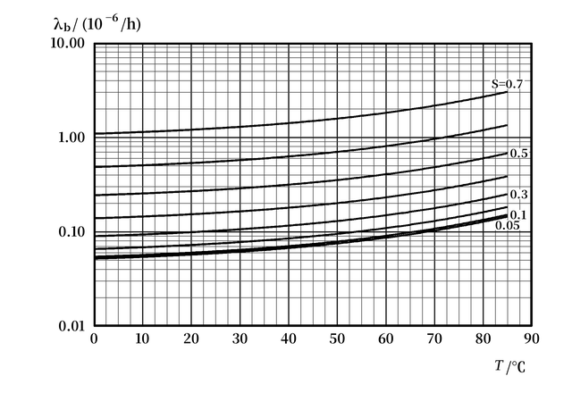

<strong>图 47 机电继电器感性负载基本失效率曲线（额定温度 85℃）</strong>

<strong>表 262 灯负载基本失效率 <i>λ</i>b（额定温度 85℃）</strong>

单位为 10−6/h

<table>
  <thead>
    <tr>
      <th rowspan="2"><i>T</i> ℃</th>
      <th colspan="6"><i>S</i></th>
    </tr>
    <tr>
      <th>0.05</th>
      <th>0.1</th>
      <th>0.15</th>
      <th>0.2</th>
      <th>0.3</th>
      <th>0.4</th>
    </tr>
  </thead>
  <tbody>
    <tr><td>0</td><td>0.054 2</td><td>0.065 4</td><td>0.089 4</td><td>0.138 5</td><td>0.483 5</td><td>2.782 4</td></tr>
    <tr><td>5</td><td>0.055 3</td><td>0.066 8</td><td>0.091 2</td><td>0.141 3</td><td>0.493 3</td><td>2.838 5</td></tr>
    <tr><td>10</td><td>0.056 6</td><td>0.068 3</td><td>0.093 3</td><td>0.144 6</td><td>0.504 6</td><td>2.903 8</td></tr>
    <tr><td>15</td><td>0.058 1</td><td>0.070 1</td><td>0.095 8</td><td>0.148 4</td><td>0.517 8</td><td>2.979 7</td></tr>
    <tr><td>20</td><td>0.059 8</td><td>0.072 2</td><td>0.098 6</td><td>0.152 8</td><td>0.533 2</td><td>3.068 1</td></tr>
    <tr><td>25</td><td>0.061 8</td><td>0.074 6</td><td>0.101 9</td><td>0.157 9</td><td>0.551 1</td><td>3.171 3</td></tr>
    <tr><td>30</td><td>0.064 2</td><td>0.077 4</td><td>0.105 8</td><td>0.163 9</td><td>0.572 0</td><td>3.291 8</td></tr>
    <tr><td>35</td><td>0.066 9</td><td>0.080 7</td><td>0.110 4</td><td>0.170 9</td><td>0.596 6</td><td>3.433 1</td></tr>
    <tr><td>40</td><td>0.070 2</td><td>0.084 6</td><td>0.115 7</td><td>0.179 2</td><td>0.625 4</td><td>3.599 1</td></tr>
    <tr><td>45</td><td>0.074 0</td><td>0.089 2</td><td>0.122 0</td><td>0.188 9</td><td>0.659 5</td><td>3.794 9</td></tr>
    <tr><td>50</td><td>0.078 5</td><td>0.094 7</td><td>0.129 4</td><td>0.200 5</td><td>0.699 8</td><td>4.026 9</td></tr>
    <tr><td>55</td><td>0.083 9</td><td>0.101 2</td><td>0.138 3</td><td>0.214 2</td><td>0.747 8</td><td>4.303 1</td></tr>
    <tr><td>60</td><td>0.090 3</td><td>0.109 0</td><td>0.148 9</td><td>0.230 7</td><td>0.805 2</td><td>4.633 7</td></tr>
    <tr><td>65</td><td>0.098 1</td><td>0.118 3</td><td>0.161 8</td><td>0.250 5</td><td>0.874 4</td><td>5.032 0</td></tr>
    <tr><td>70</td><td>0.107 5</td><td>0.129 7</td><td>0.177 3</td><td>0.274 6</td><td>0.958 4</td><td>5.515 5</td></tr>
    <tr><td>75</td><td>0.119 1</td><td>0.143 6</td><td>0.196 3</td><td>0.304 1</td><td>1.061 3</td><td>6.107 1</td></tr>
    <tr><td>80</td><td>0.133 3</td><td>0.160 8</td><td>0.219 8</td><td>0.340 4</td><td>1.188 2</td><td>6.837 6</td></tr>
    <tr><td>85</td><td>0.151 1</td><td>0.182 2</td><td>0.249 1</td><td>0.385 8</td><td>1.346 6</td><td>7.749 0</td></tr>
    <tr>
      <td colspan="7" align="left">
        注：“——”为灯在额定切换电压下负载电流的额定线。 
        &emsp;&emsp;<i>T</i> 为工作环境温度。 
        &emsp;&emsp;<i>S</i> 为实际触点负载电流与额定触电负载电流的比值。
      </td>
    </tr>
  </tbody>
</table>

145

---

<strong>GJB/Z 299D—2024</strong>

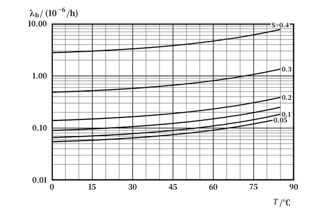

<strong>图 48 机电继电器灯负载基本失效率曲线（额定温度 85℃）</strong>

<strong>表 263 阻性负载基本失效率 <i>λ</i>b（额定温度 125℃）</strong>

单位为 10−6/h

<table>
  <thead>
    <tr>
      <th rowspan="2"><i>T</i> ℃</th>
      <th colspan="11"><i>S</i></th>
    </tr>
    <tr>
      <th>0.05</th>
      <th>0.1</th>
      <th>0.2</th>
      <th>0.3</th>
      <th>0.4</th>
      <th>0.5</th>
      <th>0.6</th>
      <th>0.7</th>
      <th>0.8</th>
      <th>0.9</th>
      <th>1.0</th>
    </tr>
  </thead>
  <tbody>
    <tr><td>0</td><td>0.052 6</td><td>0.053 2</td><td>0.055 8</td><td>0.060 3</td><td>0.067 3</td><td>0.077 5</td><td>0.092 0</td><td>0.112 7</td><td>0.142 5</td><td>0.185 8</td><td>0.250 1</td></tr>
    <tr><td>5</td><td>0.053 6</td><td>0.054 2</td><td>0.056 8</td><td>0.061 4</td><td>0.068 5</td><td>0.078 9</td><td>0.093 7</td><td>0.114 8</td><td>0.145 1</td><td>0.189 2</td><td>0.254 6</td></tr>
    <tr><td>10</td><td>0.054 6</td><td>0.055 3</td><td>0.057 9</td><td>0.062 6</td><td>0.069 9</td><td>0.080 4</td><td>0.095 5</td><td>0.117 0</td><td>0.147 9</td><td>0.192 9</td><td>0.259 6</td></tr>
    <tr><td>15</td><td>0.055 8</td><td>0.056 5</td><td>0.059 2</td><td>0.064 0</td><td>0.071 4</td><td>0.082 1</td><td>0.097 5</td><td>0.119 5</td><td>0.151 1</td><td>0.197 0</td><td>0.265 1</td></tr>
    <tr><td>20</td><td>0.057 1</td><td>0.057 8</td><td>0.060 5</td><td>0.065 4</td><td>0.073 0</td><td>0.084 0</td><td>0.099 8</td><td>0.122 3</td><td>0.154 6</td><td>0.201 6</td><td>0.271 3</td></tr>
    <tr><td>25</td><td>0.058 5</td><td>0.059 2</td><td>0.062 0</td><td>0.067 1</td><td>0.074 8</td><td>0.086 1</td><td>0.102 3</td><td>0.125 3</td><td>0.158 4</td><td>0.206 6</td><td>0.278 0</td></tr>
    <tr><td>30</td><td>0.060 1</td><td>0.060 8</td><td>0.063 7</td><td>0.068 9</td><td>0.076 8</td><td>0.088 4</td><td>0.105 0</td><td>0.128 7</td><td>0.162 6</td><td>0.212 1</td><td>0.285 4</td></tr>
    <tr><td>35</td><td>0.061 8</td><td>0.062 5</td><td>0.065 5</td><td>0.070 8</td><td>0.079 0</td><td>0.091 0</td><td>0.108 0</td><td>0.132 4</td><td>0.167 3</td><td>0.218 2</td><td>0.293 6</td></tr>
    <tr><td>40</td><td>0.063 7</td><td>0.064 5</td><td>0.067 6</td><td>0.073 0</td><td>0.081 5</td><td>0.093 8</td><td>0.111 4</td><td>0.136 5</td><td>0.172 5</td><td>0.225 0</td><td>0.302 7</td></tr>
    <tr><td>45</td><td>0.065 8</td><td>0.066 6</td><td>0.069 8</td><td>0.075 5</td><td>0.084 2</td><td>0.096 9</td><td>0.115 1</td><td>0.141 0</td><td>0.178 2</td><td>0.232 5</td><td>0.312 8</td></tr>
    <tr><td>50</td><td>0.068 2</td><td>0.069 0</td><td>0.072 3</td><td>0.078 2</td><td>0.087 2</td><td>0.100 4</td><td>0.119 2</td><td>0.146 0</td><td>0.184 6</td><td>0.240 8</td><td>0.324 0</td></tr>
    <tr><td>55</td><td>0.070 8</td><td>0.071 6</td><td>0.075 1</td><td>0.081 2</td><td>0.090 5</td><td>0.104 2</td><td>0.123 7</td><td>0.151 6</td><td>0.191 7</td><td>0.250 0</td><td>0.336 4</td></tr>
    <tr><td>60</td><td>0.073 7</td><td>0.074 5</td><td>0.078 1</td><td>0.084 5</td><td>0.094 2</td><td>0.108 5</td><td>0.128 8</td><td>0.157 8</td><td>0.199 5</td><td>0.260 2</td><td>0.350 1</td></tr>
    <tr><td>65</td><td>0.076 9</td><td>0.077 8</td><td>0.081 5</td><td>0.088 2</td><td>0.098 4</td><td>0.113 2</td><td>0.134 5</td><td>0.164 7</td><td>0.208 2</td><td>0.271 6</td><td>0.365 5</td></tr>
    <tr><td>70</td><td>0.080 5</td><td>0.081 5</td><td>0.085 4</td><td>0.092 3</td><td>0.103 0</td><td>0.118 5</td><td>0.140 7</td><td>0.172 4</td><td>0.218 0</td><td>0.284 3</td><td>0.382 6</td></tr>
    <tr><td>75</td><td>0.084 5</td><td>0.085 5</td><td>0.089 6</td><td>0.096 9</td><td>0.108 1</td><td>0.124 4</td><td>0.147 8</td><td>0.181 1</td><td>0.228 9</td><td>0.298 5</td><td>0.401 7</td></tr>
    <tr><td>80</td><td>0.089 0</td><td>0.090 1</td><td>0.094 4</td><td>0.102 1</td><td>0.113 9</td><td>0.131 1</td><td>0.155 7</td><td>0.190 7</td><td>0.241 1</td><td>0.314 5</td><td>0.423 1</td></tr>
    <tr><td>85</td><td>0.094 1</td><td>0.095 2</td><td>0.099 8</td><td>0.107 9</td><td>0.120 4</td><td>0.138 5</td><td>0.164 5</td><td>0.201 6</td><td>0.254 8</td><td>0.332 3</td><td>0.447 2</td></tr>
    <tr><td>90</td><td>0.099 8</td><td>0.101 0</td><td>0.105 8</td><td>0.114 4</td><td>0.127 7</td><td>0.146 9</td><td>0.174 5</td><td>0.213 8</td><td>0.270 3</td><td>0.352 5</td><td>0.474 3</td></tr>
    <tr><td>95</td><td>0.106 2</td><td>0.107 5</td><td>0.112 7</td><td>0.121 8</td><td>0.135 9</td><td>0.156 4</td><td>0.185 7</td><td>0.227 6</td><td>0.287 7</td><td>0.375 2</td><td>0.504 9</td></tr>
    <tr><td>100</td><td>0.113 5</td><td>0.114 9</td><td>0.120 4</td><td>0.130 2</td><td>0.145 2</td><td>0.167 1</td><td>0.198 5</td><td>0.243 2</td><td>0.307 4</td><td>0.401 0</td><td>0.539 5</td></tr>
    <tr><td>105</td><td>0.121 8</td><td>0.123 3</td><td>0.129 2</td><td>0.139 7</td><td>0.155 8</td><td>0.179 3</td><td>0.213 0</td><td>0.260 9</td><td>0.329 8</td><td>0.430 2</td><td>0.578 9</td></tr>
    <tr><td>110</td><td>0.131 2</td><td>0.132 8</td><td>0.139 2</td><td>0.150 5</td><td>0.167 9</td><td>0.193 2</td><td>0.229 5</td><td>0.281 1</td><td>0.355 4</td><td>0.463 5</td><td>0.623 7</td></tr>
    <tr><td>115</td><td>0.142 0</td><td>0.143 7</td><td>0.150 6</td><td>0.162 8</td><td>0.181 7</td><td>0.209 1</td><td>0.248 3</td><td>0.304 2</td><td>0.384 6</td><td>0.501 6</td><td>0.675 0</td></tr>
    <tr><td>120</td><td>0.154 4</td><td>0.156 2</td><td>0.163 7</td><td>0.177 1</td><td>0.197 5</td><td>0.227 3</td><td>0.270 0</td><td>0.330 8</td><td>0.418 1</td><td>0.545 4</td><td>0.733 9</td></tr>
    <tr><td>125</td><td>0.168 7</td><td>0.170 7</td><td>0.178 9</td><td>0.193 4</td><td>0.215 8</td><td>0.248 4</td><td>0.294 9</td><td>0.361 4</td><td>0.456 8</td><td>0.595 8</td><td>0.801 7</td></tr>
    <tr>
      <td colspan="12" align="left">
        注：<i>T</i> 为工作环境温度。 
        &emsp;&emsp;<i>S</i> 为实际触点负载电流与额定触电负载电流的比值。
      </td>
    </tr>
  </tbody>
</table>

146

---

<strong>GJB/Z 299D—2024</strong>

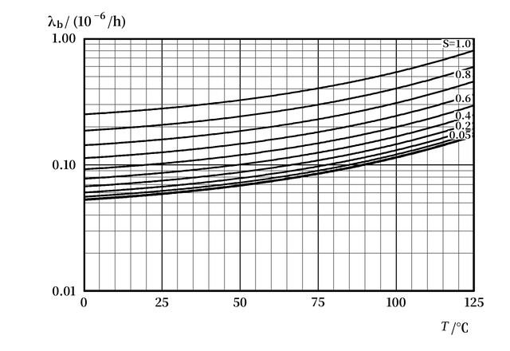

<strong>图 49 机电继电器阻性负载基本失效率曲线（额定温度 125℃）</strong>

<strong>表 264 感性负载基本失效率 <i>λ</i>b（额定温度 125℃）</strong>

单位为 10−6/h

<table>
  <thead>
    <tr>
      <th rowspan="2"><i>T</i> ℃</th>
      <th colspan="8"><i>S</i></th>
    </tr>
    <tr>
      <th>0.05</th>
      <th>0.1</th>
      <th>0.2</th>
      <th>0.3</th>
      <th>0.4</th>
      <th>0.5</th>
      <th>0.6</th>
      <th>0.7</th>
    </tr>
  </thead>
  <tbody>
    <tr><td>0</td><td>0.053 2</td><td>0.055 8</td><td>0.067 3</td><td>0.092 0</td><td>0.142 5</td><td>0.250 1</td><td>0.497 3</td><td>1.120 7</td></tr>
    <tr><td>5</td><td>0.054 2</td><td>0.056 8</td><td>0.068 5</td><td>0.093 7</td><td>0.145 1</td><td>0.254 6</td><td>0.506 3</td><td>1.141 1</td></tr>
    <tr><td>10</td><td>0.055 3</td><td>0.057 9</td><td>0.069 9</td><td>0.095 5</td><td>0.147 9</td><td>0.259 6</td><td>0.516 3</td><td>1.163 5</td></tr>
    <tr><td>15</td><td>0.056 5</td><td>0.059 2</td><td>0.071 4</td><td>0.097 5</td><td>0.151 1</td><td>0.265 1</td><td>0.527 3</td><td>1.188 3</td></tr>
    <tr><td>20</td><td>0.057 8</td><td>0.060 5</td><td>0.073 0</td><td>0.099 8</td><td>0.154 6</td><td>0.271 3</td><td>0.539 4</td><td>1.215 7</td></tr>
    <tr><td>25</td><td>0.059 2</td><td>0.062 0</td><td>0.074 8</td><td>0.102 3</td><td>0.158 4</td><td>0.278 0</td><td>0.552 8</td><td>1.245 8</td></tr>
    <tr><td>30</td><td>0.060 8</td><td>0.063 7</td><td>0.076 8</td><td>0.105 0</td><td>0.162 6</td><td>0.285 4</td><td>0.567 6</td><td>1.279 2</td></tr>
    <tr><td>35</td><td>0.062 5</td><td>0.065 5</td><td>0.079 0</td><td>0.108 0</td><td>0.167 3</td><td>0.293 6</td><td>0.584 0</td><td>1.316 0</td></tr>
    <tr><td>40</td><td>0.064 5</td><td>0.067 6</td><td>0.081 5</td><td>0.111 4</td><td>0.172 5</td><td>0.302 7</td><td>0.602 1</td><td>1.356 8</td></tr>
    <tr><td>45</td><td>0.066 6</td><td>0.069 8</td><td>0.084 2</td><td>0.115 1</td><td>0.178 2</td><td>0.312 8</td><td>0.622 1</td><td>1.401 9</td></tr>
    <tr><td>50</td><td>0.069 0</td><td>0.072 3</td><td>0.087 2</td><td>0.119 2</td><td>0.184 6</td><td>0.324 0</td><td>0.644 3</td><td>1.451 9</td></tr>
    <tr><td>55</td><td>0.071 6</td><td>0.075 1</td><td>0.090 5</td><td>0.123 7</td><td>0.191 7</td><td>0.336 4</td><td>0.668 9</td><td>1.507 5</td></tr>
    <tr><td>60</td><td>0.074 5</td><td>0.078 1</td><td>0.094 2</td><td>0.128 8</td><td>0.199 5</td><td>0.350 1</td><td>0.696 3</td><td>1.569 2</td></tr>
    <tr><td>65</td><td>0.077 8</td><td>0.081 5</td><td>0.098 4</td><td>0.134 5</td><td>0.208 2</td><td>0.365 5</td><td>0.726 8</td><td>1.637 9</td></tr>
    <tr><td>70</td><td>0.081 5</td><td>0.085 4</td><td>0.103 0</td><td>0.140 7</td><td>0.218 0</td><td>0.382 6</td><td>0.760 9</td><td>1.714 6</td></tr>
    <tr><td>75</td><td>0.085 5</td><td>0.089 6</td><td>0.108 1</td><td>0.147 8</td><td>0.228 9</td><td>0.401 7</td><td>0.798 9</td><td>1.800 4</td></tr>
    <tr><td>80</td><td>0.090 1</td><td>0.094 4</td><td>0.113 9</td><td>0.155 7</td><td>0.241 1</td><td>0.423 1</td><td>0.841 5</td><td>1.896 4</td></tr>
    <tr><td>85</td><td>0.095 2</td><td>0.099 8</td><td>0.120 4</td><td>0.164 5</td><td>0.254 8</td><td>0.447 2</td><td>0.889 4</td><td>2.004 3</td></tr>
    <tr><td>90</td><td>0.101 0</td><td>0.105 8</td><td>0.127 7</td><td>0.174 5</td><td>0.270 3</td><td>0.474 3</td><td>0.943 3</td><td>2.125 7</td></tr>
    <tr><td>95</td><td>0.107 5</td><td>0.112 7</td><td>0.135 9</td><td>0.185 7</td><td>0.287 7</td><td>0.504 9</td><td>1.004 1</td><td>2.262 8</td></tr>
    <tr><td>100</td><td>0.114 9</td><td>0.120 4</td><td>0.145 2</td><td>0.198 5</td><td>0.307 4</td><td>0.539 5</td><td>1.073 0</td><td>2.418 0</td></tr>
    <tr><td>105</td><td>0.123 3</td><td>0.129 2</td><td>0.155 8</td><td>0.213 0</td><td>0.329 8</td><td>0.578 9</td><td>1.151 2</td><td>2.594 4</td></tr>
    <tr><td>110</td><td>0.132 8</td><td>0.139 2</td><td>0.167 9</td><td>0.229 5</td><td>0.355 4</td><td>0.623 7</td><td>1.240 4</td><td>2.795 3</td></tr>
    <tr><td>115</td><td>0.143 7</td><td>0.150 6</td><td>0.181 7</td><td>0.248 3</td><td>0.384 6</td><td>0.675 0</td><td>1.342 4</td><td>3.025 1</td></tr>
    <tr><td>120</td><td>0.156 2</td><td>0.163 7</td><td>0.197 5</td><td>0.270 0</td><td>0.418 1</td><td>0.733 9</td><td>1.459 5</td><td>3.288 9</td></tr>
    <tr><td>125</td><td>0.170 7</td><td>0.178 9</td><td>0.215 8</td><td>0.294 9</td><td>0.456 8</td><td>0.801 7</td><td>1.594 4</td><td>3.593 0</td></tr>
    <tr>
      <td colspan="9" align="left">
        注：“— · —”为电机在额定切换电压下负载电流的额定线。 
        &emsp;&emsp;“——”为电感在额定切换电压下负载电流的额定线。 
        &emsp;&emsp;<i>T</i> 为工作环境温度。 
        &emsp;&emsp;<i>S</i> 为实际触点负载电流与额定触电负载电流的比值。
      </td>
    </tr>
  </tbody>
</table>

147

---

<strong>GJB/Z 299D—2024</strong>

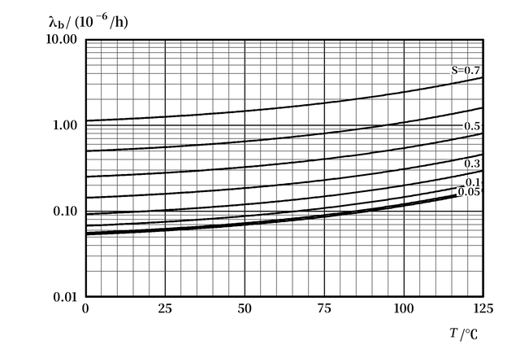

<strong>图 50 机电继电器感性负载基本失效率曲线（额定温度 125℃）</strong>

<strong>表 265 灯负载基本失效率 <i>λ</i>b（额定温度 125℃）</strong>

单位为 10−6/h

<table>
  <thead>
    <tr>
      <th rowspan="2"><i>T</i> ℃</th>
      <th colspan="6"><i>S</i></th>
    </tr>
    <tr>
      <th>0.05</th>
      <th>0.1</th>
      <th>0.15</th>
      <th>0.2</th>
      <th>0.3</th>
      <th>0.4</th>
    </tr>
  </thead>
  <tbody>
    <tr><td>0</td><td>0.055 8</td><td>0.067 3</td><td>0.092 0</td><td>0.142 5</td><td>0.497 3</td><td>2.861 7</td></tr>
    <tr><td>5</td><td>0.056 8</td><td>0.068 5</td><td>0.093 7</td><td>0.145 1</td><td>0.506 3</td><td>2.913 8</td></tr>
    <tr><td>10</td><td>0.057 9</td><td>0.069 9</td><td>0.095 5</td><td>0.147 9</td><td>0.516 3</td><td>2.971 2</td></tr>
    <tr><td>15</td><td>0.059 2</td><td>0.071 4</td><td>0.097 5</td><td>0.151 1</td><td>0.527 3</td><td>3.034 5</td></tr>
    <tr><td>20</td><td>0.060 5</td><td>0.073 0</td><td>0.099 8</td><td>0.154 6</td><td>0.539 4</td><td>3.104 3</td></tr>
    <tr><td>25</td><td>0.062 0</td><td>0.074 8</td><td>0.102 3</td><td>0.158 4</td><td>0.552 8</td><td>3.181 4</td></tr>
    <tr><td>30</td><td>0.063 7</td><td>0.076 8</td><td>0.105 0</td><td>0.162 6</td><td>0.567 6</td><td>3.266 5</td></tr>
    <tr><td>35</td><td>0.065 5</td><td>0.079 0</td><td>0.108 0</td><td>0.167 3</td><td>0.584 0</td><td>3.360 6</td></tr>
    <tr><td>40</td><td>0.067 6</td><td>0.081 5</td><td>0.111 4</td><td>0.172 5</td><td>0.602 1</td><td>3.464 7</td></tr>
    <tr><td>45</td><td>0.069 8</td><td>0.084 2</td><td>0.115 1</td><td>0.178 2</td><td>0.622 1</td><td>3.579 9</td></tr>
    <tr><td>50</td><td>0.072 3</td><td>0.087 2</td><td>0.119 2</td><td>0.184 6</td><td>0.644 3</td><td>3.707 6</td></tr>
    <tr><td>55</td><td>0.075 1</td><td>0.090 5</td><td>0.123 7</td><td>0.191 7</td><td>0.668 9</td><td>3.849 4</td></tr>
    <tr><td>60</td><td>0.078 1</td><td>0.094 2</td><td>0.128 8</td><td>0.199 5</td><td>0.696 3</td><td>4.007 1</td></tr>
    <tr><td>65</td><td>0.081 5</td><td>0.098 4</td><td>0.134 5</td><td>0.208 2</td><td>0.726 8</td><td>4.182 6</td></tr>
    <tr><td>70</td><td>0.085 4</td><td>0.103 0</td><td>0.140 7</td><td>0.218 0</td><td>0.760 9</td><td>4.378 5</td></tr>
    <tr><td>75</td><td>0.089 6</td><td>0.108 1</td><td>0.147 8</td><td>0.228 9</td><td>0.798 9</td><td>4.597 4</td></tr>
    <tr><td>80</td><td>0.094 4</td><td>0.113 9</td><td>0.155 7</td><td>0.241 1</td><td>0.841 5</td><td>4.842 7</td></tr>
    <tr><td>85</td><td>0.099 8</td><td>0.120 4</td><td>0.164 5</td><td>0.254 8</td><td>0.889 4</td><td>5.118 1</td></tr>
    <tr><td>90</td><td>0.105 8</td><td>0.127 7</td><td>0.174 5</td><td>0.270 3</td><td>0.943 3</td><td>5.428 2</td></tr>
    <tr><td>95</td><td>0.112 7</td><td>0.135 9</td><td>0.185 7</td><td>0.287 7</td><td>1.004 1</td><td>5.778 3</td></tr>
    <tr><td>100</td><td>0.120 4</td><td>0.145 2</td><td>0.198 5</td><td>0.307 4</td><td>1.073 0</td><td>6.174 7</td></tr>
    <tr><td>105</td><td>0.129 2</td><td>0.155 8</td><td>0.213 0</td><td>0.329 8</td><td>1.151 2</td><td>6.624 9</td></tr>
    <tr><td>110</td><td>0.139 2</td><td>0.167 9</td><td>0.229 5</td><td>0.355 4</td><td>1.240 4</td><td>7.138 1</td></tr>
    <tr><td>115</td><td>0.150 6</td><td>0.181 7</td><td>0.248 3</td><td>0.384 6</td><td>1.342 4</td><td>7.724 9</td></tr>
    <tr><td>120</td><td>0.163 7</td><td>0.197 5</td><td>0.270 0</td><td>0.418 1</td><td>1.459 5</td><td>8.398 6</td></tr>
    <tr><td>125</td><td>0.178 9</td><td>0.215 8</td><td>0.294 9</td><td>0.456 8</td><td>1.594 4</td><td>9.175 0</td></tr>
    <tr>
      <td colspan="7" align="left">
        注：“——”为灯在额定切换电压下负载电流的额定线。 
        &emsp;&emsp;<i>T</i> 为工作环境温度。 
        &emsp;&emsp;<i>S</i> 为实际触点负载电流与额定触电负载电流的比值。
      </td>
    </tr>
  </tbody>
</table>

148

---

<strong>GJB/Z 299D—2024</strong>

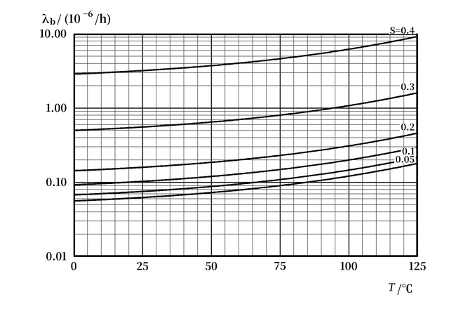

<strong>图 51 机电继电器灯负载基本失效率曲线（额定温度 125℃）</strong>

<strong>表 266 环境系数 <i>π</i>E</strong>

<table>
  <tbody>
    <tr>
      <th>环境</th>
      <th>GB</th>
      <th>GMS</th>
      <th>GF1</th>
      <th>GF2</th>
      <th>GM1</th>
      <th>GM2</th>
      <th>MP</th>
      <th>NSB</th>
      <th>NS1</th>
      <th>NS2</th>
    </tr>
    <tr>
      <td><i>π</i>E</td>
      <td>1.0</td>
      <td>1.1</td>
      <td>1.5</td>
      <td>3.0</td>
      <td>4.0</td>
      <td>8.5</td>
      <td>6.0</td>
      <td>5.0</td>
      <td>3.0</td>
      <td>6.0</td>
    </tr>
    <tr>
      <th>环境</th>
      <th>NU</th>
      <th>AIF</th>
      <th>AUF</th>
      <th>AIC</th>
      <th>AUC</th>
      <th>ARW</th>
      <th>SF</th>
      <th>ML</th>
      <th>MF</th>
      <th>—</th>
    </tr>
    <tr>
      <td><i>π</i>E</td>
      <td>14</td>
      <td>6.0</td>
      <td>11</td>
      <td>4.5</td>
      <td>8.0</td>
      <td>31</td>
      <td>1.0</td>
      <td>45</td>
      <td>22</td>
      <td>—</td>
    </tr>
  </tbody>
</table>

<strong>表 267 质量等级与质量系数 <i>π</i>Q</strong>

<table>
  <thead>
    <tr>
      <th colspan="2">质量等级</th>
      <th>质量要求说明</th>
      <th>质量要求补充说明</th>
      <th><i>π</i>Q</th>
    </tr>
  </thead>
  <tbody>
    <tr>
      <td rowspan="5">A</td>
      <td>A1R</td>
      <td align="left">符合 GJB 65B-1999、GJB 2888A-2011，且列入军用电子元器件合格产品目录（QPL）的 R 级产品</td>
      <td align="left">符合 GJB 65A-1991、GJB 2888-1997 且列入军用电子元器件合格产品目录（QPL）的 Q 级产品</td>
      <td>—</td>
    </tr>
    <tr>
      <td>A1P</td>
      <td align="left">符合 GJB 65B-1999、GJB 2888A-2011，且列入军用电子元器件合格产品目录（QPL）的 P 级产品 符合 GJB 1461-1992，且列入军用电子元器件合格产品目录（QPL）的 L 级产品</td>
      <td align="left">符合 GJB 65A-1991、GJB 2888-1997 且列入军用电子元器件合格产品目录（QPL）的 L 级产品</td>
      <td>0.08</td>
    </tr>
    <tr>
      <td>A1M</td>
      <td align="left">符合 GJB 65B-1999、GJB 2888A-2011，且列入军用电子元器件合格产品目录（QPL）的 M 级产品 符合 GJB 1461-1992，且列入军用电子元器件合格产品目录（QPL）的 W 级产品</td>
      <td align="left">符合 GJB 65A-1991、GJB 2888-1997 且列入军用电子元器件合格产品目录（QPL）的 W 级产品</td>
      <td>0.15</td>
    </tr>
    <tr>
      <td>A1L</td>
      <td align="left">符合 GJB 65B-1999、GJB 2888A-2011，且列入军用电子元器件合格产品目录（QPL）的 L 级产品 符合 GJB 1461-1992，且列入军用电子元器件合格产品目录（QPL）的 Y 级产品 符合 GJB 1042A-2002、GJB 1429-1992、GJB 1434-1992、GJB 1436-1992、GJB 1513A-2009、GJB 1514-1992、GJB 1517A-2011、GJB 2449-1995、GJB 2820-1997，且列入军用电子元器件合格产品目录（QPL）的产品 符合企业军用标准，且列入军用电子元器件合格产品目录（QPL）的产品</td>
      <td align="left">符合 GJB 65A-1991、GJB 2888-1997 且列入军用电子元器件合格产品目录（QPL）的 Y 级产品 符合 GJB 1042-1990、GJB 1513-1992、GJB 1517-1992，且列入军用电子元器件合格产品目录（QPL）的产品</td>
      <td>0.2</td>
    </tr>
    <tr>
      <td>A2</td>
      <td align="left">符合 GJB 65B-1999、GJB 1042A-2002、GJB 1429-1992、GJB 1434-1992、GJB 1436-1992、GJB 1513A-2009、GJB 1514-1992、GJB 1517A-2011、GJB 2449-1995、GJB 2820-1997、GJB 2888A-2011，但未列入军用电子元器件合格产品目录（QPL）的产品</td>
      <td align="left">符合 GJB 65A-1991、GJB 2888-1997、GJB 1042-1990、GJB 1513-1992、GJB 1517-1992，但未列入军用电子元器件合格产品目录（QPL）的产品</td>
      <td>0.3</td>
    </tr>
  </tbody>
</table>

149

---

<strong>GJB/Z 299D—2024</strong>

<strong>表 267(续)</strong>

<table>
  <thead>
    <tr>
      <th colspan="2">质量等级</th>
      <th>质量要求说明</th>
      <th>质量要求补充说明</th>
      <th><i>π</i>Q</th>
    </tr>
  </thead>
  <tbody>
    <tr>
      <td rowspan="2">B</td>
      <td>B1</td>
      <td colspan="2" align="left">按军用标准的筛选要求进行筛选的 B2 质量等级的产品</td>
      <td>0.6</td>
    </tr>
    <tr>
      <td>B2</td>
      <td colspan="2" align="left">符合 SJ 2386-1983、SJ 2456-1984 的产品</td>
      <td>1.0</td>
    </tr>
    <tr>
      <td colspan="2">C</td>
      <td colspan="2" align="left">低档产品</td>
      <td>5.0</td>
    </tr>
  </tbody>
</table>

<strong>表 268 触点系数 <i>π</i>C1</strong>

<table>
  <thead>
    <tr>
      <th>触点数</th>
      <th><i>π</i>C1</th>
    </tr>
  </thead>
  <tbody>
    <tr><td>1</td><td>1.0</td></tr>
    <tr><td>2</td><td>1.5</td></tr>
    <tr><td>3</td><td>2.0</td></tr>
    <tr><td>4</td><td>2.5</td></tr>
    <tr><td>6</td><td>4.2</td></tr>
    <tr><td>8</td><td>5.5</td></tr>
    <tr><td>12</td><td>8.0</td></tr>
    <tr>
      <td colspan="2" align="left">注：表中的触点数是指有效传导触点数，如双刀双掷按 4 个有效传导触点计。</td>
    </tr>
  </tbody>
</table>

<strong>表 269 额定负载系数 <i>π</i>r</strong>

<table>
  <thead>
    <tr>
      <th>触点负载额定值 <i>I</i> A</th>
      <th><i>I</i> ≤ 1</th>
      <th>1 &lt; <i>I</i> &lt; 10</th>
      <th>10 ≤ <i>I</i> &lt; 50</th>
      <th><i>I</i> ≥ 50</th>
    </tr>
  </thead>
  <tbody>
    <tr>
      <td><i>π</i>r</td>
      <td>1.2</td>
      <td>1.0</td>
      <td>2.0</td>
      <td>3.0</td>
    </tr>
  </tbody>
</table>

<strong>表 270 动作速率系数 <i>π</i>CYC</strong>

<table>
  <thead>
    <tr>
      <th>动作速率 <i>f</i> 次/时</th>
      <th><i>π</i>CYC</th>
    </tr>
  </thead>
  <tbody>
    <tr><td>&gt; 1</td><td><i>f</i>/10</td></tr>
    <tr><td>≤ 1</td><td>0.1</td></tr>
    <tr>
      <td colspan="2" align="left">注：超过继电器设计极限的动作速率则 <i>π</i>CYC 值无效。</td>
    </tr>
  </tbody>
</table>

<strong>表 271 应用系数 <i>π</i>A</strong>

<table>
  <thead>
    <tr>
      <th colspan="2">应用类别</th>
      <th><i>π</i>A</th>
    </tr>
  </thead>
  <tbody>
    <tr>
      <td rowspan="3">通用</td>
      <td>弱功率</td>
      <td>0.42</td>
    </tr>
    <tr>
      <td>中功率</td>
      <td>0.20</td>
    </tr>
    <tr>
      <td>强功率</td>
      <td>0.90</td>
    </tr>
    <tr>
      <td colspan="2">灵敏</td>
      <td>1.7</td>
    </tr>
    <tr>
      <td colspan="2">高速</td>
      <td>3.0</td>
    </tr>
    <tr>
      <td colspan="2">磁保持</td>
      <td>0.96</td>
    </tr>
    <tr>
      <td colspan="2">振簧</td>
      <td>1.0</td>
    </tr>
    <tr>
      <td colspan="2">电子延时</td>
      <td>2.6</td>
    </tr>
    <tr>
      <td colspan="2">热延时</td>
      <td>3.0</td>
    </tr>
    <tr>
      <td colspan="2">温度</td>
      <td>2.8</td>
    </tr>
    <tr>
      <td colspan="2">高压</td>
      <td>3.0</td>
    </tr>
    <tr>
      <td colspan="2">射频</td>
      <td>2.8</td>
    </tr>
    <tr>
      <td colspan="2">风速</td>
      <td>17.2</td>
    </tr>
  </tbody>
</table>

150

---

<strong>GJB/Z 299D—2024</strong>

<strong>表 272 结构系数 <i>π</i>C</strong>

<table>
  <thead>
    <tr>
      <th>结构形式</th>
      <th><i>π</i>C</th>
    </tr>
  </thead>
  <tbody>
    <tr><td>平衡衔铁</td><td>5.0</td></tr>
    <tr><td>衔铁式</td><td>3.5</td></tr>
    <tr><td>磁保持</td><td>3.2</td></tr>
    <tr><td>干簧</td><td>3.0</td></tr>
    <tr><td>湿簧</td><td>1.0</td></tr>
    <tr><td>双金属</td><td>5.0</td></tr>
    <tr><td>真空（玻璃）</td><td>7.0</td></tr>
    <tr><td>真空（陶瓷）</td><td>2.4</td></tr>
    <tr><td>螺管式（接触器）</td><td>10</td></tr>
  </tbody>
</table>

<strong>表 273 封装系数 <i>π</i>P</strong>

<table>
  <thead>
    <tr>
      <th>封装结构</th>
      <th>气密性密封 （漏率小于或等于 1 × 10−3Pa·cm3/s）</th>
      <th>密封 （漏率小于或等于 1 × 10−1Pa·cm3/s）</th>
      <th>塑料和环氧 树脂封装</th>
    </tr>
  </thead>
  <tbody>
    <tr>
      <td><i>π</i>P</td>
      <td>0.4</td>
      <td>1.0</td>
      <td>3.0</td>
    </tr>
  </tbody>
</table>

#### 5.11.2 固体继电器

详细预计固体继电器工作失效率的方法是采用元器件应力分析可靠性预计法，将构成固体继电器的所有单个元器件的失效率相加，而单个元器件的失效率可由本章所提供的模型给出。如果缺乏应力分析信息，单个元器件的失效率可由第 6 章所提供的通用失效率近似地给出。

如果缺乏产品的元器件清单和线路图，还可采用式（69）较简便、合适的近似预计模型：

$$\lambda_{\text{p}} = \lambda_{\text{b}}\pi_{\text{E}}\pi_{\text{Q}}\pi_{\text{L}}\pi_{\text{C2}}\pi_{\text{P}}\pi_{\text{S}} \tag{69}$$

式中：
$\lambda_{\text{p}}$ ——工作失效率，$10^{-6}/\text{h}$；
$\lambda_{\text{b}}$ ——基本失效率，$10^{-6}/\text{h}$，取值为 0.125；
$\pi_{\text{E}}$ ——环境系数，见表 274；
$\pi_{\text{Q}}$ ——质量系数，见表 275；
$\pi_{\text{L}}$ ——成熟系数，见表 276；
$\pi_{\text{C2}}$ ——结构系数，$\pi_{\text{C2}} = N(1.1)^{(N-1)}$，$N$ 为输出电路路数；
$\pi_{\text{P}}$ ——封装系数，见表 277；
$\pi_{\text{S}}$ ——电应力系数，$\pi_{\text{S}} = \pi_{\text{SI}}\pi_{\text{SV}}$；
$\pi_{\text{SI}}$ ——输出电流系数，见表 278；
$\pi_{\text{SV}}$ ——瞬态电压系数，见表 279。

<strong>表 274 环境系数 <i>π</i>E</strong>

<table>
  <tbody>
    <tr>
      <th>环境</th>
      <th>GB</th>
      <th>GMS</th>
      <th>GF1</th>
      <th>GF2</th>
      <th>GM1</th>
      <th>GM2</th>
      <th>MP</th>
      <th>NSB</th>
      <th>NS1</th>
      <th>NS2</th>
    </tr>
    <tr>
      <td><i>π</i>E</td>
      <td>1.0</td>
      <td>1.2</td>
      <td>2.0</td>
      <td>5.5</td>
      <td>6.0</td>
      <td>11</td>
      <td>7.5</td>
      <td>6.3</td>
      <td>4.0</td>
      <td>8.0</td>
    </tr>
    <tr>
      <th>环境</th>
      <th>NU</th>
      <th>AIF</th>
      <th>AUF</th>
      <th>AIC</th>
      <th>AUC</th>
      <th>ARW</th>
      <th>SF</th>
      <th>ML</th>
      <th>MF</th>
      <th>—</th>
    </tr>
    <tr>
      <td><i>π</i>E</td>
      <td>14</td>
      <td>15</td>
      <td>20</td>
      <td>8.5</td>
      <td>12</td>
      <td>16</td>
      <td>0.8</td>
      <td>30</td>
      <td>14</td>
      <td>—</td>
    </tr>
  </tbody>
</table>

151

---

<strong>GJB/Z 299D—2024</strong>

<strong>表 275 质量等级与质量系数 <i>π</i>Q</strong>

<table>
  <thead>
    <tr>
      <th colspan="2">质量等级</th>
      <th>质量要求说明</th>
      <th>质量要求补充说明</th>
      <th><i>π</i>Q</th>
    </tr>
  </thead>
  <tbody>
    <tr>
      <td rowspan="3">A</td>
      <td>A1Y</td>
      <td align="left">符合 GJB 1515A-2001 按 Y 级筛选，且列入军用电子元器件合格产品目录（QPL）的产品</td>
      <td align="left">符合 GJB 1515-1992 按 Y 级筛选，且列入军用电子元器件合格产品目录（QPL）的产品</td>
      <td>0.15</td>
    </tr>
    <tr>
      <td>A1W</td>
      <td align="left">符合 GJB 1515A-2001 按 W 级筛选，且列入军用电子元器件合格产品目录（QPL）的产品 符合企业军用标准，且列入军用电子元器件合格产品目录（QPL）的产品</td>
      <td align="left">符合 GJB 1515-1992 按 W 级筛选，且列入军用电子元器件合格产品目录（QPL）的产品</td>
      <td>0.30</td>
    </tr>
    <tr>
      <td>A2</td>
      <td align="left">符合 GJB 1515A-2001，但未列入军用电子元器件合格产品目录（QPL）的 Y 级筛选产品</td>
      <td align="left">符合 GJB 1515-1992，但未列入军用电子元器件合格产品目录（QPL）的 Y 级筛选产品</td>
      <td>0.40</td>
    </tr>
    <tr>
      <td rowspan="2">B</td>
      <td>B1</td>
      <td align="left">执行 GJB 1515A-2001 经 W 级筛选的产品</td>
      <td align="left">执行 GJB 1515-1992 经 W 级筛选的产品</td>
      <td>0.50</td>
    </tr>
    <tr>
      <td>B2</td>
      <td colspan="2" align="left">符合国家标准的产品</td>
      <td>1.0</td>
    </tr>
    <tr>
      <td colspan="2">C</td>
      <td colspan="2" align="left">低档产品</td>
      <td>5.0</td>
    </tr>
  </tbody>
</table>

<strong>表 276 成熟系数 <i>π</i>L</strong>

<table>
  <thead>
    <tr>
      <th>成熟程度</th>
      <th>符合相应的标准或技术 条件，已稳定生产的产品</th>
      <th>质量尚未稳定的产品</th>
      <th>试制品或新投产的初批次产品；设计或工艺上有 重大变更；长期中断生产或生产线有重大变化</th>
    </tr>
  </thead>
  <tbody>
    <tr>
      <td><i>π</i>L</td>
      <td>1.0</td>
      <td>3.0</td>
      <td>10</td>
    </tr>
  </tbody>
</table>

<strong>表 277 封装系数 <i>π</i>P</strong>

<table>
  <thead>
    <tr>
      <th>封装结构</th>
      <th>气密性密封 （漏率小于或等于 1 × 10−3Pa·cm3/s）</th>
      <th>密封 （漏率小于或等于 1 × 10−1Pa·cm3/s）</th>
      <th>塑料和环氧 树脂封装</th>
    </tr>
  </thead>
  <tbody>
    <tr>
      <td><i>π</i>P</td>
      <td>0.4</td>
      <td>1.0</td>
      <td>3.0</td>
    </tr>
  </tbody>
</table>

<strong>表 278 输出电流系数 <i>π</i>SI</strong>

<table>
  <thead>
    <tr>
      <th rowspan="2"><i>I</i><i>I</i>M</th>
      <th colspan="13"><i>I</i>TM<i>I</i>M</th>
    </tr>
    <tr>
      <th>2.0</th>
      <th>1.5</th>
      <th>1.2</th>
      <th>1.0</th>
      <th>0.9</th>
      <th>0.8</th>
      <th>0.7</th>
      <th>0.6</th>
      <th>0.5</th>
      <th>0.4</th>
      <th>0.3</th>
      <th>0.2</th>
      <th>0.1</th>
    </tr>
  </thead>
  <tbody>
    <tr><td>≤ 0.1</td><td>0.150</td><td>0.247</td><td>0.333</td><td>0.406</td><td>0.449</td><td>0.497</td><td>0.549</td><td>0.607</td><td>0.670</td><td>0.741</td><td>0.819</td><td>0.905</td><td>1.000</td></tr>
    <tr><td>0.2</td><td>0.166</td><td>0.273</td><td>0.368</td><td>0.449</td><td>0.497</td><td>0.549</td><td>0.607</td><td>0.670</td><td>0.741</td><td>0.819</td><td>0.905</td><td>1.000</td><td>—</td></tr>
    <tr><td>0.3</td><td>0.183</td><td>0.301</td><td>0.406</td><td>0.497</td><td>0.549</td><td>0.607</td><td>0.670</td><td>0.741</td><td>0.819</td><td>0.905</td><td>1.000</td><td>—</td><td>—</td></tr>
    <tr><td>0.4</td><td>0.202</td><td>0.333</td><td>0.449</td><td>0.549</td><td>0.607</td><td>0.670</td><td>0.741</td><td>0.810</td><td>0.905</td><td>1.000</td><td>—</td><td>—</td><td>—</td></tr>
    <tr><td>0.5</td><td>0.223</td><td>0.368</td><td>0.497</td><td>0.607</td><td>0.670</td><td>0.741</td><td>0.819</td><td>0.905</td><td>1.000</td><td>—</td><td>—</td><td>—</td><td>—</td></tr>
    <tr><td>0.6</td><td>0.247</td><td>0.406</td><td>0.549</td><td>0.670</td><td>0.741</td><td>0.819</td><td>0.905</td><td>1.000</td><td>—</td><td>—</td><td>—</td><td>—</td><td>—</td></tr>
    <tr><td>0.7</td><td>0.273</td><td>0.449</td><td>0.607</td><td>0.741</td><td>0.819</td><td>0.905</td><td>1.000</td><td>—</td><td>—</td><td>—</td><td>—</td><td>—</td><td>—</td></tr>
    <tr><td>0.8</td><td>0.301</td><td>0.497</td><td>0.670</td><td>0.819</td><td>0.905</td><td>1.000</td><td>—</td><td>—</td><td>—</td><td>—</td><td>—</td><td>—</td><td>—</td></tr>
    <tr><td>0.9</td><td>0.333</td><td>0.549</td><td>0.741</td><td>0.905</td><td>1.000</td><td>—</td><td>—</td><td>—</td><td>—</td><td>—</td><td>—</td><td>—</td><td>—</td></tr>
    <tr><td>1.0</td><td>0.368</td><td>0.607</td><td>0.819</td><td>1.000</td><td>—</td><td>—</td><td>—</td><td>—</td><td>—</td><td>—</td><td>—</td><td>—</td><td>—</td></tr>
    <tr>
      <td colspan="14" align="left">
        注：<i>I</i> 为实际输出电流，A。 
        &emsp;&emsp;<i>I</i>M 为产品说明书规定的最大输出电流，A。 
        &emsp;&emsp;<i>I</i>TM 为按产品的输出电流-环境温度曲线（或其延长线），在工作环境温度下允许的最大输出电流，A。
      </td>
    </tr>
  </tbody>
</table>

<strong>表 279 瞬态电压系数 <i>π</i>SV</strong>

<table>
  <thead>
    <tr>
      <th><i>V</i>T<i>V</i>TM</th>
      <th>≤ 0.5</th>
      <th>0.6</th>
      <th>0.8</th>
      <th>1.0</th>
    </tr>
  </thead>
  <tbody>
    <tr>
      <td><i>π</i>SV</td>
      <td>1.0</td>
      <td>1.2</td>
      <td>2.0</td>
      <td>3.0</td>
    </tr>
    <tr>
      <td colspan="5" align="left">
        注：<i>V</i>T 为实际加至继电器输出端的瞬态电压峰值，V。 
        &emsp;&emsp;<i>V</i>TM 为产品说明书规定的瞬态电压最大值，V。
      </td>
    </tr>
  </tbody>
</table>

### 5.12 开关

本条对下列类型开关的工作失效率进行预计：
a) 旋转开关；

152

---

<strong>GJB/Z 299D—2024</strong>

b) 微动开关；
c) 钮子开关；
d) 按钮开关；
e) 滑动开关；
f) 行程开关。

工作失效率预计模型见式（70）。

$$\lambda_{\text{p}} = (\lambda_{\text{b1}} + \lambda_{\text{b2}})\pi_{\text{E}}\pi_{\text{Q}}\pi_{\text{L}}\pi_{\text{CYC}} \tag{70}$$

式中：
$\lambda_{\text{p}}$ ——工作失效率，$10^{-6}/\text{h}$；
$\lambda_{\text{b1}}$ ——开关驱动机构的基本失效率，$10^{-6}/\text{h}$，见表 280；
$\lambda_{\text{b2}}$ ——开关有源接点的基本失效率，$10^{-6}/\text{h}$，除微动开关和行程开关 $\lambda_{\text{b2}} = 0$ 外，其他开关 $\lambda_{\text{b2}}$ 取值见表 281，开关有源接点数的确定见表 282；
$\pi_{\text{E}}$ ——环境系数，见表 283；
$\pi_{\text{Q}}$ ——质量系数，见表 284；
$\pi_{\text{L}}$ ——触点负载系数，见表 285；
$\pi_{\text{CYC}}$ ——开关速率系数，见表 286。

<strong>表 280 开关驱动机构的基本失效率 <i>λ</i>b1</strong>

单位为 10−6/h

<table>
  <thead>
    <tr>
      <th>类型</th>
      <th>旋转式</th>
      <th>微动式</th>
      <th>钮子式</th>
      <th>按钮式</th>
      <th>滑动式</th>
      <th>行程式</th>
    </tr>
  </thead>
  <tbody>
    <tr>
      <td><i>λ</i>b1</td>
      <td>0.032</td>
      <td>0.028</td>
      <td>0.023</td>
      <td>0.01</td>
      <td>0.03</td>
      <td>0.035</td>
    </tr>
  </tbody>
</table>

<strong>表 281 开关有源接点的基本失效率 <i>λ</i>b2</strong>

单位为 10−6/h

<table>
  <thead>
    <tr>
      <th><i>N</i></th>
      <th>2</th>
      <th>3</th>
      <th>4</th>
      <th>6</th>
      <th>8</th>
      <th>9</th>
      <th>10</th>
      <th>12</th>
      <th>18</th>
      <th><i>N</i></th>
    </tr>
  </thead>
  <tbody>
    <tr>
      <td><i>λ</i>b2</td>
      <td>0.002</td>
      <td>0.004</td>
      <td>0.006</td>
      <td>0.010</td>
      <td>0.014</td>
      <td>0.016</td>
      <td>0.018</td>
      <td>0.022</td>
      <td>0.034</td>
      <td>0.002(<i>N</i>−1)</td>
    </tr>
    <tr>
      <td colspan="11" align="left">注：<i>N</i> 为有源接点数，指实际可接通电流的动触点数，有源接点数的确定可见表 282。</td>
    </tr>
  </tbody>
</table>

<strong>表 282 有源接点数的确定</strong>

<table>
  <thead>
    <tr>
      <th>触点形式</th>
      <th>有源接点数 <i>N</i></th>
    </tr>
  </thead>
  <tbody>
    <tr><td>1 刀单掷</td><td>1</td></tr>
    <tr><td>2 刀单掷</td><td>2</td></tr>
    <tr><td>1 刀双掷</td><td>2</td></tr>
    <tr><td>3 刀单掷</td><td>3</td></tr>
    <tr><td>4 刀单掷</td><td>4</td></tr>
    <tr><td>2 刀双掷</td><td>4</td></tr>
    <tr><td>3 刀双掷</td><td>6</td></tr>
    <tr><td>4 刀双掷</td><td>8</td></tr>
    <tr><td>6 刀双掷</td><td>12</td></tr>
    <tr>
      <td colspan="2" align="left">注：仅适用于旋转开关、钮子开关、按钮开关与滑动开关。</td>
    </tr>
  </tbody>
</table>

<strong>表 283 环境系数 <i>π</i>E</strong>

<table>
  <tbody>
    <tr>
      <th>环境</th>
      <th>GB</th>
      <th>GMS</th>
      <th>GF1</th>
      <th>GF2</th>
      <th>GM1</th>
      <th>GM2</th>
      <th>MP</th>
      <th>NSB</th>
      <th>NS1</th>
      <th>NS2</th>
    </tr>
    <tr>
      <td><i>π</i>E</td>
      <td>1.0</td>
      <td>1.3</td>
      <td>2.0</td>
      <td>3.5</td>
      <td>6.4</td>
      <td>8.0</td>
      <td>7.0</td>
      <td>4.0</td>
      <td>3.0</td>
      <td>5.0</td>
    </tr>
    <tr>
      <th>环境</th>
      <th>NU</th>
      <th>AIF</th>
      <th>AUF</th>
      <th>AIC</th>
      <th>AUC</th>
      <th>ARW</th>
      <th>SF</th>
      <th>ML</th>
      <th>MF</th>
      <th>—</th>
    </tr>
    <tr>
      <td><i>π</i>E</td>
      <td>11</td>
      <td>6.0</td>
      <td>9.0</td>
      <td>3.3</td>
      <td>5.3</td>
      <td>16</td>
      <td>1.0</td>
      <td>45</td>
      <td>22</td>
      <td>—</td>
    </tr>
  </tbody>
</table>

153

---

<strong>GJB/Z 299D—2024</strong>

<strong>表 284 质量等级与质量系数 <i>π</i>Q</strong>

<table>
  <thead>
    <tr>
      <th colspan="2">质量等级</th>
      <th>质量要求说明</th>
      <th>质量要求补充说明</th>
      <th><i>π</i>Q</th>
    </tr>
  </thead>
  <tbody>
    <tr>
      <td rowspan="2">A</td>
      <td>A1</td>
      <td align="left">符合 GJB 734A-2002、GJB 735-1989、GJB 809A-1997、GJB 974-1990、GJB 1315-1991、GJB 1512A-2011、GJB 1519-1992、GJB 1609-1993、GJB 1658-1993、GJB 2450A-2012，且列入军用电子元器件合格产品目录（QPL）的产品 符合企业军用标准，且列入军用电子元器件合格产品目录（QPL）的产品</td>
      <td align="left">符合 GJB 734-1989、GJB 809-1990、GJB 1512-1992、GJB 2450-1995，且列入军用电子元器件合格产品目录（QPL）的产品</td>
      <td>0.3</td>
    </tr>
    <tr>
      <td>A2</td>
      <td align="left">符合 GJB 734A-2002、GJB 735-1989、GJB 809A-1997、GJB 974-1990、GJB 1315-1991、GJB 1512A-2011、GJB 1519-1992、GJB 1609-1993、GJB 1658-1993、GJB 2450A-2012，但未列入军用电子元器件合格产品目录（QPL）的产品</td>
      <td align="left">符合 GJB 734-1989、GJB 809-1990、GJB 1512-1992、GJB 2450-1995，但未列入军用电子元器件合格产品目录（QPL）的产品</td>
      <td>0.45</td>
    </tr>
    <tr>
      <td rowspan="2">B</td>
      <td>B1</td>
      <td align="left">按军用标准的筛选要求进行筛选的 B2 质量等级的产品</td>
      <td>—</td>
      <td>0.6</td>
    </tr>
    <tr>
      <td>B2</td>
      <td align="left">符合 GB/T 9536、GB/T 9537、GB/T 13416、SJ 737-1983、SJ 1515-1979、SJ 1752-1981、SJ 2407-1983、SJ 2566-1985 的产品</td>
      <td>—</td>
      <td>1.0</td>
    </tr>
    <tr>
      <td colspan="2">C</td>
      <td align="left">低档产品</td>
      <td>—</td>
      <td>5.0</td>
    </tr>
  </tbody>
</table>

<strong>表 285 触点负载系数 <i>π</i>L</strong>

<table>
  <thead>
    <tr>
      <th rowspan="2"><i>S</i></th>
      <th colspan="3">负载</th>
    </tr>
    <tr>
      <th>阻性</th>
      <th>感性</th>
      <th>灯</th>
    </tr>
  </thead>
  <tbody>
    <tr><td>0.05</td><td>1.00</td><td>1.02</td><td>1.06</td></tr>
    <tr><td>0.1</td><td>1.02</td><td>1.06</td><td>1.28</td></tr>
    <tr><td>0.2</td><td>1.06</td><td>1.28</td><td>2.72</td></tr>
    <tr><td>0.3</td><td>1.15</td><td>1.76</td><td>9.49</td></tr>
    <tr><td>0.4</td><td>1.28</td><td>2.72</td><td>54.6</td></tr>
    <tr><td>0.5</td><td>1.48</td><td>4.77</td><td>—</td></tr>
    <tr><td>0.6</td><td>1.76</td><td>9.49</td><td>—</td></tr>
    <tr><td>0.7</td><td>2.15</td><td>21.4</td><td>—</td></tr>
    <tr><td>0.8</td><td>2.72</td><td>—</td><td>—</td></tr>
    <tr><td>0.9</td><td>3.55</td><td>—</td><td>—</td></tr>
    <tr><td>1.0</td><td>4.77</td><td>—</td><td>—</td></tr>
    <tr>
      <td colspan="4" align="left">注：<i>S</i> = 工作负载电流/额定阻性负载电流。</td>
    </tr>
  </tbody>
</table>

<strong>表 286 开关速率系数 <i>π</i>CYC</strong>

<table>
  <thead>
    <tr>
      <th>速率 <i>f</i> 次/天</th>
      <th>≤ 1</th>
      <th>&gt; 1</th>
    </tr>
  </thead>
  <tbody>
    <tr>
      <td><i>π</i>CYC</td>
      <td>0.1</td>
      <td><i>f</i>/10</td>
    </tr>
  </tbody>
</table>

### 5.13 电连接器

本条对下列类型电连接器的工作失效率进行预计：
a) 低频连接器：圆形连接器、矩形连接器、印制电路连接器；

154

---

<strong>GJB/Z 299D—2024</strong>

b) 射频同轴连接器。

工作失效率预计模型见式（71）。

$$\lambda_{\text{p}} = \lambda_{\text{b}}\pi_{\text{E}}\pi_{\text{Q}}\pi_{\text{P}}\pi_{\text{K}}\pi_{\text{C}} \tag{71}$$

式中：
$\lambda_{\text{p}}$ ——工作失效率，$10^{-6}/\text{h}$；
$\lambda_{\text{b}}$ ——基本失效率，$10^{-6}/\text{h}$。其中低频连接器基本失效率见表 287，见图 52 和图 53；射频同轴连接器的基本失效率为 0.002 6；
$\pi_{\text{E}}$ ——环境系数，见表 290；
$\pi_{\text{Q}}$ ——质量系数，见表 291；
$\pi_{\text{P}}$ ——接触件系数，见表 292；
$\pi_{\text{K}}$ ——插拔系数，见表 293；
$\pi_{\text{C}}$ ——插孔结构系数，见表 294。

工作失效率预计模型适用于成对匹配的连接器；对于单个连接器（射频连接器除外），$\lambda_{\text{p}}$ 乘以 0.5；对于射频连接器，插头失效率为 $\lambda_{\text{p}}$ 乘以 0.4，插座失效率为 $\lambda_{\text{p}}$ 乘以 0.6；对于混装结构的连接器，应分别计算其单个连接器的失效率。

<strong>表 287 低频连接器基本失效率 <i>λ</i>b</strong>

单位为 10−6/h

<table>
  <thead>
    <tr>
      <th rowspan="2"><i>T</i> ℃</th>
      <th colspan="2">绝缘安装板材料</th>
    </tr>
    <tr>
      <th>Ⅰ类</th>
      <th>Ⅱ类</th>
    </tr>
  </thead>
  <tbody>
    <tr><td>10</td><td>0.002 4</td><td>0.005 3</td></tr>
    <tr><td>20</td><td>0.003 4</td><td>0.007 1</td></tr>
    <tr><td>30</td><td>0.004 8</td><td>0.009 4</td></tr>
    <tr><td>40</td><td>0.006 5</td><td>0.012 4</td></tr>
    <tr><td>50</td><td>0.008 9</td><td>0.016 4</td></tr>
    <tr><td>60</td><td>0.012 0</td><td>0.021 6</td></tr>
    <tr><td>70</td><td>0.016 1</td><td>0.028 5</td></tr>
    <tr><td>80</td><td>0.021 5</td><td>0.037 7</td></tr>
    <tr><td>90</td><td>0.028 7</td><td>0.050 1</td></tr>
    <tr><td>100</td><td>0.038 3</td><td>0.067 0</td></tr>
    <tr><td>110</td><td>0.051 2</td><td>0.090 4</td></tr>
    <tr><td>120</td><td>0.068 8</td><td>0.123 0</td></tr>
    <tr><td>130</td><td>0.092 9</td><td>0.169 4</td></tr>
    <tr><td>140</td><td>0.126 5</td><td>—</td></tr>
    <tr><td>150</td><td>0.173 9</td><td>—</td></tr>
    <tr>
      <td colspan="3" align="left">
        注：<i>T</i> 为工作温度，为环境温度与温升之和，不同接触件电流下的绝缘安装板材料温升见表 288。 
        &emsp;&emsp;绝缘安装板材料的分类见表 289。
      </td>
    </tr>
  </tbody>
</table>

155

---

<strong>GJB/Z 299D—2024</strong>

<strong>图 52 使用Ⅰ类绝缘安装材料的低频连接器基本失效率曲线</strong>

<strong>图 53 使用Ⅱ类绝缘安装材料的低频连接器基本失效率曲线</strong>

<strong>表 288 不同接触件电流下的绝缘安装板材料温升</strong>

单位为摄氏度

<table>
  <thead>
    <tr>
      <th rowspan="2"><i>I</i> A/个</th>
      <th colspan="10">接触件直径 mm</th>
    </tr>
    <tr>
      <th>≤ 0.6</th>
      <th>0.8</th>
      <th>1</th>
      <th>1.5</th>
      <th>2</th>
      <th>2.5</th>
      <th>3.3</th>
      <th>4.1</th>
      <th>5.2</th>
      <th>≥ 6.5</th>
    </tr>
  </thead>
  <tbody>
    <tr><td>2</td><td>5.0</td><td>3.6</td><td>2.3</td><td>1.0</td><td>0.5</td><td>0.4</td><td>0.2</td><td>0.1</td><td>0.04</td><td>0.01</td></tr>
    <tr><td>3</td><td>10.7</td><td>7.5</td><td>4.9</td><td>2.1</td><td>1.1</td><td>0.8</td><td>0.4</td><td>0.2</td><td>0.08</td><td>0.03</td></tr>
    <tr><td>4</td><td>18.2</td><td>12.9</td><td>8.3</td><td>3.6</td><td>1.8</td><td>1.3</td><td>0.6</td><td>0.3</td><td>0.13</td><td>0.05</td></tr>
    <tr><td>5</td><td>27.5</td><td>19.4</td><td>12.6</td><td>5.4</td><td>2.7</td><td>2.0</td><td>1.0</td><td>0.4</td><td>0.2</td><td>0.08</td></tr>
    <tr><td>6</td><td>38.5</td><td>27.2</td><td>17.6</td><td>7.5</td><td>3.9</td><td>2.8</td><td>1.4</td><td>0.6</td><td>0.28</td><td>0.11</td></tr>
    <tr><td>7</td><td>51.2</td><td>36.2</td><td>23.4</td><td>10.0</td><td>5.1</td><td>3.7</td><td>1.8</td><td>0.7</td><td>0.37</td><td>0.15</td></tr>
    <tr><td>8</td><td>65.6</td><td>46.3</td><td>30.0</td><td>12.8</td><td>6.6</td><td>4.7</td><td>2.3</td><td>0.9</td><td>0.47</td><td>0.19</td></tr>
    <tr><td>9</td><td>81.6</td><td>57.6</td><td>37.3</td><td>16.0</td><td>8.2</td><td>5.8</td><td>2.9</td><td>1.2</td><td>0.58</td><td>0.23</td></tr>
    <tr><td>10</td><td>—</td><td>70.0</td><td>45.3</td><td>19.4</td><td>9.9</td><td>7.1</td><td>3.5</td><td>1.4</td><td>0.71</td><td>0.28</td></tr>
    <tr><td>15</td><td>—</td><td>—</td><td>95.9</td><td>41.1</td><td>21.0</td><td>15.0</td><td>7.5</td><td>3.0</td><td>1.5</td><td>0.60</td></tr>
    <tr><td>20</td><td>—</td><td>—</td><td>—</td><td>69.9</td><td>35.7</td><td>25.5</td><td>12.8</td><td>5.1</td><td>2.55</td><td>1.02</td></tr>
    <tr><td>25</td><td>—</td><td>—</td><td>—</td><td>105.7</td><td>54.0</td><td>38.6</td><td>19.3</td><td>7.7</td><td>3.86</td><td>1.54</td></tr>
    <tr><td>30</td><td>—</td><td>—</td><td>—</td><td>—</td><td>75.6</td><td>54.0</td><td>27.0</td><td>10.8</td><td>5.4</td><td>2.16</td></tr>
    <tr><td>35</td><td>—</td><td>—</td><td>—</td><td>—</td><td>100.6</td><td>71.9</td><td>35.9</td><td>14.4</td><td>7.19</td><td>2.87</td></tr>
    <tr><td>40</td><td>—</td><td>—</td><td>—</td><td>—</td><td>—</td><td>92.0</td><td>46.0</td><td>18.4</td><td>9.2</td><td>3.68</td></tr>
  </tbody>
</table>

156

---

<strong>GJB/Z 299D—2024</strong>

<strong>表 288(续)</strong>

单位为摄氏度

<table>
  <thead>
    <tr>
      <th rowspan="2"><i>I</i> A/个</th>
      <th colspan="10">接触件直径 mm</th>
    </tr>
    <tr>
      <th>≤ 0.6</th>
      <th>0.8</th>
      <th>1</th>
      <th>1.5</th>
      <th>2</th>
      <th>2.5</th>
      <th>3.3</th>
      <th>4.1</th>
      <th>5.2</th>
      <th>≥ 6.5</th>
    </tr>
  </thead>
  <tbody>
    <tr><td>45</td><td>—</td><td>—</td><td>—</td><td>—</td><td>—</td><td>—</td><td>57.2</td><td>22.9</td><td>11.4</td><td>4.58</td></tr>
    <tr><td>50</td><td>—</td><td>—</td><td>—</td><td>—</td><td>—</td><td>—</td><td>69.5</td><td>27.8</td><td>13.9</td><td>5.56</td></tr>
    <tr><td>55</td><td>—</td><td>—</td><td>—</td><td>—</td><td>—</td><td>—</td><td>—</td><td>33.2</td><td>16.6</td><td>6.63</td></tr>
    <tr><td>60</td><td>—</td><td>—</td><td>—</td><td>—</td><td>—</td><td>—</td><td>—</td><td>39.0</td><td>19.5</td><td>7.79</td></tr>
    <tr><td>65</td><td>—</td><td>—</td><td>—</td><td>—</td><td>—</td><td>—</td><td>—</td><td>—</td><td>22.6</td><td>9.04</td></tr>
    <tr><td>70</td><td>—</td><td>—</td><td>—</td><td>—</td><td>—</td><td>—</td><td>—</td><td>—</td><td>25.9</td><td>10.36</td></tr>
    <tr><td>75</td><td>—</td><td>—</td><td>—</td><td>—</td><td>—</td><td>—</td><td>—</td><td>—</td><td>29.4</td><td>11.77</td></tr>
    <tr><td>80</td><td>—</td><td>—</td><td>—</td><td>—</td><td>—</td><td>—</td><td>—</td><td>—</td><td>33.2</td><td>13.27</td></tr>
    <tr>
      <td colspan="11" align="left">
        注：如接触件直径为英制单位，则转换为国际单位后近似选取。 
        &emsp;&emsp;应对照相关标准，实际接触件上通过的电流应不得超过规定的值。
      </td>
    </tr>
  </tbody>
</table>

<strong>表 289 绝缘安装板材料分类</strong>

<table>
  <thead>
    <tr>
      <th>类别</th>
      <th>常用绝缘安装板材料</th>
      <th>温度范围 ℃</th>
    </tr>
  </thead>
  <tbody>
    <tr>
      <td rowspan="4">Ⅰ</td>
      <td align="left">聚酰亚胺、聚四氟乙烯、聚醚醚酮</td>
      <td>−55 ～250</td>
    </tr>
    <tr>
      <td align="left">硅橡胶、氟橡胶、氟硅橡胶、聚苯硫醚、环氧模塑料</td>
      <td>−55 ～200</td>
    </tr>
    <tr>
      <td align="left">酚醛玻纤塑料</td>
      <td>−55 ～180</td>
    </tr>
    <tr>
      <td align="left">聚砜、聚醚砜、聚醚酰亚胺</td>
      <td>−55 ～170</td>
    </tr>
    <tr>
      <td rowspan="4">Ⅱ</td>
      <td align="left">增强尼龙、增强聚酰胺、聚碳酸脂、增强聚酯塑料</td>
      <td>−55 ～120</td>
    </tr>
    <tr>
      <td align="left">普通酚醛塑料、聚苯醚、聚丙烯</td>
      <td>−55 ～100</td>
    </tr>
    <tr>
      <td align="left">聚氯丁烯</td>
      <td>−55 ～90</td>
    </tr>
    <tr>
      <td align="left">聚氯乙烯</td>
      <td>−55 ～80</td>
    </tr>
  </tbody>
</table>

<strong>表 290 环境系数 <i>π</i>E</strong>

<table>
  <tbody>
    <tr>
      <th>环境</th>
      <th>GB</th>
      <th>GMS</th>
      <th>GF1</th>
      <th>GF2</th>
      <th>GM1</th>
      <th>GM2</th>
      <th>MP</th>
      <th>NSB</th>
      <th>NS1</th>
      <th>NS2</th>
    </tr>
    <tr>
      <td><i>π</i>E</td>
      <td>1.0</td>
      <td>1.4</td>
      <td>1.5</td>
      <td>3.0</td>
      <td>3.8</td>
      <td>6.2</td>
      <td>5.2</td>
      <td>2.5</td>
      <td>2.0</td>
      <td>4.0</td>
    </tr>
    <tr>
      <th>环境</th>
      <th>NU</th>
      <th>AIF</th>
      <th>AUF</th>
      <th>AIC</th>
      <th>AUC</th>
      <th>ARW</th>
      <th>SF</th>
      <th>ML</th>
      <th>MF</th>
      <th>—</th>
    </tr>
    <tr>
      <td><i>π</i>E</td>
      <td>10</td>
      <td>4.3</td>
      <td>8.4</td>
      <td>2.6</td>
      <td>5.6</td>
      <td>16.5</td>
      <td>1.0</td>
      <td>14</td>
      <td>6</td>
      <td>—</td>
    </tr>
  </tbody>
</table>

<strong>表 291 质量等级与质量系数 <i>π</i>Q</strong>

<table>
  <thead>
    <tr>
      <th colspan="2">质量等级</th>
      <th>质量要求说明</th>
      <th>质量要求补充说明</th>
      <th><i>π</i>Q</th>
    </tr>
  </thead>
  <tbody>
    <tr>
      <td>A</td>
      <td>A1</td>
      <td align="left">符合 GJB 142B-2011、GJB 176A-1998、GJB 177A-1999、GJB 598A-1996、GJB 599B-2012、GJB 600A-2001、GJB 680A-2009、GJB 681A-2002、GJB 970-1990、GJB 976A-2009、GJB 978A-1997、GJB 1212A-2011、GJB 1438A-2006、GJB 2281-1995、GJB 2444-1995、GJB 2445-1995、GJB 2446A-2011、GJB 2447-1995、GJB 2889-1997、GJB 2905A-2004、GJB 3016A-2011、GJB 3234-1998、GJB 4337-2002、GJB 5371-2005，且列入军用电子元器件合格产品目录（QPL）的产品 符合企业军用标准，且列入军用电子元器件合格产品目录（QPL）的产品</td>
      <td align="left">符合 GJB 101A-1997、GJB 142A-1994、GJB 176-1986、GJB 177-1986、GJB 599A-1993、GJB 598-1988、GJB 600-1988、GJB 680-1989、GJB 681-1989、GJB 976-1990、GJB 1212-1991、GJB 1438-1992、GJB 2446-1995、GJB 2905-1997、GJB 3016-1997，且列入军用电子元器件合格产品目录（QPL）的产品</td>
      <td>0.2</td>
    </tr>
  </tbody>
</table>

157

---

<strong>GJB/Z 299D—2024</strong>

<strong>表 291(续)</strong>

<table>
  <thead>
    <tr>
      <th colspan="2">质量等级</th>
      <th>质量要求说明</th>
      <th>质量要求补充说明</th>
      <th><i>π</i>Q</th>
    </tr>
  </thead>
  <tbody>
    <tr>
      <td>A</td>
      <td>A2</td>
      <td align="left">符合 GJB 142B-2011、GJB 176A-1998、GJB 177A-1999、GJB 598A-1996、GJB 599B-2012、GJB 600A-2001、GJB 680A-2009、GJB 681A-2002、GJB 970-1990、GJB 976A-2009、GJB 978A-1997、GJB 1212A-2011、GJB 1438A-2006、GJB 2281-1995、GJB 2444-1995、GJB 2445-1995、GJB 2446A-2011、GJB 2447-1995、GJB 2889-1997、GJB 2905A-2004、GJB 3016A-2011、GJB 3234-1998、GJB 4337-2002、GJB 5371-2005，但未列入军用电子元器件合格产品目录（QPL）的产品</td>
      <td align="left">符合 GJB 101A-1997、GJB 142A-1994、GJB 176-1986、GJB 177-1986、GJB 599A-1993、GJB 598-1988、GJB 600-1988、GJB 680-1989、GJB 681-1989、GJB 976-1990、GJB 1212-1991、GJB 1438-1992、GJB 2446-1995、GJB 2905-1997、GJB 3016-1997，但未列入军用电子元器件合格产品目录（QPL）的产品</td>
      <td>0.35</td>
    </tr>
    <tr>
      <td rowspan="2">B</td>
      <td>B1</td>
      <td colspan="2" align="left">按军用标准的筛选要求进行筛选的 B2 质量等级的产品</td>
      <td>0.7</td>
    </tr>
    <tr>
      <td>B2</td>
      <td colspan="2" align="left">符合 GB/T 6643、GB/T 9020、GB/T 9538、GB/T 11313、SJ 497-1983 的产品</td>
      <td>1.0</td>
    </tr>
    <tr>
      <td colspan="2">C</td>
      <td colspan="2" align="left">低档产品</td>
      <td>4.0</td>
    </tr>
  </tbody>
</table>

<strong>表 292 接触件系数 <i>π</i>P</strong>

<table>
  <tbody>
    <tr>
      <th><i>n</i></th>
      <td>1</td><td>2</td><td>3</td><td>4</td><td>5</td><td>6</td><td>7</td><td>8</td><td>9</td><td>10</td><td>11</td><td>12</td><td>13</td><td>14</td><td>15</td>
    </tr>
    <tr>
      <th><i>π</i>P</th>
      <td>1.00</td><td>1.33</td><td>1.52</td><td>1.69</td><td>1.84</td><td>1.99</td><td>2.14</td><td>2.28</td><td>2.43</td><td>2.57</td><td>2.72</td><td>2.77</td><td>2.82</td><td>2.87</td><td>2.91</td>
    </tr>
    <tr>
      <th><i>n</i></th>
      <td>16</td><td>17</td><td>18</td><td>19</td><td>20</td><td>25</td><td>30</td><td>35</td><td>40</td><td>45</td><td>50</td><td>55</td><td>60</td><td>65</td><td>70</td>
    </tr>
    <tr>
      <th><i>π</i>P</th>
      <td>2.96</td><td>3.00</td><td>3.04</td><td>3.08</td><td>3.12</td><td>3.29</td><td>3.45</td><td>3.59</td><td>3.72</td><td>3.84</td><td>3.95</td><td>4.06</td><td>4.16</td><td>4.26</td><td>4.36</td>
    </tr>
    <tr>
      <th><i>n</i></th>
      <td>75</td><td>80</td><td>85</td><td>90</td><td>95</td><td>100</td><td>105</td><td>110</td><td>115</td><td>120</td><td>125</td><td>130</td><td>135</td><td>140</td><td>145</td>
    </tr>
    <tr>
      <th><i>π</i>P</th>
      <td>4.45</td><td>4.54</td><td>4.62</td><td>4.70</td><td>4.78</td><td>4.86</td><td>6.02</td><td>6.15</td><td>6.28</td><td>6.41</td><td>6.53</td><td>6.65</td><td>6.78</td><td>6.90</td><td>7.01</td>
    </tr>
    <tr>
      <th><i>n</i></th>
      <td>150</td><td>155</td><td>160</td><td>165</td><td>170</td><td>175</td><td>180</td><td>185</td><td>190</td><td>195</td><td>200</td><td>210</td><td>220</td><td>230</td><td>240</td>
    </tr>
    <tr>
      <th><i>π</i>P</th>
      <td>7.13</td><td>7.25</td><td>7.37</td><td>7.48</td><td>7.60</td><td>7.71</td><td>7.82</td><td>7.93</td><td>8.04</td><td>8.16</td><td>8.27</td><td>8.48</td><td>8.70</td><td>8.91</td><td>9.13</td>
    </tr>
    <tr>
      <th><i>n</i></th>
      <td>250</td><td>260</td><td>270</td><td>280</td><td>290</td><td>300</td><td>310</td><td>320</td><td>330</td><td>340</td><td>350</td><td>360</td><td>370</td><td>380</td><td>390</td>
    </tr>
    <tr>
      <th><i>π</i>P</th>
      <td>9.34</td><td>9.54</td><td>9.75</td><td>9.96</td><td>10.16</td><td>10.36</td><td>10.57</td><td>10.77</td><td>10.97</td><td>11.17</td><td>11.37</td><td>11.56</td><td>11.76</td><td>11.96</td><td>12.15</td>
    </tr>
    <tr>
      <th><i>n</i></th>
      <td>400</td><td>410</td><td>420</td><td>430</td><td>440</td><td>450</td><td>460</td><td>470</td><td>480</td><td>490</td><td>500</td><td>550</td><td>600</td><td>650</td><td>700</td>
    </tr>
    <tr>
      <th><i>π</i>P</th>
      <td>12.35</td><td>12.54</td><td>12.73</td><td>12.93</td><td>13.12</td><td>13.31</td><td>13.50</td><td>13.69</td><td>13.88</td><td>14.08</td><td>14.27</td><td>15.21</td><td>16.15</td><td>17.09</td><td>18.02</td>
    </tr>
    <tr>
      <th><i>n</i></th>
      <td>750</td><td>800</td><td>850</td><td>900</td><td>950</td><td>1 000</td><td>1 100</td><td>1 200</td><td>1 300</td><td>1 400</td><td>1 500</td><td>2 000</td><td>2 500</td><td>3 000</td><td>4 000</td>
    </tr>
    <tr>
      <th><i>π</i>P</th>
      <td>18.95</td><td>19.88</td><td>20.81</td><td>21.74</td><td>22.67</td><td>23.61</td><td>25.48</td><td>27.36</td><td>29.25</td><td>31.16</td><td>33.08</td><td>42.95</td><td>53.30</td><td>64.16</td><td>87.52</td>
    </tr>
    <tr>
      <td colspan="16" align="left">注：<i>n</i> 为实际使用的接触件数。</td>
    </tr>
  </tbody>
</table>

<strong>表 293 插拔系数 <i>π</i>K</strong>

<table>
  <thead>
    <tr>
      <th>插拔速率 <i>f</i> 次/103 时</th>
      <th><i>f</i> ≤ 0.5</th>
      <th>0.5 &lt; <i>f</i> &lt; 5</th>
      <th>5 ≤ <i>f</i> &lt; 50</th>
      <th><i>f</i> ≥ 50</th>
    </tr>
  </thead>
  <tbody>
    <tr>
      <td><i>π</i>K</td>
      <td>1.0</td>
      <td>1.5</td>
      <td>2.0</td>
      <td>3.0</td>
    </tr>
  </tbody>
</table>

158

---

<strong>GJB/Z 299D—2024</strong>

<strong>表 294 插孔结构系数 <i>π</i>C</strong>

<table>
  <thead>
    <tr>
      <th>插孔结构</th>
      <th>簧片</th>
      <th>针孔</th>
      <th>刷式</th>
      <th>线簧</th>
      <th>绞线插针</th>
    </tr>
  </thead>
  <tbody>
    <tr>
      <td><i>π</i>C</td>
      <td>1.0</td>
      <td>0.2</td>
      <td>0.05</td>
      <td>0.06</td>
      <td>0.1</td>
    </tr>
  </tbody>
</table>

### 5.14 微特电机

#### 5.14.1 电动机和风机

工作失效率预计模型见式（72）。

$$\lambda_{\text{p}} = \lambda_{\text{b}}\pi_{\text{E}}\pi_{\text{Q}} \tag{72}$$

式中：
$\lambda_{\text{p}}$ ——工作失效率，$10^{-6}/\text{h}$；
$\lambda_{\text{b}}$ ——基本失效率，$10^{-6}/\text{h}$，见表 295；
$\pi_{\text{E}}$ ——环境系数，见表 296；
$\pi_{\text{Q}}$ ——质量系数，见表 297。

<strong>表 295 基本失效率 <i>λ</i>b</strong>

单位为 10−6/h

<table>
  <thead>
    <tr>
      <th rowspan="2">种类</th>
      <th colspan="4">使用状态</th>
    </tr>
    <tr>
      <th>高速 &gt; 10 000r/min</th>
      <th>中速 ≥ 1 000r/min ≤ 10 000r/min</th>
      <th>低速 &lt; 1 000r/min</th>
      <th>整流式</th>
    </tr>
  </thead>
  <tbody>
    <tr>
      <td>普通电动机</td>
      <td>1.07</td>
      <td>0.99</td>
      <td>0.17</td>
      <td>7.6</td>
    </tr>
    <tr>
      <td>风机</td>
      <td>2.08</td>
      <td>1.2</td>
      <td>0.68</td>
      <td>—</td>
    </tr>
    <tr>
      <td colspan="5" align="left">注：电机绝缘等级不低于 105℃，电机金属外壳温升不大于 40℃，并在使用期内应定期检修、维护和更换电刷。</td>
    </tr>
  </tbody>
</table>

<strong>表 296 环境系数 <i>π</i>E</strong>

<table>
  <tbody>
    <tr>
      <th>环境</th>
      <th>GB</th>
      <th>GMS</th>
      <th>GF1</th>
      <th>GF2</th>
      <th>GM1</th>
      <th>GM2</th>
      <th>MP</th>
      <th>NSB</th>
      <th>NS1</th>
      <th>NS2</th>
    </tr>
    <tr>
      <td><i>π</i>E</td>
      <td>1.0</td>
      <td>1.2</td>
      <td>1.5</td>
      <td>2.5</td>
      <td>4.0</td>
      <td>10</td>
      <td>5.5</td>
      <td>5.0</td>
      <td>2.3</td>
      <td>6.8</td>
    </tr>
    <tr>
      <th>环境</th>
      <th>NU</th>
      <th>AIF</th>
      <th>AUF</th>
      <th>AIC</th>
      <th>AUC</th>
      <th>ARW</th>
      <th>SF</th>
      <th>ML</th>
      <th>MF</th>
      <th>—</th>
    </tr>
    <tr>
      <td><i>π</i>E</td>
      <td>13</td>
      <td>5.0</td>
      <td>15</td>
      <td>3.3</td>
      <td>9.6</td>
      <td>16</td>
      <td>1.0</td>
      <td>21.6</td>
      <td>11</td>
      <td>—</td>
    </tr>
  </tbody>
</table>

<strong>表 297 质量等级与质量系数 <i>π</i>Q</strong>

<table>
  <thead>
    <tr>
      <th colspan="2">质量等级</th>
      <th>质量要求说明</th>
      <th>质量要求补充说明</th>
      <th><i>π</i>Q</th>
    </tr>
  </thead>
  <tbody>
    <tr>
      <td>A</td>
      <td>A1</td>
      <td align="left">符合 GJB 361A-1997、GJB 777A-1997、GJB 783B-2011、GJB 787A-1999、GJB 789A-1999、GJB 971A-1999、GJB 1423-1992、GJB 1457-1992、GJB 1641-1993、GJB 1684-1993、GJB 1780-1993、GJB 1786-1993、GJB 1863-1994、GJB 1937-1994、GJB 2147-1994、GJB 2441A-2012、GJB 2549-1995、GJB 2821-1997、GJB 2822-1997、GJB 3145-1998、GJB 3146-1998、GJB 3163-1998、GJB 3513-1999、GJB 5248-2004、SJ 20039-1992、SJ 20344-1993，且列入军用电子元器件合格产品目录（QPL）的产品 符合企业军用标准，且列入军用电子元器件合格产品目录（QPL）的产品</td>
      <td align="left">符合 GJB 361-1987、GJB 777-1989、GJB 783A-1999、GJB 787-1989、GJB 789-1989、GJB 971-1990、GJB 2441-1995，且列入军用电子元器件合格产品目录（QPL）的产品</td>
      <td>0.5</td>
    </tr>
  </tbody>
</table>

159

---

<strong>GJB/Z 299D—2024</strong>

<strong>表 297(续)</strong>

<table>
  <thead>
    <tr>
      <th colspan="2">质量等级</th>
      <th>质量要求说明</th>
      <th>质量要求补充说明</th>
      <th><i>π</i>Q</th>
    </tr>
  </thead>
  <tbody>
    <tr>
      <td>A</td>
      <td>A2</td>
      <td align="left">符合 GJB 361A-1997、GJB 777A-1997、GJB 783B-2011、GJB 787A-1999、GJB 789A-1999、GJB 971A-1999、GJB 1423-1992、GJB 1457-1992、GJB 1641-1993、GJB 1684-1993、GJB 1780-1993、GJB 1786-1993、GJB 1863-1994、GJB 1937-1994、GJB 2147-1994、GJB 2441A-2012、GJB 2549-1995、GJB 2821-1997、GJB 2822-1997、GJB 3145-1998、GJB 3146-1998、GJB 3163-1998、GJB 3513-1999、GJB 5248-2004、SJ 20039-1992、SJ 20344-1993，但未列入军用电子元器件合格产品目录（QPL）的产品</td>
      <td align="left">符合 GJB 361-1987、GJB 777-1989、GJB 783A-1999、GJB 787-1989、GJB 789-1989、GJB 971-1990、GJB 2441-1995，但未列入军用电子元器件合格产品目录（QPL）的产品</td>
      <td>0.65</td>
    </tr>
    <tr>
      <td rowspan="2">B</td>
      <td>B1</td>
      <td colspan="2" align="left">符合 GB/T 2658、GB/T 7344、GB/T 7345、GB/T 10401、GB/T 10402、GB 13139 的产品</td>
      <td>0.8</td>
    </tr>
    <tr>
      <td>B2</td>
      <td colspan="2" align="left">符合 SJ 2670-1986、SJ/Z 9129-1987、SJ/T 10474-1994、SJ/T 10475-1994、SJ/T 10476-1994、SJ/T 11049-1996 的产品</td>
      <td>1.0</td>
    </tr>
    <tr>
      <td colspan="2">C</td>
      <td colspan="2" align="left">低档产品</td>
      <td>2.5</td>
    </tr>
  </tbody>
</table>

#### 5.14.2 自整角机和旋转变压器

自整角机和旋转变压器为低速低负载电机，其工作失效率预计模型见式（73）。

$$\lambda_{\text{p}} = \lambda_{\text{b}}\pi_{\text{E}}\pi_{\text{Q}} \tag{73}$$

式中：
$\lambda_{\text{p}}$ ——工作失效率，$10^{-6}/\text{h}$；
$\lambda_{\text{b}}$ ——基本失效率，$10^{-6}/\text{h}$，见表 298；
$\pi_{\text{E}}$ ——环境系数，见表 299；
$\pi_{\text{Q}}$ ——质量系数，见表 300。

<strong>表 298 基本失效率 <i>λ</i>b</strong>

单位为 10−6/h

<table>
  <thead>
    <tr>
      <th>使用状态</th>
      <th>转速 <i>f</i> ≤ 10 次/分</th>
      <th>转速 <i>f</i> &gt; 10 次/分</th>
    </tr>
  </thead>
  <tbody>
    <tr>
      <td><i>λ</i>b</td>
      <td>0.15</td>
      <td>0.15 × <i>f</i>10</td>
    </tr>
    <tr>
      <td colspan="3" align="left">注：电机绝缘等级不低于 105℃，外壳温升不大于 40℃，并在使用期内应定期检修、维护和更换电刷。</td>
    </tr>
  </tbody>
</table>

<strong>表 299 环境系数 <i>π</i>E</strong>

<table>
  <tbody>
    <tr>
      <th>环境</th>
      <th>GB</th>
      <th>GMS</th>
      <th>GF1</th>
      <th>GF2</th>
      <th>GM1</th>
      <th>GM2</th>
      <th>MP</th>
      <th>NSB</th>
      <th>NS1</th>
      <th>NS2</th>
    </tr>
    <tr>
      <td><i>π</i>E</td>
      <td>1.0</td>
      <td>1.2</td>
      <td>1.5</td>
      <td>2.5</td>
      <td>4.0</td>
      <td>10</td>
      <td>4.5</td>
      <td>5.0</td>
      <td>2.3</td>
      <td>6.8</td>
    </tr>
    <tr>
      <th>环境</th>
      <th>NU</th>
      <th>AIF</th>
      <th>AUF</th>
      <th>AIC</th>
      <th>AUC</th>
      <th>ARW</th>
      <th>SF</th>
      <th>ML</th>
      <th>MF</th>
      <th>—</th>
    </tr>
    <tr>
      <td><i>π</i>E</td>
      <td>13</td>
      <td>5.0</td>
      <td>15</td>
      <td>3.3</td>
      <td>9.6</td>
      <td>16</td>
      <td>1.0</td>
      <td>21.6</td>
      <td>11</td>
      <td>—</td>
    </tr>
  </tbody>
</table>

<strong>表 300 质量等级与质量系数 <i>π</i>Q</strong>

<table>
  <thead>
    <tr>
      <th colspan="2">质量等级</th>
      <th>质量要求说明</th>
      <th>质量要求补充说明</th>
      <th><i>π</i>Q</th>
    </tr>
  </thead>
  <tbody>
    <tr>
      <td rowspan="2">A</td>
      <td>A1</td>
      <td align="left">符合 GJB 788A-1999、GJB 929A-1998、GJB 1421-1992、GJB 1642-1993、GJB 1652-1993、GJB 1939-1994、GJB 2143-1994，且列入军用电子元器件合格产品目录（QPL）的产品 符合企业军用标准，且列入军用电子元器件合格产品目录（QPL）的产品</td>
      <td align="left">符合 GJB 788-1989、GJB 929-1990，且列入军用电子元器件合格产品目录（QPL）的产品</td>
      <td>0.5</td>
    </tr>
    <tr>
      <td>A2</td>
      <td align="left">符合 GJB 788A-1999、GJB 929A-1998、GJB 1421-1992、GJB 1642-1993、GJB 1652-1993、GJB 1939-1994、GJB 2143-1994，但未列入军用电子元器件合格产品目录（QPL）的产品</td>
      <td align="left">符合 GJB 788-1989、GJB 929-1990，但未列入军用电子元器件合格产品目录（QPL）的产品</td>
      <td>0.7</td>
    </tr>
    <tr>
      <td colspan="2">B</td>
      <td colspan="2" align="left">符合 GB/T 10241、GB/T 10404 的产品</td>
      <td>1.0</td>
    </tr>
    <tr>
      <td colspan="2">C</td>
      <td colspan="2" align="left">低档产品</td>
      <td>2.5</td>
    </tr>
  </tbody>
</table>

160

---

<strong>GJB/Z 299D—2024</strong>

#### 5.14.3 时间累加器

工作失效率预计模型见式(74)。

$$\lambda_{\text{p}} = \lambda_{\text{b}}\pi_{\text{E}}\pi_{\text{Q}}\pi_{\text{T}} \tag{74}$$

式中：
$\lambda_{\text{p}}$ ——工作失效率，$10^{-6}/\text{h}$；
$\lambda_{\text{b}}$ ——基本失效率，$10^{-6}/\text{h}$，见表 301；
$\pi_{\text{E}}$ ——环境系数，见表 302；
$\pi_{\text{Q}}$ ——质量系数，见表 303；
$\pi_{\text{T}}$ ——温度应力系数，见表 304。

<strong>表 301 基本失效率 <i>λ</i>b</strong>

单位为 10−6/h

<table>
  <thead>
    <tr>
      <th>种类</th>
      <th>普通(交直流)</th>
      <th>可逆驱动</th>
      <th>整流子式直流</th>
    </tr>
  </thead>
  <tbody>
    <tr>
      <td><i>λ</i>b</td>
      <td>1.37</td>
      <td>2.1</td>
      <td>4.9</td>
    </tr>
  </tbody>
</table>

<strong>表 302 环境系数 <i>π</i>E</strong>

<table>
  <tbody>
    <tr>
      <td>环境</td>
      <td>GB</td>
      <td>GMS</td>
      <td>GF1</td>
      <td>GF2</td>
      <td>GM1</td>
      <td>GM2</td>
      <td>MP</td>
      <td>NSB</td>
      <td>NS1</td>
      <td>NS2</td>
    </tr>
    <tr>
      <td><i>π</i>E</td>
      <td>1.0</td>
      <td>1.2</td>
      <td>1.5</td>
      <td>2.5</td>
      <td>5.0</td>
      <td>12</td>
      <td>6.0</td>
      <td>7.0</td>
      <td>3.5</td>
      <td>8.8</td>
    </tr>
    <tr>
      <td>环境</td>
      <td>NU</td>
      <td>AIF</td>
      <td>AUF</td>
      <td>AIC</td>
      <td>AUC</td>
      <td>ARW</td>
      <td>SF</td>
      <td>ML</td>
      <td>MF</td>
      <td>—</td>
    </tr>
    <tr>
      <td><i>π</i>E</td>
      <td>16</td>
      <td>7.7</td>
      <td>20</td>
      <td>4.8</td>
      <td>12.8</td>
      <td>21</td>
      <td>1.0</td>
      <td>30.4</td>
      <td>14</td>
      <td>—</td>
    </tr>
  </tbody>
</table>

<strong>表 303 质量等级与质量系数 <i>π</i>Q</strong>

<table>
  <thead>
    <tr>
      <th colspan="2">质量等级</th>
      <th>质量要求说明</th>
      <th><i>π</i>Q</th>
    </tr>
  </thead>
  <tbody>
    <tr>
      <td rowspan="2">A</td>
      <td>A1</td>
      <td>符合 GJB 2162—1994、GJB 2163—1994、GJB 2624—1996、GJB 2844—1997、GJB 3027—1997，且列入军用电子元器件合格产品目录(QPL)的产品 符合企业军用标准，且列入军用电子元器件合格产品目录(QPL)的产品</td>
      <td>0.5</td>
    </tr>
    <tr>
      <td>A2</td>
      <td>符合 GJB 2162—1994、GJB 2163—1994、GJB 2624—1996、GJB 2844—1997、GJB 3027—1997，但未列入军用电子元器件合格产品目录(QPL)的产品</td>
      <td>0.7</td>
    </tr>
    <tr>
      <td colspan="2">B</td>
      <td>符合国家标准的产品</td>
      <td>1.0</td>
    </tr>
    <tr>
      <td colspan="2">C</td>
      <td>低档产品</td>
      <td>2.5</td>
    </tr>
  </tbody>
</table>

<strong>表 304 温度应力系数 <i>π</i>T</strong>

<table>
  <thead>
    <tr>
      <th><i>S</i> = 工作温度/额定温度</th>
      <th><i>S</i> ≤ 0.5</th>
      <th>0.5 &lt; <i>S</i> ≤ 0.6</th>
      <th>0.6 &lt; <i>S</i> ≤ 0.8</th>
      <th>0.8 &lt; <i>S</i> ≤ 1.0</th>
    </tr>
  </thead>
  <tbody>
    <tr>
      <td><i>π</i>T</td>
      <td>0.8</td>
      <td>1.0</td>
      <td>1.2</td>
      <td>1.7</td>
    </tr>
  </tbody>
</table>

### 5.15 印制板、焊接点与 SMT 互连

#### 5.15.1 印制板

工作失效率预计模型见式(75)。

$$\lambda_{\text{p}} = (\lambda_{\text{b1}}N + \lambda_{\text{b2}})\pi_{\text{E}}\pi_{\text{Q}}\pi_{\text{C}} \tag{75}$$

式中：
$\lambda_{\text{p}}$ ——工作失效率，$10^{-6}/\text{h}$；
$\lambda_{\text{b1}}$，$\lambda_{\text{b2}}$ ——基本失效率，$10^{-6}/\text{h}$，$\lambda_{\text{b1}}$ 取值为 $0.000\ 07$，$\lambda_{\text{b2}}$ 取值为 $0.000\ 4$；
$N$ ——使用的金属化孔数；

161

---

<strong>GJB/Z 299D—2024</strong>

$\pi_{\text{E}}$ ——环境系数，见表 305；
$\pi_{\text{Q}}$ ——质量系数，见表 306；
$\pi_{\text{C}}$ ——复杂度系数，见表 307(单面板的 $\pi_{\text{C}}$ 取 1.0)。

<strong>表 305 环境系数 <i>π</i>E</strong>

<table>
  <tbody>
    <tr>
      <td>环境</td>
      <td>GB</td>
      <td>GMS</td>
      <td>GF1</td>
      <td>GF2</td>
      <td>GM1</td>
      <td>GM2</td>
      <td>MP</td>
      <td>NSB</td>
      <td>NS1</td>
      <td>NS2</td>
    </tr>
    <tr>
      <td><i>π</i>E</td>
      <td>1.0</td>
      <td>1.3</td>
      <td>2.0</td>
      <td>4.0</td>
      <td>4.0</td>
      <td>8.0</td>
      <td>7.0</td>
      <td>4.5</td>
      <td>4.0</td>
      <td>6.0</td>
    </tr>
    <tr>
      <td>环境</td>
      <td>NU</td>
      <td>AIF</td>
      <td>AUF</td>
      <td>AIC</td>
      <td>AUC</td>
      <td>ARW</td>
      <td>SF</td>
      <td>ML</td>
      <td>MF</td>
      <td>—</td>
    </tr>
    <tr>
      <td><i>π</i>E</td>
      <td>13</td>
      <td>8.0</td>
      <td>20</td>
      <td>5.0</td>
      <td>10</td>
      <td>22</td>
      <td>1.0</td>
      <td>30</td>
      <td>14</td>
      <td>—</td>
    </tr>
  </tbody>
</table>

<strong>表 306 质量等级与质量系数 <i>π</i>Q</strong>

<table>
  <thead>
    <tr>
      <th colspan="2">质量等级</th>
      <th>质量要求说明</th>
      <th><i>π</i>Q</th>
    </tr>
  </thead>
  <tbody>
    <tr>
      <td rowspan="2">A</td>
      <td>A1</td>
      <td>符合 GJB 362A—1996，且列入军用电子元器件合格产品目录(QPL)的产品</td>
      <td>0.3</td>
    </tr>
    <tr>
      <td>A2</td>
      <td>符合 GJB 362A—1996，但未列入军用电子元器件合格产品目录(QPL)的产品</td>
      <td>0.5</td>
    </tr>
    <tr>
      <td colspan="2">B</td>
      <td>符合 GB/T 4588.1、GB/T 4588.2、GB/T 4588.4、GB/T 4588.10、GB/T 14515、GB/T 14516、GB/T 16261、SJ 202—1981、SJ/Z 9130—1987、SJ/T 11051—1996 的产品</td>
      <td>1.0</td>
    </tr>
    <tr>
      <td colspan="2">C</td>
      <td>低档产品</td>
      <td>4.5</td>
    </tr>
  </tbody>
</table>

<strong>表 307 复杂度系数 <i>π</i>C</strong>

<table>
  <tbody>
    <tr>
      <td>电路板层数 <i>L</i></td>
      <td>2</td>
      <td>3</td>
      <td>4</td>
      <td>5</td>
      <td>6</td>
      <td>7</td>
      <td>8</td>
      <td>9</td>
      <td>10</td>
      <td>11</td>
      <td>12</td>
      <td>13</td>
      <td>14</td>
      <td>15</td>
      <td>16</td>
    </tr>
    <tr>
      <td><i>π</i>C</td>
      <td>1.0</td>
      <td>1.3</td>
      <td>1.6</td>
      <td>1.8</td>
      <td>2.0</td>
      <td>2.2</td>
      <td>2.4</td>
      <td>2.6</td>
      <td>2.8</td>
      <td>2.9</td>
      <td>3.1</td>
      <td>3.3</td>
      <td>3.4</td>
      <td>3.6</td>
      <td>3.7</td>
    </tr>
  </tbody>
</table>

#### 5.15.2 焊接点

工作失效率预计模型见式(76)。

$$\lambda_{\text{p}} = \lambda_{\text{b}}\pi_{\text{E}}\pi_{\text{Q}} \tag{76}$$

式中：
$\lambda_{\text{p}}$ ——工作失效率，$10^{-6}/\text{h}$；
$\lambda_{\text{b}}$ ——基本失效率，$10^{-6}/\text{h}$，见表 308；
$\pi_{\text{E}}$ ——环境系数，见表 309；
$\pi_{\text{Q}}$ ——质量系数，见表 310。

<strong>表 308 基本失效率 <i>λ</i>b</strong>

单位为 10−6/h

<table>
  <thead>
    <tr>
      <th>类型</th>
      <th><i>λ</i>b</th>
    </tr>
  </thead>
  <tbody>
    <tr>
      <td>再流焊</td>
      <td>0.000 051</td>
    </tr>
    <tr>
      <td>浸焊</td>
      <td>0.000 088</td>
    </tr>
    <tr>
      <td>有绕接烙铁焊</td>
      <td>0.000 032</td>
    </tr>
    <tr>
      <td>无绕接烙铁焊</td>
      <td>0.000 210</td>
    </tr>
    <tr>
      <td>印制板的烙铁焊</td>
      <td>0.000 072</td>
    </tr>
    <tr>
      <td>熔接</td>
      <td>0.000 150</td>
    </tr>
    <tr>
      <td>绕接</td>
      <td>0.000 018</td>
    </tr>
    <tr>
      <td>压接</td>
      <td>0.000 510</td>
    </tr>
    <tr>
      <td>夹接</td>
      <td>0.000 370</td>
    </tr>
  </tbody>
</table>

162

---

<strong>GJB/Z 299D—2024</strong>

<strong>表 309 环境系数 <i>π</i>E</strong>

<table>
  <tbody>
    <tr>
      <td>环境</td>
      <td>GB</td>
      <td>GMS</td>
      <td>GF1</td>
      <td>GF2</td>
      <td>GM1</td>
      <td>GM2</td>
      <td>MP</td>
      <td>NSB</td>
      <td>NS1</td>
      <td>NS2</td>
    </tr>
    <tr>
      <td><i>π</i>E</td>
      <td>1.0</td>
      <td>1.1</td>
      <td>2.0</td>
      <td>4.0</td>
      <td>4.0</td>
      <td>7.0</td>
      <td>5.5</td>
      <td>4.5</td>
      <td>4.0</td>
      <td>5.0</td>
    </tr>
    <tr>
      <td>环境</td>
      <td>NU</td>
      <td>AIF</td>
      <td>AUF</td>
      <td>AIC</td>
      <td>AUC</td>
      <td>ARW</td>
      <td>SF</td>
      <td>ML</td>
      <td>MF</td>
      <td>—</td>
    </tr>
    <tr>
      <td><i>π</i>E</td>
      <td>10</td>
      <td>6.0</td>
      <td>11</td>
      <td>4.0</td>
      <td>6.0</td>
      <td>16</td>
      <td>1.0</td>
      <td>25</td>
      <td>12</td>
      <td>—</td>
    </tr>
  </tbody>
</table>

<strong>表 310 质量等级与质量系数 <i>π</i>Q</strong>

<table>
  <thead>
    <tr>
      <th>质量等级</th>
      <th>质量要求说明</th>
      <th><i>π</i>Q</th>
    </tr>
  </thead>
  <tbody>
    <tr>
      <td>A</td>
      <td>实施严格的质量监控程序及修补缺陷</td>
      <td>0.25</td>
    </tr>
    <tr>
      <td>B</td>
      <td>按常规程序进行焊接</td>
      <td>1.0</td>
    </tr>
    <tr>
      <td>C</td>
      <td>低档</td>
      <td>5.0</td>
    </tr>
  </tbody>
</table>

#### 5.15.3 SMT 互连

SMT 互连可靠性预计模型用于估计表面安装元器件与电路板之间的连接失效率，该预计模型提供了一种关于这种连接失效的相对度量方法，“最薄弱连接”的 SMT 由于热循环疲劳失效导致电路板失效。要对电路板上的所有表面安装元器件(SMC/SMD)进行可靠性预计，其中最大的失效率值(最薄弱连接)定为由于 SMT 连接导致的失效率。

这种连接的“最薄弱连接”往往出现在电路板中尺寸最大的 SMC/SMD 处，该预计模型假设“最薄弱连接”失效后，电路板报废，本预计模型未考虑焊接缺陷造成的影响。

$\lambda_{\text{SMT}}$ 是在期望的设备寿命周期中由于“最薄弱连接”的表面贴装器件的热循环疲劳引起的平均失效率。其预计模型见式(77)。

$$\lambda_{\text{SMT}} = A\lambda_{\text{b}} \tag{77}$$

式中：
$A$ ——失效率水平调整系数，见表 311。$A$ 可由 $\lambda_{\text{b}} L_{\text{C}}$ 确定，其中 $L_{\text{C}}$ 为电路板所在设备的设计寿命周期，$\text{h}$；
$\lambda_{\text{b}}$ ——基本失效率，$10^{-6}/\text{h}$，见式(78)。

$$\lambda_{\text{b}} = \frac{\left( \frac{d}{h} \left| (\alpha_{\text{S}}\Delta T - \alpha_{\text{CC}}(\Delta T + T_{\text{RISE}})) \right| \times 10^{-6} \right)^{2.26}}{27.7} C_{\text{R}} \cdot \pi_{\text{C}} \tag{78}$$

式中：
$d$ ——从器件中心到最远的焊接点的距离，$\text{mm}$；
$h$ ——无管脚器件的焊接点高度，$\text{mm}$。对于所有有管脚安装，默认为 $0.203\ 2\text{mm}$；
$\alpha_{\text{S}}$ ——电路板底板热膨胀系数(CTE)，$\text{ppm/}^\circ\text{C}$，见表 312；
$\Delta T$ ——使用环境温度极值之间的温差，见表 313；
$\alpha_{\text{CC}}$ ——封装材料热膨胀系数(CTE)，$\text{ppm/}^\circ\text{C}$，见表 314；
$T_{\text{RISE}}$ ——由于功耗引起的温升，见式(79)。

$$T_{\text{RISE}} = R_{\text{th(j-c)}} P \tag{79}$$

式中：
$R_{\text{th(j-c)}}$ ——热阻，${}^\circ\text{C/W}$；

163

---

<strong>GJB/Z 299D—2024</strong>

$P$ ——功耗，$\text{W}$；
$C_{\text{R}}$ ——温度循环率系数，见表 315；
$\pi_{\text{C}}$ ——元器件引线结构系数，见表 316。

<strong>表 311 失效率水平调整参数 <i>A</i></strong>

<table>
  <thead>
    <tr>
      <th><i>λ</i>b <i>L</i>C</th>
      <th><i>A</i></th>
    </tr>
  </thead>
  <tbody>
    <tr>
      <td>0～0.30</td>
      <td>0.13</td>
    </tr>
    <tr>
      <td>0.31～0.6</td>
      <td>0.31</td>
    </tr>
    <tr>
      <td>0.61～0.8</td>
      <td>0.51</td>
    </tr>
    <tr>
      <td>0.81～0.90</td>
      <td>0.6</td>
    </tr>
    <tr>
      <td>＞0.90</td>
      <td>1.0</td>
    </tr>
  </tbody>
</table>

<strong>表 312 电路板底板热膨胀系数 <i>α</i>S 缺省值</strong>

单位为百万分率每摄氏度

<table>
  <thead>
    <tr>
      <th>基座材料</th>
      <th><i>α</i>S</th>
      <th>基座材料</th>
      <th><i>α</i>S</th>
    </tr>
  </thead>
  <tbody>
    <tr>
      <td>环氧树脂覆铜箔板</td>
      <td>15</td>
      <td>陶瓷多层板</td>
      <td>7</td>
    </tr>
    <tr>
      <td>玻璃布-环氧树脂覆铜(FR-4)叠层板</td>
      <td>18</td>
      <td>包铜的镍铁合金</td>
      <td>5</td>
    </tr>
    <tr>
      <td>玻璃布-环氧树脂覆铜(FR-4)多层板</td>
      <td>20</td>
      <td>包铜的钼</td>
      <td>5</td>
    </tr>
    <tr>
      <td>玻璃布-环氧树脂覆铜(FR-4)多层板/包铜的镍铁合金</td>
      <td>11</td>
      <td>碳纤维/环氧合成物</td>
      <td>1</td>
    </tr>
    <tr>
      <td>耐热玻璃布-环氧树脂覆铜箔板</td>
      <td>13</td>
      <td>凯夫拉尔纤维(B)</td>
      <td>3</td>
    </tr>
    <tr>
      <td>玻璃布-聚酰亚胺树脂覆铜箔板</td>
      <td>13</td>
      <td>石英纤维</td>
      <td>1</td>
    </tr>
    <tr>
      <td>玻璃布-聚四氟乙烯树脂覆铜箔板</td>
      <td>24</td>
      <td>玻璃纤维</td>
      <td>5</td>
    </tr>
    <tr>
      <td>金属芯型金属类基板(Cu)</td>
      <td>17</td>
      <td>聚酰胺/石英叠层板</td>
      <td>8</td>
    </tr>
    <tr>
      <td>金属芯型金属类基板(Al)</td>
      <td>23.5</td>
      <td>聚酰胺/凯夫拉尔纤维叠层板</td>
      <td>6</td>
    </tr>
    <tr>
      <td>氧化铝陶瓷基板</td>
      <td>6.6</td>
      <td>环氧/凯夫拉尔纤维叠层板</td>
      <td>7</td>
    </tr>
    <tr>
      <td>氮化铝陶瓷基板</td>
      <td>4.6</td>
      <td>环氧芳族聚酰胺纤维</td>
      <td>7</td>
    </tr>
    <tr>
      <td>碳化硅陶瓷基板</td>
      <td>3.8</td>
      <td>聚酰胺芳族聚酰胺纤维</td>
      <td>6</td>
    </tr>
    <tr>
      <td>陶瓷低温共烧制基板</td>
      <td>4.5</td>
      <td>环氧石英</td>
      <td>9</td>
    </tr>
    <tr>
      <td>聚酯树脂挠性覆铜箔板</td>
      <td>1.8</td>
      <td>陶瓷化的包铜的镍铁合金</td>
      <td>7</td>
    </tr>
    <tr>
      <td>聚酰亚胺挠性覆铜箔板</td>
      <td>12</td>
      <td>玻璃陶瓷纤维</td>
      <td>7</td>
    </tr>
  </tbody>
</table>

<strong>表 313 使用环境温差 Δ<i>T</i> 缺省值</strong>

单位为摄氏度

<table>
  <tbody>
    <tr>
      <td>环境</td>
      <td>GB</td>
      <td>GMS</td>
      <td>GF1</td>
      <td>GF2</td>
      <td>GM1</td>
      <td>GM2</td>
      <td>MP</td>
      <td>NSB</td>
      <td>NS1</td>
      <td>NS2</td>
    </tr>
    <tr>
      <td>Δ<i>T</i></td>
      <td>7</td>
      <td>7</td>
      <td>21</td>
      <td>30</td>
      <td>26</td>
      <td>30</td>
      <td>26</td>
      <td>26</td>
      <td>26</td>
      <td>45</td>
    </tr>
    <tr>
      <td>环境</td>
      <td>NU</td>
      <td>AIF</td>
      <td>AUF</td>
      <td>AIC</td>
      <td>AUC</td>
      <td>ARW</td>
      <td>SF</td>
      <td>ML</td>
      <td>MF</td>
      <td>—</td>
    </tr>
    <tr>
      <td>Δ<i>T</i></td>
      <td>61</td>
      <td>31</td>
      <td>57</td>
      <td>31</td>
      <td>57</td>
      <td>31</td>
      <td>7</td>
      <td>—</td>
      <td>—</td>
      <td>—</td>
    </tr>
  </tbody>
</table>

<strong>表 314 封装材料热膨胀系数 <i>α</i>CC 缺省值</strong>

单位为百万分率每摄氏度

<table>
  <thead>
    <tr>
      <th>底座材料</th>
      <th><i>α</i>CC</th>
    </tr>
  </thead>
  <tbody>
    <tr>
      <td>塑料</td>
      <td>6.5</td>
    </tr>
    <tr>
      <td>陶瓷</td>
      <td>5.5</td>
    </tr>
  </tbody>
</table>

164

---

<strong>GJB/Z 299D—2024</strong>

<strong>表 315 温度循环率系数 <i>C</i>R</strong>

<table>
  <thead>
    <tr>
      <th>热循环次数 小时(<i>f</i>)</th>
      <th><i>C</i>R</th>
    </tr>
  </thead>
  <tbody>
    <tr>
      <td><i>f</i> ≤ 0.2</td>
      <td><i>f</i></td>
    </tr>
    <tr>
      <td>0.2 &lt; <i>f</i> ≤ 0.6</td>
      <td>0.25</td>
    </tr>
    <tr>
      <td>0.6 &lt; <i>f</i> ≤ 1</td>
      <td>0.4</td>
    </tr>
    <tr>
      <td>1 &lt; <i>f</i> ≤ 5</td>
      <td>1.5</td>
    </tr>
    <tr>
      <td><i>f</i> &gt; 5</td>
      <td>5.0</td>
    </tr>
    <tr>
      <td colspan="2">注：SMT 互连的热循环次数，应尽可能通过在电路板的热分析基础上得到。</td>
    </tr>
  </tbody>
</table>

<strong>表 316 元器件引线结构系数 <i>π</i>C</strong>

<table>
  <thead>
    <tr>
      <th>引线结构</th>
      <th><i>π</i>C</th>
    </tr>
  </thead>
  <tbody>
    <tr>
      <td>无引线</td>
      <td>1.0</td>
    </tr>
    <tr>
      <td>BGA</td>
      <td>0.50</td>
    </tr>
    <tr>
      <td>J 或 S 型引线</td>
      <td>0.30</td>
    </tr>
    <tr>
      <td>鸥翼型引线</td>
      <td>0.06</td>
    </tr>
  </tbody>
</table>

### 5.16 磁性器件

本条对下列磁性器件的工作失效率进行预计：
a) 大功率微波磁性器件；
b) 隔离器；
c) 放大器；
d) 回转器；
e) 调制器；
f) 环行器；
g) 移相器；
h) 耦合器；
i) 小功率微波磁性器件。

工作失效率预计模型见式(80)。

$$\lambda_{\text{p}} = \lambda_{\text{b}}\pi_{\text{E}}\pi_{\text{Q}} \tag{80}$$

式中：
$\lambda_{\text{p}}$ ——工作失效率，$10^{-6}/\text{h}$；
$\lambda_{\text{b}}$ ——基本失效率，$10^{-6}/\text{h}$，见表 317；
$\pi_{\text{E}}$ ——环境系数，见表 318；
$\pi_{\text{Q}}$ ——质量系数，见表 319。

<strong>表 317 基本失效率 <i>λ</i>b</strong>

单位为 10−6/h

<table>
  <thead>
    <tr>
      <th>种类</th>
      <th>大功率微波磁性器件、隔离器、放大器、回转器、调制器、环行器、移相器、耦合器</th>
      <th>小功率微波磁性器件 (接收机用)</th>
    </tr>
  </thead>
  <tbody>
    <tr>
      <td><i>λ</i>b</td>
      <td>0.42</td>
      <td>0.06</td>
    </tr>
  </tbody>
</table>

165

---

<strong>GJB/Z 299D—2024</strong>

<strong>表 318 环境系数 <i>π</i>E</strong>

<table>
  <tbody>
    <tr>
      <td>环境</td>
      <td>GB</td>
      <td>GMS</td>
      <td>GF1</td>
      <td>GF2</td>
      <td>GM1</td>
      <td>GM2</td>
      <td>MP</td>
      <td>NSB</td>
      <td>NS1</td>
      <td>NS2</td>
    </tr>
    <tr>
      <td><i>π</i>E</td>
      <td>1.0</td>
      <td>1.2</td>
      <td>1.5</td>
      <td>3.5</td>
      <td>4.0</td>
      <td>8.0</td>
      <td>5.0</td>
      <td>4.5</td>
      <td>3.0</td>
      <td>6.0</td>
    </tr>
    <tr>
      <td>环境</td>
      <td>NU</td>
      <td>AIF</td>
      <td>AUF</td>
      <td>AIC</td>
      <td>AUC</td>
      <td>ARW</td>
      <td>SF</td>
      <td>ML</td>
      <td>MF</td>
      <td>—</td>
    </tr>
    <tr>
      <td><i>π</i>E</td>
      <td>12</td>
      <td>6.5</td>
      <td>10</td>
      <td>3.5</td>
      <td>5.5</td>
      <td>15</td>
      <td>1.0</td>
      <td>22</td>
      <td>12</td>
      <td>—</td>
    </tr>
  </tbody>
</table>

<strong>表 319 质量等级与质量系数 <i>π</i>Q</strong>

<table>
  <thead>
    <tr>
      <th colspan="2">质量等级</th>
      <th>质量等级说明</th>
      <th>质量要求补充说明</th>
      <th><i>π</i>Q</th>
    </tr>
  </thead>
  <tbody>
    <tr>
      <td rowspan="2">A</td>
      <td>A1</td>
      <td>符合 GJB 677—1989、GJB 977—1990、GJB 1065A—2004、GJB 1424—1992、GJB 1509A—2011、GJB 1933—1994、GJB 2144—1994、GJB 2550—1995、GJB 3235—1998，且列入军用电子元器件合格产品目录(QPL)的产品 符合企业军用标准，且列入军用电子元器件合格产品目录(QPL)的产品</td>
      <td>符合 GJB 1065—1991、GJB 1509—1992，且列入军用电子元器件合格产品目录(QPL)的产品</td>
      <td>0.35</td>
    </tr>
    <tr>
      <td>A2</td>
      <td>符合 GJB 677—1989、GJB 977—1990、GJB 1065A—2004、GJB 1424—1992、GJB 1509A—2011、GJB 1933—1994、GJB 2144—1994、GJB 2550—1995、GJB 3235—1998，但未列入军用电子元器件合格产品目录(QPL)的产品</td>
      <td>符合 GJB 1065—1991、GJB 1509—1992，但未列入军用电子元器件合格产品目录(QPL)的产品</td>
      <td>0.4</td>
    </tr>
    <tr>
      <td rowspan="2">B</td>
      <td>B1</td>
      <td colspan="2">符合 GB/T 10403、GB/T 13265.1 的产品</td>
      <td>0.65</td>
    </tr>
    <tr>
      <td>B2</td>
      <td colspan="2">符合 SJ 1624—1980 的产品</td>
      <td>1.0</td>
    </tr>
    <tr>
      <td colspan="2">C</td>
      <td colspan="2">低档产品</td>
      <td>4.5</td>
    </tr>
  </tbody>
</table>

### 5.17 振荡器和谐振器

#### 5.17.1 振荡器

工作失效率预计模型见式(81)。

$$\lambda_{\text{p}} = \lambda_{\text{b}}\pi_{\text{E}}\pi_{\text{Q}}\pi_{\text{C}} \tag{81}$$

式中：
$\lambda_{\text{p}}$ ——工作失效率，$10^{-6}/\text{h}$；
$\lambda_{\text{b}}$ ——基本失效率，$10^{-6}/\text{h}$，取值为 $0.028$；
$\pi_{\text{E}}$ ——环境系数，见表 320；
$\pi_{\text{Q}}$ ——质量系数，见表 321；
$\pi_{\text{C}}$ ——控制系数，见表 322。

<strong>表 320 环境系数 <i>π</i>E</strong>

<table>
  <tbody>
    <tr>
      <td>环境</td>
      <td>GB</td>
      <td>GMS</td>
      <td>GF1</td>
      <td>GF2</td>
      <td>GM1</td>
      <td>GM2</td>
      <td>MP</td>
      <td>NSB</td>
      <td>NS1</td>
      <td>NS2</td>
    </tr>
    <tr>
      <td><i>π</i>E</td>
      <td>1.0</td>
      <td>1.2</td>
      <td>1.5</td>
      <td>3.5</td>
      <td>4.0</td>
      <td>12</td>
      <td>8.0</td>
      <td>5.5</td>
      <td>3.0</td>
      <td>7.0</td>
    </tr>
    <tr>
      <td>环境</td>
      <td>NU</td>
      <td>AIF</td>
      <td>AUF</td>
      <td>AIC</td>
      <td>AUC</td>
      <td>ARW</td>
      <td>SF</td>
      <td>ML</td>
      <td>MF</td>
      <td>—</td>
    </tr>
    <tr>
      <td><i>π</i>E</td>
      <td>14</td>
      <td>15</td>
      <td>24</td>
      <td>10</td>
      <td>18</td>
      <td>23</td>
      <td>1.0</td>
      <td>32</td>
      <td>15</td>
      <td>—</td>
    </tr>
  </tbody>
</table>

<strong>表 321 质量等级与质量系数 <i>π</i>Q</strong>

<table>
  <thead>
    <tr>
      <th colspan="2">质量等级</th>
      <th>质量要求说明</th>
      <th>质量要求补充说明</th>
      <th><i>π</i>Q</th>
    </tr>
  </thead>
  <tbody>
    <tr>
      <td>A</td>
      <td>A1S</td>
      <td>符合 GJB 1648A—2011 且列入军用电子元器件合格产品目录(QPL)的 S 级产品</td>
      <td>符合 GJB 1648—1993，且列入军用电子元器件合格产品目录(QPL)的 S 级产品</td>
      <td>0.05</td>
    </tr>
  </tbody>
</table>

166

---

<strong>GJB/Z 299D—2024</strong>

<strong>表 321(续)</strong>

<table>
  <thead>
    <tr>
      <th colspan="2">质量等级</th>
      <th>质量要求说明</th>
      <th>质量要求补充说明</th>
      <th><i>π</i>Q</th>
    </tr>
  </thead>
  <tbody>
    <tr>
      <td rowspan="2">A</td>
      <td>A1B</td>
      <td>符合 GJB 1648A—2011，且列入军用电子元器件合格产品目录(QPL)的 B 级产品 符合企业军用标准，且列入军用电子元器件合格产品目录(QPL)的产品</td>
      <td>符合 GJB 1648—1993，且列入军用电子元器件合格产品目录(QPL)的 B 级产品</td>
      <td>0.10</td>
    </tr>
    <tr>
      <td>A2</td>
      <td>符合 GJB 1648A—2011，但未列入军用电子元器件合格产品目录(QPL)的产品</td>
      <td>符合 GJB 1648—1993，但未列入军用电子元器件合格产品目录(QPL)的产品</td>
      <td>0.25</td>
    </tr>
    <tr>
      <td rowspan="2">B</td>
      <td>B1</td>
      <td colspan="2">按军用标准的筛选要求进行筛选的 B2 质量等级的产品</td>
      <td>0.65</td>
    </tr>
    <tr>
      <td>B2</td>
      <td colspan="2">符合 SJ/T 11256—2001 的产品</td>
      <td>1.0</td>
    </tr>
    <tr>
      <td colspan="2">C</td>
      <td colspan="2">低档产品</td>
      <td>5.0</td>
    </tr>
  </tbody>
</table>

<strong>表 322 控制系数 <i>π</i>C</strong>

<table>
  <thead>
    <tr>
      <th>控制方式</th>
      <th>通用</th>
      <th>温补</th>
      <th>压控</th>
    </tr>
  </thead>
  <tbody>
    <tr>
      <td><i>π</i>C</td>
      <td>1.0</td>
      <td>1.1</td>
      <td>1.3</td>
    </tr>
  </tbody>
</table>

#### 5.17.2 谐振器

工作失效率预计模型见式(82)。

$$\lambda_{\text{p}} = \lambda_{\text{b}}\pi_{\text{E}}\pi_{\text{Q}} \tag{82}$$

式中：
$\lambda_{\text{p}}$ ——工作失效率，$10^{-6}/\text{h}$；
$\lambda_{\text{b}}$ ——基本失效率，$10^{-6}/\text{h}$，取值为 $0.026$；
$\pi_{\text{E}}$ ——环境系数，见表 323；
$\pi_{\text{Q}}$ ——质量系数，见表 324。

<strong>表 323 环境系数 <i>π</i>E</strong>

<table>
  <tbody>
    <tr>
      <td>环境</td>
      <td>GB</td>
      <td>GMS</td>
      <td>GF1</td>
      <td>GF2</td>
      <td>GM1</td>
      <td>GM2</td>
      <td>MP</td>
      <td>NSB</td>
      <td>NS1</td>
      <td>NS2</td>
    </tr>
    <tr>
      <td><i>π</i>E</td>
      <td>1.0</td>
      <td>1.2</td>
      <td>1.5</td>
      <td>3.5</td>
      <td>4.0</td>
      <td>11</td>
      <td>8.0</td>
      <td>5.4</td>
      <td>3.0</td>
      <td>7.0</td>
    </tr>
    <tr>
      <td>环境</td>
      <td>NU</td>
      <td>AIF</td>
      <td>AUF</td>
      <td>AIC</td>
      <td>AUC</td>
      <td>ARW</td>
      <td>SF</td>
      <td>ML</td>
      <td>MF</td>
      <td>—</td>
    </tr>
    <tr>
      <td><i>π</i>E</td>
      <td>14</td>
      <td>15</td>
      <td>23</td>
      <td>10</td>
      <td>18</td>
      <td>22</td>
      <td>1.0</td>
      <td>30</td>
      <td>15</td>
      <td>—</td>
    </tr>
  </tbody>
</table>

<strong>表 324 质量等级与质量系数 <i>π</i>Q</strong>

<table>
  <thead>
    <tr>
      <th colspan="2">质量等级</th>
      <th>质量要求说明</th>
      <th>质量要求补充说明</th>
      <th><i>π</i>Q</th>
    </tr>
  </thead>
  <tbody>
    <tr>
      <td rowspan="2">A</td>
      <td>A1</td>
      <td>符合 GJB 1648A—2011、GJB 2138A—2011，且列入军用电子元器件合格产品目录(QPL)的产品 符合企业军用标准，且列入军用电子元器件合格产品目录(QPL)的产品</td>
      <td>符合 GJB 1648—1993、GJB 2138—1994，且列入军用电子元器件合格产品目录(QPL)的产品</td>
      <td>0.20</td>
    </tr>
    <tr>
      <td>A2</td>
      <td>符合 GJB 1648A—2011、GJB 2138A—2011，但未列入军用电子元器件合格产品目录(QPL)的产品</td>
      <td>符合 GJB 1648—1993、GJB 2138—1994，但未列入军用电子元器件合格产品目录(QPL)的产品</td>
      <td>0.30</td>
    </tr>
    <tr>
      <td colspan="2">B</td>
      <td colspan="2">符合 GB/T 12859 和其他国家标准的产品</td>
      <td>1.0</td>
    </tr>
    <tr>
      <td colspan="2">C</td>
      <td colspan="2">低档产品</td>
      <td>5.0</td>
    </tr>
  </tbody>
</table>

167

---

<strong>GJB/Z 299D—2024</strong>

### 5.18 滤波器

#### 5.18.1 概述

本条中滤波器包括：压电陶瓷滤波器、介电滤波器、石英晶体滤波器、机械滤波器和 LC 滤波器。

#### 5.18.2 压电陶瓷、介电、石英晶体和机械滤波器

工作失效率预计模型见式(83)。

$$\lambda_{\text{p}} = \lambda_{\text{b}}\pi_{\text{E}}\pi_{\text{Q}}\pi_{\text{f}} \tag{83}$$

式中：
$\lambda_{\text{p}}$ ——工作失效率，$10^{-6}/\text{h}$；
$\lambda_{\text{b}}$ ——基本失效率，$10^{-6}/\text{h}$，见表 325；
$\pi_{\text{E}}$ ——环境系数，见表 326；
$\pi_{\text{Q}}$ ——质量系数，见表 327；
$\pi_{\text{f}}$ ——频率系数，见表 328。

<strong>表 325 基本失效率 <i>λ</i>b</strong>

单位为 10−6/h

<table>
  <thead>
    <tr>
      <th>类型</th>
      <th>压电陶瓷</th>
      <th>介电</th>
      <th>石英晶体</th>
      <th>机械</th>
    </tr>
  </thead>
  <tbody>
    <tr>
      <td><i>λ</i>b</td>
      <td>0.02</td>
      <td>0.017</td>
      <td>0.012</td>
      <td>0.026</td>
    </tr>
  </tbody>
</table>

<strong>表 326 环境系数 <i>π</i>E</strong>

<table>
  <tbody>
    <tr>
      <td>环境</td>
      <td>GB</td>
      <td>GMS</td>
      <td>GF1</td>
      <td>GF2</td>
      <td>GM1</td>
      <td>GM2</td>
      <td>MP</td>
      <td>NSB</td>
      <td>NS1</td>
      <td>NS2</td>
    </tr>
    <tr>
      <td><i>π</i>E</td>
      <td>1.0</td>
      <td>1.2</td>
      <td>1.5</td>
      <td>3.5</td>
      <td>4.0</td>
      <td>12</td>
      <td>8.0</td>
      <td>5.0</td>
      <td>3.0</td>
      <td>7.0</td>
    </tr>
    <tr>
      <td>环境</td>
      <td>NU</td>
      <td>AIF</td>
      <td>AUF</td>
      <td>AIC</td>
      <td>AUC</td>
      <td>ARW</td>
      <td>SF</td>
      <td>ML</td>
      <td>MF</td>
      <td>—</td>
    </tr>
    <tr>
      <td><i>π</i>E</td>
      <td>14</td>
      <td>15</td>
      <td>24</td>
      <td>10</td>
      <td>18</td>
      <td>19</td>
      <td>0.8</td>
      <td>32</td>
      <td>15</td>
      <td>—</td>
    </tr>
  </tbody>
</table>

<strong>表 327 质量等级与质量系数 <i>π</i>Q</strong>

<table>
  <thead>
    <tr>
      <th colspan="2">质量等级</th>
      <th>质量要求说明</th>
      <th><i>π</i>Q</th>
    </tr>
  </thead>
  <tbody>
    <tr>
      <td rowspan="2">A</td>
      <td>A1</td>
      <td>符合 GJB 264—1987、GJB 1508—1992、GJB 1511—1992、SJ 20764—1999，且列入军用电子元器件合格产品目录(QPL)的产品</td>
      <td>0.4</td>
    </tr>
    <tr>
      <td>A2</td>
      <td>符合 GJB 264—1987、GJB 1508—1992、GJB 1511—1992、SJ 20764—1999，但未列入军用电子元器件合格产品目录(QPL)的产品</td>
      <td>0.6</td>
    </tr>
    <tr>
      <td colspan="2">B</td>
      <td>符合 SJ 2182—1982、SJ 2956—1988 的产品</td>
      <td>1.0</td>
    </tr>
    <tr>
      <td colspan="2">C</td>
      <td>低档产品</td>
      <td>5.0</td>
    </tr>
  </tbody>
</table>

<strong>表 328 频率系数 <i>π</i>fa</strong>

<table>
  <tbody>
    <tr>
      <td>频率 <i>f</i> MHz</td>
      <td>≤0.2</td>
      <td>0.5</td>
      <td>1.0</td>
      <td>5.0</td>
      <td>10</td>
      <td>15</td>
      <td>20</td>
      <td>25</td>
    </tr>
    <tr>
      <td><i>π</i>f</td>
      <td>0.90</td>
      <td>1.1</td>
      <td>1.3</td>
      <td>1.9</td>
      <td>2.2</td>
      <td>2.4</td>
      <td>2.6</td>
      <td>2.7</td>
    </tr>
    <tr>
      <td>频率 <i>f</i> MHz</td>
      <td>30</td>
      <td>35</td>
      <td>40</td>
      <td>45</td>
      <td>50</td>
      <td>55</td>
      <td>60</td>
      <td>—</td>
    </tr>
    <tr>
      <td><i>π</i>f</td>
      <td>2.8</td>
      <td>2.9</td>
      <td>3.0</td>
      <td>3.1</td>
      <td>3.2</td>
      <td>3.3</td>
      <td>3.3</td>
      <td>—</td>
    </tr>
    <tr>
      <td colspan="9">a <i>π</i>f 按式(84)计算：<i>π</i>f = 1.3(<i>f</i>)0.23 ………………………………………………(84)</td>
    </tr>
  </tbody>
</table>

168

---

<strong>GJB/Z 299D—2024</strong>

#### 5.18.3 LC 滤波器

详细预计 LC 滤波器失效率的方法是将所有构成 LC 滤波器的单个元器件的失效率相加，而单个元器件的失效率可由本指导性技术文件所提供的预计模型给出，其确定方法可采用元器件应力分析法或元器件计数法。若信息不充分，可采用如式(85)的近似预计模型：

$$\lambda_{\text{p}} = \lambda_{\text{b}}\pi_{\text{E}}\pi_{\text{Q}} \tag{85}$$

式中：
$\lambda_{\text{p}}$ ——工作失效率，$10^{-6}/\text{h}$；
$\lambda_{\text{b}}$ ——基本失效率，$10^{-6}/\text{h}$，见表 329；
$\pi_{\text{E}}$ ——环境系数，见表 330；
$\pi_{\text{Q}}$ ——质量系数，见表 331。

<strong>表 329 基本失效率 <i>λ</i>b</strong>

单位为 10−6/h

<table>
  <thead>
    <tr>
      <th>类型</th>
      <th>分立电感电容</th>
      <th>分立电感电容和晶体</th>
    </tr>
  </thead>
  <tbody>
    <tr>
      <td><i>λ</i>b</td>
      <td>0.028</td>
      <td>0.05</td>
    </tr>
  </tbody>
</table>

<strong>表 330 环境系数 <i>π</i>E</strong>

<table>
  <tbody>
    <tr>
      <td>环境</td>
      <td>GB</td>
      <td>GMS</td>
      <td>GF1</td>
      <td>GF2</td>
      <td>GM1</td>
      <td>GM2</td>
      <td>MP</td>
      <td>NSB</td>
      <td>NS1</td>
      <td>NS2</td>
    </tr>
    <tr>
      <td><i>π</i>E</td>
      <td>1.0</td>
      <td>1.2</td>
      <td>1.5</td>
      <td>3.5</td>
      <td>4.0</td>
      <td>8.0</td>
      <td>6.0</td>
      <td>4.0</td>
      <td>3.0</td>
      <td>6.0</td>
    </tr>
    <tr>
      <td>环境</td>
      <td>NU</td>
      <td>AIF</td>
      <td>AUF</td>
      <td>AIC</td>
      <td>AUC</td>
      <td>ARW</td>
      <td>SF</td>
      <td>ML</td>
      <td>MF</td>
      <td>—</td>
    </tr>
    <tr>
      <td><i>π</i>E</td>
      <td>10</td>
      <td>9.0</td>
      <td>14</td>
      <td>7.0</td>
      <td>11</td>
      <td>13</td>
      <td>0.8</td>
      <td>25</td>
      <td>15</td>
      <td>—</td>
    </tr>
  </tbody>
</table>

<strong>表 331 质量等级与质量系数 <i>π</i>Q</strong>

<table>
  <thead>
    <tr>
      <th colspan="2">质量等级</th>
      <th>质量要求说明</th>
      <th>质量要求补充说明</th>
      <th><i>π</i>Q</th>
    </tr>
  </thead>
  <tbody>
    <tr>
      <td rowspan="2">A</td>
      <td>A1</td>
      <td>符合 GJB 1518—1992，且军用电子元器件合格产品目录(QPL)的产品 符合企业军用标准，且列入军用电子元器件合格产品目录(QPL)的产品</td>
      <td>—</td>
      <td>0.3</td>
    </tr>
    <tr>
      <td>A2</td>
      <td>符合 GJB 1518—1992，但未列入军用电子元器件合格产品目录(QPL)的产品</td>
      <td>—</td>
      <td>0.5</td>
    </tr>
    <tr>
      <td colspan="2">B</td>
      <td colspan="2">符合 GB/T 15287、SJ/Z 9038—1987 的产品</td>
      <td>1.0</td>
    </tr>
    <tr>
      <td colspan="2">C</td>
      <td colspan="2">低档产品</td>
      <td>5.0</td>
    </tr>
  </tbody>
</table>

### 5.19 电池

工作失效率预计模型见式(86)。

$$\lambda_{\text{p}} = \lambda_{\text{b}}\pi_{\text{E}}\pi_{\text{Q}} \tag{86}$$

式中：
$\lambda_{\text{p}}$ ——工作失效率，$10^{-6}/\text{h}$；
$\lambda_{\text{b}}$ ——基本失效率，$10^{-6}/\text{h}$，见表 332；
$\pi_{\text{E}}$ ——环境系数，见表 333；
$\pi_{\text{Q}}$ ——质量系数，见表 334。

169

---

<strong>GJB/Z 299D—2024</strong>

<strong>表 332 基本失效率 <i>λ</i>b</strong>

单位为 10−6/h

<table>
  <thead>
    <tr>
      <th>种类</th>
      <th>硅太阳能电池、砷化镓 太阳能电池</th>
      <th>氢镍蓄电池</th>
      <th>镉镍蓄电池</th>
      <th>锂离子蓄电池</th>
      <th>铅酸蓄电池</th>
      <th>锂原电池</th>
    </tr>
  </thead>
  <tbody>
    <tr>
      <td><i>λ</i>b</td>
      <td>0.008</td>
      <td>1.15</td>
      <td>0.9</td>
      <td>0.2</td>
      <td>0.92</td>
      <td>1.5</td>
    </tr>
  </tbody>
</table>

<strong>表 333 环境系数 <i>π</i>E</strong>

<table>
  <tbody>
    <tr>
      <td>环境</td>
      <td>GB</td>
      <td>GMS</td>
      <td>GF1</td>
      <td>GF2</td>
      <td>GM1</td>
      <td>GM2</td>
      <td>MP</td>
      <td>NSB</td>
      <td>NS1</td>
      <td>NS2</td>
    </tr>
    <tr>
      <td><i>π</i>E</td>
      <td>1.0</td>
      <td>1.1</td>
      <td>1.4</td>
      <td>2.0</td>
      <td>1.8</td>
      <td>3.0</td>
      <td>2.0</td>
      <td>2.5</td>
      <td>1.5</td>
      <td>3.0</td>
    </tr>
    <tr>
      <td>环境</td>
      <td>NU</td>
      <td>AIF</td>
      <td>AUF</td>
      <td>AIC</td>
      <td>AUC</td>
      <td>ARW</td>
      <td>SF</td>
      <td>ML</td>
      <td>MF</td>
      <td>—</td>
    </tr>
    <tr>
      <td><i>π</i>E</td>
      <td>4.0</td>
      <td>3.0</td>
      <td>5.0</td>
      <td>2.0</td>
      <td>3.5</td>
      <td>4.5</td>
      <td>0.7</td>
      <td>12</td>
      <td>2.3</td>
      <td>—</td>
    </tr>
  </tbody>
</table>

<strong>表 334 质量等级与质量系数 <i>π</i>Q</strong>

<table>
  <thead>
    <tr>
      <th colspan="2">质量等级</th>
      <th>质量要求说明</th>
      <th>质量要求补充说明</th>
      <th><i>π</i>Q</th>
    </tr>
  </thead>
  <tbody>
    <tr>
      <td rowspan="2">A</td>
      <td>A1</td>
      <td>符合 GJB 469—1988、GJB 517A—1998、GJB 916B—2011、GJB 1431—1992、GJB 2181A—2012、GJB 2278—1995、GJB 2514A—2012、GJB 2831A—2009、GJB 2912—1997、GJB 3155—1998、GJB 3156—1998、GJB 3251A—2011、GJB 3285—1998、GJB 4073—2000、GJB 4171—2001、GJB 4284—2001、GJB 4477—2002、GJB 6789—2009、SJ 20486—1995，且列入军用电子元器件合格产品目录(QPL)的产品 符合企业军用标准，且列入军用电子元器件合格产品目录(QPL)的产品</td>
      <td>符合 GJB 517—1988、GJB 916A—2001、GJB 2181—1994、GJB 2514—1995、GJB 2831—1997、GJB 3251—1998，且列入军用电子元器件合格产品目录(QPL)的产品</td>
      <td>0.15</td>
    </tr>
    <tr>
      <td>A2</td>
      <td>符合 GJB 469—1988、GJB 517A—1998、GJB 916B—2011、GJB 1431—1992、GJB 2181A—2012、GJB 2278—1995、GJB 2514A—2012、GJB 2831A—2009、GJB 2912—1997、GJB 3155—1998、GJB 3156—1998、GJB 3251A—2011、GJB 3285—1998、GJB 4073—2000、GJB 4171—2001、GJB 4284—2001、GJB 4477—2002、GJB 6789—2009、SJ 20486—1995，但未列入军用电子元器件合格产品目录(QPL)的产品</td>
      <td>符合 GJB 517—1988、GJB 916A—2001、GJB 2181—1994、GJB 2514—1995、GJB 2831—1997、GJB 3251—1998，但未列入军用电子元器件合格产品目录(QPL)的产品</td>
      <td>0.3</td>
    </tr>
    <tr>
      <td rowspan="2">B</td>
      <td>B1</td>
      <td colspan="2">符合 GB 6492、GB/T 6495.2、GB/T 9368、GB/T 9369、GB/T 11010、GB/T 11013、GB/T 12632、GB/T 14007、GB/T 14008、GB/T 15142 的产品</td>
      <td>0.45</td>
    </tr>
    <tr>
      <td>B2</td>
      <td colspan="2">符合 SJ 753—1973、SJ 2470—1984、SJ/T 10169—1991、SJ/T 10286—1991、SJ/T 10288—1991 的产品</td>
      <td>1.0</td>
    </tr>
    <tr>
      <td colspan="2">C</td>
      <td colspan="2">低档产品</td>
      <td>4.0</td>
    </tr>
  </tbody>
</table>

### 5.20 灯

工作失效率预计模型见式(87)。

$$\lambda_{\text{p}} = \lambda_{\text{b}}\pi_{\text{E}}\pi_{\text{U}}\pi_{\text{V}} \tag{87}$$

式中：
$\lambda_{\text{p}}$ ——工作失效率，$10^{-6}/\text{h}$；
$\lambda_{\text{b}}$ ——基本失效率，$10^{-6}/\text{h}$，见表 335；
$\pi_{\text{E}}$ ——环境系数，见表 336；
$\pi_{\text{U}}$ ——利用率系数，见表 337；
$\pi_{\text{V}}$ ——额定电压系数，见表 338。

170

---

<strong>GJB/Z 299D—2024</strong>

<strong>表 335 基本失效率 <i>λ</i>b</strong>

单位为 10−6/h

<table>
  <thead>
    <tr>
      <th>种类</th>
      <th>氖灯</th>
      <th>白炽灯</th>
    </tr>
  </thead>
  <tbody>
    <tr>
      <td><i>λ</i>b</td>
      <td>0.16</td>
      <td>0.42</td>
    </tr>
  </tbody>
</table>

<strong>表 336 环境系数 <i>π</i>E</strong>

<table>
  <tbody>
    <tr>
      <td>环境</td>
      <td>GB</td>
      <td>GMS</td>
      <td>GF1</td>
      <td>GF2</td>
      <td>GM1</td>
      <td>GM2</td>
      <td>MP</td>
      <td>NSB</td>
      <td>NS1</td>
      <td>NS2</td>
    </tr>
    <tr>
      <td><i>π</i>E</td>
      <td>1.0</td>
      <td>1.1</td>
      <td>1.3</td>
      <td>2.0</td>
      <td>2.2</td>
      <td>3.8</td>
      <td>3.5</td>
      <td>2.5</td>
      <td>1.5</td>
      <td>3.0</td>
    </tr>
    <tr>
      <td>环境</td>
      <td>NU</td>
      <td>AIF</td>
      <td>AUF</td>
      <td>AIC</td>
      <td>AUC</td>
      <td>ARW</td>
      <td>SF</td>
      <td>ML</td>
      <td>MF</td>
      <td>—</td>
    </tr>
    <tr>
      <td><i>π</i>E</td>
      <td>4.1</td>
      <td>4.4</td>
      <td>6.0</td>
      <td>3.2</td>
      <td>4.5</td>
      <td>6</td>
      <td>1.0</td>
      <td>6.5</td>
      <td>4</td>
      <td>—</td>
    </tr>
  </tbody>
</table>

<strong>表 337 利用率系数 <i>π</i>U</strong>

<table>
  <thead>
    <tr>
      <th>照明小时/设备工作小时</th>
      <th>＜0.1</th>
      <th>0.1～0.8</th>
      <th>＞0.8～1</th>
    </tr>
  </thead>
  <tbody>
    <tr>
      <td><i>π</i>U</td>
      <td>0.10</td>
      <td>0.72</td>
      <td>1.0</td>
    </tr>
  </tbody>
</table>

<strong>表 338 额定电压系数 <i>π</i>Va</strong>

<table>
  <tbody>
    <tr>
      <td>额定电压 <i>V</i>r V</td>
      <td>≤5</td>
      <td>6</td>
      <td>12</td>
      <td>14</td>
      <td>24</td>
      <td>28</td>
      <td>37.5</td>
    </tr>
    <tr>
      <td><i>π</i>V</td>
      <td>1.0</td>
      <td>1.3</td>
      <td>3.1</td>
      <td>3.8</td>
      <td>7.6</td>
      <td>9.2</td>
      <td>13.4</td>
    </tr>
    <tr>
      <td colspan="8">a <i>π</i>V = 0.125(<i>V</i>)1.29 ………………………………………………(88)</td>
    </tr>
  </tbody>
</table>

### 5.21 激光器

工作失效率预计模型见式(89)。

$$\lambda_{\text{p}} = \lambda_{\text{b}}\pi_{\text{E}}\pi_{\text{A}}\pi_{\text{L}} \tag{89}$$

式中：
$\lambda_{\text{p}}$ ——工作失效率，$10^{-6}/\text{h}$；
$\lambda_{\text{b}}$ ——基本失效率，$10^{-6}/\text{h}$，见表 339；
$\pi_{\text{E}}$ ——环境系数，见表 340；
$\pi_{\text{A}}$ ——应用系数，见表 341；
$\pi_{\text{L}}$ ——成熟系数，见表 342。

<strong>表 339 基本失效率 <i>λ</i>b</strong>

单位为 10−6/h

<table>
  <thead>
    <tr>
      <th>激光器 类型</th>
      <th>氦氖 激光器</th>
      <th>氦镉 激光器</th>
      <th>氩离子 激光器</th>
      <th>密封二氧化碳</th>
      <th>氧化钕掺杂的钇铝石榴石 (ND: YAG)棒激光器</th>
      <th>红宝石棒 激光器</th>
      <th>半导体 激光器</th>
    </tr>
  </thead>
  <tbody>
    <tr>
      <td><i>λ</i>b</td>
      <td>5</td>
      <td>21</td>
      <td>28</td>
      <td><i>λ</i>b = 10 × <i>I</i> − 90</td>
      <td>93</td>
      <td>100</td>
      <td>15</td>
    </tr>
    <tr>
      <td colspan="8">注：<i>I</i> 为管子电流，mA，10 ≤ <i>I</i> ≤ 150。</td>
    </tr>
  </tbody>
</table>

<strong>表 340 环境系数 <i>π</i>E</strong>

<table>
  <tbody>
    <tr>
      <td>环境</td>
      <td>GB</td>
      <td>GMS</td>
      <td>GF1</td>
      <td>GF2</td>
      <td>GM1</td>
      <td>GM2</td>
      <td>MP</td>
      <td>NSB</td>
      <td>NS1</td>
      <td>NS2</td>
    </tr>
    <tr>
      <td><i>π</i>E</td>
      <td>1.0</td>
      <td>1.5</td>
      <td>2.0</td>
      <td>5.0</td>
      <td>5.5</td>
      <td>16</td>
      <td>11</td>
      <td>10</td>
      <td>4.0</td>
      <td>12</td>
    </tr>
    <tr>
      <td>环境</td>
      <td>NU</td>
      <td>AIF</td>
      <td>AUF</td>
      <td>AIC</td>
      <td>AUC</td>
      <td>ARW</td>
      <td>SF</td>
      <td>ML</td>
      <td>MF</td>
      <td>—</td>
    </tr>
    <tr>
      <td><i>π</i>E</td>
      <td>15</td>
      <td>17</td>
      <td>25</td>
      <td>9.0</td>
      <td>13</td>
      <td>18</td>
      <td>0.6</td>
      <td>27</td>
      <td>23</td>
      <td>—</td>
    </tr>
  </tbody>
</table>

<strong>表 341 应用系数 <i>π</i>A</strong>

<table>
  <thead>
    <tr>
      <th rowspan="2">连续</th>
      <th colspan="3">脉冲</th>
    </tr>
    <tr>
      <th>输出功率≤90mW</th>
      <th>90＜输出功率≤150mW</th>
      <th>输出功率≥150mW</th>
    </tr>
  </thead>
  <tbody>
    <tr>
      <td>1</td>
      <td>3</td>
      <td>6</td>
      <td>7</td>
    </tr>
  </tbody>
</table>

171

---

<strong>GJB/Z 299D—2024</strong>

<strong>表 342 成熟系数 <i>π</i>L</strong>

<table>
  <thead>
    <tr>
      <th>成熟程度</th>
      <th>符合相应的标准或技术条件， 已稳定生产的产品</th>
      <th>质量尚未稳定 的产品</th>
      <th>试制品或新投产的初批次产品；设计或工艺上有重大 变更；长期中断生产或生产线有重大变化</th>
    </tr>
  </thead>
  <tbody>
    <tr>
      <td><i>π</i>L</td>
      <td>1.0</td>
      <td>2.5</td>
      <td>5.0</td>
    </tr>
  </tbody>
</table>

### 5.22 压电陀螺

工作失效率预计模型见式(90)。

$$\lambda_{\text{p}} = (\lambda_{\text{b1}} + \lambda_{\text{b2}})\pi_{\text{C}}\pi_{\text{k}}\pi_{\text{A}}\pi_{\text{E}}\pi_{\text{L}} \tag{90}$$

式中：
$\lambda_{\text{p}}$ ——工作失效率，$10^{-6}/\text{h}$；
$\lambda_{\text{b1}}$ ——压电陀螺敏感器件基本失效率，$10^{-6}/\text{h}$，取值为 $0.05$；
$\lambda_{\text{b2}}$ ——压电陀螺后部电路基本失效率，$10^{-6}/\text{h}$；
$\pi_{\text{C}}$ ——复杂度系数，见表 343；
$\pi_{\text{k}}$ ——结构系数，见表 344；
$\pi_{\text{A}}$ ——应用系数，见表 345；
$\pi_{\text{E}}$ ——环境系数，见表 346；
$\pi_{\text{L}}$ ——成熟系数，见表 347。
压电陀螺后部电路基本失效率模型见式(91)。

$$\lambda_{\text{b2}} = \sum_{i=1}^{n} \lambda_{\text{p}i} N_i \tag{91}$$

式中：
$\sum \lambda_{\text{p}i} N_i$ ——后部电路所用元器件失效率之和；
$\lambda_{\text{p}i}$ ——某一种类元器件的工作失效率，$10^{-6}/\text{h}$，可依据第 5 章模型或第 6 章数据获得；
$N_i$ ——某一种类元器件数。

<strong>表 343 复杂度系数 <i>π</i>C</strong>

<table>
  <thead>
    <tr>
      <th>轴数</th>
      <th>单轴</th>
      <th>双轴</th>
      <th>三轴</th>
    </tr>
  </thead>
  <tbody>
    <tr>
      <td><i>π</i>C</td>
      <td>1.0</td>
      <td>1.1</td>
      <td>2.2</td>
    </tr>
  </tbody>
</table>

<strong>表 344 结构系数 <i>π</i>k</strong>

<table>
  <thead>
    <tr>
      <th>振梁长度(mm)</th>
      <th>30</th>
      <th>40</th>
      <th>60</th>
    </tr>
  </thead>
  <tbody>
    <tr>
      <td><i>π</i>k</td>
      <td>0.8</td>
      <td>1.0</td>
      <td>1.5</td>
    </tr>
  </tbody>
</table>

<strong>表 345 应用系数 <i>π</i>A</strong>

<table>
  <thead>
    <tr>
      <th>应用模式</th>
      <th>角速度</th>
      <th>角加速度</th>
      <th>角位移</th>
    </tr>
  </thead>
  <tbody>
    <tr>
      <td><i>π</i>A</td>
      <td>1.0</td>
      <td>1.5</td>
      <td>1.8</td>
    </tr>
  </tbody>
</table>

<strong>表 346 环境系数 <i>π</i>E</strong>

<table>
  <tbody>
    <tr>
      <td>环境</td>
      <td>GB</td>
      <td>GMS</td>
      <td>GF1</td>
      <td>GF2</td>
      <td>GM1</td>
      <td>GM2</td>
      <td>MP</td>
      <td>NSB</td>
      <td>NS1</td>
      <td>NS2</td>
    </tr>
    <tr>
      <td><i>π</i>E</td>
      <td>1.0</td>
      <td>1.3</td>
      <td>2.0</td>
      <td>5.0</td>
      <td>6.0</td>
      <td>11</td>
      <td>9.0</td>
      <td>6.0</td>
      <td>2.5</td>
      <td>7.0</td>
    </tr>
    <tr>
      <td>环境</td>
      <td>NU</td>
      <td>AIF</td>
      <td>AUF</td>
      <td>AIC</td>
      <td>AUC</td>
      <td>ARW</td>
      <td>SF</td>
      <td>ML</td>
      <td>MF</td>
      <td>—</td>
    </tr>
    <tr>
      <td><i>π</i>E</td>
      <td>17</td>
      <td>16</td>
      <td>22</td>
      <td>8.0</td>
      <td>12</td>
      <td>36</td>
      <td>0.50</td>
      <td>66</td>
      <td>33</td>
      <td>—</td>
    </tr>
  </tbody>
</table>

<strong>表 347 成熟系数 <i>π</i>L</strong>

<table>
  <thead>
    <tr>
      <th>成熟程度</th>
      <th>符合相应的标准或技术条件， 已稳定生产的产品</th>
      <th>质量尚未稳定的产品</th>
      <th>试制品或新投产的初批次产品；设计或工艺上有 重大变更；长期中断生产或生产线有重大变化</th>
    </tr>
  </thead>
  <tbody>
    <tr>
      <td><i>π</i>L</td>
      <td>1.0</td>
      <td>3.0</td>
      <td>5.5</td>
    </tr>
  </tbody>
</table>

### 5.23 光纤连接器

工作失效率预计模型见式(92)。

172

---

<strong>GJB/Z 299D—2024</strong>

$$\lambda_{\text{p}} = \lambda_{\text{b}}\pi_{\text{m}}\pi_{\text{p}}\pi_{\text{L}}\pi_{\text{Q}}\pi_{\text{E}} \tag{92}$$

式中：
$\lambda_{\text{p}}$ ——工作失效率，$10^{-6}/\text{h}$；
$\lambda_{\text{b}}$ ——基本失效率，$10^{-6}/\text{h}$，见表 348；
$\pi_{\text{m}}$ ——传输模式系数，见表 349；
$\pi_{\text{p}}$ ——端面形式系数，见表 350；
$\pi_{\text{L}}$ ——连接系数，见表 351；
$\pi_{\text{Q}}$ ——质量系数，见表 352；
$\pi_{\text{E}}$ ——环境系数，见表 353。

<strong>表 348 基本失效率 <i>λ</i>b</strong>

单位为 10−6/h

<table>
  <thead>
    <tr>
      <th>芯数 <i>N</i></th>
      <th>1</th>
      <th>2</th>
      <th>4</th>
      <th>6</th>
      <th>8</th>
      <th><i>N</i> ≥ 10</th>
    </tr>
  </thead>
  <tbody>
    <tr>
      <td><i>λ</i>b</td>
      <td>0.06</td>
      <td>0.065</td>
      <td>0.072</td>
      <td>0.08</td>
      <td>0.095</td>
      <td>0.15</td>
    </tr>
  </tbody>
</table>

<strong>表 349 传输模式系数 <i>π</i>m</strong>

<table>
  <thead>
    <tr>
      <th>传输模式</th>
      <th>多模</th>
      <th>单模</th>
    </tr>
  </thead>
  <tbody>
    <tr>
      <td><i>π</i>m</td>
      <td>1</td>
      <td>2.1</td>
    </tr>
  </tbody>
</table>

<strong>表 350 端面形式系数 <i>π</i>p</strong>

<table>
  <thead>
    <tr>
      <th>端面模式</th>
      <th>PC</th>
      <th>APC</th>
    </tr>
  </thead>
  <tbody>
    <tr>
      <td><i>π</i>p</td>
      <td>1</td>
      <td>2.1</td>
    </tr>
  </tbody>
</table>

<strong>表 351 连接系数 <i>π</i>L</strong>

<table>
  <thead>
    <tr>
      <th>连接模式</th>
      <th>FC</th>
      <th>SC</th>
      <th>ST</th>
    </tr>
  </thead>
  <tbody>
    <tr>
      <td><i>π</i>L</td>
      <td>1</td>
      <td>2.4</td>
      <td>1.1</td>
    </tr>
  </tbody>
</table>

<strong>表 352 质量等级与质量系数 <i>π</i>Q</strong>

<table>
  <thead>
    <tr>
      <th colspan="2">质量等级</th>
      <th>质量要求说明</th>
      <th>质量要求补充说明</th>
      <th><i>π</i>Q</th>
    </tr>
  </thead>
  <tbody>
    <tr>
      <td rowspan="2">A</td>
      <td>A1</td>
      <td>符合 GJB 1919A—2009，且列入军用电子元器件合格产品目录(QPL)的产品 符合企业军用标准，且列入军用电子元器件合格产品目录(QPL)的产品</td>
      <td>符合 GJB 1919—1994，且列入军用电子元器件合格产品目录(QPL)的产品</td>
      <td>0.2</td>
    </tr>
    <tr>
      <td>A2</td>
      <td>符合 GJB 1919A—2009，但未列入军用电子元器件合格产品目录(QPL)的产品</td>
      <td>符合 GJB 1919—1994，但未列入军用电子元器件合格产品目录(QPL)的产品</td>
      <td>0.4</td>
    </tr>
    <tr>
      <td colspan="2">B</td>
      <td colspan="2">符合国家标准的产品</td>
      <td>1.0</td>
    </tr>
    <tr>
      <td colspan="2">C</td>
      <td colspan="2">低档产品</td>
      <td>4.0</td>
    </tr>
  </tbody>
</table>

<strong>表 353 环境系数 <i>π</i>E</strong>

<table>
  <tbody>
    <tr>
      <td>环境</td>
      <td>GB</td>
      <td>GMS</td>
      <td>GF1</td>
      <td>GF2</td>
      <td>GM1</td>
      <td>GM2</td>
      <td>MP</td>
      <td>NSB</td>
      <td>NS1</td>
      <td>NS2</td>
    </tr>
    <tr>
      <td><i>π</i>E</td>
      <td>1.0</td>
      <td>1.4</td>
      <td>1.5</td>
      <td>3.0</td>
      <td>3.8</td>
      <td>6.2</td>
      <td>5.2</td>
      <td>2.5</td>
      <td>2.0</td>
      <td>4.0</td>
    </tr>
    <tr>
      <td>环境</td>
      <td>NU</td>
      <td>AIF</td>
      <td>AUF</td>
      <td>AIC</td>
      <td>AUC</td>
      <td>ARW</td>
      <td>SF</td>
      <td>ML</td>
      <td>MF</td>
      <td>—</td>
    </tr>
    <tr>
      <td><i>π</i>E</td>
      <td>10</td>
      <td>4.3</td>
      <td>8.4</td>
      <td>2.6</td>
      <td>5.6</td>
      <td>16.5</td>
      <td>1.0</td>
      <td>14</td>
      <td>8</td>
      <td>—</td>
    </tr>
  </tbody>
</table>

### 5.24 其他电子元器件

其他电子元器件的工作失效率见表 354。

173

---

<strong>GJB/Z 299D—2024</strong>

<strong>表 354 其他元器件工作失效率 <i>λ</i>p</strong>

单位为 10−6/h

<table>
  <thead>
    <tr>
      <th colspan="4">种类</th>
      <th>GB</th>
      <th>GMS</th>
      <th>GF1</th>
      <th>GF2</th>
      <th>GM1</th>
      <th>GM2</th>
      <th>MP</th>
      <th>NSB</th>
      <th>NS1</th>
      <th>NS2</th>
      <th>NU</th>
      <th>AIF</th>
      <th>AUF</th>
      <th>AIC</th>
      <th>AUC</th>
      <th>ARW</th>
      <th>SF</th>
      <th>ML</th>
      <th>MF</th>
    </tr>
  </thead>
  <tbody>
    <tr>
      <td rowspan="11">微波元器件</td>
      <td rowspan="2" colspan="2">衰减器</td>
      <td>固定</td>
      <td>0.072</td>
      <td>0.090</td>
      <td>0.108</td>
      <td>0.252</td>
      <td>0.288</td>
      <td>0.576</td>
      <td>0.360</td>
      <td>0.324</td>
      <td>0.216</td>
      <td>0.432</td>
      <td>0.864</td>
      <td>0.468</td>
      <td>0.720</td>
      <td>0.252</td>
      <td>0.396</td>
      <td>1.080</td>
      <td>0.072</td>
      <td>1.584</td>
      <td>0.864</td>
    </tr>
    <tr>
      <td>可调</td>
      <td>0.036</td>
      <td>0.045</td>
      <td>0.054</td>
      <td>0.126</td>
      <td>0.144</td>
      <td>0.288</td>
      <td>0.18</td>
      <td>0.162</td>
      <td>0.108</td>
      <td>0.216</td>
      <td>0.432</td>
      <td>0.234</td>
      <td>0.36</td>
      <td>0.126</td>
      <td>0.198</td>
      <td>0.54</td>
      <td>0.036</td>
      <td>0.792</td>
      <td>0.432</td>
    </tr>
    <tr>
      <td rowspan="2" colspan="2">固定元件</td>
      <td>定向耦合器</td>
      <td>0.011</td>
      <td>0.013</td>
      <td>0.017</td>
      <td>0.039</td>
      <td>0.044</td>
      <td>0.088</td>
      <td>0.055</td>
      <td>0.050</td>
      <td>0.033</td>
      <td>0.066</td>
      <td>0.13</td>
      <td>0.072</td>
      <td>0.11</td>
      <td>0.039</td>
      <td>0.061</td>
      <td>0.17</td>
      <td>0.011</td>
      <td>0.242</td>
      <td>0.132</td>
    </tr>
    <tr>
      <td>固定短线谐振腔</td>
      <td>0.045</td>
      <td>0.054</td>
      <td>0.068</td>
      <td>0.158</td>
      <td>0.180</td>
      <td>0.360</td>
      <td>0.225</td>
      <td>0.203</td>
      <td>0.135</td>
      <td>0.270</td>
      <td>0.540</td>
      <td>0.293</td>
      <td>0.450</td>
      <td>0.158</td>
      <td>0.248</td>
      <td>0.675</td>
      <td>0.045</td>
      <td>0.990</td>
      <td>0.540</td>
    </tr>
    <tr>
      <td rowspan="5">可变元件</td>
      <td colspan="2">可调短线</td>
      <td>0.180</td>
      <td>0.216</td>
      <td>0.270</td>
      <td>0.360</td>
      <td>0.720</td>
      <td>1.440</td>
      <td>0.900</td>
      <td>0.810</td>
      <td>0.540</td>
      <td>1.080</td>
      <td>2.160</td>
      <td>1.170</td>
      <td>1.800</td>
      <td>0.630</td>
      <td>0.990</td>
      <td>2.700</td>
      <td>0.180</td>
      <td>3.960</td>
      <td>2.160</td>
    </tr>
    <tr>
      <td colspan="2">可调谐振腔</td>
      <td>0.130</td>
      <td>0.195</td>
      <td>0.260</td>
      <td>0.520</td>
      <td>1.040</td>
      <td>0.650</td>
      <td>0.585</td>
      <td>0.590</td>
      <td>0.780</td>
      <td>1.560</td>
      <td>0.845</td>
      <td>1.300</td>
      <td>0.455</td>
      <td>0.715</td>
      <td>1.950</td>
      <td>0.130</td>
      <td>2.860</td>
      <td>1.560</td>
      <td>0.910</td>
    </tr>
    <tr>
      <td colspan="2">波导开关</td>
      <td>1.8</td>
      <td>2.16</td>
      <td>2.7</td>
      <td>3.6</td>
      <td>7.2</td>
      <td>14.4</td>
      <td>9.0</td>
      <td>8.1</td>
      <td>5.4</td>
      <td>10.8</td>
      <td>21.6</td>
      <td>11.7</td>
      <td>18.0</td>
      <td>6.3</td>
      <td>9.9</td>
      <td>27.0</td>
      <td>1.8</td>
      <td>39.6</td>
      <td>21.6</td>
    </tr>
    <tr>
      <td rowspan="2">波导交连</td>
      <td>大功率</td>
      <td>5.60</td>
      <td>6.72</td>
      <td>8.40</td>
      <td>19.60</td>
      <td>22.40</td>
      <td>44.80</td>
      <td>28.00</td>
      <td>25.76</td>
      <td>16.80</td>
      <td>33.60</td>
      <td>67.20</td>
      <td>36.40</td>
      <td>56.00</td>
      <td>19.60</td>
      <td>12.32</td>
      <td>84.00</td>
      <td>5.60</td>
      <td>123.20</td>
      <td>67.20</td>
    </tr>
    <tr>
      <td>小功率</td>
      <td>0.85</td>
      <td>1.02</td>
      <td>1.28</td>
      <td>2.98</td>
      <td>3.40</td>
      <td>6.80</td>
      <td>4.25</td>
      <td>3.83</td>
      <td>2.55</td>
      <td>5.10</td>
      <td>10.20</td>
      <td>55.25</td>
      <td>8.50</td>
      <td>2.98</td>
      <td>4.68</td>
      <td>12.75</td>
      <td>0.85</td>
      <td>18.70</td>
      <td>10.20</td>
    </tr>
    <tr>
      <td rowspan="2" colspan="2">微波集成电路模块</td>
      <td>大功率</td>
      <td>6.8</td>
      <td>10.2</td>
      <td>17</td>
      <td>44.2</td>
      <td>47.6</td>
      <td>74.8</td>
      <td>54.4</td>
      <td>51</td>
      <td>34</td>
      <td>68</td>
      <td>95.2</td>
      <td>102</td>
      <td>136</td>
      <td>68</td>
      <td>88.4</td>
      <td>129.2</td>
      <td>8.16</td>
      <td>217.6</td>
      <td>95.2</td>
    </tr>
    <tr>
      <td>小功率</td>
      <td>0.9</td>
      <td>1.35</td>
      <td>2.25</td>
      <td>5.85</td>
      <td>6.3</td>
      <td>9.9</td>
      <td>7.2</td>
      <td>6.75</td>
      <td>4.5</td>
      <td>9.0</td>
      <td>12.6</td>
      <td>13.5</td>
      <td>18.0</td>
      <td>9.0</td>
      <td>11.7</td>
      <td>17.1</td>
      <td>1.08</td>
      <td>28.8</td>
      <td>12.6</td>
    </tr>
    <tr>
      <td colspan="4">温敏元件</td>
      <td>0.18</td>
      <td>0.234</td>
      <td>0.45</td>
      <td>0.81</td>
      <td>1.08</td>
      <td>1.40</td>
      <td>1.24</td>
      <td>0.90</td>
      <td>0.58</td>
      <td>1.26</td>
      <td>1.73</td>
      <td>1.35</td>
      <td>2.16</td>
      <td>0.58</td>
      <td>0.83</td>
      <td>3.6</td>
      <td>0.18</td>
      <td>6.30</td>
      <td>2.70</td>
    </tr>
    <tr>
      <td colspan="4">仪表表头</td>
      <td>0.26</td>
      <td>0.39</td>
      <td>0.78</td>
      <td>1.30</td>
      <td>1.82</td>
      <td>2.6</td>
      <td>1.872</td>
      <td>1.82</td>
      <td>0.91</td>
      <td>1.82</td>
      <td>3.38</td>
      <td>5.46</td>
      <td>6.24</td>
      <td>3.64</td>
      <td>6.50</td>
      <td>7.02</td>
      <td>0.26</td>
      <td>8.32</td>
      <td>3.90</td>
    </tr>
    <tr>
      <td colspan="4">加热器</td>
      <td>4.50</td>
      <td>4.95</td>
      <td>9.45</td>
      <td>15.75</td>
      <td>20.25</td>
      <td>36.00</td>
      <td>33.75</td>
      <td>20.25</td>
      <td>13.50</td>
      <td>22.50</td>
      <td>54.00</td>
      <td>27.00</td>
      <td>58.50</td>
      <td>25.20</td>
      <td>47.25</td>
      <td>66.15</td>
      <td>4.50</td>
      <td>153.00</td>
      <td>67.50</td>
    </tr>
    <tr>
      <td rowspan="2" colspan="2">熔断器</td>
      <td colspan="2">≤30A</td>
      <td>0.004</td>
      <td>0.006</td>
      <td>0.006</td>
      <td>0.012</td>
      <td>0.015</td>
      <td>0.025</td>
      <td>0.018</td>
      <td>0.016</td>
      <td>0.008</td>
      <td>0.024</td>
      <td>0.032</td>
      <td>0.036</td>
      <td>0.044</td>
      <td>0.026</td>
      <td>0.040</td>
      <td>0.052</td>
      <td>0.004</td>
      <td>—</td>
      <td>—</td>
    </tr>
    <tr>
      <td colspan="2">＞30A</td>
      <td>0.008</td>
      <td>0.011</td>
      <td>0.012</td>
      <td>0.024</td>
      <td>0.030</td>
      <td>0.050</td>
      <td>0.036</td>
      <td>0.032</td>
      <td>0.016</td>
      <td>0.048</td>
      <td>0.064</td>
      <td>0.072</td>
      <td>0.088</td>
      <td>0.052</td>
      <td>0.080</td>
      <td>0.104</td>
      <td>0.007</td>
      <td>—</td>
      <td>—</td>
    </tr>
    <tr>
      <td colspan="4">延迟线</td>
      <td>0.4</td>
      <td>0.6</td>
      <td>0.8</td>
      <td>2.0</td>
      <td>2.4</td>
      <td>4.8</td>
      <td>3.4</td>
      <td>2.0</td>
      <td>1.8</td>
      <td>3.6</td>
      <td>6.4</td>
      <td>6.0</td>
      <td>8.0</td>
      <td>4.0</td>
      <td>5.2</td>
      <td>7.2</td>
      <td>0.5</td>
      <td>12.8</td>
      <td>5.6</td>
    </tr>
    <tr>
      <td colspan="4">电缆(千米/根)</td>
      <td>0.06</td>
      <td>0.08</td>
      <td>0.09</td>
      <td>0.18</td>
      <td>0.23</td>
      <td>0.37</td>
      <td>0.27</td>
      <td>0.24</td>
      <td>0.12</td>
      <td>0.36</td>
      <td>0.48</td>
      <td>0.54</td>
      <td>0.66</td>
      <td>0.39</td>
      <td>0.60</td>
      <td>0.78</td>
      <td>0.05</td>
      <td>1.20</td>
      <td>0.60</td>
    </tr>
    <tr>
      <td rowspan="3" colspan="2">电声器件</td>
      <td colspan="2">话筒</td>
      <td>0.170</td>
      <td>0.187</td>
      <td>0.357</td>
      <td>0.544</td>
      <td>0.850</td>
      <td>1.530</td>
      <td>1.105</td>
      <td>0.595</td>
      <td>0.510</td>
      <td>5.95</td>
      <td>2.720</td>
      <td>1.275</td>
      <td>—</td>
      <td>0.442</td>
      <td>—</td>
      <td>2.023</td>
      <td>0.170</td>
      <td>—</td>
      <td>—</td>
    </tr>
    <tr>
      <td colspan="2">电铃</td>
      <td>0.210</td>
      <td>0.231</td>
      <td>0.441</td>
      <td>0.672</td>
      <td>1.050</td>
      <td>1.890</td>
      <td>1.365</td>
      <td>0.735</td>
      <td>0.630</td>
      <td>0.315</td>
      <td>0.546</td>
      <td>0.683</td>
      <td>—</td>
      <td>0.546</td>
      <td>—</td>
      <td>2.520</td>
      <td>0.210</td>
      <td>—</td>
      <td>—</td>
    </tr>
    <tr>
      <td colspan="2">扬声器</td>
      <td>0.045</td>
      <td>0.054</td>
      <td>0.099</td>
      <td>0.148 5</td>
      <td>0.238 5</td>
      <td>0.427 5</td>
      <td>0.306</td>
      <td>0.166 5</td>
      <td>0.144</td>
      <td>0.325 35</td>
      <td>0.558</td>
      <td>0.697 5</td>
      <td>—</td>
      <td>0.292 5</td>
      <td>—</td>
      <td>0.562 5</td>
      <td>0.045</td>
      <td>—</td>
      <td>—</td>
    </tr>
    <tr>
      <td colspan="4">拉杆天线</td>
      <td>0.078</td>
      <td>0.101</td>
      <td>0.133</td>
      <td>0.476</td>
      <td>0.632</td>
      <td>1.100</td>
      <td>0.710</td>
      <td>0.554</td>
      <td>0.195</td>
      <td>0.632</td>
      <td>1.264</td>
      <td>1.022</td>
      <td>1.420</td>
      <td>0.866</td>
      <td>1.100</td>
      <td>1.342</td>
      <td>0.078</td>
      <td>2.761</td>
      <td>1.186</td>
    </tr>
    <tr>
      <td colspan="4">环形天线</td>
      <td>0.054</td>
      <td>0.065</td>
      <td>0.092</td>
      <td>0.200</td>
      <td>0.416</td>
      <td>0.718</td>
      <td>0.459</td>
      <td>0.362</td>
      <td>0.124</td>
      <td>0.416</td>
      <td>0.821</td>
      <td>0.664</td>
      <td>0.929</td>
      <td>0.567</td>
      <td>0.718</td>
      <td>0.875</td>
      <td>0.054</td>
      <td>1.906</td>
      <td>0.772</td>
    </tr>
  </tbody>
</table>

174

---

<strong>GJB/Z 299D—2024</strong>

<strong>表 354(续)</strong>

单位为 10−6/h

<table>
  <thead>
    <tr>
      <th colspan="2">种类</th>
      <th>GB</th>
      <th>GMS</th>
      <th>GF1</th>
      <th>GF2</th>
      <th>GM1</th>
      <th>GM2</th>
      <th>MP</th>
      <th>NSB</th>
      <th>NS1</th>
      <th>NS2</th>
      <th>NU</th>
      <th>AIF</th>
      <th>AUF</th>
      <th>AIC</th>
      <th>AUC</th>
      <th>ARW</th>
      <th>SF</th>
      <th>ML</th>
      <th>MF</th>
    </tr>
  </thead>
  <tbody>
    <tr>
      <td rowspan="3">仿真负载</td>
      <td>＜100W</td>
      <td>0.017</td>
      <td>0.026</td>
      <td>0.026</td>
      <td>0.051</td>
      <td>0.068</td>
      <td>0.111</td>
      <td>0.085</td>
      <td>0.043</td>
      <td>0.034</td>
      <td>0.068</td>
      <td>0.221</td>
      <td>0.094</td>
      <td>0.255</td>
      <td>0.068</td>
      <td>0.119</td>
      <td>0.272</td>
      <td>0.017</td>
      <td>0.323</td>
      <td>0.170</td>
    </tr>
    <tr>
      <td>100W～1 000W</td>
      <td>0.038</td>
      <td>0.053</td>
      <td>0.061</td>
      <td>0.114</td>
      <td>0.152</td>
      <td>0.251</td>
      <td>0.190</td>
      <td>0.099</td>
      <td>0.076</td>
      <td>0.152</td>
      <td>0.494</td>
      <td>0.213</td>
      <td>0.570</td>
      <td>0.152</td>
      <td>0.266</td>
      <td>0.608</td>
      <td>0.038</td>
      <td>0.722</td>
      <td>0.380</td>
    </tr>
    <tr>
      <td>＞1 000W</td>
      <td>0.11</td>
      <td>1.43</td>
      <td>0.17</td>
      <td>0.33</td>
      <td>0.44</td>
      <td>0.72</td>
      <td>0.55</td>
      <td>0.28</td>
      <td>0.22</td>
      <td>0.44</td>
      <td>1.43</td>
      <td>0.61</td>
      <td>1.65</td>
      <td>0.44</td>
      <td>0.77</td>
      <td>1.76</td>
      <td>0.11</td>
      <td>2.09</td>
      <td>1.10</td>
    </tr>
    <tr>
      <td colspan="2">仿真终端</td>
      <td>0.037</td>
      <td>0.046</td>
      <td>0.056</td>
      <td>0.111</td>
      <td>0.148</td>
      <td>0.241</td>
      <td>0.185</td>
      <td>0.093</td>
      <td>0.074</td>
      <td>0.148</td>
      <td>0.481</td>
      <td>0.204</td>
      <td>0.555</td>
      <td>0.148</td>
      <td>0.259</td>
      <td>0.592</td>
      <td>0.037</td>
      <td>0.703</td>
      <td>0.370</td>
    </tr>
    <tr>
      <td colspan="2">陶瓷共鸣器</td>
      <td>0.026</td>
      <td>0.029</td>
      <td>0.034</td>
      <td>0.078</td>
      <td>0.086</td>
      <td>0.174</td>
      <td>0.130</td>
      <td>0.086</td>
      <td>0.070</td>
      <td>0.130</td>
      <td>0.216</td>
      <td>0.200</td>
      <td>0.304</td>
      <td>0.156</td>
      <td>0.234</td>
      <td>0.286</td>
      <td>0.018</td>
      <td>0.546</td>
      <td>0.304</td>
    </tr>
    <tr>
      <td rowspan="2">断路器</td>
      <td>保护用(每个电极)</td>
      <td>0.26</td>
      <td>0.29</td>
      <td>0.39</td>
      <td>0.78</td>
      <td>1.04</td>
      <td>2.21</td>
      <td>1.56</td>
      <td>1.30</td>
      <td>0.78</td>
      <td>1.56</td>
      <td>3.64</td>
      <td>1.56</td>
      <td>2.86</td>
      <td>1.17</td>
      <td>2.08</td>
      <td>8.06</td>
      <td>0.26</td>
      <td>11.70</td>
      <td>5.72</td>
    </tr>
    <tr>
      <td>电源开关用(每个电极)</td>
      <td>3.80</td>
      <td>4.18</td>
      <td>5.70</td>
      <td>11.40</td>
      <td>15.20</td>
      <td>32.30</td>
      <td>22.80</td>
      <td>19.00</td>
      <td>11.40</td>
      <td>22.80</td>
      <td>53.20</td>
      <td>22.80</td>
      <td>41.80</td>
      <td>17.10</td>
      <td>30.40</td>
      <td>117.80</td>
      <td>3.80</td>
      <td>171.00</td>
      <td>83.60</td>
    </tr>
    <tr>
      <td colspan="2">光纤激光模块</td>
      <td>9.8</td>
      <td>12.7</td>
      <td>17.6</td>
      <td>29.4</td>
      <td>25.5</td>
      <td>68.6</td>
      <td>39.2</td>
      <td>36.3</td>
      <td>21.6</td>
      <td>50.0</td>
      <td>80.4</td>
      <td>54.9</td>
      <td>78.4</td>
      <td>39.2</td>
      <td>58.8</td>
      <td>117.6</td>
      <td>9.8</td>
      <td>235.2</td>
      <td>147.0</td>
    </tr>
    <tr>
      <td colspan="2">光纤发光二极管模块</td>
      <td>0.70</td>
      <td>0.91</td>
      <td>1.26</td>
      <td>2.10</td>
      <td>1.82</td>
      <td>4.90</td>
      <td>2.80</td>
      <td>2.59</td>
      <td>1.54</td>
      <td>3.57</td>
      <td>5.74</td>
      <td>3.92</td>
      <td>5.60</td>
      <td>2.80</td>
      <td>4.20</td>
      <td>8.40</td>
      <td>0.70</td>
      <td>16.80</td>
      <td>10.50</td>
    </tr>
    <tr>
      <td colspan="2">光纤探测器模块</td>
      <td>4.0</td>
      <td>5.2</td>
      <td>7.2</td>
      <td>12.0</td>
      <td>10.4</td>
      <td>28.0</td>
      <td>16.0</td>
      <td>14.8</td>
      <td>8.8</td>
      <td>20.4</td>
      <td>32.8</td>
      <td>22.4</td>
      <td>32.0</td>
      <td>16.0</td>
      <td>24.0</td>
      <td>48.0</td>
      <td>4.0</td>
      <td>96.0</td>
      <td>60.0</td>
    </tr>
    <tr>
      <td colspan="2">光纤耦合器</td>
      <td>0.6</td>
      <td>0.78</td>
      <td>1.08</td>
      <td>1.8</td>
      <td>1.56</td>
      <td>4.2</td>
      <td>2.4</td>
      <td>2.22</td>
      <td>1.32</td>
      <td>3.06</td>
      <td>4.92</td>
      <td>3.36</td>
      <td>4.8</td>
      <td>2.4</td>
      <td>3.6</td>
      <td>7.2</td>
      <td>0.6</td>
      <td>14.4</td>
      <td>9.0</td>
    </tr>
    <tr>
      <td colspan="2">波分复用器</td>
      <td>4.8</td>
      <td>6.2</td>
      <td>8.6</td>
      <td>14.4</td>
      <td>12.5</td>
      <td>33.6</td>
      <td>19.2</td>
      <td>17.8</td>
      <td>10.6</td>
      <td>24.5</td>
      <td>39.4</td>
      <td>26.9</td>
      <td>38.4</td>
      <td>19.2</td>
      <td>28.8</td>
      <td>57.6</td>
      <td>4.8</td>
      <td>115.2</td>
      <td>72.0</td>
    </tr>
    <tr>
      <td colspan="2">光电滤波器</td>
      <td>11.5</td>
      <td>15.0</td>
      <td>20.7</td>
      <td>34.5</td>
      <td>29.9</td>
      <td>80.5</td>
      <td>46.0</td>
      <td>42.6</td>
      <td>25.3</td>
      <td>58.7</td>
      <td>94.3</td>
      <td>64.4</td>
      <td>92.0</td>
      <td>46.0</td>
      <td>69.0</td>
      <td>138.0</td>
      <td>11.5</td>
      <td>276.0</td>
      <td>172.5</td>
    </tr>
  </tbody>
</table>

175

---

<strong>GJB/Z 299D—2024</strong>

## 6 工作状态的元器件计数可靠性预计法

采用元器件计数可靠性预计法所需要的信息是：
a) 所用元器件的种类及数量；
b) 所用元器件质量等级；
c) 设备工作环境。
对于可靠性模型为串联结构的设备，计算其失效率的数学表达式见式(93)。

$$\lambda_{\text{GS}} = \sum_{i=1}^{n} N_i \lambda_{\text{G}i} \pi_{\text{Q}i} \tag{93}$$

式中：
$\lambda_{\text{GS}}$ ——设备总失效率，$10^{-6}/\text{h}$；
$n$ ——设备所用元器件的种类数目；
$N_i$ ——第 $i$ 种元器件的数量；
$\lambda_{\text{G}i}$ ——第 $i$ 种元器件的通用工作失效率，$10^{-6}/\text{h}$；
$\pi_{\text{Q}i}$ ——第 $i$ 种元器件的通用质量系数。

上述表达式适用于应用在同一环境类别的设备。如果设备所包含的 $n$ 个单元是在不同环境中工作(如机载设备有的单元在座舱、有的单元在无人舱)，则表达式就应该分别按不同环境考虑，然后，将这些“环境-单元”失效率相加即为设备的总失效率。环境分类如表 1 所示，其通用工作环境温度见表 355。

本章给出了各种类元器件的通用工作失效率 $\lambda_{\text{G}}$(见表 356～表 389)。集成电路的工作通用失效率指的是已稳定生产的产品失效率，其他产品还应乘以成熟系数 $\pi_{\text{L}}$(见表 29)。本条未提供混合集成电路通用工作失效率，因为此器件不是标准化的，所以不能按它们的名称或功能来确定它们的复杂度。如果在设计中使用了混合集成电路，则可采用 5.1.3 的预计模型进行计算。此外，还有下列元器件需按第 5 章的模型进行预计：
a) 印制板、焊接点和 SMT 互连见 5.15；
b) 其他元器件见表 354。

<strong>表 355 各种元器件的通用工作环境温度</strong>

单位为摄氏度

<table>
  <tbody>
    <tr>
      <td>环境</td>
      <td>GB</td>
      <td>GMS</td>
      <td>GF1</td>
      <td>GF2</td>
      <td>GM1</td>
      <td>GM2</td>
      <td>MP</td>
      <td>NSB</td>
      <td>NS1</td>
      <td>NS2</td>
    </tr>
    <tr>
      <td><i>T</i>A</td>
      <td>30</td>
      <td>30</td>
      <td>40</td>
      <td>40</td>
      <td>55</td>
      <td>60</td>
      <td>40</td>
      <td>45</td>
      <td>40</td>
      <td>45</td>
    </tr>
    <tr>
      <td>环境</td>
      <td>NU</td>
      <td>AIF</td>
      <td>AUF</td>
      <td>AIC</td>
      <td>AUC</td>
      <td>ARW</td>
      <td>SF</td>
      <td>ML</td>
      <td>MF</td>
      <td>—</td>
    </tr>
    <tr>
      <td><i>T</i>A</td>
      <td>70</td>
      <td>55</td>
      <td>70</td>
      <td>55</td>
      <td>70</td>
      <td>55</td>
      <td>30</td>
      <td>55</td>
      <td>55</td>
      <td>—</td>
    </tr>
  </tbody>
</table>

176

---

<strong>GJB/Z 299D—2024</strong>

<strong>表 356 密封单片数字集成电路通用工作失效率 <i>λ</i>G</strong>

单位为 10−6/h

<table>
  <thead>
    <tr>
      <th rowspan="2">门数</th>
      <th rowspan="2">工艺</th>
      <th colspan="19">环境</th>
    </tr>
    <tr>
      <th>GB</th>
      <th>GMS</th>
      <th>GF1</th>
      <th>GF2</th>
      <th>GM1</th>
      <th>GM2</th>
      <th>MP</th>
      <th>NSB</th>
      <th>NS1</th>
      <th>NS2</th>
      <th>NU</th>
      <th>AIF</th>
      <th>AUF</th>
      <th>AIC</th>
      <th>AUC</th>
      <th>ARW</th>
      <th>SF</th>
      <th>ML</th>
      <th>MF</th>
    </tr>
  </thead>
  <tbody>
    <tr>
      <td rowspan="2">1～20</td>
      <td>双极</td>
      <td>0.049</td>
      <td>0.071</td>
      <td>0.113</td>
      <td>0.292</td>
      <td>0.291</td>
      <td>0.500</td>
      <td>0.305</td>
      <td>0.338</td>
      <td>0.205</td>
      <td>0.447</td>
      <td>0.641</td>
      <td>0.671</td>
      <td>0.908</td>
      <td>0.453</td>
      <td>0.603</td>
      <td>0.845</td>
      <td>0.058</td>
      <td>1.412</td>
      <td>0.671</td>
    </tr>
    <tr>
      <td>MOS</td>
      <td>0.044</td>
      <td>0.065</td>
      <td>0.104</td>
      <td>0.268</td>
      <td>0.270</td>
      <td>0.463</td>
      <td>0.280</td>
      <td>0.311</td>
      <td>0.188</td>
      <td>0.411</td>
      <td>0.598</td>
      <td>0.618</td>
      <td>0.848</td>
      <td>0.418</td>
      <td>0.567</td>
      <td>0.779</td>
      <td>0.052</td>
      <td>1.299</td>
      <td>0.618</td>
    </tr>
    <tr>
      <td rowspan="2">21～50</td>
      <td>双极</td>
      <td>0.060</td>
      <td>0.086</td>
      <td>0.138</td>
      <td>0.351</td>
      <td>0.352</td>
      <td>0.603</td>
      <td>0.367</td>
      <td>0.407</td>
      <td>0.247</td>
      <td>0.537</td>
      <td>0.773</td>
      <td>0.806</td>
      <td>1.094</td>
      <td>0.545</td>
      <td>0.729</td>
      <td>1.014</td>
      <td>0.070</td>
      <td>1.692</td>
      <td>0.806</td>
    </tr>
    <tr>
      <td>MOS</td>
      <td>0.053</td>
      <td>0.077</td>
      <td>0.124</td>
      <td>0.318</td>
      <td>0.321</td>
      <td>0.550</td>
      <td>0.332</td>
      <td>0.368</td>
      <td>0.223</td>
      <td>0.486</td>
      <td>0.710</td>
      <td>0.732</td>
      <td>1.006</td>
      <td>0.496</td>
      <td>0.675</td>
      <td>0.922</td>
      <td>0.062</td>
      <td>1.537</td>
      <td>0.732</td>
    </tr>
    <tr>
      <td rowspan="2">51～100</td>
      <td>双极</td>
      <td>0.071</td>
      <td>0.101</td>
      <td>0.162</td>
      <td>0.410</td>
      <td>0.412</td>
      <td>0.704</td>
      <td>0.428</td>
      <td>0.475</td>
      <td>0.289</td>
      <td>0.626</td>
      <td>0.904</td>
      <td>0.940</td>
      <td>1.279</td>
      <td>0.637</td>
      <td>0.854</td>
      <td>1.183</td>
      <td>0.083</td>
      <td>1.971</td>
      <td>0.940</td>
    </tr>
    <tr>
      <td>MOS</td>
      <td>0.061</td>
      <td>0.089</td>
      <td>0.145</td>
      <td>0.367</td>
      <td>0.371</td>
      <td>0.636</td>
      <td>0.384</td>
      <td>0.426</td>
      <td>0.258</td>
      <td>0.563</td>
      <td>0.822</td>
      <td>0.847</td>
      <td>1.164</td>
      <td>0.574</td>
      <td>0.782</td>
      <td>1.066</td>
      <td>0.072</td>
      <td>1.776</td>
      <td>0.847</td>
    </tr>
    <tr>
      <td rowspan="2">101～500</td>
      <td>双极</td>
      <td>0.110</td>
      <td>0.154</td>
      <td>0.245</td>
      <td>0.604</td>
      <td>0.617</td>
      <td>1.043</td>
      <td>0.630</td>
      <td>0.700</td>
      <td>0.429</td>
      <td>0.919</td>
      <td>1.342</td>
      <td>1.378</td>
      <td>1.890</td>
      <td>0.941</td>
      <td>1.278</td>
      <td>1.728</td>
      <td>0.128</td>
      <td>2.865</td>
      <td>1.378</td>
    </tr>
    <tr>
      <td>MOS</td>
      <td>0.090</td>
      <td>0.129</td>
      <td>0.208</td>
      <td>0.527</td>
      <td>0.537</td>
      <td>0.915</td>
      <td>0.550</td>
      <td>0.611</td>
      <td>0.371</td>
      <td>0.805</td>
      <td>1.185</td>
      <td>1.213</td>
      <td>1.676</td>
      <td>0.824</td>
      <td>1.132</td>
      <td>1.524</td>
      <td>0.105</td>
      <td>2.534</td>
      <td>1.213</td>
    </tr>
    <tr>
      <td rowspan="2">501～1 000</td>
      <td>双极</td>
      <td>0.120</td>
      <td>0.165</td>
      <td>0.263</td>
      <td>0.635</td>
      <td>0.656</td>
      <td>1.100</td>
      <td>0.662</td>
      <td>0.736</td>
      <td>0.453</td>
      <td>0.963</td>
      <td>1.420</td>
      <td>1.444</td>
      <td>1.993</td>
      <td>0.991</td>
      <td>1.359</td>
      <td>1.807</td>
      <td>0.138</td>
      <td>2.984</td>
      <td>1.444</td>
    </tr>
    <tr>
      <td>MOS</td>
      <td>0.093</td>
      <td>0.132</td>
      <td>0.214</td>
      <td>0.536</td>
      <td>0.551</td>
      <td>0.937</td>
      <td>0.560</td>
      <td>0.623</td>
      <td>0.379</td>
      <td>0.820</td>
      <td>1.216</td>
      <td>1.235</td>
      <td>1.717</td>
      <td>0.842</td>
      <td>1.167</td>
      <td>1.550</td>
      <td>0.109</td>
      <td>2.572</td>
      <td>1.235</td>
    </tr>
    <tr>
      <td rowspan="2">1 001～2 000</td>
      <td>双极</td>
      <td>0.204</td>
      <td>0.283</td>
      <td>0.450</td>
      <td>1.093</td>
      <td>1.123</td>
      <td>1.889</td>
      <td>1.141</td>
      <td>1.267</td>
      <td>0.779</td>
      <td>1.660</td>
      <td>2.431</td>
      <td>2.489</td>
      <td>3.418</td>
      <td>1.704</td>
      <td>2.319</td>
      <td>3.117</td>
      <td>0.235</td>
      <td>5.159</td>
      <td>2.489</td>
    </tr>
    <tr>
      <td>MOS</td>
      <td>0.163</td>
      <td>0.234</td>
      <td>0.377</td>
      <td>0.961</td>
      <td>0.974</td>
      <td>1.664</td>
      <td>1.003</td>
      <td>1.114</td>
      <td>0.676</td>
      <td>1.470</td>
      <td>2.150</td>
      <td>2.212</td>
      <td>3.044</td>
      <td>1.501</td>
      <td>2.047</td>
      <td>2.782</td>
      <td>0.191</td>
      <td>4.632</td>
      <td>2.212</td>
    </tr>
    <tr>
      <td rowspan="2">2 001～3 000</td>
      <td>双极</td>
      <td>0.229</td>
      <td>0.309</td>
      <td>0.489</td>
      <td>1.145</td>
      <td>1.197</td>
      <td>1.987</td>
      <td>1.192</td>
      <td>1.328</td>
      <td>0.825</td>
      <td>1.728</td>
      <td>2.564</td>
      <td>2.588</td>
      <td>3.585</td>
      <td>1.789</td>
      <td>2.465</td>
      <td>3.228</td>
      <td>0.261</td>
      <td>5.307</td>
      <td>2.588</td>
    </tr>
    <tr>
      <td>MOS</td>
      <td>0.170</td>
      <td>0.242</td>
      <td>0.390</td>
      <td>0.977</td>
      <td>1.002</td>
      <td>1.701</td>
      <td>1.020</td>
      <td>1.134</td>
      <td>0.691</td>
      <td>1.492</td>
      <td>2.205</td>
      <td>2.247</td>
      <td>3.113</td>
      <td>1.531</td>
      <td>2.111</td>
      <td>2.819</td>
      <td>0.199</td>
      <td>4.680</td>
      <td>2.247</td>
    </tr>
    <tr>
      <td rowspan="2">3 001～5 000</td>
      <td>双极</td>
      <td>0.349</td>
      <td>0.483</td>
      <td>0.767</td>
      <td>1.866</td>
      <td>1.912</td>
      <td>3.217</td>
      <td>1.946</td>
      <td>2.162</td>
      <td>1.330</td>
      <td>2.832</td>
      <td>4.137</td>
      <td>4.243</td>
      <td>5.816</td>
      <td>2.904</td>
      <td>3.941</td>
      <td>5.315</td>
      <td>0.403</td>
      <td>8.799</td>
      <td>4.243</td>
    </tr>
    <tr>
      <td>MOS</td>
      <td>0.279</td>
      <td>0.403</td>
      <td>0.649</td>
      <td>1.668</td>
      <td>1.679</td>
      <td>2.878</td>
      <td>1.743</td>
      <td>1.933</td>
      <td>1.171</td>
      <td>2.554</td>
      <td>3.707</td>
      <td>3.842</td>
      <td>5.255</td>
      <td>2.599</td>
      <td>3.514</td>
      <td>4.836</td>
      <td>0.329</td>
      <td>8.068</td>
      <td>3.842</td>
    </tr>
    <tr>
      <td rowspan="2">5 001～7 500</td>
      <td>双极</td>
      <td>0.369</td>
      <td>0.505</td>
      <td>0.801</td>
      <td>1.916</td>
      <td>1.980</td>
      <td>3.313</td>
      <td>1.998</td>
      <td>2.221</td>
      <td>1.372</td>
      <td>2.901</td>
      <td>4.267</td>
      <td>4.347</td>
      <td>5.984</td>
      <td>2.987</td>
      <td>4.080</td>
      <td>5.435</td>
      <td>0.423</td>
      <td>8.971</td>
      <td>4.347</td>
    </tr>
    <tr>
      <td>MOS</td>
      <td>0.284</td>
      <td>0.409</td>
      <td>0.658</td>
      <td>1.682</td>
      <td>1.700</td>
      <td>2.908</td>
      <td>1.757</td>
      <td>1.949</td>
      <td>1.183</td>
      <td>2.573</td>
      <td>3.751</td>
      <td>3.872</td>
      <td>5.312</td>
      <td>2.624</td>
      <td>3.564</td>
      <td>4.870</td>
      <td>0.334</td>
      <td>8.116</td>
      <td>3.872</td>
    </tr>
    <tr>
      <td rowspan="2">7 501～10 000</td>
      <td>双极</td>
      <td>0.459</td>
      <td>0.634</td>
      <td>1.006</td>
      <td>2.442</td>
      <td>2.505</td>
      <td>4.211</td>
      <td>2.547</td>
      <td>2.829</td>
      <td>1.741</td>
      <td>3.704</td>
      <td>5.416</td>
      <td>5.550</td>
      <td>7.612</td>
      <td>3.800</td>
      <td>5.162</td>
      <td>6.950</td>
      <td>0.529</td>
      <td>11.501</td>
      <td>5.550</td>
    </tr>
    <tr>
      <td>MOS</td>
      <td>0.362</td>
      <td>0.525</td>
      <td>0.845</td>
      <td>2.179</td>
      <td>2.188</td>
      <td>3.755</td>
      <td>2.277</td>
      <td>2.524</td>
      <td>1.529</td>
      <td>3.338</td>
      <td>4.833</td>
      <td>5.019</td>
      <td>6.854</td>
      <td>3.392</td>
      <td>4.576</td>
      <td>6.321</td>
      <td>0.428</td>
      <td>10.551</td>
      <td>5.019</td>
    </tr>
    <tr>
      <td rowspan="2">10 001～15 000</td>
      <td>双极</td>
      <td>0.577</td>
      <td>0.803</td>
      <td>1.275</td>
      <td>3.130</td>
      <td>3.192</td>
      <td>5.387</td>
      <td>3.265</td>
      <td>3.624</td>
      <td>2.225</td>
      <td>4.755</td>
      <td>6.920</td>
      <td>7.126</td>
      <td>9.744</td>
      <td>4.865</td>
      <td>6.578</td>
      <td>8.935</td>
      <td>0.667</td>
      <td>14.814</td>
      <td>7.126</td>
    </tr>
    <tr>
      <td>MOS</td>
      <td>0.465</td>
      <td>0.678</td>
      <td>1.090</td>
      <td>2.832</td>
      <td>2.827</td>
      <td>4.865</td>
      <td>2.959</td>
      <td>3.278</td>
      <td>1.982</td>
      <td>4.340</td>
      <td>6.251</td>
      <td>6.523</td>
      <td>8.875</td>
      <td>4.399</td>
      <td>5.901</td>
      <td>8.222</td>
      <td>0.550</td>
      <td>13.745</td>
      <td>6.523</td>
    </tr>
    <tr>
      <td rowspan="2">15 001～20 000</td>
      <td>双极</td>
      <td>0.699</td>
      <td>0.978</td>
      <td>1.555</td>
      <td>3.846</td>
      <td>3.906</td>
      <td>6.611</td>
      <td>4.014</td>
      <td>4.453</td>
      <td>2.728</td>
      <td>5.850</td>
      <td>8.485</td>
      <td>8.767</td>
      <td>11.962</td>
      <td>5.973</td>
      <td>8.050</td>
      <td>11.003</td>
      <td>0.811</td>
      <td>18.267</td>
      <td>8.767</td>
    </tr>
    <tr>
      <td>MOS</td>
      <td>0.573</td>
      <td>0.837</td>
      <td>1.345</td>
      <td>3.512</td>
      <td>3.494</td>
      <td>6.023</td>
      <td>3.671</td>
      <td>4.064</td>
      <td>2.455</td>
      <td>5.385</td>
      <td>7.730</td>
      <td>8.093</td>
      <td>10.983</td>
      <td>5.450</td>
      <td>7.283</td>
      <td>10.208</td>
      <td>0.678</td>
      <td>17.080</td>
      <td>8.093</td>
    </tr>
    <tr>
      <td rowspan="2">20 001～30 000</td>
      <td>双极</td>
      <td>0.827</td>
      <td>1.162</td>
      <td>1.848</td>
      <td>4.593</td>
      <td>4.652</td>
      <td>7.888</td>
      <td>4.794</td>
      <td>5.316</td>
      <td>3.254</td>
      <td>6.991</td>
      <td>10.120</td>
      <td>10.478</td>
      <td>14.277</td>
      <td>7.130</td>
      <td>9.589</td>
      <td>13.156</td>
      <td>0.961</td>
      <td>21.862</td>
      <td>10.478</td>
    </tr>
    <tr>
      <td>MOS</td>
      <td>0.684</td>
      <td>1.002</td>
      <td>1.610</td>
      <td>4.219</td>
      <td>4.187</td>
      <td>7.226</td>
      <td>4.410</td>
      <td>4.880</td>
      <td>2.947</td>
      <td>6.471</td>
      <td>9.267</td>
      <td>9.723</td>
      <td>13.174</td>
      <td>6.542</td>
      <td>8.719</td>
      <td>12.269</td>
      <td>0.812</td>
      <td>20.542</td>
      <td>9.723</td>
    </tr>
  </tbody>
</table>

177

---

<strong>GJB/Z 299D—2024</strong>

<strong>表 356(续)</strong>

单位为 10−6/h

<table>
  <thead>
    <tr>
      <th rowspan="2">门数</th>
      <th rowspan="2">工艺</th>
      <th colspan="19">环境</th>
    </tr>
    <tr>
      <th>GB</th>
      <th>GMS</th>
      <th>GF1</th>
      <th>GF2</th>
      <th>GM1</th>
      <th>GM2</th>
      <th>MP</th>
      <th>NSB</th>
      <th>NS1</th>
      <th>NS2</th>
      <th>NU</th>
      <th>AIF</th>
      <th>AUF</th>
      <th>AIC</th>
      <th>AUC</th>
      <th>ARW</th>
      <th>SF</th>
      <th>ML</th>
      <th>MF</th>
    </tr>
  </thead>
  <tbody>
    <tr>
      <td rowspan="2">30 001～60 000</td>
      <td>双极</td>
      <td>0.992</td>
      <td>1.387</td>
      <td>2.204</td>
      <td>5.441</td>
      <td>5.531</td>
      <td>9.356</td>
      <td>5.678</td>
      <td>6.300</td>
      <td>3.862</td>
      <td>8.274</td>
      <td>12.012</td>
      <td>12.401</td>
      <td>16.928</td>
      <td>8.453</td>
      <td>11.400</td>
      <td>15.560</td>
      <td>1.150</td>
      <td>25.825</td>
      <td>12.401</td>
    </tr>
    <tr>
      <td>MOS</td>
      <td>0.806</td>
      <td>1.180</td>
      <td>1.896</td>
      <td>4.966</td>
      <td>4.929</td>
      <td>8.506</td>
      <td>5.191</td>
      <td>5.745</td>
      <td>3.468</td>
      <td>7.617</td>
      <td>10.910</td>
      <td>11.445</td>
      <td>15.508</td>
      <td>7.700</td>
      <td>10.266</td>
      <td>14.440</td>
      <td>0.956</td>
      <td>24.176</td>
      <td>11.445</td>
    </tr>
    <tr>
      <td>60 001～90 000</td>
      <td>MOS</td>
      <td>0.928</td>
      <td>1.360</td>
      <td>2.184</td>
      <td>5.726</td>
      <td>5.681</td>
      <td>9.806</td>
      <td>5.986</td>
      <td>6.624</td>
      <td>3.999</td>
      <td>8.783</td>
      <td>12.574</td>
      <td>13.197</td>
      <td>17.876</td>
      <td>8.877</td>
      <td>11.828</td>
      <td>16.653</td>
      <td>1.101</td>
      <td>27.884</td>
      <td>13.197</td>
    </tr>
    <tr>
      <td>90 001～200 000</td>
      <td>MOS</td>
      <td>0.933</td>
      <td>1.365</td>
      <td>2.193</td>
      <td>5.739</td>
      <td>5.700</td>
      <td>9.833</td>
      <td>5.998</td>
      <td>6.639</td>
      <td>4.009</td>
      <td>8.801</td>
      <td>12.614</td>
      <td>13.224</td>
      <td>17.928</td>
      <td>8.900</td>
      <td>11.874</td>
      <td>16.684</td>
      <td>1.106</td>
      <td>27.927</td>
      <td>13.224</td>
    </tr>
    <tr>
      <td>200 001～400 000</td>
      <td>MOS</td>
      <td>1.075</td>
      <td>1.568</td>
      <td>2.521</td>
      <td>6.564</td>
      <td>6.544</td>
      <td>11.269</td>
      <td>6.860</td>
      <td>7.597</td>
      <td>4.592</td>
      <td>10.062</td>
      <td>14.473</td>
      <td>15.124</td>
      <td>20.554</td>
      <td>10.193</td>
      <td>13.651</td>
      <td>19.069</td>
      <td>1.273</td>
      <td>31.889</td>
      <td>15.124</td>
    </tr>
    <tr>
      <td>400 001～600 000</td>
      <td>MOS</td>
      <td>1.090</td>
      <td>1.585</td>
      <td>2.549</td>
      <td>6.605</td>
      <td>6.607</td>
      <td>11.358</td>
      <td>6.901</td>
      <td>7.646</td>
      <td>4.626</td>
      <td>10.119</td>
      <td>14.605</td>
      <td>15.213</td>
      <td>20.726</td>
      <td>10.267</td>
      <td>13.802</td>
      <td>19.169</td>
      <td>1.288</td>
      <td>32.028</td>
      <td>15.213</td>
    </tr>
    <tr>
      <td>600 001～800 000</td>
      <td>MOS</td>
      <td>1.220</td>
      <td>1.775</td>
      <td>2.854</td>
      <td>7.405</td>
      <td>7.401</td>
      <td>12.729</td>
      <td>7.738</td>
      <td>8.572</td>
      <td>5.185</td>
      <td>11.347</td>
      <td>16.362</td>
      <td>17.058</td>
      <td>23.225</td>
      <td>11.508</td>
      <td>15.455</td>
      <td>21.497</td>
      <td>1.442</td>
      <td>35.926</td>
      <td>17.058</td>
    </tr>
    <tr>
      <td>800 001～950 000</td>
      <td>MOS</td>
      <td>1.229</td>
      <td>1.785</td>
      <td>2.871</td>
      <td>7.428</td>
      <td>7.439</td>
      <td>12.781</td>
      <td>7.762</td>
      <td>8.601</td>
      <td>5.205</td>
      <td>11.380</td>
      <td>16.439</td>
      <td>17.110</td>
      <td>23.325</td>
      <td>11.552</td>
      <td>15.544</td>
      <td>21.556</td>
      <td>1.451</td>
      <td>36.007</td>
      <td>17.110</td>
    </tr>
    <tr>
      <td>950 001～1 500 000</td>
      <td>MOS</td>
      <td>1.354</td>
      <td>1.971</td>
      <td>3.169</td>
      <td>8.226</td>
      <td>8.218</td>
      <td>14.136</td>
      <td>8.596</td>
      <td>9.521</td>
      <td>5.759</td>
      <td>12.605</td>
      <td>18.168</td>
      <td>18.948</td>
      <td>25.790</td>
      <td>12.781</td>
      <td>17.156</td>
      <td>23.882</td>
      <td>1.600</td>
      <td>39.917</td>
      <td>18.948</td>
    </tr>
    <tr>
      <td>1 500 001～2 500 000</td>
      <td>MOS</td>
      <td>1.382</td>
      <td>2.001</td>
      <td>3.221</td>
      <td>8.300</td>
      <td>8.336</td>
      <td>14.302</td>
      <td>8.673</td>
      <td>9.613</td>
      <td>5.822</td>
      <td>12.710</td>
      <td>18.413</td>
      <td>19.113</td>
      <td>26.109</td>
      <td>12.919</td>
      <td>17.438</td>
      <td>24.068</td>
      <td>1.630</td>
      <td>40.172</td>
      <td>19.113</td>
    </tr>
    <tr>
      <td>2 500 001～3 500 000</td>
      <td>MOS</td>
      <td>1.649</td>
      <td>2.395</td>
      <td>3.853</td>
      <td>9.966</td>
      <td>9.982</td>
      <td>17.149</td>
      <td>10.415</td>
      <td>11.539</td>
      <td>6.984</td>
      <td>15.267</td>
      <td>22.059</td>
      <td>22.954</td>
      <td>31.297</td>
      <td>15.499</td>
      <td>20.860</td>
      <td>28.918</td>
      <td>1.948</td>
      <td>48.301</td>
      <td>22.954</td>
    </tr>
    <tr>
      <td>3 500 001～4 500 000</td>
      <td>MOS</td>
      <td>1.791</td>
      <td>2.602</td>
      <td>4.185</td>
      <td>10.832</td>
      <td>10.845</td>
      <td>18.636</td>
      <td>11.318</td>
      <td>12.541</td>
      <td>7.590</td>
      <td>16.594</td>
      <td>23.969</td>
      <td>24.949</td>
      <td>34.009</td>
      <td>16.844</td>
      <td>22.662</td>
      <td>31.434</td>
      <td>2.116</td>
      <td>52.509</td>
      <td>24.949</td>
    </tr>
    <tr>
      <td>4 500 001～5 000 000</td>
      <td>MOS</td>
      <td>1.933</td>
      <td>2.809</td>
      <td>4.518</td>
      <td>11.704</td>
      <td>11.710</td>
      <td>20.129</td>
      <td>12.230</td>
      <td>13.550</td>
      <td>8.199</td>
      <td>17.931</td>
      <td>25.883</td>
      <td>26.958</td>
      <td>36.731</td>
      <td>18.195</td>
      <td>24.462</td>
      <td>33.969</td>
      <td>2.283</td>
      <td>56.753</td>
      <td>26.958</td>
    </tr>
    <tr>
      <td>5 000 001～6 000 000</td>
      <td>MOS</td>
      <td>2.241</td>
      <td>3.251</td>
      <td>5.226</td>
      <td>13.502</td>
      <td>13.525</td>
      <td>23.226</td>
      <td>14.107</td>
      <td>15.632</td>
      <td>9.465</td>
      <td>20.678</td>
      <td>29.867</td>
      <td>31.085</td>
      <td>42.367</td>
      <td>20.993</td>
      <td>28.238</td>
      <td>39.159</td>
      <td>2.645</td>
      <td>65.399</td>
      <td>31.085</td>
    </tr>
    <tr>
      <td>6 000 001～7 000 000</td>
      <td>MOS</td>
      <td>2.522</td>
      <td>3.667</td>
      <td>5.894</td>
      <td>15.285</td>
      <td>15.271</td>
      <td>26.260</td>
      <td>15.973</td>
      <td>17.692</td>
      <td>10.704</td>
      <td>23.419</td>
      <td>33.739</td>
      <td>35.198</td>
      <td>47.888</td>
      <td>23.746</td>
      <td>31.854</td>
      <td>44.360</td>
      <td>2.980</td>
      <td>74.137</td>
      <td>35.198</td>
    </tr>
    <tr>
      <td>7 000 001～8 000 000</td>
      <td>MOS</td>
      <td>2.948</td>
      <td>4.303</td>
      <td>6.912</td>
      <td>18.018</td>
      <td>17.934</td>
      <td>30.897</td>
      <td>18.830</td>
      <td>20.847</td>
      <td>12.600</td>
      <td>27.619</td>
      <td>39.652</td>
      <td>41.501</td>
      <td>56.324</td>
      <td>27.957</td>
      <td>37.362</td>
      <td>52.336</td>
      <td>3.490</td>
      <td>87.550</td>
      <td>41.501</td>
    </tr>
    <tr>
      <td>8 000 001～9 000 000</td>
      <td>MOS</td>
      <td>3.242</td>
      <td>4.739</td>
      <td>7.610</td>
      <td>19.889</td>
      <td>19.762</td>
      <td>34.076</td>
      <td>20.788</td>
      <td>23.008</td>
      <td>13.900</td>
      <td>30.495</td>
      <td>43.708</td>
      <td>45.818</td>
      <td>62.109</td>
      <td>30.843</td>
      <td>41.145</td>
      <td>57.797</td>
      <td>3.840</td>
      <td>96.730</td>
      <td>45.818</td>
    </tr>
    <tr>
      <td>9 000 001～10 000 000</td>
      <td>MOS</td>
      <td>3.983</td>
      <td>5.847</td>
      <td>9.384</td>
      <td>24.674</td>
      <td>24.413</td>
      <td>42.185</td>
      <td>25.793</td>
      <td>28.531</td>
      <td>17.216</td>
      <td>37.854</td>
      <td>54.038</td>
      <td>56.858</td>
      <td>76.857</td>
      <td>38.212</td>
      <td>50.752</td>
      <td>71.775</td>
      <td>4.728</td>
      <td>120.256</td>
      <td>56.858</td>
    </tr>
  </tbody>
</table>

178

---

<strong>GJB/Z 299D—2024</strong>

<strong>表 357 非密封单片数字集成电路通用工作失效率 <i>λ</i>G</strong>

单位为 10−6/h

<table>
  <thead>
    <tr>
      <th rowspan="2">门数</th>
      <th rowspan="2">工艺</th>
      <th colspan="19">环境</th>
    </tr>
    <tr>
      <th>GB</th>
      <th>GMS</th>
      <th>GF1</th>
      <th>GF2</th>
      <th>GM1</th>
      <th>GM2</th>
      <th>MP</th>
      <th>NSB</th>
      <th>NS1</th>
      <th>NS2</th>
      <th>NU</th>
      <th>AIF</th>
      <th>AUF</th>
      <th>AIC</th>
      <th>AUC</th>
      <th>ARW</th>
      <th>SF</th>
      <th>ML</th>
      <th>MF</th>
    </tr>
  </thead>
  <tbody>
    <tr>
      <td rowspan="2">1～20</td>
      <td>双极</td>
      <td>0.064</td>
      <td>0.091</td>
      <td>0.145</td>
      <td>0.370</td>
      <td>0.370</td>
      <td>0.634</td>
      <td>0.387</td>
      <td>0.428</td>
      <td>0.260</td>
      <td>0.565</td>
      <td>0.811</td>
      <td>0.848</td>
      <td>1.149</td>
      <td>0.574</td>
      <td>0.765</td>
      <td>1.067</td>
      <td>0.075</td>
      <td>1.781</td>
      <td>0.848</td>
    </tr>
    <tr>
      <td>MOS</td>
      <td>0.057</td>
      <td>0.082</td>
      <td>0.132</td>
      <td>0.343</td>
      <td>0.344</td>
      <td>0.591</td>
      <td>0.358</td>
      <td>0.397</td>
      <td>0.240</td>
      <td>0.525</td>
      <td>0.761</td>
      <td>0.790</td>
      <td>1.080</td>
      <td>0.534</td>
      <td>0.720</td>
      <td>0.995</td>
      <td>0.067</td>
      <td>1.662</td>
      <td>0.790</td>
    </tr>
    <tr>
      <td rowspan="2">21～50</td>
      <td>双极</td>
      <td>0.078</td>
      <td>0.111</td>
      <td>0.176</td>
      <td>0.444</td>
      <td>0.447</td>
      <td>0.762</td>
      <td>0.464</td>
      <td>0.514</td>
      <td>0.313</td>
      <td>0.678</td>
      <td>0.977</td>
      <td>1.016</td>
      <td>1.381</td>
      <td>0.689</td>
      <td>0.923</td>
      <td>1.278</td>
      <td>0.091</td>
      <td>2.128</td>
      <td>1.016</td>
    </tr>
    <tr>
      <td>MOS</td>
      <td>0.067</td>
      <td>0.098</td>
      <td>0.157</td>
      <td>0.406</td>
      <td>0.408</td>
      <td>0.700</td>
      <td>0.424</td>
      <td>0.470</td>
      <td>0.284</td>
      <td>0.621</td>
      <td>0.902</td>
      <td>0.935</td>
      <td>1.280</td>
      <td>0.632</td>
      <td>0.856</td>
      <td>1.177</td>
      <td>0.079</td>
      <td>1.964</td>
      <td>0.935</td>
    </tr>
    <tr>
      <td rowspan="2">51～100</td>
      <td>双极</td>
      <td>0.092</td>
      <td>0.130</td>
      <td>0.207</td>
      <td>0.518</td>
      <td>0.524</td>
      <td>0.890</td>
      <td>0.541</td>
      <td>0.600</td>
      <td>0.366</td>
      <td>0.790</td>
      <td>1.142</td>
      <td>1.184</td>
      <td>1.613</td>
      <td>0.805</td>
      <td>1.081</td>
      <td>1.488</td>
      <td>0.107</td>
      <td>2.475</td>
      <td>1.184</td>
    </tr>
    <tr>
      <td>MOS</td>
      <td>0.078</td>
      <td>0.113</td>
      <td>0.182</td>
      <td>0.469</td>
      <td>0.472</td>
      <td>0.810</td>
      <td>0.490</td>
      <td>0.543</td>
      <td>0.329</td>
      <td>0.718</td>
      <td>1.044</td>
      <td>1.081</td>
      <td>1.481</td>
      <td>0.731</td>
      <td>0.991</td>
      <td>1.361</td>
      <td>0.092</td>
      <td>2.270</td>
      <td>1.081</td>
    </tr>
    <tr>
      <td rowspan="2">101～500</td>
      <td>双极</td>
      <td>0.153</td>
      <td>0.208</td>
      <td>0.328</td>
      <td>0.776</td>
      <td>0.806</td>
      <td>1.342</td>
      <td>0.809</td>
      <td>0.900</td>
      <td>0.558</td>
      <td>1.173</td>
      <td>1.728</td>
      <td>1.755</td>
      <td>2.419</td>
      <td>1.210</td>
      <td>1.655</td>
      <td>2.192</td>
      <td>0.175</td>
      <td>3.611</td>
      <td>1.755</td>
    </tr>
    <tr>
      <td>MOS</td>
      <td>0.116</td>
      <td>0.166</td>
      <td>0.268</td>
      <td>0.676</td>
      <td>0.690</td>
      <td>1.174</td>
      <td>0.706</td>
      <td>0.784</td>
      <td>0.477</td>
      <td>1.033</td>
      <td>1.520</td>
      <td>1.555</td>
      <td>2.148</td>
      <td>1.058</td>
      <td>1.452</td>
      <td>1.953</td>
      <td>0.136</td>
      <td>3.246</td>
      <td>1.555</td>
    </tr>
    <tr>
      <td rowspan="2">501～1 000</td>
      <td>双极</td>
      <td>0.169</td>
      <td>0.225</td>
      <td>0.355</td>
      <td>0.815</td>
      <td>0.859</td>
      <td>1.417</td>
      <td>0.849</td>
      <td>0.946</td>
      <td>0.591</td>
      <td>1.227</td>
      <td>1.829</td>
      <td>1.836</td>
      <td>2.549</td>
      <td>1.274</td>
      <td>1.763</td>
      <td>2.285</td>
      <td>0.191</td>
      <td>3.746</td>
      <td>1.836</td>
    </tr>
    <tr>
      <td>MOS</td>
      <td>0.121</td>
      <td>0.171</td>
      <td>0.276</td>
      <td>0.687</td>
      <td>0.707</td>
      <td>1.200</td>
      <td>0.718</td>
      <td>0.798</td>
      <td>0.487</td>
      <td>1.049</td>
      <td>1.557</td>
      <td>1.581</td>
      <td>2.196</td>
      <td>1.079</td>
      <td>1.493</td>
      <td>1.982</td>
      <td>0.141</td>
      <td>3.287</td>
      <td>1.581</td>
    </tr>
    <tr>
      <td rowspan="2">1 001～2 000</td>
      <td>双极</td>
      <td>0.307</td>
      <td>0.406</td>
      <td>0.635</td>
      <td>1.445</td>
      <td>1.522</td>
      <td>2.502</td>
      <td>1.505</td>
      <td>1.676</td>
      <td>1.050</td>
      <td>2.170</td>
      <td>3.223</td>
      <td>3.241</td>
      <td>4.487</td>
      <td>2.253</td>
      <td>3.104</td>
      <td>4.031</td>
      <td>0.346</td>
      <td>6.600</td>
      <td>3.241</td>
    </tr>
    <tr>
      <td>MOS</td>
      <td>0.216</td>
      <td>0.308</td>
      <td>0.496</td>
      <td>1.246</td>
      <td>1.271</td>
      <td>2.162</td>
      <td>1.301</td>
      <td>1.445</td>
      <td>0.880</td>
      <td>1.902</td>
      <td>2.795</td>
      <td>2.862</td>
      <td>3.947</td>
      <td>1.948</td>
      <td>2.667</td>
      <td>3.594</td>
      <td>0.253</td>
      <td>5.971</td>
      <td>2.862</td>
    </tr>
    <tr>
      <td rowspan="2">2 001～3 000</td>
      <td>双极</td>
      <td>0.390</td>
      <td>0.490</td>
      <td>0.754</td>
      <td>1.576</td>
      <td>1.719</td>
      <td>2.741</td>
      <td>1.636</td>
      <td>1.829</td>
      <td>1.175</td>
      <td>2.330</td>
      <td>3.539</td>
      <td>3.463</td>
      <td>4.861</td>
      <td>2.461</td>
      <td>3.458</td>
      <td>4.265</td>
      <td>0.430</td>
      <td>6.871</td>
      <td>3.463</td>
    </tr>
    <tr>
      <td>MOS</td>
      <td>0.235</td>
      <td>0.327</td>
      <td>0.527</td>
      <td>1.280</td>
      <td>1.333</td>
      <td>2.240</td>
      <td>1.335</td>
      <td>1.487</td>
      <td>0.913</td>
      <td>1.947</td>
      <td>2.909</td>
      <td>2.930</td>
      <td>4.089</td>
      <td>2.012</td>
      <td>2.803</td>
      <td>3.665</td>
      <td>0.272</td>
      <td>6.052</td>
      <td>2.930</td>
    </tr>
    <tr>
      <td rowspan="2">3 001～5 000</td>
      <td>双极</td>
      <td>0.564</td>
      <td>0.734</td>
      <td>1.139</td>
      <td>2.532</td>
      <td>2.681</td>
      <td>4.374</td>
      <td>2.634</td>
      <td>2.934</td>
      <td>1.853</td>
      <td>3.784</td>
      <td>5.626</td>
      <td>5.638</td>
      <td>7.806</td>
      <td>3.939</td>
      <td>5.427</td>
      <td>6.997</td>
      <td>0.632</td>
      <td>11.416</td>
      <td>5.638</td>
    </tr>
    <tr>
      <td>MOS</td>
      <td>0.379</td>
      <td>0.539</td>
      <td>0.866</td>
      <td>2.180</td>
      <td>2.217</td>
      <td>3.773</td>
      <td>2.277</td>
      <td>2.528</td>
      <td>1.539</td>
      <td>3.329</td>
      <td>4.868</td>
      <td>5.006</td>
      <td>6.878</td>
      <td>3.403</td>
      <td>4.634</td>
      <td>6.288</td>
      <td>0.443</td>
      <td>10.454</td>
      <td>5.006</td>
    </tr>
    <tr>
      <td rowspan="2">5 001～7 500</td>
      <td>双极</td>
      <td>0.611</td>
      <td>0.783</td>
      <td>1.210</td>
      <td>2.620</td>
      <td>2.810</td>
      <td>4.539</td>
      <td>2.723</td>
      <td>3.038</td>
      <td>1.932</td>
      <td>3.898</td>
      <td>5.849</td>
      <td>5.802</td>
      <td>8.080</td>
      <td>4.082</td>
      <td>5.673</td>
      <td>7.177</td>
      <td>0.680</td>
      <td>11.648</td>
      <td>5.802</td>
    </tr>
    <tr>
      <td>MOS</td>
      <td>0.387</td>
      <td>0.548</td>
      <td>0.881</td>
      <td>2.200</td>
      <td>2.249</td>
      <td>3.816</td>
      <td>2.296</td>
      <td>2.552</td>
      <td>1.557</td>
      <td>3.355</td>
      <td>4.931</td>
      <td>5.047</td>
      <td>6.959</td>
      <td>3.439</td>
      <td>4.708</td>
      <td>6.333</td>
      <td>0.452</td>
      <td>10.513</td>
      <td>5.047</td>
    </tr>
  </tbody>
</table>

179

---

<strong>GJB/Z 299D—2024</strong>

<strong>表 357(续)</strong>

单位为 10−6/h

<table>
  <thead>
    <tr>
      <th rowspan="2">门数</th>
      <th rowspan="2">工艺</th>
      <th colspan="19">环境</th>
    </tr>
    <tr>
      <th>GB</th>
      <th>GMS</th>
      <th>GF1</th>
      <th>GF2</th>
      <th>GM1</th>
      <th>GM2</th>
      <th>MP</th>
      <th>NSB</th>
      <th>NS1</th>
      <th>NS2</th>
      <th>NU</th>
      <th>AIF</th>
      <th>AUF</th>
      <th>AIC</th>
      <th>AUC</th>
      <th>ARW</th>
      <th>SF</th>
      <th>ML</th>
      <th>MF</th>
    </tr>
  </thead>
  <tbody>
    <tr>
      <td rowspan="2">7 501～10 000</td>
      <td>双极</td>
      <td>0.744</td>
      <td>0.967</td>
      <td>1.499</td>
      <td>3.321</td>
      <td>3.523</td>
      <td>5.739</td>
      <td>3.455</td>
      <td>3.849</td>
      <td>2.433</td>
      <td>4.960</td>
      <td>7.384</td>
      <td>7.389</td>
      <td>10.240</td>
      <td>5.167</td>
      <td>7.129</td>
      <td>9.167</td>
      <td>0.833</td>
      <td>14.945</td>
      <td>7.389</td>
    </tr>
    <tr>
      <td>MOS</td>
      <td>0.491</td>
      <td>0.701</td>
      <td>1.126</td>
      <td>2.848</td>
      <td>2.887</td>
      <td>4.921</td>
      <td>2.974</td>
      <td>3.300</td>
      <td>2.008</td>
      <td>4.350</td>
      <td>6.343</td>
      <td>6.539</td>
      <td>8.969</td>
      <td>4.440</td>
      <td>6.030</td>
      <td>8.219</td>
      <td>0.575</td>
      <td>13.676</td>
      <td>6.539</td>
    </tr>
    <tr>
      <td rowspan="2">10 001～15 000</td>
      <td>双极</td>
      <td>0.919</td>
      <td>1.207</td>
      <td>1.877</td>
      <td>4.239</td>
      <td>4.455</td>
      <td>7.309</td>
      <td>4.412</td>
      <td>4.910</td>
      <td>3.087</td>
      <td>6.351</td>
      <td>9.394</td>
      <td>9.468</td>
      <td>13.066</td>
      <td>6.587</td>
      <td>9.033</td>
      <td>11.773</td>
      <td>1.034</td>
      <td>19.263</td>
      <td>9.468</td>
    </tr>
    <tr>
      <td>MOS</td>
      <td>0.627</td>
      <td>0.901</td>
      <td>1.447</td>
      <td>3.697</td>
      <td>3.723</td>
      <td>6.368</td>
      <td>3.862</td>
      <td>4.282</td>
      <td>2.600</td>
      <td>5.654</td>
      <td>8.193</td>
      <td>8.497</td>
      <td>11.603</td>
      <td>5.753</td>
      <td>7.762</td>
      <td>10.692</td>
      <td>0.737</td>
      <td>17.826</td>
      <td>8.497</td>
    </tr>
    <tr>
      <td rowspan="2">15 001～20 000</td>
      <td>双极</td>
      <td>1.099</td>
      <td>1.455</td>
      <td>2.268</td>
      <td>5.194</td>
      <td>5.424</td>
      <td>8.942</td>
      <td>5.408</td>
      <td>6.014</td>
      <td>3.767</td>
      <td>7.798</td>
      <td>11.483</td>
      <td>11.633</td>
      <td>16.007</td>
      <td>8.064</td>
      <td>11.011</td>
      <td>14.487</td>
      <td>1.241</td>
      <td>23.764</td>
      <td>11.633</td>
    </tr>
    <tr>
      <td>MOS</td>
      <td>0.768</td>
      <td>1.110</td>
      <td>1.782</td>
      <td>4.584</td>
      <td>4.594</td>
      <td>7.878</td>
      <td>4.789</td>
      <td>5.306</td>
      <td>3.217</td>
      <td>7.015</td>
      <td>10.122</td>
      <td>10.540</td>
      <td>14.350</td>
      <td>7.122</td>
      <td>9.566</td>
      <td>13.273</td>
      <td>0.905</td>
      <td>22.158</td>
      <td>10.540</td>
    </tr>
    <tr>
      <td rowspan="2">20 001～30 000</td>
      <td>双极</td>
      <td>1.290</td>
      <td>1.718</td>
      <td>2.681</td>
      <td>6.192</td>
      <td>6.440</td>
      <td>10.650</td>
      <td>6.449</td>
      <td>7.169</td>
      <td>4.479</td>
      <td>9.310</td>
      <td>13.670</td>
      <td>13.892</td>
      <td>19.082</td>
      <td>9.609</td>
      <td>13.086</td>
      <td>17.318</td>
      <td>1.461</td>
      <td>28.452</td>
      <td>13.892</td>
    </tr>
    <tr>
      <td>MOS</td>
      <td>0.915</td>
      <td>1.327</td>
      <td>2.129</td>
      <td>5.504</td>
      <td>5.499</td>
      <td>9.447</td>
      <td>5.751</td>
      <td>6.370</td>
      <td>3.858</td>
      <td>8.428</td>
      <td>12.127</td>
      <td>12.661</td>
      <td>17.204</td>
      <td>8.545</td>
      <td>11.441</td>
      <td>15.954</td>
      <td>1.080</td>
      <td>26.656</td>
      <td>12.661</td>
    </tr>
    <tr>
      <td rowspan="2">30 001～60 000</td>
      <td>双极</td>
      <td>1.566</td>
      <td>2.071</td>
      <td>3.225</td>
      <td>7.364</td>
      <td>7.701</td>
      <td>12.682</td>
      <td>7.667</td>
      <td>8.528</td>
      <td>5.345</td>
      <td>11.052</td>
      <td>16.289</td>
      <td>16.484</td>
      <td>22.696</td>
      <td>11.436</td>
      <td>15.629</td>
      <td>20.522</td>
      <td>1.768</td>
      <td>33.647</td>
      <td>16.484</td>
    </tr>
    <tr>
      <td>MOS</td>
      <td>1.078</td>
      <td>1.563</td>
      <td>2.508</td>
      <td>6.480</td>
      <td>6.475</td>
      <td>11.122</td>
      <td>6.770</td>
      <td>7.499</td>
      <td>4.542</td>
      <td>9.921</td>
      <td>14.278</td>
      <td>14.904</td>
      <td>20.255</td>
      <td>10.060</td>
      <td>13.474</td>
      <td>18.779</td>
      <td>1.272</td>
      <td>31.373</td>
      <td>14.904</td>
    </tr>
    <tr>
      <td>60 001～90 000</td>
      <td>MOS</td>
      <td>1.241</td>
      <td>1.800</td>
      <td>2.888</td>
      <td>7.471</td>
      <td>7.460</td>
      <td>12.819</td>
      <td>7.806</td>
      <td>8.646</td>
      <td>5.235</td>
      <td>11.440</td>
      <td>16.454</td>
      <td>17.186</td>
      <td>23.346</td>
      <td>11.596</td>
      <td>15.521</td>
      <td>21.657</td>
      <td>1.465</td>
      <td>36.189</td>
      <td>17.186</td>
    </tr>
    <tr>
      <td>90 001～200 000</td>
      <td>MOS</td>
      <td>1.249</td>
      <td>1.808</td>
      <td>2.902</td>
      <td>7.489</td>
      <td>7.490</td>
      <td>12.859</td>
      <td>7.824</td>
      <td>8.668</td>
      <td>5.251</td>
      <td>11.464</td>
      <td>16.513</td>
      <td>17.223</td>
      <td>23.421</td>
      <td>11.630</td>
      <td>15.589</td>
      <td>21.698</td>
      <td>1.473</td>
      <td>36.242</td>
      <td>17.223</td>
    </tr>
    <tr>
      <td>200 001～400 000</td>
      <td>MOS</td>
      <td>1.446</td>
      <td>2.084</td>
      <td>3.345</td>
      <td>8.572</td>
      <td>8.614</td>
      <td>14.752</td>
      <td>8.955</td>
      <td>9.926</td>
      <td>6.023</td>
      <td>13.114</td>
      <td>18.968</td>
      <td>19.705</td>
      <td>26.875</td>
      <td>13.331</td>
      <td>17.950</td>
      <td>24.805</td>
      <td>1.701</td>
      <td>41.379</td>
      <td>19.705</td>
    </tr>
    <tr>
      <td>400 001～600 000</td>
      <td>MOS</td>
      <td>1.473</td>
      <td>2.112</td>
      <td>3.391</td>
      <td>8.630</td>
      <td>8.711</td>
      <td>14.883</td>
      <td>9.014</td>
      <td>9.998</td>
      <td>6.075</td>
      <td>13.193</td>
      <td>19.162</td>
      <td>19.829</td>
      <td>27.121</td>
      <td>13.439</td>
      <td>18.176</td>
      <td>24.940</td>
      <td>1.728</td>
      <td>41.552</td>
      <td>19.829</td>
    </tr>
    <tr>
      <td>600 001～800 000</td>
      <td>MOS</td>
      <td>1.646</td>
      <td>2.363</td>
      <td>3.795</td>
      <td>9.675</td>
      <td>9.755</td>
      <td>16.676</td>
      <td>10.106</td>
      <td>11.207</td>
      <td>6.807</td>
      <td>14.793</td>
      <td>21.463</td>
      <td>22.233</td>
      <td>30.386</td>
      <td>15.061</td>
      <td>20.346</td>
      <td>27.970</td>
      <td>1.933</td>
      <td>46.615</td>
      <td>22.233</td>
    </tr>
    <tr>
      <td>800 001～950 000</td>
      <td>MOS</td>
      <td>1.662</td>
      <td>2.379</td>
      <td>3.822</td>
      <td>9.709</td>
      <td>9.812</td>
      <td>16.753</td>
      <td>10.140</td>
      <td>11.249</td>
      <td>6.837</td>
      <td>14.839</td>
      <td>21.576</td>
      <td>22.305</td>
      <td>30.530</td>
      <td>15.125</td>
      <td>20.478</td>
      <td>28.048</td>
      <td>1.949</td>
      <td>46.715</td>
      <td>22.305</td>
    </tr>
    <tr>
      <td>950 001～1 500 000</td>
      <td>MOS</td>
      <td>1.826</td>
      <td>2.623</td>
      <td>4.212</td>
      <td>10.747</td>
      <td>10.829</td>
      <td>18.518</td>
      <td>11.225</td>
      <td>12.448</td>
      <td>7.559</td>
      <td>16.433</td>
      <td>23.829</td>
      <td>24.697</td>
      <td>33.741</td>
      <td>16.727</td>
      <td>22.582</td>
      <td>31.073</td>
      <td>2.144</td>
      <td>51.796</td>
      <td>24.697</td>
    </tr>
    <tr>
      <td>1 500 001～2 500 000</td>
      <td>MOS</td>
      <td>1.875</td>
      <td>2.675</td>
      <td>4.297</td>
      <td>10.855</td>
      <td>11.011</td>
      <td>18.763</td>
      <td>11.335</td>
      <td>12.581</td>
      <td>7.656</td>
      <td>16.580</td>
      <td>24.190</td>
      <td>24.926</td>
      <td>34.199</td>
      <td>16.929</td>
      <td>23.004</td>
      <td>31.323</td>
      <td>2.195</td>
      <td>52.115</td>
      <td>24.926</td>
    </tr>
    <tr>
      <td>2 500 001～3 500 000</td>
      <td>MOS</td>
      <td>2.231</td>
      <td>3.194</td>
      <td>5.131</td>
      <td>13.029</td>
      <td>13.170</td>
      <td>22.484</td>
      <td>13.606</td>
      <td>15.095</td>
      <td>9.176</td>
      <td>19.911</td>
      <td>28.959</td>
      <td>29.929</td>
      <td>40.973</td>
      <td>20.297</td>
      <td>27.489</td>
      <td>37.634</td>
      <td>2.616</td>
      <td>62.675</td>
      <td>29.929</td>
    </tr>
  </tbody>
</table>

180

---

<strong>GJB/Z 299D—2024</strong>

<strong>表 357(续)</strong>

单位为 10−6/h

<table>
  <thead>
    <tr>
      <th rowspan="2">门数</th>
      <th rowspan="2">工艺</th>
      <th colspan="19">环境</th>
    </tr>
    <tr>
      <th>GB</th>
      <th>GMS</th>
      <th>GF1</th>
      <th>GF2</th>
      <th>GM1</th>
      <th>GM2</th>
      <th>MP</th>
      <th>NSB</th>
      <th>NS1</th>
      <th>NS2</th>
      <th>NU</th>
      <th>AIF</th>
      <th>AUF</th>
      <th>AIC</th>
      <th>AUC</th>
      <th>ARW</th>
      <th>SF</th>
      <th>ML</th>
      <th>MF</th>
    </tr>
  </thead>
  <tbody>
    <tr>
      <td>3 500 001～4 500 000</td>
      <td>MOS</td>
      <td>2.422</td>
      <td>3.469</td>
      <td>5.573</td>
      <td>14.161</td>
      <td>14.308</td>
      <td>24.432</td>
      <td>14.789</td>
      <td>16.406</td>
      <td>9.971</td>
      <td>21.643</td>
      <td>31.464</td>
      <td>32.531</td>
      <td>44.522</td>
      <td>22.058</td>
      <td>29.860</td>
      <td>40.909</td>
      <td>2.841</td>
      <td>68.139</td>
      <td>32.531</td>
    </tr>
    <tr>
      <td>4 500 001～5 000 000</td>
      <td>MOS</td>
      <td>2.611</td>
      <td>3.744</td>
      <td>6.013</td>
      <td>15.299</td>
      <td>15.445</td>
      <td>26.385</td>
      <td>15.978</td>
      <td>17.723</td>
      <td>10.769</td>
      <td>23.386</td>
      <td>33.971</td>
      <td>35.149</td>
      <td>48.079</td>
      <td>23.825</td>
      <td>32.225</td>
      <td>44.209</td>
      <td>3.064</td>
      <td>73.653</td>
      <td>35.149</td>
    </tr>
    <tr>
      <td>5 000 001～6 000 000</td>
      <td>MOS</td>
      <td>2.972</td>
      <td>4.277</td>
      <td>6.867</td>
      <td>17.568</td>
      <td>17.673</td>
      <td>30.248</td>
      <td>18.351</td>
      <td>20.345</td>
      <td>12.348</td>
      <td>26.869</td>
      <td>38.905</td>
      <td>40.378</td>
      <td>55.108</td>
      <td>27.329</td>
      <td>36.839</td>
      <td>50.818</td>
      <td>3.494</td>
      <td>84.746</td>
      <td>40.378</td>
    </tr>
    <tr>
      <td>6 000 001～7 000 000</td>
      <td>MOS</td>
      <td>3.340</td>
      <td>4.821</td>
      <td>7.739</td>
      <td>19.888</td>
      <td>19.946</td>
      <td>34.194</td>
      <td>20.776</td>
      <td>23.024</td>
      <td>13.961</td>
      <td>30.432</td>
      <td>43.943</td>
      <td>45.725</td>
      <td>62.286</td>
      <td>30.909</td>
      <td>41.545</td>
      <td>57.577</td>
      <td>3.932</td>
      <td>96.097</td>
      <td>45.725</td>
    </tr>
    <tr>
      <td>7 000 001～8 000 000</td>
      <td>MOS</td>
      <td>3.896</td>
      <td>5.649</td>
      <td>9.064</td>
      <td>23.440</td>
      <td>23.412</td>
      <td>40.225</td>
      <td>24.492</td>
      <td>27.126</td>
      <td>16.428</td>
      <td>35.892</td>
      <td>51.633</td>
      <td>53.918</td>
      <td>73.255</td>
      <td>36.386</td>
      <td>48.710</td>
      <td>67.943</td>
      <td>4.597</td>
      <td>113.526</td>
      <td>53.918</td>
    </tr>
    <tr>
      <td>8 000 001～9 000 000</td>
      <td>MOS</td>
      <td>4.279</td>
      <td>6.218</td>
      <td>9.975</td>
      <td>25.874</td>
      <td>25.792</td>
      <td>44.360</td>
      <td>27.037</td>
      <td>29.937</td>
      <td>18.118</td>
      <td>39.631</td>
      <td>56.909</td>
      <td>59.529</td>
      <td>80.778</td>
      <td>40.140</td>
      <td>53.633</td>
      <td>75.040</td>
      <td>5.055</td>
      <td>125.452</td>
      <td>59.529</td>
    </tr>
    <tr>
      <td>9 000 001～10 000 000</td>
      <td>MOS</td>
      <td>5.244</td>
      <td>7.660</td>
      <td>12.283</td>
      <td>32.096</td>
      <td>31.841</td>
      <td>54.904</td>
      <td>33.545</td>
      <td>37.118</td>
      <td>22.431</td>
      <td>49.198</td>
      <td>70.341</td>
      <td>73.882</td>
      <td>99.952</td>
      <td>49.720</td>
      <td>66.126</td>
      <td>93.211</td>
      <td>6.211</td>
      <td>156.030</td>
      <td>73.882</td>
    </tr>
  </tbody>
</table>

<strong>表 358 密封只读存储器(ROM)及可编程只读存储器(PROM)通用工作失效率 <i>λ</i>G</strong>

单位为 10−6/h

<table>
  <thead>
    <tr>
      <th rowspan="2">位数</th>
      <th rowspan="2">工艺</th>
      <th colspan="19">环境</th>
    </tr>
    <tr>
      <th>GB</th>
      <th>GMS</th>
      <th>GF1</th>
      <th>GF2</th>
      <th>GM1</th>
      <th>GM2</th>
      <th>MP</th>
      <th>NSB</th>
      <th>NS1</th>
      <th>NS2</th>
      <th>NU</th>
      <th>AIF</th>
      <th>AUF</th>
      <th>AIC</th>
      <th>AUC</th>
      <th>ARW</th>
      <th>SF</th>
      <th>ML</th>
      <th>MF</th>
    </tr>
  </thead>
  <tbody>
    <tr>
      <td rowspan="2">1～320</td>
      <td>双极</td>
      <td>0.125</td>
      <td>0.152</td>
      <td>0.246</td>
      <td>0.464</td>
      <td>0.573</td>
      <td>0.880</td>
      <td>0.480</td>
      <td>0.549</td>
      <td>0.358</td>
      <td>0.682</td>
      <td>1.194</td>
      <td>1.034</td>
      <td>1.612</td>
      <td>0.769</td>
      <td>1.241</td>
      <td>1.246</td>
      <td>0.136</td>
      <td>1.936</td>
      <td>1.034</td>
    </tr>
    <tr>
      <td>MOS</td>
      <td>0.067</td>
      <td>0.092</td>
      <td>0.152</td>
      <td>0.357</td>
      <td>0.392</td>
      <td>0.651</td>
      <td>0.372</td>
      <td>0.418</td>
      <td>0.257</td>
      <td>0.542</td>
      <td>0.873</td>
      <td>0.826</td>
      <td>1.222</td>
      <td>0.577</td>
      <td>0.873</td>
      <td>1.025</td>
      <td>0.077</td>
      <td>1.673</td>
      <td>0.826</td>
    </tr>
    <tr>
      <td rowspan="2">321～576</td>
      <td>双极</td>
      <td>0.149</td>
      <td>0.177</td>
      <td>0.287</td>
      <td>0.515</td>
      <td>0.659</td>
      <td>0.995</td>
      <td>0.532</td>
      <td>0.613</td>
      <td>0.404</td>
      <td>0.752</td>
      <td>1.362</td>
      <td>1.143</td>
      <td>1.825</td>
      <td>0.865</td>
      <td>1.436</td>
      <td>1.365</td>
      <td>0.160</td>
      <td>2.089</td>
      <td>1.143</td>
    </tr>
    <tr>
      <td>MOS</td>
      <td>0.073</td>
      <td>0.098</td>
      <td>0.164</td>
      <td>0.374</td>
      <td>0.420</td>
      <td>0.692</td>
      <td>0.389</td>
      <td>0.439</td>
      <td>0.271</td>
      <td>0.567</td>
      <td>0.934</td>
      <td>0.866</td>
      <td>1.304</td>
      <td>0.610</td>
      <td>0.945</td>
      <td>1.071</td>
      <td>0.083</td>
      <td>1.737</td>
      <td>0.866</td>
    </tr>
    <tr>
      <td rowspan="2">577～1 120</td>
      <td>双极</td>
      <td>0.180</td>
      <td>0.209</td>
      <td>0.340</td>
      <td>0.582</td>
      <td>0.770</td>
      <td>1.144</td>
      <td>0.600</td>
      <td>0.695</td>
      <td>0.464</td>
      <td>0.842</td>
      <td>1.579</td>
      <td>1.283</td>
      <td>2.100</td>
      <td>0.988</td>
      <td>1.687</td>
      <td>1.519</td>
      <td>0.191</td>
      <td>2.286</td>
      <td>1.283</td>
    </tr>
    <tr>
      <td>MOS</td>
      <td>0.080</td>
      <td>0.106</td>
      <td>0.177</td>
      <td>0.395</td>
      <td>0.455</td>
      <td>0.742</td>
      <td>0.411</td>
      <td>0.465</td>
      <td>0.289</td>
      <td>0.598</td>
      <td>1.011</td>
      <td>0.916</td>
      <td>1.406</td>
      <td>0.651</td>
      <td>1.035</td>
      <td>1.127</td>
      <td>0.090</td>
      <td>1.816</td>
      <td>0.916</td>
    </tr>
  </tbody>
</table>

181

---

<strong>GJB/Z 299D—2024</strong>

<strong>表 358(续)</strong>

单位为 10−6/h

<table>
  <thead>
    <tr>
      <th rowspan="2">位数</th>
      <th rowspan="2">工艺</th>
      <th colspan="19">环境</th>
    </tr>
    <tr>
      <th>GB</th>
      <th>GMS</th>
      <th>GF1</th>
      <th>GF2</th>
      <th>GM1</th>
      <th>GM2</th>
      <th>MP</th>
      <th>NSB</th>
      <th>NS1</th>
      <th>NS2</th>
      <th>NU</th>
      <th>AIF</th>
      <th>AUF</th>
      <th>AIC</th>
      <th>AUC</th>
      <th>ARW</th>
      <th>SF</th>
      <th>ML</th>
      <th>MF</th>
    </tr>
  </thead>
  <tbody>
    <tr>
      <td rowspan="2">1 121～2 240</td>
      <td>双极</td>
      <td>0.271</td>
      <td>0.306</td>
      <td>0.495</td>
      <td>0.782</td>
      <td>1.082</td>
      <td>1.564</td>
      <td>0.803</td>
      <td>0.937</td>
      <td>0.642</td>
      <td>1.113</td>
      <td>2.172</td>
      <td>1.693</td>
      <td>2.849</td>
      <td>1.342</td>
      <td>2.358</td>
      <td>1.973</td>
      <td>0.285</td>
      <td>2.885</td>
      <td>1.693</td>
    </tr>
    <tr>
      <td>MOS</td>
      <td>0.108</td>
      <td>0.139</td>
      <td>0.233</td>
      <td>0.487</td>
      <td>0.588</td>
      <td>0.939</td>
      <td>0.506</td>
      <td>0.578</td>
      <td>0.363</td>
      <td>0.733</td>
      <td>1.297</td>
      <td>1.127</td>
      <td>1.788</td>
      <td>0.817</td>
      <td>1.354</td>
      <td>1.375</td>
      <td>0.120</td>
      <td>2.181</td>
      <td>1.127</td>
    </tr>
    <tr>
      <td rowspan="2">2 241～5 000</td>
      <td>双极</td>
      <td>0.335</td>
      <td>0.373</td>
      <td>0.603</td>
      <td>0.914</td>
      <td>1.305</td>
      <td>1.857</td>
      <td>0.937</td>
      <td>1.099</td>
      <td>0.762</td>
      <td>1.289</td>
      <td>2.598</td>
      <td>1.964</td>
      <td>3.384</td>
      <td>1.585</td>
      <td>2.853</td>
      <td>2.267</td>
      <td>0.350</td>
      <td>3.251</td>
      <td>1.964</td>
    </tr>
    <tr>
      <td>MOS</td>
      <td>0.121</td>
      <td>0.154</td>
      <td>0.260</td>
      <td>0.525</td>
      <td>0.652</td>
      <td>1.031</td>
      <td>0.545</td>
      <td>0.625</td>
      <td>0.396</td>
      <td>0.787</td>
      <td>1.438</td>
      <td>1.215</td>
      <td>1.974</td>
      <td>0.892</td>
      <td>1.521</td>
      <td>1.474</td>
      <td>0.134</td>
      <td>2.316</td>
      <td>1.215</td>
    </tr>
    <tr>
      <td rowspan="2">5 001～11 000</td>
      <td>双极</td>
      <td>0.394</td>
      <td>0.435</td>
      <td>0.704</td>
      <td>1.044</td>
      <td>1.514</td>
      <td>2.138</td>
      <td>1.069</td>
      <td>1.258</td>
      <td>0.878</td>
      <td>1.466</td>
      <td>3.002</td>
      <td>2.236</td>
      <td>3.897</td>
      <td>1.821</td>
      <td>3.316</td>
      <td>2.567</td>
      <td>0.410</td>
      <td>3.646</td>
      <td>2.236</td>
    </tr>
    <tr>
      <td>MOS</td>
      <td>0.138</td>
      <td>0.172</td>
      <td>0.293</td>
      <td>0.572</td>
      <td>0.732</td>
      <td>1.145</td>
      <td>0.593</td>
      <td>0.684</td>
      <td>0.436</td>
      <td>0.855</td>
      <td>1.613</td>
      <td>1.325</td>
      <td>2.205</td>
      <td>0.984</td>
      <td>1.728</td>
      <td>1.598</td>
      <td>0.152</td>
      <td>2.484</td>
      <td>1.325</td>
    </tr>
    <tr>
      <td rowspan="2">11 001～17 001</td>
      <td>双极</td>
      <td>0.589</td>
      <td>0.642</td>
      <td>1.028</td>
      <td>1.464</td>
      <td>2.158</td>
      <td>3.000</td>
      <td>1.496</td>
      <td>1.766</td>
      <td>1.251</td>
      <td>2.032</td>
      <td>4.207</td>
      <td>3.085</td>
      <td>5.414</td>
      <td>2.552</td>
      <td>4.669</td>
      <td>3.511</td>
      <td>0.610</td>
      <td>4.895</td>
      <td>3.085</td>
    </tr>
    <tr>
      <td>MOS</td>
      <td>0.205</td>
      <td>0.249</td>
      <td>0.422</td>
      <td>0.777</td>
      <td>1.035</td>
      <td>1.587</td>
      <td>0.803</td>
      <td>0.934</td>
      <td>0.604</td>
      <td>1.151</td>
      <td>2.256</td>
      <td>1.788</td>
      <td>3.057</td>
      <td>1.356</td>
      <td>2.451</td>
      <td>2.135</td>
      <td>0.223</td>
      <td>3.260</td>
      <td>1.788</td>
    </tr>
    <tr>
      <td rowspan="2">17 001～38 000</td>
      <td>双极</td>
      <td>0.705</td>
      <td>0.764</td>
      <td>1.222</td>
      <td>1.708</td>
      <td>2.553</td>
      <td>3.524</td>
      <td>1.744</td>
      <td>2.063</td>
      <td>1.471</td>
      <td>2.360</td>
      <td>4.958</td>
      <td>3.585</td>
      <td>6.359</td>
      <td>2.992</td>
      <td>5.529</td>
      <td>4.059</td>
      <td>0.728</td>
      <td>5.600</td>
      <td>3.585</td>
    </tr>
    <tr>
      <td>MOS</td>
      <td>0.239</td>
      <td>0.285</td>
      <td>0.487</td>
      <td>0.863</td>
      <td>1.186</td>
      <td>1.798</td>
      <td>0.891</td>
      <td>1.042</td>
      <td>0.680</td>
      <td>1.272</td>
      <td>2.581</td>
      <td>1.986</td>
      <td>3.481</td>
      <td>1.526</td>
      <td>2.838</td>
      <td>2.353</td>
      <td>0.257</td>
      <td>3.548</td>
      <td>1.986</td>
    </tr>
    <tr>
      <td rowspan="2">38 001～74 000</td>
      <td>双极</td>
      <td>1.045</td>
      <td>1.115</td>
      <td>1.765</td>
      <td>2.345</td>
      <td>3.587</td>
      <td>4.851</td>
      <td>2.388</td>
      <td>2.835</td>
      <td>2.062</td>
      <td>3.188</td>
      <td>6.823</td>
      <td>4.818</td>
      <td>8.655</td>
      <td>4.110</td>
      <td>7.665</td>
      <td>5.383</td>
      <td>1.073</td>
      <td>7.222</td>
      <td>4.818</td>
    </tr>
    <tr>
      <td>MOS</td>
      <td>0.352</td>
      <td>0.405</td>
      <td>0.692</td>
      <td>1.126</td>
      <td>1.643</td>
      <td>2.420</td>
      <td>1.158</td>
      <td>1.370</td>
      <td>0.914</td>
      <td>1.635</td>
      <td>3.519</td>
      <td>2.563</td>
      <td>4.686</td>
      <td>2.034</td>
      <td>3.945</td>
      <td>2.987</td>
      <td>0.373</td>
      <td>4.362</td>
      <td>2.563</td>
    </tr>
    <tr>
      <td rowspan="2">74 001～150 000</td>
      <td>双极</td>
      <td>1.273</td>
      <td>1.362</td>
      <td>2.155</td>
      <td>2.879</td>
      <td>4.386</td>
      <td>5.943</td>
      <td>2.932</td>
      <td>3.478</td>
      <td>2.526</td>
      <td>3.920</td>
      <td>8.352</td>
      <td>5.923</td>
      <td>10.606</td>
      <td>5.039</td>
      <td>9.370</td>
      <td>6.629</td>
      <td>1.309</td>
      <td>8.925</td>
      <td>5.923</td>
    </tr>
    <tr>
      <td>MOS</td>
      <td>0.435</td>
      <td>0.499</td>
      <td>0.853</td>
      <td>1.382</td>
      <td>2.023</td>
      <td>2.977</td>
      <td>1.421</td>
      <td>1.683</td>
      <td>1.124</td>
      <td>2.006</td>
      <td>4.333</td>
      <td>3.146</td>
      <td>5.767</td>
      <td>2.501</td>
      <td>4.864</td>
      <td>3.663</td>
      <td>0.461</td>
      <td>5.341</td>
      <td>3.146</td>
    </tr>
    <tr>
      <td rowspan="2">150 001～300 000</td>
      <td>双极</td>
      <td>1.881</td>
      <td>1.983</td>
      <td>3.102</td>
      <td>3.933</td>
      <td>6.134</td>
      <td>8.134</td>
      <td>3.994</td>
      <td>4.754</td>
      <td>3.527</td>
      <td>5.260</td>
      <td>11.426</td>
      <td>7.898</td>
      <td>14.337</td>
      <td>6.884</td>
      <td>12.918</td>
      <td>8.708</td>
      <td>1.922</td>
      <td>11.344</td>
      <td>7.898</td>
    </tr>
    <tr>
      <td>MOS</td>
      <td>0.647</td>
      <td>0.716</td>
      <td>1.221</td>
      <td>1.792</td>
      <td>2.809</td>
      <td>4.000</td>
      <td>1.834</td>
      <td>2.203</td>
      <td>1.514</td>
      <td>2.552</td>
      <td>5.901</td>
      <td>4.022</td>
      <td>7.739</td>
      <td>3.325</td>
      <td>6.763</td>
      <td>4.580</td>
      <td>0.675</td>
      <td>6.392</td>
      <td>4.022</td>
    </tr>
    <tr>
      <td rowspan="2">300 001～600 000</td>
      <td>双极</td>
      <td>2.322</td>
      <td>2.464</td>
      <td>3.857</td>
      <td>5.022</td>
      <td>7.687</td>
      <td>10.293</td>
      <td>5.107</td>
      <td>6.056</td>
      <td>4.454</td>
      <td>6.767</td>
      <td>14.405</td>
      <td>10.158</td>
      <td>18.167</td>
      <td>8.738</td>
      <td>16.178</td>
      <td>11.295</td>
      <td>2.379</td>
      <td>14.988</td>
      <td>10.158</td>
    </tr>
    <tr>
      <td>MOS</td>
      <td>0.829</td>
      <td>0.929</td>
      <td>1.579</td>
      <td>2.399</td>
      <td>3.653</td>
      <td>5.258</td>
      <td>2.459</td>
      <td>2.935</td>
      <td>1.999</td>
      <td>3.435</td>
      <td>7.696</td>
      <td>5.393</td>
      <td>10.137</td>
      <td>4.393</td>
      <td>8.737</td>
      <td>6.193</td>
      <td>0.869</td>
      <td>8.794</td>
      <td>5.393</td>
    </tr>
    <tr>
      <td rowspan="2">600 001～1 200 000</td>
      <td>双极</td>
      <td>2.803</td>
      <td>2.966</td>
      <td>4.642</td>
      <td>5.985</td>
      <td>9.225</td>
      <td>12.308</td>
      <td>6.083</td>
      <td>7.224</td>
      <td>5.330</td>
      <td>8.043</td>
      <td>17.248</td>
      <td>12.075</td>
      <td>21.712</td>
      <td>10.437</td>
      <td>19.419</td>
      <td>13.386</td>
      <td>2.868</td>
      <td>17.645</td>
      <td>12.075</td>
    </tr>
    <tr>
      <td>MOS</td>
      <td>0.996</td>
      <td>1.104</td>
      <td>1.881</td>
      <td>2.767</td>
      <td>4.328</td>
      <td>6.168</td>
      <td>2.832</td>
      <td>3.400</td>
      <td>2.335</td>
      <td>3.940</td>
      <td>9.095</td>
      <td>6.209</td>
      <td>11.931</td>
      <td>5.128</td>
      <td>10.418</td>
      <td>7.073</td>
      <td>1.039</td>
      <td>9.883</td>
      <td>6.209</td>
    </tr>
  </tbody>
</table>

182

---

<strong>GJB/Z 299D—2024</strong>

<strong>表 358(续)</strong>

单位为 10−6/h

<table>
  <thead>
    <tr>
      <th rowspan="2">位数</th>
      <th rowspan="2">工艺</th>
      <th colspan="19">环境</th>
    </tr>
    <tr>
      <th>GB</th>
      <th>GMS</th>
      <th>GF1</th>
      <th>GF2</th>
      <th>GM1</th>
      <th>GM2</th>
      <th>MP</th>
      <th>NSB</th>
      <th>NS1</th>
      <th>NS2</th>
      <th>NU</th>
      <th>AIF</th>
      <th>AUF</th>
      <th>AIC</th>
      <th>AUC</th>
      <th>ARW</th>
      <th>SF</th>
      <th>ML</th>
      <th>MF</th>
    </tr>
  </thead>
  <tbody>
    <tr>
      <td>1 200 001～2 400 000</td>
      <td>MOS</td>
      <td>1.236</td>
      <td>1.371</td>
      <td>2.336</td>
      <td>3.443</td>
      <td>5.378</td>
      <td>7.669</td>
      <td>3.524</td>
      <td>4.229</td>
      <td>2.903</td>
      <td>4.904</td>
      <td>11.303</td>
      <td>7.726</td>
      <td>14.830</td>
      <td>6.377</td>
      <td>12.941</td>
      <td>8.806</td>
      <td>1.290</td>
      <td>12.315</td>
      <td>7.726</td>
    </tr>
    <tr>
      <td>2 400 001～4 800 000</td>
      <td>MOS</td>
      <td>1.493</td>
      <td>1.641</td>
      <td>2.801</td>
      <td>4.011</td>
      <td>6.418</td>
      <td>9.071</td>
      <td>4.099</td>
      <td>4.946</td>
      <td>3.421</td>
      <td>5.684</td>
      <td>13.458</td>
      <td>8.985</td>
      <td>17.594</td>
      <td>7.510</td>
      <td>15.528</td>
      <td>10.165</td>
      <td>1.552</td>
      <td>14.001</td>
      <td>8.985</td>
    </tr>
    <tr>
      <td>4 800 001～9 600 000</td>
      <td>MOS</td>
      <td>1.812</td>
      <td>1.975</td>
      <td>3.378</td>
      <td>4.716</td>
      <td>7.708</td>
      <td>10.813</td>
      <td>4.814</td>
      <td>5.837</td>
      <td>4.064</td>
      <td>6.653</td>
      <td>16.133</td>
      <td>10.548</td>
      <td>21.024</td>
      <td>8.916</td>
      <td>18.739</td>
      <td>11.854</td>
      <td>1.877</td>
      <td>16.098</td>
      <td>10.548</td>
    </tr>
    <tr>
      <td>9 600 001～19 200 000</td>
      <td>MOS</td>
      <td>2.207</td>
      <td>2.389</td>
      <td>4.094</td>
      <td>5.593</td>
      <td>9.310</td>
      <td>12.975</td>
      <td>5.703</td>
      <td>6.943</td>
      <td>4.862</td>
      <td>7.857</td>
      <td>19.453</td>
      <td>12.490</td>
      <td>25.282</td>
      <td>10.662</td>
      <td>22.723</td>
      <td>13.953</td>
      <td>2.280</td>
      <td>18.706</td>
      <td>12.490</td>
    </tr>
    <tr>
      <td>19 200 001～38 400 000</td>
      <td>MOS</td>
      <td>2.697</td>
      <td>2.904</td>
      <td>4.982</td>
      <td>6.682</td>
      <td>11.297</td>
      <td>15.659</td>
      <td>6.806</td>
      <td>8.316</td>
      <td>5.853</td>
      <td>9.353</td>
      <td>23.574</td>
      <td>14.903</td>
      <td>30.567</td>
      <td>12.831</td>
      <td>27.666</td>
      <td>16.561</td>
      <td>2.780</td>
      <td>21.950</td>
      <td>14.903</td>
    </tr>
    <tr>
      <td>38 400 001～67 108 864</td>
      <td>MOS</td>
      <td>3.305</td>
      <td>3.543</td>
      <td>6.085</td>
      <td>8.034</td>
      <td>13.764</td>
      <td>18.991</td>
      <td>8.177</td>
      <td>10.023</td>
      <td>7.083</td>
      <td>11.211</td>
      <td>28.688</td>
      <td>17.901</td>
      <td>37.128</td>
      <td>15.523</td>
      <td>33.799</td>
      <td>19.803</td>
      <td>3.400</td>
      <td>25.985</td>
      <td>17.901</td>
    </tr>
  </tbody>
</table>

<strong>表 359 非密封只读存储器(ROM)及可编程只读存储器(PROM)通用工作失效率 <i>λ</i>G</strong>

单位为 10−6/h

<table>
  <thead>
    <tr>
      <th rowspan="2">位数</th>
      <th rowspan="2">工艺</th>
      <th colspan="19">环境</th>
    </tr>
    <tr>
      <th>GB</th>
      <th>GMS</th>
      <th>GF1</th>
      <th>GF2</th>
      <th>GM1</th>
      <th>GM2</th>
      <th>MP</th>
      <th>NSB</th>
      <th>NS1</th>
      <th>NS2</th>
      <th>NU</th>
      <th>AIF</th>
      <th>AUF</th>
      <th>AIC</th>
      <th>AUC</th>
      <th>ARW</th>
      <th>SF</th>
      <th>ML</th>
      <th>MF</th>
    </tr>
  </thead>
  <tbody>
    <tr>
      <td rowspan="2">1～320</td>
      <td>双极</td>
      <td>0.185</td>
      <td>0.218</td>
      <td>0.350</td>
      <td>0.621</td>
      <td>0.785</td>
      <td>1.180</td>
      <td>0.641</td>
      <td>0.736</td>
      <td>0.489</td>
      <td>0.901</td>
      <td>1.598</td>
      <td>1.361</td>
      <td>2.136</td>
      <td>1.030</td>
      <td>1.672</td>
      <td>1.626</td>
      <td>0.199</td>
      <td>2.488</td>
      <td>1.361</td>
    </tr>
    <tr>
      <td>MOS</td>
      <td>0.087</td>
      <td>0.119</td>
      <td>0.196</td>
      <td>0.454</td>
      <td>0.501</td>
      <td>0.829</td>
      <td>0.473</td>
      <td>0.532</td>
      <td>0.328</td>
      <td>0.690</td>
      <td>1.108</td>
      <td>1.050</td>
      <td>1.549</td>
      <td>0.734</td>
      <td>1.108</td>
      <td>1.302</td>
      <td>0.100</td>
      <td>2.122</td>
      <td>1.050</td>
    </tr>
    <tr>
      <td rowspan="2">321～576</td>
      <td>双极</td>
      <td>0.223</td>
      <td>0.257</td>
      <td>0.412</td>
      <td>0.694</td>
      <td>0.908</td>
      <td>1.341</td>
      <td>0.715</td>
      <td>0.825</td>
      <td>0.556</td>
      <td>0.997</td>
      <td>1.830</td>
      <td>1.507</td>
      <td>2.425</td>
      <td>1.163</td>
      <td>1.942</td>
      <td>1.783</td>
      <td>0.236</td>
      <td>2.678</td>
      <td>1.507</td>
    </tr>
    <tr>
      <td>MOS</td>
      <td>0.094</td>
      <td>0.126</td>
      <td>0.210</td>
      <td>0.474</td>
      <td>0.534</td>
      <td>0.877</td>
      <td>0.493</td>
      <td>0.557</td>
      <td>0.345</td>
      <td>0.718</td>
      <td>1.182</td>
      <td>1.095</td>
      <td>1.646</td>
      <td>0.773</td>
      <td>1.195</td>
      <td>1.353</td>
      <td>0.107</td>
      <td>2.192</td>
      <td>1.095</td>
    </tr>
    <tr>
      <td rowspan="2">577～1 120</td>
      <td>双极</td>
      <td>0.271</td>
      <td>0.307</td>
      <td>0.492</td>
      <td>0.788</td>
      <td>1.068</td>
      <td>1.548</td>
      <td>0.809</td>
      <td>0.940</td>
      <td>0.643</td>
      <td>1.121</td>
      <td>2.130</td>
      <td>1.696</td>
      <td>2.798</td>
      <td>1.335</td>
      <td>2.292</td>
      <td>1.985</td>
      <td>0.285</td>
      <td>2.924</td>
      <td>1.696</td>
    </tr>
    <tr>
      <td>MOS</td>
      <td>0.103</td>
      <td>0.136</td>
      <td>0.227</td>
      <td>0.498</td>
      <td>0.576</td>
      <td>0.936</td>
      <td>0.518</td>
      <td>0.588</td>
      <td>0.366</td>
      <td>0.753</td>
      <td>1.273</td>
      <td>1.152</td>
      <td>1.767</td>
      <td>0.821</td>
      <td>1.303</td>
      <td>1.417</td>
      <td>0.116</td>
      <td>2.279</td>
      <td>1.152</td>
    </tr>
    <tr>
      <td rowspan="2">1 121～2 240</td>
      <td>双极</td>
      <td>0.497</td>
      <td>0.539</td>
      <td>0.846</td>
      <td>1.196</td>
      <td>1.728</td>
      <td>2.386</td>
      <td>1.222</td>
      <td>1.433</td>
      <td>1.025</td>
      <td>1.646</td>
      <td>3.300</td>
      <td>2.471</td>
      <td>4.228</td>
      <td>2.044</td>
      <td>3.629</td>
      <td>2.813</td>
      <td>0.514</td>
      <td>3.924</td>
      <td>2.471</td>
    </tr>
    <tr>
      <td>MOS</td>
      <td>0.161</td>
      <td>0.200</td>
      <td>0.335</td>
      <td>0.652</td>
      <td>0.820</td>
      <td>1.279</td>
      <td>0.675</td>
      <td>0.777</td>
      <td>0.497</td>
      <td>0.970</td>
      <td>1.778</td>
      <td>1.493</td>
      <td>2.424</td>
      <td>1.106</td>
      <td>1.882</td>
      <td>1.802</td>
      <td>0.177</td>
      <td>2.807</td>
      <td>1.493</td>
    </tr>
    <tr>
      <td rowspan="2">2 241～5 000</td>
      <td>双极</td>
      <td>0.622</td>
      <td>0.668</td>
      <td>1.046</td>
      <td>1.420</td>
      <td>2.111</td>
      <td>2.870</td>
      <td>1.447</td>
      <td>1.706</td>
      <td>1.237</td>
      <td>1.934</td>
      <td>3.993</td>
      <td>2.903</td>
      <td>5.076</td>
      <td>2.448</td>
      <td>4.439</td>
      <td>3.267</td>
      <td>0.641</td>
      <td>4.451</td>
      <td>2.903</td>
    </tr>
    <tr>
      <td>MOS</td>
      <td>0.184</td>
      <td>0.224</td>
      <td>0.378</td>
      <td>0.706</td>
      <td>0.917</td>
      <td>1.412</td>
      <td>0.730</td>
      <td>0.844</td>
      <td>0.546</td>
      <td>1.045</td>
      <td>1.983</td>
      <td>1.614</td>
      <td>2.689</td>
      <td>1.214</td>
      <td>2.128</td>
      <td>1.934</td>
      <td>0.200</td>
      <td>2.974</td>
      <td>1.614</td>
    </tr>
  </tbody>
</table>

183

---

<strong>GJB/Z 299D—2024</strong>

<strong>表 359(续)</strong>

单位为 10−6/h

<table>
  <thead>
    <tr>
      <th rowspan="2">位数</th>
      <th rowspan="2">工艺</th>
      <th colspan="19">环境</th>
    </tr>
    <tr>
      <th>GB</th>
      <th>GMS</th>
      <th>GF1</th>
      <th>GF2</th>
      <th>GM1</th>
      <th>GM2</th>
      <th>MP</th>
      <th>NSB</th>
      <th>NS1</th>
      <th>NS2</th>
      <th>NU</th>
      <th>AIF</th>
      <th>AUF</th>
      <th>AIC</th>
      <th>AUC</th>
      <th>ARW</th>
      <th>SF</th>
      <th>ML</th>
      <th>MF</th>
    </tr>
  </thead>
  <tbody>
    <tr>
      <td rowspan="2">5 001～11 000</td>
      <td>双极</td>
      <td>0.734</td>
      <td>0.784</td>
      <td>1.227</td>
      <td>1.630</td>
      <td>2.460</td>
      <td>3.318</td>
      <td>1.659</td>
      <td>1.962</td>
      <td>1.433</td>
      <td>2.208</td>
      <td>4.630</td>
      <td>3.315</td>
      <td>5.862</td>
      <td>2.823</td>
      <td>5.174</td>
      <td>3.708</td>
      <td>0.754</td>
      <td>4.985</td>
      <td>3.315</td>
    </tr>
    <tr>
      <td>MOS</td>
      <td>0.213</td>
      <td>0.255</td>
      <td>0.430</td>
      <td>0.772</td>
      <td>1.038</td>
      <td>1.577</td>
      <td>0.797</td>
      <td>0.929</td>
      <td>0.605</td>
      <td>1.137</td>
      <td>2.238</td>
      <td>1.764</td>
      <td>3.018</td>
      <td>1.347</td>
      <td>2.434</td>
      <td>2.098</td>
      <td>0.230</td>
      <td>3.183</td>
      <td>1.764</td>
    </tr>
    <tr>
      <td rowspan="2">11 001～17 001</td>
      <td>双极</td>
      <td>0.898</td>
      <td>0.961</td>
      <td>1.506</td>
      <td>2.022</td>
      <td>3.029</td>
      <td>4.102</td>
      <td>2.060</td>
      <td>2.433</td>
      <td>1.770</td>
      <td>2.748</td>
      <td>5.716</td>
      <td>4.125</td>
      <td>7.251</td>
      <td>3.495</td>
      <td>6.369</td>
      <td>4.629</td>
      <td>0.924</td>
      <td>6.267</td>
      <td>4.125</td>
    </tr>
    <tr>
      <td>MOS</td>
      <td>0.266</td>
      <td>0.320</td>
      <td>0.540</td>
      <td>0.975</td>
      <td>1.303</td>
      <td>1.984</td>
      <td>1.007</td>
      <td>1.171</td>
      <td>0.762</td>
      <td>1.436</td>
      <td>2.811</td>
      <td>2.227</td>
      <td>3.794</td>
      <td>1.696</td>
      <td>3.051</td>
      <td>2.651</td>
      <td>0.288</td>
      <td>4.030</td>
      <td>2.227</td>
    </tr>
    <tr>
      <td rowspan="2">17 001～38 000</td>
      <td>双极</td>
      <td>1.599</td>
      <td>1.668</td>
      <td>2.552</td>
      <td>3.118</td>
      <td>4.858</td>
      <td>6.317</td>
      <td>3.159</td>
      <td>3.749</td>
      <td>2.842</td>
      <td>4.094</td>
      <td>8.779</td>
      <td>6.059</td>
      <td>10.884</td>
      <td>5.369</td>
      <td>9.918</td>
      <td>6.612</td>
      <td>1.627</td>
      <td>8.407</td>
      <td>6.059</td>
    </tr>
    <tr>
      <td>MOS</td>
      <td>0.465</td>
      <td>0.520</td>
      <td>0.875</td>
      <td>1.332</td>
      <td>1.996</td>
      <td>2.869</td>
      <td>1.365</td>
      <td>1.623</td>
      <td>1.109</td>
      <td>1.901</td>
      <td>4.158</td>
      <td>2.966</td>
      <td>5.466</td>
      <td>2.409</td>
      <td>4.686</td>
      <td>3.412</td>
      <td>0.487</td>
      <td>4.860</td>
      <td>2.966</td>
    </tr>
    <tr>
      <td rowspan="2">38 001～74 000</td>
      <td>双极</td>
      <td>2.859</td>
      <td>2.940</td>
      <td>4.396</td>
      <td>5.065</td>
      <td>8.003</td>
      <td>10.108</td>
      <td>5.114</td>
      <td>6.066</td>
      <td>4.739</td>
      <td>6.424</td>
      <td>13.936</td>
      <td>9.423</td>
      <td>16.971</td>
      <td>8.607</td>
      <td>15.829</td>
      <td>10.076</td>
      <td>2.892</td>
      <td>12.197</td>
      <td>9.423</td>
    </tr>
    <tr>
      <td>MOS</td>
      <td>0.881</td>
      <td>0.944</td>
      <td>1.562</td>
      <td>2.085</td>
      <td>3.373</td>
      <td>4.624</td>
      <td>2.123</td>
      <td>2.561</td>
      <td>1.830</td>
      <td>2.880</td>
      <td>6.760</td>
      <td>4.483</td>
      <td>8.681</td>
      <td>3.845</td>
      <td>7.788</td>
      <td>4.993</td>
      <td>0.906</td>
      <td>6.651</td>
      <td>4.483</td>
    </tr>
    <tr>
      <td rowspan="2">74 001～150 000</td>
      <td>双极</td>
      <td>3.476</td>
      <td>3.577</td>
      <td>5.349</td>
      <td>6.181</td>
      <td>9.747</td>
      <td>12.324</td>
      <td>6.242</td>
      <td>7.401</td>
      <td>5.775</td>
      <td>7.908</td>
      <td>16.987</td>
      <td>11.512</td>
      <td>20.701</td>
      <td>10.498</td>
      <td>19.281</td>
      <td>12.323</td>
      <td>3.517</td>
      <td>14.960</td>
      <td>11.512</td>
    </tr>
    <tr>
      <td>MOS</td>
      <td>1.089</td>
      <td>1.166</td>
      <td>1.930</td>
      <td>2.566</td>
      <td>4.164</td>
      <td>5.702</td>
      <td>2.613</td>
      <td>3.154</td>
      <td>2.256</td>
      <td>3.543</td>
      <td>8.341</td>
      <td>5.515</td>
      <td>10.706</td>
      <td>4.739</td>
      <td>9.619</td>
      <td>6.137</td>
      <td>1.120</td>
      <td>8.156</td>
      <td>5.515</td>
    </tr>
    <tr>
      <td rowspan="2">150 001～300 000</td>
      <td>双极</td>
      <td>6.133</td>
      <td>6.247</td>
      <td>9.138</td>
      <td>10.077</td>
      <td>15.982</td>
      <td>19.695</td>
      <td>10.145</td>
      <td>12.000</td>
      <td>9.619</td>
      <td>12.572</td>
      <td>26.886</td>
      <td>17.974</td>
      <td>32.222</td>
      <td>16.829</td>
      <td>30.619</td>
      <td>18.890</td>
      <td>6.178</td>
      <td>21.866</td>
      <td>17.974</td>
    </tr>
    <tr>
      <td>MOS</td>
      <td>2.096</td>
      <td>2.179</td>
      <td>3.528</td>
      <td>4.208</td>
      <td>7.213</td>
      <td>9.467</td>
      <td>4.257</td>
      <td>5.191</td>
      <td>3.876</td>
      <td>5.606</td>
      <td>13.869</td>
      <td>8.654</td>
      <td>17.402</td>
      <td>7.826</td>
      <td>16.242</td>
      <td>9.317</td>
      <td>2.129</td>
      <td>11.471</td>
      <td>8.654</td>
    </tr>
    <tr>
      <td rowspan="2">300 001～600 000</td>
      <td>双极</td>
      <td>7.493</td>
      <td>7.655</td>
      <td>11.207</td>
      <td>12.538</td>
      <td>19.699</td>
      <td>24.427</td>
      <td>12.635</td>
      <td>14.920</td>
      <td>11.889</td>
      <td>15.732</td>
      <td>33.297</td>
      <td>22.523</td>
      <td>40.056</td>
      <td>20.900</td>
      <td>37.784</td>
      <td>23.822</td>
      <td>7.558</td>
      <td>28.041</td>
      <td>22.523</td>
    </tr>
    <tr>
      <td>MOS</td>
      <td>2.633</td>
      <td>2.754</td>
      <td>4.459</td>
      <td>5.445</td>
      <td>9.163</td>
      <td>12.123</td>
      <td>5.517</td>
      <td>6.700</td>
      <td>4.964</td>
      <td>7.301</td>
      <td>17.686</td>
      <td>11.256</td>
      <td>22.276</td>
      <td>10.053</td>
      <td>20.592</td>
      <td>12.218</td>
      <td>2.681</td>
      <td>15.346</td>
      <td>11.256</td>
    </tr>
    <tr>
      <td rowspan="2">600 001～1 200 000</td>
      <td>双极</td>
      <td>9.072</td>
      <td>9.256</td>
      <td>13.545</td>
      <td>15.055</td>
      <td>23.755</td>
      <td>29.373</td>
      <td>15.165</td>
      <td>17.921</td>
      <td>14.318</td>
      <td>18.841</td>
      <td>40.066</td>
      <td>26.958</td>
      <td>48.116</td>
      <td>25.117</td>
      <td>45.539</td>
      <td>28.431</td>
      <td>9.146</td>
      <td>33.217</td>
      <td>26.958</td>
    </tr>
    <tr>
      <td>MOS</td>
      <td>3.223</td>
      <td>3.351</td>
      <td>5.428</td>
      <td>6.480</td>
      <td>11.098</td>
      <td>14.572</td>
      <td>6.557</td>
      <td>7.994</td>
      <td>5.967</td>
      <td>8.636</td>
      <td>21.344</td>
      <td>13.331</td>
      <td>26.785</td>
      <td>12.048</td>
      <td>24.989</td>
      <td>14.358</td>
      <td>3.274</td>
      <td>17.695</td>
      <td>13.331</td>
    </tr>
    <tr>
      <td>1 200 001～2 400 000</td>
      <td>MOS</td>
      <td>3.998</td>
      <td>4.158</td>
      <td>6.734</td>
      <td>8.049</td>
      <td>13.773</td>
      <td>18.091</td>
      <td>8.145</td>
      <td>9.928</td>
      <td>7.408</td>
      <td>10.729</td>
      <td>26.494</td>
      <td>16.562</td>
      <td>33.253</td>
      <td>14.959</td>
      <td>31.009</td>
      <td>17.844</td>
      <td>4.062</td>
      <td>22.012</td>
      <td>16.562</td>
    </tr>
    <tr>
      <td>2 400 001～4 800 000</td>
      <td>MOS</td>
      <td>4.905</td>
      <td>5.077</td>
      <td>8.225</td>
      <td>9.642</td>
      <td>16.749</td>
      <td>21.859</td>
      <td>9.746</td>
      <td>11.920</td>
      <td>8.951</td>
      <td>12.784</td>
      <td>32.120</td>
      <td>19.757</td>
      <td>40.190</td>
      <td>18.028</td>
      <td>37.770</td>
      <td>21.139</td>
      <td>4.974</td>
      <td>25.633</td>
      <td>19.757</td>
    </tr>
    <tr>
      <td>4 800 001～9 600 000</td>
      <td>MOS</td>
      <td>6.029</td>
      <td>6.217</td>
      <td>10.073</td>
      <td>11.619</td>
      <td>20.440</td>
      <td>26.532</td>
      <td>11.732</td>
      <td>14.391</td>
      <td>10.864</td>
      <td>15.334</td>
      <td>39.099</td>
      <td>23.720</td>
      <td>48.794</td>
      <td>21.835</td>
      <td>46.155</td>
      <td>25.228</td>
      <td>6.104</td>
      <td>30.130</td>
      <td>23.720</td>
    </tr>
    <tr>
      <td>9 600 001～19 200 000</td>
      <td>MOS</td>
      <td>7.423</td>
      <td>7.631</td>
      <td>12.364</td>
      <td>14.071</td>
      <td>25.016</td>
      <td>32.328</td>
      <td>14.196</td>
      <td>17.457</td>
      <td>13.238</td>
      <td>18.497</td>
      <td>47.754</td>
      <td>28.638</td>
      <td>59.466</td>
      <td>26.557</td>
      <td>56.552</td>
      <td>30.303</td>
      <td>7.506</td>
      <td>35.713</td>
      <td>28.638</td>
    </tr>
  </tbody>
</table>

184

---

<strong>GJB/Z 299D—2024</strong>

<strong>表 359(续)</strong>

单位为 10−6/h

<table>
  <thead>
    <tr>
      <th rowspan="2">位数</th>
      <th rowspan="2">工艺</th>
      <th colspan="19">环境</th>
    </tr>
    <tr>
      <th>GB</th>
      <th>GMS</th>
      <th>GF1</th>
      <th>GF2</th>
      <th>GM1</th>
      <th>GM2</th>
      <th>MP</th>
      <th>NSB</th>
      <th>NS1</th>
      <th>NS2</th>
      <th>NU</th>
      <th>AIF</th>
      <th>AUF</th>
      <th>AIC</th>
      <th>AUC</th>
      <th>ARW</th>
      <th>SF</th>
      <th>ML</th>
      <th>MF</th>
    </tr>
  </thead>
  <tbody>
    <tr>
      <td>19 200 001～38 400 000</td>
      <td>MOS</td>
      <td>9.151</td>
      <td>9.383</td>
      <td>15.206</td>
      <td>17.113</td>
      <td>30.693</td>
      <td>39.518</td>
      <td>17.252</td>
      <td>21.260</td>
      <td>16.183</td>
      <td>22.422</td>
      <td>58.489</td>
      <td>34.739</td>
      <td>72.703</td>
      <td>32.413</td>
      <td>69.447</td>
      <td>36.600</td>
      <td>9.244</td>
      <td>42.646</td>
      <td>34.739</td>
    </tr>
    <tr>
      <td>38 400 001～67 108 864</td>
      <td>MOS</td>
      <td>11.294</td>
      <td>11.557</td>
      <td>18.730</td>
      <td>20.887</td>
      <td>37.732</td>
      <td>48.436</td>
      <td>21.045</td>
      <td>25.977</td>
      <td>19.835</td>
      <td>27.292</td>
      <td>71.802</td>
      <td>42.309</td>
      <td>89.121</td>
      <td>39.679</td>
      <td>85.438</td>
      <td>44.414</td>
      <td>11.399</td>
      <td>51.254</td>
      <td>42.309</td>
    </tr>
  </tbody>
</table>

<strong>表 360 MOS 可擦可编程只读存储器(EEPROM、UVEPROM、FLASH)通用工作失效率 <i>λ</i>G</strong>

单位为 10−6/h

<table>
  <thead>
    <tr>
      <th rowspan="2">位数</th>
      <th rowspan="2">工艺</th>
      <th colspan="19">环境</th>
    </tr>
    <tr>
      <th>GB</th>
      <th>GMS</th>
      <th>GF1</th>
      <th>GF2</th>
      <th>GM1</th>
      <th>GM2</th>
      <th>MP</th>
      <th>NSB</th>
      <th>NS1</th>
      <th>NS2</th>
      <th>NU</th>
      <th>AIF</th>
      <th>AUF</th>
      <th>AIC</th>
      <th>AUC</th>
      <th>ARW</th>
      <th>SF</th>
      <th>ML</th>
      <th>MF</th>
    </tr>
  </thead>
  <tbody>
    <tr>
      <td rowspan="2">1～320</td>
      <td>密封</td>
      <td>0.075</td>
      <td>0.104</td>
      <td>0.170</td>
      <td>0.411</td>
      <td>0.438</td>
      <td>0.735</td>
      <td>0.428</td>
      <td>0.479</td>
      <td>0.293</td>
      <td>0.626</td>
      <td>0.971</td>
      <td>0.949</td>
      <td>1.365</td>
      <td>0.655</td>
      <td>0.955</td>
      <td>1.183</td>
      <td>0.086</td>
      <td>1.946</td>
      <td>0.949</td>
    </tr>
    <tr>
      <td>非密封</td>
      <td>0.101</td>
      <td>0.137</td>
      <td>0.225</td>
      <td>0.520</td>
      <td>0.570</td>
      <td>0.941</td>
      <td>0.541</td>
      <td>0.608</td>
      <td>0.376</td>
      <td>0.788</td>
      <td>1.250</td>
      <td>1.195</td>
      <td>1.746</td>
      <td>0.836</td>
      <td>1.242</td>
      <td>1.483</td>
      <td>0.116</td>
      <td>2.418</td>
      <td>1.195</td>
    </tr>
    <tr>
      <td rowspan="2">321～576</td>
      <td>密封</td>
      <td>0.084</td>
      <td>0.115</td>
      <td>0.190</td>
      <td>0.448</td>
      <td>0.487</td>
      <td>0.810</td>
      <td>0.467</td>
      <td>0.524</td>
      <td>0.322</td>
      <td>0.681</td>
      <td>1.078</td>
      <td>1.035</td>
      <td>1.510</td>
      <td>0.720</td>
      <td>1.069</td>
      <td>1.287</td>
      <td>0.096</td>
      <td>2.106</td>
      <td>1.035</td>
    </tr>
    <tr>
      <td>非密封</td>
      <td>0.115</td>
      <td>0.153</td>
      <td>0.251</td>
      <td>0.564</td>
      <td>0.633</td>
      <td>1.035</td>
      <td>0.587</td>
      <td>0.662</td>
      <td>0.411</td>
      <td>0.852</td>
      <td>1.385</td>
      <td>1.296</td>
      <td>1.926</td>
      <td>0.915</td>
      <td>1.392</td>
      <td>1.601</td>
      <td>0.130</td>
      <td>2.592</td>
      <td>1.296</td>
    </tr>
    <tr>
      <td rowspan="2">577～1 120</td>
      <td>密封</td>
      <td>0.096</td>
      <td>0.130</td>
      <td>0.215</td>
      <td>0.496</td>
      <td>0.550</td>
      <td>0.908</td>
      <td>0.517</td>
      <td>0.582</td>
      <td>0.359</td>
      <td>0.754</td>
      <td>1.216</td>
      <td>1.147</td>
      <td>1.699</td>
      <td>0.804</td>
      <td>1.218</td>
      <td>1.422</td>
      <td>0.110</td>
      <td>2.315</td>
      <td>1.147</td>
    </tr>
    <tr>
      <td>非密封</td>
      <td>0.132</td>
      <td>0.173</td>
      <td>0.285</td>
      <td>0.621</td>
      <td>0.714</td>
      <td>1.156</td>
      <td>0.646</td>
      <td>0.731</td>
      <td>0.458</td>
      <td>0.936</td>
      <td>1.560</td>
      <td>1.427</td>
      <td>2.160</td>
      <td>1.017</td>
      <td>1.586</td>
      <td>1.755</td>
      <td>0.148</td>
      <td>2.820</td>
      <td>1.427</td>
    </tr>
    <tr>
      <td rowspan="2">1 121～2 240</td>
      <td>密封</td>
      <td>0.148</td>
      <td>0.189</td>
      <td>0.315</td>
      <td>0.654</td>
      <td>0.780</td>
      <td>1.243</td>
      <td>0.679</td>
      <td>0.774</td>
      <td>0.489</td>
      <td>0.981</td>
      <td>1.698</td>
      <td>1.501</td>
      <td>2.336</td>
      <td>1.087</td>
      <td>1.756</td>
      <td>1.833</td>
      <td>0.165</td>
      <td>2.910</td>
      <td>1.501</td>
    </tr>
    <tr>
      <td>非密封</td>
      <td>0.214</td>
      <td>0.263</td>
      <td>0.434</td>
      <td>0.837</td>
      <td>1.042</td>
      <td>1.618</td>
      <td>0.866</td>
      <td>0.994</td>
      <td>0.641</td>
      <td>1.239</td>
      <td>2.225</td>
      <td>1.896</td>
      <td>3.023</td>
      <td>1.405</td>
      <td>2.336</td>
      <td>2.289</td>
      <td>0.233</td>
      <td>3.566</td>
      <td>1.896</td>
    </tr>
    <tr>
      <td rowspan="2">2 241～5 000</td>
      <td>密封</td>
      <td>0.177</td>
      <td>0.223</td>
      <td>0.372</td>
      <td>0.752</td>
      <td>0.918</td>
      <td>1.449</td>
      <td>0.779</td>
      <td>0.892</td>
      <td>0.567</td>
      <td>1.123</td>
      <td>1.995</td>
      <td>1.723</td>
      <td>2.733</td>
      <td>1.260</td>
      <td>2.085</td>
      <td>2.093</td>
      <td>0.196</td>
      <td>3.295</td>
      <td>1.723</td>
    </tr>
    <tr>
      <td>非密封</td>
      <td>0.258</td>
      <td>0.312</td>
      <td>0.517</td>
      <td>0.959</td>
      <td>1.230</td>
      <td>1.885</td>
      <td>0.992</td>
      <td>1.144</td>
      <td>0.744</td>
      <td>1.413</td>
      <td>2.615</td>
      <td>2.168</td>
      <td>3.535</td>
      <td>1.629</td>
      <td>2.780</td>
      <td>2.599</td>
      <td>0.280</td>
      <td>4.001</td>
      <td>2.168</td>
    </tr>
    <tr>
      <td rowspan="2">5 001～11 000</td>
      <td>密封</td>
      <td>0.215</td>
      <td>0.268</td>
      <td>0.448</td>
      <td>0.878</td>
      <td>1.098</td>
      <td>1.716</td>
      <td>0.910</td>
      <td>1.045</td>
      <td>0.668</td>
      <td>1.308</td>
      <td>2.381</td>
      <td>2.011</td>
      <td>3.249</td>
      <td>1.486</td>
      <td>2.514</td>
      <td>2.432</td>
      <td>0.236</td>
      <td>3.797</td>
      <td>2.011</td>
    </tr>
    <tr>
      <td>非密封</td>
      <td>0.316</td>
      <td>0.376</td>
      <td>0.625</td>
      <td>1.119</td>
      <td>1.475</td>
      <td>2.234</td>
      <td>1.155</td>
      <td>1.339</td>
      <td>0.878</td>
      <td>1.639</td>
      <td>3.124</td>
      <td>2.522</td>
      <td>4.200</td>
      <td>1.920</td>
      <td>3.358</td>
      <td>3.003</td>
      <td>0.340</td>
      <td>4.567</td>
      <td>2.522</td>
    </tr>
    <tr>
      <td rowspan="2">11 001～17 001</td>
      <td>密封</td>
      <td>0.390</td>
      <td>0.458</td>
      <td>0.763</td>
      <td>1.318</td>
      <td>1.787</td>
      <td>2.675</td>
      <td>1.359</td>
      <td>1.583</td>
      <td>1.047</td>
      <td>1.922</td>
      <td>3.769</td>
      <td>2.965</td>
      <td>5.043</td>
      <td>2.288</td>
      <td>4.095</td>
      <td>3.507</td>
      <td>0.417</td>
      <td>5.268</td>
      <td>2.965</td>
    </tr>
    <tr>
      <td>非密封</td>
      <td>0.593</td>
      <td>0.670</td>
      <td>1.102</td>
      <td>1.738</td>
      <td>2.471</td>
      <td>3.578</td>
      <td>1.784</td>
      <td>2.096</td>
      <td>1.428</td>
      <td>2.483</td>
      <td>5.062</td>
      <td>3.819</td>
      <td>6.665</td>
      <td>3.044</td>
      <td>5.580</td>
      <td>4.439</td>
      <td>0.624</td>
      <td>6.454</td>
      <td>3.819</td>
    </tr>
  </tbody>
</table>

185

---

<strong>GJB/Z 299D—2024</strong>

<strong>表 360(续)</strong>

单位为 10−6/h

<table>
  <thead>
    <tr>
      <th rowspan="2">位数</th>
      <th rowspan="2">工艺</th>
      <th colspan="19">环境</th>
    </tr>
    <tr>
      <th>GB</th>
      <th>GMS</th>
      <th>GF1</th>
      <th>GF2</th>
      <th>GM1</th>
      <th>GM2</th>
      <th>MP</th>
      <th>NSB</th>
      <th>NS1</th>
      <th>NS2</th>
      <th>NU</th>
      <th>AIF</th>
      <th>AUF</th>
      <th>AIC</th>
      <th>AUC</th>
      <th>ARW</th>
      <th>SF</th>
      <th>ML</th>
      <th>MF</th>
    </tr>
  </thead>
  <tbody>
    <tr>
      <td rowspan="2">17 001～38 000</td>
      <td>密封</td>
      <td>0.488</td>
      <td>0.566</td>
      <td>0.946</td>
      <td>1.588</td>
      <td>2.201</td>
      <td>3.265</td>
      <td>1.635</td>
      <td>1.913</td>
      <td>1.275</td>
      <td>2.305</td>
      <td>4.631</td>
      <td>3.564</td>
      <td>6.170</td>
      <td>2.781</td>
      <td>5.074</td>
      <td>4.191</td>
      <td>0.519</td>
      <td>6.227</td>
      <td>3.564</td>
    </tr>
    <tr>
      <td>非密封</td>
      <td>0.746</td>
      <td>0.834</td>
      <td>1.373</td>
      <td>2.096</td>
      <td>3.054</td>
      <td>4.376</td>
      <td>2.148</td>
      <td>2.536</td>
      <td>1.743</td>
      <td>2.976</td>
      <td>6.231</td>
      <td>4.587</td>
      <td>8.163</td>
      <td>3.706</td>
      <td>6.929</td>
      <td>5.292</td>
      <td>0.781</td>
      <td>7.582</td>
      <td>4.587</td>
    </tr>
    <tr>
      <td rowspan="2">38 001～74 000</td>
      <td>密封</td>
      <td>0.933</td>
      <td>1.029</td>
      <td>1.696</td>
      <td>2.482</td>
      <td>3.737</td>
      <td>5.279</td>
      <td>2.539</td>
      <td>3.017</td>
      <td>2.099</td>
      <td>3.495</td>
      <td>7.580</td>
      <td>5.403</td>
      <td>9.867</td>
      <td>4.446</td>
      <td>8.527</td>
      <td>6.169</td>
      <td>0.971</td>
      <td>8.658</td>
      <td>5.403</td>
    </tr>
    <tr>
      <td>非密封</td>
      <td>1.450</td>
      <td>1.557</td>
      <td>2.518</td>
      <td>3.392</td>
      <td>5.297</td>
      <td>7.244</td>
      <td>3.456</td>
      <td>4.130</td>
      <td>2.966</td>
      <td>4.663</td>
      <td>10.387</td>
      <td>7.152</td>
      <td>13.293</td>
      <td>6.086</td>
      <td>11.800</td>
      <td>8.005</td>
      <td>1.493</td>
      <td>10.777</td>
      <td>7.152</td>
    </tr>
    <tr>
      <td rowspan="2">74 001～150 000</td>
      <td>密封</td>
      <td>1.759</td>
      <td>1.872</td>
      <td>3.029</td>
      <td>3.957</td>
      <td>6.325</td>
      <td>8.560</td>
      <td>4.025</td>
      <td>4.833</td>
      <td>3.505</td>
      <td>5.399</td>
      <td>12.340</td>
      <td>8.294</td>
      <td>15.714</td>
      <td>7.162</td>
      <td>14.130</td>
      <td>9.199</td>
      <td>1.804</td>
      <td>12.142</td>
      <td>8.294</td>
    </tr>
    <tr>
      <td>非密封</td>
      <td>2.739</td>
      <td>2.865</td>
      <td>4.537</td>
      <td>5.573</td>
      <td>9.072</td>
      <td>11.950</td>
      <td>5.648</td>
      <td>6.793</td>
      <td>5.067</td>
      <td>7.424</td>
      <td>17.115</td>
      <td>11.270</td>
      <td>21.458</td>
      <td>10.007</td>
      <td>19.690</td>
      <td>12.280</td>
      <td>2.789</td>
      <td>15.563</td>
      <td>11.270</td>
    </tr>
    <tr>
      <td rowspan="2">150 001～300 000</td>
      <td>密封</td>
      <td>2.174</td>
      <td>2.304</td>
      <td>3.730</td>
      <td>4.799</td>
      <td>7.759</td>
      <td>10.447</td>
      <td>4.877</td>
      <td>5.871</td>
      <td>4.277</td>
      <td>6.523</td>
      <td>15.101</td>
      <td>10.028</td>
      <td>19.182</td>
      <td>8.724</td>
      <td>17.356</td>
      <td>11.071</td>
      <td>2.226</td>
      <td>14.462</td>
      <td>10.028</td>
    </tr>
    <tr>
      <td>非密封</td>
      <td>3.391</td>
      <td>3.534</td>
      <td>5.596</td>
      <td>6.773</td>
      <td>11.147</td>
      <td>14.607</td>
      <td>6.859</td>
      <td>8.268</td>
      <td>6.199</td>
      <td>8.986</td>
      <td>20.971</td>
      <td>13.645</td>
      <td>26.222</td>
      <td>12.210</td>
      <td>24.212</td>
      <td>14.793</td>
      <td>3.448</td>
      <td>18.525</td>
      <td>13.645</td>
    </tr>
    <tr>
      <td rowspan="2">300 001～600 000</td>
      <td>密封</td>
      <td>2.740</td>
      <td>2.916</td>
      <td>4.718</td>
      <td>6.159</td>
      <td>9.849</td>
      <td>13.327</td>
      <td>6.265</td>
      <td>7.523</td>
      <td>5.456</td>
      <td>8.402</td>
      <td>19.214</td>
      <td>12.907</td>
      <td>24.465</td>
      <td>11.149</td>
      <td>22.004</td>
      <td>14.314</td>
      <td>2.810</td>
      <td>18.884</td>
      <td>12.907</td>
    </tr>
    <tr>
      <td>非密封</td>
      <td>4.266</td>
      <td>4.462</td>
      <td>7.067</td>
      <td>8.674</td>
      <td>14.128</td>
      <td>18.605</td>
      <td>8.792</td>
      <td>10.575</td>
      <td>7.890</td>
      <td>11.555</td>
      <td>26.651</td>
      <td>17.539</td>
      <td>33.408</td>
      <td>15.579</td>
      <td>30.664</td>
      <td>19.108</td>
      <td>4.345</td>
      <td>24.205</td>
      <td>17.539</td>
    </tr>
    <tr>
      <td rowspan="2">600 001～1 200 000</td>
      <td>密封</td>
      <td>3.387</td>
      <td>3.589</td>
      <td>5.809</td>
      <td>7.471</td>
      <td>12.083</td>
      <td>16.267</td>
      <td>7.592</td>
      <td>9.140</td>
      <td>6.660</td>
      <td>10.153</td>
      <td>23.516</td>
      <td>15.609</td>
      <td>29.869</td>
      <td>13.583</td>
      <td>27.032</td>
      <td>17.231</td>
      <td>3.468</td>
      <td>22.500</td>
      <td>15.609</td>
    </tr>
    <tr>
      <td>非密封</td>
      <td>5.282</td>
      <td>5.505</td>
      <td>8.717</td>
      <td>10.545</td>
      <td>17.362</td>
      <td>22.746</td>
      <td>10.679</td>
      <td>12.873</td>
      <td>9.653</td>
      <td>13.988</td>
      <td>32.658</td>
      <td>21.241</td>
      <td>40.832</td>
      <td>19.012</td>
      <td>37.712</td>
      <td>23.024</td>
      <td>5.371</td>
      <td>28.820</td>
      <td>21.241</td>
    </tr>
    <tr>
      <td rowspan="2">1 200 001～2 400 000</td>
      <td>密封</td>
      <td>4.228</td>
      <td>4.481</td>
      <td>7.252</td>
      <td>9.327</td>
      <td>15.084</td>
      <td>20.308</td>
      <td>9.479</td>
      <td>11.410</td>
      <td>8.315</td>
      <td>12.676</td>
      <td>29.357</td>
      <td>19.487</td>
      <td>37.288</td>
      <td>16.957</td>
      <td>33.746</td>
      <td>21.512</td>
      <td>4.329</td>
      <td>28.091</td>
      <td>19.487</td>
    </tr>
    <tr>
      <td>非密封</td>
      <td>6.594</td>
      <td>6.872</td>
      <td>10.882</td>
      <td>13.164</td>
      <td>21.674</td>
      <td>28.396</td>
      <td>13.331</td>
      <td>16.071</td>
      <td>12.051</td>
      <td>17.463</td>
      <td>40.770</td>
      <td>26.518</td>
      <td>50.975</td>
      <td>23.734</td>
      <td>47.078</td>
      <td>28.744</td>
      <td>6.705</td>
      <td>35.981</td>
      <td>26.518</td>
    </tr>
    <tr>
      <td rowspan="2">2 400 001～4 800 000</td>
      <td>密封</td>
      <td>5.236</td>
      <td>5.531</td>
      <td>8.952</td>
      <td>11.371</td>
      <td>18.566</td>
      <td>24.890</td>
      <td>11.548</td>
      <td>13.930</td>
      <td>10.191</td>
      <td>15.404</td>
      <td>36.061</td>
      <td>23.698</td>
      <td>45.710</td>
      <td>20.749</td>
      <td>41.581</td>
      <td>26.057</td>
      <td>5.354</td>
      <td>33.725</td>
      <td>23.698</td>
    </tr>
    <tr>
      <td>非密封</td>
      <td>8.177</td>
      <td>8.497</td>
      <td>13.453</td>
      <td>16.079</td>
      <td>26.713</td>
      <td>34.848</td>
      <td>16.272</td>
      <td>19.654</td>
      <td>14.798</td>
      <td>21.235</td>
      <td>50.132</td>
      <td>32.286</td>
      <td>62.544</td>
      <td>29.083</td>
      <td>58.061</td>
      <td>34.847</td>
      <td>8.305</td>
      <td>43.174</td>
      <td>32.286</td>
    </tr>
    <tr>
      <td rowspan="2">4 800 001～9 600 000</td>
      <td>密封</td>
      <td>6.494</td>
      <td>6.841</td>
      <td>11.075</td>
      <td>13.922</td>
      <td>22.913</td>
      <td>30.610</td>
      <td>14.130</td>
      <td>17.075</td>
      <td>12.533</td>
      <td>18.811</td>
      <td>44.429</td>
      <td>28.954</td>
      <td>56.223</td>
      <td>25.482</td>
      <td>51.362</td>
      <td>31.732</td>
      <td>6.633</td>
      <td>40.760</td>
      <td>28.954</td>
    </tr>
    <tr>
      <td>非密封</td>
      <td>10.153</td>
      <td>10.526</td>
      <td>16.664</td>
      <td>19.718</td>
      <td>33.004</td>
      <td>42.903</td>
      <td>19.942</td>
      <td>24.126</td>
      <td>18.228</td>
      <td>25.968</td>
      <td>61.819</td>
      <td>39.486</td>
      <td>76.987</td>
      <td>35.761</td>
      <td>71.771</td>
      <td>42.466</td>
      <td>10.302</td>
      <td>52.152</td>
      <td>39.486</td>
    </tr>
    <tr>
      <td rowspan="2">9 600 001～19 200 000</td>
      <td>密封</td>
      <td>8.065</td>
      <td>8.478</td>
      <td>13.724</td>
      <td>17.107</td>
      <td>28.339</td>
      <td>37.751</td>
      <td>17.354</td>
      <td>21.001</td>
      <td>15.457</td>
      <td>23.063</td>
      <td>54.876</td>
      <td>35.516</td>
      <td>69.347</td>
      <td>31.391</td>
      <td>63.573</td>
      <td>38.816</td>
      <td>8.230</td>
      <td>49.541</td>
      <td>35.516</td>
    </tr>
    <tr>
      <td>非密封</td>
      <td>12.620</td>
      <td>13.058</td>
      <td>20.671</td>
      <td>24.261</td>
      <td>40.857</td>
      <td>52.957</td>
      <td>24.524</td>
      <td>29.708</td>
      <td>22.510</td>
      <td>31.897</td>
      <td>76.408</td>
      <td>48.474</td>
      <td>95.015</td>
      <td>44.096</td>
      <td>88.886</td>
      <td>51.977</td>
      <td>12.795</td>
      <td>63.359</td>
      <td>48.474</td>
    </tr>
    <tr>
      <td rowspan="2">19 200 001～38 400 000</td>
      <td>密封</td>
      <td>10.026</td>
      <td>10.520</td>
      <td>17.032</td>
      <td>21.083</td>
      <td>35.112</td>
      <td>46.664</td>
      <td>21.379</td>
      <td>25.901</td>
      <td>19.107</td>
      <td>28.371</td>
      <td>67.916</td>
      <td>43.707</td>
      <td>85.730</td>
      <td>38.768</td>
      <td>78.815</td>
      <td>47.659</td>
      <td>10.224</td>
      <td>60.502</td>
      <td>43.707</td>
    </tr>
    <tr>
      <td>非密封</td>
      <td>15.699</td>
      <td>16.219</td>
      <td>25.674</td>
      <td>29.932</td>
      <td>50.660</td>
      <td>65.509</td>
      <td>30.243</td>
      <td>36.677</td>
      <td>27.855</td>
      <td>39.274</td>
      <td>94.620</td>
      <td>59.695</td>
      <td>117.521</td>
      <td>54.502</td>
      <td>110.251</td>
      <td>63.849</td>
      <td>15.907</td>
      <td>77.350</td>
      <td>59.695</td>
    </tr>
  </tbody>
</table>

186

---

<strong>GJB/Z 299D—2024</strong>

<strong>表 360(续)</strong>

单位为 10−6/h

<table>
  <thead>
    <tr>
      <th rowspan="2">位数</th>
      <th rowspan="2">工艺</th>
      <th colspan="19">环境</th>
    </tr>
    <tr>
      <th>GB</th>
      <th>GMS</th>
      <th>GF1</th>
      <th>GF2</th>
      <th>GM1</th>
      <th>GM2</th>
      <th>MP</th>
      <th>NSB</th>
      <th>NS1</th>
      <th>NS2</th>
      <th>NU</th>
      <th>AIF</th>
      <th>AUF</th>
      <th>AIC</th>
      <th>AUC</th>
      <th>ARW</th>
      <th>SF</th>
      <th>ML</th>
      <th>MF</th>
    </tr>
  </thead>
  <tbody>
    <tr>
      <td rowspan="2">38 400 001～76 800 000</td>
      <td>密封</td>
      <td>12.474</td>
      <td>13.070</td>
      <td>21.161</td>
      <td>26.046</td>
      <td>43.568</td>
      <td>57.792</td>
      <td>26.403</td>
      <td>32.019</td>
      <td>23.663</td>
      <td>34.998</td>
      <td>84.195</td>
      <td>53.933</td>
      <td>106.182</td>
      <td>47.976</td>
      <td>97.842</td>
      <td>58.698</td>
      <td>12.712</td>
      <td>74.186</td>
      <td>53.933</td>
    </tr>
    <tr>
      <td>非密封</td>
      <td>19.544</td>
      <td>20.165</td>
      <td>31.918</td>
      <td>37.010</td>
      <td>62.897</td>
      <td>81.178</td>
      <td>37.383</td>
      <td>45.377</td>
      <td>34.527</td>
      <td>48.482</td>
      <td>117.354</td>
      <td>73.702</td>
      <td>145.616</td>
      <td>67.492</td>
      <td>136.922</td>
      <td>78.670</td>
      <td>19.792</td>
      <td>94.816</td>
      <td>73.702</td>
    </tr>
    <tr>
      <td rowspan="2">76 800 001～153 600 000</td>
      <td>密封</td>
      <td>15.530</td>
      <td>16.252</td>
      <td>26.315</td>
      <td>32.241</td>
      <td>54.123</td>
      <td>71.682</td>
      <td>32.675</td>
      <td>39.656</td>
      <td>29.351</td>
      <td>43.270</td>
      <td>104.517</td>
      <td>66.697</td>
      <td>131.712</td>
      <td>59.471</td>
      <td>121.595</td>
      <td>72.478</td>
      <td>15.819</td>
      <td>91.268</td>
      <td>66.697</td>
    </tr>
    <tr>
      <td>非密封</td>
      <td>24.343</td>
      <td>25.090</td>
      <td>39.714</td>
      <td>45.847</td>
      <td>78.173</td>
      <td>100.738</td>
      <td>46.296</td>
      <td>56.237</td>
      <td>42.855</td>
      <td>59.977</td>
      <td>145.734</td>
      <td>91.187</td>
      <td>180.687</td>
      <td>83.708</td>
      <td>170.215</td>
      <td>97.171</td>
      <td>24.642</td>
      <td>116.618</td>
      <td>91.187</td>
    </tr>
    <tr>
      <td rowspan="2">153 600 001～307 200 000</td>
      <td>密封</td>
      <td>19.344</td>
      <td>20.225</td>
      <td>32.750</td>
      <td>39.975</td>
      <td>67.299</td>
      <td>89.022</td>
      <td>40.504</td>
      <td>49.190</td>
      <td>36.451</td>
      <td>53.596</td>
      <td>129.885</td>
      <td>82.632</td>
      <td>163.582</td>
      <td>73.820</td>
      <td>151.246</td>
      <td>89.681</td>
      <td>19.697</td>
      <td>112.591</td>
      <td>82.632</td>
    </tr>
    <tr>
      <td>非密封</td>
      <td>30.333</td>
      <td>31.240</td>
      <td>49.445</td>
      <td>56.878</td>
      <td>97.242</td>
      <td>125.155</td>
      <td>57.422</td>
      <td>69.794</td>
      <td>53.253</td>
      <td>74.326</td>
      <td>181.161</td>
      <td>113.015</td>
      <td>224.468</td>
      <td>103.950</td>
      <td>211.777</td>
      <td>120.267</td>
      <td>30.696</td>
      <td>143.835</td>
      <td>113.015</td>
    </tr>
    <tr>
      <td rowspan="2">307 200 001～614 400 000</td>
      <td>密封</td>
      <td>24.106</td>
      <td>25.185</td>
      <td>40.782</td>
      <td>49.630</td>
      <td>83.748</td>
      <td>110.668</td>
      <td>50.277</td>
      <td>61.091</td>
      <td>45.314</td>
      <td>66.486</td>
      <td>161.553</td>
      <td>102.523</td>
      <td>203.366</td>
      <td>91.733</td>
      <td>188.260</td>
      <td>111.155</td>
      <td>24.538</td>
      <td>139.210</td>
      <td>102.523</td>
    </tr>
    <tr>
      <td>非密封</td>
      <td>37.811</td>
      <td>38.916</td>
      <td>61.593</td>
      <td>70.649</td>
      <td>121.047</td>
      <td>155.635</td>
      <td>71.312</td>
      <td>86.717</td>
      <td>66.232</td>
      <td>92.239</td>
      <td>225.387</td>
      <td>140.263</td>
      <td>279.120</td>
      <td>129.219</td>
      <td>263.659</td>
      <td>149.098</td>
      <td>38.253</td>
      <td>177.811</td>
      <td>140.263</td>
    </tr>
    <tr>
      <td rowspan="2">614 400 001～1 228 800 000</td>
      <td>密封</td>
      <td>30.050</td>
      <td>31.376</td>
      <td>50.809</td>
      <td>61.682</td>
      <td>104.281</td>
      <td>137.689</td>
      <td>62.478</td>
      <td>75.947</td>
      <td>56.378</td>
      <td>82.578</td>
      <td>201.085</td>
      <td>127.354</td>
      <td>253.031</td>
      <td>114.094</td>
      <td>234.466</td>
      <td>137.962</td>
      <td>30.581</td>
      <td>172.440</td>
      <td>127.354</td>
    </tr>
    <tr>
      <td>非密封</td>
      <td>47.146</td>
      <td>48.498</td>
      <td>76.758</td>
      <td>87.839</td>
      <td>150.764</td>
      <td>193.685</td>
      <td>88.650</td>
      <td>107.843</td>
      <td>82.434</td>
      <td>114.600</td>
      <td>280.594</td>
      <td>174.277</td>
      <td>347.345</td>
      <td>160.764</td>
      <td>328.426</td>
      <td>185.088</td>
      <td>47.687</td>
      <td>220.223</td>
      <td>174.277</td>
    </tr>
  </tbody>
</table>

<strong>表 361 单片双极、MOS 模拟电路通用工作失效率 <i>λ</i>G</strong>

单位为 10−6/h

<table>
  <thead>
    <tr>
      <th rowspan="2">晶体管数</th>
      <th rowspan="2">工艺</th>
      <th colspan="19">环境</th>
    </tr>
    <tr>
      <th>GB</th>
      <th>GMS</th>
      <th>GF1</th>
      <th>GF2</th>
      <th>GM1</th>
      <th>GM2</th>
      <th>MP</th>
      <th>NSB</th>
      <th>NS1</th>
      <th>NS2</th>
      <th>NU</th>
      <th>AIF</th>
      <th>AUF</th>
      <th>AIC</th>
      <th>AUC</th>
      <th>ARW</th>
      <th>SF</th>
      <th>ML</th>
      <th>MF</th>
    </tr>
  </thead>
  <tbody>
    <tr>
      <td rowspan="2">1～20</td>
      <td>密封</td>
      <td>0.082</td>
      <td>0.112</td>
      <td>0.190</td>
      <td>0.434</td>
      <td>0.508</td>
      <td>0.838</td>
      <td>0.452</td>
      <td>0.514</td>
      <td>0.315</td>
      <td>0.663</td>
      <td>1.173</td>
      <td>1.025</td>
      <td>1.648</td>
      <td>0.728</td>
      <td>1.231</td>
      <td>1.263</td>
      <td>0.094</td>
      <td>2.037</td>
      <td>1.025</td>
    </tr>
    <tr>
      <td>非密封</td>
      <td>0.101</td>
      <td>0.137</td>
      <td>0.233</td>
      <td>0.523</td>
      <td>0.618</td>
      <td>1.014</td>
      <td>0.544</td>
      <td>0.620</td>
      <td>0.381</td>
      <td>0.797</td>
      <td>1.422</td>
      <td>1.233</td>
      <td>1.992</td>
      <td>0.880</td>
      <td>1.497</td>
      <td>1.516</td>
      <td>0.116</td>
      <td>2.436</td>
      <td>1.233</td>
    </tr>
    <tr>
      <td rowspan="2">21～50</td>
      <td>密封</td>
      <td>0.115</td>
      <td>0.153</td>
      <td>0.264</td>
      <td>0.582</td>
      <td>0.707</td>
      <td>1.154</td>
      <td>0.605</td>
      <td>0.692</td>
      <td>0.427</td>
      <td>0.886</td>
      <td>1.645</td>
      <td>1.381</td>
      <td>2.304</td>
      <td>0.993</td>
      <td>1.762</td>
      <td>1.690</td>
      <td>0.130</td>
      <td>2.697</td>
      <td>1.381</td>
    </tr>
    <tr>
      <td>非密封</td>
      <td>0.141</td>
      <td>0.187</td>
      <td>0.322</td>
      <td>0.693</td>
      <td>0.855</td>
      <td>1.387</td>
      <td>0.721</td>
      <td>0.827</td>
      <td>0.512</td>
      <td>1.054</td>
      <td>1.982</td>
      <td>1.644</td>
      <td>2.765</td>
      <td>1.191</td>
      <td>2.130</td>
      <td>2.007</td>
      <td>0.159</td>
      <td>3.186</td>
      <td>1.644</td>
    </tr>
    <tr>
      <td rowspan="2">51～100</td>
      <td>密封</td>
      <td>0.149</td>
      <td>0.197</td>
      <td>0.341</td>
      <td>0.733</td>
      <td>0.914</td>
      <td>1.482</td>
      <td>0.762</td>
      <td>0.876</td>
      <td>0.542</td>
      <td>1.115</td>
      <td>2.138</td>
      <td>1.746</td>
      <td>2.987</td>
      <td>1.268</td>
      <td>2.318</td>
      <td>2.128</td>
      <td>0.168</td>
      <td>3.371</td>
      <td>1.746</td>
    </tr>
    <tr>
      <td>非密封</td>
      <td>0.183</td>
      <td>0.238</td>
      <td>0.414</td>
      <td>0.869</td>
      <td>1.103</td>
      <td>1.774</td>
      <td>0.902</td>
      <td>1.041</td>
      <td>0.647</td>
      <td>1.318</td>
      <td>2.566</td>
      <td>2.068</td>
      <td>3.573</td>
      <td>1.513</td>
      <td>2.796</td>
      <td>2.511</td>
      <td>0.205</td>
      <td>3.953</td>
      <td>2.068</td>
    </tr>
    <tr>
      <td rowspan="2">101～500</td>
      <td>密封</td>
      <td>0.324</td>
      <td>0.404</td>
      <td>0.722</td>
      <td>1.380</td>
      <td>1.930</td>
      <td>3.025</td>
      <td>1.428</td>
      <td>1.679</td>
      <td>1.059</td>
      <td>2.081</td>
      <td>4.552</td>
      <td>3.327</td>
      <td>6.290</td>
      <td>2.524</td>
      <td>5.165</td>
      <td>3.969</td>
      <td>0.356</td>
      <td>6.057</td>
      <td>3.327</td>
    </tr>
    <tr>
      <td>非密封</td>
      <td>0.418</td>
      <td>0.509</td>
      <td>0.912</td>
      <td>1.660</td>
      <td>2.407</td>
      <td>3.715</td>
      <td>1.715</td>
      <td>2.031</td>
      <td>1.295</td>
      <td>2.487</td>
      <td>5.630</td>
      <td>3.993</td>
      <td>7.727</td>
      <td>3.082</td>
      <td>6.450</td>
      <td>4.723</td>
      <td>0.454</td>
      <td>7.093</td>
      <td>3.993</td>
    </tr>
  </tbody>
</table>

187

---

<strong>GJB/Z 299D—2024</strong>

<strong>表 361(续)</strong>

单位为 10−6/h

<table>
  <thead>
    <tr>
      <th rowspan="2">晶体管数</th>
      <th rowspan="2">工艺</th>
      <th colspan="19">环境</th>
    </tr>
    <tr>
      <th>GB</th>
      <th>GMS</th>
      <th>GF1</th>
      <th>GF2</th>
      <th>GM1</th>
      <th>GM2</th>
      <th>MP</th>
      <th>NSB</th>
      <th>NS1</th>
      <th>NS2</th>
      <th>NU</th>
      <th>AIF</th>
      <th>AUF</th>
      <th>AIC</th>
      <th>AUC</th>
      <th>ARW</th>
      <th>SF</th>
      <th>ML</th>
      <th>MF</th>
    </tr>
  </thead>
  <tbody>
    <tr>
      <td rowspan="2">501～1 000</td>
      <td>密封</td>
      <td>0.423</td>
      <td>0.519</td>
      <td>0.936</td>
      <td>1.718</td>
      <td>2.508</td>
      <td>3.889</td>
      <td>1.775</td>
      <td>2.106</td>
      <td>1.337</td>
      <td>2.582</td>
      <td>5.949</td>
      <td>4.167</td>
      <td>8.196</td>
      <td>3.214</td>
      <td>6.861</td>
      <td>4.929</td>
      <td>0.461</td>
      <td>7.408</td>
      <td>4.167</td>
    </tr>
    <tr>
      <td>非密封</td>
      <td>0.548</td>
      <td>0.654</td>
      <td>1.186</td>
      <td>2.056</td>
      <td>3.130</td>
      <td>4.771</td>
      <td>2.120</td>
      <td>2.537</td>
      <td>1.632</td>
      <td>3.068</td>
      <td>7.356</td>
      <td>4.978</td>
      <td>10.058</td>
      <td>3.916</td>
      <td>8.571</td>
      <td>5.827</td>
      <td>0.590</td>
      <td>8.588</td>
      <td>4.978</td>
    </tr>
    <tr>
      <td rowspan="2">1 001～2 000</td>
      <td>密封</td>
      <td>0.771</td>
      <td>0.918</td>
      <td>1.667</td>
      <td>2.871</td>
      <td>4.401</td>
      <td>6.697</td>
      <td>2.959</td>
      <td>3.547</td>
      <td>2.284</td>
      <td>4.281</td>
      <td>10.351</td>
      <td>6.956</td>
      <td>14.145</td>
      <td>5.488</td>
      <td>12.090</td>
      <td>8.130</td>
      <td>0.830</td>
      <td>11.947</td>
      <td>6.956</td>
    </tr>
    <tr>
      <td>非密封</td>
      <td>1.016</td>
      <td>1.183</td>
      <td>2.147</td>
      <td>3.517</td>
      <td>5.572</td>
      <td>8.346</td>
      <td>3.617</td>
      <td>4.367</td>
      <td>2.849</td>
      <td>5.203</td>
      <td>12.951</td>
      <td>8.479</td>
      <td>17.568</td>
      <td>6.808</td>
      <td>15.229</td>
      <td>9.816</td>
      <td>1.083</td>
      <td>14.159</td>
      <td>8.479</td>
    </tr>
    <tr>
      <td rowspan="2">2 001～3 000</td>
      <td>密封</td>
      <td>0.927</td>
      <td>1.090</td>
      <td>1.992</td>
      <td>3.331</td>
      <td>5.261</td>
      <td>7.945</td>
      <td>3.429</td>
      <td>4.138</td>
      <td>2.678</td>
      <td>4.954</td>
      <td>12.408</td>
      <td>8.102</td>
      <td>16.919</td>
      <td>6.469</td>
      <td>14.633</td>
      <td>9.408</td>
      <td>0.992</td>
      <td>13.654</td>
      <td>8.102</td>
    </tr>
    <tr>
      <td>非密封</td>
      <td>1.223</td>
      <td>1.407</td>
      <td>2.570</td>
      <td>4.075</td>
      <td>6.666</td>
      <td>9.902</td>
      <td>4.185</td>
      <td>5.090</td>
      <td>3.341</td>
      <td>6.008</td>
      <td>15.527</td>
      <td>9.859</td>
      <td>21.009</td>
      <td>8.024</td>
      <td>18.439</td>
      <td>11.328</td>
      <td>1.297</td>
      <td>16.100</td>
      <td>9.859</td>
    </tr>
    <tr>
      <td rowspan="2">3 001～4 000</td>
      <td>密封</td>
      <td>1.173</td>
      <td>1.403</td>
      <td>2.540</td>
      <td>4.428</td>
      <td>6.704</td>
      <td>10.233</td>
      <td>4.566</td>
      <td>5.458</td>
      <td>3.507</td>
      <td>6.609</td>
      <td>15.749</td>
      <td>10.740</td>
      <td>21.541</td>
      <td>8.408</td>
      <td>18.318</td>
      <td>12.552</td>
      <td>1.265</td>
      <td>18.538</td>
      <td>10.710</td>
    </tr>
    <tr>
      <td>非密封</td>
      <td>1.549</td>
      <td>1.815</td>
      <td>3.283</td>
      <td>5.465</td>
      <td>8.522</td>
      <td>12.818</td>
      <td>5.625</td>
      <td>6.767</td>
      <td>4.400</td>
      <td>8.098</td>
      <td>19.785</td>
      <td>13.153</td>
      <td>26.872</td>
      <td>10.492</td>
      <td>23.146</td>
      <td>15.283</td>
      <td>1.655</td>
      <td>22.204</td>
      <td>13.153</td>
    </tr>
    <tr>
      <td rowspan="2">4 001～5 000</td>
      <td>密封</td>
      <td>1.295</td>
      <td>1.538</td>
      <td>2.795</td>
      <td>4.785</td>
      <td>7.381</td>
      <td>11.212</td>
      <td>4.930</td>
      <td>5.918</td>
      <td>3.814</td>
      <td>7.131</td>
      <td>17.368</td>
      <td>11.602</td>
      <td>23.723</td>
      <td>9.176</td>
      <td>20.326</td>
      <td>13.543</td>
      <td>1.392</td>
      <td>19.851</td>
      <td>11.602</td>
    </tr>
    <tr>
      <td>非密封</td>
      <td>1.712</td>
      <td>1.991</td>
      <td>3.616</td>
      <td>5.900</td>
      <td>9.385</td>
      <td>14.043</td>
      <td>6.068</td>
      <td>7.332</td>
      <td>4.786</td>
      <td>8.725</td>
      <td>21.818</td>
      <td>14.232</td>
      <td>29.587</td>
      <td>11.446</td>
      <td>25.687</td>
      <td>16.460</td>
      <td>1.824</td>
      <td>23.703</td>
      <td>14.232</td>
    </tr>
  </tbody>
</table>

<strong>表 362 微波单片集成电路通用工作失效率 <i>λ</i>G</strong>

单位为 10−6/h

<table>
  <thead>
    <tr>
      <th rowspan="2">晶体管结构</th>
      <th rowspan="2">工艺</th>
      <th colspan="19">环境</th>
    </tr>
    <tr>
      <th>GB</th>
      <th>GMS</th>
      <th>GF1</th>
      <th>GF2</th>
      <th>GM1</th>
      <th>GM2</th>
      <th>MP</th>
      <th>NSB</th>
      <th>NS1</th>
      <th>NS2</th>
      <th>NU</th>
      <th>AIF</th>
      <th>AUF</th>
      <th>AIC</th>
      <th>AUC</th>
      <th>ARW</th>
      <th>SF</th>
      <th>ML</th>
      <th>MF</th>
    </tr>
  </thead>
  <tbody>
    <tr>
      <td rowspan="2">GaAs MMIC (MESFET)</td>
      <td>密封</td>
      <td>0.060</td>
      <td>0.070</td>
      <td>0.148</td>
      <td>0.226</td>
      <td>0.485</td>
      <td>0.753</td>
      <td>0.232</td>
      <td>0.301</td>
      <td>0.188</td>
      <td>0.349</td>
      <td>1.378</td>
      <td>0.650</td>
      <td>1.968</td>
      <td>0.555</td>
      <td>1.835</td>
      <td>0.726</td>
      <td>0.064</td>
      <td>0.972</td>
      <td>0.650</td>
    </tr>
    <tr>
      <td>非密封</td>
      <td>0.097</td>
      <td>0.109</td>
      <td>0.232</td>
      <td>0.333</td>
      <td>0.744</td>
      <td>1.112</td>
      <td>0.341</td>
      <td>0.448</td>
      <td>0.284</td>
      <td>0.510</td>
      <td>2.036</td>
      <td>0.958</td>
      <td>2.910</td>
      <td>0.835</td>
      <td>2.737</td>
      <td>1.057</td>
      <td>0.101</td>
      <td>1.377</td>
      <td>0.958</td>
    </tr>
    <tr>
      <td rowspan="2">GaAs MMIC (HBT)</td>
      <td>密封</td>
      <td>0.077</td>
      <td>0.086</td>
      <td>0.189</td>
      <td>0.267</td>
      <td>0.631</td>
      <td>0.970</td>
      <td>0.273</td>
      <td>0.365</td>
      <td>0.229</td>
      <td>0.412</td>
      <td>1.822</td>
      <td>0.796</td>
      <td>2.604</td>
      <td>0.701</td>
      <td>2.471</td>
      <td>0.872</td>
      <td>0.081</td>
      <td>1.118</td>
      <td>0.796</td>
    </tr>
    <tr>
      <td>非密封</td>
      <td>0.125</td>
      <td>0.138</td>
      <td>0.302</td>
      <td>0.403</td>
      <td>0.979</td>
      <td>1.448</td>
      <td>0.410</td>
      <td>0.554</td>
      <td>0.353</td>
      <td>0.615</td>
      <td>2.713</td>
      <td>1.193</td>
      <td>3.876</td>
      <td>1.070</td>
      <td>3.704</td>
      <td>1.292</td>
      <td>0.130</td>
      <td>1.612</td>
      <td>1.193</td>
    </tr>
    <tr>
      <td rowspan="2">GaAs MMIC (、pHEMT)</td>
      <td>密封</td>
      <td>0.201</td>
      <td>0.210</td>
      <td>0.498</td>
      <td>0.576</td>
      <td>1.727</td>
      <td>2.602</td>
      <td>0.581</td>
      <td>0.842</td>
      <td>0.538</td>
      <td>0.889</td>
      <td>5.159</td>
      <td>1.892</td>
      <td>7.371</td>
      <td>1.797</td>
      <td>7.238</td>
      <td>1.968</td>
      <td>0.204</td>
      <td>2.214</td>
      <td>1.892</td>
    </tr>
    <tr>
      <td>非密封</td>
      <td>0.341</td>
      <td>0.353</td>
      <td>0.821</td>
      <td>0.922</td>
      <td>2.744</td>
      <td>3.971</td>
      <td>0.929</td>
      <td>1.344</td>
      <td>0.873</td>
      <td>1.406</td>
      <td>7.787</td>
      <td>2.958</td>
      <td>11.127</td>
      <td>2.835</td>
      <td>10.954</td>
      <td>3.057</td>
      <td>0.346</td>
      <td>3.377</td>
      <td>2.958</td>
    </tr>
    <tr>
      <td rowspan="2">aN MMIC (HEMT)</td>
      <td>密封</td>
      <td>0.027</td>
      <td>0.037</td>
      <td>0.066</td>
      <td>0.144</td>
      <td>0.193</td>
      <td>0.317</td>
      <td>0.149</td>
      <td>0.174</td>
      <td>0.106</td>
      <td>0.221</td>
      <td>0.488</td>
      <td>0.357</td>
      <td>0.697</td>
      <td>0.263</td>
      <td>0.564</td>
      <td>0.433</td>
      <td>0.031</td>
      <td>0.680</td>
      <td>0.357</td>
    </tr>
    <tr>
      <td>非密封</td>
      <td>0.039</td>
      <td>0.051</td>
      <td>0.094</td>
      <td>0.195</td>
      <td>0.273</td>
      <td>0.439</td>
      <td>0.202</td>
      <td>0.238</td>
      <td>0.146</td>
      <td>0.299</td>
      <td>0.683</td>
      <td>0.487</td>
      <td>0.976</td>
      <td>0.364</td>
      <td>0.804</td>
      <td>0.586</td>
      <td>0.044</td>
      <td>0.906</td>
      <td>0.487</td>
    </tr>
  </tbody>
</table>

188

---

<strong>GJB/Z 299D—2024</strong>

<strong>表 363 密封静态随机存储器(SRAM)通用工作失效率 <i>λ</i>G</strong>

单位为 10−6/h

<table>
  <thead>
    <tr>
      <th rowspan="2">位数</th>
      <th rowspan="2">工艺</th>
      <th colspan="19">环境</th>
    </tr>
    <tr>
      <th>GB</th>
      <th>GMS</th>
      <th>GF1</th>
      <th>GF2</th>
      <th>GM1</th>
      <th>GM2</th>
      <th>MP</th>
      <th>NSB</th>
      <th>NS1</th>
      <th>NS2</th>
      <th>NU</th>
      <th>AIF</th>
      <th>AUF</th>
      <th>AIC</th>
      <th>AUC</th>
      <th>ARW</th>
      <th>SF</th>
      <th>ML</th>
      <th>MF</th>
    </tr>
  </thead>
  <tbody>
    <tr>
      <td rowspan="2">1～320</td>
      <td>双极</td>
      <td>0.132</td>
      <td>0.169</td>
      <td>0.273</td>
      <td>0.572</td>
      <td>0.655</td>
      <td>1.046</td>
      <td>0.594</td>
      <td>0.671</td>
      <td>0.426</td>
      <td>0.854</td>
      <td>1.391</td>
      <td>1.290</td>
      <td>1.911</td>
      <td>0.925</td>
      <td>1.400</td>
      <td>1.583</td>
      <td>0.147</td>
      <td>2.532</td>
      <td>1.290</td>
    </tr>
    <tr>
      <td>MOS</td>
      <td>0.087</td>
      <td>0.115</td>
      <td>0.192</td>
      <td>0.425</td>
      <td>0.493</td>
      <td>0.802</td>
      <td>0.442</td>
      <td>0.501</td>
      <td>0.311</td>
      <td>0.643</td>
      <td>1.095</td>
      <td>0.985</td>
      <td>1.522</td>
      <td>0.702</td>
      <td>1.126</td>
      <td>1.211</td>
      <td>0.098</td>
      <td>1.947</td>
      <td>0.985</td>
    </tr>
    <tr>
      <td rowspan="2">321～576</td>
      <td>双极</td>
      <td>0.157</td>
      <td>0.198</td>
      <td>0.321</td>
      <td>0.660</td>
      <td>0.766</td>
      <td>1.214</td>
      <td>0.684</td>
      <td>0.775</td>
      <td>0.494</td>
      <td>0.982</td>
      <td>1.620</td>
      <td>1.485</td>
      <td>2.219</td>
      <td>1.072</td>
      <td>1.641</td>
      <td>1.815</td>
      <td>0.173</td>
      <td>2.890</td>
      <td>1.485</td>
    </tr>
    <tr>
      <td>MOS</td>
      <td>0.099</td>
      <td>0.129</td>
      <td>0.217</td>
      <td>0.463</td>
      <td>0.553</td>
      <td>0.890</td>
      <td>0.481</td>
      <td>0.548</td>
      <td>0.343</td>
      <td>0.698</td>
      <td>1.229</td>
      <td>1.075</td>
      <td>1.701</td>
      <td>0.775</td>
      <td>1.281</td>
      <td>1.315</td>
      <td>0.111</td>
      <td>2.095</td>
      <td>1.075</td>
    </tr>
    <tr>
      <td rowspan="2">577～1 120</td>
      <td>双极</td>
      <td>0.189</td>
      <td>0.236</td>
      <td>0.383</td>
      <td>0.774</td>
      <td>0.910</td>
      <td>1.433</td>
      <td>0.803</td>
      <td>0.911</td>
      <td>0.583</td>
      <td>1.150</td>
      <td>1.919</td>
      <td>1.740</td>
      <td>2.621</td>
      <td>1.263</td>
      <td>1.953</td>
      <td>2.122</td>
      <td>0.208</td>
      <td>3.363</td>
      <td>1.740</td>
    </tr>
    <tr>
      <td>MOS</td>
      <td>0.114</td>
      <td>0.146</td>
      <td>0.248</td>
      <td>0.512</td>
      <td>0.629</td>
      <td>1.003</td>
      <td>0.531</td>
      <td>0.609</td>
      <td>0.383</td>
      <td>0.770</td>
      <td>1.400</td>
      <td>1.189</td>
      <td>1.929</td>
      <td>0.868</td>
      <td>1.479</td>
      <td>1.447</td>
      <td>0.127</td>
      <td>2.284</td>
      <td>1.189</td>
    </tr>
    <tr>
      <td rowspan="2">1 121～2 240</td>
      <td>双极</td>
      <td>0.270</td>
      <td>0.330</td>
      <td>0.532</td>
      <td>1.021</td>
      <td>1.234</td>
      <td>1.909</td>
      <td>1.057</td>
      <td>1.205</td>
      <td>0.783</td>
      <td>1.503</td>
      <td>2.566</td>
      <td>2.273</td>
      <td>3.476</td>
      <td>1.676</td>
      <td>2.640</td>
      <td>2.750</td>
      <td>0.294</td>
      <td>4.303</td>
      <td>2.273</td>
    </tr>
    <tr>
      <td>MOS</td>
      <td>0.165</td>
      <td>0.203</td>
      <td>0.346</td>
      <td>0.661</td>
      <td>0.862</td>
      <td>1.338</td>
      <td>0.684</td>
      <td>0.792</td>
      <td>0.507</td>
      <td>0.984</td>
      <td>1.898</td>
      <td>1.529</td>
      <td>2.588</td>
      <td>1.146</td>
      <td>2.051</td>
      <td>1.836</td>
      <td>0.180</td>
      <td>2.834</td>
      <td>1.529</td>
    </tr>
    <tr>
      <td rowspan="2">2 241～5 000</td>
      <td>双极</td>
      <td>0.332</td>
      <td>0.403</td>
      <td>0.650</td>
      <td>1.233</td>
      <td>1.501</td>
      <td>2.313</td>
      <td>1.275</td>
      <td>1.455</td>
      <td>0.948</td>
      <td>1.811</td>
      <td>3.115</td>
      <td>2.739</td>
      <td>4.211</td>
      <td>2.028</td>
      <td>3.216</td>
      <td>3.307</td>
      <td>0.361</td>
      <td>5.156</td>
      <td>2.739</td>
    </tr>
    <tr>
      <td>MOS</td>
      <td>0.196</td>
      <td>0.238</td>
      <td>0.409</td>
      <td>0.752</td>
      <td>1.014</td>
      <td>1.556</td>
      <td>0.777</td>
      <td>0.906</td>
      <td>0.585</td>
      <td>1.116</td>
      <td>2.231</td>
      <td>1.743</td>
      <td>3.028</td>
      <td>1.324</td>
      <td>2.441</td>
      <td>2.078</td>
      <td>0.213</td>
      <td>3.167</td>
      <td>1.743</td>
    </tr>
    <tr>
      <td rowspan="2">5 001～11 000</td>
      <td>双极</td>
      <td>0.411</td>
      <td>0.498</td>
      <td>0.802</td>
      <td>1.509</td>
      <td>1.849</td>
      <td>2.840</td>
      <td>1.561</td>
      <td>1.783</td>
      <td>1.164</td>
      <td>2.215</td>
      <td>3.830</td>
      <td>3.350</td>
      <td>5.170</td>
      <td>2.487</td>
      <td>3.962</td>
      <td>4.041</td>
      <td>0.446</td>
      <td>6.284</td>
      <td>3.350</td>
    </tr>
    <tr>
      <td>MOS</td>
      <td>0.237</td>
      <td>0.284</td>
      <td>0.489</td>
      <td>0.870</td>
      <td>1.208</td>
      <td>1.835</td>
      <td>0.898</td>
      <td>1.053</td>
      <td>0.684</td>
      <td>1.285</td>
      <td>2.657</td>
      <td>2.015</td>
      <td>3.591</td>
      <td>1.551</td>
      <td>2.941</td>
      <td>2.387</td>
      <td>0.256</td>
      <td>3.593</td>
      <td>2.015</td>
    </tr>
    <tr>
      <td rowspan="2">11 001～17 001</td>
      <td>双极</td>
      <td>0.611</td>
      <td>0.725</td>
      <td>1.160</td>
      <td>2.091</td>
      <td>2.615</td>
      <td>3.954</td>
      <td>2.160</td>
      <td>2.474</td>
      <td>1.637</td>
      <td>3.042</td>
      <td>5.342</td>
      <td>4.592</td>
      <td>7.157</td>
      <td>3.456</td>
      <td>5.566</td>
      <td>5.501</td>
      <td>0.656</td>
      <td>8.456</td>
      <td>4.592</td>
    </tr>
    <tr>
      <td>MOS</td>
      <td>0.372</td>
      <td>0.431</td>
      <td>0.742</td>
      <td>1.228</td>
      <td>1.791</td>
      <td>2.657</td>
      <td>1.263</td>
      <td>1.496</td>
      <td>0.991</td>
      <td>1.792</td>
      <td>3.885</td>
      <td>2.821</td>
      <td>5.195</td>
      <td>2.229</td>
      <td>4.366</td>
      <td>3.295</td>
      <td>0.395</td>
      <td>4.835</td>
      <td>2.821</td>
    </tr>
    <tr>
      <td rowspan="2">17 001～38 000</td>
      <td>双极</td>
      <td>0.764</td>
      <td>0.904</td>
      <td>1.447</td>
      <td>2.601</td>
      <td>3.259</td>
      <td>4.922</td>
      <td>2.685</td>
      <td>3.077</td>
      <td>2.038</td>
      <td>3.780</td>
      <td>6.654</td>
      <td>5.707</td>
      <td>8.909</td>
      <td>4.300</td>
      <td>6.940</td>
      <td>6.832</td>
      <td>0.820</td>
      <td>10.489</td>
      <td>5.707</td>
    </tr>
    <tr>
      <td>MOS</td>
      <td>0.458</td>
      <td>0.524</td>
      <td>0.907</td>
      <td>1.453</td>
      <td>2.179</td>
      <td>3.201</td>
      <td>1.492</td>
      <td>1.778</td>
      <td>1.186</td>
      <td>2.111</td>
      <td>4.720</td>
      <td>3.337</td>
      <td>6.289</td>
      <td>2.671</td>
      <td>5.357</td>
      <td>3.869</td>
      <td>0.485</td>
      <td>5.599</td>
      <td>3.337</td>
    </tr>
    <tr>
      <td rowspan="2">38 001～74 000</td>
      <td>双极</td>
      <td>1.130</td>
      <td>1.311</td>
      <td>2.081</td>
      <td>3.560</td>
      <td>4.570</td>
      <td>6.775</td>
      <td>3.668</td>
      <td>4.217</td>
      <td>2.838</td>
      <td>5.118</td>
      <td>9.176</td>
      <td>7.707</td>
      <td>12.178</td>
      <td>5.904</td>
      <td>9.654</td>
      <td>9.150</td>
      <td>1.203</td>
      <td>13.839</td>
      <td>7.707</td>
    </tr>
    <tr>
      <td>MOS</td>
      <td>0.722</td>
      <td>0.802</td>
      <td>1.383</td>
      <td>2.034</td>
      <td>3.232</td>
      <td>4.619</td>
      <td>2.082</td>
      <td>2.510</td>
      <td>1.716</td>
      <td>2.908</td>
      <td>6.881</td>
      <td>4.615</td>
      <td>9.052</td>
      <td>3.820</td>
      <td>7.939</td>
      <td>5.251</td>
      <td>0.754</td>
      <td>7.319</td>
      <td>4.615</td>
    </tr>
    <tr>
      <td rowspan="2">74 001～150 000</td>
      <td>双极</td>
      <td>1.933</td>
      <td>2.138</td>
      <td>3.389</td>
      <td>5.073</td>
      <td>7.131</td>
      <td>10.071</td>
      <td>5.197</td>
      <td>6.071</td>
      <td>4.252</td>
      <td>7.098</td>
      <td>13.912</td>
      <td>10.706</td>
      <td>18.034</td>
      <td>8.651</td>
      <td>15.158</td>
      <td>12.349</td>
      <td>2.015</td>
      <td>17.690</td>
      <td>10.706</td>
    </tr>
    <tr>
      <td>MOS</td>
      <td>0.801</td>
      <td>0.895</td>
      <td>1.541</td>
      <td>2.317</td>
      <td>3.613</td>
      <td>5.198</td>
      <td>2.374</td>
      <td>2.850</td>
      <td>1.938</td>
      <td>3.324</td>
      <td>7.703</td>
      <td>5.262</td>
      <td>10.160</td>
      <td>4.314</td>
      <td>8.833</td>
      <td>6.019</td>
      <td>0.838</td>
      <td>8.482</td>
      <td>5.262</td>
    </tr>
    <tr>
      <td rowspan="2">150 001～300 000</td>
      <td>双极</td>
      <td>2.823</td>
      <td>3.062</td>
      <td>4.800</td>
      <td>6.758</td>
      <td>9.796</td>
      <td>13.502</td>
      <td>6.901</td>
      <td>8.099</td>
      <td>5.803</td>
      <td>9.293</td>
      <td>18.686</td>
      <td>13.949</td>
      <td>23.919</td>
      <td>11.562</td>
      <td>20.577</td>
      <td>15.859</td>
      <td>2.919</td>
      <td>22.066</td>
      <td>13.949</td>
    </tr>
    <tr>
      <td>MOS</td>
      <td>1.220</td>
      <td>1.327</td>
      <td>2.271</td>
      <td>3.145</td>
      <td>5.175</td>
      <td>7.242</td>
      <td>3.209</td>
      <td>3.896</td>
      <td>2.719</td>
      <td>4.429</td>
      <td>10.825</td>
      <td>7.029</td>
      <td>14.093</td>
      <td>5.964</td>
      <td>12.601</td>
      <td>7.881</td>
      <td>1.263</td>
      <td>10.651</td>
      <td>7.029</td>
    </tr>
    <tr>
      <td rowspan="2">300 001～600 000</td>
      <td>双极</td>
      <td>3.426</td>
      <td>3.705</td>
      <td>5.807</td>
      <td>8.093</td>
      <td>11.812</td>
      <td>16.222</td>
      <td>8.261</td>
      <td>9.707</td>
      <td>6.978</td>
      <td>11.102</td>
      <td>22.482</td>
      <td>16.664</td>
      <td>28.724</td>
      <td>13.876</td>
      <td>24.820</td>
      <td>18.895</td>
      <td>3.538</td>
      <td>26.145</td>
      <td>16.664</td>
    </tr>
    <tr>
      <td>MOS</td>
      <td>1.482</td>
      <td>1.603</td>
      <td>2.748</td>
      <td>3.740</td>
      <td>6.244</td>
      <td>8.694</td>
      <td>3.813</td>
      <td>4.645</td>
      <td>3.256</td>
      <td>5.250</td>
      <td>13.045</td>
      <td>8.350</td>
      <td>16.946</td>
      <td>7.140</td>
      <td>15.251</td>
      <td>9.319</td>
      <td>1.531</td>
      <td>12.466</td>
      <td>8.350</td>
    </tr>
  </tbody>
</table>

189

---

<strong>GJB/Z 299D—2024</strong>

<strong>表 363(续)</strong>

单位为 10−6/h

<table>
  <thead>
    <tr>
      <th rowspan="2">位数</th>
      <th rowspan="2">工艺</th>
      <th colspan="19">环境</th>
    </tr>
    <tr>
      <th>GB</th>
      <th>GMS</th>
      <th>GF1</th>
      <th>GF2</th>
      <th>GM1</th>
      <th>GM2</th>
      <th>MP</th>
      <th>NSB</th>
      <th>NS1</th>
      <th>NS2</th>
      <th>NU</th>
      <th>AIF</th>
      <th>AUF</th>
      <th>AIC</th>
      <th>AUC</th>
      <th>ARW</th>
      <th>SF</th>
      <th>ML</th>
      <th>MF</th>
    </tr>
  </thead>
  <tbody>
    <tr>
      <td rowspan="2">600 001～1 200 000</td>
      <td>双极</td>
      <td>4.243</td>
      <td>4.611</td>
      <td>7.229</td>
      <td>10.246</td>
      <td>14.782</td>
      <td>20.427</td>
      <td>10.467</td>
      <td>12.273</td>
      <td>8.774</td>
      <td>14.113</td>
      <td>28.243</td>
      <td>21.184</td>
      <td>36.198</td>
      <td>17.505</td>
      <td>31.047</td>
      <td>24.127</td>
      <td>4.390</td>
      <td>33.692</td>
      <td>21.184</td>
    </tr>
    <tr>
      <td>MOS</td>
      <td>1.886</td>
      <td>2.065</td>
      <td>3.529</td>
      <td>5.002</td>
      <td>8.073</td>
      <td>11.375</td>
      <td>5.110</td>
      <td>6.177</td>
      <td>4.284</td>
      <td>7.075</td>
      <td>16.916</td>
      <td>11.197</td>
      <td>22.085</td>
      <td>9.402</td>
      <td>19.571</td>
      <td>12.634</td>
      <td>1.958</td>
      <td>17.303</td>
      <td>11.197</td>
    </tr>
    <tr>
      <td>1 200 001～2 400 000</td>
      <td>MOS</td>
      <td>2.283</td>
      <td>2.484</td>
      <td>4.252</td>
      <td>5.904</td>
      <td>9.693</td>
      <td>13.575</td>
      <td>6.025</td>
      <td>7.312</td>
      <td>5.098</td>
      <td>8.320</td>
      <td>20.279</td>
      <td>13.200</td>
      <td>26.410</td>
      <td>11.185</td>
      <td>23.587</td>
      <td>14.813</td>
      <td>2.363</td>
      <td>20.054</td>
      <td>13.200</td>
    </tr>
    <tr>
      <td>2 400 001～4 800 000</td>
      <td>MOS</td>
      <td>2.771</td>
      <td>3.000</td>
      <td>5.141</td>
      <td>7.016</td>
      <td>11.688</td>
      <td>16.284</td>
      <td>7.153</td>
      <td>8.710</td>
      <td>6.101</td>
      <td>9.853</td>
      <td>24.421</td>
      <td>15.667</td>
      <td>31.734</td>
      <td>13.380</td>
      <td>28.533</td>
      <td>17.496</td>
      <td>2.863</td>
      <td>23.441</td>
      <td>15.667</td>
    </tr>
    <tr>
      <td>4 800 001～9 600 000</td>
      <td>MOS</td>
      <td>3.373</td>
      <td>3.635</td>
      <td>6.235</td>
      <td>8.384</td>
      <td>14.144</td>
      <td>19.619</td>
      <td>8.541</td>
      <td>10.431</td>
      <td>7.336</td>
      <td>11.741</td>
      <td>29.520</td>
      <td>18.703</td>
      <td>38.289</td>
      <td>16.083</td>
      <td>34.621</td>
      <td>20.799</td>
      <td>3.478</td>
      <td>27.611</td>
      <td>18.703</td>
    </tr>
    <tr>
      <td>9 600 001～19 200 000</td>
      <td>MOS</td>
      <td>4.114</td>
      <td>4.417</td>
      <td>7.583</td>
      <td>10.068</td>
      <td>17.167</td>
      <td>23.725</td>
      <td>10.250</td>
      <td>12.549</td>
      <td>8.856</td>
      <td>14.065</td>
      <td>35.797</td>
      <td>22.441</td>
      <td>46.359</td>
      <td>19.410</td>
      <td>42.116</td>
      <td>24.865</td>
      <td>4.235</td>
      <td>32.745</td>
      <td>22.441</td>
    </tr>
    <tr>
      <td>19 200 001～38 400 000</td>
      <td>MOS</td>
      <td>5.026</td>
      <td>5.379</td>
      <td>9.242</td>
      <td>12.142</td>
      <td>20.889</td>
      <td>28.780</td>
      <td>12.354</td>
      <td>15.158</td>
      <td>10.727</td>
      <td>16.926</td>
      <td>43.525</td>
      <td>27.043</td>
      <td>56.295</td>
      <td>23.506</td>
      <td>51.344</td>
      <td>29.872</td>
      <td>5.167</td>
      <td>39.066</td>
      <td>27.043</td>
    </tr>
    <tr>
      <td>38 400 001～76 800 000</td>
      <td>MOS</td>
      <td>6.148</td>
      <td>6.564</td>
      <td>11.285</td>
      <td>14.695</td>
      <td>25.472</td>
      <td>35.004</td>
      <td>14.944</td>
      <td>18.369</td>
      <td>13.031</td>
      <td>20.448</td>
      <td>53.040</td>
      <td>32.708</td>
      <td>68.527</td>
      <td>28.550</td>
      <td>62.705</td>
      <td>36.035</td>
      <td>6.315</td>
      <td>46.848</td>
      <td>32.708</td>
    </tr>
    <tr>
      <td>76 800 001～153 600 000</td>
      <td>MOS</td>
      <td>7.530</td>
      <td>8.023</td>
      <td>13.800</td>
      <td>17.838</td>
      <td>31.114</td>
      <td>42.665</td>
      <td>18.133</td>
      <td>22.322</td>
      <td>15.868</td>
      <td>24.785</td>
      <td>64.753</td>
      <td>39.684</td>
      <td>83.587</td>
      <td>34.759</td>
      <td>76.692</td>
      <td>43.624</td>
      <td>7.727</td>
      <td>56.429</td>
      <td>39.684</td>
    </tr>
    <tr>
      <td>153 600 001～307 200 000</td>
      <td>MOS</td>
      <td>9.232</td>
      <td>9.819</td>
      <td>16.896</td>
      <td>21.708</td>
      <td>38.060</td>
      <td>52.098</td>
      <td>22.060</td>
      <td>27.189</td>
      <td>19.360</td>
      <td>30.123</td>
      <td>79.175</td>
      <td>48.271</td>
      <td>102.127</td>
      <td>42.403</td>
      <td>93.911</td>
      <td>52.966</td>
      <td>9.467</td>
      <td>68.224</td>
      <td>48.271</td>
    </tr>
    <tr>
      <td>307 200 001～614 400 000</td>
      <td>MOS</td>
      <td>11.327</td>
      <td>12.030</td>
      <td>20.707</td>
      <td>26.472</td>
      <td>46.612</td>
      <td>63.712</td>
      <td>26.894</td>
      <td>33.181</td>
      <td>23.660</td>
      <td>36.696</td>
      <td>96.929</td>
      <td>58.844</td>
      <td>124.953</td>
      <td>51.814</td>
      <td>115.111</td>
      <td>64.468</td>
      <td>11.608</td>
      <td>82.745</td>
      <td>58.844</td>
    </tr>
  </tbody>
</table>

<strong>表 364 非密封静态随机存储器(SRAM)通用工作失效率 <i>λ</i>G</strong>

单位为 10−6/h

<table>
  <thead>
    <tr>
      <th rowspan="2">位数</th>
      <th rowspan="2">工艺</th>
      <th colspan="19">环境</th>
    </tr>
    <tr>
      <th>GB</th>
      <th>GMS</th>
      <th>GF1</th>
      <th>GF2</th>
      <th>GM1</th>
      <th>GM2</th>
      <th>MP</th>
      <th>NSB</th>
      <th>NS1</th>
      <th>NS2</th>
      <th>NU</th>
      <th>AIF</th>
      <th>AUF</th>
      <th>AIC</th>
      <th>AUC</th>
      <th>ARW</th>
      <th>SF</th>
      <th>ML</th>
      <th>MF</th>
    </tr>
  </thead>
  <tbody>
    <tr>
      <td rowspan="2">1～320</td>
      <td>双极</td>
      <td>0.184</td>
      <td>0.227</td>
      <td>0.363</td>
      <td>0.717</td>
      <td>0.843</td>
      <td>1.318</td>
      <td>0.742</td>
      <td>0.842</td>
      <td>0.544</td>
      <td>1.058</td>
      <td>1.755</td>
      <td>1.594</td>
      <td>2.388</td>
      <td>1.163</td>
      <td>1.784</td>
      <td>1.939</td>
      <td>0.201</td>
      <td>3.061</td>
      <td>1.594</td>
    </tr>
    <tr>
      <td>MOS</td>
      <td>0.111</td>
      <td>0.146</td>
      <td>0.244</td>
      <td>0.531</td>
      <td>0.619</td>
      <td>1.002</td>
      <td>0.552</td>
      <td>0.626</td>
      <td>0.391</td>
      <td>0.801</td>
      <td>1.368</td>
      <td>1.227</td>
      <td>1.895</td>
      <td>0.877</td>
      <td>1.406</td>
      <td>1.506</td>
      <td>0.125</td>
      <td>2.414</td>
      <td>1.227</td>
    </tr>
    <tr>
      <td rowspan="2">321～576</td>
      <td>双极</td>
      <td>0.218</td>
      <td>0.266</td>
      <td>0.426</td>
      <td>0.819</td>
      <td>0.981</td>
      <td>1.518</td>
      <td>0.848</td>
      <td>0.964</td>
      <td>0.627</td>
      <td>1.204</td>
      <td>2.031</td>
      <td>1.815</td>
      <td>2.750</td>
      <td>1.336</td>
      <td>2.079</td>
      <td>2.199</td>
      <td>0.237</td>
      <td>3.446</td>
      <td>1.815</td>
    </tr>
    <tr>
      <td>MOS</td>
      <td>0.127</td>
      <td>0.163</td>
      <td>0.274</td>
      <td>0.574</td>
      <td>0.691</td>
      <td>1.106</td>
      <td>0.596</td>
      <td>0.681</td>
      <td>0.428</td>
      <td>0.864</td>
      <td>1.526</td>
      <td>1.329</td>
      <td>2.105</td>
      <td>0.962</td>
      <td>1.592</td>
      <td>1.622</td>
      <td>0.141</td>
      <td>2.574</td>
      <td>1.329</td>
    </tr>
    <tr>
      <td rowspan="2">577～1 120</td>
      <td>双极</td>
      <td>0.262</td>
      <td>0.317</td>
      <td>0.507</td>
      <td>0.953</td>
      <td>1.159</td>
      <td>1.778</td>
      <td>0.985</td>
      <td>1.123</td>
      <td>0.735</td>
      <td>1.395</td>
      <td>2.387</td>
      <td>2.105</td>
      <td>3.221</td>
      <td>1.561</td>
      <td>2.460</td>
      <td>2.540</td>
      <td>0.284</td>
      <td>3.953</td>
      <td>2.105</td>
    </tr>
    <tr>
      <td>MOS</td>
      <td>0.146</td>
      <td>0.185</td>
      <td>0.312</td>
      <td>0.631</td>
      <td>0.784</td>
      <td>1.239</td>
      <td>0.654</td>
      <td>0.751</td>
      <td>0.475</td>
      <td>0.945</td>
      <td>1.729</td>
      <td>1.459</td>
      <td>2.373</td>
      <td>1.071</td>
      <td>1.830</td>
      <td>1.769</td>
      <td>0.162</td>
      <td>2.778</td>
      <td>1.459</td>
    </tr>
  </tbody>
</table>

190

---

<strong>GJB/Z 299D—2024</strong>

<strong>表 364(续)</strong>

单位为 10−6/h

<table>
  <thead>
    <tr>
      <th rowspan="2">位数</th>
      <th rowspan="2">工艺</th>
      <th colspan="19">环境</th>
    </tr>
    <tr>
      <th>GB</th>
      <th>GMS</th>
      <th>GF1</th>
      <th>GF2</th>
      <th>GM1</th>
      <th>GM2</th>
      <th>MP</th>
      <th>NSB</th>
      <th>NS1</th>
      <th>NS2</th>
      <th>NU</th>
      <th>AIF</th>
      <th>AUF</th>
      <th>AIC</th>
      <th>AUC</th>
      <th>ARW</th>
      <th>SF</th>
      <th>ML</th>
      <th>MF</th>
    </tr>
  </thead>
  <tbody>
    <tr>
      <td rowspan="2">1 121～2 240</td>
      <td>双极</td>
      <td>0.444</td>
      <td>0.511</td>
      <td>0.805</td>
      <td>1.357</td>
      <td>1.743</td>
      <td>2.569</td>
      <td>1.398</td>
      <td>1.606</td>
      <td>1.088</td>
      <td>1.943</td>
      <td>3.468</td>
      <td>2.915</td>
      <td>4.588</td>
      <td>2.242</td>
      <td>3.645</td>
      <td>3.454</td>
      <td>0.471</td>
      <td>5.205</td>
      <td>2.915</td>
    </tr>
    <tr>
      <td>MOS</td>
      <td>0.254</td>
      <td>0.300</td>
      <td>0.508</td>
      <td>0.886</td>
      <td>1.220</td>
      <td>1.837</td>
      <td>0.913</td>
      <td>1.069</td>
      <td>0.702</td>
      <td>1.299</td>
      <td>2.625</td>
      <td>2.021</td>
      <td>3.527</td>
      <td>1.561</td>
      <td>2.883</td>
      <td>2.389</td>
      <td>0.272</td>
      <td>3.586</td>
      <td>2.021</td>
    </tr>
    <tr>
      <td rowspan="2">2 241～5 000</td>
      <td>双极</td>
      <td>0.546</td>
      <td>0.625</td>
      <td>0.984</td>
      <td>1.629</td>
      <td>2.117</td>
      <td>3.100</td>
      <td>1.677</td>
      <td>1.930</td>
      <td>1.314</td>
      <td>2.324</td>
      <td>4.194</td>
      <td>3.487</td>
      <td>5.531</td>
      <td>2.700</td>
      <td>4.429</td>
      <td>4.117</td>
      <td>0.578</td>
      <td>6.165</td>
      <td>3.487</td>
    </tr>
    <tr>
      <td>MOS</td>
      <td>0.307</td>
      <td>0.356</td>
      <td>0.607</td>
      <td>1.013</td>
      <td>1.446</td>
      <td>2.148</td>
      <td>1.043</td>
      <td>1.229</td>
      <td>0.815</td>
      <td>1.477</td>
      <td>3.103</td>
      <td>2.308</td>
      <td>4.146</td>
      <td>1.813</td>
      <td>3.452</td>
      <td>2.705</td>
      <td>0.327</td>
      <td>3.993</td>
      <td>2.308</td>
    </tr>
    <tr>
      <td rowspan="2">5 001～11 000</td>
      <td>双极</td>
      <td>0.677</td>
      <td>0.770</td>
      <td>1.212</td>
      <td>1.983</td>
      <td>2.597</td>
      <td>3.785</td>
      <td>2.039</td>
      <td>2.350</td>
      <td>1.607</td>
      <td>2.820</td>
      <td>5.130</td>
      <td>4.232</td>
      <td>6.751</td>
      <td>3.293</td>
      <td>5.436</td>
      <td>4.984</td>
      <td>0.714</td>
      <td>7.426</td>
      <td>4.232</td>
    </tr>
    <tr>
      <td>MOS</td>
      <td>0.375</td>
      <td>0.429</td>
      <td>0.733</td>
      <td>1.176</td>
      <td>1.736</td>
      <td>2.547</td>
      <td>1.209</td>
      <td>1.434</td>
      <td>0.960</td>
      <td>1.704</td>
      <td>3.716</td>
      <td>2.677</td>
      <td>4.940</td>
      <td>2.136</td>
      <td>4.183</td>
      <td>3.109</td>
      <td>0.396</td>
      <td>4.514</td>
      <td>2.677</td>
    </tr>
    <tr>
      <td rowspan="2">11 001～17 001</td>
      <td>双极</td>
      <td>1.204</td>
      <td>1.327</td>
      <td>2.046</td>
      <td>3.058</td>
      <td>4.167</td>
      <td>5.857</td>
      <td>3.132</td>
      <td>3.628</td>
      <td>2.565</td>
      <td>4.245</td>
      <td>7.939</td>
      <td>6.314</td>
      <td>10.256</td>
      <td>5.080</td>
      <td>8.528</td>
      <td>7.301</td>
      <td>1.253</td>
      <td>10.510</td>
      <td>6.314</td>
    </tr>
    <tr>
      <td>MOS</td>
      <td>0.746</td>
      <td>0.815</td>
      <td>1.376</td>
      <td>1.941</td>
      <td>3.096</td>
      <td>4.344</td>
      <td>1.983</td>
      <td>2.389</td>
      <td>1.666</td>
      <td>2.734</td>
      <td>6.400</td>
      <td>4.296</td>
      <td>8.328</td>
      <td>3.606</td>
      <td>7.363</td>
      <td>4.848</td>
      <td>0.773</td>
      <td>6.642</td>
      <td>4.296</td>
    </tr>
    <tr>
      <td rowspan="2">17 001～38 000</td>
      <td>双极</td>
      <td>1.504</td>
      <td>1.654</td>
      <td>2.550</td>
      <td>3.783</td>
      <td>5.178</td>
      <td>7.259</td>
      <td>3.874</td>
      <td>4.490</td>
      <td>3.182</td>
      <td>5.242</td>
      <td>9.848</td>
      <td>7.796</td>
      <td>12.704</td>
      <td>6.292</td>
      <td>10.598</td>
      <td>8.999</td>
      <td>1.564</td>
      <td>12.911</td>
      <td>7.796</td>
    </tr>
    <tr>
      <td>MOS</td>
      <td>0.932</td>
      <td>1.009</td>
      <td>1.707</td>
      <td>2.333</td>
      <td>3.819</td>
      <td>5.306</td>
      <td>2.378</td>
      <td>2.882</td>
      <td>2.027</td>
      <td>3.264</td>
      <td>7.872</td>
      <td>5.147</td>
      <td>10.199</td>
      <td>4.384</td>
      <td>9.131</td>
      <td>5.757</td>
      <td>0.963</td>
      <td>7.741</td>
      <td>5.147</td>
    </tr>
    <tr>
      <td rowspan="2">38 001～74 000</td>
      <td>双极</td>
      <td>2.680</td>
      <td>2.871</td>
      <td>4.331</td>
      <td>5.899</td>
      <td>8.354</td>
      <td>11.291</td>
      <td>6.013</td>
      <td>6.995</td>
      <td>5.134</td>
      <td>7.951</td>
      <td>15.284</td>
      <td>11.681</td>
      <td>19.331</td>
      <td>9.769</td>
      <td>16.654</td>
      <td>13.210</td>
      <td>2.756</td>
      <td>18.181</td>
      <td>11.681</td>
    </tr>
    <tr>
      <td>MOS</td>
      <td>1.901</td>
      <td>1.992</td>
      <td>3.304</td>
      <td>4.045</td>
      <td>7.010</td>
      <td>9.349</td>
      <td>4.099</td>
      <td>5.023</td>
      <td>3.683</td>
      <td>5.475</td>
      <td>13.897</td>
      <td>8.583</td>
      <td>17.623</td>
      <td>7.679</td>
      <td>16.358</td>
      <td>9.306</td>
      <td>1.938</td>
      <td>11.655</td>
      <td>8.583</td>
    </tr>
    <tr>
      <td rowspan="2">74 001～150 000</td>
      <td>双极</td>
      <td>7.185</td>
      <td>7.404</td>
      <td>10.866</td>
      <td>12.658</td>
      <td>19.373</td>
      <td>24.441</td>
      <td>12.789</td>
      <td>15.032</td>
      <td>11.784</td>
      <td>16.125</td>
      <td>33.186</td>
      <td>23.176</td>
      <td>40.338</td>
      <td>20.990</td>
      <td>37.278</td>
      <td>24.924</td>
      <td>7.273</td>
      <td>30.606</td>
      <td>23.176</td>
    </tr>
    <tr>
      <td>MOS</td>
      <td>3.329</td>
      <td>3.437</td>
      <td>5.568</td>
      <td>6.453</td>
      <td>11.311</td>
      <td>14.705</td>
      <td>6.517</td>
      <td>7.988</td>
      <td>6.021</td>
      <td>8.527</td>
      <td>21.652</td>
      <td>13.187</td>
      <td>27.041</td>
      <td>12.109</td>
      <td>25.531</td>
      <td>14.050</td>
      <td>3.372</td>
      <td>16.854</td>
      <td>13.187</td>
    </tr>
    <tr>
      <td rowspan="2">150 001～300 000</td>
      <td>双极</td>
      <td>8.754</td>
      <td>9.006</td>
      <td>13.211</td>
      <td>15.276</td>
      <td>23.492</td>
      <td>29.545</td>
      <td>15.427</td>
      <td>18.148</td>
      <td>14.269</td>
      <td>19.407</td>
      <td>40.145</td>
      <td>27.874</td>
      <td>48.704</td>
      <td>25.356</td>
      <td>45.178</td>
      <td>29.889</td>
      <td>8.855</td>
      <td>36.437</td>
      <td>27.874</td>
    </tr>
    <tr>
      <td>MOS</td>
      <td>4.073</td>
      <td>4.192</td>
      <td>6.792</td>
      <td>7.773</td>
      <td>13.760</td>
      <td>17.814</td>
      <td>7.845</td>
      <td>9.637</td>
      <td>7.295</td>
      <td>10.236</td>
      <td>26.289</td>
      <td>15.841</td>
      <td>32.766</td>
      <td>14.645</td>
      <td>31.091</td>
      <td>16.798</td>
      <td>4.120</td>
      <td>19.909</td>
      <td>15.841</td>
    </tr>
    <tr>
      <td rowspan="2">300 001～600 000</td>
      <td>双极</td>
      <td>10.733</td>
      <td>11.056</td>
      <td>16.225</td>
      <td>18.873</td>
      <td>28.912</td>
      <td>36.454</td>
      <td>19.066</td>
      <td>22.414</td>
      <td>17.581</td>
      <td>24.029</td>
      <td>49.504</td>
      <td>34.532</td>
      <td>60.149</td>
      <td>31.302</td>
      <td>55.628</td>
      <td>37.115</td>
      <td>10.862</td>
      <td>45.512</td>
      <td>34.532</td>
    </tr>
    <tr>
      <td>MOS</td>
      <td>5.050</td>
      <td>5.215</td>
      <td>8.448</td>
      <td>9.802</td>
      <td>17.165</td>
      <td>22.325</td>
      <td>9.901</td>
      <td>12.133</td>
      <td>9.142</td>
      <td>12.958</td>
      <td>32.865</td>
      <td>20.038</td>
      <td>41.053</td>
      <td>18.387</td>
      <td>38.741</td>
      <td>21.359</td>
      <td>5.116</td>
      <td>25.653</td>
      <td>20.038</td>
    </tr>
    <tr>
      <td rowspan="2">600 001～1 200 000</td>
      <td>双极</td>
      <td>13.076</td>
      <td>13.447</td>
      <td>19.724</td>
      <td>22.769</td>
      <td>35.053</td>
      <td>44.053</td>
      <td>22.992</td>
      <td>27.052</td>
      <td>21.284</td>
      <td>28.908</td>
      <td>59.867</td>
      <td>41.514</td>
      <td>72.601</td>
      <td>37.801</td>
      <td>67.402</td>
      <td>44.485</td>
      <td>13.224</td>
      <td>54.140</td>
      <td>41.514</td>
    </tr>
    <tr>
      <td>MOS</td>
      <td>6.176</td>
      <td>6.359</td>
      <td>10.303</td>
      <td>11.804</td>
      <td>20.877</td>
      <td>27.038</td>
      <td>11.914</td>
      <td>14.633</td>
      <td>11.072</td>
      <td>15.548</td>
      <td>39.893</td>
      <td>24.061</td>
      <td>49.731</td>
      <td>22.231</td>
      <td>47.169</td>
      <td>25.525</td>
      <td>6.249</td>
      <td>30.283</td>
      <td>24.061</td>
    </tr>
    <tr>
      <td>1 200 001～2 400 000</td>
      <td>MOS</td>
      <td>7.607</td>
      <td>7.834</td>
      <td>12.692</td>
      <td>14.553</td>
      <td>25.722</td>
      <td>33.323</td>
      <td>14.689</td>
      <td>18.039</td>
      <td>13.645</td>
      <td>19.173</td>
      <td>49.158</td>
      <td>29.670</td>
      <td>61.289</td>
      <td>27.401</td>
      <td>58.112</td>
      <td>31.485</td>
      <td>7.698</td>
      <td>37.384</td>
      <td>29.670</td>
    </tr>
    <tr>
      <td>2 400 001～4 800 000</td>
      <td>MOS</td>
      <td>9.315</td>
      <td>9.569</td>
      <td>15.505</td>
      <td>17.587</td>
      <td>31.348</td>
      <td>40.468</td>
      <td>17.740</td>
      <td>21.828</td>
      <td>16.571</td>
      <td>23.098</td>
      <td>59.811</td>
      <td>35.768</td>
      <td>74.441</td>
      <td>33.228</td>
      <td>70.885</td>
      <td>37.799</td>
      <td>9.416</td>
      <td>44.403</td>
      <td>35.768</td>
    </tr>
    <tr>
      <td>4 800 001～9 600 000</td>
      <td>MOS</td>
      <td>11.417</td>
      <td>11.704</td>
      <td>18.967</td>
      <td>21.323</td>
      <td>38.275</td>
      <td>49.264</td>
      <td>21.495</td>
      <td>26.493</td>
      <td>20.173</td>
      <td>27.930</td>
      <td>72.926</td>
      <td>43.275</td>
      <td>90.634</td>
      <td>40.401</td>
      <td>86.611</td>
      <td>45.573</td>
      <td>11.532</td>
      <td>53.044</td>
      <td>43.275</td>
    </tr>
  </tbody>
</table>

191

---

<strong>GJB/Z 299D—2024</strong>

<strong>表 364(续)</strong>

单位为 10−6/h

<table>
  <thead>
    <tr>
      <th rowspan="2">位数</th>
      <th rowspan="2">工艺</th>
      <th colspan="19">环境</th>
    </tr>
    <tr>
      <th>GB</th>
      <th>GMS</th>
      <th>GF1</th>
      <th>GF2</th>
      <th>GM1</th>
      <th>GM2</th>
      <th>MP</th>
      <th>NSB</th>
      <th>NS1</th>
      <th>NS2</th>
      <th>NU</th>
      <th>AIF</th>
      <th>AUF</th>
      <th>AIC</th>
      <th>AUC</th>
      <th>ARW</th>
      <th>SF</th>
      <th>ML</th>
      <th>MF</th>
    </tr>
  </thead>
  <tbody>
    <tr>
      <td>9 600 001～19 200 000</td>
      <td>MOS</td>
      <td>14.005</td>
      <td>14.333</td>
      <td>23.229</td>
      <td>25.922</td>
      <td>46.803</td>
      <td>60.093</td>
      <td>26.119</td>
      <td>32.236</td>
      <td>24.608</td>
      <td>33.878</td>
      <td>89.073</td>
      <td>52.517</td>
      <td>110.569</td>
      <td>49.233</td>
      <td>105.972</td>
      <td>55.144</td>
      <td>14.136</td>
      <td>63.682</td>
      <td>52.517</td>
    </tr>
    <tr>
      <td>19 200 001～38 400 000</td>
      <td>MOS</td>
      <td>17.192</td>
      <td>17.571</td>
      <td>28.477</td>
      <td>31.584</td>
      <td>57.301</td>
      <td>73.426</td>
      <td>31.811</td>
      <td>39.307</td>
      <td>30.068</td>
      <td>41.202</td>
      <td>108.952</td>
      <td>63.895</td>
      <td>135.112</td>
      <td>60.106</td>
      <td>129.807</td>
      <td>66.927</td>
      <td>17.343</td>
      <td>76.779</td>
      <td>63.895</td>
    </tr>
    <tr>
      <td>38 400 001～76 800 000</td>
      <td>MOS</td>
      <td>21.115</td>
      <td>21.556</td>
      <td>34.937</td>
      <td>38.555</td>
      <td>70.227</td>
      <td>89.840</td>
      <td>38.819</td>
      <td>48.013</td>
      <td>36.790</td>
      <td>50.219</td>
      <td>133.426</td>
      <td>77.904</td>
      <td>165.329</td>
      <td>73.492</td>
      <td>159.152</td>
      <td>81.433</td>
      <td>21.291</td>
      <td>92.904</td>
      <td>77.904</td>
    </tr>
    <tr>
      <td>76 800 001～153 600 000</td>
      <td>MOS</td>
      <td>25.944</td>
      <td>26.462</td>
      <td>42.891</td>
      <td>47.137</td>
      <td>86.140</td>
      <td>110.048</td>
      <td>47.448</td>
      <td>58.731</td>
      <td>45.066</td>
      <td>61.320</td>
      <td>163.557</td>
      <td>95.150</td>
      <td>202.530</td>
      <td>89.972</td>
      <td>195.280</td>
      <td>99.292</td>
      <td>26.152</td>
      <td>112.755</td>
      <td>95.150</td>
    </tr>
    <tr>
      <td>153 600 001～307 200 000</td>
      <td>MOS</td>
      <td>31.891</td>
      <td>32.503</td>
      <td>52.683</td>
      <td>57.703</td>
      <td>105.731</td>
      <td>134.927</td>
      <td>58.070</td>
      <td>71.925</td>
      <td>55.254</td>
      <td>74.986</td>
      <td>200.652</td>
      <td>116.383</td>
      <td>248.329</td>
      <td>110.261</td>
      <td>239.759</td>
      <td>121.280</td>
      <td>32.136</td>
      <td>137.196</td>
      <td>116.383</td>
    </tr>
    <tr>
      <td>307 200 001～614 400 000</td>
      <td>MOS</td>
      <td>39.211</td>
      <td>39.940</td>
      <td>64.739</td>
      <td>70.711</td>
      <td>129.851</td>
      <td>165.557</td>
      <td>71.148</td>
      <td>88.170</td>
      <td>67.798</td>
      <td>91.812</td>
      <td>246.322</td>
      <td>142.524</td>
      <td>304.715</td>
      <td>135.241</td>
      <td>294.519</td>
      <td>148.350</td>
      <td>39.503</td>
      <td>167.285</td>
      <td>142.524</td>
    </tr>
  </tbody>
</table>

<strong>表 365 密封先进先出存储器(FIFO)通用工作失效率 <i>λ</i>G</strong>

单位为 10−6/h

<table>
  <thead>
    <tr>
      <th rowspan="2">位数</th>
      <th rowspan="2">工艺</th>
      <th colspan="19">环境</th>
    </tr>
    <tr>
      <th>GB</th>
      <th>GMS</th>
      <th>GF1</th>
      <th>GF2</th>
      <th>GM1</th>
      <th>GM2</th>
      <th>MP</th>
      <th>NSB</th>
      <th>NS1</th>
      <th>NS2</th>
      <th>NU</th>
      <th>AIF</th>
      <th>AUF</th>
      <th>AIC</th>
      <th>AUC</th>
      <th>ARW</th>
      <th>SF</th>
      <th>ML</th>
      <th>MF</th>
    </tr>
  </thead>
  <tbody>
    <tr>
      <td>1～320</td>
      <td>MOS</td>
      <td>0.081</td>
      <td>0.108</td>
      <td>0.180</td>
      <td>0.407</td>
      <td>0.463</td>
      <td>0.759</td>
      <td>0.423</td>
      <td>0.479</td>
      <td>0.296</td>
      <td>0.616</td>
      <td>1.029</td>
      <td>0.943</td>
      <td>1.434</td>
      <td>0.667</td>
      <td>1.048</td>
      <td>1.163</td>
      <td>0.092</td>
      <td>1.880</td>
      <td>0.943</td>
    </tr>
    <tr>
      <td>321～576</td>
      <td>MOS</td>
      <td>0.091</td>
      <td>0.120</td>
      <td>0.201</td>
      <td>0.439</td>
      <td>0.514</td>
      <td>0.833</td>
      <td>0.457</td>
      <td>0.519</td>
      <td>0.323</td>
      <td>0.664</td>
      <td>1.142</td>
      <td>1.019</td>
      <td>1.585</td>
      <td>0.729</td>
      <td>1.178</td>
      <td>1.252</td>
      <td>0.102</td>
      <td>2.008</td>
      <td>1.019</td>
    </tr>
    <tr>
      <td>577～1 120</td>
      <td>MOS</td>
      <td>0.104</td>
      <td>0.135</td>
      <td>0.227</td>
      <td>0.481</td>
      <td>0.578</td>
      <td>0.929</td>
      <td>0.500</td>
      <td>0.571</td>
      <td>0.357</td>
      <td>0.725</td>
      <td>1.286</td>
      <td>1.117</td>
      <td>1.778</td>
      <td>0.808</td>
      <td>1.344</td>
      <td>1.365</td>
      <td>0.116</td>
      <td>2.171</td>
      <td>1.117</td>
    </tr>
    <tr>
      <td>1 121～2 240</td>
      <td>MOS</td>
      <td>0.147</td>
      <td>0.184</td>
      <td>0.311</td>
      <td>0.614</td>
      <td>0.779</td>
      <td>1.222</td>
      <td>0.636</td>
      <td>0.733</td>
      <td>0.466</td>
      <td>0.917</td>
      <td>1.718</td>
      <td>1.420</td>
      <td>2.350</td>
      <td>1.052</td>
      <td>1.834</td>
      <td>1.715</td>
      <td>0.162</td>
      <td>2.673</td>
      <td>1.420</td>
    </tr>
    <tr>
      <td>2 241～5 000</td>
      <td>MOS</td>
      <td>0.173</td>
      <td>0.213</td>
      <td>0.363</td>
      <td>0.691</td>
      <td>0.905</td>
      <td>1.403</td>
      <td>0.715</td>
      <td>0.829</td>
      <td>0.531</td>
      <td>1.029</td>
      <td>1.993</td>
      <td>1.600</td>
      <td>2.716</td>
      <td>1.201</td>
      <td>2.156</td>
      <td>1.920</td>
      <td>0.189</td>
      <td>2.959</td>
      <td>1.600</td>
    </tr>
    <tr>
      <td>5 001～11 000</td>
      <td>MOS</td>
      <td>0.207</td>
      <td>0.251</td>
      <td>0.430</td>
      <td>0.790</td>
      <td>1.065</td>
      <td>1.635</td>
      <td>0.816</td>
      <td>0.952</td>
      <td>0.614</td>
      <td>1.172</td>
      <td>2.344</td>
      <td>1.830</td>
      <td>3.181</td>
      <td>1.390</td>
      <td>2.566</td>
      <td>2.181</td>
      <td>0.224</td>
      <td>3.324</td>
      <td>1.830</td>
    </tr>
    <tr>
      <td>11 001～17 001</td>
      <td>MOS</td>
      <td>0.318</td>
      <td>0.375</td>
      <td>0.642</td>
      <td>1.102</td>
      <td>1.558</td>
      <td>2.337</td>
      <td>1.136</td>
      <td>1.336</td>
      <td>0.878</td>
      <td>1.617</td>
      <td>3.385</td>
      <td>2.534</td>
      <td>4.546</td>
      <td>1.973</td>
      <td>3.761</td>
      <td>2.982</td>
      <td>0.341</td>
      <td>4.441</td>
      <td>2.534</td>
    </tr>
    <tr>
      <td>17 001～38 000</td>
      <td>MOS</td>
      <td>0.388</td>
      <td>0.451</td>
      <td>0.776</td>
      <td>1.289</td>
      <td>1.873</td>
      <td>2.782</td>
      <td>1.326</td>
      <td>1.569</td>
      <td>1.038</td>
      <td>1.882</td>
      <td>4.064</td>
      <td>2.961</td>
      <td>5.437</td>
      <td>2.336</td>
      <td>4.561</td>
      <td>3.461</td>
      <td>0.413</td>
      <td>5.087</td>
      <td>2.961</td>
    </tr>
    <tr>
      <td>38 001～74 000</td>
      <td>MOS</td>
      <td>0.602</td>
      <td>0.676</td>
      <td>1.162</td>
      <td>1.772</td>
      <td>2.730</td>
      <td>3.944</td>
      <td>1.816</td>
      <td>2.175</td>
      <td>1.474</td>
      <td>2.547</td>
      <td>5.825</td>
      <td>4.025</td>
      <td>7.696</td>
      <td>3.281</td>
      <td>6.654</td>
      <td>4.620</td>
      <td>0.631</td>
      <td>6.555</td>
      <td>4.025</td>
    </tr>
  </tbody>
</table>

192

---

<strong>GJB/Z 299D—2024</strong>

<strong>表 365(续)</strong>

单位为 10−6/h

<table>
  <thead>
    <tr>
      <th rowspan="2">位数</th>
      <th rowspan="2">工艺</th>
      <th colspan="19">环境</th>
    </tr>
    <tr>
      <th>GB</th>
      <th>GMS</th>
      <th>GF1</th>
      <th>GF2</th>
      <th>GM1</th>
      <th>GM2</th>
      <th>MP</th>
      <th>NSB</th>
      <th>NS1</th>
      <th>NS2</th>
      <th>NU</th>
      <th>AIF</th>
      <th>AUF</th>
      <th>AIC</th>
      <th>AUC</th>
      <th>ARW</th>
      <th>SF</th>
      <th>ML</th>
      <th>MF</th>
    </tr>
  </thead>
  <tbody>
    <tr>
      <td>74 001～150 000</td>
      <td>MOS</td>
      <td>0.762</td>
      <td>0.854</td>
      <td>1.469</td>
      <td>2.226</td>
      <td>3.449</td>
      <td>4.972</td>
      <td>2.282</td>
      <td>2.736</td>
      <td>1.857</td>
      <td>3.198</td>
      <td>7.356</td>
      <td>5.056</td>
      <td>9.711</td>
      <td>4.132</td>
      <td>8.417</td>
      <td>5.796</td>
      <td>0.799</td>
      <td>8.198</td>
      <td>5.056</td>
    </tr>
    <tr>
      <td>150 001～300 000</td>
      <td>MOS</td>
      <td>1.196</td>
      <td>1.302</td>
      <td>2.228</td>
      <td>3.095</td>
      <td>5.079</td>
      <td>7.115</td>
      <td>3.159</td>
      <td>3.833</td>
      <td>2.672</td>
      <td>4.362</td>
      <td>10.627</td>
      <td>6.920</td>
      <td>13.841</td>
      <td>5.862</td>
      <td>12.360</td>
      <td>7.766</td>
      <td>1.238</td>
      <td>10.516</td>
      <td>6.920</td>
    </tr>
    <tr>
      <td>300 001～600 000</td>
      <td>MOS</td>
      <td>1.501</td>
      <td>1.623</td>
      <td>2.782</td>
      <td>3.789</td>
      <td>6.323</td>
      <td>8.804</td>
      <td>3.863</td>
      <td>4.705</td>
      <td>3.298</td>
      <td>5.319</td>
      <td>13.209</td>
      <td>8.460</td>
      <td>17.161</td>
      <td>7.232</td>
      <td>15.441</td>
      <td>9.442</td>
      <td>1.550</td>
      <td>12.635</td>
      <td>8.460</td>
    </tr>
    <tr>
      <td>600 001～1 200 000</td>
      <td>MOS</td>
      <td>1.970</td>
      <td>2.155</td>
      <td>3.683</td>
      <td>5.202</td>
      <td>8.420</td>
      <td>11.852</td>
      <td>5.313</td>
      <td>6.427</td>
      <td>4.461</td>
      <td>7.353</td>
      <td>17.638</td>
      <td>11.642</td>
      <td>23.018</td>
      <td>9.790</td>
      <td>20.426</td>
      <td>13.123</td>
      <td>2.044</td>
      <td>17.938</td>
      <td>11.642</td>
    </tr>
    <tr>
      <td>1 200 001～2 400 000</td>
      <td>MOS</td>
      <td>2.464</td>
      <td>2.677</td>
      <td>4.583</td>
      <td>6.329</td>
      <td>10.440</td>
      <td>14.596</td>
      <td>6.456</td>
      <td>7.844</td>
      <td>5.477</td>
      <td>8.908</td>
      <td>21.833</td>
      <td>14.143</td>
      <td>28.412</td>
      <td>12.015</td>
      <td>25.432</td>
      <td>15.846</td>
      <td>2.549</td>
      <td>21.380</td>
      <td>14.143</td>
    </tr>
    <tr>
      <td>2 400 001～4 800 000</td>
      <td>MOS</td>
      <td>3.095</td>
      <td>3.343</td>
      <td>5.731</td>
      <td>7.765</td>
      <td>13.014</td>
      <td>18.094</td>
      <td>7.914</td>
      <td>9.650</td>
      <td>6.773</td>
      <td>10.891</td>
      <td>27.178</td>
      <td>17.332</td>
      <td>35.286</td>
      <td>14.850</td>
      <td>31.812</td>
      <td>19.317</td>
      <td>3.194</td>
      <td>25.768</td>
      <td>17.332</td>
    </tr>
    <tr>
      <td>4 800 001～9 600 000</td>
      <td>MOS</td>
      <td>3.898</td>
      <td>4.191</td>
      <td>7.193</td>
      <td>9.596</td>
      <td>16.296</td>
      <td>22.553</td>
      <td>9.772</td>
      <td>11.953</td>
      <td>8.424</td>
      <td>13.418</td>
      <td>33.992</td>
      <td>21.395</td>
      <td>44.048</td>
      <td>18.465</td>
      <td>39.944</td>
      <td>23.740</td>
      <td>4.015</td>
      <td>31.360</td>
      <td>21.395</td>
    </tr>
    <tr>
      <td>9 600 001～16 777 216</td>
      <td>MOS</td>
      <td>4.922</td>
      <td>5.272</td>
      <td>9.056</td>
      <td>11.930</td>
      <td>20.478</td>
      <td>28.235</td>
      <td>12.140</td>
      <td>14.887</td>
      <td>10.528</td>
      <td>16.639</td>
      <td>42.676</td>
      <td>26.575</td>
      <td>55.215</td>
      <td>23.071</td>
      <td>50.309</td>
      <td>29.378</td>
      <td>5.062</td>
      <td>38.488</td>
      <td>26.575</td>
    </tr>
  </tbody>
</table>

<strong>表 366 MOS 动态随机存储器 (DRAM) 通用工作失效率 <i>λ</i>G</strong>

单位为 10−6/h

<table>
  <thead>
    <tr>
      <th rowspan="2">位数</th>
      <th rowspan="2">工艺</th>
      <th colspan="19">环境</th>
    </tr>
    <tr>
      <th>GB</th>
      <th>GMS</th>
      <th>GF1</th>
      <th>GF2</th>
      <th>GM1</th>
      <th>GM2</th>
      <th>MP</th>
      <th>NSB</th>
      <th>NS1</th>
      <th>NS2</th>
      <th>NU</th>
      <th>AIF</th>
      <th>AUF</th>
      <th>AIC</th>
      <th>AUC</th>
      <th>ARW</th>
      <th>SF</th>
      <th>ML</th>
      <th>MF</th>
    </tr>
  </thead>
  <tbody>
    <tr>
      <td rowspan="2">1～320</td>
      <td>密封</td>
      <td>0.071</td>
      <td>0.095</td>
      <td>0.157</td>
      <td>0.354</td>
      <td>0.400</td>
      <td>0.656</td>
      <td>0.369</td>
      <td>0.417</td>
      <td>0.258</td>
      <td>0.537</td>
      <td>0.885</td>
      <td>0.819</td>
      <td>1.233</td>
      <td>0.578</td>
      <td>0.896</td>
      <td>1.012</td>
      <td>0.080</td>
      <td>1.637</td>
      <td>0.819</td>
    </tr>
    <tr>
      <td>非密封</td>
      <td>0.103</td>
      <td>0.134</td>
      <td>0.221</td>
      <td>0.473</td>
      <td>0.551</td>
      <td>0.886</td>
      <td>0.491</td>
      <td>0.557</td>
      <td>0.350</td>
      <td>0.711</td>
      <td>1.202</td>
      <td>1.085</td>
      <td>1.660</td>
      <td>0.778</td>
      <td>1.230</td>
      <td>1.330</td>
      <td>0.115</td>
      <td>2.128</td>
      <td>1.085</td>
    </tr>
    <tr>
      <td rowspan="2">321～576</td>
      <td>密封</td>
      <td>0.079</td>
      <td>0.103</td>
      <td>0.172</td>
      <td>0.374</td>
      <td>0.437</td>
      <td>0.707</td>
      <td>0.389</td>
      <td>0.442</td>
      <td>0.276</td>
      <td>0.565</td>
      <td>0.965</td>
      <td>0.866</td>
      <td>1.337</td>
      <td>0.619</td>
      <td>0.992</td>
      <td>1.063</td>
      <td>0.088</td>
      <td>1.704</td>
      <td>0.866</td>
    </tr>
    <tr>
      <td>非密封</td>
      <td>0.116</td>
      <td>0.148</td>
      <td>0.246</td>
      <td>0.502</td>
      <td>0.608</td>
      <td>0.963</td>
      <td>0.521</td>
      <td>0.595</td>
      <td>0.377</td>
      <td>0.752</td>
      <td>1.321</td>
      <td>1.152</td>
      <td>1.813</td>
      <td>0.839</td>
      <td>1.375</td>
      <td>1.402</td>
      <td>0.129</td>
      <td>2.215</td>
      <td>1.152</td>
    </tr>
    <tr>
      <td rowspan="2">577～1 120</td>
      <td>密封</td>
      <td>0.089</td>
      <td>0.114</td>
      <td>0.192</td>
      <td>0.400</td>
      <td>0.484</td>
      <td>0.773</td>
      <td>0.416</td>
      <td>0.475</td>
      <td>0.299</td>
      <td>0.602</td>
      <td>1.069</td>
      <td>0.926</td>
      <td>1.473</td>
      <td>0.672</td>
      <td>1.117</td>
      <td>1.129</td>
      <td>0.099</td>
      <td>1.790</td>
      <td>0.926</td>
    </tr>
    <tr>
      <td>非密封</td>
      <td>0.134</td>
      <td>0.166</td>
      <td>0.278</td>
      <td>0.541</td>
      <td>0.681</td>
      <td>1.062</td>
      <td>0.560</td>
      <td>0.644</td>
      <td>0.413</td>
      <td>0.805</td>
      <td>1.477</td>
      <td>1.239</td>
      <td>2.012</td>
      <td>0.918</td>
      <td>1.564</td>
      <td>1.495</td>
      <td>0.147</td>
      <td>2.327</td>
      <td>1.239</td>
    </tr>
    <tr>
      <td rowspan="2">1 121～2 240</td>
      <td>密封</td>
      <td>0.151</td>
      <td>0.181</td>
      <td>0.305</td>
      <td>0.549</td>
      <td>0.737</td>
      <td>1.120</td>
      <td>0.567</td>
      <td>0.660</td>
      <td>0.430</td>
      <td>0.809</td>
      <td>1.589</td>
      <td>1.255</td>
      <td>2.143</td>
      <td>0.957</td>
      <td>1.726</td>
      <td>1.493</td>
      <td>0.163</td>
      <td>2.267</td>
      <td>1.255</td>
    </tr>
    <tr>
      <td>非密封</td>
      <td>0.237</td>
      <td>0.275</td>
      <td>0.459</td>
      <td>0.766</td>
      <td>1.066</td>
      <td>1.578</td>
      <td>0.788</td>
      <td>0.923</td>
      <td>0.616</td>
      <td>1.110</td>
      <td>2.241</td>
      <td>1.717</td>
      <td>2.984</td>
      <td>1.343</td>
      <td>2.460</td>
      <td>2.017</td>
      <td>0.252</td>
      <td>2.990</td>
      <td>1.717</td>
    </tr>
    <tr>
      <td rowspan="2">2 241～5 000</td>
      <td>密封</td>
      <td>0.181</td>
      <td>0.212</td>
      <td>0.360</td>
      <td>0.615</td>
      <td>0.862</td>
      <td>1.288</td>
      <td>0.633</td>
      <td>0.743</td>
      <td>0.490</td>
      <td>0.899</td>
      <td>1.851</td>
      <td>1.401</td>
      <td>2.480</td>
      <td>1.091</td>
      <td>2.046</td>
      <td>1.650</td>
      <td>0.193</td>
      <td>2.457</td>
      <td>1.401</td>
    </tr>
    <tr>
      <td>非密封</td>
      <td>0.289</td>
      <td>0.327</td>
      <td>0.549</td>
      <td>0.866</td>
      <td>1.261</td>
      <td>1.833</td>
      <td>0.889</td>
      <td>1.051</td>
      <td>0.711</td>
      <td>1.244</td>
      <td>2.636</td>
      <td>1.934</td>
      <td>3.483</td>
      <td>1.547</td>
      <td>2.941</td>
      <td>2.244</td>
      <td>0.304</td>
      <td>3.249</td>
      <td>1.934</td>
    </tr>
  </tbody>
</table>

193

---

<strong>GJB/Z 299D—2024</strong>

<strong>表 366(续)</strong>

单位为 10−6/h

<table>
  <thead>
    <tr>
      <th rowspan="2">位数</th>
      <th rowspan="2">工艺</th>
      <th colspan="19">环境</th>
    </tr>
    <tr>
      <th>GB</th>
      <th>GMS</th>
      <th>GF1</th>
      <th>GF2</th>
      <th>GM1</th>
      <th>GM2</th>
      <th>MP</th>
      <th>NSB</th>
      <th>NS1</th>
      <th>NS2</th>
      <th>NU</th>
      <th>AIF</th>
      <th>AUF</th>
      <th>AIC</th>
      <th>AUC</th>
      <th>ARW</th>
      <th>SF</th>
      <th>ML</th>
      <th>MF</th>
    </tr>
  </thead>
  <tbody>
    <tr>
      <td rowspan="2">5 001～11 000</td>
      <td>密封</td>
      <td>0.220</td>
      <td>0.253</td>
      <td>0.432</td>
      <td>0.699</td>
      <td>1.024</td>
      <td>1.506</td>
      <td>0.719</td>
      <td>0.851</td>
      <td>0.569</td>
      <td>1.015</td>
      <td>2.192</td>
      <td>1.592</td>
      <td>2.918</td>
      <td>1.265</td>
      <td>2.461</td>
      <td>1.853</td>
      <td>0.233</td>
      <td>2.702</td>
      <td>1.592</td>
    </tr>
    <tr>
      <td>非密封</td>
      <td>0.355</td>
      <td>0.396</td>
      <td>0.666</td>
      <td>0.996</td>
      <td>1.515</td>
      <td>2.165</td>
      <td>1.020</td>
      <td>1.217</td>
      <td>0.835</td>
      <td>1.418</td>
      <td>3.149</td>
      <td>2.216</td>
      <td>4.130</td>
      <td>1.813</td>
      <td>3.566</td>
      <td>2.538</td>
      <td>0.372</td>
      <td>3.586</td>
      <td>2.216</td>
    </tr>
    <tr>
      <td rowspan="2">11 001～17 001</td>
      <td>密封</td>
      <td>0.441</td>
      <td>0.483</td>
      <td>0.815</td>
      <td>1.158</td>
      <td>1.837</td>
      <td>2.583</td>
      <td>1.183</td>
      <td>1.424</td>
      <td>0.991</td>
      <td>1.633</td>
      <td>3.801</td>
      <td>2.565</td>
      <td>4.950</td>
      <td>2.147</td>
      <td>4.364</td>
      <td>2.899</td>
      <td>0.458</td>
      <td>3.986</td>
      <td>2.565</td>
    </tr>
    <tr>
      <td>非密封</td>
      <td>0.718</td>
      <td>0.770</td>
      <td>1.273</td>
      <td>1.696</td>
      <td>2.748</td>
      <td>3.765</td>
      <td>1.727</td>
      <td>2.084</td>
      <td>1.490</td>
      <td>2.342</td>
      <td>5.505</td>
      <td>3.645</td>
      <td>7.068</td>
      <td>3.130</td>
      <td>6.346</td>
      <td>4.058</td>
      <td>0.739</td>
      <td>5.399</td>
      <td>3.645</td>
    </tr>
    <tr>
      <td rowspan="2">17 001～38 000</td>
      <td>密封</td>
      <td>0.554</td>
      <td>0.599</td>
      <td>1.014</td>
      <td>1.379</td>
      <td>2.266</td>
      <td>3.144</td>
      <td>1.405</td>
      <td>1.705</td>
      <td>1.201</td>
      <td>1.927</td>
      <td>4.669</td>
      <td>3.041</td>
      <td>6.046</td>
      <td>2.595</td>
      <td>5.422</td>
      <td>3.397</td>
      <td>0.572</td>
      <td>4.554</td>
      <td>3.041</td>
    </tr>
    <tr>
      <td>非密封</td>
      <td>0.909</td>
      <td>0.963</td>
      <td>1.595</td>
      <td>2.040</td>
      <td>3.414</td>
      <td>4.617</td>
      <td>2.073</td>
      <td>2.519</td>
      <td>1.823</td>
      <td>2.791</td>
      <td>6.805</td>
      <td>4.359</td>
      <td>8.685</td>
      <td>3.816</td>
      <td>7.925</td>
      <td>4.793</td>
      <td>0.930</td>
      <td>6.204</td>
      <td>4.359</td>
    </tr>
    <tr>
      <td rowspan="2">38 001～74 000</td>
      <td>密封</td>
      <td>1.144</td>
      <td>1.196</td>
      <td>1.984</td>
      <td>2.408</td>
      <td>4.204</td>
      <td>5.590</td>
      <td>2.439</td>
      <td>2.994</td>
      <td>2.201</td>
      <td>3.252</td>
      <td>8.324</td>
      <td>5.102</td>
      <td>10.542</td>
      <td>4.586</td>
      <td>9.819</td>
      <td>5.516</td>
      <td>1.165</td>
      <td>6.859</td>
      <td>5.102</td>
    </tr>
    <tr>
      <td>非密封</td>
      <td>1.861</td>
      <td>1.924</td>
      <td>3.117</td>
      <td>3.630</td>
      <td>6.358</td>
      <td>8.253</td>
      <td>3.667</td>
      <td>4.491</td>
      <td>3.379</td>
      <td>4.803</td>
      <td>12.142</td>
      <td>7.426</td>
      <td>15.176</td>
      <td>6.801</td>
      <td>14.300</td>
      <td>7.926</td>
      <td>1.886</td>
      <td>9.552</td>
      <td>7.426</td>
    </tr>
    <tr>
      <td rowspan="2">74 001～150 000</td>
      <td>密封</td>
      <td>1.920</td>
      <td>1.980</td>
      <td>3.207</td>
      <td>3.700</td>
      <td>6.508</td>
      <td>8.449</td>
      <td>3.736</td>
      <td>4.583</td>
      <td>3.460</td>
      <td>4.883</td>
      <td>12.450</td>
      <td>7.554</td>
      <td>15.538</td>
      <td>6.953</td>
      <td>14.696</td>
      <td>8.035</td>
      <td>1.944</td>
      <td>9.597</td>
      <td>7.554</td>
    </tr>
    <tr>
      <td>非密封</td>
      <td>3.065</td>
      <td>3.138</td>
      <td>4.966</td>
      <td>5.567</td>
      <td>9.705</td>
      <td>12.378</td>
      <td>5.611</td>
      <td>6.849</td>
      <td>5.274</td>
      <td>7.215</td>
      <td>17.992</td>
      <td>10.979</td>
      <td>22.190</td>
      <td>10.247</td>
      <td>21.165</td>
      <td>11.565</td>
      <td>3.094</td>
      <td>13.468</td>
      <td>10.979</td>
    </tr>
    <tr>
      <td rowspan="2">150 001～300 000</td>
      <td>密封</td>
      <td>2.267</td>
      <td>2.330</td>
      <td>3.776</td>
      <td>4.296</td>
      <td>7.639</td>
      <td>9.871</td>
      <td>4.334</td>
      <td>5.330</td>
      <td>4.042</td>
      <td>5.647</td>
      <td>14.582</td>
      <td>8.743</td>
      <td>18.157</td>
      <td>8.109</td>
      <td>17.269</td>
      <td>9.251</td>
      <td>2.292</td>
      <td>10.901</td>
      <td>8.743</td>
    </tr>
    <tr>
      <td>非密封</td>
      <td>3.624</td>
      <td>3.701</td>
      <td>5.856</td>
      <td>6.484</td>
      <td>11.410</td>
      <td>14.489</td>
      <td>6.530</td>
      <td>7.988</td>
      <td>6.177</td>
      <td>8.371</td>
      <td>21.103</td>
      <td>12.742</td>
      <td>25.969</td>
      <td>11.976</td>
      <td>24.897</td>
      <td>13.355</td>
      <td>3.655</td>
      <td>15.345</td>
      <td>12.742</td>
    </tr>
    <tr>
      <td rowspan="2">300 001～600 000</td>
      <td>密封</td>
      <td>2.727</td>
      <td>2.819</td>
      <td>4.566</td>
      <td>5.315</td>
      <td>9.285</td>
      <td>12.088</td>
      <td>5.370</td>
      <td>6.527</td>
      <td>4.950</td>
      <td>7.033</td>
      <td>17.786</td>
      <td>10.874</td>
      <td>22.228</td>
      <td>9.961</td>
      <td>20.950</td>
      <td>11.605</td>
      <td>2.764</td>
      <td>13.980</td>
      <td>10.874</td>
    </tr>
    <tr>
      <td>非密封</td>
      <td>4.351</td>
      <td>4.463</td>
      <td>7.062</td>
      <td>7.978</td>
      <td>13.827</td>
      <td>17.683</td>
      <td>8.045</td>
      <td>9.808</td>
      <td>7.531</td>
      <td>10.366</td>
      <td>25.672</td>
      <td>15.770</td>
      <td>31.705</td>
      <td>14.653</td>
      <td>30.142</td>
      <td>16.662</td>
      <td>4.396</td>
      <td>19.565</td>
      <td>15.770</td>
    </tr>
    <tr>
      <td rowspan="2">600 001～1 200 000</td>
      <td>密封</td>
      <td>3.219</td>
      <td>3.315</td>
      <td>5.371</td>
      <td>6.160</td>
      <td>10.885</td>
      <td>14.103</td>
      <td>6.218</td>
      <td>7.635</td>
      <td>5.775</td>
      <td>8.117</td>
      <td>20.804</td>
      <td>12.560</td>
      <td>25.939</td>
      <td>11.597</td>
      <td>24.591</td>
      <td>13.330</td>
      <td>3.257</td>
      <td>15.833</td>
      <td>12.560</td>
    </tr>
    <tr>
      <td>非密封</td>
      <td>5.142</td>
      <td>5.258</td>
      <td>8.321</td>
      <td>9.276</td>
      <td>16.239</td>
      <td>20.672</td>
      <td>9.346</td>
      <td>11.420</td>
      <td>8.810</td>
      <td>12.003</td>
      <td>30.075</td>
      <td>18.267</td>
      <td>37.055</td>
      <td>17.102</td>
      <td>35.423</td>
      <td>19.199</td>
      <td>5.188</td>
      <td>22.228</td>
      <td>18.267</td>
    </tr>
    <tr>
      <td rowspan="2">1 200 001～2 400 000</td>
      <td>密封</td>
      <td>3.837</td>
      <td>3.956</td>
      <td>6.409</td>
      <td>7.384</td>
      <td>13.002</td>
      <td>16.871</td>
      <td>7.456</td>
      <td>9.148</td>
      <td>6.908</td>
      <td>9.743</td>
      <td>24.867</td>
      <td>15.072</td>
      <td>31.028</td>
      <td>13.882</td>
      <td>29.362</td>
      <td>16.024</td>
      <td>3.884</td>
      <td>19.118</td>
      <td>15.072</td>
    </tr>
    <tr>
      <td>非密封</td>
      <td>6.126</td>
      <td>6.270</td>
      <td>9.923</td>
      <td>11.106</td>
      <td>19.384</td>
      <td>24.710</td>
      <td>11.193</td>
      <td>13.667</td>
      <td>10.529</td>
      <td>14.388</td>
      <td>35.926</td>
      <td>21.895</td>
      <td>44.295</td>
      <td>20.452</td>
      <td>42.275</td>
      <td>23.049</td>
      <td>6.184</td>
      <td>26.801</td>
      <td>21.895</td>
    </tr>
    <tr>
      <td rowspan="2">2 400 001～4 800 000</td>
      <td>密封</td>
      <td>4.532</td>
      <td>4.658</td>
      <td>7.547</td>
      <td>8.582</td>
      <td>15.268</td>
      <td>19.725</td>
      <td>8.657</td>
      <td>10.648</td>
      <td>8.077</td>
      <td>11.278</td>
      <td>29.141</td>
      <td>17.462</td>
      <td>36.283</td>
      <td>16.201</td>
      <td>34.517</td>
      <td>18.471</td>
      <td>4.582</td>
      <td>21.750</td>
      <td>17.462</td>
    </tr>
    <tr>
      <td>非密封</td>
      <td>7.245</td>
      <td>7.396</td>
      <td>11.703</td>
      <td>12.945</td>
      <td>22.798</td>
      <td>28.941</td>
      <td>13.036</td>
      <td>15.950</td>
      <td>12.339</td>
      <td>16.707</td>
      <td>42.158</td>
      <td>25.432</td>
      <td>51.869</td>
      <td>23.918</td>
      <td>49.749</td>
      <td>26.644</td>
      <td>7.306</td>
      <td>30.581</td>
      <td>25.432</td>
    </tr>
    <tr>
      <td rowspan="2">4 800 001～9 600 000</td>
      <td>密封</td>
      <td>5.359</td>
      <td>5.493</td>
      <td>8.902</td>
      <td>10.007</td>
      <td>17.964</td>
      <td>23.121</td>
      <td>10.088</td>
      <td>12.433</td>
      <td>9.468</td>
      <td>13.107</td>
      <td>34.227</td>
      <td>20.308</td>
      <td>42.537</td>
      <td>18.961</td>
      <td>40.651</td>
      <td>21.386</td>
      <td>5.413</td>
      <td>24.888</td>
      <td>20.308</td>
    </tr>
    <tr>
      <td>非密封</td>
      <td>8.576</td>
      <td>8.736</td>
      <td>13.821</td>
      <td>15.133</td>
      <td>26.858</td>
      <td>33.976</td>
      <td>15.229</td>
      <td>18.667</td>
      <td>14.493</td>
      <td>19.467</td>
      <td>49.573</td>
      <td>29.643</td>
      <td>60.881</td>
      <td>28.042</td>
      <td>58.640</td>
      <td>30.923</td>
      <td>8.640</td>
      <td>35.083</td>
      <td>29.643</td>
    </tr>
    <tr>
      <td rowspan="2">9 600 001～19 200 000</td>
      <td>密封</td>
      <td>6.342</td>
      <td>6.487</td>
      <td>10.514</td>
      <td>11.703</td>
      <td>21.173</td>
      <td>27.163</td>
      <td>11.791</td>
      <td>14.559</td>
      <td>11.123</td>
      <td>15.284</td>
      <td>40.280</td>
      <td>23.697</td>
      <td>49.980</td>
      <td>22.246</td>
      <td>47.949</td>
      <td>24.857</td>
      <td>6.400</td>
      <td>28.629</td>
      <td>23.697</td>
    </tr>
    <tr>
      <td>非密封</td>
      <td>10.158</td>
      <td>10.329</td>
      <td>16.341</td>
      <td>17.738</td>
      <td>31.689</td>
      <td>39.966</td>
      <td>17.840</td>
      <td>21.900</td>
      <td>17.056</td>
      <td>22.752</td>
      <td>58.395</td>
      <td>34.654</td>
      <td>71.603</td>
      <td>32.950</td>
      <td>69.218</td>
      <td>36.017</td>
      <td>10.226</td>
      <td>40.447</td>
      <td>34.654</td>
    </tr>
  </tbody>
</table>

194

---

<strong>GJB/Z 299D—2024</strong>

<strong>表 366(续)</strong>

单位为 10−6/h

<table>
  <thead>
    <tr>
      <th rowspan="2">位数</th>
      <th rowspan="2">工艺</th>
      <th colspan="19">环境</th>
    </tr>
    <tr>
      <th>GB</th>
      <th>GMS</th>
      <th>GF1</th>
      <th>GF2</th>
      <th>GM1</th>
      <th>GM2</th>
      <th>MP</th>
      <th>NSB</th>
      <th>NS1</th>
      <th>NS2</th>
      <th>NU</th>
      <th>AIF</th>
      <th>AUF</th>
      <th>AIC</th>
      <th>AUC</th>
      <th>ARW</th>
      <th>SF</th>
      <th>ML</th>
      <th>MF</th>
    </tr>
  </thead>
  <tbody>
    <tr>
      <td rowspan="2">19 200 001～38 400 000</td>
      <td>密封</td>
      <td>7.513</td>
      <td>7.670</td>
      <td>12.431</td>
      <td>13.723</td>
      <td>24.990</td>
      <td>31.973</td>
      <td>13.818</td>
      <td>17.089</td>
      <td>13.093</td>
      <td>17.877</td>
      <td>47.482</td>
      <td>27.732</td>
      <td>58.839</td>
      <td>26.156</td>
      <td>56.633</td>
      <td>28.992</td>
      <td>7.576</td>
      <td>33.089</td>
      <td>27.732</td>
    </tr>
    <tr>
      <td>非密封</td>
      <td>12.041</td>
      <td>12.224</td>
      <td>19.338</td>
      <td>20.837</td>
      <td>37.436</td>
      <td>47.093</td>
      <td>20.947</td>
      <td>25.748</td>
      <td>20.106</td>
      <td>26.662</td>
      <td>68.891</td>
      <td>40.618</td>
      <td>84.361</td>
      <td>38.789</td>
      <td>81.801</td>
      <td>42.081</td>
      <td>12.114</td>
      <td>46.836</td>
      <td>40.618</td>
    </tr>
    <tr>
      <td rowspan="2">38 400 001～76 800 000</td>
      <td>密封</td>
      <td>8.904</td>
      <td>9.077</td>
      <td>14.713</td>
      <td>16.128</td>
      <td>29.533</td>
      <td>37.698</td>
      <td>16.232</td>
      <td>20.101</td>
      <td>15.438</td>
      <td>20.965</td>
      <td>56.053</td>
      <td>32.536</td>
      <td>69.381</td>
      <td>30.810</td>
      <td>66.965</td>
      <td>33.917</td>
      <td>8.974</td>
      <td>38.406</td>
      <td>32.536</td>
    </tr>
    <tr>
      <td>非密封</td>
      <td>14.280</td>
      <td>14.478</td>
      <td>22.903</td>
      <td>24.526</td>
      <td>44.273</td>
      <td>55.574</td>
      <td>24.645</td>
      <td>30.327</td>
      <td>23.734</td>
      <td>31.316</td>
      <td>81.379</td>
      <td>47.717</td>
      <td>99.541</td>
      <td>45.738</td>
      <td>96.770</td>
      <td>49.301</td>
      <td>14.359</td>
      <td>54.447</td>
      <td>47.717</td>
    </tr>
    <tr>
      <td rowspan="2">76 800 001～153 600 000</td>
      <td>密封</td>
      <td>10.560</td>
      <td>10.751</td>
      <td>17.427</td>
      <td>18.991</td>
      <td>34.938</td>
      <td>44.512</td>
      <td>19.106</td>
      <td>23.687</td>
      <td>18.228</td>
      <td>24.641</td>
      <td>66.253</td>
      <td>38.258</td>
      <td>81.929</td>
      <td>36.350</td>
      <td>79.258</td>
      <td>39.784</td>
      <td>10.637</td>
      <td>44.744</td>
      <td>38.258</td>
    </tr>
    <tr>
      <td>非密封</td>
      <td>16.943</td>
      <td>17.159</td>
      <td>27.144</td>
      <td>28.916</td>
      <td>52.407</td>
      <td>65.665</td>
      <td>29.045</td>
      <td>35.775</td>
      <td>28.051</td>
      <td>36.856</td>
      <td>96.237</td>
      <td>56.167</td>
      <td>117.604</td>
      <td>54.006</td>
      <td>114.578</td>
      <td>57.896</td>
      <td>17.030</td>
      <td>63.514</td>
      <td>56.167</td>
    </tr>
    <tr>
      <td rowspan="2">153 600 001～307 200 000</td>
      <td>密封</td>
      <td>12.530</td>
      <td>12.743</td>
      <td>20.656</td>
      <td>22.400</td>
      <td>41.369</td>
      <td>52.622</td>
      <td>22.528</td>
      <td>27.956</td>
      <td>21.549</td>
      <td>29.020</td>
      <td>78.391</td>
      <td>45.070</td>
      <td>96.862</td>
      <td>42.943</td>
      <td>93.885</td>
      <td>46.772</td>
      <td>12.615</td>
      <td>52.302</td>
      <td>45.070</td>
    </tr>
    <tr>
      <td>非密封</td>
      <td>20.111</td>
      <td>20.349</td>
      <td>32.188</td>
      <td>34.140</td>
      <td>62.084</td>
      <td>77.671</td>
      <td>34.283</td>
      <td>42.260</td>
      <td>33.188</td>
      <td>43.450</td>
      <td>113.914</td>
      <td>66.225</td>
      <td>139.096</td>
      <td>63.845</td>
      <td>135.764</td>
      <td>68.129</td>
      <td>20.206</td>
      <td>74.317</td>
      <td>66.225</td>
    </tr>
    <tr>
      <td rowspan="2">307 200 001～614 400 000</td>
      <td>密封</td>
      <td>14.873</td>
      <td>15.112</td>
      <td>24.498</td>
      <td>26.459</td>
      <td>49.023</td>
      <td>62.274</td>
      <td>26.602</td>
      <td>33.038</td>
      <td>25.502</td>
      <td>34.234</td>
      <td>92.835</td>
      <td>53.183</td>
      <td>114.636</td>
      <td>50.792</td>
      <td>111.289</td>
      <td>55.096</td>
      <td>14.969</td>
      <td>61.312</td>
      <td>53.183</td>
    </tr>
    <tr>
      <td>非密封</td>
      <td>23.879</td>
      <td>24.144</td>
      <td>38.189</td>
      <td>40.357</td>
      <td>73.596</td>
      <td>91.958</td>
      <td>40.516</td>
      <td>49.976</td>
      <td>39.300</td>
      <td>51.298</td>
      <td>134.946</td>
      <td>78.196</td>
      <td>164.669</td>
      <td>75.552</td>
      <td>160.967</td>
      <td>80.312</td>
      <td>23.985</td>
      <td>87.186</td>
      <td>78.196</td>
    </tr>
    <tr>
      <td rowspan="2">614 400 001～1 228 800 000</td>
      <td>密封</td>
      <td>17.660</td>
      <td>17.931</td>
      <td>29.069</td>
      <td>31.291</td>
      <td>58.129</td>
      <td>73.762</td>
      <td>31.453</td>
      <td>39.088</td>
      <td>30.207</td>
      <td>40.443</td>
      <td>110.026</td>
      <td>62.844</td>
      <td>135.790</td>
      <td>60.134</td>
      <td>131.997</td>
      <td>65.011</td>
      <td>17.769</td>
      <td>72.056</td>
      <td>62.844</td>
    </tr>
    <tr>
      <td>非密封</td>
      <td>28.361</td>
      <td>28.657</td>
      <td>45.328</td>
      <td>47.757</td>
      <td>87.291</td>
      <td>108.957</td>
      <td>47.935</td>
      <td>59.159</td>
      <td>46.572</td>
      <td>60.640</td>
      <td>159.969</td>
      <td>92.446</td>
      <td>195.098</td>
      <td>89.484</td>
      <td>190.950</td>
      <td>94.816</td>
      <td>28.479</td>
      <td>102.519</td>
      <td>92.446</td>
    </tr>
  </tbody>
</table>

<strong>表 367 密封单片微处理器通用工作失效率 <i>λ</i>G</strong>

单位为 10−6/h

<table>
  <thead>
    <tr>
      <th rowspan="2">晶体管数</th>
      <th rowspan="2">工艺</th>
      <th colspan="19">环境</th>
    </tr>
    <tr>
      <th>GB</th>
      <th>GMS</th>
      <th>GF1</th>
      <th>GF2</th>
      <th>GM1</th>
      <th>GM2</th>
      <th>MP</th>
      <th>NSB</th>
      <th>NS1</th>
      <th>NS2</th>
      <th>NU</th>
      <th>AIF</th>
      <th>AUF</th>
      <th>AIC</th>
      <th>AUC</th>
      <th>ARW</th>
      <th>SF</th>
      <th>ML</th>
      <th>MF</th>
    </tr>
  </thead>
  <tbody>
    <tr>
      <td rowspan="2">1～200</td>
      <td>双极</td>
      <td>0.272</td>
      <td>0.382</td>
      <td>0.611</td>
      <td>1.520</td>
      <td>1.545</td>
      <td>2.620</td>
      <td>1.586</td>
      <td>1.761</td>
      <td>1.076</td>
      <td>2.315</td>
      <td>3.371</td>
      <td>3.474</td>
      <td>4.755</td>
      <td>2.366</td>
      <td>3.204</td>
      <td>4.361</td>
      <td>0.316</td>
      <td>7.243</td>
      <td>3.474</td>
    </tr>
    <tr>
      <td>MOS</td>
      <td>0.272</td>
      <td>0.379</td>
      <td>0.620</td>
      <td>1.498</td>
      <td>1.594</td>
      <td>2.675</td>
      <td>1.563</td>
      <td>1.748</td>
      <td>1.070</td>
      <td>2.283</td>
      <td>3.528</td>
      <td>3.458</td>
      <td>4.958</td>
      <td>2.387</td>
      <td>3.458</td>
      <td>4.315</td>
      <td>0.315</td>
      <td>7.101</td>
      <td>3.458</td>
    </tr>
    <tr>
      <td rowspan="2">201～800</td>
      <td>双极</td>
      <td>0.336</td>
      <td>0.456</td>
      <td>0.728</td>
      <td>1.712</td>
      <td>1.800</td>
      <td>2.992</td>
      <td>1.784</td>
      <td>1.989</td>
      <td>1.232</td>
      <td>2.589</td>
      <td>3.877</td>
      <td>3.888</td>
      <td>5.422</td>
      <td>2.688</td>
      <td>3.742</td>
      <td>4.848</td>
      <td>0.384</td>
      <td>7.968</td>
      <td>3.888</td>
    </tr>
    <tr>
      <td>MOS</td>
      <td>0.311</td>
      <td>0.423</td>
      <td>0.697</td>
      <td>1.619</td>
      <td>1.782</td>
      <td>2.948</td>
      <td>1.686</td>
      <td>1.896</td>
      <td>1.169</td>
      <td>2.458</td>
      <td>3.936</td>
      <td>3.737</td>
      <td>5.501</td>
      <td>2.613</td>
      <td>3.928</td>
      <td>4.635</td>
      <td>0.356</td>
      <td>7.557</td>
      <td>3.737</td>
    </tr>
    <tr>
      <td rowspan="2">801～3 000</td>
      <td>双极</td>
      <td>0.379</td>
      <td>0.505</td>
      <td>0.805</td>
      <td>1.833</td>
      <td>1.963</td>
      <td>3.228</td>
      <td>1.909</td>
      <td>2.134</td>
      <td>1.332</td>
      <td>2.761</td>
      <td>4.200</td>
      <td>4.147</td>
      <td>5.845</td>
      <td>2.892</td>
      <td>4.089</td>
      <td>5.150</td>
      <td>0.429</td>
      <td>8.412</td>
      <td>4.147</td>
    </tr>
    <tr>
      <td>MOS</td>
      <td>0.333</td>
      <td>0.449</td>
      <td>0.741</td>
      <td>1.687</td>
      <td>1.888</td>
      <td>3.103</td>
      <td>1.756</td>
      <td>1.980</td>
      <td>1.225</td>
      <td>2.556</td>
      <td>4.167</td>
      <td>3.893</td>
      <td>5.808</td>
      <td>2.741</td>
      <td>4.194</td>
      <td>4.816</td>
      <td>0.379</td>
      <td>7.813</td>
      <td>3.893</td>
    </tr>
    <tr>
      <td rowspan="2">3 001～8 000</td>
      <td>双极</td>
      <td>0.664</td>
      <td>0.872</td>
      <td>1.390</td>
      <td>3.095</td>
      <td>3.360</td>
      <td>5.479</td>
      <td>3.219</td>
      <td>3.606</td>
      <td>2.263</td>
      <td>4.646</td>
      <td>7.152</td>
      <td>6.978</td>
      <td>9.917</td>
      <td>4.899</td>
      <td>7.006</td>
      <td>8.642</td>
      <td>0.747</td>
      <td>14.048</td>
      <td>6.978</td>
    </tr>
    <tr>
      <td>MOS</td>
      <td>0.531</td>
      <td>0.720</td>
      <td>1.187</td>
      <td>2.735</td>
      <td>3.029</td>
      <td>5.000</td>
      <td>2.848</td>
      <td>3.207</td>
      <td>1.980</td>
      <td>4.150</td>
      <td>6.690</td>
      <td>6.314</td>
      <td>9.341</td>
      <td>4.426</td>
      <td>6.698</td>
      <td>7.824</td>
      <td>0.607</td>
      <td>12.733</td>
      <td>6.314</td>
    </tr>
  </tbody>
</table>

195

---

<strong>GJB/Z 299D—2024</strong>

<strong>表 367(续)</strong>

单位为 10−6/h

<table>
  <thead>
    <tr>
      <th rowspan="2">晶体管数</th>
      <th rowspan="2">工艺</th>
      <th colspan="19">环境</th>
    </tr>
    <tr>
      <th>GB</th>
      <th>GMS</th>
      <th>GF1</th>
      <th>GF2</th>
      <th>GM1</th>
      <th>GM2</th>
      <th>MP</th>
      <th>NSB</th>
      <th>NS1</th>
      <th>NS2</th>
      <th>NU</th>
      <th>AIF</th>
      <th>AUF</th>
      <th>AIC</th>
      <th>AUC</th>
      <th>ARW</th>
      <th>SF</th>
      <th>ML</th>
      <th>MF</th>
    </tr>
  </thead>
  <tbody>
    <tr>
      <td rowspan="2">8 001～20 000</td>
      <td>双极</td>
      <td>0.767</td>
      <td>0.985</td>
      <td>1.569</td>
      <td>3.362</td>
      <td>3.738</td>
      <td>6.011</td>
      <td>3.493</td>
      <td>3.926</td>
      <td>2.487</td>
      <td>5.019</td>
      <td>7.887</td>
      <td>7.541</td>
      <td>10.869</td>
      <td>5.355</td>
      <td>7.809</td>
      <td>9.290</td>
      <td>0.854</td>
      <td>14.974</td>
      <td>7.541</td>
    </tr>
    <tr>
      <td>MOS</td>
      <td>0.570</td>
      <td>0.764</td>
      <td>1.264</td>
      <td>2.853</td>
      <td>3.215</td>
      <td>5.270</td>
      <td>2.969</td>
      <td>3.352</td>
      <td>2.078</td>
      <td>4.321</td>
      <td>7.095</td>
      <td>6.586</td>
      <td>9.879</td>
      <td>4.649</td>
      <td>7.166</td>
      <td>8.136</td>
      <td>0.648</td>
      <td>13.173</td>
      <td>6.586</td>
    </tr>
    <tr>
      <td rowspan="2">20 001～40 000</td>
      <td>双极</td>
      <td>0.998</td>
      <td>1.239</td>
      <td>1.971</td>
      <td>3.943</td>
      <td>4.574</td>
      <td>7.178</td>
      <td>4.088</td>
      <td>4.624</td>
      <td>2.981</td>
      <td>5.826</td>
      <td>9.507</td>
      <td>8.760</td>
      <td>12.957</td>
      <td>6.354</td>
      <td>9.589</td>
      <td>10.684</td>
      <td>1.094</td>
      <td>16.939</td>
      <td>8.760</td>
    </tr>
    <tr>
      <td>MOS</td>
      <td>0.647</td>
      <td>0.851</td>
      <td>1.416</td>
      <td>3.084</td>
      <td>3.581</td>
      <td>5.801</td>
      <td>3.206</td>
      <td>3.638</td>
      <td>2.271</td>
      <td>4.655</td>
      <td>7.894</td>
      <td>7.121</td>
      <td>10.939</td>
      <td>5.087</td>
      <td>8.091</td>
      <td>8.749</td>
      <td>0.729</td>
      <td>14.038</td>
      <td>7.121</td>
    </tr>
    <tr>
      <td rowspan="2">40 001～60 000</td>
      <td>双极</td>
      <td>1.510</td>
      <td>1.947</td>
      <td>3.101</td>
      <td>6.680</td>
      <td>7.402</td>
      <td>11.927</td>
      <td>6.942</td>
      <td>7.799</td>
      <td>4.934</td>
      <td>9.981</td>
      <td>15.638</td>
      <td>14.996</td>
      <td>21.569</td>
      <td>10.631</td>
      <td>15.459</td>
      <td>18.488</td>
      <td>1.685</td>
      <td>29.835</td>
      <td>14.996</td>
    </tr>
    <tr>
      <td>MOS</td>
      <td>1.057</td>
      <td>1.449</td>
      <td>2.381</td>
      <td>5.594</td>
      <td>6.094</td>
      <td>10.127</td>
      <td>5.829</td>
      <td>6.545</td>
      <td>4.026</td>
      <td>8.504</td>
      <td>13.470</td>
      <td>12.913</td>
      <td>18.858</td>
      <td>8.994</td>
      <td>13.372</td>
      <td>16.048</td>
      <td>1.214</td>
      <td>26.237</td>
      <td>12.913</td>
    </tr>
    <tr>
      <td rowspan="2">60 001～80 000</td>
      <td>双极</td>
      <td>1.624</td>
      <td>2.070</td>
      <td>3.296</td>
      <td>6.953</td>
      <td>7.804</td>
      <td>12.481</td>
      <td>7.221</td>
      <td>8.127</td>
      <td>5.169</td>
      <td>10.357</td>
      <td>16.411</td>
      <td>15.564</td>
      <td>22.560</td>
      <td>11.104</td>
      <td>16.316</td>
      <td>19.133</td>
      <td>1.802</td>
      <td>30.729</td>
      <td>15.564</td>
    </tr>
    <tr>
      <td>MOS</td>
      <td>1.089</td>
      <td>1.485</td>
      <td>2.443</td>
      <td>5.689</td>
      <td>6.245</td>
      <td>10.346</td>
      <td>5.926</td>
      <td>6.662</td>
      <td>4.106</td>
      <td>8.641</td>
      <td>13.799</td>
      <td>13.132</td>
      <td>19.295</td>
      <td>9.174</td>
      <td>13.753</td>
      <td>16.299</td>
      <td>1.247</td>
      <td>26.589</td>
      <td>13.132</td>
    </tr>
    <tr>
      <td>80 001～90 000</td>
      <td>双极</td>
      <td>1.719</td>
      <td>2.173</td>
      <td>3.459</td>
      <td>7.180</td>
      <td>8.139</td>
      <td>12.942</td>
      <td>7.452</td>
      <td>8.400</td>
      <td>5.365</td>
      <td>10.669</td>
      <td>17.055</td>
      <td>16.035</td>
      <td>23.383</td>
      <td>11.497</td>
      <td>17.030</td>
      <td>19.665</td>
      <td>1.900</td>
      <td>31.464</td>
      <td>16.035</td>
    </tr>
    <tr>
      <td>80 001～95 000</td>
      <td>MOS</td>
      <td>1.114</td>
      <td>1.513</td>
      <td>2.494</td>
      <td>5.765</td>
      <td>6.367</td>
      <td>10.521</td>
      <td>6.004</td>
      <td>6.756</td>
      <td>4.169</td>
      <td>8.751</td>
      <td>14.063</td>
      <td>13.308</td>
      <td>19.644</td>
      <td>9.319</td>
      <td>14.059</td>
      <td>16.499</td>
      <td>1.274</td>
      <td>26.872</td>
      <td>13.308</td>
    </tr>
    <tr>
      <td>95 001～200 000</td>
      <td>MOS</td>
      <td>2.734</td>
      <td>3.748</td>
      <td>6.101</td>
      <td>14.412</td>
      <td>15.462</td>
      <td>25.738</td>
      <td>15.020</td>
      <td>16.817</td>
      <td>10.358</td>
      <td>21.885</td>
      <td>33.886</td>
      <td>33.099</td>
      <td>47.445</td>
      <td>22.963</td>
      <td>33.255</td>
      <td>41.208</td>
      <td>3.140</td>
      <td>67.561</td>
      <td>33.099</td>
    </tr>
    <tr>
      <td>200 001～400 000</td>
      <td>MOS</td>
      <td>2.991</td>
      <td>4.021</td>
      <td>6.570</td>
      <td>15.016</td>
      <td>16.520</td>
      <td>27.186</td>
      <td>15.634</td>
      <td>17.574</td>
      <td>10.896</td>
      <td>22.724</td>
      <td>36.086</td>
      <td>34.443</td>
      <td>50.284</td>
      <td>24.142</td>
      <td>35.864</td>
      <td>42.683</td>
      <td>3.403</td>
      <td>69.464</td>
      <td>34.443</td>
    </tr>
    <tr>
      <td>400 001～600 000</td>
      <td>MOS</td>
      <td>3.136</td>
      <td>4.175</td>
      <td>6.835</td>
      <td>15.357</td>
      <td>17.118</td>
      <td>28.005</td>
      <td>15.981</td>
      <td>18.001</td>
      <td>11.200</td>
      <td>23.197</td>
      <td>37.331</td>
      <td>35.200</td>
      <td>51.889</td>
      <td>24.808</td>
      <td>37.340</td>
      <td>43.514</td>
      <td>3.551</td>
      <td>70.534</td>
      <td>35.200</td>
    </tr>
    <tr>
      <td>600 001～800 000</td>
      <td>MOS</td>
      <td>3.242</td>
      <td>4.288</td>
      <td>7.030</td>
      <td>15.606</td>
      <td>17.555</td>
      <td>28.602</td>
      <td>16.233</td>
      <td>18.313</td>
      <td>11.422</td>
      <td>23.542</td>
      <td>38.240</td>
      <td>35.753</td>
      <td>53.061</td>
      <td>25.294</td>
      <td>38.418</td>
      <td>44.121</td>
      <td>3.660</td>
      <td>71.314</td>
      <td>35.753</td>
    </tr>
    <tr>
      <td>800 001～950 000</td>
      <td>MOS</td>
      <td>3.327</td>
      <td>4.378</td>
      <td>7.185</td>
      <td>15.805</td>
      <td>17.906</td>
      <td>29.082</td>
      <td>16.436</td>
      <td>18.563</td>
      <td>11.601</td>
      <td>23.819</td>
      <td>38.969</td>
      <td>36.197</td>
      <td>54.002</td>
      <td>25.685</td>
      <td>39.285</td>
      <td>44.607</td>
      <td>3.748</td>
      <td>71.939</td>
      <td>36.197</td>
    </tr>
    <tr>
      <td>950 001～2 000 000</td>
      <td>MOS</td>
      <td>4.048</td>
      <td>5.237</td>
      <td>8.578</td>
      <td>18.331</td>
      <td>21.101</td>
      <td>33.928</td>
      <td>19.045</td>
      <td>21.559</td>
      <td>13.573</td>
      <td>27.506</td>
      <td>45.575</td>
      <td>41.796</td>
      <td>62.869</td>
      <td>29.902</td>
      <td>46.218</td>
      <td>51.312</td>
      <td>4.523</td>
      <td>82.236</td>
      <td>41.796</td>
    </tr>
    <tr>
      <td>2 000 001～4 000 000</td>
      <td>MOS</td>
      <td>4.631</td>
      <td>5.848</td>
      <td>9.619</td>
      <td>19.601</td>
      <td>23.385</td>
      <td>36.996</td>
      <td>20.331</td>
      <td>23.154</td>
      <td>14.732</td>
      <td>29.240</td>
      <td>50.236</td>
      <td>44.567</td>
      <td>68.820</td>
      <td>32.393</td>
      <td>51.778</td>
      <td>54.305</td>
      <td>5.118</td>
      <td>85.956</td>
      <td>44.567</td>
    </tr>
  </tbody>
</table>

196

---

<strong>GJB/Z 299D—2024</strong>

<strong>表 367(续)</strong>

单位为 10−6/h

<table>
  <thead>
    <tr>
      <th rowspan="2">晶体管数</th>
      <th rowspan="2">工艺</th>
      <th colspan="19">环境</th>
    </tr>
    <tr>
      <th>GB</th>
      <th>GMS</th>
      <th>GF1</th>
      <th>GF2</th>
      <th>GM1</th>
      <th>GM2</th>
      <th>MP</th>
      <th>NSB</th>
      <th>NS1</th>
      <th>NS2</th>
      <th>NU</th>
      <th>AIF</th>
      <th>AUF</th>
      <th>AIC</th>
      <th>AUC</th>
      <th>ARW</th>
      <th>SF</th>
      <th>ML</th>
      <th>MF</th>
    </tr>
  </thead>
  <tbody>
    <tr>
      <td>4 000 001～6 000 000</td>
      <td>MOS</td>
      <td>4.961</td>
      <td>6.194</td>
      <td>10.208</td>
      <td>20.318</td>
      <td>24.678</td>
      <td>38.730</td>
      <td>21.058</td>
      <td>24.054</td>
      <td>15.386</td>
      <td>30.219</td>
      <td>52.873</td>
      <td>46.131</td>
      <td>72.186</td>
      <td>33.802</td>
      <td>54.925</td>
      <td>55.994</td>
      <td>5.454</td>
      <td>88.050</td>
      <td>46.131</td>
    </tr>
    <tr>
      <td>6 000 001～8 000 000</td>
      <td>MOS</td>
      <td>5.203</td>
      <td>6.447</td>
      <td>10.639</td>
      <td>20.841</td>
      <td>25.623</td>
      <td>39.998</td>
      <td>21.588</td>
      <td>24.712</td>
      <td>15.864</td>
      <td>30.933</td>
      <td>54.800</td>
      <td>47.273</td>
      <td>74.646</td>
      <td>34.830</td>
      <td>57.226</td>
      <td>57.227</td>
      <td>5.701</td>
      <td>89.577</td>
      <td>47.273</td>
    </tr>
    <tr>
      <td>8 000 001～9 500 000</td>
      <td>MOS</td>
      <td>5.397</td>
      <td>6.650</td>
      <td>10.985</td>
      <td>21.262</td>
      <td>26.382</td>
      <td>41.016</td>
      <td>22.014</td>
      <td>25.240</td>
      <td>16.248</td>
      <td>31.506</td>
      <td>56.348</td>
      <td>48.189</td>
      <td>76.620</td>
      <td>35.656</td>
      <td>59.074</td>
      <td>58.215</td>
      <td>5.898</td>
      <td>90.801</td>
      <td>48.189</td>
    </tr>
    <tr>
      <td>9 500 001～10 000 000</td>
      <td>MOS</td>
      <td>5.482</td>
      <td>6.739</td>
      <td>11.136</td>
      <td>21.446</td>
      <td>26.714</td>
      <td>41.461</td>
      <td>22.200</td>
      <td>25.471</td>
      <td>16.417</td>
      <td>31.757</td>
      <td>57.026</td>
      <td>48.590</td>
      <td>77.485</td>
      <td>36.018</td>
      <td>59.884</td>
      <td>58.648</td>
      <td>5.985</td>
      <td>91.336</td>
      <td>48.590</td>
    </tr>
    <tr>
      <td>10 000 001～30 000 000</td>
      <td>MOS</td>
      <td>8.306</td>
      <td>10.136</td>
      <td>16.648</td>
      <td>31.655</td>
      <td>39.473</td>
      <td>60.965</td>
      <td>32.753</td>
      <td>37.571</td>
      <td>24.335</td>
      <td>46.721</td>
      <td>83.585</td>
      <td>71.318</td>
      <td>113.282</td>
      <td>53.016</td>
      <td>87.660</td>
      <td>85.959</td>
      <td>9.038</td>
      <td>133.542</td>
      <td>71.318</td>
    </tr>
    <tr>
      <td>30 000 001～50 000 000</td>
      <td>MOS</td>
      <td>9.251</td>
      <td>11.115</td>
      <td>18.296</td>
      <td>33.578</td>
      <td>43.000</td>
      <td>65.618</td>
      <td>34.696</td>
      <td>39.987</td>
      <td>26.123</td>
      <td>49.305</td>
      <td>90.641</td>
      <td>75.426</td>
      <td>122.202</td>
      <td>56.791</td>
      <td>96.112</td>
      <td>90.335</td>
      <td>9.997</td>
      <td>138.788</td>
      <td>75.426</td>
    </tr>
    <tr>
      <td>50 000 001～70 000 000</td>
      <td>MOS</td>
      <td>9.885</td>
      <td>11.771</td>
      <td>19.400</td>
      <td>34.864</td>
      <td>45.362</td>
      <td>68.733</td>
      <td>35.995</td>
      <td>41.603</td>
      <td>27.321</td>
      <td>51.032</td>
      <td>95.365</td>
      <td>78.174</td>
      <td>128.174</td>
      <td>59.317</td>
      <td>101.773</td>
      <td>93.260</td>
      <td>10.639</td>
      <td>142.290</td>
      <td>78.174</td>
    </tr>
    <tr>
      <td>70 000 001～90 000 000</td>
      <td>MOS</td>
      <td>10.375</td>
      <td>12.278</td>
      <td>20.254</td>
      <td>35.857</td>
      <td>47.188</td>
      <td>71.139</td>
      <td>36.999</td>
      <td>42.852</td>
      <td>28.246</td>
      <td>52.366</td>
      <td>99.016</td>
      <td>80.296</td>
      <td>132.789</td>
      <td>61.268</td>
      <td>106.149</td>
      <td>95.519</td>
      <td>11.136</td>
      <td>144.992</td>
      <td>80.296</td>
    </tr>
    <tr>
      <td>90 000 001～110 000 000</td>
      <td>MOS</td>
      <td>10.780</td>
      <td>12.697</td>
      <td>20.959</td>
      <td>36.677</td>
      <td>48.696</td>
      <td>73.127</td>
      <td>37.827</td>
      <td>43.883</td>
      <td>29.010</td>
      <td>53.467</td>
      <td>102.033</td>
      <td>82.049</td>
      <td>136.601</td>
      <td>62.880</td>
      <td>109.765</td>
      <td>97.383</td>
      <td>11.547</td>
      <td>147.221</td>
      <td>82.049</td>
    </tr>
    <tr>
      <td>110 000 001～130 000 000</td>
      <td>MOS</td>
      <td>11.128</td>
      <td>13.057</td>
      <td>21.565</td>
      <td>37.382</td>
      <td>49.992</td>
      <td>74.835</td>
      <td>38.539</td>
      <td>44.769</td>
      <td>29.666</td>
      <td>54.413</td>
      <td>104.624</td>
      <td>83.553</td>
      <td>139.876</td>
      <td>64.265</td>
      <td>112.872</td>
      <td>98.984</td>
      <td>11.900</td>
      <td>149.133</td>
      <td>83.553</td>
    </tr>
    <tr>
      <td>130 000 001～150 000 000</td>
      <td>MOS</td>
      <td>11.435</td>
      <td>13.374</td>
      <td>22.099</td>
      <td>38.002</td>
      <td>51.134</td>
      <td>76.340</td>
      <td>39.166</td>
      <td>45.549</td>
      <td>30.245</td>
      <td>55.246</td>
      <td>106.908</td>
      <td>84.879</td>
      <td>142.762</td>
      <td>65.485</td>
      <td>115.611</td>
      <td>100.394</td>
      <td>12.211</td>
      <td>150.817</td>
      <td>84.879</td>
    </tr>
    <tr>
      <td>150 000 001～170 000 000</td>
      <td>MOS</td>
      <td>11.710</td>
      <td>13.659</td>
      <td>22.579</td>
      <td>38.559</td>
      <td>52.159</td>
      <td>77.691</td>
      <td>39.728</td>
      <td>46.249</td>
      <td>30.764</td>
      <td>55.993</td>
      <td>108.959</td>
      <td>86.068</td>
      <td>145.352</td>
      <td>66.580</td>
      <td>118.069</td>
      <td>101.659</td>
      <td>12.490</td>
      <td>152.328</td>
      <td>86.068</td>
    </tr>
    <tr>
      <td>170 000 001～190 000 000</td>
      <td>MOS</td>
      <td>11.961</td>
      <td>13.918</td>
      <td>23.015</td>
      <td>39.066</td>
      <td>53.092</td>
      <td>78.920</td>
      <td>40.240</td>
      <td>46.886</td>
      <td>31.236</td>
      <td>56.673</td>
      <td>110.824</td>
      <td>87.151</td>
      <td>147.709</td>
      <td>67.577</td>
      <td>120.306</td>
      <td>102.810</td>
      <td>12.744</td>
      <td>153.701</td>
      <td>87.151</td>
    </tr>
  </tbody>
</table>

197

---

<strong>GJB/Z 299D—2024</strong>

<strong>表 367(续)</strong>

单位为 10−6/h

<table>
  <thead>
    <tr>
      <th rowspan="2">晶体管数</th>
      <th rowspan="2">工艺</th>
      <th colspan="19">环境</th>
    </tr>
    <tr>
      <th>GB</th>
      <th>GMS</th>
      <th>GF1</th>
      <th>GF2</th>
      <th>GM1</th>
      <th>GM2</th>
      <th>MP</th>
      <th>NSB</th>
      <th>NS1</th>
      <th>NS2</th>
      <th>NU</th>
      <th>AIF</th>
      <th>AUF</th>
      <th>AIC</th>
      <th>AUC</th>
      <th>ARW</th>
      <th>SF</th>
      <th>ML</th>
      <th>MF</th>
    </tr>
  </thead>
  <tbody>
    <tr>
      <td>190 000 001～220 000 000</td>
      <td>MOS</td>
      <td>12.191</td>
      <td>14.156</td>
      <td>23.416</td>
      <td>39.532</td>
      <td>53.950</td>
      <td>80.050</td>
      <td>40.711</td>
      <td>47.472</td>
      <td>31.671</td>
      <td>57.299</td>
      <td>112.539</td>
      <td>88.145</td>
      <td>149.877</td>
      <td>68.493</td>
      <td>122.363</td>
      <td>103.867</td>
      <td>12.977</td>
      <td>154.964</td>
      <td>88.145</td>
    </tr>
    <tr>
      <td>220 000 001～275 000 000</td>
      <td>MOS</td>
      <td>15.914</td>
      <td>18.167</td>
      <td>29.841</td>
      <td>48.317</td>
      <td>67.317</td>
      <td>98.367</td>
      <td>49.669</td>
      <td>58.110</td>
      <td>39.304</td>
      <td>69.376</td>
      <td>138.444</td>
      <td>106.522</td>
      <td>182.995</td>
      <td>83.990</td>
      <td>151.451</td>
      <td>124.547</td>
      <td>16.815</td>
      <td>183.129</td>
      <td>106.522</td>
    </tr>
    <tr>
      <td>275 000 001～300 000 000</td>
      <td>MOS</td>
      <td>16.260</td>
      <td>18.522</td>
      <td>30.432</td>
      <td>48.982</td>
      <td>68.550</td>
      <td>99.971</td>
      <td>50.340</td>
      <td>58.946</td>
      <td>39.933</td>
      <td>70.257</td>
      <td>140.865</td>
      <td>107.914</td>
      <td>186.030</td>
      <td>85.291</td>
      <td>154.357</td>
      <td>126.013</td>
      <td>17.165</td>
      <td>184.832</td>
      <td>107.914</td>
    </tr>
    <tr>
      <td>300 000 001～340 000 000</td>
      <td>MOS</td>
      <td>16.868</td>
      <td>19.236</td>
      <td>31.600</td>
      <td>51.013</td>
      <td>71.234</td>
      <td>103.986</td>
      <td>52.433</td>
      <td>61.371</td>
      <td>41.543</td>
      <td>73.208</td>
      <td>146.439</td>
      <td>112.426</td>
      <td>193.476</td>
      <td>88.752</td>
      <td>160.333</td>
      <td>131.365</td>
      <td>17.815</td>
      <td>192.917</td>
      <td>112.426</td>
    </tr>
    <tr>
      <td>340 000 001～380 000 000</td>
      <td>MOS</td>
      <td>17.251</td>
      <td>19.628</td>
      <td>32.253</td>
      <td>51.748</td>
      <td>72.598</td>
      <td>105.759</td>
      <td>53.175</td>
      <td>62.295</td>
      <td>42.239</td>
      <td>74.182</td>
      <td>149.216</td>
      <td>113.965</td>
      <td>196.830</td>
      <td>90.191</td>
      <td>163.546</td>
      <td>132.984</td>
      <td>18.202</td>
      <td>194.797</td>
      <td>113.965</td>
    </tr>
    <tr>
      <td>380 000 001～500 000 000</td>
      <td>MOS</td>
      <td>17.603</td>
      <td>19.990</td>
      <td>32.854</td>
      <td>52.425</td>
      <td>73.852</td>
      <td>107.388</td>
      <td>53.857</td>
      <td>63.144</td>
      <td>42.878</td>
      <td>75.077</td>
      <td>151.577</td>
      <td>115.380</td>
      <td>199.914</td>
      <td>91.513</td>
      <td>166.501</td>
      <td>134.473</td>
      <td>18.558</td>
      <td>196.526</td>
      <td>115.380</td>
    </tr>
    <tr>
      <td>500 000 001～700 000 000</td>
      <td>MOS</td>
      <td>19.047</td>
      <td>21.471</td>
      <td>35.318</td>
      <td>55.197</td>
      <td>78.997</td>
      <td>114.072</td>
      <td>56.652</td>
      <td>66.626</td>
      <td>45.500</td>
      <td>78.748</td>
      <td>161.673</td>
      <td>121.181</td>
      <td>212.564</td>
      <td>96.937</td>
      <td>178.623</td>
      <td>140.575</td>
      <td>20.017</td>
      <td>203.608</td>
      <td>121.181</td>
    </tr>
    <tr>
      <td>700 000 001～900 000 000</td>
      <td>MOS</td>
      <td>20.164</td>
      <td>22.617</td>
      <td>37.222</td>
      <td>57.339</td>
      <td>82.975</td>
      <td>119.238</td>
      <td>58.811</td>
      <td>69.317</td>
      <td>47.526</td>
      <td>81.585</td>
      <td>169.478</td>
      <td>125.662</td>
      <td>222.341</td>
      <td>101.129</td>
      <td>187.995</td>
      <td>145.288</td>
      <td>21.145</td>
      <td>209.073</td>
      <td>125.662</td>
    </tr>
    <tr>
      <td>900 000 001～1 100 000 000</td>
      <td>MOS</td>
      <td>21.087</td>
      <td>23.564</td>
      <td>38.797</td>
      <td>59.109</td>
      <td>86.262</td>
      <td>123.506</td>
      <td>60.595</td>
      <td>71.539</td>
      <td>49.200</td>
      <td>83.925</td>
      <td>175.927</td>
      <td>129.363</td>
      <td>230.419</td>
      <td>104.592</td>
      <td>195.740</td>
      <td>149.180</td>
      <td>22.077</td>
      <td>213.583</td>
      <td>129.363</td>
    </tr>
    <tr>
      <td>1 100 000 001～1 400 000 000</td>
      <td>MOS</td>
      <td>21.880</td>
      <td>24.377</td>
      <td>40.149</td>
      <td>60.628</td>
      <td>89.086</td>
      <td>127.173</td>
      <td>62.127</td>
      <td>73.449</td>
      <td>50.638</td>
      <td>85.936</td>
      <td>181.467</td>
      <td>132.542</td>
      <td>237.359</td>
      <td>107.567</td>
      <td>202.395</td>
      <td>152.521</td>
      <td>22.879</td>
      <td>217.455</td>
      <td>132.542</td>
    </tr>
  </tbody>
</table>

<strong>表 368 非密封单片微处理器通用工作失效率 <i>λ</i>G</strong>

单位为 10−6/h

<table>
  <thead>
    <tr>
      <th rowspan="2">晶体管数</th>
      <th rowspan="2">工艺</th>
      <th colspan="19">环境</th>
    </tr>
    <tr>
      <th>GB</th>
      <th>GMS</th>
      <th>GF1</th>
      <th>GF2</th>
      <th>GM1</th>
      <th>GM2</th>
      <th>MP</th>
      <th>NSB</th>
      <th>NS1</th>
      <th>NS2</th>
      <th>NU</th>
      <th>AIF</th>
      <th>AUF</th>
      <th>AIC</th>
      <th>AUC</th>
      <th>ARW</th>
      <th>SF</th>
      <th>ML</th>
      <th>MF</th>
    </tr>
  </thead>
  <tbody>
    <tr>
      <td rowspan="2">1～200</td>
      <td>双极</td>
      <td>0.352</td>
      <td>0.502</td>
      <td>0.803</td>
      <td>2.040</td>
      <td>2.049</td>
      <td>3.500</td>
      <td>2.130</td>
      <td>2.361</td>
      <td>1.436</td>
      <td>3.115</td>
      <td>4.491</td>
      <td>4.674</td>
      <td>6.355</td>
      <td>3.166</td>
      <td>4.244</td>
      <td>5.881</td>
      <td>0.412</td>
      <td>9.803</td>
      <td>4.674</td>
    </tr>
    <tr>
      <td>MOS</td>
      <td>0.352</td>
      <td>0.499</td>
      <td>0.812</td>
      <td>2.018</td>
      <td>2.098</td>
      <td>3.555</td>
      <td>2.107</td>
      <td>2.348</td>
      <td>1.430</td>
      <td>3.083</td>
      <td>4.648</td>
      <td>4.658</td>
      <td>6.558</td>
      <td>3.187</td>
      <td>4.498</td>
      <td>5.835</td>
      <td>0.411</td>
      <td>9.661</td>
      <td>4.658</td>
    </tr>
  </tbody>
</table>

198

---

<strong>GJB/Z 299D—2024</strong>

<strong>表 368(续)</strong>

单位为 10−6/h

<table>
  <thead>
    <tr>
      <th rowspan="2">晶体管数</th>
      <th rowspan="2">工艺</th>
      <th colspan="19">环境</th>
    </tr>
    <tr>
      <th>GB</th>
      <th>GMS</th>
      <th>GF1</th>
      <th>GF2</th>
      <th>GM1</th>
      <th>GM2</th>
      <th>MP</th>
      <th>NSB</th>
      <th>NS1</th>
      <th>NS2</th>
      <th>NU</th>
      <th>AIF</th>
      <th>AUF</th>
      <th>AIC</th>
      <th>AUC</th>
      <th>ARW</th>
      <th>SF</th>
      <th>ML</th>
      <th>MF</th>
    </tr>
  </thead>
  <tbody>
    <tr>
      <td rowspan="2">201～800</td>
      <td>双极</td>
      <td>0.416</td>
      <td>0.576</td>
      <td>0.920</td>
      <td>2.232</td>
      <td>2.304</td>
      <td>3.872</td>
      <td>2.328</td>
      <td>2.589</td>
      <td>1.592</td>
      <td>3.389</td>
      <td>4.997</td>
      <td>5.088</td>
      <td>7.022</td>
      <td>3.488</td>
      <td>4.782</td>
      <td>6.368</td>
      <td>0.480</td>
      <td>10.528</td>
      <td>5.088</td>
    </tr>
    <tr>
      <td>MOS</td>
      <td>0.391</td>
      <td>0.543</td>
      <td>0.889</td>
      <td>2.139</td>
      <td>2.286</td>
      <td>3.828</td>
      <td>2.230</td>
      <td>2.496</td>
      <td>1.529</td>
      <td>3.258</td>
      <td>5.056</td>
      <td>4.937</td>
      <td>7.101</td>
      <td>3.413</td>
      <td>4.968</td>
      <td>6.155</td>
      <td>0.452</td>
      <td>10.117</td>
      <td>4.937</td>
    </tr>
    <tr>
      <td rowspan="2">801～3 000</td>
      <td>双极</td>
      <td>0.459</td>
      <td>0.625</td>
      <td>0.997</td>
      <td>2.353</td>
      <td>2.467</td>
      <td>4.108</td>
      <td>2.453</td>
      <td>2.734</td>
      <td>1.692</td>
      <td>3.561</td>
      <td>5.320</td>
      <td>5.347</td>
      <td>7.445</td>
      <td>3.692</td>
      <td>5.129</td>
      <td>6.670</td>
      <td>0.525</td>
      <td>10.973</td>
      <td>5.347</td>
    </tr>
    <tr>
      <td>MOS</td>
      <td>0.413</td>
      <td>0.569</td>
      <td>0.933</td>
      <td>2.207</td>
      <td>2.392</td>
      <td>3.983</td>
      <td>2.300</td>
      <td>2.580</td>
      <td>1.585</td>
      <td>3.356</td>
      <td>5.287</td>
      <td>5.094</td>
      <td>7.408</td>
      <td>3.541</td>
      <td>5.234</td>
      <td>6.336</td>
      <td>0.475</td>
      <td>10.373</td>
      <td>5.094</td>
    </tr>
    <tr>
      <td rowspan="2">3 001～8 000</td>
      <td>双极</td>
      <td>0.802</td>
      <td>1.079</td>
      <td>1.722</td>
      <td>3.995</td>
      <td>4.232</td>
      <td>7.002</td>
      <td>4.161</td>
      <td>4.644</td>
      <td>2.886</td>
      <td>6.030</td>
      <td>9.090</td>
      <td>9.055</td>
      <td>12.686</td>
      <td>6.283</td>
      <td>8.806</td>
      <td>11.272</td>
      <td>0.913</td>
      <td>18.479</td>
      <td>9.055</td>
    </tr>
    <tr>
      <td>MOS</td>
      <td>0.670</td>
      <td>0.928</td>
      <td>1.519</td>
      <td>3.635</td>
      <td>3.901</td>
      <td>6.523</td>
      <td>3.790</td>
      <td>4.245</td>
      <td>2.603</td>
      <td>5.535</td>
      <td>8.629</td>
      <td>8.391</td>
      <td>12.110</td>
      <td>5.811</td>
      <td>8.498</td>
      <td>10.455</td>
      <td>0.773</td>
      <td>17.163</td>
      <td>8.391</td>
    </tr>
    <tr>
      <td rowspan="2">8 001～20 000</td>
      <td>双极</td>
      <td>0.905</td>
      <td>1.193</td>
      <td>1.902</td>
      <td>4.262</td>
      <td>4.610</td>
      <td>7.534</td>
      <td>4.435</td>
      <td>4.964</td>
      <td>3.111</td>
      <td>6.404</td>
      <td>9.825</td>
      <td>9.618</td>
      <td>13.638</td>
      <td>6.740</td>
      <td>9.609</td>
      <td>11.921</td>
      <td>1.020</td>
      <td>19.404</td>
      <td>9.618</td>
    </tr>
    <tr>
      <td>MOS</td>
      <td>0.709</td>
      <td>0.972</td>
      <td>1.596</td>
      <td>3.753</td>
      <td>4.087</td>
      <td>6.793</td>
      <td>3.911</td>
      <td>4.390</td>
      <td>2.701</td>
      <td>5.705</td>
      <td>9.034</td>
      <td>8.663</td>
      <td>12.648</td>
      <td>6.033</td>
      <td>8.966</td>
      <td>10.767</td>
      <td>0.814</td>
      <td>17.604</td>
      <td>8.663</td>
    </tr>
    <tr>
      <td rowspan="2">20 001～40 000</td>
      <td>双极</td>
      <td>1.137</td>
      <td>1.446</td>
      <td>2.303</td>
      <td>4.843</td>
      <td>5.446</td>
      <td>8.701</td>
      <td>5.029</td>
      <td>5.662</td>
      <td>3.604</td>
      <td>7.211</td>
      <td>11.445</td>
      <td>10.837</td>
      <td>15.726</td>
      <td>7.739</td>
      <td>11.389</td>
      <td>13.315</td>
      <td>1.260</td>
      <td>21.370</td>
      <td>10.837</td>
    </tr>
    <tr>
      <td>MOS</td>
      <td>0.786</td>
      <td>1.058</td>
      <td>1.748</td>
      <td>3.984</td>
      <td>4.454</td>
      <td>7.324</td>
      <td>4.148</td>
      <td>4.676</td>
      <td>2.894</td>
      <td>6.040</td>
      <td>9.833</td>
      <td>9.198</td>
      <td>13.708</td>
      <td>6.471</td>
      <td>9.891</td>
      <td>11.379</td>
      <td>0.895</td>
      <td>18.468</td>
      <td>9.198</td>
    </tr>
    <tr>
      <td rowspan="2">40 001～60 000</td>
      <td>双极</td>
      <td>1.821</td>
      <td>2.413</td>
      <td>3.846</td>
      <td>8.698</td>
      <td>9.358</td>
      <td>15.342</td>
      <td>9.053</td>
      <td>10.127</td>
      <td>6.332</td>
      <td>13.086</td>
      <td>19.985</td>
      <td>19.654</td>
      <td>27.779</td>
      <td>13.736</td>
      <td>19.495</td>
      <td>24.387</td>
      <td>2.057</td>
      <td>39.772</td>
      <td>19.654</td>
    </tr>
    <tr>
      <td>MOS</td>
      <td>1.367</td>
      <td>1.915</td>
      <td>3.126</td>
      <td>7.612</td>
      <td>8.051</td>
      <td>13.543</td>
      <td>7.941</td>
      <td>8.873</td>
      <td>5.424</td>
      <td>11.609</td>
      <td>17.817</td>
      <td>17.571</td>
      <td>25.068</td>
      <td>12.099</td>
      <td>17.409</td>
      <td>21.948</td>
      <td>1.586</td>
      <td>36.173</td>
      <td>17.571</td>
    </tr>
    <tr>
      <td rowspan="2">60 001～80 000</td>
      <td>双极</td>
      <td>1.934</td>
      <td>2.536</td>
      <td>4.041</td>
      <td>8.972</td>
      <td>9.760</td>
      <td>15.897</td>
      <td>9.332</td>
      <td>10.456</td>
      <td>6.566</td>
      <td>13.462</td>
      <td>20.758</td>
      <td>20.222</td>
      <td>28.770</td>
      <td>14.209</td>
      <td>20.352</td>
      <td>25.032</td>
      <td>2.175</td>
      <td>40.665</td>
      <td>20.222</td>
    </tr>
    <tr>
      <td>MOS</td>
      <td>1.399</td>
      <td>1.950</td>
      <td>3.188</td>
      <td>7.707</td>
      <td>8.202</td>
      <td>13.762</td>
      <td>8.038</td>
      <td>8.991</td>
      <td>5.503</td>
      <td>11.746</td>
      <td>18.146</td>
      <td>17.790</td>
      <td>25.505</td>
      <td>12.279</td>
      <td>17.790</td>
      <td>22.198</td>
      <td>1.620</td>
      <td>36.526</td>
      <td>17.790</td>
    </tr>
    <tr>
      <td>80 001～90 000</td>
      <td>双极</td>
      <td>2.029</td>
      <td>2.638</td>
      <td>4.204</td>
      <td>9.198</td>
      <td>10.095</td>
      <td>16.358</td>
      <td>9.564</td>
      <td>10.729</td>
      <td>6.762</td>
      <td>13.774</td>
      <td>21.402</td>
      <td>20.692</td>
      <td>29.594</td>
      <td>14.602</td>
      <td>21.067</td>
      <td>25.565</td>
      <td>2.273</td>
      <td>41.400</td>
      <td>20.692</td>
    </tr>
    <tr>
      <td>80 001～95 000</td>
      <td>MOS</td>
      <td>1.425</td>
      <td>1.979</td>
      <td>3.239</td>
      <td>7.783</td>
      <td>8.323</td>
      <td>13.937</td>
      <td>8.116</td>
      <td>9.085</td>
      <td>5.566</td>
      <td>11.856</td>
      <td>18.410</td>
      <td>17.966</td>
      <td>25.855</td>
      <td>12.424</td>
      <td>18.096</td>
      <td>22.399</td>
      <td>1.647</td>
      <td>36.808</td>
      <td>17.966</td>
    </tr>
    <tr>
      <td>95 001～200 000</td>
      <td>MOS</td>
      <td>3.216</td>
      <td>4.471</td>
      <td>7.258</td>
      <td>17.546</td>
      <td>18.500</td>
      <td>31.042</td>
      <td>18.299</td>
      <td>20.434</td>
      <td>12.528</td>
      <td>26.707</td>
      <td>40.637</td>
      <td>40.332</td>
      <td>57.089</td>
      <td>27.785</td>
      <td>39.524</td>
      <td>50.370</td>
      <td>3.718</td>
      <td>82.992</td>
      <td>40.332</td>
    </tr>
    <tr>
      <td>200 001～400 000</td>
      <td>MOS</td>
      <td>3.473</td>
      <td>4.744</td>
      <td>7.727</td>
      <td>18.151</td>
      <td>19.558</td>
      <td>32.491</td>
      <td>18.913</td>
      <td>21.190</td>
      <td>13.066</td>
      <td>27.546</td>
      <td>42.837</td>
      <td>41.676</td>
      <td>59.929</td>
      <td>28.964</td>
      <td>42.132</td>
      <td>51.845</td>
      <td>3.981</td>
      <td>84.895</td>
      <td>41.676</td>
    </tr>
    <tr>
      <td>400 001～600 000</td>
      <td>MOS</td>
      <td>3.618</td>
      <td>4.898</td>
      <td>7.993</td>
      <td>18.492</td>
      <td>20.156</td>
      <td>33.309</td>
      <td>19.260</td>
      <td>21.617</td>
      <td>13.370</td>
      <td>28.019</td>
      <td>44.081</td>
      <td>42.434</td>
      <td>61.533</td>
      <td>29.630</td>
      <td>43.608</td>
      <td>52.676</td>
      <td>4.130</td>
      <td>85.965</td>
      <td>42.434</td>
    </tr>
    <tr>
      <td>600 001～800 000</td>
      <td>MOS</td>
      <td>3.724</td>
      <td>5.011</td>
      <td>8.187</td>
      <td>18.740</td>
      <td>20.593</td>
      <td>33.907</td>
      <td>19.512</td>
      <td>21.929</td>
      <td>13.592</td>
      <td>28.364</td>
      <td>44.991</td>
      <td>42.987</td>
      <td>62.705</td>
      <td>30.117</td>
      <td>44.687</td>
      <td>53.283</td>
      <td>4.239</td>
      <td>86.745</td>
      <td>42.987</td>
    </tr>
    <tr>
      <td>800 001～950 000</td>
      <td>MOS</td>
      <td>3.809</td>
      <td>5.102</td>
      <td>8.343</td>
      <td>18.940</td>
      <td>20.944</td>
      <td>34.387</td>
      <td>19.715</td>
      <td>22.179</td>
      <td>13.771</td>
      <td>28.641</td>
      <td>45.720</td>
      <td>43.430</td>
      <td>63.646</td>
      <td>30.507</td>
      <td>45.554</td>
      <td>53.769</td>
      <td>4.326</td>
      <td>87.369</td>
      <td>43.430</td>
    </tr>
    <tr>
      <td>950 001～2 000 000</td>
      <td>MOS</td>
      <td>4.644</td>
      <td>6.132</td>
      <td>10.010</td>
      <td>22.211</td>
      <td>24.861</td>
      <td>40.494</td>
      <td>23.103</td>
      <td>26.036</td>
      <td>16.259</td>
      <td>33.475</td>
      <td>53.931</td>
      <td>50.749</td>
      <td>74.807</td>
      <td>35.871</td>
      <td>53.977</td>
      <td>62.652</td>
      <td>5.240</td>
      <td>101.336</td>
      <td>50.749</td>
    </tr>
  </tbody>
</table>

199

---

<strong>GJB/Z 299D—2024</strong>

<strong>表 368(续)</strong>

单位为 10−6/h

<table>
  <thead>
    <tr>
      <th rowspan="2">晶体管数</th>
      <th rowspan="2">工艺</th>
      <th colspan="19">环境</th>
    </tr>
    <tr>
      <th>GB</th>
      <th>GMS</th>
      <th>GF1</th>
      <th>GF2</th>
      <th>GM1</th>
      <th>GM2</th>
      <th>MP</th>
      <th>NSB</th>
      <th>NS1</th>
      <th>NS2</th>
      <th>NU</th>
      <th>AIF</th>
      <th>AUF</th>
      <th>AIC</th>
      <th>AUC</th>
      <th>ARW</th>
      <th>SF</th>
      <th>ML</th>
      <th>MF</th>
    </tr>
  </thead>
  <tbody>
    <tr>
      <td>2 000 001～4 000 000</td>
      <td>MOS</td>
      <td>5.228</td>
      <td>6.743</td>
      <td>11.051</td>
      <td>23.480</td>
      <td>27.146</td>
      <td>43.561</td>
      <td>24.390</td>
      <td>27.630</td>
      <td>17.417</td>
      <td>35.209</td>
      <td>58.592</td>
      <td>53.520</td>
      <td>80.758</td>
      <td>38.362</td>
      <td>59.537</td>
      <td>65.646</td>
      <td>5.834</td>
      <td>105.056</td>
      <td>53.520</td>
    </tr>
    <tr>
      <td>4 000 001～6 000 000</td>
      <td>MOS</td>
      <td>5.558</td>
      <td>7.089</td>
      <td>11.640</td>
      <td>24.197</td>
      <td>28.438</td>
      <td>45.296</td>
      <td>25.116</td>
      <td>28.531</td>
      <td>18.072</td>
      <td>36.187</td>
      <td>61.229</td>
      <td>55.084</td>
      <td>84.123</td>
      <td>39.770</td>
      <td>62.684</td>
      <td>67.335</td>
      <td>6.171</td>
      <td>107.150</td>
      <td>55.084</td>
    </tr>
    <tr>
      <td>6 000 001～8 000 000</td>
      <td>MOS</td>
      <td>5.800</td>
      <td>7.342</td>
      <td>12.071</td>
      <td>24.721</td>
      <td>29.383</td>
      <td>46.563</td>
      <td>25.647</td>
      <td>29.188</td>
      <td>18.550</td>
      <td>36.902</td>
      <td>63.156</td>
      <td>56.226</td>
      <td>86.583</td>
      <td>40.799</td>
      <td>64.985</td>
      <td>68.567</td>
      <td>6.417</td>
      <td>108.677</td>
      <td>56.226</td>
    </tr>
    <tr>
      <td>8 000 001～9 500 000</td>
      <td>MOS</td>
      <td>5.994</td>
      <td>7.546</td>
      <td>12.417</td>
      <td>25.141</td>
      <td>30.142</td>
      <td>47.581</td>
      <td>26.072</td>
      <td>29.716</td>
      <td>18.934</td>
      <td>37.475</td>
      <td>64.704</td>
      <td>57.142</td>
      <td>88.558</td>
      <td>41.625</td>
      <td>66.834</td>
      <td>69.556</td>
      <td>6.614</td>
      <td>109.900</td>
      <td>57.142</td>
    </tr>
    <tr>
      <td>9 500 001～10 000 000</td>
      <td>MOS</td>
      <td>6.079</td>
      <td>7.635</td>
      <td>12.569</td>
      <td>25.325</td>
      <td>30.474</td>
      <td>48.027</td>
      <td>26.259</td>
      <td>29.947</td>
      <td>19.103</td>
      <td>37.726</td>
      <td>65.382</td>
      <td>57.543</td>
      <td>89.423</td>
      <td>41.986</td>
      <td>67.643</td>
      <td>69.988</td>
      <td>6.701</td>
      <td>110.436</td>
      <td>57.543</td>
    </tr>
    <tr>
      <td>10 000 001～30 000 000</td>
      <td>MOS</td>
      <td>9.412</td>
      <td>11.796</td>
      <td>19.304</td>
      <td>38.849</td>
      <td>46.446</td>
      <td>73.140</td>
      <td>40.279</td>
      <td>45.871</td>
      <td>29.315</td>
      <td>57.789</td>
      <td>99.081</td>
      <td>87.920</td>
      <td>135.418</td>
      <td>64.084</td>
      <td>102.048</td>
      <td>106.988</td>
      <td>10.366</td>
      <td>168.960</td>
      <td>87.920</td>
    </tr>
    <tr>
      <td>30 000 001～50 000 000</td>
      <td>MOS</td>
      <td>10.358</td>
      <td>12.775</td>
      <td>20.953</td>
      <td>40.772</td>
      <td>49.973</td>
      <td>77.793</td>
      <td>42.222</td>
      <td>48.288</td>
      <td>31.104</td>
      <td>60.373</td>
      <td>106.136</td>
      <td>92.028</td>
      <td>144.338</td>
      <td>67.859</td>
      <td>110.500</td>
      <td>111.364</td>
      <td>11.325</td>
      <td>174.206</td>
      <td>92.028</td>
    </tr>
    <tr>
      <td>50 000 001～70 000 000</td>
      <td>MOS</td>
      <td>10.992</td>
      <td>13.431</td>
      <td>22.057</td>
      <td>42.058</td>
      <td>52.335</td>
      <td>80.907</td>
      <td>43.521</td>
      <td>49.904</td>
      <td>32.301</td>
      <td>62.100</td>
      <td>110.860</td>
      <td>94.776</td>
      <td>150.310</td>
      <td>70.385</td>
      <td>116.161</td>
      <td>114.289</td>
      <td>11.968</td>
      <td>177.708</td>
      <td>94.776</td>
    </tr>
    <tr>
      <td>70 000 001～90 000 000</td>
      <td>MOS</td>
      <td>11.482</td>
      <td>13.938</td>
      <td>22.910</td>
      <td>43.051</td>
      <td>54.160</td>
      <td>83.314</td>
      <td>44.525</td>
      <td>51.153</td>
      <td>33.226</td>
      <td>63.434</td>
      <td>114.512</td>
      <td>96.898</td>
      <td>154.924</td>
      <td>72.336</td>
      <td>120.538</td>
      <td>116.548</td>
      <td>12.464</td>
      <td>180.409</td>
      <td>96.898</td>
    </tr>
    <tr>
      <td>90 000 001～110 000 000</td>
      <td>MOS</td>
      <td>11.887</td>
      <td>14.357</td>
      <td>23.616</td>
      <td>43.871</td>
      <td>55.669</td>
      <td>85.302</td>
      <td>45.353</td>
      <td>52.184</td>
      <td>33.990</td>
      <td>64.535</td>
      <td>117.528</td>
      <td>98.651</td>
      <td>158.737</td>
      <td>73.948</td>
      <td>124.154</td>
      <td>118.412</td>
      <td>12.875</td>
      <td>182.638</td>
      <td>98.651</td>
    </tr>
    <tr>
      <td>110 000 001～130 000 000</td>
      <td>MOS</td>
      <td>12.235</td>
      <td>14.717</td>
      <td>24.222</td>
      <td>44.576</td>
      <td>56.965</td>
      <td>87.010</td>
      <td>46.065</td>
      <td>53.070</td>
      <td>34.647</td>
      <td>65.481</td>
      <td>120.119</td>
      <td>100.155</td>
      <td>162.011</td>
      <td>75.333</td>
      <td>127.260</td>
      <td>120.013</td>
      <td>13.228</td>
      <td>184.551</td>
      <td>100.155</td>
    </tr>
    <tr>
      <td>130 000 001～150 000 000</td>
      <td>MOS</td>
      <td>12.542</td>
      <td>15.034</td>
      <td>24.756</td>
      <td>45.196</td>
      <td>58.107</td>
      <td>88.515</td>
      <td>46.692</td>
      <td>53.850</td>
      <td>35.225</td>
      <td>66.314</td>
      <td>122.404</td>
      <td>101.481</td>
      <td>164.898</td>
      <td>76.553</td>
      <td>129.999</td>
      <td>121.423</td>
      <td>13.539</td>
      <td>186.235</td>
      <td>101.481</td>
    </tr>
    <tr>
      <td>150 000 001～170 000 000</td>
      <td>MOS</td>
      <td>12.817</td>
      <td>15.319</td>
      <td>25.235</td>
      <td>45.753</td>
      <td>59.132</td>
      <td>89.866</td>
      <td>47.255</td>
      <td>54.550</td>
      <td>35.744</td>
      <td>67.061</td>
      <td>124.454</td>
      <td>102.670</td>
      <td>167.488</td>
      <td>77.648</td>
      <td>132.457</td>
      <td>122.688</td>
      <td>13.818</td>
      <td>187.745</td>
      <td>102.670</td>
    </tr>
    <tr>
      <td>170 000 001～190 000 000</td>
      <td>MOS</td>
      <td>13.068</td>
      <td>15.578</td>
      <td>25.672</td>
      <td>46.260</td>
      <td>60.065</td>
      <td>91.095</td>
      <td>47.766</td>
      <td>55.187</td>
      <td>36.217</td>
      <td>67.741</td>
      <td>126.319</td>
      <td>103.752</td>
      <td>169.845</td>
      <td>78.645</td>
      <td>134.694</td>
      <td>123.839</td>
      <td>14.072</td>
      <td>189.119</td>
      <td>103.752</td>
    </tr>
    <tr>
      <td>190 000 001～220 000 000</td>
      <td>MOS</td>
      <td>13.298</td>
      <td>15.817</td>
      <td>26.073</td>
      <td>46.726</td>
      <td>60.923</td>
      <td>92.225</td>
      <td>48.237</td>
      <td>55.773</td>
      <td>36.651</td>
      <td>68.366</td>
      <td>128.035</td>
      <td>104.747</td>
      <td>172.013</td>
      <td>79.561</td>
      <td>136.752</td>
      <td>124.896</td>
      <td>14.305</td>
      <td>190.381</td>
      <td>104.747</td>
    </tr>
    <tr>
      <td>220 000 001～275 000 000</td>
      <td>MOS</td>
      <td>16.985</td>
      <td>19.775</td>
      <td>32.413</td>
      <td>55.284</td>
      <td>74.069</td>
      <td>110.157</td>
      <td>56.957</td>
      <td>66.149</td>
      <td>44.127</td>
      <td>80.094</td>
      <td>159.449</td>
      <td>122.599</td>
      <td>204.431</td>
      <td>94.708</td>
      <td>165.385</td>
      <td>144.911</td>
      <td>18.101</td>
      <td>217.427</td>
      <td>122.599</td>
    </tr>
    <tr>
      <td>275 000 001～300 000 000</td>
      <td>MOS</td>
      <td>17.332</td>
      <td>20.130</td>
      <td>33.004</td>
      <td>55.949</td>
      <td>75.303</td>
      <td>111.761</td>
      <td>57.628</td>
      <td>66.984</td>
      <td>44.756</td>
      <td>80.975</td>
      <td>155.871</td>
      <td>123.991</td>
      <td>207.466</td>
      <td>96.009</td>
      <td>168.291</td>
      <td>146.377</td>
      <td>18.451</td>
      <td>219.130</td>
      <td>123.991</td>
    </tr>
    <tr>
      <td>300 000 001～340 000 000</td>
      <td>MOS</td>
      <td>17.705</td>
      <td>20.490</td>
      <td>33.607</td>
      <td>56.449</td>
      <td>76.502</td>
      <td>113.185</td>
      <td>58.120</td>
      <td>67.643</td>
      <td>45.307</td>
      <td>81.571</td>
      <td>158.147</td>
      <td>124.970</td>
      <td>210.201</td>
      <td>97.115</td>
      <td>171.204</td>
      <td>147.254</td>
      <td>18.819</td>
      <td>219.677</td>
      <td>124.970</td>
    </tr>
  </tbody>
</table>

200

---

<strong>GJB/Z 299D—2024</strong>

<strong>表 368(续)</strong>

单位为 10−6/h

<table>
  <thead>
    <tr>
      <th rowspan="2">晶体管数</th>
      <th rowspan="2">工艺</th>
      <th colspan="19">环境</th>
    </tr>
    <tr>
      <th>GB</th>
      <th>GMS</th>
      <th>GF1</th>
      <th>GF2</th>
      <th>GM1</th>
      <th>GM2</th>
      <th>MP</th>
      <th>NSB</th>
      <th>NS1</th>
      <th>NS2</th>
      <th>NU</th>
      <th>AIF</th>
      <th>AUF</th>
      <th>AIC</th>
      <th>AUC</th>
      <th>ARW</th>
      <th>SF</th>
      <th>ML</th>
      <th>MF</th>
    </tr>
  </thead>
  <tbody>
    <tr>
      <td>340 000 001～380 000 000</td>
      <td>MOS</td>
      <td>18.087</td>
      <td>20.883</td>
      <td>34.260</td>
      <td>57.184</td>
      <td>77.866</td>
      <td>114.958</td>
      <td>58.861</td>
      <td>68.567</td>
      <td>46.002</td>
      <td>82.544</td>
      <td>160.823</td>
      <td>126.509</td>
      <td>213.555</td>
      <td>98.553</td>
      <td>174.417</td>
      <td>148.873</td>
      <td>19.205</td>
      <td>221.558</td>
      <td>126.509</td>
    </tr>
    <tr>
      <td>380 000 001～500 000 000</td>
      <td>MOS</td>
      <td>18.439</td>
      <td>21.244</td>
      <td>34.861</td>
      <td>57.860</td>
      <td>79.121</td>
      <td>116.587</td>
      <td>59.543</td>
      <td>69.416</td>
      <td>46.641</td>
      <td>83.440</td>
      <td>163.285</td>
      <td>127.924</td>
      <td>216.639</td>
      <td>99.876</td>
      <td>177.372</td>
      <td>150.362</td>
      <td>19.561</td>
      <td>223.287</td>
      <td>127.924</td>
    </tr>
    <tr>
      <td>500 000 001～700 000 000</td>
      <td>MOS</td>
      <td>19.883</td>
      <td>22.726</td>
      <td>37.325</td>
      <td>60.633</td>
      <td>84.266</td>
      <td>123.271</td>
      <td>62.338</td>
      <td>72.898</td>
      <td>49.263</td>
      <td>87.110</td>
      <td>173.381</td>
      <td>133.725</td>
      <td>229.289</td>
      <td>105.300</td>
      <td>189.495</td>
      <td>156.464</td>
      <td>21.020</td>
      <td>230.368</td>
      <td>133.725</td>
    </tr>
    <tr>
      <td>700 000 001～900 000 000</td>
      <td>MOS</td>
      <td>21.000</td>
      <td>23.871</td>
      <td>39.229</td>
      <td>62.775</td>
      <td>88.243</td>
      <td>128.437</td>
      <td>64.498</td>
      <td>75.589</td>
      <td>51.289</td>
      <td>89.946</td>
      <td>181.186</td>
      <td>138.206</td>
      <td>239.066</td>
      <td>109.492</td>
      <td>198.867</td>
      <td>161.177</td>
      <td>22.148</td>
      <td>235.833</td>
      <td>138.206</td>
    </tr>
    <tr>
      <td>900 000 001～1 100 000 000</td>
      <td>MOS</td>
      <td>21.923</td>
      <td>24.818</td>
      <td>40.804</td>
      <td>64.544</td>
      <td>91.530</td>
      <td>132.705</td>
      <td>66.281</td>
      <td>77.811</td>
      <td>52.963</td>
      <td>92.287</td>
      <td>187.634</td>
      <td>141.907</td>
      <td>247.145</td>
      <td>112.955</td>
      <td>206.612</td>
      <td>165.069</td>
      <td>23.081</td>
      <td>240.344</td>
      <td>141.907</td>
    </tr>
    <tr>
      <td>1 100 000 001～1 400 000 000</td>
      <td>MOS</td>
      <td>22.716</td>
      <td>25.631</td>
      <td>42.156</td>
      <td>66.064</td>
      <td>94.354</td>
      <td>136.372</td>
      <td>67.813</td>
      <td>79.721</td>
      <td>54.402</td>
      <td>94.298</td>
      <td>193.175</td>
      <td>145.086</td>
      <td>254.085</td>
      <td>115.930</td>
      <td>213.267</td>
      <td>168.410</td>
      <td>23.882</td>
      <td>244.215</td>
      <td>145.086</td>
    </tr>
  </tbody>
</table>

<strong>表 369 声表面波通用工作失效率 <i>λ</i>G</strong>

单位为 10−6/h

<table>
  <thead>
    <tr>
      <th rowspan="2">种类</th>
      <th colspan="19">环境</th>
    </tr>
    <tr>
      <th>GB</th>
      <th>GMS</th>
      <th>GF1</th>
      <th>GF2</th>
      <th>GM1</th>
      <th>GM2</th>
      <th>MP</th>
      <th>NSB</th>
      <th>NS1</th>
      <th>NS2</th>
      <th>NU</th>
      <th>AIF</th>
      <th>AUF</th>
      <th>AIC</th>
      <th>AUC</th>
      <th>ARW</th>
      <th>SF</th>
      <th>ML</th>
      <th>MF</th>
    </tr>
  </thead>
  <tbody>
    <tr>
      <td>滤波器</td>
      <td>0.191</td>
      <td>0.287</td>
      <td>0.382</td>
      <td>0.955</td>
      <td>1.146</td>
      <td>2.292</td>
      <td>1.624</td>
      <td>0.955</td>
      <td>0.860</td>
      <td>1.719</td>
      <td>3.056</td>
      <td>2.865</td>
      <td>3.820</td>
      <td>1.910</td>
      <td>2.483</td>
      <td>3.438</td>
      <td>0.229</td>
      <td>6.112</td>
      <td>2.674</td>
    </tr>
    <tr>
      <td>振荡器</td>
      <td>0.955</td>
      <td>1.433</td>
      <td>1.910</td>
      <td>4.775</td>
      <td>5.730</td>
      <td>11.460</td>
      <td>8.118</td>
      <td>4.775</td>
      <td>4.298</td>
      <td>8.595</td>
      <td>15.280</td>
      <td>14.325</td>
      <td>19.100</td>
      <td>9.550</td>
      <td>12.415</td>
      <td>17.190</td>
      <td>1.146</td>
      <td>30.560</td>
      <td>13.370</td>
    </tr>
    <tr>
      <td>延迟线</td>
      <td>0.573</td>
      <td>0.860</td>
      <td>1.146</td>
      <td>2.865</td>
      <td>3.438</td>
      <td>6.876</td>
      <td>4.871</td>
      <td>2.865</td>
      <td>2.579</td>
      <td>5.157</td>
      <td>9.168</td>
      <td>8.595</td>
      <td>11.460</td>
      <td>5.730</td>
      <td>7.449</td>
      <td>10.314</td>
      <td>0.688</td>
      <td>18.336</td>
      <td>8.022</td>
    </tr>
    <tr>
      <td>其他(谐振器、频率合成器、压缩线)</td>
      <td>1.910</td>
      <td>2.865</td>
      <td>3.820</td>
      <td>9.550</td>
      <td>11.460</td>
      <td>22.920</td>
      <td>16.235</td>
      <td>9.550</td>
      <td>8.595</td>
      <td>17.190</td>
      <td>30.560</td>
      <td>28.650</td>
      <td>38.200</td>
      <td>19.100</td>
      <td>24.830</td>
      <td>34.380</td>
      <td>2.292</td>
      <td>61.120</td>
      <td>26.740</td>
    </tr>
  </tbody>
</table>

201

---

<strong>GJB/Z 299D—2024</strong>

<strong>表 370 半导体分立器件通用工作失效率 <i>λ</i>G</strong>

单位为 10−6/h

<table>
  <thead>
    <tr>
      <th colspan="3" rowspan="2">种类</th>
      <th colspan="19">环境</th>
    </tr>
    <tr>
      <th>GB</th>
      <th>GMS</th>
      <th>GF1</th>
      <th>GF2</th>
      <th>GM1</th>
      <th>GM2</th>
      <th>MP</th>
      <th>NSB</th>
      <th>NS1</th>
      <th>NS2</th>
      <th>NU</th>
      <th>AIF</th>
      <th>AUF</th>
      <th>AIC</th>
      <th>AUC</th>
      <th>ARW</th>
      <th>SF</th>
      <th>ML</th>
      <th>MF</th>
    </tr>
  </thead>
  <tbody>
    <tr>
      <td rowspan="8">二极管</td>
      <td rowspan="4">普通二极管</td>
      <td>整流</td>
      <td>0.014</td>
      <td>0.017</td>
      <td>0.029</td>
      <td>0.086</td>
      <td>0.122</td>
      <td>0.267</td>
      <td>0.129</td>
      <td>0.084</td>
      <td>0.051</td>
      <td>0.112</td>
      <td>0.404</td>
      <td>0.289</td>
      <td>0.578</td>
      <td>0.156</td>
      <td>0.318</td>
      <td>0.334</td>
      <td>0.007</td>
      <td>0.623</td>
      <td>0.334</td>
    </tr>
    <tr>
      <td>开关</td>
      <td>0.016</td>
      <td>0.019</td>
      <td>0.032</td>
      <td>0.094</td>
      <td>0.133</td>
      <td>0.291</td>
      <td>0.140</td>
      <td>0.092</td>
      <td>0.056</td>
      <td>0.122</td>
      <td>0.441</td>
      <td>0.315</td>
      <td>0.630</td>
      <td>0.170</td>
      <td>0.347</td>
      <td>0.364</td>
      <td>0.008</td>
      <td>0.679</td>
      <td>0.364</td>
    </tr>
    <tr>
      <td>检波</td>
      <td>0.015</td>
      <td>0.018</td>
      <td>0.031</td>
      <td>0.091</td>
      <td>0.130</td>
      <td>0.283</td>
      <td>0.136</td>
      <td>0.089</td>
      <td>0.055</td>
      <td>0.119</td>
      <td>0.429</td>
      <td>0.307</td>
      <td>0.613</td>
      <td>0.165</td>
      <td>0.337</td>
      <td>0.354</td>
      <td>0.008</td>
      <td>0.661</td>
      <td>0.354</td>
    </tr>
    <tr>
      <td>瞬态抑制</td>
      <td>0.017</td>
      <td>0.021</td>
      <td>0.035</td>
      <td>0.104</td>
      <td>0.148</td>
      <td>0.323</td>
      <td>0.156</td>
      <td>0.102</td>
      <td>0.062</td>
      <td>0.136</td>
      <td>0.490</td>
      <td>0.350</td>
      <td>0.700</td>
      <td>0.189</td>
      <td>0.385</td>
      <td>0.404</td>
      <td>0.009</td>
      <td>0.755</td>
      <td>0.404</td>
    </tr>
    <tr>
      <td colspan="2">电压调整、电流调整、电压基准</td>
      <td>0.033</td>
      <td>0.040</td>
      <td>0.062</td>
      <td>0.182</td>
      <td>0.237</td>
      <td>0.507</td>
      <td>0.273</td>
      <td>0.172</td>
      <td>0.109</td>
      <td>0.230</td>
      <td>0.754</td>
      <td>0.560</td>
      <td>1.077</td>
      <td>0.302</td>
      <td>0.593</td>
      <td>0.647</td>
      <td>0.017</td>
      <td>1.207</td>
      <td>0.647</td>
    </tr>
    <tr>
      <td rowspan="3">微波二极管</td>
      <td>微波硅检波</td>
      <td>0.234</td>
      <td>0.281</td>
      <td>0.492</td>
      <td>1.230</td>
      <td>1.615</td>
      <td>4.188</td>
      <td>1.844</td>
      <td>1.264</td>
      <td>0.861</td>
      <td>1.769</td>
      <td>4.275</td>
      <td>4.037</td>
      <td>7.328</td>
      <td>1.884</td>
      <td>3.359</td>
      <td>4.037</td>
      <td>0.140</td>
      <td>7.536</td>
      <td>4.037</td>
    </tr>
    <tr>
      <td>微波硅混频</td>
      <td>0.293</td>
      <td>0.352</td>
      <td>0.618</td>
      <td>1.544</td>
      <td>2.039</td>
      <td>5.299</td>
      <td>2.316</td>
      <td>1.589</td>
      <td>1.081</td>
      <td>2.225</td>
      <td>5.430</td>
      <td>5.097</td>
      <td>9.309</td>
      <td>2.378</td>
      <td>4.267</td>
      <td>5.097</td>
      <td>0.176</td>
      <td>9.514</td>
      <td>5.097</td>
    </tr>
    <tr>
      <td>变容、阶跃、隧道、体效应、PIN、雪崩</td>
      <td>0.191</td>
      <td>0.229</td>
      <td>0.362</td>
      <td>1.063</td>
      <td>1.380</td>
      <td>2.922</td>
      <td>1.595</td>
      <td>1.010</td>
      <td>0.638</td>
      <td>1.347</td>
      <td>4.196</td>
      <td>3.261</td>
      <td>5.995</td>
      <td>1.756</td>
      <td>3.297</td>
      <td>3.762</td>
      <td>0.115</td>
      <td>7.023</td>
      <td>3.762</td>
    </tr>
    <tr>
      <td rowspan="9">晶体管</td>
      <td rowspan="3">双极型</td>
      <td>功率</td>
      <td>0.026</td>
      <td>0.031</td>
      <td>0.058</td>
      <td>0.145</td>
      <td>0.188</td>
      <td>0.397</td>
      <td>0.218</td>
      <td>0.153</td>
      <td>0.102</td>
      <td>0.215</td>
      <td>0.569</td>
      <td>0.512</td>
      <td>0.976</td>
      <td>0.256</td>
      <td>0.488</td>
      <td>0.580</td>
      <td>0.013</td>
      <td>0.956</td>
      <td>0.512</td>
    </tr>
    <tr>
      <td>开关</td>
      <td>0.028</td>
      <td>0.034</td>
      <td>0.062</td>
      <td>0.155</td>
      <td>0.200</td>
      <td>0.423</td>
      <td>0.232</td>
      <td>0.163</td>
      <td>0.108</td>
      <td>0.228</td>
      <td>0.606</td>
      <td>0.545</td>
      <td>1.040</td>
      <td>0.273</td>
      <td>0.520</td>
      <td>0.618</td>
      <td>0.014</td>
      <td>1.018</td>
      <td>0.545</td>
    </tr>
    <tr>
      <td>达林顿</td>
      <td>0.034</td>
      <td>0.041</td>
      <td>0.076</td>
      <td>0.189</td>
      <td>0.244</td>
      <td>0.516</td>
      <td>0.283</td>
      <td>0.199</td>
      <td>0.132</td>
      <td>0.279</td>
      <td>0.740</td>
      <td>0.665</td>
      <td>1.268</td>
      <td>0.332</td>
      <td>0.634</td>
      <td>0.754</td>
      <td>0.017</td>
      <td>1.241</td>
      <td>0.665</td>
    </tr>
    <tr>
      <td colspan="2">硅场效应</td>
      <td>0.184</td>
      <td>0.221</td>
      <td>0.410</td>
      <td>1.026</td>
      <td>1.330</td>
      <td>2.818</td>
      <td>1.538</td>
      <td>1.083</td>
      <td>0.718</td>
      <td>1.516</td>
      <td>4.047</td>
      <td>3.629</td>
      <td>6.938</td>
      <td>1.814</td>
      <td>3.469</td>
      <td>4.112</td>
      <td>0.110</td>
      <td>6.773</td>
      <td>3.629</td>
    </tr>
    <tr>
      <td colspan="2">微波双极型</td>
      <td>0.448</td>
      <td>0.537</td>
      <td>1.070</td>
      <td>2.675</td>
      <td>3.729</td>
      <td>8.074</td>
      <td>4.012</td>
      <td>2.893</td>
      <td>1.872</td>
      <td>4.512</td>
      <td>11.844</td>
      <td>10.171</td>
      <td>20.304</td>
      <td>5.085</td>
      <td>10.152</td>
      <td>11.527</td>
      <td>0.269</td>
      <td>18.985</td>
      <td>10.171</td>
    </tr>
    <tr>
      <td rowspan="2">微波场效应</td>
      <td>GaAs MESFET、HBT、pHEMT</td>
      <td>0.355</td>
      <td>0.231</td>
      <td>0.526</td>
      <td>1.314</td>
      <td>2.538</td>
      <td>5.993</td>
      <td>1.971</td>
      <td>1.603</td>
      <td>0.920</td>
      <td>2.244</td>
      <td>10.589</td>
      <td>6.923</td>
      <td>18.153</td>
      <td>3.461</td>
      <td>9.077</td>
      <td>7.846</td>
      <td>0.006</td>
      <td>12.923</td>
      <td>6.923</td>
    </tr>
    <tr>
      <td>GaN HEMT</td>
      <td>0.030</td>
      <td>0.035</td>
      <td>0.157</td>
      <td>0.392</td>
      <td>1.712</td>
      <td>5.307</td>
      <td>0.588</td>
      <td>0.628</td>
      <td>0.274</td>
      <td>0.879</td>
      <td>15.755</td>
      <td>4.668</td>
      <td>27.008</td>
      <td>2.334</td>
      <td>13.504</td>
      <td>5.291</td>
      <td>0.018</td>
      <td>8.714</td>
      <td>4.668</td>
    </tr>
    <tr>
      <td colspan="2">单结</td>
      <td>0.182</td>
      <td>0.218</td>
      <td>0.426</td>
      <td>1.065</td>
      <td>1.481</td>
      <td>3.206</td>
      <td>1.598</td>
      <td>1.151</td>
      <td>0.746</td>
      <td>1.612</td>
      <td>4.802</td>
      <td>4.039</td>
      <td>8.232</td>
      <td>2.019</td>
      <td>4.116</td>
      <td>4.578</td>
      <td>0.109</td>
      <td>7.539</td>
      <td>4.039</td>
    </tr>
    <tr>
      <td colspan="2">闸流</td>
      <td>0.290</td>
      <td>0.348</td>
      <td>0.727</td>
      <td>1.819</td>
      <td>2.868</td>
      <td>6.527</td>
      <td>2.728</td>
      <td>2.248</td>
      <td>1.273</td>
      <td>2.861</td>
      <td>10.985</td>
      <td>7.822</td>
      <td>18.831</td>
      <td>3.911</td>
      <td>9.415</td>
      <td>8.865</td>
      <td>0.174</td>
      <td>14.601</td>
      <td>7.822</td>
    </tr>
  </tbody>
</table>

202

---

<strong>GJB/Z 299D—2024</strong>

<strong>表 371 光电子器件通用工作失效率 <i>λ</i>G</strong>

单位为 10−6/h

<table>
  <thead>
    <tr>
      <th colspan="2" rowspan="2">种类</th>
      <th colspan="19">环境</th>
    </tr>
    <tr>
      <th>GB</th>
      <th>GMS</th>
      <th>GF1</th>
      <th>GF2</th>
      <th>GM1</th>
      <th>GM2</th>
      <th>MP</th>
      <th>NSB</th>
      <th>NS1</th>
      <th>NS2</th>
      <th>NU</th>
      <th>AIF</th>
      <th>AUF</th>
      <th>AIC</th>
      <th>AUC</th>
      <th>ARW</th>
      <th>SF</th>
      <th>ML</th>
      <th>MF</th>
    </tr>
  </thead>
  <tbody>
    <tr>
      <td colspan="2">发光二极管</td>
      <td>0.002</td>
      <td>0.002</td>
      <td>0.004</td>
      <td>0.007</td>
      <td>0.009</td>
      <td>0.026</td>
      <td>0.009</td>
      <td>0.009</td>
      <td>0.005</td>
      <td>0.013</td>
      <td>0.039</td>
      <td>0.018</td>
      <td>0.038</td>
      <td>0.013</td>
      <td>0.029</td>
      <td>0.039</td>
      <td>0.002</td>
      <td>0.079</td>
      <td>0.049</td>
    </tr>
    <tr>
      <td colspan="2">红外发光二极管</td>
      <td>0.015</td>
      <td>0.020</td>
      <td>0.037</td>
      <td>0.061</td>
      <td>0.079</td>
      <td>0.243</td>
      <td>0.081</td>
      <td>0.087</td>
      <td>0.045</td>
      <td>0.119</td>
      <td>0.363</td>
      <td>0.171</td>
      <td>0.354</td>
      <td>0.122</td>
      <td>0.266</td>
      <td>0.367</td>
      <td>0.015</td>
      <td>0.734</td>
      <td>0.458</td>
    </tr>
    <tr>
      <td colspan="2">光敏二极管</td>
      <td>0.027</td>
      <td>0.035</td>
      <td>0.065</td>
      <td>0.108</td>
      <td>0.141</td>
      <td>0.430</td>
      <td>0.144</td>
      <td>0.153</td>
      <td>0.079</td>
      <td>0.211</td>
      <td>0.643</td>
      <td>0.303</td>
      <td>0.627</td>
      <td>0.216</td>
      <td>0.470</td>
      <td>0.649</td>
      <td>0.027</td>
      <td>1.298</td>
      <td>0.811</td>
    </tr>
    <tr>
      <td colspan="2">激光二极管</td>
      <td>0.058</td>
      <td>0.076</td>
      <td>0.171</td>
      <td>0.285</td>
      <td>0.486</td>
      <td>1.619</td>
      <td>0.380</td>
      <td>0.443</td>
      <td>0.209</td>
      <td>0.611</td>
      <td>2.848</td>
      <td>1.048</td>
      <td>2.779</td>
      <td>0.748</td>
      <td>2.084</td>
      <td>2.245</td>
      <td>0.058</td>
      <td>4.489</td>
      <td>2.806</td>
    </tr>
    <tr>
      <td colspan="2">光电晶体管</td>
      <td>0.085</td>
      <td>0.111</td>
      <td>0.206</td>
      <td>0.343</td>
      <td>0.446</td>
      <td>1.365</td>
      <td>0.457</td>
      <td>0.486</td>
      <td>0.251</td>
      <td>0.670</td>
      <td>2.040</td>
      <td>0.961</td>
      <td>1.990</td>
      <td>0.686</td>
      <td>1.493</td>
      <td>2.059</td>
      <td>0.085</td>
      <td>4.119</td>
      <td>2.574</td>
    </tr>
    <tr>
      <td colspan="2">简单式光电耦合器</td>
      <td>0.049</td>
      <td>0.063</td>
      <td>0.126</td>
      <td>0.210</td>
      <td>0.303</td>
      <td>0.956</td>
      <td>0.280</td>
      <td>0.309</td>
      <td>0.154</td>
      <td>0.425</td>
      <td>1.519</td>
      <td>0.652</td>
      <td>1.482</td>
      <td>0.466</td>
      <td>1.111</td>
      <td>1.397</td>
      <td>0.049</td>
      <td>2.795</td>
      <td>1.747</td>
    </tr>
    <tr>
      <td colspan="2">复合式光电耦合器</td>
      <td>0.194</td>
      <td>0.252</td>
      <td>0.504</td>
      <td>0.840</td>
      <td>1.211</td>
      <td>3.824</td>
      <td>1.120</td>
      <td>1.234</td>
      <td>0.616</td>
      <td>1.701</td>
      <td>6.076</td>
      <td>2.608</td>
      <td>5.927</td>
      <td>1.863</td>
      <td>4.446</td>
      <td>5.589</td>
      <td>0.194</td>
      <td>11.179</td>
      <td>6.987</td>
    </tr>
    <tr>
      <td colspan="2">单位数码管</td>
      <td>0.006</td>
      <td>0.008</td>
      <td>0.016</td>
      <td>0.027</td>
      <td>0.039</td>
      <td>0.122</td>
      <td>0.036</td>
      <td>0.039</td>
      <td>0.020</td>
      <td>0.054</td>
      <td>0.194</td>
      <td>0.083</td>
      <td>0.189</td>
      <td>0.059</td>
      <td>0.142</td>
      <td>0.178</td>
      <td>0.006</td>
      <td>0.356</td>
      <td>0.223</td>
    </tr>
    <tr>
      <td colspan="2">双位数码管</td>
      <td>0.011</td>
      <td>0.014</td>
      <td>0.028</td>
      <td>0.047</td>
      <td>0.068</td>
      <td>0.215</td>
      <td>0.063</td>
      <td>0.069</td>
      <td>0.035</td>
      <td>0.096</td>
      <td>0.342</td>
      <td>0.147</td>
      <td>0.333</td>
      <td>0.105</td>
      <td>0.250</td>
      <td>0.314</td>
      <td>0.011</td>
      <td>0.629</td>
      <td>0.393</td>
    </tr>
    <tr>
      <td colspan="2">三位数码管</td>
      <td>0.013</td>
      <td>0.017</td>
      <td>0.035</td>
      <td>0.058</td>
      <td>0.084</td>
      <td>0.265</td>
      <td>0.078</td>
      <td>0.086</td>
      <td>0.043</td>
      <td>0.118</td>
      <td>0.421</td>
      <td>0.181</td>
      <td>0.411</td>
      <td>0.129</td>
      <td>0.308</td>
      <td>0.388</td>
      <td>0.013</td>
      <td>0.776</td>
      <td>0.485</td>
    </tr>
    <tr>
      <td colspan="2">四位数码管</td>
      <td>0.016</td>
      <td>0.021</td>
      <td>0.042</td>
      <td>0.069</td>
      <td>0.100</td>
      <td>0.315</td>
      <td>0.092</td>
      <td>0.102</td>
      <td>0.051</td>
      <td>0.140</td>
      <td>0.501</td>
      <td>0.215</td>
      <td>0.489</td>
      <td>0.154</td>
      <td>0.367</td>
      <td>0.461</td>
      <td>0.016</td>
      <td>0.922</td>
      <td>0.576</td>
    </tr>
    <tr>
      <td colspan="2">五位数码管</td>
      <td>0.019</td>
      <td>0.024</td>
      <td>0.048</td>
      <td>0.080</td>
      <td>0.116</td>
      <td>0.366</td>
      <td>0.107</td>
      <td>0.118</td>
      <td>0.059</td>
      <td>0.163</td>
      <td>0.581</td>
      <td>0.249</td>
      <td>0.567</td>
      <td>0.178</td>
      <td>0.425</td>
      <td>0.534</td>
      <td>0.019</td>
      <td>1.069</td>
      <td>0.668</td>
    </tr>
    <tr>
      <td colspan="2">六位数码管</td>
      <td>0.021</td>
      <td>0.027</td>
      <td>0.055</td>
      <td>0.091</td>
      <td>0.132</td>
      <td>0.416</td>
      <td>0.122</td>
      <td>0.134</td>
      <td>0.067</td>
      <td>0.185</td>
      <td>0.661</td>
      <td>0.284</td>
      <td>0.645</td>
      <td>0.203</td>
      <td>0.483</td>
      <td>0.608</td>
      <td>0.021</td>
      <td>1.216</td>
      <td>0.760</td>
    </tr>
    <tr>
      <td colspan="2">七位数码管</td>
      <td>0.024</td>
      <td>0.031</td>
      <td>0.061</td>
      <td>0.102</td>
      <td>0.148</td>
      <td>0.466</td>
      <td>0.137</td>
      <td>0.150</td>
      <td>0.075</td>
      <td>0.207</td>
      <td>0.740</td>
      <td>0.318</td>
      <td>0.722</td>
      <td>0.227</td>
      <td>0.542</td>
      <td>0.681</td>
      <td>0.024</td>
      <td>1.362</td>
      <td>0.852</td>
    </tr>
    <tr>
      <td colspan="2">八位数码管</td>
      <td>0.026</td>
      <td>0.034</td>
      <td>0.068</td>
      <td>0.113</td>
      <td>0.163</td>
      <td>0.516</td>
      <td>0.151</td>
      <td>0.167</td>
      <td>0.083</td>
      <td>0.230</td>
      <td>0.820</td>
      <td>0.352</td>
      <td>0.800</td>
      <td>0.252</td>
      <td>0.600</td>
      <td>0.755</td>
      <td>0.026</td>
      <td>1.509</td>
      <td>0.943</td>
    </tr>
    <tr>
      <td colspan="2">九位数码管</td>
      <td>0.029</td>
      <td>0.037</td>
      <td>0.075</td>
      <td>0.124</td>
      <td>0.179</td>
      <td>0.566</td>
      <td>0.166</td>
      <td>0.183</td>
      <td>0.091</td>
      <td>0.252</td>
      <td>0.900</td>
      <td>0.386</td>
      <td>0.878</td>
      <td>0.276</td>
      <td>0.659</td>
      <td>0.828</td>
      <td>0.029</td>
      <td>1.656</td>
      <td>1.035</td>
    </tr>
    <tr>
      <td colspan="2">十位数码管</td>
      <td>0.031</td>
      <td>0.041</td>
      <td>0.081</td>
      <td>0.135</td>
      <td>0.195</td>
      <td>0.617</td>
      <td>0.181</td>
      <td>0.199</td>
      <td>0.099</td>
      <td>0.274</td>
      <td>0.980</td>
      <td>0.421</td>
      <td>0.956</td>
      <td>0.300</td>
      <td>0.717</td>
      <td>0.901</td>
      <td>0.031</td>
      <td>1.803</td>
      <td>1.127</td>
    </tr>
    <tr>
      <td rowspan="2">光电二极管探测器</td>
      <td>单隔离</td>
      <td>0.029</td>
      <td>0.038</td>
      <td>0.076</td>
      <td>0.126</td>
      <td>0.182</td>
      <td>0.574</td>
      <td>0.168</td>
      <td>0.185</td>
      <td>0.092</td>
      <td>0.255</td>
      <td>0.911</td>
      <td>0.391</td>
      <td>0.889</td>
      <td>0.279</td>
      <td>0.667</td>
      <td>0.838</td>
      <td>0.029</td>
      <td>1.677</td>
      <td>1.048</td>
    </tr>
    <tr>
      <td>双隔离</td>
      <td>0.049</td>
      <td>0.063</td>
      <td>0.126</td>
      <td>0.210</td>
      <td>0.303</td>
      <td>0.956</td>
      <td>0.280</td>
      <td>0.309</td>
      <td>0.154</td>
      <td>0.425</td>
      <td>1.519</td>
      <td>0.652</td>
      <td>1.482</td>
      <td>0.466</td>
      <td>1.111</td>
      <td>1.397</td>
      <td>0.049</td>
      <td>2.795</td>
      <td>1.747</td>
    </tr>
    <tr>
      <td rowspan="2">光电晶体管探测器</td>
      <td>单隔离</td>
      <td>0.010</td>
      <td>0.014</td>
      <td>0.027</td>
      <td>0.045</td>
      <td>0.065</td>
      <td>0.206</td>
      <td>0.060</td>
      <td>0.066</td>
      <td>0.033</td>
      <td>0.091</td>
      <td>0.327</td>
      <td>0.140</td>
      <td>0.319</td>
      <td>0.100</td>
      <td>0.239</td>
      <td>0.300</td>
      <td>0.010</td>
      <td>0.601</td>
      <td>0.376</td>
    </tr>
    <tr>
      <td>双隔离</td>
      <td>0.017</td>
      <td>0.022</td>
      <td>0.044</td>
      <td>0.074</td>
      <td>0.106</td>
      <td>0.335</td>
      <td>0.098</td>
      <td>0.108</td>
      <td>0.054</td>
      <td>0.149</td>
      <td>0.532</td>
      <td>0.228</td>
      <td>0.519</td>
      <td>0.163</td>
      <td>0.389</td>
      <td>0.489</td>
      <td>0.017</td>
      <td>0.978</td>
      <td>0.611</td>
    </tr>
  </tbody>
</table>

203

---

<strong>GJB/Z 299D—2024</strong>

<strong>表 372 真空电子器件通用工作失效率 <i>λ</i>G</strong>

单位为 10−6/h

<table>
  <thead>
    <tr>
      <th colspan="2" rowspan="2">种类</th>
      <th colspan="19">环境</th>
    </tr>
    <tr>
      <th>GB</th>
      <th>GMS</th>
      <th>GF1</th>
      <th>GF2</th>
      <th>GM1</th>
      <th>GM2</th>
      <th>MP</th>
      <th>NSB</th>
      <th>NS1</th>
      <th>NS2</th>
      <th>NU</th>
      <th>AIF</th>
      <th>AUF</th>
      <th>AIC</th>
      <th>AUC</th>
      <th>ARW</th>
      <th>SF</th>
      <th>ML</th>
      <th>MF</th>
    </tr>
  </thead>
  <tbody>
    <tr>
      <td rowspan="2">速调管</td>
      <td>连续波</td>
      <td>32.03</td>
      <td>37.85</td>
      <td>58.23</td>
      <td>232.92</td>
      <td>320.27</td>
      <td>465.84</td>
      <td>407.61</td>
      <td>262.04</td>
      <td>116.46</td>
      <td>291.15</td>
      <td>582.30</td>
      <td>465.84</td>
      <td>640.53</td>
      <td>262.04</td>
      <td>349.38</td>
      <td>1164.60</td>
      <td>32.03</td>
      <td>3319.11</td>
      <td>1455.75</td>
    </tr>
    <tr>
      <td>脉冲</td>
      <td>12.36</td>
      <td>14.61</td>
      <td>22.48</td>
      <td>89.92</td>
      <td>123.64</td>
      <td>179.84</td>
      <td>157.36</td>
      <td>101.16</td>
      <td>44.96</td>
      <td>112.40</td>
      <td>224.80</td>
      <td>179.84</td>
      <td>247.28</td>
      <td>101.16</td>
      <td>134.88</td>
      <td>449.60</td>
      <td>12.36</td>
      <td>1281.36</td>
      <td>562.00</td>
    </tr>
    <tr>
      <td colspan="2">行波管</td>
      <td>26.3</td>
      <td>34.2</td>
      <td>52.6</td>
      <td>131.5</td>
      <td>157.8</td>
      <td>289.3</td>
      <td>236.7</td>
      <td>157.8</td>
      <td>65.8</td>
      <td>184.1</td>
      <td>447.1</td>
      <td>420.8</td>
      <td>578.6</td>
      <td>210.4</td>
      <td>315.6</td>
      <td>946.8</td>
      <td>13.2</td>
      <td>1735.8</td>
      <td>867.9</td>
    </tr>
    <tr>
      <td rowspan="2">磁控管</td>
      <td>连续波</td>
      <td>26.2</td>
      <td>34.1</td>
      <td>52.4</td>
      <td>131.0</td>
      <td>144.1</td>
      <td>262.0</td>
      <td>235.8</td>
      <td>209.6</td>
      <td>104.8</td>
      <td>248.9</td>
      <td>471.6</td>
      <td>419.2</td>
      <td>576.4</td>
      <td>209.6</td>
      <td>301.3</td>
      <td>1048.0</td>
      <td>26.2</td>
      <td>3484.6</td>
      <td>1703.0</td>
    </tr>
    <tr>
      <td>脉冲</td>
      <td>109.1</td>
      <td>141.83</td>
      <td>218.2</td>
      <td>545.5</td>
      <td>600.05</td>
      <td>1091</td>
      <td>981.9</td>
      <td>872.8</td>
      <td>436.4</td>
      <td>1036.45</td>
      <td>1963.8</td>
      <td>1745.6</td>
      <td>2400.2</td>
      <td>872.8</td>
      <td>1254.65</td>
      <td>4364</td>
      <td>109.1</td>
      <td>14510.3</td>
      <td>7091.5</td>
    </tr>
  </tbody>
</table>

<strong>表 373 电阻器通用工作失效率 <i>λ</i>G</strong>

单位为 10−6/h

<table>
  <thead>
    <tr>
      <th colspan="2" rowspan="2">种类</th>
      <th colspan="19">环境</th>
    </tr>
    <tr>
      <th>GB</th>
      <th>GMS</th>
      <th>GF1</th>
      <th>GF2</th>
      <th>GM1</th>
      <th>GM2</th>
      <th>MP</th>
      <th>NSB</th>
      <th>NS1</th>
      <th>NS2</th>
      <th>NU</th>
      <th>AIF</th>
      <th>AUF</th>
      <th>AIC</th>
      <th>AUC</th>
      <th>ARW</th>
      <th>SF</th>
      <th>ML</th>
      <th>MF</th>
    </tr>
  </thead>
  <tbody>
    <tr>
      <td rowspan="3">膜电阻器</td>
      <td>金属膜</td>
      <td>0.0011</td>
      <td>0.0012</td>
      <td>0.0022</td>
      <td>0.0037</td>
      <td>0.0058</td>
      <td>0.0092</td>
      <td>0.0068</td>
      <td>0.0049</td>
      <td>0.0030</td>
      <td>0.0058</td>
      <td>0.0173</td>
      <td>0.0073</td>
      <td>0.0191</td>
      <td>0.0036</td>
      <td>0.0106</td>
      <td>0.0182</td>
      <td>0.0005</td>
      <td>0.0378</td>
      <td>0.0218</td>
    </tr>
    <tr>
      <td>碳膜</td>
      <td>0.0075</td>
      <td>0.0083</td>
      <td>0.0145</td>
      <td>0.0241</td>
      <td>0.0358</td>
      <td>0.0558</td>
      <td>0.045</td>
      <td>0.0316</td>
      <td>0.0201</td>
      <td>0.0374</td>
      <td>0.1008</td>
      <td>0.0447</td>
      <td>0.1109</td>
      <td>0.0224</td>
      <td>0.0615</td>
      <td>0.1118</td>
      <td>0.0038</td>
      <td>0.2326</td>
      <td>0.1342</td>
    </tr>
    <tr>
      <td>玻璃釉</td>
      <td>0.0025</td>
      <td>0.0027</td>
      <td>0.0048</td>
      <td>0.0081</td>
      <td>0.0120</td>
      <td>0.0187</td>
      <td>0.0151</td>
      <td>0.0106</td>
      <td>0.0067</td>
      <td>0.0126</td>
      <td>0.0337</td>
      <td>0.0150</td>
      <td>0.0370</td>
      <td>0.0075</td>
      <td>0.0205</td>
      <td>0.0376</td>
      <td>0.0012</td>
      <td>0.0782</td>
      <td>0.0451</td>
    </tr>
    <tr>
      <td rowspan="2">线绕电阻器</td>
      <td>普通线绕</td>
      <td>0.054</td>
      <td>0.059</td>
      <td>0.125</td>
      <td>0.209</td>
      <td>0.330</td>
      <td>0.638</td>
      <td>0.447</td>
      <td>0.285</td>
      <td>0.179</td>
      <td>0.317</td>
      <td>1.168</td>
      <td>0.440</td>
      <td>1.265</td>
      <td>0.410</td>
      <td>1.022</td>
      <td>1.077</td>
      <td>0.054</td>
      <td>2.491</td>
      <td>1.099</td>
    </tr>
    <tr>
      <td>精密线绕</td>
      <td>0.086</td>
      <td>0.095</td>
      <td>0.200</td>
      <td>0.334</td>
      <td>0.528</td>
      <td>1.021</td>
      <td>0.716</td>
      <td>0.457</td>
      <td>0.286</td>
      <td>0.507</td>
      <td>1.868</td>
      <td>0.703</td>
      <td>2.024</td>
      <td>0.656</td>
      <td>1.635</td>
      <td>1.723</td>
      <td>0.086</td>
      <td>3.986</td>
      <td>1.758</td>
    </tr>
    <tr>
      <td rowspan="2">箔式电阻器</td>
      <td>普通箔式</td>
      <td>0.006</td>
      <td>0.007</td>
      <td>0.012</td>
      <td>0.020</td>
      <td>0.030</td>
      <td>0.048</td>
      <td>0.037</td>
      <td>0.029</td>
      <td>0.020</td>
      <td>0.034</td>
      <td>0.111</td>
      <td>0.045</td>
      <td>0.120</td>
      <td>0.038</td>
      <td>0.079</td>
      <td>0.106</td>
      <td>0.006</td>
      <td>0.227</td>
      <td>0.114</td>
    </tr>
    <tr>
      <td>精密箔式</td>
      <td>0.011</td>
      <td>0.012</td>
      <td>0.021</td>
      <td>0.035</td>
      <td>0.054</td>
      <td>0.087</td>
      <td>0.066</td>
      <td>0.052</td>
      <td>0.035</td>
      <td>0.061</td>
      <td>0.200</td>
      <td>0.082</td>
      <td>0.217</td>
      <td>0.068</td>
      <td>0.142</td>
      <td>0.191</td>
      <td>0.011</td>
      <td>0.409</td>
      <td>0.204</td>
    </tr>
    <tr>
      <td colspan="2">功率线绕电阻器</td>
      <td>0.056</td>
      <td>0.062</td>
      <td>0.092</td>
      <td>0.183</td>
      <td>0.279</td>
      <td>0.474</td>
      <td>0.416</td>
      <td>0.268</td>
      <td>0.153</td>
      <td>0.287</td>
      <td>0.798</td>
      <td>0.349</td>
      <td>0.958</td>
      <td>0.188</td>
      <td>0.479</td>
      <td>0.948</td>
      <td>0.056</td>
      <td>2.091</td>
      <td>1.046</td>
    </tr>
    <tr>
      <td colspan="2">功率非线绕固定电阻器</td>
      <td>0.052</td>
      <td>0.057</td>
      <td>0.095</td>
      <td>0.159</td>
      <td>0.219</td>
      <td>0.360</td>
      <td>0.349</td>
      <td>0.214</td>
      <td>0.132</td>
      <td>0.241</td>
      <td>0.568</td>
      <td>0.274</td>
      <td>0.681</td>
      <td>0.219</td>
      <td>0.534</td>
      <td>0.766</td>
      <td>0.052</td>
      <td>1.642</td>
      <td>0.821</td>
    </tr>
    <tr>
      <td colspan="2">片式膜电阻</td>
      <td>0.006</td>
      <td>0.007</td>
      <td>0.012</td>
      <td>0.019</td>
      <td>0.031</td>
      <td>0.040</td>
      <td>0.037</td>
      <td>0.027</td>
      <td>0.017</td>
      <td>0.030</td>
      <td>0.060</td>
      <td>0.040</td>
      <td>0.069</td>
      <td>0.020</td>
      <td>0.038</td>
      <td>0.086</td>
      <td>0.003</td>
      <td>0.174</td>
      <td>0.090</td>
    </tr>
    <tr>
      <td colspan="2">电阻网络(分立电阻 <i>N</i>R=10)</td>
      <td>0.041</td>
      <td>0.046</td>
      <td>0.106</td>
      <td>0.176</td>
      <td>0.383</td>
      <td>0.669</td>
      <td>0.329</td>
      <td>0.264</td>
      <td>0.147</td>
      <td>0.313</td>
      <td>1.495</td>
      <td>0.478</td>
      <td>1.645</td>
      <td>0.239</td>
      <td>0.912</td>
      <td>1.196</td>
      <td>0.041</td>
      <td>2.487</td>
      <td>1.435</td>
    </tr>
    <tr>
      <td colspan="2">电阻网络(膜电阻，<i>N</i>R=10)</td>
      <td>0.023</td>
      <td>0.025</td>
      <td>0.059</td>
      <td>0.098</td>
      <td>0.213</td>
      <td>0.372</td>
      <td>0.183</td>
      <td>0.147</td>
      <td>0.082</td>
      <td>0.174</td>
      <td>0.831</td>
      <td>0.266</td>
      <td>0.914</td>
      <td>0.133</td>
      <td>0.507</td>
      <td>0.664</td>
      <td>0.023</td>
      <td>1.382</td>
      <td>0.797</td>
    </tr>
  </tbody>
</table>

204

---

<strong>GJB/Z 299D—2024</strong>

<strong>表 374 敏感电阻器通用工作失效率 <i>λ</i>G</strong>

单位为 10−6/h

<table>
  <thead>
    <tr>
      <th rowspan="2">种类</th>
      <th colspan="19">环境</th>
    </tr>
    <tr>
      <th>GB</th>
      <th>GMS</th>
      <th>GF1</th>
      <th>GF2</th>
      <th>GM1</th>
      <th>GM2</th>
      <th>MP</th>
      <th>NSB</th>
      <th>NS1</th>
      <th>NS2</th>
      <th>NU</th>
      <th>AIF</th>
      <th>AUF</th>
      <th>AIC</th>
      <th>AUC</th>
      <th>ARW</th>
      <th>SF</th>
      <th>ML</th>
      <th>MF</th>
    </tr>
  </thead>
  <tbody>
    <tr>
      <td>热敏电阻器</td>
      <td>0.027</td>
      <td>0.035</td>
      <td>0.098</td>
      <td>0.176</td>
      <td>0.304</td>
      <td>0.441</td>
      <td>0.269</td>
      <td>0.224</td>
      <td>0.125</td>
      <td>0.314</td>
      <td>0.655</td>
      <td>0.380</td>
      <td>0.819</td>
      <td>0.162</td>
      <td>0.314</td>
      <td>1.014</td>
      <td>0.027</td>
      <td>1.775</td>
      <td>0.761</td>
    </tr>
    <tr>
      <td>压敏电阻器</td>
      <td>0.023</td>
      <td>0.030</td>
      <td>0.088</td>
      <td>0.158</td>
      <td>0.273</td>
      <td>0.396</td>
      <td>0.242</td>
      <td>0.201</td>
      <td>0.112</td>
      <td>0.282</td>
      <td>0.588</td>
      <td>0.341</td>
      <td>0.735</td>
      <td>0.146</td>
      <td>0.282</td>
      <td>0.910</td>
      <td>0.023</td>
      <td>1.593</td>
      <td>0.683</td>
    </tr>
    <tr>
      <td>光敏电阻器</td>
      <td>0.051</td>
      <td>0.066</td>
      <td>0.195</td>
      <td>0.351</td>
      <td>0.608</td>
      <td>0.882</td>
      <td>0.538</td>
      <td>0.449</td>
      <td>0.250</td>
      <td>0.628</td>
      <td>1.310</td>
      <td>0.761</td>
      <td>1.638</td>
      <td>0.324</td>
      <td>0.628</td>
      <td>2.028</td>
      <td>0.051</td>
      <td>3.549</td>
      <td>1.521</td>
    </tr>
  </tbody>
</table>

<strong>表 375 电位器通用工作失效率 <i>λ</i>G</strong>

单位为 10−6/h

<table>
  <thead>
    <tr>
      <th rowspan="2">种类</th>
      <th colspan="19">环境</th>
    </tr>
    <tr>
      <th>GB</th>
      <th>GMS</th>
      <th>GF1</th>
      <th>GF2</th>
      <th>GM1</th>
      <th>GM2</th>
      <th>MP</th>
      <th>NSB</th>
      <th>NS1</th>
      <th>NS2</th>
      <th>NU</th>
      <th>AIF</th>
      <th>AUF</th>
      <th>AIC</th>
      <th>AUC</th>
      <th>ARW</th>
      <th>SF</th>
      <th>ML</th>
      <th>MF</th>
    </tr>
  </thead>
  <tbody>
    <tr>
      <td>普通线绕电位器</td>
      <td>0.286 6</td>
      <td>0.343 9</td>
      <td>0.654 8</td>
      <td>0.982 2</td>
      <td>2.192 3</td>
      <td>4.787 8</td>
      <td>2.619 1</td>
      <td>1.479 4</td>
      <td>0.982 2</td>
      <td>1.655 5</td>
      <td>5.146 7</td>
      <td>3.846 8</td>
      <td>7.282 0</td>
      <td>1.820 0</td>
      <td>4.380 1</td>
      <td>6.783 6</td>
      <td>0.286 6</td>
      <td>—</td>
      <td>—</td>
    </tr>
    <tr>
      <td>精密线绕电位器</td>
      <td>0.453 2</td>
      <td>0.543 9</td>
      <td>1.033 9</td>
      <td>1.550 9</td>
      <td>2.590 4</td>
      <td>5.137 1</td>
      <td>3.101 8</td>
      <td>2.664 7</td>
      <td>1.550 9</td>
      <td>3.108 8</td>
      <td>9.427 5</td>
      <td>6.022 6</td>
      <td>11.195 2</td>
      <td>3.820 8</td>
      <td>8.080 7</td>
      <td>16.837 4</td>
      <td>0.453 2</td>
      <td>34.322 4</td>
      <td>12.951 9</td>
    </tr>
    <tr>
      <td>微调线绕电位器</td>
      <td>0.340 2</td>
      <td>0.408 2</td>
      <td>0.668 4</td>
      <td>1.114 0</td>
      <td>1.727 8</td>
      <td>2.970 0</td>
      <td>2.042 3</td>
      <td>1.363 1</td>
      <td>0.928 3</td>
      <td>1.479 9</td>
      <td>3.923 3</td>
      <td>2.894 0</td>
      <td>6.865 8</td>
      <td>1.857 4</td>
      <td>4.026 5</td>
      <td>7.083 9</td>
      <td>0.340 2</td>
      <td>14.686 2</td>
      <td>6.479 2</td>
    </tr>
    <tr>
      <td>有机实芯电位器</td>
      <td>0.075 2</td>
      <td>0.082 7</td>
      <td>0.135 7</td>
      <td>0.271 4</td>
      <td>0.721 2</td>
      <td>1.676 3</td>
      <td>0.768 9</td>
      <td>0.453 0</td>
      <td>0.226 2</td>
      <td>0.533 5</td>
      <td>2.175 2</td>
      <td>1.416 6</td>
      <td>3.016 5</td>
      <td>0.965 9</td>
      <td>1.846 8</td>
      <td>2.318 1</td>
      <td>0.075 2</td>
      <td>6.091 3</td>
      <td>2.575 6</td>
    </tr>
    <tr>
      <td>合成碳膜电位器</td>
      <td>0.132 9</td>
      <td>0.146 2</td>
      <td>0.240 0</td>
      <td>0.479 9</td>
      <td>1.273 9</td>
      <td>2.958 3</td>
      <td>1.359 8</td>
      <td>0.978 9</td>
      <td>0.479 9</td>
      <td>1.192 5</td>
      <td>4.838 0</td>
      <td>2.820 8</td>
      <td>5.957 2</td>
      <td>1.933 6</td>
      <td>3.682 6</td>
      <td>4.549 7</td>
      <td>0.132 9</td>
      <td>—</td>
      <td>—</td>
    </tr>
    <tr>
      <td>金属玻璃釉电位器</td>
      <td>0.056 3</td>
      <td>0.067 5</td>
      <td>0.119 5</td>
      <td>0.209 1</td>
      <td>0.240 5</td>
      <td>0.509 8</td>
      <td>0.358 4</td>
      <td>0.216 4</td>
      <td>0.119 5</td>
      <td>0.234 9</td>
      <td>0.586 6</td>
      <td>0.447 7</td>
      <td>1.289 1</td>
      <td>0.227 2</td>
      <td>0.849 1</td>
      <td>1.269 5</td>
      <td>0.056 3</td>
      <td>2.719 5</td>
      <td>1.336 4</td>
    </tr>
    <tr>
      <td>非线绕精密电位器</td>
      <td>0.208 4</td>
      <td>0.250 1</td>
      <td>0.454 9</td>
      <td>0.682 4</td>
      <td>1.058 3</td>
      <td>2.043 2</td>
      <td>1.364 7</td>
      <td>1.145 0</td>
      <td>0.682 4</td>
      <td>1.335 9</td>
      <td>3.541 5</td>
      <td>2.460 6</td>
      <td>4.205 5</td>
      <td>1.561 0</td>
      <td>3.035 6</td>
      <td>6.879 2</td>
      <td>0.208 4</td>
      <td>—</td>
      <td>—</td>
    </tr>
  </tbody>
</table>

<strong>表 376 电容器通用工作失效率 <i>λ</i>G</strong>

单位为 10−6/h

<table>
  <thead>
    <tr>
      <th rowspan="2">种类</th>
      <th colspan="19">环境</th>
    </tr>
    <tr>
      <th>GB</th>
      <th>GMS</th>
      <th>GF1</th>
      <th>GF2</th>
      <th>GM1</th>
      <th>GM2</th>
      <th>MP</th>
      <th>NSB</th>
      <th>NS1</th>
      <th>NS2</th>
      <th>NU</th>
      <th>AIF</th>
      <th>AUF</th>
      <th>AIC</th>
      <th>AUC</th>
      <th>ARW</th>
      <th>SF</th>
      <th>ML</th>
      <th>MF</th>
    </tr>
  </thead>
  <tbody>
    <tr>
      <td>纸和薄膜电容器</td>
      <td>0.006 4</td>
      <td>0.007 0</td>
      <td>0.016 9</td>
      <td>0.033 9</td>
      <td>0.045 5</td>
      <td>0.106 9</td>
      <td>0.049 4</td>
      <td>0.034 2</td>
      <td>0.019 8</td>
      <td>0.043 3</td>
      <td>0.206 6</td>
      <td>0.075 8</td>
      <td>0.377 2</td>
      <td>0.056 9</td>
      <td>0.179 6</td>
      <td>0.142 1</td>
      <td>0.006 4</td>
      <td>0.293 7</td>
      <td>0.142 1</td>
    </tr>
    <tr>
      <td>云母电容器</td>
      <td>0.004 1</td>
      <td>0.005 0</td>
      <td>0.011 9</td>
      <td>0.016 5</td>
      <td>0.042 5</td>
      <td>0.070 5</td>
      <td>0.030 4</td>
      <td>0.023 3</td>
      <td>0.012 5</td>
      <td>0.030 9</td>
      <td>0.152 6</td>
      <td>0.054 5</td>
      <td>0.214 1</td>
      <td>0.042 5</td>
      <td>0.160 6</td>
      <td>0.093 1</td>
      <td>0.004 1</td>
      <td>0.146 3</td>
      <td>0.066 5</td>
    </tr>
    <tr>
      <td>1 类瓷介电容器</td>
      <td>0.002 4</td>
      <td>0.002 8</td>
      <td>0.007 7</td>
      <td>0.013 2</td>
      <td>0.023 4</td>
      <td>0.045 2</td>
      <td>0.022 5</td>
      <td>0.015 0</td>
      <td>0.007 4</td>
      <td>0.017 6</td>
      <td>0.082 4</td>
      <td>0.034 1</td>
      <td>0.096 9</td>
      <td>0.017 3</td>
      <td>0.060 6</td>
      <td>0.053 5</td>
      <td>0.002 4</td>
      <td>0.086 6</td>
      <td>0.040 8</td>
    </tr>
  </tbody>
</table>

205

---

<strong>GJB/Z 299D—2024</strong>

<strong>表 376(续)</strong>

单位为 10−6/h

<table>
  <thead>
    <tr>
      <th colspan="2" rowspan="2">种类</th>
      <th colspan="19">环境</th>
    </tr>
    <tr>
      <th>GB</th>
      <th>GMS</th>
      <th>GF1</th>
      <th>GF2</th>
      <th>GM1</th>
      <th>GM2</th>
      <th>MP</th>
      <th>NSB</th>
      <th>NS1</th>
      <th>NS2</th>
      <th>NU</th>
      <th>AIF</th>
      <th>AUF</th>
      <th>AIC</th>
      <th>AUC</th>
      <th>ARW</th>
      <th>SF</th>
      <th>ML</th>
      <th>MF</th>
    </tr>
  </thead>
  <tbody>
    <tr>
      <td colspan="2">2 类瓷介电容器</td>
      <td>0.002 5</td>
      <td>0.003 0</td>
      <td>0.007 2</td>
      <td>0.011 8</td>
      <td>0.013 6</td>
      <td>0.022 0</td>
      <td>0.017 9</td>
      <td>0.012 7</td>
      <td>0.007 4</td>
      <td>0.014 8</td>
      <td>0.025 4</td>
      <td>0.020 6</td>
      <td>0.039 0</td>
      <td>0.016 0</td>
      <td>0.028 4</td>
      <td>0.032 1</td>
      <td>0.002 5</td>
      <td>0.045 5</td>
      <td>0.021 4</td>
    </tr>
    <tr>
      <td colspan="2">铝电解电容器</td>
      <td>0.040 9</td>
      <td>0.049 0</td>
      <td>0.135 4</td>
      <td>0.225 7</td>
      <td>0.427 0</td>
      <td>1.327 9</td>
      <td>0.507 7</td>
      <td>0.345 0</td>
      <td>0.169 2</td>
      <td>0.412 6</td>
      <td>2.506 3</td>
      <td>1.291 1</td>
      <td>4.460 4</td>
      <td>0.915 0</td>
      <td>3.186 0</td>
      <td>1.830 0</td>
      <td>0.040 9</td>
      <td>2.135 0</td>
      <td>1.016 7</td>
    </tr>
    <tr>
      <td colspan="2">固体钽电解电容器</td>
      <td>0.007 1</td>
      <td>0.008 6</td>
      <td>0.020 9</td>
      <td>0.030 4</td>
      <td>0.045 7</td>
      <td>0.100 8</td>
      <td>0.052 2</td>
      <td>0.037 2</td>
      <td>0.020 0</td>
      <td>0.044 1</td>
      <td>0.199 4</td>
      <td>0.108 4</td>
      <td>0.351 9</td>
      <td>0.071 8</td>
      <td>0.187 7</td>
      <td>0.156 7</td>
      <td>0.007 1</td>
      <td>0.248 1</td>
      <td>0.117 5</td>
    </tr>
    <tr>
      <td colspan="2">非固体钽电解电容器</td>
      <td>0.018 6</td>
      <td>0.022 3</td>
      <td>0.061 1</td>
      <td>0.086 0</td>
      <td>0.129 1</td>
      <td>0.286 6</td>
      <td>0.135 7</td>
      <td>0.094 3</td>
      <td>0.056 6</td>
      <td>0.124 9</td>
      <td>0.567 7</td>
      <td>0.349 9</td>
      <td>0.976 7</td>
      <td>0.190 3</td>
      <td>0.622 7</td>
      <td>0.441 7</td>
      <td>0.018 6</td>
      <td>0.713 5</td>
      <td>0.339 7</td>
    </tr>
    <tr>
      <td colspan="2">氧化铌电解电容器</td>
      <td>0.002 4</td>
      <td>0.002 9</td>
      <td>0.007 0</td>
      <td>0.011 9</td>
      <td>0.020 0</td>
      <td>0.039 3</td>
      <td>0.020 3</td>
      <td>0.013 4</td>
      <td>0.006 7</td>
      <td>0.015 3</td>
      <td>0.079 8</td>
      <td>0.029 2</td>
      <td>0.093 8</td>
      <td>0.014 8</td>
      <td>0.058 7</td>
      <td>0.045 7</td>
      <td>0.002 4</td>
      <td>0.074 0</td>
      <td>0.034 8</td>
    </tr>
    <tr>
      <td rowspan="3">可变电容器</td>
      <td>瓷介微调</td>
      <td>0.070</td>
      <td>0.077</td>
      <td>0.168</td>
      <td>0.336</td>
      <td>0.336</td>
      <td>0.672</td>
      <td>0.490</td>
      <td>0.315</td>
      <td>0.196</td>
      <td>0.399</td>
      <td>0.805</td>
      <td>0.560</td>
      <td>1.470</td>
      <td>0.420</td>
      <td>0.700</td>
      <td>1.050</td>
      <td>—</td>
      <td>—</td>
      <td>—</td>
    </tr>
    <tr>
      <td>玻璃介质微调</td>
      <td>0.150</td>
      <td>0.165</td>
      <td>0.360</td>
      <td>0.720</td>
      <td>0.720</td>
      <td>1.440</td>
      <td>1.050</td>
      <td>0.675</td>
      <td>0.420</td>
      <td>0.855</td>
      <td>1.725</td>
      <td>1.200</td>
      <td>3.150</td>
      <td>0.900</td>
      <td>1.500</td>
      <td>2.250</td>
      <td>—</td>
      <td>—</td>
      <td>—</td>
    </tr>
    <tr>
      <td>空气介质微调</td>
      <td>0.230</td>
      <td>0.253</td>
      <td>0.552</td>
      <td>1.104</td>
      <td>1.104</td>
      <td>2.208</td>
      <td>1.610</td>
      <td>1.035</td>
      <td>0.644</td>
      <td>1.311</td>
      <td>2.645</td>
      <td>1.840</td>
      <td>4.830</td>
      <td>1.380</td>
      <td>2.300</td>
      <td>3.450</td>
      <td>—</td>
      <td>—</td>
      <td>—</td>
    </tr>
  </tbody>
</table>

<strong>表 377 感性元件通用工作失效率 <i>λ</i>G</strong>

单位为 10−6/h

<table>
  <thead>
    <tr>
      <th colspan="2" rowspan="2">种类</th>
      <th colspan="19">环境</th>
    </tr>
    <tr>
      <th>GB</th>
      <th>GMS</th>
      <th>GF1</th>
      <th>GF2</th>
      <th>GM1</th>
      <th>GM2</th>
      <th>MP</th>
      <th>NSB</th>
      <th>NS1</th>
      <th>NS2</th>
      <th>NU</th>
      <th>AIF</th>
      <th>AUF</th>
      <th>AIC</th>
      <th>AUC</th>
      <th>ARW</th>
      <th>SF</th>
      <th>ML</th>
      <th>MF</th>
    </tr>
  </thead>
  <tbody>
    <tr>
      <td rowspan="3">电感器</td>
      <td>固定电感器</td>
      <td>0.002 0</td>
      <td>0.002 8</td>
      <td>0.004 4</td>
      <td>0.013 2</td>
      <td>0.020 3</td>
      <td>0.042 7</td>
      <td>0.021 9</td>
      <td>0.016 1</td>
      <td>0.006 1</td>
      <td>0.018 4</td>
      <td>0.050 5</td>
      <td>0.038 0</td>
      <td>0.059 4</td>
      <td>0.030 4</td>
      <td>0.047 5</td>
      <td>0.048 2</td>
      <td>0.002 0</td>
      <td>0.101 5</td>
      <td>0.038 0</td>
    </tr>
    <tr>
      <td>可变电感器</td>
      <td>0.004 0</td>
      <td>0.005 6</td>
      <td>0.008 8</td>
      <td>0.026 3</td>
      <td>0.040 6</td>
      <td>0.085 4</td>
      <td>0.043 8</td>
      <td>0.032 2</td>
      <td>0.012 3</td>
      <td>0.036 8</td>
      <td>0.101 0</td>
      <td>0.076 1</td>
      <td>0.118 8</td>
      <td>0.060 9</td>
      <td>0.095 1</td>
      <td>0.096 4</td>
      <td>0.004 0</td>
      <td>0.202 9</td>
      <td>0.076 1</td>
    </tr>
    <tr>
      <td>扼流圈</td>
      <td>0.006 0</td>
      <td>0.008 4</td>
      <td>0.013 2</td>
      <td>0.039 5</td>
      <td>0.060 9</td>
      <td>0.128 1</td>
      <td>0.065 8</td>
      <td>0.048 3</td>
      <td>0.018 4</td>
      <td>0.055 2</td>
      <td>0.151 5</td>
      <td>0.114 1</td>
      <td>0.178 2</td>
      <td>0.091 3</td>
      <td>0.142 6</td>
      <td>0.144 6</td>
      <td>0.006 0</td>
      <td>0.304 4</td>
      <td>0.114 1</td>
    </tr>
    <tr>
      <td colspan="2">片式电感器</td>
      <td>0.002 3</td>
      <td>0.003 0</td>
      <td>0.005 26</td>
      <td>0.015 78</td>
      <td>0.017 31</td>
      <td>0.033 3</td>
      <td>0.017 1</td>
      <td>0.019 6</td>
      <td>0.007 4</td>
      <td>0.022 0</td>
      <td>0.067 0</td>
      <td>0.047 0</td>
      <td>0.080 0</td>
      <td>0.034 6</td>
      <td>0.051 9</td>
      <td>0.050 3</td>
      <td>0.002</td>
      <td>0.125 9</td>
      <td>0.047 2</td>
    </tr>
    <tr>
      <td>变压器</td>
      <td>电源变压器</td>
      <td>0.036 3</td>
      <td>0.050 9</td>
      <td>0.079 3</td>
      <td>0.238 0</td>
      <td>0.457 0</td>
      <td>0.768 7</td>
      <td>0.396 7</td>
      <td>0.290 7</td>
      <td>0.111 1</td>
      <td>0.373 8</td>
      <td>1.012 7</td>
      <td>0.685 5</td>
      <td>1.119 3</td>
      <td>0.548 4</td>
      <td>0.852 8</td>
      <td>0.914 1</td>
      <td>0.036 3</td>
      <td>1.828 1</td>
      <td>0.685 5</td>
    </tr>
  </tbody>
</table>

206

---

<strong>GJB/Z 299D—2024</strong>

<strong>表 377(续)</strong>

单位为 10−6/h

<table>
  <thead>
    <tr>
      <th colspan="2" rowspan="2">种类</th>
      <th colspan="19">环境</th>
    </tr>
    <tr>
      <th>GB</th>
      <th>GMS</th>
      <th>GF1</th>
      <th>GF2</th>
      <th>GM1</th>
      <th>GM2</th>
      <th>MP</th>
      <th>NSB</th>
      <th>NS1</th>
      <th>NS2</th>
      <th>NU</th>
      <th>AIF</th>
      <th>AUF</th>
      <th>AIC</th>
      <th>AUC</th>
      <th>ARW</th>
      <th>SF</th>
      <th>ML</th>
      <th>MF</th>
    </tr>
  </thead>
  <tbody>
    <tr>
      <td rowspan="5">变压器</td>
      <td>小功率脉冲变压器</td>
      <td>0.007 2</td>
      <td>0.010 1</td>
      <td>0.015 8</td>
      <td>0.047 5</td>
      <td>0.091 1</td>
      <td>0.153 3</td>
      <td>0.079 1</td>
      <td>0.058 0</td>
      <td>0.022 2</td>
      <td>0.074 5</td>
      <td>0.201 9</td>
      <td>0.136 7</td>
      <td>0.223 1</td>
      <td>0.109 4</td>
      <td>0.170 0</td>
      <td>0.182 3</td>
      <td>0.007 2</td>
      <td>0.364 5</td>
      <td>0.136 7</td>
    </tr>
    <tr>
      <td>小功率脉冲变压器</td>
      <td>0.036 2</td>
      <td>0.050 7</td>
      <td>0.079 1</td>
      <td>0.237 3</td>
      <td>0.455 6</td>
      <td>0.766 3</td>
      <td>0.395 6</td>
      <td>0.289 9</td>
      <td>0.110 8</td>
      <td>0.372 7</td>
      <td>1.009 4</td>
      <td>0.683 5</td>
      <td>1.115 6</td>
      <td>0.546 8</td>
      <td>0.850 0</td>
      <td>0.911 3</td>
      <td>0.036 2</td>
      <td>1.822 6</td>
      <td>0.683 5</td>
    </tr>
    <tr>
      <td>音频变压器</td>
      <td>0.014 5</td>
      <td>0.020 3</td>
      <td>0.031 6</td>
      <td>0.094 9</td>
      <td>0.182 1</td>
      <td>0.306 3</td>
      <td>0.158 1</td>
      <td>0.115 9</td>
      <td>0.044 3</td>
      <td>0.149 0</td>
      <td>0.403 5</td>
      <td>0.273 2</td>
      <td>0.446 0</td>
      <td>0.218 6</td>
      <td>0.339 8</td>
      <td>0.364 3</td>
      <td>0.014 5</td>
      <td>0.728 6</td>
      <td>0.273 2</td>
    </tr>
    <tr>
      <td>中频变压器</td>
      <td>0.014 6</td>
      <td>0.020 4</td>
      <td>0.031 8</td>
      <td>0.095 5</td>
      <td>0.183 4</td>
      <td>0.308 5</td>
      <td>0.159 1</td>
      <td>0.116 6</td>
      <td>0.044 6</td>
      <td>0.150 0</td>
      <td>0.406 5</td>
      <td>0.275 1</td>
      <td>0.449 3</td>
      <td>0.220 1</td>
      <td>0.342 3</td>
      <td>0.366 8</td>
      <td>0.014 6</td>
      <td>0.733 5</td>
      <td>0.275 1</td>
    </tr>
    <tr>
      <td>高压变压器、射频变压器</td>
      <td>0.043 4</td>
      <td>0.060 8</td>
      <td>0.094 8</td>
      <td>0.284 5</td>
      <td>0.546 1</td>
      <td>0.918 4</td>
      <td>0.474 2</td>
      <td>0.347 5</td>
      <td>0.132 8</td>
      <td>0.446 7</td>
      <td>1.209 8</td>
      <td>0.819 2</td>
      <td>1.337 1</td>
      <td>0.655 4</td>
      <td>1.018 7</td>
      <td>1.092 3</td>
      <td>0.043 4</td>
      <td>2.184 6</td>
      <td>0.819 2</td>
    </tr>
  </tbody>
</table>

<strong>表 378 继电器通用工作失效率 <i>λ</i>G</strong>

单位为 10−6/h

<table>
  <thead>
    <tr>
      <th colspan="2" rowspan="2">种类</th>
      <th colspan="19">环境</th>
    </tr>
    <tr>
      <th>GB</th>
      <th>GMS</th>
      <th>GF1</th>
      <th>GF2</th>
      <th>GM1</th>
      <th>GM2</th>
      <th>MP</th>
      <th>NSB</th>
      <th>NS1</th>
      <th>NS2</th>
      <th>NU</th>
      <th>AIF</th>
      <th>AUF</th>
      <th>AIC</th>
      <th>AUC</th>
      <th>ARW</th>
      <th>SF</th>
      <th>ML</th>
      <th>MF</th>
    </tr>
  </thead>
  <tbody>
    <tr>
      <td rowspan="8">机电继电器</td>
      <td>弱功率</td>
      <td>0.171</td>
      <td>0.188</td>
      <td>0.280</td>
      <td>0.560</td>
      <td>0.893</td>
      <td>2.042</td>
      <td>1.120</td>
      <td>0.984</td>
      <td>0.560</td>
      <td>1.181</td>
      <td>4.004</td>
      <td>1.339</td>
      <td>3.146</td>
      <td>1.004</td>
      <td>2.288</td>
      <td>6.917</td>
      <td>0.171</td>
      <td>10.041</td>
      <td>4.909</td>
    </tr>
    <tr>
      <td>中功率</td>
      <td>0.116</td>
      <td>0.128</td>
      <td>0.190</td>
      <td>0.381</td>
      <td>0.607</td>
      <td>1.389</td>
      <td>0.762</td>
      <td>0.669</td>
      <td>0.381</td>
      <td>0.803</td>
      <td>2.724</td>
      <td>0.911</td>
      <td>2.140</td>
      <td>0.683</td>
      <td>1.557</td>
      <td>4.706</td>
      <td>0.116</td>
      <td>6.831</td>
      <td>3.340</td>
    </tr>
    <tr>
      <td>强功率</td>
      <td>0.523</td>
      <td>0.575</td>
      <td>0.857</td>
      <td>1.714</td>
      <td>2.732</td>
      <td>6.252</td>
      <td>3.428</td>
      <td>3.012</td>
      <td>1.714</td>
      <td>3.615</td>
      <td>12.258</td>
      <td>4.099</td>
      <td>9.631</td>
      <td>3.074</td>
      <td>7.004</td>
      <td>21.176</td>
      <td>0.523</td>
      <td>30.739</td>
      <td>15.028</td>
    </tr>
    <tr>
      <td>灵敏</td>
      <td>0.987</td>
      <td>1.086</td>
      <td>1.619</td>
      <td>3.238</td>
      <td>5.161</td>
      <td>11.810</td>
      <td>6.475</td>
      <td>5.690</td>
      <td>3.238</td>
      <td>6.828</td>
      <td>23.154</td>
      <td>7.742</td>
      <td>18.192</td>
      <td>5.806</td>
      <td>13.231</td>
      <td>39.999</td>
      <td>0.987</td>
      <td>58.063</td>
      <td>28.386</td>
    </tr>
    <tr>
      <td>磁保持</td>
      <td>0.357</td>
      <td>0.392</td>
      <td>0.585</td>
      <td>1.170</td>
      <td>1.865</td>
      <td>4.268</td>
      <td>2.340</td>
      <td>2.056</td>
      <td>1.170</td>
      <td>2.468</td>
      <td>8.368</td>
      <td>2.798</td>
      <td>6.575</td>
      <td>2.098</td>
      <td>4.782</td>
      <td>14.456</td>
      <td>0.357</td>
      <td>20.985</td>
      <td>10.259</td>
    </tr>
    <tr>
      <td>真空</td>
      <td>0.836</td>
      <td>0.920</td>
      <td>1.371</td>
      <td>2.742</td>
      <td>4.372</td>
      <td>10.004</td>
      <td>5.485</td>
      <td>4.819</td>
      <td>2.742</td>
      <td>5.783</td>
      <td>19.612</td>
      <td>6.558</td>
      <td>15.410</td>
      <td>4.918</td>
      <td>11.207</td>
      <td>33.881</td>
      <td>0.836</td>
      <td>49.183</td>
      <td>24.045</td>
    </tr>
    <tr>
      <td>干簧</td>
      <td>0.348</td>
      <td>0.383</td>
      <td>0.571</td>
      <td>1.143</td>
      <td>1.822</td>
      <td>4.168</td>
      <td>2.285</td>
      <td>2.008</td>
      <td>1.143</td>
      <td>2.410</td>
      <td>8.172</td>
      <td>2.732</td>
      <td>6.421</td>
      <td>2.049</td>
      <td>4.670</td>
      <td>14.117</td>
      <td>0.348</td>
      <td>20.493</td>
      <td>10.019</td>
    </tr>
    <tr>
      <td>温度</td>
      <td>0.759</td>
      <td>0.835</td>
      <td>1.244</td>
      <td>2.489</td>
      <td>3.967</td>
      <td>9.078</td>
      <td>4.977</td>
      <td>4.373</td>
      <td>2.489</td>
      <td>5.248</td>
      <td>17.796</td>
      <td>5.950</td>
      <td>13.983</td>
      <td>4.463</td>
      <td>10.169</td>
      <td>30.744</td>
      <td>0.759</td>
      <td>44.629</td>
      <td>21.818</td>
    </tr>
  </tbody>
</table>

207

---

<strong>GJB/Z 299D—2024</strong>

<strong>表 378(续)</strong>

单位为 10−6/h

<table>
  <thead>
    <tr>
      <th colspan="2" rowspan="2">种类</th>
      <th colspan="19">环境</th>
    </tr>
    <tr>
      <th>GB</th>
      <th>GMS</th>
      <th>GF1</th>
      <th>GF2</th>
      <th>GM1</th>
      <th>GM2</th>
      <th>MP</th>
      <th>NSB</th>
      <th>NS1</th>
      <th>NS2</th>
      <th>NU</th>
      <th>AIF</th>
      <th>AUF</th>
      <th>AIC</th>
      <th>AUC</th>
      <th>ARW</th>
      <th>SF</th>
      <th>ML</th>
      <th>MF</th>
    </tr>
  </thead>
  <tbody>
    <tr>
      <td rowspan="3">机电继电器</td>
      <td>电子延时</td>
      <td>0.302</td>
      <td>0.332</td>
      <td>0.495</td>
      <td>0.990</td>
      <td>1.579</td>
      <td>3.612</td>
      <td>1.981</td>
      <td>1.740</td>
      <td>0.990</td>
      <td>2.088</td>
      <td>7.082</td>
      <td>2.368</td>
      <td>5.565</td>
      <td>1.776</td>
      <td>4.047</td>
      <td>12.235</td>
      <td>0.302</td>
      <td>17.760</td>
      <td>8.683</td>
    </tr>
    <tr>
      <td>射频</td>
      <td>1.138</td>
      <td>1.252</td>
      <td>1.866</td>
      <td>3.733</td>
      <td>5.950</td>
      <td>13.616</td>
      <td>7.466</td>
      <td>6.560</td>
      <td>3.733</td>
      <td>7.872</td>
      <td>26.695</td>
      <td>8.926</td>
      <td>20.974</td>
      <td>6.694</td>
      <td>15.254</td>
      <td>46.116</td>
      <td>1.138</td>
      <td>66.943</td>
      <td>32.728</td>
    </tr>
    <tr>
      <td>接触器</td>
      <td>2.090</td>
      <td>2.299</td>
      <td>3.428</td>
      <td>6.856</td>
      <td>10.929</td>
      <td>25.009</td>
      <td>13.712</td>
      <td>12.049</td>
      <td>6.856</td>
      <td>14.458</td>
      <td>49.031</td>
      <td>16.394</td>
      <td>38.524</td>
      <td>12.296</td>
      <td>28.018</td>
      <td>84.703</td>
      <td>2.090</td>
      <td>122.956</td>
      <td>60.112</td>
    </tr>
    <tr>
      <td colspan="2">固体电器继电器</td>
      <td>0.125</td>
      <td>0.150</td>
      <td>0.250</td>
      <td>0.688</td>
      <td>0.750</td>
      <td>1.375</td>
      <td>0.938</td>
      <td>0.788</td>
      <td>0.500</td>
      <td>1.000</td>
      <td>1.750</td>
      <td>1.875</td>
      <td>2.500</td>
      <td>1.063</td>
      <td>1.500</td>
      <td>2.000</td>
      <td>0.100</td>
      <td>3.750</td>
      <td>1.750</td>
    </tr>
  </tbody>
</table>

<strong>表 379 开关通用工作失效率 <i>λ</i>G</strong>

单位为 10−6/h

<table>
  <thead>
    <tr>
      <th rowspan="2">种类</th>
      <th colspan="19">环境</th>
    </tr>
    <tr>
      <th>GB</th>
      <th>GMS</th>
      <th>GF1</th>
      <th>GF2</th>
      <th>GM1</th>
      <th>GM2</th>
      <th>MP</th>
      <th>NSB</th>
      <th>NS1</th>
      <th>NS2</th>
      <th>NU</th>
      <th>AIF</th>
      <th>AUF</th>
      <th>AIC</th>
      <th>AUC</th>
      <th>ARW</th>
      <th>SF</th>
      <th>ML</th>
      <th>MF</th>
    </tr>
  </thead>
  <tbody>
    <tr>
      <td>旋转开关</td>
      <td>0.047 4</td>
      <td>0.061 6</td>
      <td>0.094 7</td>
      <td>0.165 8</td>
      <td>0.303 1</td>
      <td>0.378 9</td>
      <td>0.331 5</td>
      <td>0.189 4</td>
      <td>0.142 1</td>
      <td>0.236 8</td>
      <td>0.521 0</td>
      <td>0.284 2</td>
      <td>0.426 2</td>
      <td>0.156 3</td>
      <td>0.251 0</td>
      <td>0.757 8</td>
      <td>0.047 4</td>
      <td>2.131 2</td>
      <td>0.047 4</td>
    </tr>
    <tr>
      <td>微动开关</td>
      <td>0.044 4</td>
      <td>0.057 7</td>
      <td>0.088 8</td>
      <td>0.155 4</td>
      <td>0.284 2</td>
      <td>0.355 2</td>
      <td>0.310 8</td>
      <td>0.177 6</td>
      <td>0.133 2</td>
      <td>0.222 0</td>
      <td>0.488 4</td>
      <td>0.266 4</td>
      <td>0.399 6</td>
      <td>0.146 5</td>
      <td>0.235 3</td>
      <td>0.710 4</td>
      <td>0.044 4</td>
      <td>1.998 0</td>
      <td>0.044 4</td>
    </tr>
    <tr>
      <td>钮子开关</td>
      <td>0.037 0</td>
      <td>0.048 1</td>
      <td>0.074 0</td>
      <td>0.129 5</td>
      <td>0.236 8</td>
      <td>0.296 0</td>
      <td>0.259 0</td>
      <td>0.148 0</td>
      <td>0.111 0</td>
      <td>0.185 0</td>
      <td>0.407 0</td>
      <td>0.222 0</td>
      <td>0.333 0</td>
      <td>0.122 1</td>
      <td>0.196 1</td>
      <td>0.592 0</td>
      <td>0.037 0</td>
      <td>1.665 0</td>
      <td>0.037 0</td>
    </tr>
    <tr>
      <td>按钮开关</td>
      <td>0.017 8</td>
      <td>0.023 1</td>
      <td>0.035 5</td>
      <td>0.062 2</td>
      <td>0.113 7</td>
      <td>0.142 1</td>
      <td>0.124 3</td>
      <td>0.071 0</td>
      <td>0.053 3</td>
      <td>0.088 8</td>
      <td>0.195 4</td>
      <td>0.106 6</td>
      <td>0.159 8</td>
      <td>0.058 6</td>
      <td>0.094 1</td>
      <td>0.284 2</td>
      <td>0.017 8</td>
      <td>0.799 2</td>
      <td>0.017 8</td>
    </tr>
    <tr>
      <td>滑动开关</td>
      <td>0.047 4</td>
      <td>0.061 6</td>
      <td>0.094 7</td>
      <td>0.165 8</td>
      <td>0.303 1</td>
      <td>0.378 9</td>
      <td>0.331 5</td>
      <td>0.189 4</td>
      <td>0.142 1</td>
      <td>0.236 8</td>
      <td>0.521 0</td>
      <td>0.284 2</td>
      <td>0.426 2</td>
      <td>0.156 3</td>
      <td>0.251 0</td>
      <td>0.757 8</td>
      <td>0.047 4</td>
      <td>2.131 2</td>
      <td>0.047 4</td>
    </tr>
    <tr>
      <td>行程开关</td>
      <td>0.051 8</td>
      <td>0.067 3</td>
      <td>0.103 6</td>
      <td>0.181 3</td>
      <td>0.331 5</td>
      <td>0.414 4</td>
      <td>0.562 6</td>
      <td>0.207 2</td>
      <td>0.155 4</td>
      <td>0.259 0</td>
      <td>0.569 8</td>
      <td>0.310 8</td>
      <td>0.466 2</td>
      <td>0.170 9</td>
      <td>0.274 5</td>
      <td>0.828 8</td>
      <td>0.051 8</td>
      <td>2.331 0</td>
      <td>0.051 8</td>
    </tr>
  </tbody>
</table>

<strong>表 380 电连接器通用工作失效率 <i>λ</i>G</strong>

单位为 10−6/h

<table>
  <thead>
    <tr>
      <th colspan="2" rowspan="2">种类</th>
      <th colspan="19">环境</th>
    </tr>
    <tr>
      <th>GB</th>
      <th>GMS</th>
      <th>GF1</th>
      <th>GF2</th>
      <th>GM1</th>
      <th>GM2</th>
      <th>MP</th>
      <th>NSB</th>
      <th>NS1</th>
      <th>NS2</th>
      <th>NU</th>
      <th>AIF</th>
      <th>AUF</th>
      <th>AIC</th>
      <th>AUC</th>
      <th>ARW</th>
      <th>SF</th>
      <th>ML</th>
      <th>MF</th>
    </tr>
  </thead>
  <tbody>
    <tr>
      <td rowspan="4">低频连接器</td>
      <td>圆形及矩形Ⅰ</td>
      <td>0.004 9</td>
      <td>0.006 8</td>
      <td>0.009 9</td>
      <td>0.019 8</td>
      <td>0.039 3</td>
      <td>0.074 3</td>
      <td>0.034 4</td>
      <td>0.019 2</td>
      <td>0.013 2</td>
      <td>0.030 8</td>
      <td>0.160 1</td>
      <td>0.044 5</td>
      <td>0.134 5</td>
      <td>0.026 9</td>
      <td>0.089 7</td>
      <td>0.170 7</td>
      <td>0.004 9</td>
      <td>0.144 8</td>
      <td>0.062 1</td>
    </tr>
    <tr>
      <td>圆形及矩形Ⅱ</td>
      <td>0.009 3</td>
      <td>0.013 0</td>
      <td>0.018 3</td>
      <td>0.036 6</td>
      <td>0.070 2</td>
      <td>0.131 6</td>
      <td>0.063 5</td>
      <td>0.035 1</td>
      <td>0.024 4</td>
      <td>0.056 1</td>
      <td>0.280 8</td>
      <td>0.079 5</td>
      <td>0.235 9</td>
      <td>0.048 1</td>
      <td>0.157 3</td>
      <td>0.305 0</td>
      <td>0.009 3</td>
      <td>0.258 8</td>
      <td>0.110 9</td>
    </tr>
    <tr>
      <td>印制电路板Ⅰ</td>
      <td>0.005 4</td>
      <td>0.007 6</td>
      <td>0.011 1</td>
      <td>0.022 2</td>
      <td>0.044 0</td>
      <td>0.083 0</td>
      <td>0.038 5</td>
      <td>0.021 5</td>
      <td>0.014 8</td>
      <td>0.034 4</td>
      <td>0.179 0</td>
      <td>0.049 7</td>
      <td>0.150 4</td>
      <td>0.030 1</td>
      <td>0.100 3</td>
      <td>0.190 9</td>
      <td>0.005 4</td>
      <td>0.162 0</td>
      <td>0.069 4</td>
    </tr>
    <tr>
      <td>印制电路板Ⅱ</td>
      <td>0.010 4</td>
      <td>0.014 5</td>
      <td>0.020 5</td>
      <td>0.041 0</td>
      <td>0.078 5</td>
      <td>0.147 2</td>
      <td>0.071 0</td>
      <td>0.039 2</td>
      <td>0.027 3</td>
      <td>0.062 7</td>
      <td>0.314 0</td>
      <td>0.088 9</td>
      <td>0.263 8</td>
      <td>0.053 7</td>
      <td>0.175 9</td>
      <td>0.341 0</td>
      <td>0.010 4</td>
      <td>0.289 4</td>
      <td>0.124 0</td>
    </tr>
    <tr>
      <td colspan="2">射频同轴连接器</td>
      <td>0.002 6</td>
      <td>0.003 6</td>
      <td>0.003 9</td>
      <td>0.007 8</td>
      <td>0.009 9</td>
      <td>0.016 1</td>
      <td>0.013 5</td>
      <td>0.006 5</td>
      <td>0.005 2</td>
      <td>0.010 4</td>
      <td>0.026 0</td>
      <td>0.011 2</td>
      <td>0.021 8</td>
      <td>0.006 8</td>
      <td>0.014 6</td>
      <td>0.042 9</td>
      <td>0.002 6</td>
      <td>0.036 4</td>
      <td>0.015 6</td>
    </tr>
  </tbody>
</table>

208

---

<strong>GJB/Z 299D—2024</strong>

<strong>表 381 微特电机通用工作失效率 <i>λ</i>G</strong>

单位为 10−6/h

<table>
  <thead>
    <tr>
      <th rowspan="2" colspan="2">种类</th>
      <th colspan="19">环境</th>
    </tr>
    <tr>
      <th>GB</th>
      <th>GMS</th>
      <th>GF1</th>
      <th>GF2</th>
      <th>GM1</th>
      <th>GM2</th>
      <th>MP</th>
      <th>NSB</th>
      <th>NS1</th>
      <th>NS2</th>
      <th>NU</th>
      <th>AIF</th>
      <th>AUF</th>
      <th>AIC</th>
      <th>AUC</th>
      <th>ARW</th>
      <th>SF</th>
      <th>ML</th>
      <th>MF</th>
    </tr>
  </thead>
  <tbody>
    <tr>
      <td rowspan="4">电动机</td>
      <td>高速＞10 000r/min</td>
      <td>1.07</td>
      <td>1.28</td>
      <td>1.61</td>
      <td>2.68</td>
      <td>4.28</td>
      <td>10.70</td>
      <td>5.89</td>
      <td>5.35</td>
      <td>2.46</td>
      <td>7.28</td>
      <td>13.91</td>
      <td>5.35</td>
      <td>16.05</td>
      <td>3.53</td>
      <td>10.27</td>
      <td>17.12</td>
      <td>1.07</td>
      <td>23.11</td>
      <td>11.77</td>
    </tr>
    <tr>
      <td>1 000r/min≤中速≤10 000r/min</td>
      <td>0.99</td>
      <td>1.19</td>
      <td>1.49</td>
      <td>2.48</td>
      <td>3.96</td>
      <td>9.90</td>
      <td>5.45</td>
      <td>4.95</td>
      <td>2.28</td>
      <td>6.73</td>
      <td>12.87</td>
      <td>4.95</td>
      <td>14.85</td>
      <td>3.27</td>
      <td>9.50</td>
      <td>15.84</td>
      <td>0.99</td>
      <td>21.38</td>
      <td>10.89</td>
    </tr>
    <tr>
      <td>低速＜1 000r/min</td>
      <td>0.17</td>
      <td>0.20</td>
      <td>0.26</td>
      <td>0.43</td>
      <td>0.68</td>
      <td>1.70</td>
      <td>0.94</td>
      <td>0.85</td>
      <td>0.39</td>
      <td>1.16</td>
      <td>2.21</td>
      <td>0.85</td>
      <td>2.55</td>
      <td>0.56</td>
      <td>1.63</td>
      <td>2.72</td>
      <td>0.17</td>
      <td>3.67</td>
      <td>1.87</td>
    </tr>
    <tr>
      <td>整流式</td>
      <td>7.60</td>
      <td>9.12</td>
      <td>11.40</td>
      <td>19.00</td>
      <td>30.40</td>
      <td>76.00</td>
      <td>41.80</td>
      <td>38.00</td>
      <td>17.48</td>
      <td>51.68</td>
      <td>98.80</td>
      <td>38.00</td>
      <td>114.00</td>
      <td>25.08</td>
      <td>72.96</td>
      <td>121.60</td>
      <td>7.60</td>
      <td>164.16</td>
      <td>83.60</td>
    </tr>
    <tr>
      <td rowspan="3">风机</td>
      <td>高速＞10 000r/min</td>
      <td>2.08</td>
      <td>2.50</td>
      <td>3.12</td>
      <td>5.20</td>
      <td>8.32</td>
      <td>20.80</td>
      <td>11.44</td>
      <td>10.40</td>
      <td>4.78</td>
      <td>14.14</td>
      <td>27.04</td>
      <td>10.40</td>
      <td>31.20</td>
      <td>6.86</td>
      <td>19.97</td>
      <td>33.28</td>
      <td>2.08</td>
      <td>44.93</td>
      <td>22.88</td>
    </tr>
    <tr>
      <td>1 000r/min≤中速≤10 000r/min</td>
      <td>1.20</td>
      <td>1.44</td>
      <td>1.80</td>
      <td>3.00</td>
      <td>4.80</td>
      <td>12.00</td>
      <td>6.60</td>
      <td>6.00</td>
      <td>2.76</td>
      <td>8.16</td>
      <td>15.60</td>
      <td>6.00</td>
      <td>18.00</td>
      <td>3.96</td>
      <td>11.52</td>
      <td>19.20</td>
      <td>1.20</td>
      <td>25.92</td>
      <td>13.20</td>
    </tr>
    <tr>
      <td>低速＜1 000r/min</td>
      <td>0.68</td>
      <td>0.82</td>
      <td>1.02</td>
      <td>1.70</td>
      <td>2.72</td>
      <td>6.80</td>
      <td>3.74</td>
      <td>3.40</td>
      <td>1.56</td>
      <td>4.62</td>
      <td>8.84</td>
      <td>3.40</td>
      <td>10.20</td>
      <td>2.24</td>
      <td>6.53</td>
      <td>10.88</td>
      <td>0.68</td>
      <td>14.69</td>
      <td>7.48</td>
    </tr>
    <tr>
      <td colspan="2">自整角机和旋转变压器</td>
      <td>0.15</td>
      <td>0.23</td>
      <td>0.30</td>
      <td>0.75</td>
      <td>0.83</td>
      <td>2.40</td>
      <td>1.65</td>
      <td>1.50</td>
      <td>0.60</td>
      <td>1.80</td>
      <td>2.25</td>
      <td>2.55</td>
      <td>3.75</td>
      <td>1.35</td>
      <td>1.95</td>
      <td>2.70</td>
      <td>0.09</td>
      <td>4.05</td>
      <td>3.45</td>
    </tr>
    <tr>
      <td rowspan="3">时间累加器</td>
      <td>普通(交直流)</td>
      <td>1.37</td>
      <td>1.64</td>
      <td>2.06</td>
      <td>3.43</td>
      <td>6.85</td>
      <td>16.44</td>
      <td>8.22</td>
      <td>9.59</td>
      <td>4.80</td>
      <td>12.06</td>
      <td>21.92</td>
      <td>10.55</td>
      <td>27.40</td>
      <td>6.58</td>
      <td>17.54</td>
      <td>28.77</td>
      <td>1.37</td>
      <td>41.65</td>
      <td>19.18</td>
    </tr>
    <tr>
      <td>可逆驱动</td>
      <td>2.10</td>
      <td>2.52</td>
      <td>3.15</td>
      <td>5.25</td>
      <td>10.50</td>
      <td>25.20</td>
      <td>12.60</td>
      <td>14.70</td>
      <td>7.35</td>
      <td>18.48</td>
      <td>33.60</td>
      <td>16.17</td>
      <td>42.00</td>
      <td>10.08</td>
      <td>26.88</td>
      <td>44.10</td>
      <td>2.10</td>
      <td>63.84</td>
      <td>29.40</td>
    </tr>
    <tr>
      <td>直流子式直流</td>
      <td>4.90</td>
      <td>5.88</td>
      <td>7.35</td>
      <td>12.25</td>
      <td>24.50</td>
      <td>58.80</td>
      <td>29.40</td>
      <td>34.30</td>
      <td>17.15</td>
      <td>43.12</td>
      <td>78.40</td>
      <td>37.73</td>
      <td>98.00</td>
      <td>23.52</td>
      <td>62.72</td>
      <td>102.90</td>
      <td>4.90</td>
      <td>148.96</td>
      <td>68.60</td>
    </tr>
  </tbody>
</table>

<strong>表 382 磁性器件通用工作失效率 <i>λ</i>G</strong>

单位为 10−6/h

<table>
  <thead>
    <tr>
      <th rowspan="2">种类</th>
      <th colspan="19">环境</th>
    </tr>
    <tr>
      <th>GB</th>
      <th>GMS</th>
      <th>GF1</th>
      <th>GF2</th>
      <th>GM1</th>
      <th>GM2</th>
      <th>MP</th>
      <th>NSB</th>
      <th>NS1</th>
      <th>NS2</th>
      <th>NU</th>
      <th>AIF</th>
      <th>AUF</th>
      <th>AIC</th>
      <th>AUC</th>
      <th>ARW</th>
      <th>SF</th>
      <th>ML</th>
      <th>MF</th>
    </tr>
  </thead>
  <tbody>
    <tr>
      <td>大功率磁性器件、隔离器、放大器、回转器、调制器、环行器、移相器、耦合器</td>
      <td>0.42</td>
      <td>0.504</td>
      <td>0.63</td>
      <td>1.47</td>
      <td>1.68</td>
      <td>3.36</td>
      <td>2.1</td>
      <td>1.89</td>
      <td>1.26</td>
      <td>2.52</td>
      <td>5.04</td>
      <td>2.73</td>
      <td>4.2</td>
      <td>1.47</td>
      <td>2.31</td>
      <td>6.3</td>
      <td>0.42</td>
      <td>9.24</td>
      <td>5.04</td>
    </tr>
    <tr>
      <td>小功率磁性器件(接收机用)</td>
      <td>0.06</td>
      <td>0.072</td>
      <td>0.09</td>
      <td>0.21</td>
      <td>0.24</td>
      <td>0.48</td>
      <td>0.3</td>
      <td>0.27</td>
      <td>0.18</td>
      <td>0.36</td>
      <td>0.72</td>
      <td>0.39</td>
      <td>0.6</td>
      <td>0.21</td>
      <td>0.33</td>
      <td>0.9</td>
      <td>0.06</td>
      <td>1.32</td>
      <td>0.72</td>
    </tr>
  </tbody>
</table>

209

---

<strong>GJB/Z 299D—2024</strong>

<strong>表 383 振荡器和谐振器通用工作失效率 <i>λ</i>G</strong>

单位为 10−6/h

<table>
  <thead>
    <tr>
      <th rowspan="2">种类</th>
      <th colspan="19">环境</th>
    </tr>
    <tr>
      <th>GB</th>
      <th>GMS</th>
      <th>GF1</th>
      <th>GF2</th>
      <th>GM1</th>
      <th>GM2</th>
      <th>MP</th>
      <th>NSB</th>
      <th>NS1</th>
      <th>NS2</th>
      <th>NU</th>
      <th>AIF</th>
      <th>AUF</th>
      <th>AIC</th>
      <th>AUC</th>
      <th>ARW</th>
      <th>SF</th>
      <th>ML</th>
      <th>MF</th>
    </tr>
  </thead>
  <tbody>
    <tr>
      <td>普通振荡器</td>
      <td>0.028</td>
      <td>0.034</td>
      <td>0.042</td>
      <td>0.098</td>
      <td>0.112</td>
      <td>0.336</td>
      <td>0.224</td>
      <td>0.154</td>
      <td>0.084</td>
      <td>0.196</td>
      <td>0.392</td>
      <td>0.420</td>
      <td>0.672</td>
      <td>0.280</td>
      <td>0.504</td>
      <td>0.644</td>
      <td>0.028</td>
      <td>0.896</td>
      <td>0.420</td>
    </tr>
    <tr>
      <td>温补振荡器</td>
      <td>0.031</td>
      <td>0.037</td>
      <td>0.046</td>
      <td>0.108</td>
      <td>0.123</td>
      <td>0.370</td>
      <td>0.246</td>
      <td>0.166</td>
      <td>0.092</td>
      <td>0.216</td>
      <td>0.431</td>
      <td>0.462</td>
      <td>0.739</td>
      <td>0.308</td>
      <td>0.554</td>
      <td>0.678</td>
      <td>0.031</td>
      <td>0.986</td>
      <td>0.462</td>
    </tr>
    <tr>
      <td>压控振荡器</td>
      <td>0.036</td>
      <td>0.044</td>
      <td>0.055</td>
      <td>0.127</td>
      <td>0.146</td>
      <td>0.437</td>
      <td>0.291</td>
      <td>0.197</td>
      <td>0.109</td>
      <td>0.255</td>
      <td>0.510</td>
      <td>0.546</td>
      <td>0.874</td>
      <td>0.364</td>
      <td>0.655</td>
      <td>0.801</td>
      <td>0.036</td>
      <td>1.165</td>
      <td>0.546</td>
    </tr>
    <tr>
      <td>谐振器</td>
      <td>0.026</td>
      <td>0.031</td>
      <td>0.039</td>
      <td>0.091</td>
      <td>0.104</td>
      <td>0.312</td>
      <td>0.208</td>
      <td>0.140</td>
      <td>0.078</td>
      <td>0.182</td>
      <td>0.364</td>
      <td>0.390</td>
      <td>0.624</td>
      <td>0.260</td>
      <td>0.468</td>
      <td>0.572</td>
      <td>0.026</td>
      <td>0.832</td>
      <td>0.390</td>
    </tr>
  </tbody>
</table>

<strong>表 384 滤波器通用工作失效率 <i>λ</i>G</strong>

单位为 10−6/h

<table>
  <thead>
    <tr>
      <th rowspan="2" colspan="2">种类</th>
      <th colspan="19">环境</th>
    </tr>
    <tr>
      <th>GB</th>
      <th>GMS</th>
      <th>GF1</th>
      <th>GF2</th>
      <th>GM1</th>
      <th>GM2</th>
      <th>MP</th>
      <th>NSB</th>
      <th>NS1</th>
      <th>NS2</th>
      <th>NU</th>
      <th>AIF</th>
      <th>AUF</th>
      <th>AIC</th>
      <th>AUC</th>
      <th>ARW</th>
      <th>SF</th>
      <th>ML</th>
      <th>MF</th>
    </tr>
  </thead>
  <tbody>
    <tr>
      <td rowspan="2">LC 滤波器</td>
      <td>分立电感电容</td>
      <td>0.028</td>
      <td>0.034</td>
      <td>0.042</td>
      <td>0.098</td>
      <td>0.112</td>
      <td>0.224</td>
      <td>0.168</td>
      <td>0.112</td>
      <td>0.084</td>
      <td>0.168</td>
      <td>0.280</td>
      <td>0.252</td>
      <td>0.392</td>
      <td>0.196</td>
      <td>0.308</td>
      <td>0.364</td>
      <td>0.022</td>
      <td>0.700</td>
      <td>0.420</td>
    </tr>
    <tr>
      <td>分立电感电容和晶体</td>
      <td>0.050</td>
      <td>0.060</td>
      <td>0.075</td>
      <td>0.175</td>
      <td>0.200</td>
      <td>0.400</td>
      <td>0.300</td>
      <td>0.200</td>
      <td>0.150</td>
      <td>0.300</td>
      <td>0.500</td>
      <td>0.450</td>
      <td>0.700</td>
      <td>0.350</td>
      <td>0.550</td>
      <td>0.650</td>
      <td>0.040</td>
      <td>1.250</td>
      <td>0.750</td>
    </tr>
    <tr>
      <td colspan="2">压电陶瓷滤波器</td>
      <td>0.038</td>
      <td>0.046</td>
      <td>0.057</td>
      <td>0.133</td>
      <td>0.152</td>
      <td>0.456</td>
      <td>0.304</td>
      <td>0.190</td>
      <td>0.114</td>
      <td>0.266</td>
      <td>0.532</td>
      <td>0.570</td>
      <td>0.912</td>
      <td>0.380</td>
      <td>0.684</td>
      <td>0.722</td>
      <td>0.030</td>
      <td>1.216</td>
      <td>0.570</td>
    </tr>
    <tr>
      <td colspan="2">介电滤波器</td>
      <td>0.051</td>
      <td>0.061</td>
      <td>0.077</td>
      <td>0.179</td>
      <td>0.204</td>
      <td>0.612</td>
      <td>0.408</td>
      <td>0.255</td>
      <td>0.153</td>
      <td>0.357</td>
      <td>0.714</td>
      <td>0.765</td>
      <td>1.224</td>
      <td>0.510</td>
      <td>0.918</td>
      <td>0.969</td>
      <td>0.041</td>
      <td>1.632</td>
      <td>0.765</td>
    </tr>
    <tr>
      <td colspan="2">石英晶体滤波器</td>
      <td>0.023</td>
      <td>0.027</td>
      <td>0.034</td>
      <td>0.080</td>
      <td>0.091</td>
      <td>0.274</td>
      <td>0.182</td>
      <td>0.114</td>
      <td>0.068</td>
      <td>0.160</td>
      <td>0.319</td>
      <td>0.342</td>
      <td>0.547</td>
      <td>0.228</td>
      <td>0.410</td>
      <td>0.433</td>
      <td>0.018</td>
      <td>0.730</td>
      <td>0.342</td>
    </tr>
    <tr>
      <td colspan="2">机械滤波器</td>
      <td>0.049</td>
      <td>0.059</td>
      <td>0.074</td>
      <td>0.173</td>
      <td>0.198</td>
      <td>0.593</td>
      <td>0.395</td>
      <td>0.247</td>
      <td>0.148</td>
      <td>0.346</td>
      <td>0.692</td>
      <td>0.741</td>
      <td>1.186</td>
      <td>0.494</td>
      <td>0.889</td>
      <td>0.939</td>
      <td>0.040</td>
      <td>1.581</td>
      <td>0.741</td>
    </tr>
  </tbody>
</table>

<strong>表 385 电池通用工作失效率 <i>λ</i>G</strong>

单位为 10−6/h

<table>
  <thead>
    <tr>
      <th rowspan="2">种类</th>
      <th colspan="19">环境</th>
    </tr>
    <tr>
      <th>GB</th>
      <th>GMS</th>
      <th>GF1</th>
      <th>GF2</th>
      <th>GM1</th>
      <th>GM2</th>
      <th>MP</th>
      <th>NSB</th>
      <th>NS1</th>
      <th>NS2</th>
      <th>NU</th>
      <th>AIF</th>
      <th>AUF</th>
      <th>AIC</th>
      <th>AUC</th>
      <th>ARW</th>
      <th>SF</th>
      <th>ML</th>
      <th>MF</th>
    </tr>
  </thead>
  <tbody>
    <tr>
      <td>硅、砷化镓太阳能电池</td>
      <td>0.008</td>
      <td>0.009</td>
      <td>0.011</td>
      <td>0.016</td>
      <td>0.014</td>
      <td>0.024</td>
      <td>0.016</td>
      <td>0.020</td>
      <td>0.012</td>
      <td>0.024</td>
      <td>0.032</td>
      <td>0.024</td>
      <td>0.040</td>
      <td>0.016</td>
      <td>0.028</td>
      <td>0.036</td>
      <td>0.006</td>
      <td>0.096</td>
      <td>0.018</td>
    </tr>
    <tr>
      <td>氢镍蓄电池</td>
      <td>1.15</td>
      <td>1.27</td>
      <td>1.61</td>
      <td>2.30</td>
      <td>2.07</td>
      <td>3.45</td>
      <td>2.30</td>
      <td>2.88</td>
      <td>1.73</td>
      <td>3.45</td>
      <td>4.60</td>
      <td>3.45</td>
      <td>5.75</td>
      <td>2.30</td>
      <td>4.03</td>
      <td>5.18</td>
      <td>0.81</td>
      <td>13.80</td>
      <td>2.65</td>
    </tr>
    <tr>
      <td>镉镍蓄电池</td>
      <td>0.90</td>
      <td>0.99</td>
      <td>1.26</td>
      <td>1.80</td>
      <td>1.62</td>
      <td>2.70</td>
      <td>1.80</td>
      <td>2.25</td>
      <td>1.35</td>
      <td>2.70</td>
      <td>3.60</td>
      <td>2.70</td>
      <td>4.50</td>
      <td>1.80</td>
      <td>3.15</td>
      <td>4.05</td>
      <td>0.63</td>
      <td>10.80</td>
      <td>2.07</td>
    </tr>
  </tbody>
</table>

210

---

<strong>GJB/Z 299D—2024</strong>

<strong>表 385(续)</strong>

单位为 10−6/h

<table>
  <thead>
    <tr>
      <th rowspan="2">种类</th>
      <th colspan="19">环境</th>
    </tr>
    <tr>
      <th>GB</th>
      <th>GMS</th>
      <th>GF1</th>
      <th>GF2</th>
      <th>GM1</th>
      <th>GM2</th>
      <th>MP</th>
      <th>NSB</th>
      <th>NS1</th>
      <th>NS2</th>
      <th>NU</th>
      <th>AIF</th>
      <th>AUF</th>
      <th>AIC</th>
      <th>AUC</th>
      <th>ARW</th>
      <th>SF</th>
      <th>ML</th>
      <th>MF</th>
    </tr>
  </thead>
  <tbody>
    <tr>
      <td>锂离子蓄电池</td>
      <td>0.2</td>
      <td>0.22</td>
      <td>0.28</td>
      <td>0.4</td>
      <td>0.36</td>
      <td>0.6</td>
      <td>0.4</td>
      <td>0.5</td>
      <td>0.3</td>
      <td>0.6</td>
      <td>0.8</td>
      <td>0.6</td>
      <td>1</td>
      <td>0.4</td>
      <td>0.7</td>
      <td>0.9</td>
      <td>0.14</td>
      <td>2.4</td>
      <td>0.46</td>
    </tr>
    <tr>
      <td>铅酸蓄电池</td>
      <td>0.92</td>
      <td>1.01</td>
      <td>1.29</td>
      <td>1.84</td>
      <td>1.66</td>
      <td>2.76</td>
      <td>1.84</td>
      <td>2.30</td>
      <td>1.38</td>
      <td>2.76</td>
      <td>3.68</td>
      <td>2.76</td>
      <td>4.60</td>
      <td>1.84</td>
      <td>3.22</td>
      <td>4.14</td>
      <td>0.64</td>
      <td>11.04</td>
      <td>2.12</td>
    </tr>
    <tr>
      <td>锂原电池</td>
      <td>1.50</td>
      <td>1.65</td>
      <td>2.10</td>
      <td>3.00</td>
      <td>2.70</td>
      <td>4.50</td>
      <td>3.00</td>
      <td>3.75</td>
      <td>2.25</td>
      <td>4.50</td>
      <td>6.00</td>
      <td>4.50</td>
      <td>7.50</td>
      <td>3.00</td>
      <td>5.25</td>
      <td>6.75</td>
      <td>1.05</td>
      <td>18.00</td>
      <td>3.45</td>
    </tr>
  </tbody>
</table>

<strong>表 386 灯通用工作失效率 <i>λ</i>G</strong>

单位为 10−6/h

<table>
  <thead>
    <tr>
      <th rowspan="2">种类</th>
      <th colspan="19">环境</th>
    </tr>
    <tr>
      <th>GB</th>
      <th>GMS</th>
      <th>GF1</th>
      <th>GF2</th>
      <th>GM1</th>
      <th>GM2</th>
      <th>MP</th>
      <th>NSB</th>
      <th>NS1</th>
      <th>NS2</th>
      <th>NU</th>
      <th>AIF</th>
      <th>AUF</th>
      <th>AIC</th>
      <th>AUC</th>
      <th>ARW</th>
      <th>SF</th>
      <th>ML</th>
      <th>MF</th>
    </tr>
  </thead>
  <tbody>
    <tr>
      <td>氖灯</td>
      <td>0.16</td>
      <td>0.18</td>
      <td>0.21</td>
      <td>0.32</td>
      <td>0.35</td>
      <td>0.61</td>
      <td>0.56</td>
      <td>0.40</td>
      <td>0.24</td>
      <td>0.48</td>
      <td>0.66</td>
      <td>0.70</td>
      <td>0.96</td>
      <td>0.51</td>
      <td>0.72</td>
      <td>0.96</td>
      <td>0.16</td>
      <td>1.04</td>
      <td>0.64</td>
    </tr>
    <tr>
      <td>白炽灯</td>
      <td>0.42</td>
      <td>0.46</td>
      <td>0.55</td>
      <td>0.84</td>
      <td>0.92</td>
      <td>1.60</td>
      <td>1.47</td>
      <td>1.05</td>
      <td>0.63</td>
      <td>1.26</td>
      <td>1.72</td>
      <td>1.85</td>
      <td>2.52</td>
      <td>1.34</td>
      <td>1.89</td>
      <td>2.52</td>
      <td>0.42</td>
      <td>2.73</td>
      <td>1.68</td>
    </tr>
  </tbody>
</table>

<strong>表 387 激光器通用工作失效率 <i>λ</i>G</strong>

单位为 10−6/h

<table>
  <thead>
    <tr>
      <th rowspan="2">种类</th>
      <th colspan="19">环境</th>
    </tr>
    <tr>
      <th>GB</th>
      <th>GMS</th>
      <th>GF1</th>
      <th>GF2</th>
      <th>GM1</th>
      <th>GM2</th>
      <th>MP</th>
      <th>NSB</th>
      <th>NS1</th>
      <th>NS2</th>
      <th>NU</th>
      <th>AIF</th>
      <th>AUF</th>
      <th>AIC</th>
      <th>AUC</th>
      <th>ARW</th>
      <th>SF</th>
      <th>ML</th>
      <th>MF</th>
    </tr>
  </thead>
  <tbody>
    <tr>
      <td>氦氖激光器</td>
      <td>5.0</td>
      <td>7.5</td>
      <td>10.0</td>
      <td>25.0</td>
      <td>27.5</td>
      <td>80.0</td>
      <td>55.0</td>
      <td>50.0</td>
      <td>20.0</td>
      <td>60.0</td>
      <td>75.0</td>
      <td>85.0</td>
      <td>125.0</td>
      <td>45.0</td>
      <td>65.0</td>
      <td>90.0</td>
      <td>3.0</td>
      <td>135.0</td>
      <td>115.0</td>
    </tr>
    <tr>
      <td>氦镉激光器</td>
      <td>21.0</td>
      <td>31.5</td>
      <td>42.0</td>
      <td>105.0</td>
      <td>115.5</td>
      <td>336.0</td>
      <td>231.0</td>
      <td>210.0</td>
      <td>84.0</td>
      <td>252.0</td>
      <td>315.0</td>
      <td>357.0</td>
      <td>525.0</td>
      <td>189.0</td>
      <td>273.0</td>
      <td>378.0</td>
      <td>12.6</td>
      <td>567.0</td>
      <td>483.0</td>
    </tr>
    <tr>
      <td>氩离子激光器</td>
      <td>28.0</td>
      <td>42.0</td>
      <td>56.0</td>
      <td>140.0</td>
      <td>154.0</td>
      <td>448.0</td>
      <td>308.0</td>
      <td>280.0</td>
      <td>112.0</td>
      <td>336.0</td>
      <td>420.0</td>
      <td>476.0</td>
      <td>700.0</td>
      <td>252.0</td>
      <td>364.0</td>
      <td>504.0</td>
      <td>16.8</td>
      <td>756.0</td>
      <td>644.0</td>
    </tr>
    <tr>
      <td>钝化钕掺杂的钇铝石榴石(ND：YAG)棒激光器</td>
      <td>93.0</td>
      <td>139.5</td>
      <td>186.0</td>
      <td>465.0</td>
      <td>511.5</td>
      <td>1 488.0</td>
      <td>1 023.0</td>
      <td>930.0</td>
      <td>372.0</td>
      <td>1 116.0</td>
      <td>1 395.0</td>
      <td>1 581.0</td>
      <td>2 325.0</td>
      <td>837.0</td>
      <td>1 209.0</td>
      <td>1 674.0</td>
      <td>55.8</td>
      <td>2 511.0</td>
      <td>2 139.0</td>
    </tr>
    <tr>
      <td>红宝石棒激光器</td>
      <td>100.0</td>
      <td>150.0</td>
      <td>200.0</td>
      <td>500.0</td>
      <td>550.0</td>
      <td>1 600.0</td>
      <td>1 100.0</td>
      <td>1 000.0</td>
      <td>400.0</td>
      <td>1 200.0</td>
      <td>1 500.0</td>
      <td>1 700.0</td>
      <td>2 500.0</td>
      <td>900.0</td>
      <td>1 300.0</td>
      <td>1 800.0</td>
      <td>60.0</td>
      <td>2 700.0</td>
      <td>2 300.0</td>
    </tr>
    <tr>
      <td>半导体激光器</td>
      <td>15.0</td>
      <td>22.5</td>
      <td>30.0</td>
      <td>75.0</td>
      <td>82.5</td>
      <td>240.0</td>
      <td>165.0</td>
      <td>150.0</td>
      <td>60.0</td>
      <td>180.0</td>
      <td>225.0</td>
      <td>255.0</td>
      <td>375.0</td>
      <td>135.0</td>
      <td>195.0</td>
      <td>270.0</td>
      <td>9.0</td>
      <td>405.0</td>
      <td>345.0</td>
    </tr>
  </tbody>
</table>

211

---

<strong>GJB/Z 299D—2024</strong>

<strong>表 388 压电陀螺通用工作失效率 <i>λ</i>G</strong>

单位为 10−6/h

<table>
  <thead>
    <tr>
      <th rowspan="2">种类</th>
      <th colspan="19">环境</th>
    </tr>
    <tr>
      <th>GB</th>
      <th>GMS</th>
      <th>GF1</th>
      <th>GF2</th>
      <th>GM1</th>
      <th>GM2</th>
      <th>MP</th>
      <th>NSB</th>
      <th>NS1</th>
      <th>NS2</th>
      <th>NU</th>
      <th>AIF</th>
      <th>AUF</th>
      <th>AIC</th>
      <th>AUC</th>
      <th>ARW</th>
      <th>SF</th>
      <th>ML</th>
      <th>MF</th>
    </tr>
  </thead>
  <tbody>
    <tr>
      <td>压电陀螺</td>
      <td>0.05</td>
      <td>0.07</td>
      <td>0.10</td>
      <td>0.25</td>
      <td>0.30</td>
      <td>0.55</td>
      <td>0.45</td>
      <td>0.30</td>
      <td>0.13</td>
      <td>0.35</td>
      <td>0.85</td>
      <td>0.80</td>
      <td>1.10</td>
      <td>0.40</td>
      <td>0.60</td>
      <td>1.80</td>
      <td>0.03</td>
      <td>3.30</td>
      <td>1.65</td>
    </tr>
  </tbody>
</table>

<strong>表 389 光纤连接器通用工作失效率 <i>λ</i>G</strong>

单位为 10−6/h

<table>
  <thead>
    <tr>
      <th rowspan="2">芯数</th>
      <th colspan="19">环境</th>
    </tr>
    <tr>
      <th>GB</th>
      <th>GMS</th>
      <th>GF1</th>
      <th>GF2</th>
      <th>GM1</th>
      <th>GM2</th>
      <th>MP</th>
      <th>NSB</th>
      <th>NS1</th>
      <th>NS2</th>
      <th>NU</th>
      <th>AIF</th>
      <th>AUF</th>
      <th>AIC</th>
      <th>AUC</th>
      <th>ARW</th>
      <th>SF</th>
      <th>ML</th>
      <th>MF</th>
    </tr>
  </thead>
  <tbody>
    <tr>
      <td>1</td>
      <td>0.060</td>
      <td>0.084</td>
      <td>0.090</td>
      <td>0.180</td>
      <td>0.228</td>
      <td>0.372</td>
      <td>0.312</td>
      <td>0.150</td>
      <td>0.120</td>
      <td>0.240</td>
      <td>0.600</td>
      <td>0.258</td>
      <td>0.504</td>
      <td>0.156</td>
      <td>0.336</td>
      <td>0.990</td>
      <td>0.060</td>
      <td>0.840</td>
      <td>0.480</td>
    </tr>
    <tr>
      <td>2</td>
      <td>0.065</td>
      <td>0.091</td>
      <td>0.098</td>
      <td>0.195</td>
      <td>0.247</td>
      <td>0.403</td>
      <td>0.338</td>
      <td>0.163</td>
      <td>0.130</td>
      <td>0.260</td>
      <td>0.650</td>
      <td>0.280</td>
      <td>0.546</td>
      <td>0.169</td>
      <td>0.364</td>
      <td>1.073</td>
      <td>0.065</td>
      <td>0.910</td>
      <td>0.520</td>
    </tr>
    <tr>
      <td>4</td>
      <td>0.072</td>
      <td>0.101</td>
      <td>0.108</td>
      <td>0.216</td>
      <td>0.274</td>
      <td>0.446</td>
      <td>0.374</td>
      <td>0.180</td>
      <td>0.144</td>
      <td>0.288</td>
      <td>0.720</td>
      <td>0.310</td>
      <td>0.605</td>
      <td>0.187</td>
      <td>0.403</td>
      <td>1.188</td>
      <td>0.072</td>
      <td>1.008</td>
      <td>0.576</td>
    </tr>
    <tr>
      <td>6</td>
      <td>0.080</td>
      <td>0.112</td>
      <td>0.120</td>
      <td>0.240</td>
      <td>0.304</td>
      <td>0.496</td>
      <td>0.416</td>
      <td>0.200</td>
      <td>0.160</td>
      <td>0.320</td>
      <td>0.800</td>
      <td>0.344</td>
      <td>0.672</td>
      <td>0.208</td>
      <td>0.448</td>
      <td>1.320</td>
      <td>0.080</td>
      <td>1.120</td>
      <td>0.640</td>
    </tr>
    <tr>
      <td>8</td>
      <td>0.095</td>
      <td>0.133</td>
      <td>0.143</td>
      <td>0.285</td>
      <td>0.361</td>
      <td>0.589</td>
      <td>0.494</td>
      <td>0.238</td>
      <td>0.190</td>
      <td>0.380</td>
      <td>0.950</td>
      <td>0.409</td>
      <td>0.798</td>
      <td>0.247</td>
      <td>0.532</td>
      <td>1.568</td>
      <td>0.095</td>
      <td>1.330</td>
      <td>0.760</td>
    </tr>
    <tr>
      <td>≥10</td>
      <td>0.150</td>
      <td>0.210</td>
      <td>0.225</td>
      <td>0.450</td>
      <td>0.570</td>
      <td>0.930</td>
      <td>0.780</td>
      <td>0.375</td>
      <td>0.300</td>
      <td>0.600</td>
      <td>1.500</td>
      <td>0.645</td>
      <td>1.260</td>
      <td>0.390</td>
      <td>0.840</td>
      <td>2.475</td>
      <td>0.150</td>
      <td>2.100</td>
      <td>1.200</td>
    </tr>
  </tbody>
</table>

212

---

<strong>GJB/Z 299D—2024</strong>

## 附录 A（资料性附录） 电子元器件全寿命状态的可靠性预计

### A.1 概述

本附录为电子元器件全寿命状态的可靠性预计提供了基本方法。

### A.2 任务剖面

元器件的全寿命状态包括整个任务阶段的使用状态，全寿命状态的可靠性预计应确定产品的任务剖面，明确相应的参数。

任务剖面即设备的实际使用条件，是对影响设备的各种条件、周围环境和影响参数的时序描述，一个任务剖面分为若干个不同性质的阶段，应包含使用期限内工作阶段及非工作（包括关机、贮存/休眠状态）阶段，并需要说明各个阶段的占空比。描述中需重点关注四个因素：

a) 产品集成到系统后所处的平台类型；
b) 应用时产品所处位置；
c) 地理或气候条件；
d) 任务类型。

### A.3 可靠性预计模型

#### A.3.1 元器件全寿命失效率预计模型

元器件全寿命预计模型由任务剖面中各工作阶段失效率、非工作阶段失效率构成，全寿命失效率模型见式(A.1)。

$$\lambda_{\text{P}} = \sum_{i=1}^{x} DC_{\text{P}i} \lambda_{\text{P}i} + \sum_{j=1}^{y} DC_{\text{NP}j} \lambda_{\text{NP}j} \tag{A.1}$$

式中：
$\lambda_{\text{P}}$ ——元器件全寿命失效率；
$\lambda_{\text{P}i}$ ——元器件在任务剖面的第 $i$ 个工作阶段的工作失效率，$10^{-6}/\text{h}$；
$DC_{\text{P}i}$ ——任务剖面的第 $i$ 个工作阶段的占空比，即单位时间内第 $i$ 个工作阶段的工作时间所占比例；
$DC_{\text{P}}$ ——总工作状态占空比，$DC_{\text{P}} = \sum DC_{\text{P}i}$；
$\lambda_{\text{NP}j}$ ——元器件在任务剖面的第 $j$ 个非工作阶段的非工作状态失效率，$10^{-6}/\text{h}$；
$DC_{\text{NP}j}$ ——任务剖面的第 $j$ 个非工作阶段的占空比，即单位时间内第 $j$ 个非工作阶段的非工作时间所占比例；
$DC_{\text{NP}}$ ——总非工作状态占空比，$DC_{\text{NP}} = \sum DC_{\text{NP}j}$，有 $DC_{\text{P}} + DC_{\text{NP}} = 1$。

#### A.3.2 元器件工作失效率预计模型

元器件工作失效率预计模型是元器件失效率与影响失效率因素之间的关系表达式。除微电路失效率是由温度、电应力引起的失效率与环境(机械)应力引起的失效率之和来表示外，元器件的工作失效率($\lambda_{\text{p}}$)一般表示为基本失效率($\lambda_{\text{b}}$)与其他影响失效率的质量因子、环境因子、材料、工艺、结构因子以及应用因子等一系列修正因子($\pi$ 系数)的乘积，基本失效率一般仅计温度和电应力对元器件失效率的影响，而工作失效率模型则除反映热、电等基本因素外，还包含其他多种的失效率影响因素。元器件工作失效率预计模型见式(A.2)。

$$\lambda_{\text{p}} = \lambda_{\text{b}} \pi_{\text{E}} \pi_{\text{Q}} \pi_{\text{T}} \pi_{i} \tag{A.2}$$

213

---

<strong>GJB/Z 299D—2024</strong>

由于任务剖面中各个工作阶段环境、工作模式不同，因此各阶段元器件失效率预计模型中基本失效率、$\pi$ 系数可能存在差异，各类别元器件工作失效率预计模型及参数见本指导性技术文件第 5 章。

#### A.3.3 元器件非工作状态失效率预计模型

元器件的非工作失效率($\lambda_{\text{NP}}$)一般表示为基本失效率($\lambda_{\text{Nb}}$)与其他影响失效率的质量因子、环境因子等的乘积，元器件非工作失效率预计模型见式(A.3)。

$$\lambda_{\text{NP}} = \lambda_{\text{Nb}} \pi_{\text{NE}} \pi_{\text{NQ}} \pi_{\text{NT}} \pi_{\text{N}i} \tag{A.3}$$

由于任务剖面中各个非工作阶段环境不同，因此各阶段元器件失效率预计模型中基本失效率、$\pi$ 系数可能存在差异，各类别非工作元器件失效率预计模型及参数见附录 B。

### A.4 设备可靠性预计模型

在开展可靠性预计时，需要根据电子设备的工作原理图、功能结构关系、工作流程等，建立基本可靠性模型、任务可靠性模型。由于不同设备的工作原理、工作方式不同，建立的系统可靠性模型也不同，常见的可靠性模型包括串联模型、并联模型、表决模型等。电子设备的任务可靠性模型和基本可靠性模型，以及进行可靠性预计的统一程序和方法，可参照 GJB 813—1990。

214

---

<strong>GJB/Z 299D—2024</strong>

## 附录 B（规范性附录） 电子元器件非工作状态可靠性预计

### B.1 概述

本附录代替 GJB/Z 108A—2006《电子设备非工作状态可靠性预计手册》。

本附录为电子元器件的非工作状态可靠性预计提供了基本的数据和方法。

本附录适用于电子元器件在非工作状态下的可靠性预计，其中元器件非工作应力分析可靠性预计法适用于产品已具有详细的元器件清单的设备研制阶段；元器件非工作计数可靠性预计法适用于产品研制的初步设计阶段。

本指导性技术文件提供的基本失效率数据未考虑核辐射环境，也未考虑电离辐射的影响。

### B.2 元器件非工作可靠性详细预计法

#### B.2.1 概述

本章按元器件种类分别提供其非工作失效率预计模型及模型中所涉及的一系列数据。

#### B.2.2 微电路

##### B.2.2.1 概述

本条对半导体集成电路、微波单片集成电路和混合集成电路提供可靠性预计：

a) 半导体集成电路，包括：
   1) 半导体数字集成电路，可分为：
      ① 通用数字集成电路，包括：
         - TTL、ASTTL、ALSTTL、LSTTL、HTTL、FTTL、ECL、IIL 等双极工艺制作的数字电路；
         - MOS 数字集成电路，包括在蓝宝石、多晶硅、单晶硅等各种衬底上采用 NMOS、PMOS、MNOS、CMOS、HCMOS、HCTMOS、FCTMOS、ACTMOS 等 MOS 工艺制作的数字电路。
      ② 微处理器，包括 CPU、数字信号处理器(DSP)、微控制器。
      ③ 存储器，包括双极、MOS 工艺制作的 SRAM、DRAM、ROM、PROM、EPROM、EEPROM、FLASH、FIFO 存储器和电荷耦合(CCD)等器件。
      ④ 可编程逻辑器件，包括 PLA、PAL、PLD、CPLD、FPGA 等。
   2) 半导体模拟集成电路，包括双极、MOS、BiCMOS 工艺的模拟电路。
b) 微波单片集成电路，包括砷化镓(GaAs)、氮化镓(GaN)微波单片集成电路。
c) 混合集成电路。

##### B.2.2.2 半导体集成电路和微波单片集成电路

半导体集成电路和微波单片集成电路的非工作失效率预计模型见式(B.1)。

$$\lambda_{\text{NP}} = \lambda_{\text{Nb}} \pi_{\text{NE}} \pi_{\text{NQ}} (\pi_{\text{NT}} + \pi_{\text{NF}}) \pi_{\text{NL}} \pi_{\text{CYC}} \tag{B.1}$$

式中：
$\lambda_{\text{NP}}$ ——非工作失效率，$10^{-6}/\text{h}$，对于 A/D 转换器、D/A 转换器、F/V 转换器、S-D 转换器 R-D 转换器、采样/保持电路等由模拟集成电路和数字集成电路构成的半导体混合信号集成电路，则可由组成电路的模拟集成电路与数字集成电路的非工作失效率求和获得；
$\lambda_{\text{Nb}}$ ——非工作基本失效率，见表 B.1～表 B.5；

215

---

<strong>GJB/Z 299D—2024</strong>

$\pi_{\text{NE}}$ ——非工作环境系数，见表 B.6；
$\pi_{\text{NQ}}$ ——非工作质量系数，见表 B.7；
$\pi_{\text{NT}}$ ——非工作温度应力系数，见表 B.8；
$\pi_{\text{NF}}$ ——封装系数，见表 B.9，对于微波单片集成电路 $\pi_{\text{NF}} = 0$；
$\pi_{\text{NL}}$ ——产品成熟系数，见表 B.10；
$\pi_{\text{CYC}}$ ——设备电源通-断循环系数，见表 B.11。

<strong>表 B.1 单片数字电路非工作基本失效率 <i>λ</i>Nb</strong>

单位为 10−6/h

<table>
  <thead>
    <tr>
      <th>门数 <i>N</i>G</th>
      <th><i>λ</i>Nb</th>
      <th>门数 <i>N</i>G</th>
      <th><i>λ</i>Nb</th>
    </tr>
  </thead>
  <tbody>
    <tr>
      <td>50</td>
      <td>0.000 8</td>
      <td>50 000</td>
      <td>0.003 8</td>
    </tr>
    <tr>
      <td>100</td>
      <td>0.001 0</td>
      <td>60 000</td>
      <td>0.004 0</td>
    </tr>
    <tr>
      <td>200</td>
      <td>0.001 1</td>
      <td>80 000</td>
      <td>0.004 2</td>
    </tr>
    <tr>
      <td>300</td>
      <td>0.001 2</td>
      <td>100 000</td>
      <td>0.004 5</td>
    </tr>
    <tr>
      <td>400</td>
      <td>0.001 3</td>
      <td>300 000</td>
      <td>0.005 7</td>
    </tr>
    <tr>
      <td>500</td>
      <td>0.001 4</td>
      <td>500 000</td>
      <td>0.006 4</td>
    </tr>
    <tr>
      <td>600</td>
      <td>0.001 4</td>
      <td>700 000</td>
      <td>0.006 9</td>
    </tr>
    <tr>
      <td>700</td>
      <td>0.001 5</td>
      <td>900 000</td>
      <td>0.007 3</td>
    </tr>
    <tr>
      <td>800</td>
      <td>0.001 5</td>
      <td>1 000 000</td>
      <td>0.007 4</td>
    </tr>
    <tr>
      <td>900</td>
      <td>0.001 6</td>
      <td>2 000 000</td>
      <td>0.008 7</td>
    </tr>
    <tr>
      <td>1 000</td>
      <td>0.001 6</td>
      <td>3 000 000</td>
      <td>0.009 5</td>
    </tr>
    <tr>
      <td>3 000</td>
      <td>0.002 1</td>
      <td>4 000 000</td>
      <td>0.010 1</td>
    </tr>
    <tr>
      <td>5 000</td>
      <td>0.002 3</td>
      <td>5 000 000</td>
      <td>0.010 6</td>
    </tr>
    <tr>
      <td>7 000</td>
      <td>0.002 5</td>
      <td>6 000 000</td>
      <td>0.011 0</td>
    </tr>
    <tr>
      <td>9 000</td>
      <td>0.002 6</td>
      <td>7 000 000</td>
      <td>0.011 4</td>
    </tr>
    <tr>
      <td>10 000</td>
      <td>0.002 7</td>
      <td>8 000 000</td>
      <td>0.011 8</td>
    </tr>
    <tr>
      <td>20 000</td>
      <td>0.003 1</td>
      <td>9 000 000</td>
      <td>0.012 1</td>
    </tr>
    <tr>
      <td>30 000</td>
      <td>0.003 4</td>
      <td>10 000 000</td>
      <td>0.012 4</td>
    </tr>
    <tr>
      <td>40 000</td>
      <td>0.003 6</td>
      <td>—</td>
      <td>—</td>
    </tr>
  </tbody>
</table>

<strong>表 B.2 微处理器非工作基本失效率 <i>λ</i>Nb</strong>

单位为 10−6/h

<table>
  <thead>
    <tr>
      <th>晶体管数 <i>N</i>T</th>
      <th><i>λ</i>Nb</th>
      <th>晶体管数 <i>N</i>T</th>
      <th><i>λ</i>Nb</th>
    </tr>
  </thead>
  <tbody>
    <tr>
      <td>50</td>
      <td>0.000 7</td>
      <td>3 000</td>
      <td>0.001 6</td>
    </tr>
    <tr>
      <td>100</td>
      <td>0.000 8</td>
      <td>5 000</td>
      <td>0.001 7</td>
    </tr>
    <tr>
      <td>200</td>
      <td>0.001 0</td>
      <td>7 000</td>
      <td>0.001 8</td>
    </tr>
    <tr>
      <td>300</td>
      <td>0.001 0</td>
      <td>9 000</td>
      <td>0.001 9</td>
    </tr>
    <tr>
      <td>400</td>
      <td>0.001 1</td>
      <td>10 000</td>
      <td>0.002 0</td>
    </tr>
    <tr>
      <td>500</td>
      <td>0.001 1</td>
      <td>20 000</td>
      <td>0.002 2</td>
    </tr>
    <tr>
      <td>600</td>
      <td>0.001 2</td>
      <td>30 000</td>
      <td>0.002 4</td>
    </tr>
    <tr>
      <td>700</td>
      <td>0.001 2</td>
      <td>40 000</td>
      <td>0.002 5</td>
    </tr>
    <tr>
      <td>800</td>
      <td>0.001 2</td>
      <td>50 000</td>
      <td>0.002 7</td>
    </tr>
    <tr>
      <td>900</td>
      <td>0.001 3</td>
      <td>60 000</td>
      <td>0.002 7</td>
    </tr>
    <tr>
      <td>1 000</td>
      <td>0.001 3</td>
      <td>70 000</td>
      <td>0.002 8</td>
    </tr>
  </tbody>
</table>

216

---

<strong>GJB/Z 299D—2024</strong>

<strong>表 B.2(续)</strong>

单位为 10−6/h

<table>
  <thead>
    <tr>
      <th>晶体管数 <i>N</i>T</th>
      <th><i>λ</i>Nb</th>
      <th>晶体管数 <i>N</i>T</th>
      <th><i>λ</i>Nb</th>
    </tr>
  </thead>
  <tbody>
    <tr>
      <td>80 000</td>
      <td>0.002 9</td>
      <td>80 000 000</td>
      <td>0.010 4</td>
    </tr>
    <tr>
      <td>100 000</td>
      <td>0.003 0</td>
      <td>90 000 000</td>
      <td>0.010 6</td>
    </tr>
    <tr>
      <td>300 000</td>
      <td>0.003 7</td>
      <td>100 000 000</td>
      <td>0.010 8</td>
    </tr>
    <tr>
      <td>500 000</td>
      <td>0.004 1</td>
      <td>120 000 000</td>
      <td>0.011 2</td>
    </tr>
    <tr>
      <td>700 000</td>
      <td>0.004 3</td>
      <td>140 000 000</td>
      <td>0.011 5</td>
    </tr>
    <tr>
      <td>900 000</td>
      <td>0.004 5</td>
      <td>160 000 000</td>
      <td>0.011 8</td>
    </tr>
    <tr>
      <td>1 000 000</td>
      <td>0.004 6</td>
      <td>180 000 000</td>
      <td>0.012 0</td>
    </tr>
    <tr>
      <td>2 000 000</td>
      <td>0.005 2</td>
      <td>200 000 000</td>
      <td>0.012 3</td>
    </tr>
    <tr>
      <td>3 000 000</td>
      <td>0.005 7</td>
      <td>220 000 000</td>
      <td>0.012 5</td>
    </tr>
    <tr>
      <td>4 000 000</td>
      <td>0.006 0</td>
      <td>250 000 000</td>
      <td>0.012 8</td>
    </tr>
    <tr>
      <td>5 000 000</td>
      <td>0.006 2</td>
      <td>280 000 000</td>
      <td>0.013 0</td>
    </tr>
    <tr>
      <td>6 000 000</td>
      <td>0.006 4</td>
      <td>320 000 000</td>
      <td>0.013 4</td>
    </tr>
    <tr>
      <td>7 000 000</td>
      <td>0.006 6</td>
      <td>360 000 000</td>
      <td>0.013 7</td>
    </tr>
    <tr>
      <td>8 000 000</td>
      <td>0.006 8</td>
      <td>400 000 000</td>
      <td>0.013 9</td>
    </tr>
    <tr>
      <td>9 000 000</td>
      <td>0.006 9</td>
      <td>500 000 000</td>
      <td>0.014 5</td>
    </tr>
    <tr>
      <td>10 000 000</td>
      <td>0.007 1</td>
      <td>600 000 000</td>
      <td>0.015 0</td>
    </tr>
    <tr>
      <td>20 000 000</td>
      <td>0.008 0</td>
      <td>700 000 000</td>
      <td>0.015 5</td>
    </tr>
    <tr>
      <td>30 000 000</td>
      <td>0.008 6</td>
      <td>800 000 000</td>
      <td>0.015 8</td>
    </tr>
    <tr>
      <td>40 000 000</td>
      <td>0.009 1</td>
      <td>900 000 000</td>
      <td>0.016 2</td>
    </tr>
    <tr>
      <td>50 000 000</td>
      <td>0.009 5</td>
      <td>1 000 000 000</td>
      <td>0.016 5</td>
    </tr>
    <tr>
      <td>60 000 000</td>
      <td>0.009 8</td>
      <td>1 200 000 000</td>
      <td>0.017 1</td>
    </tr>
    <tr>
      <td>70 000 000</td>
      <td>0.010 1</td>
      <td>—</td>
      <td>—</td>
    </tr>
  </tbody>
</table>

<strong>表 B.3 单片模拟电路非工作基本失效率 <i>λ</i>Nb</strong>

单位为 10−6/h

<table>
  <thead>
    <tr>
      <th>晶体管数 <i>N</i>T</th>
      <th><i>λ</i>Nb</th>
      <th>晶体管数 <i>N</i>T</th>
      <th><i>λ</i>Nb</th>
    </tr>
  </thead>
  <tbody>
    <tr>
      <td>50</td>
      <td>0.002 5</td>
      <td>700</td>
      <td>0.006 7</td>
    </tr>
    <tr>
      <td>100</td>
      <td>0.003 2</td>
      <td>800</td>
      <td>0.007 0</td>
    </tr>
    <tr>
      <td>200</td>
      <td>0.004 2</td>
      <td>900</td>
      <td>0.007 3</td>
    </tr>
    <tr>
      <td>300</td>
      <td>0.004 9</td>
      <td>1 000</td>
      <td>0.007 6</td>
    </tr>
    <tr>
      <td>400</td>
      <td>0.005 4</td>
      <td>3 000</td>
      <td>0.011 4</td>
    </tr>
    <tr>
      <td>500</td>
      <td>0.005 9</td>
      <td>5 000</td>
      <td>0.013 8</td>
    </tr>
    <tr>
      <td>600</td>
      <td>0.006 3</td>
      <td>—</td>
      <td>—</td>
    </tr>
  </tbody>
</table>

217

---

<strong>GJB/Z 299D—2024</strong>

<strong>表 B.4 存储器非工作基本失效率 <i>λ</i>Nb</strong>

单位为 10−6/h

<table>
  <thead>
    <tr>
      <th>位数 <i>N</i>B</th>
      <th><i>λ</i>Nb</th>
      <th>位数 <i>N</i>B</th>
      <th><i>λ</i>Nb</th>
    </tr>
  </thead>
  <tbody>
    <tr>
      <td>16</td>
      <td>0.001 0</td>
      <td>65 536</td>
      <td>0.007 7</td>
    </tr>
    <tr>
      <td>32</td>
      <td>0.001 1</td>
      <td>131 072</td>
      <td>0.009 1</td>
    </tr>
    <tr>
      <td>64</td>
      <td>0.001 4</td>
      <td>262 144</td>
      <td>0.010 9</td>
    </tr>
    <tr>
      <td>128</td>
      <td>0.001 6</td>
      <td>524 288</td>
      <td>0.012 9</td>
    </tr>
    <tr>
      <td>256</td>
      <td>0.001 9</td>
      <td>1 048 576</td>
      <td>0.015 4</td>
    </tr>
    <tr>
      <td>320</td>
      <td>0.002 0</td>
      <td>2 097 152</td>
      <td>0.018 3</td>
    </tr>
    <tr>
      <td>512</td>
      <td>0.002 3</td>
      <td>4 194 304</td>
      <td>0.021 7</td>
    </tr>
    <tr>
      <td>1 024</td>
      <td>0.002 7</td>
      <td>8 388 608</td>
      <td>0.025 8</td>
    </tr>
    <tr>
      <td>2 048</td>
      <td>0.003 2</td>
      <td>16 777 216</td>
      <td>0.030 7</td>
    </tr>
    <tr>
      <td>2 560</td>
      <td>0.003 4</td>
      <td>33 554 432</td>
      <td>0.036 5</td>
    </tr>
    <tr>
      <td>4 096</td>
      <td>0.003 8</td>
      <td>67 108 864</td>
      <td>0.043 5</td>
    </tr>
    <tr>
      <td>8 192</td>
      <td>0.004 6</td>
      <td>134 217 728</td>
      <td>0.051 7</td>
    </tr>
    <tr>
      <td>9 216</td>
      <td>0.004 7</td>
      <td>268 435 456</td>
      <td>0.061 5</td>
    </tr>
    <tr>
      <td>16 384</td>
      <td>0.005 4</td>
      <td>536 870 912</td>
      <td>0.073 1</td>
    </tr>
    <tr>
      <td>32 768</td>
      <td>0.006 5</td>
      <td>1 073 741 824</td>
      <td>0.086 9</td>
    </tr>
  </tbody>
</table>

<strong>表 B.5 微波单片集成电路的非工作基本失效率 <i>λ</i>Nb</strong>

单位为 10−6/h

<table>
  <thead>
    <tr>
      <th rowspan="3" colspan="2">晶体管结构</th>
      <th colspan="5">封装形式</th>
    </tr>
    <tr>
      <th colspan="2">密封的双列直插(DIP)封装</th>
      <th rowspan="2">密封的扁平封装</th>
      <th rowspan="2">密封的金属壳封装</th>
      <th rowspan="2">非密封器件</th>
    </tr>
    <tr>
      <th>熔接或焊接</th>
      <th>玻璃密封</th>
    </tr>
  </thead>
  <tbody>
    <tr>
      <td rowspan="3">GaAs 微波单片集成电路</td>
      <td>MESFET</td>
      <td>0.001 2</td>
      <td>0.001 1</td>
      <td>0.001 1</td>
      <td>0.001 1</td>
      <td>0.001 3</td>
    </tr>
    <tr>
      <td>HBT</td>
      <td>0.001 6</td>
      <td>0.001 6</td>
      <td>0.001 5</td>
      <td>0.001 6</td>
      <td>0.001 7</td>
    </tr>
    <tr>
      <td>pHEMT</td>
      <td>0.004 7</td>
      <td>0.004 7</td>
      <td>0.004 6</td>
      <td>0.004 7</td>
      <td>0.004 8</td>
    </tr>
    <tr>
      <td>GaN 微波单片集成电路</td>
      <td>HEMT</td>
      <td>0.005 0</td>
      <td>0.004 9</td>
      <td>0.004 7</td>
      <td>0.004 8</td>
      <td>0.005 5</td>
    </tr>
  </tbody>
</table>

<strong>表 B.6 非工作环境系数 <i>π</i>NE</strong>

<table>
  <tbody>
    <tr>
      <th rowspan="2">种类</th>
      <th colspan="90">环境</th>
    </tr>
    <tr>
      <th colspan="10">GB</th>
      <th colspan="10">GMS</th>
      <th colspan="10">GF1</th>
      <th colspan="10">GF2</th>
      <th colspan="10">GM1</th>
      <th colspan="10">GM2</th>
      <th colspan="10">MP</th>
      <th colspan="10">NSB</th>
      <th colspan="10">NS1</th>
    </tr>
    <tr>
      <td>密封</td>
      <td colspan="10">1.0</td>
      <td colspan="10">1.5</td>
      <td colspan="10">2.4</td>
      <td colspan="10">6.0</td>
      <td colspan="10">6.3</td>
      <td colspan="10">9.0</td>
      <td colspan="10">6.8</td>
      <td colspan="10">6.7</td>
      <td colspan="10">4.3</td>
    </tr>
    <tr>
      <td>非密封</td>
      <td colspan="10">1.0</td>
      <td colspan="10">2.0</td>
      <td colspan="10">4.0</td>
      <td colspan="10">12</td>
      <td colspan="10">10</td>
      <td colspan="10">17</td>
      <td colspan="10">14</td>
      <td colspan="10">12</td>
      <td colspan="10">7.8</td>
    </tr>
    <tr>
      <th rowspan="2">种类</th>
      <th colspan="90">环境</th>
    </tr>
    <tr>
      <th colspan="9">NS2</th>
      <th colspan="9">NU</th>
      <th colspan="9">AIF</th>
      <th colspan="9">AUF</th>
      <th colspan="9">AIC</th>
      <th colspan="9">AUC</th>
      <th colspan="9">ARW</th>
      <th colspan="9">SF</th>
      <th colspan="9">ML</th>
      <th colspan="9">MF</th>
    </tr>
    <tr>
      <td>密封</td>
      <td colspan="9">8.5</td>
      <td colspan="9">11</td>
      <td colspan="9">11.4</td>
      <td colspan="9">17</td>
      <td colspan="9">8.0</td>
      <td colspan="9">12</td>
      <td colspan="9">16</td>
      <td colspan="9">1.2</td>
      <td colspan="9">23</td>
      <td colspan="9">10</td>
    </tr>
    <tr>
      <td>非密封</td>
      <td colspan="9">15</td>
      <td colspan="9">23</td>
      <td colspan="9">20</td>
      <td colspan="9">33</td>
      <td colspan="9">15</td>
      <td colspan="9">21</td>
      <td colspan="9">30</td>
      <td colspan="9">1.5</td>
      <td colspan="9">46</td>
      <td colspan="9">22</td>
    </tr>
  </tbody>
</table>

218

---

<strong>GJB/Z 299D—2024</strong>

<strong>表 B.7 质量等级与非工作质量系数 <i>π</i>NQ</strong>

<table>
  <thead>
    <tr>
      <th colspan="2">质量等级</th>
      <th><i>π</i>NQ</th>
    </tr>
  </thead>
  <tbody>
    <tr>
      <td rowspan="4">A</td>
      <td>A3</td>
      <td>0.25</td>
    </tr>
    <tr>
      <td>A4</td>
      <td>0.35</td>
    </tr>
    <tr>
      <td>A5</td>
      <td>0.5</td>
    </tr>
    <tr>
      <td>A6</td>
      <td>0.6</td>
    </tr>
    <tr>
      <td rowspan="2">B</td>
      <td>B1</td>
      <td>0.7</td>
    </tr>
    <tr>
      <td>B2</td>
      <td>1.0</td>
    </tr>
    <tr>
      <td rowspan="2">C</td>
      <td>C1</td>
      <td>2.0</td>
    </tr>
    <tr>
      <td>C2</td>
      <td>6.0</td>
    </tr>
  </tbody>
</table>

<strong>表 B.8 非工作温度应力系数 <i>π</i>NT</strong>

<table>
  <thead>
    <tr>
      <th><i>T</i> ℃</th>
      <th>双极 数字电路</th>
      <th>MOS 数字电路</th>
      <th>模拟电路</th>
      <th>双极 微处理器</th>
      <th>MOS 微处理器</th>
      <th>双极存储器</th>
      <th>MOS 存储器</th>
      <th>微波单片 电路</th>
    </tr>
  </thead>
  <tbody>
    <tr>
      <td>0</td>
      <td>0.93</td>
      <td>0.81</td>
      <td>0.98</td>
      <td>1.38</td>
      <td>1.27</td>
      <td>0.93</td>
      <td>0.96</td>
      <td>0.92</td>
    </tr>
    <tr>
      <td>5</td>
      <td>0.94</td>
      <td>0.82</td>
      <td>1.02</td>
      <td>1.41</td>
      <td>1.30</td>
      <td>0.94</td>
      <td>0.98</td>
      <td>0.93</td>
    </tr>
    <tr>
      <td>10</td>
      <td>0.95</td>
      <td>0.83</td>
      <td>1.07</td>
      <td>1.46</td>
      <td>1.35</td>
      <td>0.95</td>
      <td>1.02</td>
      <td>0.94</td>
    </tr>
    <tr>
      <td>15</td>
      <td>0.96</td>
      <td>0.84</td>
      <td>1.15</td>
      <td>1.52</td>
      <td>1.42</td>
      <td>0.96</td>
      <td>1.08</td>
      <td>0.97</td>
    </tr>
    <tr>
      <td>20</td>
      <td>0.98</td>
      <td>0.85</td>
      <td>1.26</td>
      <td>1.60</td>
      <td>1.52</td>
      <td>0.98</td>
      <td>1.15</td>
      <td>1.01</td>
    </tr>
    <tr>
      <td>25</td>
      <td>1.00</td>
      <td>0.87</td>
      <td>1.40</td>
      <td>1.70</td>
      <td>1.65</td>
      <td>1.01</td>
      <td>1.26</td>
      <td>1.06</td>
    </tr>
    <tr>
      <td>30</td>
      <td>1.03</td>
      <td>0.90</td>
      <td>1.59</td>
      <td>1.84</td>
      <td>1.83</td>
      <td>1.04</td>
      <td>1.40</td>
      <td>1.14</td>
    </tr>
    <tr>
      <td>35</td>
      <td>1.06</td>
      <td>0.93</td>
      <td>1.85</td>
      <td>2.01</td>
      <td>2.07</td>
      <td>1.09</td>
      <td>1.60</td>
      <td>1.25</td>
    </tr>
    <tr>
      <td>40</td>
      <td>1.11</td>
      <td>0.98</td>
      <td>2.20</td>
      <td>2.23</td>
      <td>2.39</td>
      <td>1.14</td>
      <td>1.85</td>
      <td>1.42</td>
    </tr>
    <tr>
      <td>45</td>
      <td>1.16</td>
      <td>1.03</td>
      <td>2.65</td>
      <td>2.51</td>
      <td>2.82</td>
      <td>1.21</td>
      <td>2.19</td>
      <td>1.65</td>
    </tr>
    <tr>
      <td>50</td>
      <td>1.22</td>
      <td>1.11</td>
      <td>3.24</td>
      <td>2.87</td>
      <td>3.37</td>
      <td>1.30</td>
      <td>2.64</td>
      <td>1.97</td>
    </tr>
    <tr>
      <td>55</td>
      <td>1.30</td>
      <td>1.20</td>
      <td>3.99</td>
      <td>3.31</td>
      <td>4.09</td>
      <td>1.41</td>
      <td>3.21</td>
      <td>2.40</td>
    </tr>
    <tr>
      <td>60</td>
      <td>1.40</td>
      <td>1.32</td>
      <td>4.96</td>
      <td>3.86</td>
      <td>5.01</td>
      <td>1.55</td>
      <td>3.95</td>
      <td>3.00</td>
    </tr>
    <tr>
      <td>65</td>
      <td>1.52</td>
      <td>1.48</td>
      <td>6.18</td>
      <td>4.53</td>
      <td>6.19</td>
      <td>1.72</td>
      <td>4.89</td>
      <td>3.80</td>
    </tr>
    <tr>
      <td>70</td>
      <td>1.66</td>
      <td>1.67</td>
      <td>7.72</td>
      <td>5.35</td>
      <td>7.68</td>
      <td>1.92</td>
      <td>6.08</td>
      <td>4.88</td>
    </tr>
    <tr>
      <td>75</td>
      <td>1.83</td>
      <td>1.90</td>
      <td>9.64</td>
      <td>6.35</td>
      <td>9.55</td>
      <td>2.17</td>
      <td>7.58</td>
      <td>6.30</td>
    </tr>
    <tr>
      <td>80</td>
      <td>2.02</td>
      <td>2.19</td>
      <td>12.03</td>
      <td>7.56</td>
      <td>11.88</td>
      <td>2.48</td>
      <td>9.44</td>
      <td>8.17</td>
    </tr>
    <tr>
      <td>85</td>
      <td>2.26</td>
      <td>2.54</td>
      <td>14.98</td>
      <td>9.01</td>
      <td>14.77</td>
      <td>2.84</td>
      <td>11.76</td>
      <td>10.61</td>
    </tr>
    <tr>
      <td>90</td>
      <td>2.53</td>
      <td>2.96</td>
      <td>18.59</td>
      <td>10.74</td>
      <td>18.33</td>
      <td>3.27</td>
      <td>14.61</td>
      <td>13.76</td>
    </tr>
    <tr>
      <td>95</td>
      <td>2.85</td>
      <td>3.48</td>
      <td>22.99</td>
      <td>12.79</td>
      <td>22.69</td>
      <td>3.78</td>
      <td>18.09</td>
      <td>17.80</td>
    </tr>
    <tr>
      <td>100</td>
      <td>3.23</td>
      <td>4.10</td>
      <td>28.32</td>
      <td>15.22</td>
      <td>28.00</td>
      <td>4.39</td>
      <td>22.34</td>
      <td>22.94</td>
    </tr>
  </tbody>
</table>

219

---

<strong>GJB/Z 299D—2024</strong>

<strong>表 B.9 封装系数 <i>π</i>NF</strong>

<table>
  <thead>
    <tr>
      <th rowspan="2"><i>N</i>P</th>
      <th colspan="5">密封</th>
      <th colspan="4">非密封</th>
    </tr>
    <tr>
      <th>双列直插 (DIP) 封装</th>
      <th>扁平 (FP) 封装</th>
      <th>插接阵列 (含 PGA、 BGA、LGA 和其他)封装</th>
      <th>表面安装 (PLCC、 LCC、SO 和其他) 封装</th>
      <th>金属壳 封装</th>
      <th>双列直插 (DIP) 封装</th>
      <th>扁平 (FP) 封装</th>
      <th>插接阵列 (含 PGA、 BGA、LGA 和其他) 封装</th>
      <th>表面安装 (PLCC、 LCC、SO 和 其他)封装</th>
    </tr>
  </thead>
  <tbody>
    <tr>
      <td>2</td>
      <td>—</td>
      <td>—</td>
      <td>—</td>
      <td>—</td>
      <td>0.002 9</td>
      <td>—</td>
      <td>—</td>
      <td>—</td>
      <td>—</td>
    </tr>
    <tr>
      <td>3</td>
      <td>—</td>
      <td>0.005 3</td>
      <td>—</td>
      <td>—</td>
      <td>0.005 0</td>
      <td>—</td>
      <td>0.007 9</td>
      <td>—</td>
      <td>—</td>
    </tr>
    <tr>
      <td>4</td>
      <td>0.013 6</td>
      <td>0.008 0</td>
      <td>0.029 9</td>
      <td>0.063 8</td>
      <td>0.007 5</td>
      <td>0.017 6</td>
      <td>0.012 0</td>
      <td>0.038 8</td>
      <td>0.083 9</td>
    </tr>
    <tr>
      <td>6</td>
      <td>0.020 5</td>
      <td>0.014 2</td>
      <td>0.045 1</td>
      <td>0.096 5</td>
      <td>0.013 1</td>
      <td>0.026 7</td>
      <td>0.021 3</td>
      <td>0.058 5</td>
      <td>0.127 4</td>
    </tr>
    <tr>
      <td>8</td>
      <td>0.027 5</td>
      <td>0.021 5</td>
      <td>0.060 5</td>
      <td>0.129 3</td>
      <td>0.019 4</td>
      <td>0.035 8</td>
      <td>0.032 2</td>
      <td>0.078 2</td>
      <td>0.171 4</td>
    </tr>
    <tr>
      <td>10</td>
      <td>0.034 6</td>
      <td>0.029 5</td>
      <td>0.076 0</td>
      <td>0.162 4</td>
      <td>0.026 4</td>
      <td>0.044 9</td>
      <td>0.044 3</td>
      <td>0.097 9</td>
      <td>0.215 7</td>
    </tr>
    <tr>
      <td>12</td>
      <td>0.041 6</td>
      <td>0.038 3</td>
      <td>0.091 6</td>
      <td>0.195 6</td>
      <td>0.034 0</td>
      <td>0.054 1</td>
      <td>0.057 4</td>
      <td>0.117 7</td>
      <td>0.260 3</td>
    </tr>
    <tr>
      <td>14</td>
      <td>0.048 7</td>
      <td>0.047 7</td>
      <td>0.107 1</td>
      <td>0.228 9</td>
      <td>0.042 1</td>
      <td>0.063 3</td>
      <td>0.071 6</td>
      <td>0.137 6</td>
      <td>0.305 0</td>
    </tr>
    <tr>
      <td>16</td>
      <td>0.055 8</td>
      <td>0.057 8</td>
      <td>0.122 8</td>
      <td>0.262 3</td>
      <td>0.050 6</td>
      <td>0.072 6</td>
      <td>0.086 6</td>
      <td>0.157 4</td>
      <td>0.350 0</td>
    </tr>
    <tr>
      <td>18</td>
      <td>0.062 9</td>
      <td>0.068 3</td>
      <td>0.138 5</td>
      <td>0.295 8</td>
      <td>0.059 6</td>
      <td>0.081 8</td>
      <td>0.102 5</td>
      <td>0.177 3</td>
      <td>0.395 2</td>
    </tr>
    <tr>
      <td>20</td>
      <td>0.070 1</td>
      <td>0.079 4</td>
      <td>0.154 2</td>
      <td>0.329 4</td>
      <td>0.068 9</td>
      <td>0.091 1</td>
      <td>0.119 2</td>
      <td>0.197 2</td>
      <td>0.440 5</td>
    </tr>
    <tr>
      <td>22</td>
      <td>0.077 2</td>
      <td>0.091 0</td>
      <td>0.169 9</td>
      <td>0.363 0</td>
      <td>0.078 6</td>
      <td>0.100 4</td>
      <td>0.136 5</td>
      <td>0.217 1</td>
      <td>0.485 9</td>
    </tr>
    <tr>
      <td>24</td>
      <td>0.084 4</td>
      <td>0.103 1</td>
      <td>0.185 7</td>
      <td>0.396 7</td>
      <td>0.088 6</td>
      <td>0.109 7</td>
      <td>0.154 6</td>
      <td>0.237 1</td>
      <td>0.531 4</td>
    </tr>
    <tr>
      <td>28</td>
      <td>0.098 8</td>
      <td>0.128 5</td>
      <td>0.217 3</td>
      <td>0.464 2</td>
      <td>—</td>
      <td>0.128 4</td>
      <td>0.192 7</td>
      <td>0.277 0</td>
      <td>0.622 9</td>
    </tr>
    <tr>
      <td>36</td>
      <td>0.127 6</td>
      <td>0.184 0</td>
      <td>0.280 8</td>
      <td>0.599 8</td>
      <td>—</td>
      <td>0.165 9</td>
      <td>0.275 9</td>
      <td>0.357 1</td>
      <td>0.806 9</td>
    </tr>
    <tr>
      <td>40</td>
      <td>0.142 1</td>
      <td>0.213 8</td>
      <td>0.312 6</td>
      <td>0.667 9</td>
      <td>—</td>
      <td>0.184 7</td>
      <td>0.320 8</td>
      <td>0.397 2</td>
      <td>0.899 4</td>
    </tr>
    <tr>
      <td>48</td>
      <td>0.171 2</td>
      <td>0.277 5</td>
      <td>0.376 5</td>
      <td>0.804 4</td>
      <td>—</td>
      <td>0.222 5</td>
      <td>0.416 2</td>
      <td>0.477 5</td>
      <td>1.085 2</td>
    </tr>
    <tr>
      <td>64</td>
      <td>0.229 5</td>
      <td>0.418 5</td>
      <td>0.504 9</td>
      <td>1.078 7</td>
      <td>—</td>
      <td>0.298 4</td>
      <td>0.627 8</td>
      <td>0.638 5</td>
      <td>1.459 5</td>
    </tr>
    <tr>
      <td>80</td>
      <td>0.288 2</td>
      <td>0.575 6</td>
      <td>0.634 0</td>
      <td>1.354 5</td>
      <td>—</td>
      <td>0.374 6</td>
      <td>0.863 5</td>
      <td>0.799 9</td>
      <td>1.836 7</td>
    </tr>
    <tr>
      <td>100</td>
      <td>0.361 8</td>
      <td>0.791 8</td>
      <td>0.796 0</td>
      <td>1.700 6</td>
      <td>—</td>
      <td>0.470 4</td>
      <td>1.187 6</td>
      <td>1.002 1</td>
      <td>2.311 2</td>
    </tr>
    <tr>
      <td>120</td>
      <td>—</td>
      <td>1.027 3</td>
      <td>0.958 7</td>
      <td>2.048 2</td>
      <td>—</td>
      <td>—</td>
      <td>1.541 0</td>
      <td>1.204 7</td>
      <td>2.788 7</td>
    </tr>
    <tr>
      <td>140</td>
      <td>—</td>
      <td>1.280 4</td>
      <td>1.122 0</td>
      <td>2.397 0</td>
      <td>—</td>
      <td>—</td>
      <td>1.920 6</td>
      <td>1.407 7</td>
      <td>3.268 6</td>
    </tr>
    <tr>
      <td>280</td>
      <td>—</td>
      <td>3.446 7</td>
      <td>2.302 7</td>
      <td>4.860 9</td>
      <td>—</td>
      <td>—</td>
      <td>5.170 0</td>
      <td>2.834 9</td>
      <td>6.674 5</td>
    </tr>
    <tr>
      <td>320</td>
      <td>—</td>
      <td>—</td>
      <td>2.592 5</td>
      <td>5.570 1</td>
      <td>—</td>
      <td>—</td>
      <td>—</td>
      <td>3.225 6</td>
      <td>7.658 6</td>
    </tr>
    <tr>
      <td>432</td>
      <td>—</td>
      <td>—</td>
      <td>3.388 2</td>
      <td>—</td>
      <td>—</td>
      <td>—</td>
      <td>—</td>
      <td>4.339 9</td>
      <td>—</td>
    </tr>
    <tr>
      <td>575</td>
      <td>—</td>
      <td>—</td>
      <td>4.369 7</td>
      <td>—</td>
      <td>—</td>
      <td>—</td>
      <td>—</td>
      <td>5.753 0</td>
      <td>—</td>
    </tr>
    <tr>
      <td>675</td>
      <td>—</td>
      <td>—</td>
      <td>5.041 4</td>
      <td>—</td>
      <td>—</td>
      <td>—</td>
      <td>—</td>
      <td>6.739 2</td>
      <td>—</td>
    </tr>
    <tr>
      <td>728</td>
      <td>—</td>
      <td>—</td>
      <td>5.389 4</td>
      <td>—</td>
      <td>—</td>
      <td>—</td>
      <td>—</td>
      <td>7.224 1</td>
      <td>—</td>
    </tr>
    <tr>
      <td>956</td>
      <td>—</td>
      <td>—</td>
      <td>6.871 5</td>
      <td>—</td>
      <td>—</td>
      <td>—</td>
      <td>—</td>
      <td>9.390 6</td>
      <td>—</td>
    </tr>
    <tr>
      <td>1 144</td>
      <td>—</td>
      <td>—</td>
      <td>8.058 8</td>
      <td>—</td>
      <td>—</td>
      <td>—</td>
      <td>—</td>
      <td>11.181 8</td>
      <td>—</td>
    </tr>
    <tr>
      <td>1 572</td>
      <td>—</td>
      <td>—</td>
      <td>10.698 8</td>
      <td>—</td>
      <td>—</td>
      <td>—</td>
      <td>—</td>
      <td>14.500 5</td>
      <td>—</td>
    </tr>
    <tr>
      <td>1 925</td>
      <td>—</td>
      <td>—</td>
      <td>12.691 4</td>
      <td>—</td>
      <td>—</td>
      <td>—</td>
      <td>—</td>
      <td>16.077 7</td>
      <td>—</td>
    </tr>
    <tr>
      <td>2 046</td>
      <td>—</td>
      <td>—</td>
      <td>13.166 3</td>
      <td>—</td>
      <td>—</td>
      <td>—</td>
      <td>—</td>
      <td>16.406 1</td>
      <td>—</td>
    </tr>
    <tr>
      <td colspan="10">注：<i>N</i>P 为引出端数目。</td>
    </tr>
  </tbody>
</table>

220

---

<strong>GJB/Z 299D—2024</strong>

<strong>表 B.10 产品成熟系数 <i>π</i>NL</strong>

<table>
  <thead>
    <tr>
      <th>成熟程度</th>
      <th>符合相应的标准或技术 条件，已稳定生产的产品</th>
      <th>质量尚未稳定的产品</th>
      <th>试制品或新投产的初批次产品；设计或 工艺有重大变更；长期中断生产或 生产线有重大变化</th>
    </tr>
  </thead>
  <tbody>
    <tr>
      <td><i>π</i>NL</td>
      <td>1</td>
      <td>2</td>
      <td>5</td>
    </tr>
  </tbody>
</table>

<strong>表 B.11 设备电源通-断循环系数 <i>π</i>CYC</strong>

<table>
  <thead>
    <tr>
      <th>循环率 <i>N</i>C 次/103 时</th>
      <th>循环平均间隔时间 h</th>
      <th>数字电路、微处理器和存储器的 <i>π</i>CYC</th>
      <th>模拟电路、微波单片电路的 <i>π</i>CYC</th>
    </tr>
  </thead>
  <tbody>
    <tr>
      <td>＜1</td>
      <td>＞1 000</td>
      <td>1.00</td>
      <td>1.00</td>
    </tr>
    <tr>
      <td>1</td>
      <td>1 000</td>
      <td>1.02</td>
      <td>1.03</td>
    </tr>
    <tr>
      <td>2</td>
      <td>500</td>
      <td>1.04</td>
      <td>1.06</td>
    </tr>
    <tr>
      <td>3</td>
      <td>333</td>
      <td>1.06</td>
      <td>1.09</td>
    </tr>
    <tr>
      <td>4</td>
      <td>250</td>
      <td>1.08</td>
      <td>1.12</td>
    </tr>
    <tr>
      <td>5</td>
      <td>200</td>
      <td>1.10</td>
      <td>1.16</td>
    </tr>
    <tr>
      <td>10</td>
      <td>100</td>
      <td>1.20</td>
      <td>1.31</td>
    </tr>
    <tr>
      <td>20</td>
      <td>50</td>
      <td>1.40</td>
      <td>1.62</td>
    </tr>
    <tr>
      <td>50</td>
      <td>20</td>
      <td>2.00</td>
      <td>2.55</td>
    </tr>
  </tbody>
</table>

##### B.2.2.3 混合集成电路

混合集成电路的非工作失效率预计模型见式(B.2)。

$$\lambda_{\text{NP}} = \lambda_{\text{Nb}} \pi_{\text{NE}} \pi_{\text{NQ}} \pi_{\text{CYC}} \tag{B.2}$$

式中：
$\lambda_{\text{NP}}$ ——非工作失效率；
$\lambda_{\text{Nb}}$ ——非工作基本失效率，$10^{-6}/\text{h}$，其值取决于构成该电路的元器件及其数量，见表 B.12；
$\pi_{\text{NE}}$ ——非工作环境系数，见表 B.13；
$\pi_{\text{NQ}}$ ——非工作质量系数，见表 B.14；
$\pi_{\text{CYC}}$ ——设备电源通-断循环系数，见表 B.15。

非工作基本失效率预计模型见式(B.3)。

$$\lambda_{\text{Nb}} = A \left( N_{\text{IC}} \lambda_{\text{NIC}} + N_{\text{T}} \lambda_{\text{NT}} + N_{\text{D}} \lambda_{\text{ND}} + N_{\text{N}} \lambda_{\text{NN}} \right) \tag{B.3}$$

式中：
$A$ ——复杂度调整系数，见表 B.12；
$N_{\text{IC}}$ ——单片集成电路数；
$\lambda_{\text{NIC}}$ ——单片集成电路非工作失效率典型值，见表 B.12；
$N_{\text{T}}$ ——晶体管数；
$\lambda_{\text{NT}}$ ——晶体管非工作失效率典型值，见表 B.12；
$N_{\text{D}}$ ——二极管数；
$\lambda_{\text{ND}}$ ——二极管非工作失效率典型值，见表 B.12；
$N_{\text{N}}$ ——无源元件数；
$\lambda_{\text{NN}}$ ——无源元件非工作失效率典型值，见表 B.12。

221

---

<strong>GJB/Z 299D—2024</strong>

<strong>表 B.12 非工作基本失效率 <i>λ</i>Nb</strong>

单位为 10−6/h

<table>
  <thead>
    <tr>
      <th>复杂度</th>
      <th><i>A</i></th>
      <th><i>λ</i>NIC</th>
      <th><i>λ</i>NT</th>
      <th><i>λ</i>ND</th>
      <th><i>λ</i>NN</th>
    </tr>
  </thead>
  <tbody>
    <tr>
      <td>7<i>N</i>IC + 1.5<i>N</i>T + <i>N</i>D + <i>N</i>N ≤ 31</td>
      <td>1.15</td>
      <td>0.015 1</td>
      <td>0.003 6</td>
      <td>0.001 9</td>
      <td>0.001 1</td>
    </tr>
    <tr>
      <td>7<i>N</i>IC + 1.5<i>N</i>T + <i>N</i>D + <i>N</i>N &gt; 31</td>
      <td>1.30</td>
      <td>0.015 1</td>
      <td>0.003 6</td>
      <td>0.001 9</td>
      <td>0.001 1</td>
    </tr>
  </tbody>
</table>

<strong>表 B.13 非工作环境系数 <i>π</i>NE</strong>

<table>
  <tbody>
    <tr>
      <th>环境</th>
      <th>GB</th>
      <th>GMS</th>
      <th>GF1</th>
      <th>GF2</th>
      <th>GM1</th>
      <th>GM2</th>
      <th>MP</th>
      <th>NSB</th>
      <th>NS1</th>
      <th>NS2</th>
    </tr>
    <tr>
      <td><i>π</i>NE</td>
      <td>1.0</td>
      <td>1.5</td>
      <td>2.5</td>
      <td>6.5</td>
      <td>7.0</td>
      <td>11</td>
      <td>8.0</td>
      <td>7.5</td>
      <td>5.0</td>
      <td>10</td>
    </tr>
    <tr>
      <th>环境</th>
      <th>NU</th>
      <th>AIF</th>
      <th>AUF</th>
      <th>AIC</th>
      <th>AUC</th>
      <th>ARW</th>
      <th>SF</th>
      <th>ML</th>
      <th>MF</th>
      <th>—</th>
    </tr>
    <tr>
      <td><i>π</i>NE</td>
      <td>14</td>
      <td>15</td>
      <td>20</td>
      <td>10</td>
      <td>13</td>
      <td>19</td>
      <td>1.2</td>
      <td>32</td>
      <td>14</td>
      <td>—</td>
    </tr>
  </tbody>
</table>

<strong>表 B.14 质量等级与非工作质量系数 <i>π</i>NQ</strong>

<table>
  <thead>
    <tr>
      <th colspan="2">质量等级</th>
      <th><i>π</i>NQ</th>
    </tr>
  </thead>
  <tbody>
    <tr>
      <td rowspan="6">A</td>
      <td>A2</td>
      <td>0.15</td>
    </tr>
    <tr>
      <td>A3</td>
      <td>0.20</td>
    </tr>
    <tr>
      <td>A4</td>
      <td>0.25</td>
    </tr>
    <tr>
      <td>A5</td>
      <td>0.30</td>
    </tr>
    <tr>
      <td>A6</td>
      <td>0.40</td>
    </tr>
    <tr>
      <td>A7</td>
      <td>0.50</td>
    </tr>
    <tr>
      <td rowspan="2">B</td>
      <td>B1</td>
      <td>0.70</td>
    </tr>
    <tr>
      <td>B2</td>
      <td>1.0</td>
    </tr>
    <tr>
      <td colspan="2">C</td>
      <td>4.0</td>
    </tr>
  </tbody>
</table>

<strong>表 B.15 设备电源通-断循环系数 <i>π</i>CYC</strong>

<table>
  <thead>
    <tr>
      <th>循环率 <i>N</i>C 次/103 时</th>
      <th>循环平均间隔时间 h</th>
      <th><i>π</i>CYC</th>
    </tr>
  </thead>
  <tbody>
    <tr>
      <td>＜1</td>
      <td>＞1 000</td>
      <td>1.00</td>
    </tr>
    <tr>
      <td>1</td>
      <td>1 000</td>
      <td>1.03</td>
    </tr>
    <tr>
      <td>2</td>
      <td>500</td>
      <td>1.06</td>
    </tr>
    <tr>
      <td>3</td>
      <td>333</td>
      <td>1.09</td>
    </tr>
    <tr>
      <td>4</td>
      <td>250</td>
      <td>1.12</td>
    </tr>
    <tr>
      <td>5</td>
      <td>200</td>
      <td>1.16</td>
    </tr>
    <tr>
      <td>10</td>
      <td>100</td>
      <td>1.31</td>
    </tr>
    <tr>
      <td>20</td>
      <td>50</td>
      <td>1.62</td>
    </tr>
    <tr>
      <td>50</td>
      <td>20</td>
      <td>2.55</td>
    </tr>
  </tbody>
</table>

#### B.2.3 声表面波器件

非工作失效率预计模型见式(B.4)。

$$\lambda_{\text{NP}} = \lambda_{\text{Nb}} \pi_{\text{NE}} \pi_{\text{NQ}} \tag{B.4}$$

式中：
$\lambda_{\text{NP}}$ ——非工作失效率，$10^{-6}/\text{h}$；

222

---

<strong>GJB/Z 299D—2024</strong>

$\lambda_{\text{Nb}}$ ——非工作基本失效率，$10^{-6}/\text{h}$，取值为 0.009；
$\pi_{\text{NE}}$ ——非工作环境系数，见表 B.16；
$\pi_{\text{NQ}}$ ——非工作质量系数，见表 B.17。

<strong>表 B.16 非工作环境系数 <i>π</i>NE</strong>

<table>
  <tbody>
    <tr>
      <th>环境</th>
      <th>GB</th>
      <th>GMS</th>
      <th>GF1</th>
      <th>GF2</th>
      <th>GM1</th>
      <th>GM2</th>
      <th>MP</th>
      <th>NSB</th>
      <th>NS1</th>
      <th>NS2</th>
    </tr>
    <tr>
      <td><i>π</i>NE</td>
      <td>1.0</td>
      <td>1.5</td>
      <td>2.0</td>
      <td>5.0</td>
      <td>6.0</td>
      <td>12</td>
      <td>8.0</td>
      <td>5.0</td>
      <td>4.5</td>
      <td>9.0</td>
    </tr>
    <tr>
      <th>环境</th>
      <th>NU</th>
      <th>AIF</th>
      <th>AUF</th>
      <th>AIC</th>
      <th>AUC</th>
      <th>ARW</th>
      <th>SF</th>
      <th>ML</th>
      <th>MF</th>
      <th>—</th>
    </tr>
    <tr>
      <td><i>π</i>NE</td>
      <td>16</td>
      <td>15</td>
      <td>20</td>
      <td>10</td>
      <td>13</td>
      <td>18</td>
      <td>1.2</td>
      <td>32</td>
      <td>14</td>
      <td>—</td>
    </tr>
  </tbody>
</table>

<strong>表 B.17 质量等级与非工作质量系数 <i>π</i>NQ</strong>

<table>
  <thead>
    <tr>
      <th colspan="2">质量等级</th>
      <th><i>π</i>NQ</th>
    </tr>
  </thead>
  <tbody>
    <tr>
      <td rowspan="3">A</td>
      <td>A1B</td>
      <td>0.2</td>
    </tr>
    <tr>
      <td>A1B1</td>
      <td>0.4</td>
    </tr>
    <tr>
      <td>A2</td>
      <td>0.5</td>
    </tr>
    <tr>
      <td rowspan="2">B</td>
      <td>B1</td>
      <td>0.7</td>
    </tr>
    <tr>
      <td>B2</td>
      <td>1.0</td>
    </tr>
    <tr>
      <td colspan="2">C</td>
      <td>3.0</td>
    </tr>
  </tbody>
</table>

#### B.2.4 半导体分立器件

##### B.2.4.1 概述

半导体分立器件包括二极管、晶体管，其分类见表 B.18。

<strong>表 B.18 半导体分立器件的分类</strong>

<table>
  <thead>
    <tr>
      <th colspan="2">器件种类</th>
      <th>分类</th>
    </tr>
  </thead>
  <tbody>
    <tr>
      <td rowspan="8">二极管</td>
      <td rowspan="4">普通二极管</td>
      <td>整流二极管</td>
    </tr>
    <tr>
      <td>开关二极管</td>
    </tr>
    <tr>
      <td>检波二极管</td>
    </tr>
    <tr>
      <td>瞬态抑制二极管</td>
    </tr>
    <tr>
      <td colspan="2">电压调整、电压基准及电流调整二极管</td>
    </tr>
    <tr>
      <td rowspan="3">微波二极管</td>
      <td>检波二极管</td>
    </tr>
    <tr>
      <td>混频二极管</td>
    </tr>
    <tr>
      <td>变容，阶跃，隧道，体效应，PIN，雪崩二极管</td>
    </tr>
    <tr>
      <td rowspan="7">晶体管</td>
      <td rowspan="3">双极型晶体管</td>
      <td>功率晶体管</td>
    </tr>
    <tr>
      <td>开关晶体管</td>
    </tr>
    <tr>
      <td>达林顿晶体管</td>
    </tr>
    <tr>
      <td colspan="2">硅场效应晶体管</td>
    </tr>
    <tr>
      <td colspan="2">单结晶体管</td>
    </tr>
    <tr>
      <td colspan="2">微波晶体管(双极型晶体管、场效应晶体管)</td>
    </tr>
    <tr>
      <td colspan="2">闸流晶体管</td>
    </tr>
  </tbody>
</table>

223

---

<strong>GJB/Z 299D—2024</strong>

##### B.2.4.2 二极管

非工作失效率预计模型见式(B.5)。

$$\lambda_{\text{NP}} = \lambda_{\text{Nb}} \pi_{\text{NE}} \pi_{\text{NQ}} \pi_{\text{NT}} \pi_{\text{CYC}} \tag{B.5}$$

式中：
$\lambda_{\text{NP}}$ ——非工作失效率，$10^{-6}/\text{h}$；
$\lambda_{\text{Nb}}$ ——非工作基本失效率，$10^{-6}/\text{h}$，见表 B.19；
$\pi_{\text{NE}}$ ——非工作环境系数，见表 B.20；
$\pi_{\text{NQ}}$ ——非工作质量系数，见表 B.21；
$\pi_{\text{NT}}$ ——非工作温度应力系数，见表 B.22；
$\pi_{\text{CYC}}$ ——设备电源通-断循环系数，见表 B.23。

<strong>表 B.19 非工作基本失效率 <i>λ</i>Nb</strong>

单位为 10−6/h

<table>
  <thead>
    <tr>
      <th colspan="2">种类</th>
      <th><i>λ</i>Nb</th>
    </tr>
  </thead>
  <tbody>
    <tr>
      <td rowspan="4">普通二极管</td>
      <td>整流二极管</td>
      <td>0.000 7</td>
    </tr>
    <tr>
      <td>开关二极管</td>
      <td>0.000 8</td>
    </tr>
    <tr>
      <td>检波二极管</td>
      <td>0.000 72</td>
    </tr>
    <tr>
      <td>瞬态抑制二极管</td>
      <td>0.000 9</td>
    </tr>
    <tr>
      <td colspan="2">电压调整、电压基准及电流调整二极管</td>
      <td>0.002</td>
    </tr>
    <tr>
      <td rowspan="3">微波二极管</td>
      <td>微波硅检波二极管</td>
      <td>0.01</td>
    </tr>
    <tr>
      <td>微波硅混频二极管</td>
      <td>0.012</td>
    </tr>
    <tr>
      <td>变容，阶跃，隧道，体效应，PIN，雪崩二极管</td>
      <td>0.008 4</td>
    </tr>
  </tbody>
</table>

<strong>表 B.20 非工作环境系数 <i>π</i>NE</strong>

<table>
  <tbody>
    <tr>
      <th>环境</th>
      <th>GB</th>
      <th>GMS</th>
      <th>GF1</th>
      <th>GF2</th>
      <th>GM1</th>
      <th>GM2</th>
      <th>MP</th>
      <th>NSB</th>
      <th>NS1</th>
      <th>NS2</th>
    </tr>
    <tr>
      <td><i>π</i>NE</td>
      <td>1.0</td>
      <td>1.2</td>
      <td>1.7</td>
      <td>5.0</td>
      <td>5.5</td>
      <td>11</td>
      <td>7.5</td>
      <td>4.5</td>
      <td>3.0</td>
      <td>6.0</td>
    </tr>
    <tr>
      <th>环境</th>
      <th>NU</th>
      <th>AIF</th>
      <th>AUF</th>
      <th>AIC</th>
      <th>AUC</th>
      <th>ARW</th>
      <th>SF</th>
      <th>ML</th>
      <th>MF</th>
      <th>—</th>
    </tr>
    <tr>
      <td><i>π</i>NE</td>
      <td>14</td>
      <td>13</td>
      <td>20</td>
      <td>7.0</td>
      <td>11</td>
      <td>15</td>
      <td>1.2</td>
      <td>28</td>
      <td>15</td>
      <td>—</td>
    </tr>
  </tbody>
</table>

<strong>表 B.21 质量等级与非工作质量系数 <i>π</i>NQ</strong>

<table>
  <thead>
    <tr>
      <th colspan="2">质量等级</th>
      <th>整流、开关、检波、 瞬态抑制二极管</th>
      <th>电流调整、电压调整、 电压基准二极管</th>
      <th>微波硅检波、微波 硅混频二极管</th>
      <th>变容、阶跃、隧道、体效 应、PIN、雪崩二极管</th>
    </tr>
  </thead>
  <tbody>
    <tr>
      <td rowspan="5">A</td>
      <td>A2</td>
      <td>0.07</td>
      <td>0.07</td>
      <td>—</td>
      <td>0.07</td>
    </tr>
    <tr>
      <td>A3</td>
      <td>0.12</td>
      <td>0.12</td>
      <td>0.12</td>
      <td>0.12</td>
    </tr>
    <tr>
      <td>A4</td>
      <td>0.20</td>
      <td>0.20</td>
      <td>0.20</td>
      <td>0.20</td>
    </tr>
    <tr>
      <td>A5</td>
      <td>0.35</td>
      <td>0.35</td>
      <td>0.35</td>
      <td>0.35</td>
    </tr>
    <tr>
      <td>A6</td>
      <td>0.45</td>
      <td>0.45</td>
      <td>0.45</td>
      <td>0.45</td>
    </tr>
    <tr>
      <td rowspan="2">B</td>
      <td>B1</td>
      <td>0.60</td>
      <td>0.60</td>
      <td>0.60</td>
      <td>0.60</td>
    </tr>
    <tr>
      <td>B2</td>
      <td>1.00</td>
      <td>1.00</td>
      <td>1.00</td>
      <td>1.00</td>
    </tr>
    <tr>
      <td colspan="2">C</td>
      <td>4.00</td>
      <td>4.00</td>
      <td>4.00</td>
      <td>4.00</td>
    </tr>
  </tbody>
</table>

224

---

<strong>GJB/Z 299D—2024</strong>

<strong>表 B.22 非工作温度应力系数 <i>π</i>NT</strong>

<table>
  <thead>
    <tr>
      <th rowspan="2"><em>T</em> ℃</th>
      <th colspan="4">种类</th>
    </tr>
    <tr>
      <th>整流、开关、检波、 瞬态抑制二极管</th>
      <th>电流调整、电压调整、 电压基准二极管</th>
      <th>微波硅检波、微波硅混频 二极管</th>
      <th>变容、阶跃、隧道、体效应、 PIN、雪崩二极管</th>
    </tr>
  </thead>
  <tbody>
    <tr><td>0</td><td>0.26</td><td>0.39</td><td>0.43</td><td>0.35</td></tr>
    <tr><td>10</td><td>0.46</td><td>0.58</td><td>0.62</td><td>0.54</td></tr>
    <tr><td>20</td><td>0.78</td><td>0.84</td><td>0.86</td><td>0.82</td></tr>
    <tr><td>25</td><td>1.00</td><td>1.00</td><td>1.00</td><td>1.00</td></tr>
    <tr><td>30</td><td>1.28</td><td>1.19</td><td>1.17</td><td>1.21</td></tr>
    <tr><td>40</td><td>2.03</td><td>1.65</td><td>1.56</td><td>1.75</td></tr>
    <tr><td>50</td><td>3.14</td><td>2.24</td><td>2.06</td><td>2.46</td></tr>
    <tr><td>55</td><td>3.87</td><td>2.59</td><td>2.35</td><td>2.90</td></tr>
    <tr><td>60</td><td>4.74</td><td>2.99</td><td>2.68</td><td>3.40</td></tr>
    <tr><td>65</td><td>5.78</td><td>3.44</td><td>3.04</td><td>3.97</td></tr>
    <tr><td>70</td><td>7.00</td><td>3.94</td><td>3.44</td><td>4.63</td></tr>
    <tr><td>75</td><td>8.43</td><td>4.50</td><td>3.89</td><td>5.37</td></tr>
    <tr><td>80</td><td>10.1</td><td>5.13</td><td>4.40</td><td>6.22</td></tr>
    <tr><td>85</td><td>12.1</td><td>5.84</td><td>4.97</td><td>7.17</td></tr>
    <tr><td>90</td><td>14.4</td><td>6.63</td><td>5.61</td><td>8.26</td></tr>
    <tr><td>95</td><td>17.1</td><td>7.52</td><td>6.34</td><td>9.50</td></tr>
    <tr><td>100</td><td>20.2</td><td>8.52</td><td>7.18</td><td>10.9</td></tr>
    <tr>
      <td colspan="5">注：<i>T</i> 为工作环境温度或带散热片功率器件的管壳温度。</td>
    </tr>
  </tbody>
</table>

<strong>表 B.23 设备电源通-断循环系数 <i>π</i>CYC</strong>

<table>
  <thead>
    <tr>
      <th>循环率 <i>N</i>c 次/103 时</th>
      <th>循环平均间隔时间 h</th>
      <th><i>π</i>CYC</th>
    </tr>
  </thead>
  <tbody>
    <tr><td>＜0.6</td><td>＞1 667</td><td>1.00</td></tr>
    <tr><td>1</td><td>1 000</td><td>1.08</td></tr>
    <tr><td>2</td><td>500</td><td>1.17</td></tr>
    <tr><td>3</td><td>333</td><td>1.25</td></tr>
    <tr><td>4</td><td>250</td><td>1.33</td></tr>
    <tr><td>5</td><td>200</td><td>1.42</td></tr>
    <tr><td>10</td><td>100</td><td>1.83</td></tr>
    <tr><td>20</td><td>50</td><td>2.66</td></tr>
    <tr><td>50</td><td>20</td><td>5.15</td></tr>
  </tbody>
</table>

##### B.2.4.3 晶体管

非工作失效率预计模型见式(B.6)。

$$\lambda_{\text{NP}} = \lambda_{\text{Nb}}\pi_{\text{NE}}\pi_{\text{NQ}}\pi_{\text{NT}}\pi_{\text{Nr}}\pi_{\text{CYC}} \tag{B.6}$$

225

---

<strong>GJB/Z 299D—2024</strong>

式中：
$\lambda_{\text{NP}}$ ——非工作失效率，$10^{-6}/\text{h}$；
$\lambda_{\text{Nb}}$ ——非工作基本失效率，$10^{-6}/\text{h}$，见表 B.24；
$\pi_{\text{NE}}$ ——非工作环境系数，见表 B.25；
$\pi_{\text{NQ}}$ ——非工作质量系数，见表表 B.26；
$\pi_{\text{NT}}$ ——非工作温度应力系数，见表 B.27；
$\pi_{\text{Nr}}$ ——晶体管性能额定值系数，单结晶体管 $\pi_{\text{Nr}} = 1$，其他见表 B.28～表 B.30；
$\pi_{\text{CYC}}$ ——设备电源通-断循环系数，见表 B.31。

<strong>表 B.24 非工作基本失效率 <i>λ</i>Nb</strong>

单位为 10−6/h

<table>
  <thead>
    <tr>
      <th>分类号</th>
      <th>种类</th>
      <th><i>λ</i>Nb</th>
    </tr>
  </thead>
  <tbody>
    <tr>
      <td rowspan="3">双极型晶体管</td>
      <td>功率晶体管</td>
      <td>0.000 91</td>
    </tr>
    <tr>
      <td>开关晶体管</td>
      <td>0.001 1</td>
    </tr>
    <tr>
      <td>达林顿晶体管</td>
      <td>0.001 7</td>
    </tr>
    <tr>
      <td colspan="2">硅场效应晶体管</td>
      <td>0.004 5</td>
    </tr>
    <tr>
      <td colspan="2">微波晶体管(双极型晶体管、场效应晶体管)</td>
      <td>0.017 0</td>
    </tr>
    <tr>
      <td colspan="2">单结晶体管</td>
      <td>0.004 9</td>
    </tr>
    <tr>
      <td colspan="2">闸流晶体管</td>
      <td>0.011 6</td>
    </tr>
  </tbody>
</table>

<strong>表 B.25 非工作环境系数 <i>π</i>NE</strong>

<table>
  <tbody>
    <tr>
      <td>环境</td>
      <td>GB</td>
      <td>GMS</td>
      <td>GF1</td>
      <td>GF2</td>
      <td>GM1</td>
      <td>GM2</td>
      <td>MP</td>
      <td>NSB</td>
      <td>NS1</td>
      <td>NS2</td>
    </tr>
    <tr>
      <td><i>π</i>NE</td>
      <td>1.0</td>
      <td>1.2</td>
      <td>1.8</td>
      <td>5.9</td>
      <td>5.5</td>
      <td>12</td>
      <td>7.5</td>
      <td>4.5</td>
      <td>3.0</td>
      <td>7.0</td>
    </tr>
    <tr>
      <td>环境</td>
      <td>NU</td>
      <td>AIF</td>
      <td>AUF</td>
      <td>AIC</td>
      <td>AUC</td>
      <td>ARW</td>
      <td>SF</td>
      <td>ML</td>
      <td>MF</td>
      <td>—</td>
    </tr>
    <tr>
      <td><i>π</i>NE</td>
      <td>14</td>
      <td>13</td>
      <td>20</td>
      <td>7.5</td>
      <td>12</td>
      <td>17</td>
      <td>1.2</td>
      <td>32</td>
      <td>15</td>
      <td>—</td>
    </tr>
  </tbody>
</table>

<strong>表 B.26 质量等级与非工作质量系数 <i>π</i>NQ</strong>

<table>
  <thead>
    <tr>
      <th colspan="2" rowspan="2">质量等级</th>
      <th colspan="5">种类</th>
    </tr>
    <tr>
      <th>双极型晶体管</th>
      <th>硅场效应晶体管</th>
      <th>单结晶体管</th>
      <th>微波晶体管</th>
      <th>闸流晶体管</th>
    </tr>
  </thead>
  <tbody>
    <tr>
      <td rowspan="6">A</td>
      <td>A1</td>
      <td>0.05</td>
      <td>—</td>
      <td>—</td>
      <td>—</td>
      <td>—</td>
    </tr>
    <tr>
      <td>A2</td>
      <td>0.07</td>
      <td>0.07</td>
      <td>—</td>
      <td>0.07</td>
      <td>—</td>
    </tr>
    <tr>
      <td>A3</td>
      <td>0.12</td>
      <td>0.12</td>
      <td>0.12</td>
      <td>0.12</td>
      <td>0.12</td>
    </tr>
    <tr>
      <td>A4</td>
      <td>0.20</td>
      <td>0.20</td>
      <td>0.20</td>
      <td>0.20</td>
      <td>0.20</td>
    </tr>
    <tr>
      <td>A5</td>
      <td>0.35</td>
      <td>0.35</td>
      <td>0.35</td>
      <td>0.35</td>
      <td>0.35</td>
    </tr>
    <tr>
      <td>A6</td>
      <td>0.45</td>
      <td>0.45</td>
      <td>0.45</td>
      <td>0.45</td>
      <td>0.45</td>
    </tr>
    <tr>
      <td rowspan="2">B</td>
      <td>B1</td>
      <td>0.60</td>
      <td>0.60</td>
      <td>0.60</td>
      <td>0.60</td>
      <td>0.60</td>
    </tr>
    <tr>
      <td>B2</td>
      <td>1.0</td>
      <td>1.0</td>
      <td>1.0</td>
      <td>1.0</td>
      <td>1.0</td>
    </tr>
    <tr>
      <td colspan="2">C</td>
      <td>4.0</td>
      <td>4.0</td>
      <td>4.0</td>
      <td>4.0</td>
      <td>4.0</td>
    </tr>
  </tbody>
</table>

226

---

<strong>GJB/Z 299D—2024</strong>

<strong>表 B.27 非工作温度应力系数 <i>π</i>NT</strong>

<table>
  <thead>
    <tr>
      <th rowspan="2"><em>T</em> ℃</th>
      <th colspan="5">种类</th>
    </tr>
    <tr>
      <th>双极型晶体管</th>
      <th>硅场效应晶体管</th>
      <th>单结晶体管</th>
      <th>微波晶体管</th>
      <th>闸流晶体管</th>
    </tr>
  </thead>
  <tbody>
    <tr><td>0</td><td>0.36</td><td>0.35</td><td>0.29</td><td>0.24</td><td>0.27</td></tr>
    <tr><td>10</td><td>0.55</td><td>0.54</td><td>0.49</td><td>0.43</td><td>0.47</td></tr>
    <tr><td>20</td><td>0.83</td><td>0.82</td><td>0.80</td><td>0.76</td><td>0.79</td></tr>
    <tr><td>25</td><td>1.00</td><td>1.00</td><td>1.00</td><td>1.00</td><td>1.00</td></tr>
    <tr><td>30</td><td>1.22</td><td>1.21</td><td>1.26</td><td>1.30</td><td>1.30</td></tr>
    <tr><td>40</td><td>1.76</td><td>1.75</td><td>1.93</td><td>2.13</td><td>2.07</td></tr>
    <tr><td>50</td><td>2.47</td><td>2.46</td><td>2.89</td><td>3.41</td><td>3.20</td></tr>
    <tr><td>55</td><td>2.91</td><td>2.90</td><td>3.50</td><td>4.26</td><td>3.95</td></tr>
    <tr><td>60</td><td>3.41</td><td>3.40</td><td>4.23</td><td>5.29</td><td>4.85</td></tr>
    <tr><td>65</td><td>3.99</td><td>3.97</td><td>5.08</td><td>6.54</td><td>5.92</td></tr>
    <tr><td>70</td><td>4.66</td><td>4.63</td><td>6.07</td><td>8.04</td><td>7.21</td></tr>
    <tr><td>75</td><td>5.41</td><td>5.37</td><td>7.23</td><td>9.84</td><td>8.73</td></tr>
    <tr><td>80</td><td>6.27</td><td>6.22</td><td>8.58</td><td>12.0</td><td>10.5</td></tr>
    <tr><td>85</td><td>7.26</td><td>7.17</td><td>10.2</td><td>14.6</td><td>12.7</td></tr>
    <tr><td>90</td><td>8.38</td><td>8.26</td><td>12.0</td><td>17.6</td><td>15.2</td></tr>
    <tr><td>95</td><td>9.67</td><td>9.50</td><td>14.1</td><td>21.4</td><td>18.2</td></tr>
    <tr><td>100</td><td>11.1</td><td>10.9</td><td>16.5</td><td>25.8</td><td>21.8</td></tr>
  </tbody>
</table>

<strong>表 B.28 双极型和硅场效应晶体管性能额定值系数 <i>π</i>Nr</strong>

<table>
  <tbody>
    <tr>
      <td>额定功率 <em>P</em> W</td>
      <td><em>P</em>＜1</td>
      <td>1≤<em>P</em>≤5</td>
      <td>5＜<em>P</em>≤20</td>
      <td>20＜<em>P</em>≤50</td>
      <td><em>P</em>＞50</td>
    </tr>
    <tr>
      <td><i>π</i>Nr</td>
      <td>1.0</td>
      <td>1.3</td>
      <td>1.7</td>
      <td>2.3</td>
      <td>3.0</td>
    </tr>
  </tbody>
</table>

<strong>表 B.29 微波双极型和砷化镓场效应晶体管性能额定值系数 <i>π</i>Nr</strong>

<table>
  <tbody>
    <tr>
      <td>额定功率 <em>P</em> W</td>
      <td><em>P</em>≤0.1</td>
      <td>0.1＜<em>P</em>≤1</td>
      <td>1＜<em>P</em>≤5</td>
      <td><em>P</em>＞5</td>
    </tr>
    <tr>
      <td><i>π</i>Nr</td>
      <td>1.0</td>
      <td>1.3</td>
      <td>2.0</td>
      <td>3.0</td>
    </tr>
  </tbody>
</table>

<strong>表 B.30 闸流晶体管性能额定值系数 <i>π</i>Nr</strong>

<table>
  <tbody>
    <tr>
      <td>额定平均通态电流 <em>I</em> A</td>
      <td><em>I</em>≤1</td>
      <td>1＜<em>I</em>≤5</td>
      <td>5＜<em>I</em>≤25</td>
      <td>25＜<em>I</em>≤100</td>
      <td><em>I</em>＞100</td>
    </tr>
    <tr>
      <td><i>π</i>Nr</td>
      <td>1.0</td>
      <td>1.5</td>
      <td>2.5</td>
      <td>3.5</td>
      <td>5.0</td>
    </tr>
  </tbody>
</table>

<strong>表 B.31 设备电源通-断循环系数 <i>π</i>CYC</strong>

<table>
  <thead>
    <tr>
      <th>循环率 <i>N</i>c 次/103 时</th>
      <th>循环平均间隔时间 h</th>
      <th><i>π</i>CYC</th>
    </tr>
  </thead>
  <tbody>
    <tr><td>＜1</td><td>＞1 000</td><td>1.00</td></tr>
    <tr><td>1</td><td>1 000</td><td>1.05</td></tr>
    <tr><td>2</td><td>500</td><td>1.10</td></tr>
  </tbody>
</table>

227

---

<strong>GJB/Z 299D—2024</strong>

<strong>表 B.31(续)</strong>

<table>
  <thead>
    <tr>
      <th>循环率 <i>N</i>c 次/103 时</th>
      <th>循环平均间隔时间 h</th>
      <th><i>π</i>CYC</th>
    </tr>
  </thead>
  <tbody>
    <tr><td>3</td><td>333</td><td>1.15</td></tr>
    <tr><td>4</td><td>250</td><td>1.20</td></tr>
    <tr><td>5</td><td>200</td><td>1.25</td></tr>
    <tr><td>10</td><td>100</td><td>1.50</td></tr>
    <tr><td>20</td><td>50</td><td>2.00</td></tr>
    <tr><td>50</td><td>20</td><td>3.50</td></tr>
  </tbody>
</table>

#### B.2.5 光电子器件

非工作失效率预计模型见式(B.7)。

$$\lambda_{\text{NP}} = \lambda_{\text{Nb}}\pi_{\text{NE}}\pi_{\text{NQ}}\pi_{\text{NT}} \tag{B.7}$$

式中：
$\lambda_{\text{NP}}$ ——非工作失效率，$10^{-6}/\text{h}$；
$\lambda_{\text{Nb}}$ ——非工作基本失效率，$10^{-6}/\text{h}$，见表 B.32；
$\pi_{\text{NE}}$ ——非工作环境系数，见表 B.33；
$\pi_{\text{NQ}}$ ——非工作质量系数，见表 B.34；
$\pi_{\text{NT}}$ ——非工作温度应力系数，见表 B.35。

<strong>表 B.32 非工作基本失效率 <i>λ</i>Nb</strong>

单位为 10−6/h

<table>
  <thead>
    <tr>
      <th>分类号</th>
      <th colspan="2">种类</th>
      <th><i>λ</i>Nb</th>
    </tr>
  </thead>
  <tbody>
    <tr>
      <td>1</td>
      <td colspan="2">发光二极管</td>
      <td>0.000 065</td>
    </tr>
    <tr>
      <td>2</td>
      <td colspan="2">红外发光二极管</td>
      <td>0.000 62</td>
    </tr>
    <tr>
      <td>3</td>
      <td colspan="2">光电二极管</td>
      <td>0.001 3</td>
    </tr>
    <tr>
      <td>4</td>
      <td colspan="2">激光二极管</td>
      <td>0.001 7</td>
    </tr>
    <tr>
      <td>5</td>
      <td colspan="2">光电晶体管</td>
      <td>0.004 6</td>
    </tr>
    <tr>
      <td rowspan="2">6</td>
      <td rowspan="2">光电耦合器</td>
      <td>简单式</td>
      <td>0.002 6</td>
    </tr>
    <tr>
      <td>复合式</td>
      <td>0.008</td>
    </tr>
    <tr>
      <td>7</td>
      <td colspan="2">单位数码管</td>
      <td>0.000 21</td>
    </tr>
    <tr>
      <td>8</td>
      <td colspan="2">多位数码管</td>
      <td>0.000 23+0.000 08×位数</td>
    </tr>
    <tr>
      <td rowspan="2">9</td>
      <td rowspan="2">光电二极管探测器</td>
      <td>单隔离</td>
      <td>0.001 6</td>
    </tr>
    <tr>
      <td>双隔离</td>
      <td>0.003 0</td>
    </tr>
    <tr>
      <td rowspan="2">10</td>
      <td rowspan="2">光电晶体管探测器</td>
      <td>单隔离</td>
      <td>0.000 6</td>
    </tr>
    <tr>
      <td>双隔离</td>
      <td>0.000 9</td>
    </tr>
  </tbody>
</table>

<strong>表 B.33 非工作环境系数 <i>π</i>NE</strong>

<table>
  <tbody>
    <tr>
      <td>环境</td>
      <td>GB</td>
      <td>GMS</td>
      <td>GF1</td>
      <td>GF2</td>
      <td>GM1</td>
      <td>GM2</td>
      <td>MP</td>
      <td>NSB</td>
      <td>NS1</td>
      <td>NS2</td>
    </tr>
    <tr>
      <td><i>π</i>NE</td>
      <td>1.0</td>
      <td>1.1</td>
      <td>1.8</td>
      <td>3.0</td>
      <td>2.6</td>
      <td>7.0</td>
      <td>4.0</td>
      <td>3.7</td>
      <td>2.2</td>
      <td>5.1</td>
    </tr>
    <tr>
      <td>环境</td>
      <td>NU</td>
      <td>AIF</td>
      <td>AUF</td>
      <td>AIC</td>
      <td>AUC</td>
      <td>ARW</td>
      <td>SF</td>
      <td>ML</td>
      <td>MF</td>
      <td>—</td>
    </tr>
    <tr>
      <td><i>π</i>NE</td>
      <td>8.2</td>
      <td>5.6</td>
      <td>8.0</td>
      <td>4.0</td>
      <td>6.0</td>
      <td>12</td>
      <td>1.0</td>
      <td>16</td>
      <td>9.0</td>
      <td>—</td>
    </tr>
  </tbody>
</table>

228

---

<strong>GJB/Z 299D—2024</strong>

<strong>表 B.34 质量等级与非工作质量系数 <i>π</i>NQ</strong>

<table>
  <thead>
    <tr>
      <th colspan="2">质量等级</th>
      <th><i>π</i>NQ</th>
    </tr>
  </thead>
  <tbody>
    <tr>
      <td rowspan="5">A</td>
      <td>A2</td>
      <td>0.07</td>
    </tr>
    <tr>
      <td>A3</td>
      <td>0.15</td>
    </tr>
    <tr>
      <td>A4</td>
      <td>0.25</td>
    </tr>
    <tr>
      <td>A5</td>
      <td>0.35</td>
    </tr>
    <tr>
      <td>A6</td>
      <td>0.45</td>
    </tr>
    <tr>
      <td rowspan="2">B</td>
      <td>B1</td>
      <td>0.70</td>
    </tr>
    <tr>
      <td>B2</td>
      <td>1.0</td>
    </tr>
    <tr>
      <td colspan="2">C</td>
      <td>5.0</td>
    </tr>
  </tbody>
</table>

<strong>表 B.35 非工作温度应力系数 <i>π</i>NT</strong>

<table>
  <thead>
    <tr>
      <th><em>T</em> ℃</th>
      <th><i>π</i>NT</th>
      <th>T ℃</th>
      <th><i>π</i>NT</th>
      <th>T ℃</th>
      <th><i>π</i>NT</th>
      <th>T ℃</th>
      <th><i>π</i>NT</th>
    </tr>
  </thead>
  <tbody>
    <tr><td>0</td><td>0.25</td><td>30</td><td>1.29</td><td>60</td><td>4.95</td><td>90</td><td>15.25</td></tr>
    <tr><td>5</td><td>0.33</td><td>35</td><td>1.64</td><td>65</td><td>6.05</td><td>95</td><td>18.07</td></tr>
    <tr><td>10</td><td>0.45</td><td>40</td><td>2.07</td><td>70</td><td>7.36</td><td>100</td><td>21.31</td></tr>
    <tr><td>15</td><td>0.59</td><td>45</td><td>2.60</td><td>75</td><td>8.90</td><td>—</td><td>—</td></tr>
    <tr><td>20</td><td>0.77</td><td>50</td><td>3.25</td><td>80</td><td>10.70</td><td>—</td><td>—</td></tr>
    <tr><td>25</td><td>1.00</td><td>55</td><td>4.02</td><td>85</td><td>12.81</td><td>—</td><td>—</td></tr>
  </tbody>
</table>

#### B.2.6 真空电子器件

非工作失效率预计模型见式(B.8)。

$$\lambda_{\text{NP}} = \lambda_{\text{Nb}}\pi_{\text{NE}}\pi_{\text{NQ}} \tag{B.8}$$

式中：
$\lambda_{\text{NP}}$ ——非工作失效率，$10^{-6}/\text{h}$；
$\lambda_{\text{Nb}}$ ——非工作基本失效率，$10^{-6}/\text{h}$，见表 B.36；
$\pi_{\text{NE}}$ ——非工作环境系数，见表 B.37；
$\pi_{\text{NQ}}$ ——非工作质量系数，见表 B.38。

<strong>表 B.36 非工作基本失效率 <i>λ</i>Nb</strong>

单位为 10−6/h

<table>
  <thead>
    <tr>
      <th colspan="2">类型</th>
      <th><i>λ</i>Nb</th>
    </tr>
  </thead>
  <tbody>
    <tr>
      <td colspan="2">磁控管</td>
      <td>1.13</td>
    </tr>
    <tr>
      <td colspan="2">行波管</td>
      <td>0.89</td>
    </tr>
    <tr>
      <td colspan="3" align="center">空间电荷控制电子管</td>
    </tr>
    <tr>
      <td rowspan="4">发射管</td>
      <td>超短波</td>
      <td>0.07</td>
    </tr>
    <tr>
      <td>脉冲</td>
      <td>0.11</td>
    </tr>
    <tr>
      <td>分米波</td>
      <td>0.13</td>
    </tr>
    <tr>
      <td>厘米波</td>
      <td>0.15</td>
    </tr>
  </tbody>
</table>

229

---

<strong>GJB/Z 299D—2024</strong>

<strong>表 B.36(续)</strong>

单位为 10−6/h

<table>
  <thead>
    <tr>
      <th colspan="2">类型</th>
      <th><i>λ</i>Nb</th>
    </tr>
  </thead>
  <tbody>
    <tr>
      <td rowspan="2">调制管</td>
      <td>连续波</td>
      <td>0.09</td>
    </tr>
    <tr>
      <td>脉冲</td>
      <td>0.10</td>
    </tr>
    <tr>
      <td colspan="2">整流管</td>
      <td>0.19</td>
    </tr>
    <tr>
      <td colspan="3" align="center">微波电子管</td>
    </tr>
    <tr>
      <td rowspan="3">速调管</td>
      <td>连续波</td>
      <td>0.89</td>
    </tr>
    <tr>
      <td>脉冲速调管</td>
      <td>1.07</td>
    </tr>
    <tr>
      <td>小功率(本机振荡用)</td>
      <td>0.73</td>
    </tr>
    <tr>
      <td rowspan="2">充气微波开关管</td>
      <td>有源管</td>
      <td>0.35</td>
    </tr>
    <tr>
      <td>无源管</td>
      <td>0.20</td>
    </tr>
    <tr>
      <td rowspan="2">返波管</td>
      <td>连续</td>
      <td>1.77</td>
    </tr>
    <tr>
      <td>脉冲</td>
      <td>2.16</td>
    </tr>
    <tr>
      <td colspan="2">正交场放大管</td>
      <td>1.2</td>
    </tr>
    <tr>
      <td colspan="3" align="center">阴极射线管(真空显示器件)</td>
    </tr>
    <tr>
      <td rowspan="2">显示管</td>
      <td>黑白显示管</td>
      <td>0.14</td>
    </tr>
    <tr>
      <td>彩色显示管</td>
      <td>0.18</td>
    </tr>
    <tr>
      <td colspan="2">示波管</td>
      <td>0.93</td>
    </tr>
    <tr>
      <td colspan="2">指示管</td>
      <td>0.65</td>
    </tr>
    <tr>
      <td colspan="2">摄像管</td>
      <td>1.74</td>
    </tr>
    <tr>
      <td colspan="3" align="center">真空离子器件</td>
    </tr>
    <tr>
      <td colspan="2">闸流管</td>
      <td>0.55</td>
    </tr>
    <tr>
      <td colspan="2">触发管</td>
      <td>0.30</td>
    </tr>
    <tr>
      <td rowspan="2">放电管</td>
      <td>谐振</td>
      <td>0.009</td>
    </tr>
    <tr>
      <td>非谐振</td>
      <td>0.006</td>
    </tr>
    <tr>
      <td colspan="2">计数管</td>
      <td>0.72</td>
    </tr>
    <tr>
      <td colspan="2">稳压管</td>
      <td>0.059</td>
    </tr>
    <tr>
      <td colspan="3" align="center">真空光电子器件</td>
    </tr>
    <tr>
      <td colspan="2">光电管</td>
      <td>0.42</td>
    </tr>
    <tr>
      <td colspan="2">光电倍增管</td>
      <td>1.26</td>
    </tr>
    <tr>
      <td colspan="2">像增强管</td>
      <td>0.42</td>
    </tr>
  </tbody>
</table>

230

---

<strong>GJB/Z 299D—2024</strong>

<strong>表 B.37 非工作环境系数 <i>π</i>NE</strong>

<table>
  <tbody>
    <tr>
      <td>环境</td>
      <td>GB</td>
      <td>GMS</td>
      <td>GF1</td>
      <td>GF2</td>
      <td>GM1</td>
      <td>GM2</td>
      <td>MP</td>
      <td>NSB</td>
      <td>NS1</td>
      <td>NS2</td>
    </tr>
    <tr>
      <td><i>π</i>NE</td>
      <td>1.0</td>
      <td>1.3</td>
      <td>2.0</td>
      <td>5.0</td>
      <td>6.0</td>
      <td>12</td>
      <td>9.0</td>
      <td>7.0</td>
      <td>2.5</td>
      <td>8.0</td>
    </tr>
    <tr>
      <td>环境</td>
      <td>NU</td>
      <td>AIF</td>
      <td>AUF</td>
      <td>AIC</td>
      <td>AUC</td>
      <td>ARW</td>
      <td>SF</td>
      <td>ML</td>
      <td>MF</td>
      <td>—</td>
    </tr>
    <tr>
      <td><i>π</i>NE</td>
      <td>17</td>
      <td>16</td>
      <td>22</td>
      <td>8.0</td>
      <td>12</td>
      <td>36</td>
      <td>1.0</td>
      <td>60</td>
      <td>25</td>
      <td>—</td>
    </tr>
  </tbody>
</table>

<strong>表 B.38 质量等级与非工作质量系数 <i>π</i>NQ</strong>

<table>
  <thead>
    <tr>
      <th colspan="2">质量等级</th>
      <th><i>π</i>NQ</th>
    </tr>
  </thead>
  <tbody>
    <tr>
      <td rowspan="2">A</td>
      <td>A1</td>
      <td>0.30</td>
    </tr>
    <tr>
      <td>A2</td>
      <td>0.70</td>
    </tr>
    <tr>
      <td colspan="2">B</td>
      <td>1.0</td>
    </tr>
    <tr>
      <td colspan="2">C</td>
      <td>2.5</td>
    </tr>
  </tbody>
</table>

#### B.2.7 电阻器

本条对下列类型电阻器的非工作失效率进行预计：
a) 金属膜电阻器；
b) 碳膜电阻器(功率 $P\leqslant 2\text{W}$)；
c) 玻璃釉电阻器(功率 $P\leqslant 2\text{W}$)；
d) 线绕电阻器：包括普通线绕电阻器、精密线绕电阻器；
e) 箔式电阻器：包括普通金属箔电阻器、精密金属箔电阻器；
f) 功率线绕电阻器(功率 $P > 2\text{W}$)；
g) 功率非线绕电阻器；
h) 片式膜电阻器；
i) 电阻网络。

一般地，电阻器的非工作失效率预计模型见式(B.9)。

$$\lambda_{\text{NP}} = \lambda_{\text{Nb}}\pi_{\text{NQ}}\pi_{\text{NE}}\pi_{\text{CYC}} \tag{B.9}$$

式中：
$\lambda_{\text{NP}}$ ——非工作失效率，$10^{-6}/\text{h}$；
$\lambda_{\text{Nb}}$ ——非工作基本失效率，$10^{-6}/\text{h}$，见表 B.39；
$\pi_{\text{NQ}}$ ——非工作质量系数，见表 B.40；
$\pi_{\text{NE}}$ ——非工作环境系数，见表 B.41；
$\pi_{\text{CYC}}$ ——设备电源通-断循环系数，见表 B.43。

电阻网络的非工作失效率预计模型见式(B.10)。

$$\lambda_{\text{NP}} = N_{\text{E}}\lambda_{\text{Nb}}\pi_{\text{NQ}}\pi_{\text{NE}}\pi_{\text{NT}}\pi_{\text{CYC}} \tag{B.10}$$

式中：
$\lambda_{\text{NP}}$ ——非工作失效率，$10^{-6}/\text{h}$；
$N_{\text{E}}$ ——网络电阻数；
$\lambda_{\text{Nb}}$ ——非工作基本失效率，$10^{-6}/\text{h}$，见表 B.39；
$\pi_{\text{NQ}}$ ——非工作质量系数，见表 B.40；
$\pi_{\text{NE}}$ ——非工作环境系数，见表 B.41；
$\pi_{\text{NT}}$ ——非工作温度应力系数，见表 B.42；

231

---

<strong>GJB/Z 299D—2024</strong>

$\pi_{\text{CYC}}$ ——设备电源通-断循环系数，见表 B.43。

<strong>表 B.39 非工作基本失效率 <i>λ</i>Nb</strong>

单位为 10−6/h

<table>
  <thead>
    <tr>
      <th colspan="2">种类</th>
      <th><i>λ</i>Nb</th>
    </tr>
  </thead>
  <tbody>
    <tr>
      <td colspan="2">金属膜</td>
      <td>0.000 1</td>
    </tr>
    <tr>
      <td colspan="2">碳膜(功率 <em>P</em>≤2W)</td>
      <td>0.000 48</td>
    </tr>
    <tr>
      <td colspan="2">玻璃釉(功率 <em>P</em>≤2W)</td>
      <td>0.000 21</td>
    </tr>
    <tr>
      <td rowspan="2">线绕电阻器</td>
      <td>普通</td>
      <td>0.003 4</td>
    </tr>
    <tr>
      <td>精密</td>
      <td>0.007 0</td>
    </tr>
    <tr>
      <td rowspan="2">箔式电阻器</td>
      <td>普通金属箔</td>
      <td>0.000 5</td>
    </tr>
    <tr>
      <td>精密金属箔</td>
      <td>0.000 8</td>
    </tr>
    <tr>
      <td colspan="2">功率线绕电阻器</td>
      <td>0.001 3</td>
    </tr>
    <tr>
      <td colspan="2">功率非线绕电阻器(功率 <em>P</em>＞2W)</td>
      <td>0.002 7</td>
    </tr>
    <tr>
      <td colspan="2">片式膜电阻器</td>
      <td>0.000 4</td>
    </tr>
    <tr>
      <td rowspan="2">电阻网络</td>
      <td>(单个分立电阻)</td>
      <td>0.000 61</td>
    </tr>
    <tr>
      <td>(单个膜电阻)</td>
      <td>0.000 25</td>
    </tr>
  </tbody>
</table>

<strong>表 B.40 质量等级与非工作质量系数 <i>π</i>NQ</strong>

<table>
  <thead>
    <tr>
      <th rowspan="2">种类</th>
      <th colspan="6">质量等级</th>
    </tr>
    <tr>
      <th>A1P</th>
      <th>A1M</th>
      <th>A2</th>
      <th>B1</th>
      <th>B2</th>
      <th>C</th>
    </tr>
  </thead>
  <tbody>
    <tr>
      <td>金属膜</td>
      <td>0.1</td>
      <td>0.2</td>
      <td>0.4</td>
      <td>0.8</td>
      <td>1</td>
      <td>2.5</td>
    </tr>
    <tr>
      <td>碳膜(功率 <em>P</em>≤2W)</td>
      <td>—</td>
      <td>—</td>
      <td>0.4</td>
      <td>0.8</td>
      <td>1</td>
      <td>3.0</td>
    </tr>
    <tr>
      <td>玻璃釉(功率 <em>P</em>≤2W)</td>
      <td>—</td>
      <td>—</td>
      <td>0.4</td>
      <td>0.8</td>
      <td>1</td>
      <td>2.5</td>
    </tr>
    <tr>
      <td>线绕</td>
      <td>—</td>
      <td>0.2</td>
      <td>0.4</td>
      <td>0.8</td>
      <td>1</td>
      <td>2.5</td>
    </tr>
    <tr>
      <td>功率线绕</td>
      <td>—</td>
      <td>0.1</td>
      <td>0.2</td>
      <td>0.8</td>
      <td>1</td>
      <td>3.0</td>
    </tr>
    <tr>
      <td>箔式</td>
      <td>—</td>
      <td>0.1</td>
      <td>0.4</td>
      <td>0.8</td>
      <td>1</td>
      <td>3.0</td>
    </tr>
    <tr>
      <td>功率非线绕</td>
      <td>—</td>
      <td>0.1</td>
      <td>0.2</td>
      <td>0.8</td>
      <td>1</td>
      <td>2.5</td>
    </tr>
    <tr>
      <td>片式膜</td>
      <td>0.05</td>
      <td>0.1</td>
      <td>0.2</td>
      <td>0.8</td>
      <td>1</td>
      <td>2.5</td>
    </tr>
    <tr>
      <td>电阻网络</td>
      <td>0.05</td>
      <td>0.1</td>
      <td>0.2</td>
      <td>0.8</td>
      <td>1</td>
      <td>3.0</td>
    </tr>
  </tbody>
</table>

<strong>表 B.41 非工作环境系数 <i>π</i>NE</strong>

<table>
  <thead>
    <tr>
      <th rowspan="2">种类</th>
      <th colspan="10">环境</th>
    </tr>
    <tr>
      <th>GB</th>
      <th>GMS</th>
      <th>GF1</th>
      <th>GF2</th>
      <th>GM1</th>
      <th>GM2</th>
      <th>MP</th>
      <th>NSB</th>
      <th>NS1</th>
      <th>NS2</th>
    </tr>
  </thead>
  <tbody>
    <tr>
      <td>金属膜、碳膜、 玻璃釉</td>
      <td>1.0</td>
      <td>1.1</td>
      <td>1.8</td>
      <td>3.5</td>
      <td>4.0</td>
      <td>6.0</td>
      <td>5.6</td>
      <td>3.8</td>
      <td>2.5</td>
      <td>4.5</td>
    </tr>
    <tr>
      <td>线绕</td>
      <td>1.0</td>
      <td>1.1</td>
      <td>2.1</td>
      <td>4.0</td>
      <td>4.5</td>
      <td>8.0</td>
      <td>7.5</td>
      <td>4.5</td>
      <td>3.0</td>
      <td>5.0</td>
    </tr>
    <tr>
      <td>功率线绕</td>
      <td>1.0</td>
      <td>1.1</td>
      <td>1.5</td>
      <td>3.5</td>
      <td>4.0</td>
      <td>6.5</td>
      <td>6.0</td>
      <td>4.2</td>
      <td>2.5</td>
      <td>4.5</td>
    </tr>
    <tr>
      <td>箔式</td>
      <td>1.0</td>
      <td>1.1</td>
      <td>1.8</td>
      <td>3.5</td>
      <td>4.0</td>
      <td>6.0</td>
      <td>5.6</td>
      <td>4.0</td>
      <td>3.0</td>
      <td>5.0</td>
    </tr>
    <tr>
      <td>功率非线绕</td>
      <td>1.0</td>
      <td>1.1</td>
      <td>1.8</td>
      <td>3.5</td>
      <td>4.0</td>
      <td>6.5</td>
      <td>6.0</td>
      <td>4.0</td>
      <td>2.5</td>
      <td>4.5</td>
    </tr>
  </tbody>
</table>

232

---

<strong>GJB/Z 299D—2024</strong>

<strong>表 B.41(续)</strong>

<table>
  <thead>
    <tr>
      <th rowspan="2">种类</th>
      <th colspan="10">环境</th>
    </tr>
    <tr>
      <th>GB</th>
      <th>GMS</th>
      <th>GF1</th>
      <th>GF2</th>
      <th>GM1</th>
      <th>GM2</th>
      <th>MP</th>
      <th>NSB</th>
      <th>NS1</th>
      <th>NS2</th>
    </tr>
  </thead>
  <tbody>
    <tr>
      <td>片式膜</td>
      <td>1.0</td>
      <td>1.1</td>
      <td>2</td>
      <td>3.9</td>
      <td>5.2</td>
      <td>6.7</td>
      <td>6.1</td>
      <td>4.5</td>
      <td>2.8</td>
      <td>5</td>
    </tr>
    <tr>
      <td>电阻网络</td>
      <td>1.0</td>
      <td>1.1</td>
      <td>1.8</td>
      <td>3.5</td>
      <td>4.0</td>
      <td>6.0</td>
      <td>5.6</td>
      <td>3.8</td>
      <td>2.5</td>
      <td>4.5</td>
    </tr>
    <tr>
      <th rowspan="2">种类</th>
      <th colspan="10">环境</th>
    </tr>
    <tr>
      <th>NU</th>
      <th>AIF</th>
      <th>AUF</th>
      <th>AIC</th>
      <th>AUC</th>
      <th>ARW</th>
      <th>SF</th>
      <th>ML</th>
      <th colspan="2">MF</th>
    </tr>
    <tr>
      <td>金属膜、碳膜、 玻璃釉</td>
      <td>10</td>
      <td>5</td>
      <td>11</td>
      <td>2.5</td>
      <td>6.1</td>
      <td>12.5</td>
      <td>0.5</td>
      <td>26</td>
      <td colspan="2">15</td>
    </tr>
    <tr>
      <td>线绕</td>
      <td>12</td>
      <td>6</td>
      <td>13</td>
      <td>5.6</td>
      <td>10.5</td>
      <td>14.7</td>
      <td>1.0</td>
      <td>34</td>
      <td colspan="2">15</td>
    </tr>
    <tr>
      <td>功率线绕</td>
      <td>10</td>
      <td>5</td>
      <td>12</td>
      <td>2.7</td>
      <td>6</td>
      <td>13.6</td>
      <td>1.0</td>
      <td>30</td>
      <td colspan="2">15</td>
    </tr>
    <tr>
      <td>箔式</td>
      <td>10</td>
      <td>5</td>
      <td>11</td>
      <td>2.5</td>
      <td>6.1</td>
      <td>12.5</td>
      <td>0.5</td>
      <td>26</td>
      <td colspan="2">15</td>
    </tr>
    <tr>
      <td>功率非线绕</td>
      <td>10</td>
      <td>5</td>
      <td>12</td>
      <td>4</td>
      <td>9.4</td>
      <td>14</td>
      <td>1.0</td>
      <td>30</td>
      <td colspan="2">15</td>
    </tr>
    <tr>
      <td>片式膜</td>
      <td>10</td>
      <td>6.6</td>
      <td>11.5</td>
      <td>3.4</td>
      <td>6.4</td>
      <td>13</td>
      <td>0.5</td>
      <td>29</td>
      <td colspan="2">15</td>
    </tr>
    <tr>
      <td>电阻网络</td>
      <td>10</td>
      <td>5</td>
      <td>11</td>
      <td>2.5</td>
      <td>6.1</td>
      <td>12.5</td>
      <td>1.0</td>
      <td>26</td>
      <td colspan="2">15</td>
    </tr>
  </tbody>
</table>

<strong>表 B.42 电阻网络非工作温度应力系数 <i>π</i>NT</strong>

<table>
  <thead>
    <tr>
      <th><em>T</em> ℃</th>
      <th><i>π</i>NT</th>
      <th><em>T</em> ℃</th>
      <th><i>π</i>NT</th>
      <th><em>T</em> ℃</th>
      <th><i>π</i>NT</th>
    </tr>
  </thead>
  <tbody>
    <tr><td>0～25</td><td>1.0</td><td>55</td><td>3.5</td><td>85</td><td>9.8</td></tr>
    <tr><td>30</td><td>1.25</td><td>60</td><td>4.2</td><td>90</td><td>11.4</td></tr>
    <tr><td>35</td><td>1.56</td><td>65</td><td>5.0</td><td>95</td><td>13.3</td></tr>
    <tr><td>40</td><td>1.92</td><td>70</td><td>5.9</td><td>100</td><td>15.4</td></tr>
    <tr><td>45</td><td>2.4</td><td>75</td><td>7.1</td><td>—</td><td>—</td></tr>
    <tr><td>50</td><td>2.9</td><td>80</td><td>8.3</td><td>—</td><td>—</td></tr>
  </tbody>
</table>

<strong>表 B.43 设备电源通-断循环系数 <i>π</i>CYC</strong>

<table>
  <thead>
    <tr>
      <th>循环率 <i>N</i>c 次/103 时</th>
      <th>循环平均间隔时间 <em>t</em> h</th>
      <th><i>π</i>CYC</th>
    </tr>
  </thead>
  <tbody>
    <tr><td>＜0.8</td><td>＞1 250</td><td>1.00</td></tr>
    <tr><td>1</td><td>1 000</td><td>1.06</td></tr>
    <tr><td>2</td><td>500</td><td>1.13</td></tr>
    <tr><td>3</td><td>333</td><td>1.19</td></tr>
    <tr><td>4</td><td>250</td><td>1.25</td></tr>
    <tr><td>5</td><td>200</td><td>1.32</td></tr>
    <tr><td>10</td><td>100</td><td>1.63</td></tr>
    <tr><td>20</td><td>50</td><td>2.26</td></tr>
    <tr><td>50</td><td>20</td><td>4.15</td></tr>
  </tbody>
</table>

233

---

<strong>GJB/Z 299D—2024</strong>

#### B.2.8 敏感电阻器

本条对下列类型敏感电阻器的非工作失效率进行预计：
a) 热敏电阻器；
b) 压敏电阻器；
c) 光敏电阻器。

一般地，敏感电阻器的非工作失效率预计模型见式(B.11)。

$$\lambda_{\text{NP}} = \lambda_{\text{Nb}}\pi_{\text{NQ}}\pi_{\text{NE}}\pi_{\text{CYC}} \tag{B.11}$$

式中：
$\lambda_{\text{NP}}$ ——非工作失效率，$10^{-6}/\text{h}$；
$\lambda_{\text{Nb}}$ ——非工作基本失效率，$10^{-6}/\text{h}$，见表 B.44；
$\pi_{\text{NQ}}$ ——非工作质量系数，见表 B.45；
$\pi_{\text{NE}}$ ——非工作环境系数，见表 B.46；
$\pi_{\text{CYC}}$ ——设备电源通-断循环系数，见表 B.47。

<strong>表 B.44 非工作基本失效率 <i>λ</i>Nb</strong>

单位为 10−6/h

<table>
  <thead>
    <tr>
      <th>种类</th>
      <th><i>λ</i>Nb</th>
    </tr>
  </thead>
  <tbody>
    <tr><td>热敏</td><td>0.001 6</td></tr>
    <tr><td>压敏</td><td>0.003 5</td></tr>
    <tr><td>光敏</td><td>0.001 9</td></tr>
  </tbody>
</table>

<strong>表 B.45 质量等级与非工作质量系数 <i>π</i>NQ</strong>

<table>
  <tbody>
    <tr>
      <td>质量等级</td>
      <td>A1</td>
      <td>A2</td>
      <td>B1</td>
      <td>B2</td>
      <td>C</td>
    </tr>
    <tr>
      <td><i>π</i>NQ</td>
      <td>0.2</td>
      <td>0.4</td>
      <td>0.8</td>
      <td>1.0</td>
      <td>3.0</td>
    </tr>
  </tbody>
</table>

<strong>表 B.46 非工作环境系数 <i>π</i>NE</strong>

<table>
  <tbody>
    <tr>
      <td>环境</td>
      <td>GB</td>
      <td>GMS</td>
      <td>GF1</td>
      <td>GF2</td>
      <td>GM1</td>
      <td>GM2</td>
      <td>MP</td>
      <td>NSB</td>
      <td>NS1</td>
      <td>NS2</td>
    </tr>
    <tr>
      <td><i>π</i>NE</td>
      <td>1.0</td>
      <td>1.3</td>
      <td>2.5</td>
      <td>5.0</td>
      <td>5.5</td>
      <td>7.0</td>
      <td>6.5</td>
      <td>5.0</td>
      <td>3.2</td>
      <td>5.5</td>
    </tr>
    <tr>
      <td>环境</td>
      <td>NU</td>
      <td>AIF</td>
      <td>AUF</td>
      <td>AIC</td>
      <td>AUC</td>
      <td>ARW</td>
      <td>SF</td>
      <td>ML</td>
      <td>MF</td>
      <td>—</td>
    </tr>
    <tr>
      <td><i>π</i>NE</td>
      <td>8.5</td>
      <td>7</td>
      <td>11.5</td>
      <td>3.2</td>
      <td>4.6</td>
      <td>17</td>
      <td>1.0</td>
      <td>31</td>
      <td>15</td>
      <td>—</td>
    </tr>
  </tbody>
</table>

<strong>表 B.47 设备电源通-断循环系数 <i>π</i>CYC</strong>

<table>
  <thead>
    <tr>
      <th>循环率 <i>N</i>c 次/103 时</th>
      <th>循环平均间隔时间 <em>t</em> h</th>
      <th><i>π</i>CYC</th>
    </tr>
  </thead>
  <tbody>
    <tr><td>＜0.8</td><td>＞1 250</td><td>1.00</td></tr>
    <tr><td>1</td><td>1 000</td><td>1.06</td></tr>
    <tr><td>2</td><td>500</td><td>1.13</td></tr>
    <tr><td>3</td><td>333</td><td>1.19</td></tr>
  </tbody>
</table>

234

---

<strong>GJB/Z 299D—2024</strong>

<strong>表 B.47(续)</strong>

<table>
  <thead>
    <tr>
      <th>循环率 <i>N</i>c 次/103 时</th>
      <th>循环平均间隔时间 <em>t</em> h</th>
      <th><i>π</i>CYC</th>
    </tr>
  </thead>
  <tbody>
    <tr><td>4</td><td>250</td><td>1.25</td></tr>
    <tr><td>5</td><td>200</td><td>1.32</td></tr>
    <tr><td>10</td><td>100</td><td>1.63</td></tr>
    <tr><td>20</td><td>50</td><td>2.26</td></tr>
    <tr><td>50</td><td>20</td><td>4.15</td></tr>
  </tbody>
</table>

#### B.2.9 电位器

本条对下列电位器的非工作失效率进行预计：
a) 线绕电位器：
   1) 普通线绕电位器；
   2) 精密线绕电位器；
   3) 微调线绕电位器。
b) 非线绕电位器：
   1) 有机实芯电位器；
   2) 合成碳膜电位器；
   3) 玻璃釉电位器；
   4) 非线绕精密电位器(导电塑料电位器)。

电位器的非工作失效率预计模型见式(B.12)。

$$\lambda_{\text{NP}} = \lambda_{\text{Nb}}\pi_{\text{NQ}}\pi_{\text{NE}}\pi_{\text{CYC}} \tag{B.12}$$

式中：
$\lambda_{\text{NP}}$ ——非工作失效率，$10^{-6}/\text{h}$；
$\lambda_{\text{Nb}}$ ——非工作基本失效率，$10^{-6}/\text{h}$，见表 B.48；
$\pi_{\text{NQ}}$ ——非工作质量系数，见表 B.49；
$\pi_{\text{NE}}$ ——非工作环境系数，见表 B.50；
$\pi_{\text{CYC}}$ ——设备电源通-断循环系数，见表 B.51。

<strong>表 B.48 非工作基本失效率 <i>λ</i>Nb</strong>

单位为 10−6/h

<table>
  <thead>
    <tr>
      <th>种类</th>
      <th><i>λ</i>Nb</th>
    </tr>
  </thead>
  <tbody>
    <tr><td>普通线绕</td><td>0.020</td></tr>
    <tr><td>精密线绕</td><td>0.030</td></tr>
    <tr><td>微调线绕</td><td>0.016</td></tr>
    <tr><td>有机实芯</td><td>0.005 8</td></tr>
    <tr><td>合成碳膜</td><td>0.008 2</td></tr>
    <tr><td>玻璃釉</td><td>0.004</td></tr>
    <tr><td>非线绕精密电位器</td><td>0.013</td></tr>
  </tbody>
</table>

235

---

<strong>GJB/Z 299D—2024</strong>

<strong>表 B.49 质量等级与非工作质量系数 <i>π</i>NQ</strong>

<table>
  <thead>
    <tr>
      <th rowspan="2">种类</th>
      <th colspan="5">质量等级</th>
    </tr>
    <tr>
      <th>A1M</th>
      <th>A2</th>
      <th>B1</th>
      <th>B2</th>
      <th>C</th>
    </tr>
  </thead>
  <tbody>
    <tr><td>普通线绕</td><td>0.2</td><td>0.4</td><td>0.7</td><td>1</td><td>3</td></tr>
    <tr><td>精密线绕</td><td>0.2</td><td>0.4</td><td>0.7</td><td>1</td><td>3</td></tr>
    <tr><td>微调线绕</td><td>0.2</td><td>0.4</td><td>0.7</td><td>1</td><td>3</td></tr>
    <tr><td>有机实芯</td><td>0.2</td><td>0.4</td><td>0.7</td><td>1</td><td>3</td></tr>
    <tr><td>合成碳膜</td><td>—</td><td>0.4</td><td>0.7</td><td>1</td><td>4</td></tr>
    <tr><td>玻璃釉</td><td>0.2</td><td>0.4</td><td>0.7</td><td>1</td><td>3</td></tr>
    <tr><td>非线绕精密</td><td>0.2</td><td>0.4</td><td>0.7</td><td>1</td><td>3</td></tr>
  </tbody>
</table>

<strong>表 B.50 非工作环境系数 <i>π</i>NE</strong>

<table>
  <thead>
    <tr>
      <th rowspan="2">种类</th>
      <th colspan="10">环境</th>
    </tr>
    <tr>
      <th>GB</th>
      <th>GMS</th>
      <th>GF1</th>
      <th>GF2</th>
      <th>GM1</th>
      <th>GM2</th>
      <th>MP</th>
      <th>NSB</th>
      <th colspan="2">NS1</th>
    </tr>
  </thead>
  <tbody>
    <tr><td>普通线绕</td><td>1.0</td><td>1.2</td><td>2.0</td><td>4.0</td><td>5.3</td><td>10.6</td><td>8.0</td><td>4.2</td><td colspan="2">3.0</td></tr>
    <tr><td>精密线绕</td><td>1.0</td><td>1.2</td><td>2.0</td><td>4.0</td><td>5.0</td><td>7.3</td><td>6.0</td><td>4.8</td><td colspan="2">3.0</td></tr>
    <tr><td>微调线绕</td><td>1.0</td><td>1.2</td><td>1.8</td><td>3.5</td><td>4.0</td><td>6.5</td><td>5.5</td><td>3.5</td><td colspan="2">2.5</td></tr>
    <tr><td>有机实芯</td><td>1.0</td><td>1.1</td><td>1.5</td><td>3.5</td><td>5.6</td><td>11.3</td><td>8.5</td><td>4.5</td><td colspan="2">2.5</td></tr>
    <tr><td>合成碳膜</td><td>1.0</td><td>1.1</td><td>1.5</td><td>3.5</td><td>5.6</td><td>11.3</td><td>8.5</td><td>5.5</td><td colspan="2">3.0</td></tr>
    <tr><td>玻璃釉</td><td>1.0</td><td>1.2</td><td>2.0</td><td>4.0</td><td>4.5</td><td>7.3</td><td>6.0</td><td>3.5</td><td colspan="2">2.0</td></tr>
    <tr><td>非线绕精密</td><td>1.0</td><td>1.2</td><td>2.0</td><td>4.0</td><td>5.0</td><td>7.3</td><td>6.0</td><td>4.8</td><td colspan="2">3.0</td></tr>
    <tr>
      <th rowspan="2">种类</th>
      <th colspan="10">环境</th>
    </tr>
    <tr>
      <th>NS2</th>
      <th>NU</th>
      <th>AIF</th>
      <th>AUF</th>
      <th>AIC</th>
      <th>AUC</th>
      <th>ARW</th>
      <th>SF</th>
      <th>ML</th>
      <th>MF</th>
    </tr>
    <tr><td>普通线绕</td><td>4.7</td><td>9.4</td><td>9.3</td><td>13.3</td><td>4.4</td><td>8.0</td><td>16.4</td><td>—</td><td>—</td><td>—</td></tr>
    <tr><td>精密线绕</td><td>5.0</td><td>11.2</td><td>9.3</td><td>13.3</td><td>5.9</td><td>9.6</td><td>26</td><td>—</td><td>—</td><td>—</td></tr>
    <tr><td>微调线绕</td><td>3.8</td><td>7.6</td><td>6.7</td><td>13.3</td><td>4.3</td><td>7.8</td><td>16.4</td><td>—</td><td>—</td><td>—</td></tr>
    <tr><td>有机实芯</td><td>5.3</td><td>10.6</td><td>11</td><td>14.7</td><td>7.5</td><td>9.0</td><td>18</td><td>—</td><td>—</td><td>—</td></tr>
    <tr><td>合成碳膜</td><td>6.7</td><td>13.4</td><td>12.4</td><td>16.5</td><td>8.5</td><td>10.2</td><td>20</td><td>—</td><td>—</td><td>—</td></tr>
    <tr><td>玻璃釉</td><td>3.8</td><td>7.6</td><td>6.7</td><td>16.7</td><td>3.4</td><td>11</td><td>19</td><td>—</td><td>—</td><td>—</td></tr>
    <tr><td>非线绕精密</td><td>5.0</td><td>11.2</td><td>9.3</td><td>13.3</td><td>5.9</td><td>9.6</td><td>26</td><td>—</td><td>—</td><td>—</td></tr>
  </tbody>
</table>

<strong>表 B.51 设备电源通-断循环系数 <i>π</i>CYC</strong>

<table>
  <thead>
    <tr>
      <th>循环率 <i>N</i>c 次/103 时</th>
      <th>循环平均间隔时间 h</th>
      <th><i>π</i>CYC</th>
    </tr>
  </thead>
  <tbody>
    <tr><td>＜0.8</td><td>＞1 250</td><td>1.00</td></tr>
    <tr><td>1</td><td>1 000</td><td>1.06</td></tr>
    <tr><td>2</td><td>500</td><td>1.13</td></tr>
    <tr><td>3</td><td>333</td><td>1.19</td></tr>
    <tr><td>4</td><td>250</td><td>1.25</td></tr>
  </tbody>
</table>

236

---

<strong>GJB/Z 299D—2024</strong>

<strong>表 B.51(续)</strong>

<table>
  <thead>
    <tr>
      <th>循环率 <i>N</i>c 次/103 时</th>
      <th>循环平均间隔时间 h</th>
      <th><i>π</i>CYC</th>
    </tr>
  </thead>
  <tbody>
    <tr><td>5</td><td>200</td><td>1.32</td></tr>
    <tr><td>10</td><td>100</td><td>1.63</td></tr>
    <tr><td>20</td><td>50</td><td>2.26</td></tr>
    <tr><td>50</td><td>20</td><td>4.15</td></tr>
  </tbody>
</table>

#### B.2.10 电容器

本条包括下列类型电容器：
a) 纸和薄膜电容器：包括纸介电容器、薄膜电容器和纸-膜复合介质电容器；
b) 瓷介电容器：包括 1 类瓷介电容器、2 类瓷介电容器；
c) 云母电容器；
d) 铝电解电容器；
e) 固体钽电解电容器；
f) 非固体钽电解电容器；
g) 氧化铌电解电容器；
h) 可变电容器：包括瓷介微调、玻璃介质微调和空气介质微调可变电容器；
i) 电容网络。

一般地，电容器的非工作失效率预计模型见式(B.13)。

$$\lambda_{\text{NP}} = \lambda_{\text{Nb}}\pi_{\text{NQ}}\pi_{\text{NE}}\pi_{\text{NT}}\pi_{\text{Nch}}\pi_{\text{CYC}} \tag{B.13}$$

式中：
$\lambda_{\text{NP}}$ ——非工作失效率，$10^{-6}/\text{h}$；
$\lambda_{\text{Nb}}$ ——非工作基本失效率，$10^{-6}/\text{h}$，见表 B.52；
$\pi_{\text{NQ}}$ ——非工作质量系数，见表 B.53；
$\pi_{\text{NE}}$ ——非工作环境系数，见表 B.54；
$\pi_{\text{NT}}$ ——非工作温度应力系数，可变电容器取值为 1，其他电容器见表 B.55；
$\pi_{\text{Nch}}$ ——非工作表面贴装系数，非固体钽电解电容器、可变电容器取值为 1，其他电容器见表 B.56；
$\pi_{\text{CYC}}$ ——设备电源通-断循环系数，钽电容器取值为 1，其他电容器见表 B.57。

电容网络非工作失效率预计模型见式(B.14)。

$$\lambda_{\text{NP}} = N\lambda_{\text{NP(单)}} \tag{B.14}$$

式中：
$\lambda_{\text{NP}}$ ——非工作失效率，$10^{-6}/\text{h}$；
$N$ ——网络电容个数；
$\lambda_{\text{NP(单)}}$ ——单个电容器的非工作失效率。

<strong>表 B.52 非工作基本失效率 <i>λ</i>Nb</strong>

单位为 10−6/h

<table>
  <thead>
    <tr>
      <th colspan="2">种类</th>
      <th><i>λ</i>Nb</th>
    </tr>
  </thead>
  <tbody>
    <tr>
      <td rowspan="2">纸和薄膜电容器</td>
      <td>纸介</td>
      <td>0.000 56</td>
    </tr>
    <tr>
      <td>薄膜</td>
      <td>0.000 41</td>
    </tr>
    <tr>
      <td rowspan="2">瓷介电容器</td>
      <td>1 类瓷介</td>
      <td>0.000 13</td>
    </tr>
    <tr>
      <td>2 类瓷介</td>
      <td>0.000 17</td>
    </tr>
  </tbody>
</table>

237

---

<strong>GJB/Z 299D—2024</strong>

<strong>表 B.52(续)</strong>

单位为 10−6/h

<table>
  <thead>
    <tr>
      <th colspan="2">种类</th>
      <th><i>λ</i>Nb</th>
    </tr>
  </thead>
  <tbody>
    <tr>
      <td colspan="2">云母电容器</td>
      <td>0.000 15</td>
    </tr>
    <tr>
      <td colspan="2">铝电解电容器</td>
      <td>0.002 1</td>
    </tr>
    <tr>
      <td colspan="2">固体钽电解电容器</td>
      <td>0.000 4</td>
    </tr>
    <tr>
      <td colspan="2">非固体钽电解电容器</td>
      <td>0.000 8</td>
    </tr>
    <tr>
      <td colspan="2">氧化铌电解电容器</td>
      <td>0.000 23</td>
    </tr>
    <tr>
      <td rowspan="3">可变电容器</td>
      <td>瓷介微调</td>
      <td>0.005 3</td>
    </tr>
    <tr>
      <td>玻璃介质微调</td>
      <td>0.008 2</td>
    </tr>
    <tr>
      <td>空气介质微调</td>
      <td>0.008 9</td>
    </tr>
  </tbody>
</table>

<strong>表 B.53 质量等级与非工作质量系数 <i>π</i>NQ</strong>

<table>
  <thead>
    <tr>
      <th colspan="2" rowspan="3">种类</th>
      <th colspan="7">质量等级</th>
    </tr>
    <tr>
      <th colspan="2">A1</th>
      <th rowspan="2">A2</th>
      <th rowspan="2">B1</th>
      <th rowspan="2">B2</th>
      <th colspan="2">C</th>
    </tr>
    <tr>
      <th>A1P</th>
      <th>A1M</th>
      <th>C1</th>
      <th>C2</th>
    </tr>
  </thead>
  <tbody>
    <tr>
      <td colspan="2">纸和薄膜</td>
      <td>0.2</td>
      <td>0.3</td>
      <td>0.4</td>
      <td>0.75</td>
      <td>1</td>
      <td>2.0</td>
      <td>3.4</td>
    </tr>
    <tr>
      <td rowspan="2">瓷介</td>
      <td>1 类瓷介</td>
      <td>0.2</td>
      <td>0.3</td>
      <td>0.4</td>
      <td>0.75</td>
      <td>1</td>
      <td colspan="2">3</td>
    </tr>
    <tr>
      <td>2 类瓷介</td>
      <td>0.2</td>
      <td>0.3</td>
      <td>0.4</td>
      <td>0.75</td>
      <td>1</td>
      <td colspan="2">3</td>
    </tr>
    <tr>
      <td colspan="2">云母</td>
      <td>0.2</td>
      <td>0.3</td>
      <td>0.4</td>
      <td>0.75</td>
      <td>1</td>
      <td colspan="2">3.4</td>
    </tr>
    <tr>
      <td colspan="2">铝电解</td>
      <td>0.2</td>
      <td>0.3</td>
      <td>0.4</td>
      <td>0.75</td>
      <td>1</td>
      <td colspan="2">3.4</td>
    </tr>
    <tr>
      <td colspan="2">固体钽电解</td>
      <td>0.15</td>
      <td>0.25</td>
      <td>0.4</td>
      <td>0.75</td>
      <td>1</td>
      <td colspan="2">3</td>
    </tr>
    <tr>
      <td colspan="2">非固体钽电解</td>
      <td>0.2</td>
      <td>0.3</td>
      <td>0.4</td>
      <td>0.75</td>
      <td>1</td>
      <td colspan="2">3</td>
    </tr>
    <tr>
      <td colspan="2">氧化铌电解</td>
      <td>—</td>
      <td>—</td>
      <td>0.4</td>
      <td>0.75</td>
      <td>1</td>
      <td colspan="2">3</td>
    </tr>
    <tr>
      <td colspan="2">可变</td>
      <td colspan="2">0.3</td>
      <td>0.4</td>
      <td>0.75</td>
      <td>1</td>
      <td colspan="2">3</td>
    </tr>
  </tbody>
</table>

<strong>表 B.54 非工作环境系数 <i>π</i>NE</strong>

<table>
  <thead>
    <tr>
      <th colspan="2" rowspan="2">种类</th>
      <th colspan="9">环境</th>
    </tr>
    <tr>
      <th>GB</th>
      <th>GMS</th>
      <th>GF1</th>
      <th>GF2</th>
      <th>GM1</th>
      <th>GM2</th>
      <th>MP</th>
      <th>NSB</th>
      <th>NS1</th>
    </tr>
  </thead>
  <tbody>
    <tr>
      <td colspan="2">纸和薄膜</td>
      <td>1.0</td>
      <td>1.1</td>
      <td>2.4</td>
      <td>4.6</td>
      <td>4.8</td>
      <td>9.6</td>
      <td>7.0</td>
      <td>4.5</td>
      <td>2.8</td>
    </tr>
    <tr>
      <td rowspan="2">瓷介</td>
      <td>1 类瓷介</td>
      <td>1.0</td>
      <td>1.2</td>
      <td>2.4</td>
      <td>4.1</td>
      <td>4.6</td>
      <td>7.6</td>
      <td>6.0</td>
      <td>4.0</td>
      <td>2.3</td>
    </tr>
    <tr>
      <td>2 类瓷介</td>
      <td>1.0</td>
      <td>1.1</td>
      <td>2.8</td>
      <td>4.6</td>
      <td>5.1</td>
      <td>8.1</td>
      <td>7.0</td>
      <td>4.9</td>
      <td>2.9</td>
    </tr>
    <tr>
      <td colspan="2">云母</td>
      <td>1.0</td>
      <td>1.2</td>
      <td>1.8</td>
      <td>2.5</td>
      <td>3.2</td>
      <td>4.6</td>
      <td>4.2</td>
      <td>2.8</td>
      <td>1.9</td>
    </tr>
    <tr>
      <td colspan="2">铝电解</td>
      <td>1.0</td>
      <td>1.2</td>
      <td>2.4</td>
      <td>4.0</td>
      <td>4.2</td>
      <td>10.4</td>
      <td>7.0</td>
      <td>5.1</td>
      <td>3.0</td>
    </tr>
    <tr>
      <td colspan="2">固体钽电解</td>
      <td>1.0</td>
      <td>1.2</td>
      <td>2.4</td>
      <td>3.5</td>
      <td>3.6</td>
      <td>6.5</td>
      <td>5.0</td>
      <td>3.8</td>
      <td>2.3</td>
    </tr>
    <tr>
      <td colspan="2">非固体钽电解</td>
      <td>1.0</td>
      <td>1.2</td>
      <td>2.7</td>
      <td>3.6</td>
      <td>3.8</td>
      <td>7.1</td>
      <td>6.0</td>
      <td>3.7</td>
      <td>2.5</td>
    </tr>
    <tr>
      <td colspan="2">氧化铌电解</td>
      <td>1.0</td>
      <td>1.2</td>
      <td>2.4</td>
      <td>3.5</td>
      <td>3.6</td>
      <td>6.5</td>
      <td>5.0</td>
      <td>3.8</td>
      <td>2.3</td>
    </tr>
  </tbody>
</table>

238

---

<strong>GJB/Z 299D—2024</strong>

<strong>表 B.54(续)</strong>

<table>
  <thead>
    <tr>
      <th colspan="2" rowspan="2">种类</th>
      <th colspan="10">环境</th>
    </tr>
    <tr>
      <th>GB</th>
      <th>GMS</th>
      <th>GF1</th>
      <th>GF2</th>
      <th>GM1</th>
      <th>GM2</th>
      <th>MP</th>
      <th>NSB</th>
      <th colspan="2">NS1</th>
    </tr>
  </thead>
  <tbody>
    <tr>
      <td colspan="2">可变</td>
      <td>1.0</td>
      <td>1.1</td>
      <td>2.4</td>
      <td>4.8</td>
      <td>4.8</td>
      <td>9.6</td>
      <td>7.0</td>
      <td>4.5</td>
      <td colspan="2">2.8</td>
    </tr>
    <tr>
      <th colspan="2" rowspan="2">种类</th>
      <th colspan="10">环境</th>
    </tr>
    <tr>
      <th>NS2</th>
      <th>NU</th>
      <th>AIF</th>
      <th>AUF</th>
      <th>AIC</th>
      <th>AUC</th>
      <th>ARW</th>
      <th>SF</th>
      <th>ML</th>
      <th>MF</th>
    </tr>
    <tr>
      <td colspan="2">纸和薄膜</td>
      <td>5.7</td>
      <td>11.5</td>
      <td>8.0</td>
      <td>21</td>
      <td>6.0</td>
      <td>10</td>
      <td>14</td>
      <td>1.0</td>
      <td>31</td>
      <td>15</td>
    </tr>
    <tr>
      <td rowspan="2">瓷介</td>
      <td>1 类瓷介</td>
      <td>4.7</td>
      <td>10.2</td>
      <td>6.7</td>
      <td>12</td>
      <td>3.4</td>
      <td>7.3</td>
      <td>10</td>
      <td>1.0</td>
      <td>17</td>
      <td>8.0</td>
    </tr>
    <tr>
      <td>2 类瓷介</td>
      <td>5.7</td>
      <td>9.1</td>
      <td>7.7</td>
      <td>14</td>
      <td>6.0</td>
      <td>9.2</td>
      <td>12</td>
      <td>1.0</td>
      <td>17</td>
      <td>8.0</td>
    </tr>
    <tr>
      <td colspan="2">云母</td>
      <td>3.7</td>
      <td>5.7</td>
      <td>4.1</td>
      <td>8.0</td>
      <td>3.2</td>
      <td>5.0</td>
      <td>7.0</td>
      <td>1.0</td>
      <td>11</td>
      <td>5.0</td>
    </tr>
    <tr>
      <td colspan="2">铝电解</td>
      <td>6.1</td>
      <td>12.7</td>
      <td>10</td>
      <td>21</td>
      <td>8.0</td>
      <td>14</td>
      <td>17</td>
      <td>1.0</td>
      <td>21</td>
      <td>10</td>
    </tr>
    <tr>
      <td colspan="2">固体钽电解</td>
      <td>4.5</td>
      <td>8.5</td>
      <td>8.3</td>
      <td>15</td>
      <td>5.2</td>
      <td>7.5</td>
      <td>12</td>
      <td>1.0</td>
      <td>19</td>
      <td>9.0</td>
    </tr>
    <tr>
      <td colspan="2">非固体钽电解</td>
      <td>4.9</td>
      <td>10.3</td>
      <td>9.0</td>
      <td>16</td>
      <td>5.6</td>
      <td>10</td>
      <td>13</td>
      <td>1.0</td>
      <td>21</td>
      <td>10</td>
    </tr>
    <tr>
      <td colspan="2">氧化铌电解</td>
      <td>4.5</td>
      <td>8.5</td>
      <td>8.3</td>
      <td>15</td>
      <td>5.2</td>
      <td>7.5</td>
      <td>12</td>
      <td>1.0</td>
      <td>19</td>
      <td>9.0</td>
    </tr>
    <tr>
      <td colspan="2">可变</td>
      <td>5.7</td>
      <td>11.5</td>
      <td>8.0</td>
      <td>21</td>
      <td>6.0</td>
      <td>10</td>
      <td>15</td>
      <td>—</td>
      <td>—</td>
      <td>—</td>
    </tr>
  </tbody>
</table>

<strong>表 B.55 非工作温度应力系数 <i>π</i>NT</strong>

<table>
  <thead>
    <tr>
      <th rowspan="2"><em>T</em> ℃</th>
      <th colspan="6"><i>π</i>NT</th>
    </tr>
    <tr>
      <th>纸和薄膜 电容器</th>
      <th>1 类瓷介 电容器</th>
      <th>2 类瓷介 电容器</th>
      <th>云母电容器</th>
      <th>铝电解、氧化铌 电解电容器</th>
      <th>钽电解 电容器</th>
    </tr>
  </thead>
  <tbody>
    <tr><td>0～10</td><td>0.95</td><td>0.56</td><td>0.90</td><td>0.51</td><td>0.69</td><td>0.78</td></tr>
    <tr><td>15</td><td>0.96</td><td>0.68</td><td>0.93</td><td>0.64</td><td>0.78</td><td>0.84</td></tr>
    <tr><td>20</td><td>0.98</td><td>0.82</td><td>0.96</td><td>0.80</td><td>0.88</td><td>0.91</td></tr>
    <tr><td>25</td><td>1.00</td><td>1.00</td><td>1.00</td><td>1.00</td><td>1.00</td><td>1.00</td></tr>
    <tr><td>30</td><td>1.03</td><td>1.22</td><td>1.04</td><td>1.25</td><td>1.15</td><td>1.09</td></tr>
    <tr><td>35</td><td>1.08</td><td>1.48</td><td>1.08</td><td>1.56</td><td>1.35</td><td>1.21</td></tr>
    <tr><td>40</td><td>1.14</td><td>1.80</td><td>1.12</td><td>1.96</td><td>1.59</td><td>1.35</td></tr>
    <tr><td>45</td><td>1.23</td><td>2.19</td><td>1.16</td><td>2.44</td><td>1.91</td><td>1.52</td></tr>
    <tr><td>50</td><td>1.35</td><td>2.66</td><td>1.20</td><td>3.06</td><td>2.32</td><td>1.73</td></tr>
    <tr><td>55</td><td>1.53</td><td>3.23</td><td>1.25</td><td>3.82</td><td>2.87</td><td>1.97</td></tr>
    <tr><td>60</td><td>1.80</td><td>3.93</td><td>1.29</td><td>4.78</td><td>3.61</td><td>2.28</td></tr>
    <tr><td>65</td><td>2.22</td><td>4.78</td><td>1.34</td><td>5.98</td><td>4.61</td><td>2.65</td></tr>
    <tr><td>70</td><td>2.90</td><td>5.81</td><td>1.39</td><td>7.47</td><td>6.00</td><td>3.13</td></tr>
    <tr><td>75</td><td>4.09</td><td>7.07</td><td>1.45</td><td>9.34</td><td>7.96</td><td>3.72</td></tr>
    <tr><td>80</td><td>6.35</td><td>8.59</td><td>1.50</td><td>11.68</td><td>10.79</td><td>4.47</td></tr>
    <tr><td>85</td><td>11.11</td><td>10.45</td><td>1.56</td><td>14.61</td><td>14.94</td><td>5.44</td></tr>
  </tbody>
</table>

239

---

<strong>GJB/Z 299D—2024</strong>

<strong>表 B.56 非工作表面贴装系数表 <i>π</i>Nch</strong>

<table>
  <thead>
    <tr>
      <th colspan="2" rowspan="2">电容器类别</th>
      <th colspan="2"><i>π</i>Nch</th>
    </tr>
    <tr>
      <th>片式</th>
      <th>有引线(包含有引线 SMT，通孔式)</th>
    </tr>
  </thead>
  <tbody>
    <tr>
      <td colspan="2">薄膜</td>
      <td>1.5</td>
      <td>1.0</td>
    </tr>
    <tr>
      <td rowspan="2">瓷介</td>
      <td>1 类瓷介</td>
      <td>2.0</td>
      <td>1.0</td>
    </tr>
    <tr>
      <td>2 类瓷介</td>
      <td>2.0</td>
      <td>1.0</td>
    </tr>
    <tr>
      <td colspan="2">云母</td>
      <td>1.5</td>
      <td>1.0</td>
    </tr>
    <tr>
      <td colspan="2">铝电解</td>
      <td>1.5</td>
      <td>1.0</td>
    </tr>
    <tr>
      <td colspan="2">固体钽电解</td>
      <td>1.5</td>
      <td>1.0</td>
    </tr>
    <tr>
      <td colspan="2">氧化铌电解</td>
      <td>1.5</td>
      <td>1.0</td>
    </tr>
  </tbody>
</table>

<strong>表 B.57 设备电源通-断循环系数 <i>π</i>CYC</strong>

<table>
  <thead>
    <tr>
      <th>循环率 <i>N</i>c 次/103 时</th>
      <th>循环平均间隔时间 h</th>
      <th><i>π</i>CYC</th>
    </tr>
  </thead>
  <tbody>
    <tr><td>＜0.3</td><td>＞3 300</td><td>1.00</td></tr>
    <tr><td>1</td><td>1 000</td><td>1.06</td></tr>
    <tr><td>2</td><td>500</td><td>1.12</td></tr>
    <tr><td>3</td><td>333</td><td>1.18</td></tr>
    <tr><td>4</td><td>250</td><td>1.24</td></tr>
    <tr><td>5</td><td>200</td><td>1.30</td></tr>
    <tr><td>10</td><td>100</td><td>1.60</td></tr>
    <tr><td>20</td><td>50</td><td>2.20</td></tr>
    <tr><td>50</td><td>20</td><td>4.00</td></tr>
  </tbody>
</table>

#### B.2.11 感性元件

##### B.2.11.1 概述

本条对下列感性元件提供非工作失效率预计：
a) 电感器：
   1) 固定电感器；
   2) 可变电感器；
   3) 扼流圈。
b) 片式电感器。
c) 变压器：
   1) 电源变压器；
   2) 脉冲变压器；
   3) 高压变压器；
   4) 音频变压器；
   5) 中频变压器；
   6) 射频变压器。

##### B.2.11.2 电感器

本条对下列类型电感器的非工作失效率进行预计：

240

---

<strong>GJB/Z 299D—2024</strong>

a) 固定电感器；
b) 可变电感器；
c) 扼流圈。

电感器的非工作失效率预计模型见式(B.15)。

$$\lambda_{\text{NP}} = \lambda_{\text{Nb}} \pi_{\text{NE}} \pi_{\text{NQ}} \pi_{\text{CYC}} \tag{B.15}$$

式中：
$\lambda_{\text{NP}}$ ——非工作失效率，$10^{-6}/\text{h}$；
$\lambda_{\text{Nb}}$ ——非工作基本失效率，$10^{-6}/\text{h}$，见表 B.58；
$\pi_{\text{NE}}$ ——非工作环境系数，见表 B.59；
$\pi_{\text{NQ}}$ ——非工作质量系数，见表 B.60；
$\pi_{\text{CYC}}$ ——设备电源通-断循环系数，见表 B.61。

<strong>表 B.58 非工作基本失效率 <i>λ</i>Nb</strong>

单位为 10−6/h

<table>
  <thead>
    <tr>
      <th>类型</th>
      <th><i>λ</i>Nb</th>
    </tr>
  </thead>
  <tbody>
    <tr>
      <td>固定电感器</td>
      <td>0.000 13</td>
    </tr>
    <tr>
      <td>可变电感器</td>
      <td>0.000 23</td>
    </tr>
    <tr>
      <td>扼流圈</td>
      <td>0.000 35</td>
    </tr>
  </tbody>
</table>

<strong>表 B.59 非工作环境系数 <i>π</i>NE</strong>

<table>
  <tbody>
    <tr>
      <td>环境</td>
      <td>GB</td>
      <td>GMS</td>
      <td>GF1</td>
      <td>GF2</td>
      <td>GM1</td>
      <td>GM2</td>
      <td>MP</td>
      <td>NSB</td>
      <td>NS1</td>
      <td>NS2</td>
    </tr>
    <tr>
      <td><i>π</i>NE</td>
      <td>1.0</td>
      <td>1.4</td>
      <td>2.0</td>
      <td>6.0</td>
      <td>7.0</td>
      <td>14</td>
      <td>7.8</td>
      <td>7.5</td>
      <td>2.8</td>
      <td>8.5</td>
    </tr>
    <tr>
      <td>环境</td>
      <td>NU</td>
      <td>AIF</td>
      <td>AUF</td>
      <td>AIC</td>
      <td>AUC</td>
      <td>ARW</td>
      <td>SF</td>
      <td>ML</td>
      <td>MF</td>
      <td>—</td>
    </tr>
    <tr>
      <td><i>π</i>NE</td>
      <td>18</td>
      <td>12</td>
      <td>16</td>
      <td>6.0</td>
      <td>8.0</td>
      <td>19</td>
      <td>0.5</td>
      <td>34</td>
      <td>15</td>
      <td>—</td>
    </tr>
  </tbody>
</table>

<strong>表 B.60 质量等级与非工作质量系数 <i>π</i>NQ</strong>

<table>
  <thead>
    <tr>
      <th colspan="2">质量等级</th>
      <th><i>π</i>NQ</th>
    </tr>
  </thead>
  <tbody>
    <tr>
      <td>A</td>
      <td>A2</td>
      <td>0.25</td>
    </tr>
    <tr>
      <td rowspan="2">B</td>
      <td>B1</td>
      <td>0.70</td>
    </tr>
    <tr>
      <td>B2</td>
      <td>1.0</td>
    </tr>
    <tr>
      <td colspan="2">C</td>
      <td>2.5</td>
    </tr>
  </tbody>
</table>

<strong>表 B.61 设备电源通-断循环系数 <i>π</i>CYC</strong>

<table>
  <thead>
    <tr>
      <th>循环率 <i>N</i>C 次/103 时</th>
      <th>循环平均间隔时间 h</th>
      <th><i>π</i>CYC</th>
    </tr>
  </thead>
  <tbody>
    <tr>
      <td>≤ 0.1</td>
      <td>≥ 10 000</td>
      <td>1.00</td>
    </tr>
    <tr>
      <td>0.2</td>
      <td>5 000</td>
      <td>1.02</td>
    </tr>
    <tr>
      <td>0.5</td>
      <td>2 000</td>
      <td>1.04</td>
    </tr>
    <tr>
      <td>1</td>
      <td>1 000</td>
      <td>1.08</td>
    </tr>
  </tbody>
</table>

241

---

<strong>GJB/Z 299D—2024</strong>

<strong>表 B.61 (续)</strong>

<table>
  <thead>
    <tr>
      <th>循环率 <i>N</i>C 次/103 时</th>
      <th>循环平均间隔时间 h</th>
      <th><i>π</i>CYC</th>
    </tr>
  </thead>
  <tbody>
    <tr>
      <td>2</td>
      <td>500</td>
      <td>1.16</td>
    </tr>
    <tr>
      <td>5</td>
      <td>200</td>
      <td>1.40</td>
    </tr>
    <tr>
      <td>10</td>
      <td>100</td>
      <td>1.80</td>
    </tr>
    <tr>
      <td>20</td>
      <td>50</td>
      <td>2.60</td>
    </tr>
    <tr>
      <td>50</td>
      <td>20</td>
      <td>5.00</td>
    </tr>
  </tbody>
</table>

##### B.2.11.3 片式电感器

片式电感器的非工作失效率预计模型见式(B.16)

$$\lambda_{\text{NP}} = \lambda_{\text{Nb}} \pi_{\text{NE}} \pi_{\text{NQ}} \pi_{\text{CYC}} \tag{B.16}$$

式中：
$\lambda_{\text{NP}}$ ——非工作失效率，$10^{-6}/\text{h}$；
$\lambda_{\text{Nb}}$ ——非工作基本失效率，$10^{-6}/\text{h}$，取值为 0.000 14；
$\pi_{\text{NE}}$ ——非工作环境系数，见表 B.62；
$\pi_{\text{NQ}}$ ——非工作质量系数，见表 B.63；
$\pi_{\text{CYC}}$ ——设备电源通-断循环系数，见表 B.64。

<strong>表 B.62 非工作环境系数 <i>π</i>NE</strong>

<table>
  <tbody>
    <tr>
      <td>环境</td>
      <td>GB</td>
      <td>GMS</td>
      <td>GF1</td>
      <td>GF2</td>
      <td>GM1</td>
      <td>GM2</td>
      <td>MP</td>
      <td>NSB</td>
      <td>NS1</td>
      <td>NS2</td>
    </tr>
    <tr>
      <td><i>π</i>NE</td>
      <td>1.0</td>
      <td>1.3</td>
      <td>2.0</td>
      <td>6.0</td>
      <td>5.5</td>
      <td>10</td>
      <td>6.5</td>
      <td>7.0</td>
      <td>2.8</td>
      <td>8.0</td>
    </tr>
    <tr>
      <td>环境</td>
      <td>NU</td>
      <td>AIF</td>
      <td>AUF</td>
      <td>AIC</td>
      <td>AUC</td>
      <td>ARW</td>
      <td>SF</td>
      <td>ML</td>
      <td>MF</td>
      <td>—</td>
    </tr>
    <tr>
      <td><i>π</i>NE</td>
      <td>18</td>
      <td>12</td>
      <td>16</td>
      <td>6.0</td>
      <td>8.0</td>
      <td>15</td>
      <td>0.5</td>
      <td>34</td>
      <td>15</td>
      <td>—</td>
    </tr>
  </tbody>
</table>

<strong>表 B.63 质量等级与非工作质量系数 <i>π</i>NQ</strong>

<table>
  <thead>
    <tr>
      <th colspan="2">质量等级</th>
      <th><i>π</i>Q</th>
    </tr>
  </thead>
  <tbody>
    <tr>
      <td rowspan="2">A</td>
      <td>A1</td>
      <td>0.5</td>
    </tr>
    <tr>
      <td>A2</td>
      <td>0.6</td>
    </tr>
    <tr>
      <td rowspan="2">B</td>
      <td>B1</td>
      <td>0.7</td>
    </tr>
    <tr>
      <td>B2</td>
      <td>1.0</td>
    </tr>
    <tr>
      <td colspan="2">C</td>
      <td>2.5</td>
    </tr>
  </tbody>
</table>

<strong>表 B.64 设备电源通-断循环系数 <i>π</i>CYC</strong>

<table>
  <thead>
    <tr>
      <th>循环率 <i>N</i>C 次/103 时</th>
      <th>循环平均间隔时间 h</th>
      <th><i>π</i>CYC</th>
    </tr>
  </thead>
  <tbody>
    <tr>
      <td>≤ 0.1</td>
      <td>≥ 10 000</td>
      <td>1.0</td>
    </tr>
    <tr>
      <td>0.2</td>
      <td>5 000</td>
      <td>1.01</td>
    </tr>
    <tr>
      <td>0.5</td>
      <td>2 000</td>
      <td>1.03</td>
    </tr>
    <tr>
      <td>1</td>
      <td>1 000</td>
      <td>1.05</td>
    </tr>
    <tr>
      <td>2</td>
      <td>500</td>
      <td>1.10</td>
    </tr>
  </tbody>
</table>

242

---

<strong>GJB/Z 299D—2024</strong>

<strong>表 B.64 (续)</strong>

<table>
  <thead>
    <tr>
      <th>循环率 <i>N</i>C 次/103 时</th>
      <th>循环平均间隔时间 h</th>
      <th><i>π</i>CYC</th>
    </tr>
  </thead>
  <tbody>
    <tr>
      <td>5</td>
      <td>200</td>
      <td>1.25</td>
    </tr>
    <tr>
      <td>10</td>
      <td>100</td>
      <td>1.50</td>
    </tr>
    <tr>
      <td>20</td>
      <td>50</td>
      <td>2.00</td>
    </tr>
    <tr>
      <td>50</td>
      <td>20</td>
      <td>3.50</td>
    </tr>
  </tbody>
</table>

##### B.2.11.4 变压器

本条对下列类型变压器的非工作失效率进行预计：
a) 电源变压器；
b) 脉冲变压器；
c) 高压变压器；
d) 音频变压器；
e) 中频变压器；
f) 射频变压器。

非工作失效率预计模型见式(B.17)。

$$\lambda_{\text{NP}} = \lambda_{\text{Nb}} \pi_{\text{NE}} \pi_{\text{NQ}} \pi_{\text{CYC}} \tag{B.17}$$

式中：
$\lambda_{\text{NP}}$ ——非工作失效率，$10^{-6}/\text{h}$；
$\lambda_{\text{Nb}}$ ——非工作基本失效率，$10^{-6}/\text{h}$，见表 B.65；
$\pi_{\text{NE}}$ ——非工作环境系数，见表 B.66；
$\pi_{\text{NQ}}$ ——非工作质量系数，见表 B.67；
$\pi_{\text{CYC}}$ ——设备电源通-断循环系数，见表 B.68。

<strong>表 B.65 非工作基本失效率 <i>λ</i>Nb</strong>

单位为 10−6/h

<table>
  <thead>
    <tr>
      <th>类型</th>
      <th><i>λ</i>Nb</th>
    </tr>
  </thead>
  <tbody>
    <tr>
      <td>小功率脉冲变压器</td>
      <td>0.000 4</td>
    </tr>
    <tr>
      <td>中频变压器、音频变压器、电源变压器</td>
      <td>0.000 9</td>
    </tr>
    <tr>
      <td>大功率脉冲变压器</td>
      <td>0.001 8</td>
    </tr>
    <tr>
      <td>高压变压器、射频变压器</td>
      <td>0.002 3</td>
    </tr>
  </tbody>
</table>

<strong>表 B.66 非工作环境系数 <i>π</i>NE</strong>

<table>
  <tbody>
    <tr>
      <td>环境</td>
      <td>GB</td>
      <td>GMS</td>
      <td>GF1</td>
      <td>GF2</td>
      <td>GM1</td>
      <td>GM2</td>
      <td>MP</td>
      <td>NSB</td>
      <td>NS1</td>
      <td>NS2</td>
    </tr>
    <tr>
      <td><i>π</i>NE</td>
      <td>1.0</td>
      <td>1.4</td>
      <td>2.0</td>
      <td>6.0</td>
      <td>7.0</td>
      <td>14</td>
      <td>8.0</td>
      <td>7.5</td>
      <td>2.8</td>
      <td>9.0</td>
    </tr>
    <tr>
      <td>环境</td>
      <td>NU</td>
      <td>AIF</td>
      <td>AUF</td>
      <td>AIC</td>
      <td>AUC</td>
      <td>ARW</td>
      <td>SF</td>
      <td>ML</td>
      <td>MF</td>
      <td>—</td>
    </tr>
    <tr>
      <td><i>π</i>NE</td>
      <td>19</td>
      <td>12</td>
      <td>16</td>
      <td>6.0</td>
      <td>8.5</td>
      <td>20</td>
      <td>0.5</td>
      <td>34</td>
      <td>15</td>
      <td>—</td>
    </tr>
  </tbody>
</table>

243

---

<strong>GJB/Z 299D—2024</strong>

<strong>表 B.67 质量等级与非工作质量系数 <i>π</i>NQ</strong>

<table>
  <thead>
    <tr>
      <th colspan="2">质量等级</th>
      <th><i>π</i>NQ</th>
    </tr>
  </thead>
  <tbody>
    <tr>
      <td rowspan="2">A</td>
      <td>A1</td>
      <td>0.25</td>
    </tr>
    <tr>
      <td>A2</td>
      <td>0.35</td>
    </tr>
    <tr>
      <td rowspan="2">B</td>
      <td>B1</td>
      <td>0.70</td>
    </tr>
    <tr>
      <td>B2</td>
      <td>1.00</td>
    </tr>
    <tr>
      <td colspan="2">C</td>
      <td>2.50</td>
    </tr>
  </tbody>
</table>

<strong>表 B.68 设备电源通-断循环系数 <i>π</i>CYC</strong>

<table>
  <thead>
    <tr>
      <th>循环率 <i>N</i>C 次/103 时</th>
      <th>循环平均间隔时间 h</th>
      <th><i>π</i>CYC</th>
    </tr>
  </thead>
  <tbody>
    <tr>
      <td>≤ 0.05</td>
      <td>≥ 20 000</td>
      <td>1.00</td>
    </tr>
    <tr>
      <td>0.1</td>
      <td>10 000</td>
      <td>1.01</td>
    </tr>
    <tr>
      <td>0.2</td>
      <td>5 000</td>
      <td>1.02</td>
    </tr>
    <tr>
      <td>0.5</td>
      <td>2 000</td>
      <td>1.05</td>
    </tr>
    <tr>
      <td>1</td>
      <td>1 000</td>
      <td>1.10</td>
    </tr>
    <tr>
      <td>2</td>
      <td>500</td>
      <td>1.20</td>
    </tr>
    <tr>
      <td>5</td>
      <td>200</td>
      <td>1.50</td>
    </tr>
    <tr>
      <td>10</td>
      <td>100</td>
      <td>2.00</td>
    </tr>
    <tr>
      <td>20</td>
      <td>50</td>
      <td>3.00</td>
    </tr>
    <tr>
      <td>50</td>
      <td>20</td>
      <td>6.00</td>
    </tr>
  </tbody>
</table>

#### B.2.12 继电器

本条对下列类型继电器的非工作失效率进行预计：
a) 机电继电器；
b) 固体继电器。

非工作失效率预计模型见式(B.18)。

$$\lambda_{\text{NP}} = \lambda_{\text{Nb}} \pi_{\text{NE}} \pi_{\text{NQ}} \tag{B.18}$$

式中：
$\lambda_{\text{Nb}}$ ——非工作基本失效率，$10^{-6}/\text{h}$，见表 B.69；
$\pi_{\text{NE}}$ ——非工作环境系数，见表 B.70；
$\pi_{\text{NQ}}$ ——非工作质量系数，见表 B.71 和表 B.72。

<strong>表 B.69 非工作基本失效率 <i>λ</i>Nb</strong>

单位为 10−6/h

<table>
  <thead>
    <tr>
      <th colspan="3">类型</th>
      <th>触点电压(工作值)mV</th>
      <th><i>λ</i>Nb</th>
    </tr>
  </thead>
  <tbody>
    <tr>
      <td rowspan="4">机电继电器</td>
      <td rowspan="2">密封</td>
      <td>熔焊工艺</td>
      <td rowspan="2">—</td>
      <td>0.001 8</td>
    </tr>
    <tr>
      <td>铅焊工艺</td>
      <td>0.005 5</td>
    </tr>
    <tr>
      <td colspan="2" rowspan="2">非密封</td>
      <td>&gt; 50</td>
      <td>0.013</td>
    </tr>
    <tr>
      <td>≤ 50</td>
      <td>0.026</td>
    </tr>
    <tr>
      <td colspan="3">固体继电器</td>
      <td>—</td>
      <td>0.012</td>
    </tr>
  </tbody>
</table>

244

---

<strong>GJB/Z 299D—2024</strong>

<strong>表 B.70 非工作环境系数 <i>π</i>NE</strong>

<table>
  <tbody>
    <tr>
      <td>环境</td>
      <td>GB</td>
      <td>GMS</td>
      <td>GF1</td>
      <td>GF2</td>
      <td>GM1</td>
      <td>GM2</td>
      <td>MP</td>
      <td>NSB</td>
      <td>NS1</td>
      <td>NS2</td>
    </tr>
    <tr>
      <td><i>π</i>NE</td>
      <td>1.0</td>
      <td>1.1</td>
      <td>1.5</td>
      <td>4.5</td>
      <td>4.0</td>
      <td>8.5</td>
      <td>6.0</td>
      <td>5.0</td>
      <td>3.0</td>
      <td>6.5</td>
    </tr>
    <tr>
      <td>环境</td>
      <td>NU</td>
      <td>AIF</td>
      <td>AUF</td>
      <td>AIC</td>
      <td>AUC</td>
      <td>ARW</td>
      <td>SF</td>
      <td>ML</td>
      <td>MF</td>
      <td>—</td>
    </tr>
    <tr>
      <td><i>π</i>NE</td>
      <td>14</td>
      <td>7.0</td>
      <td>15</td>
      <td>4.5</td>
      <td>8.0</td>
      <td>22</td>
      <td>1.0</td>
      <td>37</td>
      <td>20</td>
      <td>—</td>
    </tr>
  </tbody>
</table>

<strong>表 B.71 机电继电器质量等级与非工作质量系数 <i>π</i>NQ</strong>

<table>
  <thead>
    <tr>
      <th colspan="2">质量等级</th>
      <th><i>π</i>NQ</th>
    </tr>
  </thead>
  <tbody>
    <tr>
      <td rowspan="5">A</td>
      <td>A1R</td>
      <td>—</td>
    </tr>
    <tr>
      <td>A1P</td>
      <td>0.10</td>
    </tr>
    <tr>
      <td>A1M</td>
      <td>0.20</td>
    </tr>
    <tr>
      <td>A1L</td>
      <td>0.35</td>
    </tr>
    <tr>
      <td>A2</td>
      <td>0.45</td>
    </tr>
    <tr>
      <td rowspan="2">B</td>
      <td>B1</td>
      <td>0.7</td>
    </tr>
    <tr>
      <td>B2</td>
      <td>1.0</td>
    </tr>
    <tr>
      <td colspan="2">C</td>
      <td>4.0</td>
    </tr>
  </tbody>
</table>

<strong>表 B.72 固体继电器质量等级与非工作质量系数 <i>π</i>NQ</strong>

<table>
  <thead>
    <tr>
      <th colspan="2">质量等级</th>
      <th><i>π</i>NQ</th>
    </tr>
  </thead>
  <tbody>
    <tr>
      <td rowspan="3">A</td>
      <td>A1Y</td>
      <td>0.15</td>
    </tr>
    <tr>
      <td>A1W</td>
      <td>0.3</td>
    </tr>
    <tr>
      <td>A2</td>
      <td>0.4</td>
    </tr>
    <tr>
      <td rowspan="2">B</td>
      <td>B1</td>
      <td>0.6</td>
    </tr>
    <tr>
      <td>B2</td>
      <td>1.0</td>
    </tr>
    <tr>
      <td colspan="2">C</td>
      <td>4.0</td>
    </tr>
  </tbody>
</table>

#### B.2.13 开关

本条对下列类型开关的非工作失效率进行预计：
a) 旋转开关；
b) 微动开关；
c) 钮子开关；
d) 按钮开关；
e) 滑动开关；
f) 行程开关。

开关的非工作失效率预计模型见式(B.19)。

$$\lambda_{\text{NP}} = \lambda_{\text{Nb}} \pi_{\text{NE}} \pi_{\text{NQ}} \tag{B.19}$$

式中：
$\lambda_{\text{NP}}$ ——非工作失效率，$10^{-6}/\text{h}$；
$\lambda_{\text{Nb}}$ ——非工作基本失效率，$10^{-6}/\text{h}$，见表 B.73；
$\pi_{\text{NE}}$ ——非工作环境系数，见表 B.74；

245

---

<strong>GJB/Z 299D—2024</strong>

$\pi_{\text{NQ}}$ ——非工作质量系数，见表 B.75。

<strong>表 B.73 非工作基本失效率 <i>λ</i>Nb</strong>

单位为 10−6/h

<table>
  <thead>
    <tr>
      <th>触点电压(工作值)</th>
      <th><i>λ</i>Nb</th>
    </tr>
  </thead>
  <tbody>
    <tr>
      <td>旋转开关</td>
      <td>0.002 6</td>
    </tr>
    <tr>
      <td>微动开关</td>
      <td>0.002 3</td>
    </tr>
    <tr>
      <td>钮子开关</td>
      <td>0.002 1</td>
    </tr>
    <tr>
      <td>按钮开关</td>
      <td>0.001 1</td>
    </tr>
    <tr>
      <td>滑动开关</td>
      <td>0.002 2</td>
    </tr>
    <tr>
      <td>行程开关</td>
      <td>0.002 9</td>
    </tr>
  </tbody>
</table>

<strong>表 B.74 非工作环境系数 <i>π</i>NE</strong>

<table>
  <tbody>
    <tr>
      <td>环境</td>
      <td>GB</td>
      <td>GMS</td>
      <td>GF1</td>
      <td>GF2</td>
      <td>GM1</td>
      <td>GM2</td>
      <td>MP</td>
      <td>NSB</td>
      <td>NS1</td>
      <td>NS2</td>
    </tr>
    <tr>
      <td><i>π</i>NE</td>
      <td>1.0</td>
      <td>1.3</td>
      <td>2.0</td>
      <td>3.5</td>
      <td>6.4</td>
      <td>8.0</td>
      <td>7.0</td>
      <td>4.0</td>
      <td>3.0</td>
      <td>5.0</td>
    </tr>
    <tr>
      <td>环境</td>
      <td>NU</td>
      <td>AIF</td>
      <td>AUF</td>
      <td>AIC</td>
      <td>AUC</td>
      <td>ARW</td>
      <td>SF</td>
      <td>ML</td>
      <td>MF</td>
      <td>—</td>
    </tr>
    <tr>
      <td><i>π</i>NE</td>
      <td>11</td>
      <td>6.0</td>
      <td>9.0</td>
      <td>3.3</td>
      <td>5.3</td>
      <td>16</td>
      <td>1.0</td>
      <td>41</td>
      <td>20</td>
      <td>—</td>
    </tr>
  </tbody>
</table>

<strong>表 B.75 质量等级与非工作质量系数 <i>π</i>NQ</strong>

<table>
  <thead>
    <tr>
      <th colspan="2">质量等级</th>
      <th><i>π</i>NQ</th>
    </tr>
  </thead>
  <tbody>
    <tr>
      <td rowspan="2">A</td>
      <td>A1</td>
      <td>0.35</td>
    </tr>
    <tr>
      <td>A2</td>
      <td>0.5</td>
    </tr>
    <tr>
      <td rowspan="2">B</td>
      <td>B1</td>
      <td>0.7</td>
    </tr>
    <tr>
      <td>B2</td>
      <td>1.0</td>
    </tr>
    <tr>
      <td colspan="2">C</td>
      <td>4.0</td>
    </tr>
  </tbody>
</table>

#### B.2.14 电连接器

本条对下列类型电连接器的非工作失效率进行预计：
a) 低频连接器：圆形连接器、矩形连接器、印制电路板用连接器；
b) 射频同轴连接器。

电连接器的非工作失效率预计模型见式(B.20)。

$$\lambda_{\text{NP}} = \lambda_{\text{Nb}} \pi_{\text{NE}} \pi_{\text{NQ}} \tag{B.20}$$

式中：
$\lambda_{\text{NP}}$ ——非工作失效率，$10^{-6}/\text{h}$；
$\lambda_{\text{Nb}}$ ——非工作基本失效率，$10^{-6}/\text{h}$，见表 B.76；
$\pi_{\text{NE}}$ ——非工作环境系数，见表 B.77；
$\pi_{\text{NQ}}$ ——非工作质量系数，见表 B.78。

<strong>表 B.76 非工作基本失效率 <i>λ</i>Nb</strong>

单位为 10−6/h

<table>
  <thead>
    <tr>
      <th>种类</th>
      <th><i>λ</i>Nb</th>
    </tr>
  </thead>
  <tbody>
    <tr>
      <td>射频同轴连接器、圆形连接器</td>
      <td>0.000 35</td>
    </tr>
    <tr>
      <td>矩形连接器、印制电路板用连接器</td>
      <td>0.000 55</td>
    </tr>
  </tbody>
</table>

246

---

<strong>GJB/Z 299D—2024</strong>

<strong>表 B.77 非工作环境系数 <i>π</i>NE</strong>

<table>
  <tbody>
    <tr>
      <td>环境</td>
      <td>GB</td>
      <td>GMS</td>
      <td>GF1</td>
      <td>GF2</td>
      <td>GM1</td>
      <td>GM2</td>
      <td>MP</td>
      <td>NSB</td>
      <td>NS1</td>
      <td>NS2</td>
    </tr>
    <tr>
      <td><i>π</i>NE</td>
      <td>1.0</td>
      <td>1.4</td>
      <td>1.5</td>
      <td>3.0</td>
      <td>3.8</td>
      <td>6.2</td>
      <td>5.2</td>
      <td>2.5</td>
      <td>2.0</td>
      <td>3.0</td>
    </tr>
    <tr>
      <td>环境</td>
      <td>NU</td>
      <td>AIF</td>
      <td>AUF</td>
      <td>AIC</td>
      <td>AUC</td>
      <td>ARW</td>
      <td>SF</td>
      <td>ML</td>
      <td>MF</td>
      <td>—</td>
    </tr>
    <tr>
      <td><i>π</i>NE</td>
      <td>8.0</td>
      <td>4.3</td>
      <td>8.4</td>
      <td>2.6</td>
      <td>5.6</td>
      <td>10.5</td>
      <td>1.0</td>
      <td>14</td>
      <td>7.0</td>
      <td>—</td>
    </tr>
  </tbody>
</table>

<strong>表 B.78 质量等级与非工作质量系数 <i>π</i>NQ</strong>

<table>
  <thead>
    <tr>
      <th colspan="2">质量等级</th>
      <th><i>π</i>NQ</th>
    </tr>
  </thead>
  <tbody>
    <tr>
      <td rowspan="2">A</td>
      <td>A1</td>
      <td>0.30</td>
    </tr>
    <tr>
      <td>A2</td>
      <td>0.45</td>
    </tr>
    <tr>
      <td rowspan="2">B</td>
      <td>B1</td>
      <td>0.75</td>
    </tr>
    <tr>
      <td>B2</td>
      <td>1.0</td>
    </tr>
    <tr>
      <td colspan="2">C</td>
      <td>3.5</td>
    </tr>
  </tbody>
</table>

#### B.2.15 微特电机

本条对下列类微特电机的非工作失效率进行预计：
a) 普通电动机；
b) 风机；
c) 自整角机、旋转变压器；
d) 时间累加器。

微特电机的非工作效率预计模型见式(B.21)。

$$\lambda_{\text{NP}} = \lambda_{\text{Nb}} \pi_{\text{NE}} \pi_{\text{NQ}} \tag{B.21}$$

式中：
$\lambda_{\text{NP}}$ ——非工作失效率，$10^{-6}/\text{h}$；
$\lambda_{\text{Nb}}$ ——非工作基本失效率，$10^{-6}/\text{h}$，见表 B.79；
$\pi_{\text{NE}}$ ——非工作环境系数，见表 B.80；
$\pi_{\text{NQ}}$ ——非工作质量系数，见表 B.81、表 B.82。

<strong>表 B.79 非工作基本失效率 <i>λ</i>Nb</strong>

单位为 10−6/h

<table>
  <thead>
    <tr>
      <th>类别</th>
      <th><i>λ</i>Nb</th>
    </tr>
  </thead>
  <tbody>
    <tr>
      <td>电动机</td>
      <td>0.04</td>
    </tr>
    <tr>
      <td>风机</td>
      <td>0.036</td>
    </tr>
    <tr>
      <td>旋转变压器、自整角机</td>
      <td>0.011</td>
    </tr>
    <tr>
      <td>时间累加器</td>
      <td>0.15</td>
    </tr>
  </tbody>
</table>

<strong>表 B.80 非工作环境系数 <i>π</i>NE</strong>

<table>
  <tbody>
    <tr>
      <td>环境</td>
      <td>GB</td>
      <td>GMS</td>
      <td>GF1</td>
      <td>GF2</td>
      <td>GM1</td>
      <td>GM2</td>
      <td>MP</td>
      <td>NSB</td>
      <td>NS1</td>
      <td>NS2</td>
    </tr>
    <tr>
      <td><i>π</i>NE</td>
      <td>1.0</td>
      <td>1.2</td>
      <td>1.5</td>
      <td>2.5</td>
      <td>4.0</td>
      <td>10</td>
      <td>4.5</td>
      <td>5.0</td>
      <td>2.3</td>
      <td>6.8</td>
    </tr>
    <tr>
      <td>环境</td>
      <td>NU</td>
      <td>AIF</td>
      <td>AUF</td>
      <td>AIC</td>
      <td>AUC</td>
      <td>ARW</td>
      <td>SF</td>
      <td>ML</td>
      <td>MF</td>
      <td>—</td>
    </tr>
    <tr>
      <td><i>π</i>NE</td>
      <td>13</td>
      <td>5.0</td>
      <td>15</td>
      <td>3.3</td>
      <td>9.6</td>
      <td>16</td>
      <td>1.0</td>
      <td>21.6</td>
      <td>11</td>
      <td>—</td>
    </tr>
  </tbody>
</table>

247

---

<strong>GJB/Z 299D—2024</strong>

<strong>表 B.81 电动机、风机质量等级与非工作质量系数 <i>π</i>NQ</strong>

<table>
  <thead>
    <tr>
      <th colspan="2">质量等级</th>
      <th><i>π</i>NQ</th>
    </tr>
  </thead>
  <tbody>
    <tr>
      <td rowspan="2">A</td>
      <td>A1</td>
      <td>0.2</td>
    </tr>
    <tr>
      <td>A2</td>
      <td>0.65</td>
    </tr>
    <tr>
      <td rowspan="2">B</td>
      <td>B1</td>
      <td>0.8</td>
    </tr>
    <tr>
      <td>B2</td>
      <td>1.0</td>
    </tr>
    <tr>
      <td colspan="2">C</td>
      <td>2.5</td>
    </tr>
  </tbody>
</table>

<strong>表 B.82 自整角机、旋转变压器和时间累加器质量等级与非工作质量系数 <i>π</i>NQ</strong>

<table>
  <thead>
    <tr>
      <th colspan="2">质量等级</th>
      <th><i>π</i>NQ</th>
    </tr>
  </thead>
  <tbody>
    <tr>
      <td rowspan="2">A</td>
      <td>A1</td>
      <td>0.2</td>
    </tr>
    <tr>
      <td>A2</td>
      <td>0.65</td>
    </tr>
    <tr>
      <td colspan="2">B</td>
      <td>1.0</td>
    </tr>
    <tr>
      <td colspan="2">C</td>
      <td>2.5</td>
    </tr>
  </tbody>
</table>

#### B.2.16 印制板、焊接点与 SMT 互连

##### B.2.16.1 印制板

非工作失效率预计模型见式(B.22)。

$$\lambda_{\text{NP}} = (\lambda_{\text{Nb1}} N + \lambda_{\text{Nb2}}) \pi_{\text{NE}} \pi_{\text{NQ}} \tag{B.22}$$

式中：
$\lambda_{\text{NP}}$ ——非工作失效率，$10^{-6}/\text{h}$；
$\lambda_{\text{Nb1}}$、$\lambda_{\text{Nb2}}$ ——非工作基本失效率，$10^{-6}/\text{h}$，$\lambda_{\text{Nb1}}$ 取值 0.000 004，$\lambda_{\text{Nb2}}$ 取值 0.000 07；
$N$ ——金属化孔数；
$\pi_{\text{NE}}$ ——非工作环境系数，见表 B.83；
$\pi_{\text{NQ}}$ ——非工作质量系数，见表 B.84。

<strong>表 B.83 非工作环境系数 <i>π</i>NE</strong>

<table>
  <tbody>
    <tr>
      <td>环境</td>
      <td>GB</td>
      <td>GMS</td>
      <td>GF1</td>
      <td>GF2</td>
      <td>GM1</td>
      <td>GM2</td>
      <td>MP</td>
      <td>NSB</td>
      <td>NS1</td>
      <td>NS2</td>
    </tr>
    <tr>
      <td><i>π</i>NE</td>
      <td>1.0</td>
      <td>1.3</td>
      <td>2.0</td>
      <td>4.0</td>
      <td>4.0</td>
      <td>8.0</td>
      <td>7.0</td>
      <td>4.5</td>
      <td>3.5</td>
      <td>6.0</td>
    </tr>
    <tr>
      <td>环境</td>
      <td>NU</td>
      <td>AIF</td>
      <td>AUF</td>
      <td>AIC</td>
      <td>AUC</td>
      <td>ARW</td>
      <td>SF</td>
      <td>ML</td>
      <td>MF</td>
      <td>—</td>
    </tr>
    <tr>
      <td><i>π</i>NE</td>
      <td>13</td>
      <td>9.0</td>
      <td>20</td>
      <td>5.0</td>
      <td>10</td>
      <td>22</td>
      <td>1.0</td>
      <td>30</td>
      <td>15</td>
      <td>—</td>
    </tr>
  </tbody>
</table>

<strong>表 B.84 质量等级与非工作质量系数 <i>π</i>NQ</strong>

<table>
  <thead>
    <tr>
      <th colspan="2">质量等级</th>
      <th><i>π</i>NQ</th>
    </tr>
  </thead>
  <tbody>
    <tr>
      <td rowspan="2">A</td>
      <td>A1</td>
      <td>0.3</td>
    </tr>
    <tr>
      <td>A2</td>
      <td>0.5</td>
    </tr>
    <tr>
      <td colspan="2">B</td>
      <td>1.0</td>
    </tr>
    <tr>
      <td colspan="2">C</td>
      <td>3.0</td>
    </tr>
  </tbody>
</table>

##### B.2.16.2 焊接点

非工作失效率预计模型见式(B.23)。

$$\lambda_{\text{NP}} = \lambda_{\text{Nb}} \pi_{\text{NE}} \tag{B.23}$$

248

---

<strong>GJB/Z 299D—2024</strong>

式中：
$\lambda_{\text{NP}}$ ——非工作失效率，$10^{-6}/\text{h}$；
$\lambda_{\text{Nb}}$ ——非工作基本失效率，$10^{-6}/\text{h}$，见表 B.85；
$\pi_{\text{NE}}$ ——非工作环境系数，见表 B.86。

<strong>表 B.85 非工作基本失效率 <i>λ</i>Nb</strong>

单位为 10−6/h

<table>
  <thead>
    <tr>
      <th>类型</th>
      <th><i>λ</i>Nb</th>
    </tr>
  </thead>
  <tbody>
    <tr>
      <td>再流焊</td>
      <td>0.000 007 4</td>
    </tr>
    <tr>
      <td>浸焊</td>
      <td>0.000 022</td>
    </tr>
    <tr>
      <td>有绕接烙铁焊</td>
      <td>0.000 008</td>
    </tr>
    <tr>
      <td>无绕接烙铁焊</td>
      <td>0.000 053</td>
    </tr>
    <tr>
      <td>印制板的烙铁焊</td>
      <td>0.000 017</td>
    </tr>
    <tr>
      <td>熔接</td>
      <td>0.000 007</td>
    </tr>
    <tr>
      <td>绕接</td>
      <td>0.000 001</td>
    </tr>
    <tr>
      <td>压接</td>
      <td>0.000 029</td>
    </tr>
    <tr>
      <td>夹接</td>
      <td>0.000 014</td>
    </tr>
  </tbody>
</table>

<strong>表 B.86 非工作环境系数 <i>π</i>NE</strong>

<table>
  <tbody>
    <tr>
      <td>环境</td>
      <td>GB</td>
      <td>GMS</td>
      <td>GF1</td>
      <td>GF2</td>
      <td>GM1</td>
      <td>GM2</td>
      <td>MP</td>
      <td>NSB</td>
      <td>NS1</td>
      <td>NS2</td>
    </tr>
    <tr>
      <td><i>π</i>NE</td>
      <td>1.0</td>
      <td>1.1</td>
      <td>1.7</td>
      <td>3.5</td>
      <td>4.0</td>
      <td>7.0</td>
      <td>5.5</td>
      <td>3.8</td>
      <td>3.0</td>
      <td>5.0</td>
    </tr>
    <tr>
      <td>环境</td>
      <td>NU</td>
      <td>AIF</td>
      <td>AUF</td>
      <td>AIC</td>
      <td>AUC</td>
      <td>ARW</td>
      <td>SF</td>
      <td>ML</td>
      <td>MF</td>
      <td>—</td>
    </tr>
    <tr>
      <td><i>π</i>NE</td>
      <td>10</td>
      <td>6.0</td>
      <td>8.0</td>
      <td>4.0</td>
      <td>6.0</td>
      <td>12</td>
      <td>1.0</td>
      <td>25</td>
      <td>12</td>
      <td>—</td>
    </tr>
  </tbody>
</table>

##### B.2.16.3 SMT 互连

非工作状态 SMT 互连可靠性预计模型用于估计表面安装元器件与电路板之间的非工作状态连接失效率，该模型提供了一种关于电路板失效的相对度量方法，“最薄弱连接”的 SMT 由于环境的热循环疲劳失效导致电路板失效。要对电路板上的所有表面安装元器件(SMC/SMD)进行连接可靠性预计，其中最大的失效率值(最薄弱连接)定为由于 SMT 连接导致的失效率。

这种连接的“最薄弱连接”往往出现在电路板中尺寸最大的 SMC/SMD 处，该预计模型假设“最薄弱连接”失效后，电路板报废，本预计模型未考虑焊接缺陷和引线缺陷造成的影响。

$\lambda_{\text{NSMT}}$ 是在期望的设备寿命周期中由于“最薄弱连接”的表面贴装器件的热循环疲劳引起的平均失效率。

其预计模型见式(B.24)。

$$\lambda_{\text{NSMT}} = A \lambda_{\text{Nb}} \tag{B.24}$$

式中：
$A$ ——失效率水平调整系数，见表 B.87。$A$ 可由 $\lambda_{\text{Nb}} L_{\text{C}}$ 确定，其中 $L_{\text{C}}$ 为电路板所在设备的设计寿命周期，$\text{h}$。
$\lambda_{\text{Nb}}$ ——非工作基本失效率，$10^{-6}/\text{h}$，见式(B.25)。

$$\lambda_{\text{Nb}} = \frac{\left( \frac{d}{h} \left| \alpha_{\text{S}} \Delta T - \alpha_{\text{CC}} \Delta T \right| \times 10^{-6} \right)^{2.26}}{7.5} C_{\text{R}} \pi_{\text{C}} \tag{B.25}$$

249

---

<strong>GJB/Z 299D—2024</strong>

式中：
$d$ ——从器件中心到最远的焊接点的距离，$\text{mm}$；
$h$ ——无管脚器件的焊接点高度 $\text{mm}$。对于所有有管脚安装，默认为 $0.203\ 2\text{mm}$；
$\alpha_{\text{S}}$ ——电路板底板热膨胀系数(CTE)，$\text{ppm/}^\circ\text{C}$，见表 B.88；
$\Delta T$ ——使用环境温度极值之间的温差；
$\alpha_{\text{CC}}$ ——封装材料热膨胀系数(CTE)，$\text{ppm/}^\circ\text{C}$，见表 B.89；
$C_{\text{R}}$ ——温度循环率系数，见表 B.90；
$\pi_{\text{C}}$ ——元器件引线结构系数，见表 B.91。

<strong>表 B.87 失效率水平调整参数 <i>A</i></strong>

<table>
  <thead>
    <tr>
      <th><i>λ</i>Nb <i>L</i>C</th>
      <th><i>A</i></th>
    </tr>
  </thead>
  <tbody>
    <tr>
      <td>0～0.30</td>
      <td>0.13</td>
    </tr>
    <tr>
      <td>0.31～0.6</td>
      <td>0.31</td>
    </tr>
    <tr>
      <td>0.61～0.8</td>
      <td>0.51</td>
    </tr>
    <tr>
      <td>0.81～0.90</td>
      <td>0.6</td>
    </tr>
    <tr>
      <td>&gt; 0.90</td>
      <td>1.0</td>
    </tr>
  </tbody>
</table>

<strong>表 B.88 电路板底板热膨胀系数 <i>α</i>S 缺省值</strong>

单位为百万分率每摄氏度

<table>
  <thead>
    <tr>
      <th>基座材料</th>
      <th><i>α</i>S</th>
      <th>基座材料</th>
      <th><i>α</i>S</th>
    </tr>
  </thead>
  <tbody>
    <tr>
      <td>环氧树脂覆铜箔板</td>
      <td>15</td>
      <td>陶瓷多层板</td>
      <td>7</td>
    </tr>
    <tr>
      <td>玻璃布-环氧树脂覆铜(FR-4)叠层板</td>
      <td>18</td>
      <td>包铜的镍铁合金</td>
      <td>5</td>
    </tr>
    <tr>
      <td>玻璃布-环氧树脂覆铜(FR-4)多层板</td>
      <td>20</td>
      <td>包铜的钼</td>
      <td>5</td>
    </tr>
    <tr>
      <td>玻璃布-环氧树脂覆铜(FR-4)多层板/包铜的镍铁合金</td>
      <td>11</td>
      <td>碳纤维/环氧合成物</td>
      <td>1</td>
    </tr>
    <tr>
      <td>耐热玻璃布-环氧树脂覆铜箔板</td>
      <td>13</td>
      <td>凯夫拉尔纤维(B)</td>
      <td>3</td>
    </tr>
    <tr>
      <td>玻璃布-聚酰亚胺树脂覆铜箔板</td>
      <td>13</td>
      <td>石英纤维</td>
      <td>1</td>
    </tr>
    <tr>
      <td>玻璃布-聚四氟乙烯树脂覆铜箔板</td>
      <td>24</td>
      <td>玻璃纤维</td>
      <td>5</td>
    </tr>
    <tr>
      <td>金属芯型金属类基板(Cu)</td>
      <td>17</td>
      <td>聚酰胺/石英叠层板</td>
      <td>8</td>
    </tr>
    <tr>
      <td>金属芯型金属类基板(Al)</td>
      <td>23.5</td>
      <td>聚酰胺/凯夫拉尔纤维叠层板</td>
      <td>6</td>
    </tr>
    <tr>
      <td>氧化铝陶瓷基板</td>
      <td>6.6</td>
      <td>环氧/凯夫拉尔纤维叠层板</td>
      <td>7</td>
    </tr>
    <tr>
      <td>氮化铝陶瓷基板</td>
      <td>4.6</td>
      <td>环氧芳族聚酰胺纤维</td>
      <td>7</td>
    </tr>
    <tr>
      <td>碳化硅陶瓷基板</td>
      <td>3.8</td>
      <td>聚酰胺芳族聚酰胺纤维</td>
      <td>6</td>
    </tr>
    <tr>
      <td>陶瓷低温共烧制基板</td>
      <td>4.5</td>
      <td>环氧石英</td>
      <td>9</td>
    </tr>
    <tr>
      <td>聚酯树脂挠性覆铜箔板</td>
      <td>1.8</td>
      <td>陶瓷化的包铜的镍铁合金</td>
      <td>7</td>
    </tr>
    <tr>
      <td>聚酰亚胺挠性覆铜箔板</td>
      <td>12</td>
      <td>玻璃陶瓷纤维</td>
      <td>7</td>
    </tr>
  </tbody>
</table>

<strong>表 B.89 封装材料热膨胀系数 <i>α</i>CC 缺省值</strong>

单位为百万分率每摄氏度

<table>
  <thead>
    <tr>
      <th>底座材料</th>
      <th><i>α</i>CC</th>
    </tr>
  </thead>
  <tbody>
    <tr>
      <td>塑料</td>
      <td>6.5</td>
    </tr>
    <tr>
      <td>陶瓷</td>
      <td>5.5</td>
    </tr>
  </tbody>
</table>

250

---

<strong>GJB/Z 299D—2024</strong>

<strong>表 B.90 温度循环率系数 <i>C</i>R</strong>

<table>
  <thead>
    <tr>
      <th>热循环次数 小时(<i>f</i>)</th>
      <th><i>C</i>R</th>
    </tr>
  </thead>
  <tbody>
    <tr>
      <td><i>f</i> ≤ 0.2</td>
      <td><i>f</i></td>
    </tr>
    <tr>
      <td>0.2 &lt; <i>f</i> ≤ 0.6</td>
      <td>0.25</td>
    </tr>
    <tr>
      <td>0.6 &lt; <i>f</i> ≤ 1</td>
      <td>0.4</td>
    </tr>
    <tr>
      <td>1 &lt; <i>f</i> ≤ 5</td>
      <td>1.5</td>
    </tr>
    <tr>
      <td><i>f</i> &gt; 5</td>
      <td>5.0</td>
    </tr>
    <tr>
      <td colspan="2">注：SMT 互连的热循环次数，应尽可能通过在电路板的热分析基础上得到。</td>
    </tr>
  </tbody>
</table>

<strong>表 B.91 元器件引线结构系数 <i>π</i>C</strong>

<table>
  <thead>
    <tr>
      <th>管脚结构</th>
      <th><i>π</i>C</th>
    </tr>
  </thead>
  <tbody>
    <tr>
      <td>无引线</td>
      <td>1.0</td>
    </tr>
    <tr>
      <td>BGA</td>
      <td>0.50</td>
    </tr>
    <tr>
      <td>J 或 S 型引线</td>
      <td>0.30</td>
    </tr>
    <tr>
      <td>鸥翼型引线</td>
      <td>0.06</td>
    </tr>
  </tbody>
</table>

#### B.2.17 磁性器件

本条对下列磁性器件的非工作失效率进行预计：
a) 大功率微波磁性器件；
b) 隔离器；
c) 放大器；
d) 回转器；
e) 调制器；
f) 环行器；
g) 移相器；
h) 耦合器；
i) 小功率微波磁性器件。

磁性器件的非工作失效率预计模型见式(B.26)。

$$\lambda_{\text{NP}} = \lambda_{\text{Nb}} \pi_{\text{NE}} \pi_{\text{NQ}} \tag{B.26}$$

式中：
$\lambda_{\text{NP}}$ ——非工作失效率，$10^{-6}/\text{h}$；
$\lambda_{\text{Nb}}$ ——非工作基本失效率，$10^{-6}/\text{h}$，见表 B.92；
$\pi_{\text{NE}}$ ——非工作环境系数，见表 B.93；
$\pi_{\text{NQ}}$ ——非工作质量系数，见表 B.94。

<strong>表 B.92 非工作基本失效率 <i>λ</i>Nb</strong>

单位为 10−6/h

<table>
  <thead>
    <tr>
      <th>种类</th>
      <th>大功率磁性器件、隔离器、耦合器、放大器、回转器、调制器、环行器、移相器</th>
      <th>小功率磁性器件</th>
    </tr>
  </thead>
  <tbody>
    <tr>
      <td><i>λ</i>Nb</td>
      <td>0.003 8</td>
      <td>0.000 35</td>
    </tr>
  </tbody>
</table>

251

---

<strong>GJB/Z 299D—2024</strong>

<strong>表 B.93 非工作环境系数 <i>π</i>NE</strong>

<table>
  <tbody>
    <tr>
      <td>环境</td>
      <td>GB</td>
      <td>GMS</td>
      <td>GF1</td>
      <td>GF2</td>
      <td>GM1</td>
      <td>GM2</td>
      <td>MP</td>
      <td>NSB</td>
      <td>NS1</td>
      <td>NS2</td>
    </tr>
    <tr>
      <td><i>π</i>NE</td>
      <td>1.0</td>
      <td>1.2</td>
      <td>1.5</td>
      <td>3.5</td>
      <td>4.0</td>
      <td>7.0</td>
      <td>5.0</td>
      <td>4.5</td>
      <td>3.0</td>
      <td>6.5</td>
    </tr>
    <tr>
      <td>环境</td>
      <td>NU</td>
      <td>AIF</td>
      <td>AUF</td>
      <td>AIC</td>
      <td>AUC</td>
      <td>ARW</td>
      <td>SF</td>
      <td>ML</td>
      <td>MF</td>
      <td>—</td>
    </tr>
    <tr>
      <td><i>π</i>NE</td>
      <td>12</td>
      <td>6.0</td>
      <td>10</td>
      <td>3.5</td>
      <td>5.5</td>
      <td>9.0</td>
      <td>1.0</td>
      <td>22</td>
      <td>12</td>
      <td>—</td>
    </tr>
  </tbody>
</table>

<strong>表 B.94 质量等级与非工作质量系数 <i>π</i>NQ</strong>

<table>
  <thead>
    <tr>
      <th colspan="2">质量等级</th>
      <th><i>π</i>NQ</th>
    </tr>
  </thead>
  <tbody>
    <tr>
      <td rowspan="2">A</td>
      <td>A1</td>
      <td>0.45</td>
    </tr>
    <tr>
      <td>A2</td>
      <td>0.5</td>
    </tr>
    <tr>
      <td rowspan="2">B</td>
      <td>B1</td>
      <td>0.75</td>
    </tr>
    <tr>
      <td>B2</td>
      <td>1.0</td>
    </tr>
    <tr>
      <td colspan="2">C</td>
      <td>3.0</td>
    </tr>
  </tbody>
</table>

#### B.2.18 振荡器和谐振器

##### B.2.18.1 振荡器

非工作失效率预计模型见式(B.27)。

$$\lambda_{\text{NP}} = \lambda_{\text{Nb}} \pi_{\text{NE}} \pi_{\text{NQ}} \tag{B.27}$$

式中：
$\lambda_{\text{NP}}$ ——非工作失效率，$10^{-6}/\text{h}$；
$\lambda_{\text{Nb}}$ ——非工作基本失效率，$10^{-6}/\text{h}$，取值为 0.001 2；
$\pi_{\text{NE}}$ ——非工作环境系数，见表 B.95；
$\pi_{\text{NQ}}$ ——非工作质量系数，见表 B.96。

<strong>表 B.95 非工作环境系数 <i>π</i>NE</strong>

<table>
  <tbody>
    <tr>
      <td>环境</td>
      <td>GB</td>
      <td>GMS</td>
      <td>GF1</td>
      <td>GF2</td>
      <td>GM1</td>
      <td>GM2</td>
      <td>MP</td>
      <td>NSB</td>
      <td>NS1</td>
      <td>NS2</td>
    </tr>
    <tr>
      <td><i>π</i>NE</td>
      <td>1.0</td>
      <td>1.2</td>
      <td>1.5</td>
      <td>3.5</td>
      <td>4.0</td>
      <td>11</td>
      <td>8</td>
      <td>5.5</td>
      <td>3.0</td>
      <td>7.0</td>
    </tr>
    <tr>
      <td>环境</td>
      <td>NU</td>
      <td>AIF</td>
      <td>AUF</td>
      <td>AIC</td>
      <td>AUC</td>
      <td>ARW</td>
      <td>SF</td>
      <td>ML</td>
      <td>MF</td>
      <td>—</td>
    </tr>
    <tr>
      <td><i>π</i>NE</td>
      <td>14</td>
      <td>15</td>
      <td>23</td>
      <td>10</td>
      <td>18</td>
      <td>22</td>
      <td>1.0</td>
      <td>30</td>
      <td>15</td>
      <td>—</td>
    </tr>
  </tbody>
</table>

<strong>表 B.96 质量等级与非工作质量系数 <i>π</i>NQ</strong>

<table>
  <thead>
    <tr>
      <th colspan="2">质量等级</th>
      <th><i>π</i>NQ</th>
    </tr>
  </thead>
  <tbody>
    <tr>
      <td rowspan="2">A</td>
      <td>A1</td>
      <td>0.2</td>
    </tr>
    <tr>
      <td>A2</td>
      <td>0.35</td>
    </tr>
    <tr>
      <td colspan="2">B</td>
      <td>1.0</td>
    </tr>
    <tr>
      <td colspan="2">C</td>
      <td>3.5</td>
    </tr>
  </tbody>
</table>

##### B.2.18.2 谐振器

非工作失效率预计模型见式(B.28)。

$$\lambda_{\text{NP}} = \lambda_{\text{Nb}} \pi_{\text{NE}} \pi_{\text{NQ}} \tag{B.28}$$

252

---

<strong>GJB/Z 299D—2024</strong>

式中：
$\lambda_{\text{NP}}$ ——非工作失效率，$10^{-6}/\text{h}$；
$\lambda_{\text{Nb}}$ ——非工作基本失效率，$10^{-6}/\text{h}$，$\lambda_{\text{Nb}}$ 取值为 0.000 9；
$\pi_{\text{NE}}$ ——非工作环境系数，见表 B.97；
$\pi_{\text{NQ}}$ ——非工作质量系数，见表 B.98。

<strong>表 B.97 非工作环境系数 <i>π</i>NE</strong>

<table>
  <tbody>
    <tr>
      <td>环境</td>
      <td>GB</td>
      <td>GMS</td>
      <td>GF1</td>
      <td>GF2</td>
      <td>GM1</td>
      <td>GM2</td>
      <td>MP</td>
      <td>NSB</td>
      <td>NS1</td>
      <td>NS2</td>
    </tr>
    <tr>
      <td><i>π</i>NE</td>
      <td>1.0</td>
      <td>1.2</td>
      <td>1.5</td>
      <td>3.5</td>
      <td>4.0</td>
      <td>11</td>
      <td>8.0</td>
      <td>5.4</td>
      <td>3.0</td>
      <td>7.0</td>
    </tr>
    <tr>
      <td>环境</td>
      <td>NU</td>
      <td>AIF</td>
      <td>AUF</td>
      <td>AIC</td>
      <td>AUC</td>
      <td>ARW</td>
      <td>SF</td>
      <td>ML</td>
      <td>MF</td>
      <td>—</td>
    </tr>
    <tr>
      <td><i>π</i>NE</td>
      <td>14</td>
      <td>15</td>
      <td>23</td>
      <td>10</td>
      <td>18</td>
      <td>22</td>
      <td>1.0</td>
      <td>30</td>
      <td>15</td>
      <td>—</td>
    </tr>
  </tbody>
</table>

<strong>表 B.98 质量等级与非工作质量系数 <i>π</i>NQ</strong>

<table>
  <thead>
    <tr>
      <th colspan="2">质量等级</th>
      <th><i>π</i>NQ</th>
    </tr>
  </thead>
  <tbody>
    <tr>
      <td rowspan="2">A</td>
      <td>A1</td>
      <td>0.20</td>
    </tr>
    <tr>
      <td>A2</td>
      <td>0.35</td>
    </tr>
    <tr>
      <td colspan="2">B</td>
      <td>1.0</td>
    </tr>
    <tr>
      <td colspan="2">C</td>
      <td>3.5</td>
    </tr>
  </tbody>
</table>

#### B.2.19 滤波器

##### B.2.19.1 概述

本条对下列类型滤波器的非工作失效率进行预计：
a) 压电陶瓷滤波器；
b) 介电滤波器；
c) 石英晶体滤波器；
d) 机械滤波器；
e) LC 滤波器。

##### B.2.19.2 压电陶瓷、介电、石英晶体和机械滤波器

非工作失效率预计模型见式(B.29)。

$$\lambda_{\text{NP}} = \lambda_{\text{Nb}} \pi_{\text{NE}} \pi_{\text{NQ}} \tag{B.29}$$

式中：
$\lambda_{\text{NP}}$ ——非工作失效率，$10^{-6}/\text{h}$；
$\lambda_{\text{Nb}}$ ——非工作基本失效率，$10^{-6}/\text{h}$，见表 B.99；
$\pi_{\text{NE}}$ ——非工作环境系数，见表 B.100；
$\pi_{\text{NQ}}$ ——非工作质量系数，见表 B.101。

<strong>表 B.99 非工作基本失效率 <i>λ</i>Nb</strong>

单位为 10−6/h

<table>
  <thead>
    <tr>
      <th>类别</th>
      <th>压电陶瓷</th>
      <th>介电</th>
      <th>石英晶体</th>
      <th>机械</th>
    </tr>
  </thead>
  <tbody>
    <tr>
      <td><i>λ</i>Nb</td>
      <td>0.002 1</td>
      <td>0.001 3</td>
      <td>0.001 8</td>
      <td>0.005 1</td>
    </tr>
  </tbody>
</table>

253

---

<strong>GJB/Z 299D—2024</strong>

<strong>表 B.100 非工作环境系数 <i>π</i>NE</strong>

<table>
  <tbody>
    <tr>
      <td>环境</td>
      <td>GB</td>
      <td>GMS</td>
      <td>GF1</td>
      <td>GF2</td>
      <td>GM1</td>
      <td>GM2</td>
      <td>MP</td>
      <td>NSB</td>
      <td>NS1</td>
      <td>NS2</td>
    </tr>
    <tr>
      <td><i>π</i>NE</td>
      <td>1.0</td>
      <td>1.2</td>
      <td>1.5</td>
      <td>3.5</td>
      <td>4.0</td>
      <td>11</td>
      <td>8.0</td>
      <td>5.0</td>
      <td>3.0</td>
      <td>7.0</td>
    </tr>
    <tr>
      <td>环境</td>
      <td>NU</td>
      <td>AIF</td>
      <td>AUF</td>
      <td>AIC</td>
      <td>AUC</td>
      <td>ARW</td>
      <td>SF</td>
      <td>ML</td>
      <td>MF</td>
      <td>—</td>
    </tr>
    <tr>
      <td><i>π</i>NE</td>
      <td>14</td>
      <td>12</td>
      <td>20</td>
      <td>7.0</td>
      <td>11</td>
      <td>17</td>
      <td>0.8</td>
      <td>32</td>
      <td>15</td>
      <td>—</td>
    </tr>
  </tbody>
</table>

<strong>表 B.101 质量等级与非工作质量系数 <i>π</i>NQ</strong>

<table>
  <thead>
    <tr>
      <th colspan="2">质量等级</th>
      <th><i>π</i>NQ</th>
    </tr>
  </thead>
  <tbody>
    <tr>
      <td rowspan="2">A</td>
      <td>A1</td>
      <td>0.50</td>
    </tr>
    <tr>
      <td>A2</td>
      <td>0.65</td>
    </tr>
    <tr>
      <td colspan="2">B</td>
      <td>1.0</td>
    </tr>
    <tr>
      <td colspan="2">C</td>
      <td>3.5</td>
    </tr>
  </tbody>
</table>

##### B.2.19.3 LC 滤波器

预计 LC 滤波器非工作失效率较准确的方法是将所有构成 LC 滤波器的单个元器件的非工作失效率相加。而单个元器件的非工作失效率可由本指导性技术文件所提供的模型给出，其确定方法可采用元器件非工作可靠性详细预计法或计数预计法。若信息不充分，可采用式(B.30)的近似模型：

$$\lambda_{\text{NP}} = \lambda_{\text{Nb}} \pi_{\text{NE}} \pi_{\text{NQ}} \tag{B.30}$$

式中：
$\lambda_{\text{NP}}$ ——非工作失效率，$10^{-6}/\text{h}$；
$\lambda_{\text{Nb}}$ ——非工作基本失效率，$10^{-6}/\text{h}$，见表 B.102；
$\pi_{\text{NE}}$ ——非工作环境系数，见表 B.103；
$\pi_{\text{NQ}}$ ——非工作质量系数，见表 B.104。

<strong>表 B.102 非工作基本失效率 <i>λ</i>Nb</strong>

单位为 10−6/h

<table>
  <thead>
    <tr>
      <th>类别</th>
      <th>分立电感电容</th>
      <th>分立电感电容和晶体</th>
    </tr>
  </thead>
  <tbody>
    <tr>
      <td><i>λ</i>Nb</td>
      <td>0.002 3</td>
      <td>0.004 8</td>
    </tr>
  </tbody>
</table>

<strong>表 B.103 非工作环境系数 <i>π</i>NE</strong>

<table>
  <tbody>
    <tr>
      <td>环境</td>
      <td>GB</td>
      <td>GMS</td>
      <td>GF1</td>
      <td>GF2</td>
      <td>GM1</td>
      <td>GM2</td>
      <td>MP</td>
      <td>NSB</td>
      <td>NS1</td>
      <td>NS2</td>
    </tr>
    <tr>
      <td><i>π</i>NE</td>
      <td>1.0</td>
      <td>1.2</td>
      <td>1.5</td>
      <td>3.5</td>
      <td>4.0</td>
      <td>8.0</td>
      <td>6.0</td>
      <td>4.0</td>
      <td>3.0</td>
      <td>6.0</td>
    </tr>
    <tr>
      <td>环境</td>
      <td>NU</td>
      <td>AIF</td>
      <td>AUF</td>
      <td>AIC</td>
      <td>AUC</td>
      <td>ARW</td>
      <td>SF</td>
      <td>ML</td>
      <td>MF</td>
      <td>—</td>
    </tr>
    <tr>
      <td><i>π</i>NE</td>
      <td>10</td>
      <td>9.0</td>
      <td>14</td>
      <td>5.5</td>
      <td>8.5</td>
      <td>13</td>
      <td>0.8</td>
      <td>25</td>
      <td>12</td>
      <td>—</td>
    </tr>
  </tbody>
</table>

<strong>表 B.104 质量等级与非工作质量系数 <i>π</i>NQ</strong>

<table>
  <thead>
    <tr>
      <th colspan="2">质量等级</th>
      <th><i>π</i>NQ</th>
    </tr>
  </thead>
  <tbody>
    <tr>
      <td rowspan="2">A</td>
      <td>A1</td>
      <td>0.50</td>
    </tr>
    <tr>
      <td>A2</td>
      <td>0.65</td>
    </tr>
    <tr>
      <td colspan="2">B</td>
      <td>1.0</td>
    </tr>
    <tr>
      <td colspan="2">C</td>
      <td>3.5</td>
    </tr>
  </tbody>
</table>

254

---

<strong>GJB/Z 299D—2024</strong>

#### B.2.20 电池

电池的非工作失效率预计模型见式(B.31)。

$$\lambda_{\text{NP}} = \lambda_{\text{Nb}} \pi_{\text{NE}} \pi_{\text{NQ}} \tag{B.31}$$

式中：
$\lambda_{\text{NP}}$ ——非工作失效率，$10^{-6}/\text{h}$；
$\lambda_{\text{Nb}}$ ——非工作基本失效率，$10^{-6}/\text{h}$，见表 B.105；
$\pi_{\text{NE}}$ ——非工作环境系数，见表 B.106；
$\pi_{\text{NQ}}$ ——非工作质量系数，见表 B.107。

<strong>表 B.105 非工作基本失效率 <i>λ</i>Nb</strong>

单位为 10−6/h

<table>
  <thead>
    <tr>
      <th>类别</th>
      <th>硅太阳能电池、砷化镓太阳能电池</th>
      <th>氢镍蓄电池</th>
      <th>镉镍蓄电池</th>
      <th>锂离子蓄电池</th>
      <th>铅酸蓄电池</th>
      <th>锂原电池</th>
    </tr>
  </thead>
  <tbody>
    <tr>
      <td><i>λ</i>Nb</td>
      <td>0.000 43</td>
      <td>0.030</td>
      <td>0.016</td>
      <td>0.009</td>
      <td>0.011</td>
      <td>0.051</td>
    </tr>
  </tbody>
</table>

<strong>表 B.106 非工作环境系数 <i>π</i>NE</strong>

<table>
  <tbody>
    <tr>
      <td>环境</td>
      <td>GB</td>
      <td>GMS</td>
      <td>GF1</td>
      <td>GF2</td>
      <td>GM1</td>
      <td>GM2</td>
      <td>MP</td>
      <td>NSB</td>
      <td>NS1</td>
      <td>NS2</td>
    </tr>
    <tr>
      <td><i>π</i>NE</td>
      <td>1.0</td>
      <td>1.1</td>
      <td>1.4</td>
      <td>2.0</td>
      <td>1.8</td>
      <td>3.0</td>
      <td>2.0</td>
      <td>2.5</td>
      <td>1.5</td>
      <td>3.0</td>
    </tr>
    <tr>
      <td>环境</td>
      <td>NU</td>
      <td>AIF</td>
      <td>AUF</td>
      <td>AIC</td>
      <td>AUC</td>
      <td>ARW</td>
      <td>SF</td>
      <td>ML</td>
      <td>MF</td>
      <td>—</td>
    </tr>
    <tr>
      <td><i>π</i>NE</td>
      <td>4.0</td>
      <td>3.0</td>
      <td>5.0</td>
      <td>2.0</td>
      <td>3.5</td>
      <td>4.5</td>
      <td>0.7</td>
      <td>6.0</td>
      <td>2.3</td>
      <td>—</td>
    </tr>
  </tbody>
</table>

<strong>表 B.107 质量等级与非工作质量系数 <i>π</i>NQ</strong>

<table>
  <thead>
    <tr>
      <th colspan="2">质量等级</th>
      <th><i>π</i>NQ</th>
    </tr>
  </thead>
  <tbody>
    <tr>
      <td rowspan="2">A</td>
      <td>A1</td>
      <td>0.3</td>
    </tr>
    <tr>
      <td>A2</td>
      <td>0.4</td>
    </tr>
    <tr>
      <td rowspan="2">B</td>
      <td>B1</td>
      <td>0.6</td>
    </tr>
    <tr>
      <td>B2</td>
      <td>1.0</td>
    </tr>
    <tr>
      <td colspan="2">C</td>
      <td>3.0</td>
    </tr>
  </tbody>
</table>

#### B.2.21 灯

非工作失效率预计模型见式(B.32)。

$$\lambda_{\text{NP}} = \lambda_{\text{Nb}} \pi_{\text{NE}} \tag{B.32}$$

式中：
$\lambda_{\text{NP}}$ ——非工作失效率，$10^{-6}/\text{h}$；
$\lambda_{\text{Nb}}$ ——非工作基本失效率，$10^{-6}/\text{h}$，见表 B.108；
$\pi_{\text{NE}}$ ——非工作环境系数，见表 B.109。

<strong>表 B.108 非工作基本失效率 <i>λ</i>Nb</strong>

单位为 10−6/h

<table>
  <thead>
    <tr>
      <th>种类</th>
      <th>氖灯</th>
      <th>白炽灯</th>
    </tr>
  </thead>
  <tbody>
    <tr>
      <td><i>λ</i>Nb</td>
      <td>0.064</td>
      <td>0.18</td>
    </tr>
  </tbody>
</table>

255

---

<strong>GJB/Z 299D—2024</strong>

<strong>表 B.109 非工作环境系数 <i>π</i>NE</strong>

<table>
  <tbody>
    <tr>
      <td>环境</td>
      <td>GB</td>
      <td>GMS</td>
      <td>GF1</td>
      <td>GF2</td>
      <td>GM1</td>
      <td>GM2</td>
      <td>MP</td>
      <td>NSB</td>
      <td>NS1</td>
      <td>NS2</td>
    </tr>
    <tr>
      <td><i>π</i>NE</td>
      <td>1.0</td>
      <td>1.1</td>
      <td>1.3</td>
      <td>2.0</td>
      <td>2.2</td>
      <td>3.6</td>
      <td>3.2</td>
      <td>2.4</td>
      <td>1.3</td>
      <td>2.8</td>
    </tr>
    <tr>
      <td>环境</td>
      <td>NU</td>
      <td>AIF</td>
      <td>AUF</td>
      <td>AIC</td>
      <td>AUC</td>
      <td>ARW</td>
      <td>SF</td>
      <td>ML</td>
      <td>MF</td>
      <td>—</td>
    </tr>
    <tr>
      <td><i>π</i>NE</td>
      <td>4.0</td>
      <td>4.1</td>
      <td>5.5</td>
      <td>3.0</td>
      <td>4.2</td>
      <td>5.5</td>
      <td>1.0</td>
      <td>6.0</td>
      <td>4.0</td>
      <td>—</td>
    </tr>
  </tbody>
</table>

#### B.2.22 激光器

非工作失效率预计模型见式(B.33)。

$$\lambda_{\text{NP}} = \lambda_{\text{Nb}} \pi_{\text{NE}} \pi_{\text{NL}} \tag{B.33}$$

式中：
$\lambda_{\text{NP}}$ ——非工作失效率，$10^{-6}/\text{h}$；
$\lambda_{\text{Nb}}$ ——非工作基本失效率，$10^{-6}/\text{h}$，见表 B.110；
$\pi_{\text{NE}}$ ——非工作环境系数，见表 B.111；
$\pi_{\text{NL}}$ ——成熟系数，见表 B.112。

<strong>表 B.110 非工作基本失效率 <i>λ</i>Nb</strong>

单位为 10−6/h

<table>
  <thead>
    <tr>
      <th colspan="2">类型</th>
      <th><i>λ</i>Nb</th>
    </tr>
  </thead>
  <tbody>
    <tr>
      <td colspan="2">氦氖激光器</td>
      <td>0.12</td>
    </tr>
    <tr>
      <td colspan="2">氦镉激光器</td>
      <td>0.8</td>
    </tr>
    <tr>
      <td colspan="2">氩离子激光器</td>
      <td>0.7</td>
    </tr>
    <tr>
      <td colspan="2">密封二氧化碳激光器</td>
      <td>0.5</td>
    </tr>
    <tr>
      <td colspan="2">氧化钕掺杂的钇铝石榴石(ND:YAG)棒激光器</td>
      <td>1.7</td>
    </tr>
    <tr>
      <td colspan="2">红宝石棒激光器</td>
      <td>2.2</td>
    </tr>
    <tr>
      <td rowspan="3">半导体激光器</td>
      <td>输出光功率 ≤ 90mW</td>
      <td>0.23</td>
    </tr>
    <tr>
      <td>90mW &lt; 输出光功率 ≤ 150mW</td>
      <td>0.41</td>
    </tr>
    <tr>
      <td>输出光功率 &gt; 150mW</td>
      <td>0.50</td>
    </tr>
  </tbody>
</table>

<strong>表 B.111 非工作环境系数 <i>π</i>NE</strong>

<table>
  <tbody>
    <tr>
      <td>环境</td>
      <td>GB</td>
      <td>GMS</td>
      <td>GF1</td>
      <td>GF2</td>
      <td>GM1</td>
      <td>GM2</td>
      <td>MP</td>
      <td>NSB</td>
      <td>NS1</td>
      <td>NS2</td>
    </tr>
    <tr>
      <td><i>π</i>NE</td>
      <td>1.0</td>
      <td>1.5</td>
      <td>2.0</td>
      <td>5.0</td>
      <td>5.5</td>
      <td>16</td>
      <td>11</td>
      <td>10</td>
      <td>4.0</td>
      <td>12</td>
    </tr>
    <tr>
      <td>环境</td>
      <td>NU</td>
      <td>AIF</td>
      <td>AUF</td>
      <td>AIC</td>
      <td>AUC</td>
      <td>ARW</td>
      <td>SF</td>
      <td>ML</td>
      <td>MF</td>
      <td>—</td>
    </tr>
    <tr>
      <td><i>π</i>NE</td>
      <td>15</td>
      <td>17</td>
      <td>25</td>
      <td>9.0</td>
      <td>13</td>
      <td>18</td>
      <td>0.6</td>
      <td>27</td>
      <td>13</td>
      <td>—</td>
    </tr>
  </tbody>
</table>

<strong>表 B.112 成熟系数 <i>π</i>NL</strong>

<table>
  <thead>
    <tr>
      <th>成熟程度</th>
      <th>符合生产标准已稳定生产的产品</th>
      <th>质量尚未稳定的产品</th>
      <th>试制品或设计、工艺有重大变更的产品</th>
    </tr>
  </thead>
  <tbody>
    <tr>
      <td><i>π</i>NL</td>
      <td>1.0</td>
      <td>2.5</td>
      <td>5.0</td>
    </tr>
  </tbody>
</table>

#### B.2.23 压电陀螺

非工作失效率预计模型见式(B.34)。

$$\lambda_{\text{NP}} = \lambda_{\text{Nb}} \pi_{\text{NC}} \pi_{\text{NE}} \pi_{\text{NL}} \tag{B.34}$$

256

---

<strong>GJB/Z 299D—2024</strong>

式中：
$\lambda_{\text{NP}}$ ——非工作失效率，$10^{-6}/\text{h}$；
$\lambda_{\text{Nb}}$ ——非工作基本失效率，$10^{-6}/\text{h}$，取值为 $0.003$；
$\pi_{\text{NC}}$ ——非工作复杂度系数，见表 B.113；
$\pi_{\text{NE}}$ ——非工作环境系数，见表 B.114；
$\pi_{\text{NL}}$ ——成熟系数，见表 B.115。

<strong>表 B.113 非工作复杂度系数 <i>π</i>NC</strong>

<table>
  <thead>
    <tr>
      <th>类别</th>
      <th>单轴</th>
      <th>双轴</th>
      <th>三轴</th>
    </tr>
  </thead>
  <tbody>
    <tr>
      <td><i>π</i>NC</td>
      <td>1</td>
      <td>1.1</td>
      <td>2.2</td>
    </tr>
  </tbody>
</table>

<strong>表 B.114 非工作环境系数 <i>π</i>NE</strong>

<table>
  <tbody>
    <tr>
      <td>环境</td>
      <td>GB</td>
      <td>GMS</td>
      <td>GF1</td>
      <td>GF2</td>
      <td>GM1</td>
      <td>GM2</td>
      <td>MP</td>
      <td>NSB</td>
      <td>NS1</td>
      <td>NS2</td>
    </tr>
    <tr>
      <td><i>π</i>NE</td>
      <td>1.0</td>
      <td>1.3</td>
      <td>2.0</td>
      <td>5.0</td>
      <td>6.0</td>
      <td>11</td>
      <td>9.0</td>
      <td>6.0</td>
      <td>2.5</td>
      <td>7.0</td>
    </tr>
    <tr>
      <td>环境</td>
      <td>NU</td>
      <td>AIF</td>
      <td>AUF</td>
      <td>AIC</td>
      <td>AUC</td>
      <td>ARW</td>
      <td>SF</td>
      <td>ML</td>
      <td>MF</td>
      <td>—</td>
    </tr>
    <tr>
      <td><i>π</i>NE</td>
      <td>17</td>
      <td>16</td>
      <td>22</td>
      <td>8.0</td>
      <td>12</td>
      <td>36</td>
      <td>0.5</td>
      <td>66</td>
      <td>32</td>
      <td>—</td>
    </tr>
  </tbody>
</table>

<strong>表 B.115 成熟系数 <i>π</i>NL</strong>

<table>
  <thead>
    <tr>
      <th>成熟程度</th>
      <th>符合相应标准或技术条件，已稳定生产的产品</th>
      <th>质量尚未稳定的产品</th>
      <th>试制品或设计、工艺有重大变更的产品</th>
    </tr>
  </thead>
  <tbody>
    <tr>
      <td><i>π</i>NL</td>
      <td>1.0</td>
      <td>2.0</td>
      <td>4.5</td>
    </tr>
  </tbody>
</table>

#### B.2.24 光纤连接器

非工作失效率预计模型见式（B.35）。

$$\lambda_{\text{NP}} = \lambda_{\text{Nb}} \pi_{\text{NL}} \pi_{\text{NE}} \pi_{\text{NQ}} \tag{B.35}$$

式中：
$\lambda_{\text{NP}}$ ——非工作失效率，$10^{-6}/\text{h}$；
$\lambda_{\text{Nb}}$ ——非工作基本失效率，$10^{-6}/\text{h}$，见表 B.116；
$\pi_{\text{NL}}$ ——非工作连接系数，见表 B.117；
$\pi_{\text{NE}}$ ——非工作环境系数，见表 B.118；
$\pi_{\text{NQ}}$ ——非工作质量系数，见表 B.119。

<strong>表 B.116 基本失效率 <i>λ</i>Nb</strong>

<table>
  <thead>
    <tr>
      <th>芯数 <i>N</i></th>
      <th>1</th>
      <th>2</th>
      <th>4</th>
      <th>6</th>
      <th>8</th>
      <th><i>N</i> ≥ 10</th>
    </tr>
  </thead>
  <tbody>
    <tr>
      <td><i>λ</i>b</td>
      <td>0.005</td>
      <td>0.005 5</td>
      <td>0.006 1</td>
      <td>0.006 8</td>
      <td>0.007 6</td>
      <td>0.008 5</td>
    </tr>
  </tbody>
</table>

<strong>表 B.117 非工作连接系数 <i>π</i>NL</strong>

<table>
  <thead>
    <tr>
      <th>连接模式</th>
      <th>FC</th>
      <th>SC</th>
      <th>ST</th>
    </tr>
  </thead>
  <tbody>
    <tr>
      <td><i>π</i>NL</td>
      <td>1</td>
      <td>2.4</td>
      <td>1.1</td>
    </tr>
  </tbody>
</table>

257

---

<strong>GJB/Z 299D—2024</strong>

<strong>表 B.118 非工作环境系数 <i>π</i>NE</strong>

<table>
  <tbody>
    <tr>
      <td>环境</td>
      <td>GB</td>
      <td>GMS</td>
      <td>GF1</td>
      <td>GF2</td>
      <td>GM1</td>
      <td>GM2</td>
      <td>MP</td>
      <td>NSB</td>
      <td>NS1</td>
      <td>NS2</td>
    </tr>
    <tr>
      <td><i>π</i>NE</td>
      <td>1.0</td>
      <td>1.4</td>
      <td>1.5</td>
      <td>3.0</td>
      <td>3.8</td>
      <td>6.2</td>
      <td>5.2</td>
      <td>2.5</td>
      <td>2.0</td>
      <td>3.0</td>
    </tr>
    <tr>
      <td>环境</td>
      <td>NU</td>
      <td>AIF</td>
      <td>AUF</td>
      <td>AIC</td>
      <td>AUC</td>
      <td>ARW</td>
      <td>SF</td>
      <td>ML</td>
      <td>MF</td>
      <td>—</td>
    </tr>
    <tr>
      <td><i>π</i>NE</td>
      <td>8.0</td>
      <td>4.3</td>
      <td>8.4</td>
      <td>2.6</td>
      <td>5.6</td>
      <td>10.5</td>
      <td>1.0</td>
      <td>14</td>
      <td>7.0</td>
      <td>—</td>
    </tr>
  </tbody>
</table>

<strong>表 B.119 质量等级与非工作质量系数 <i>π</i>NQ</strong>

<table>
  <thead>
    <tr>
      <th colspan="2">质量等级</th>
      <th><i>π</i>NQ</th>
    </tr>
  </thead>
  <tbody>
    <tr>
      <td rowspan="2">A</td>
      <td>A1</td>
      <td>0.3</td>
    </tr>
    <tr>
      <td>A2</td>
      <td>0.6</td>
    </tr>
    <tr>
      <td colspan="2">B</td>
      <td>1.0</td>
    </tr>
    <tr>
      <td colspan="2">C</td>
      <td>3.0</td>
    </tr>
  </tbody>
</table>

#### B.2.25 其他电子元器件

其他电子元器件的非工作失效率见表 B.120。

258

---

<strong>GJB/Z 299D—2024</strong>

<strong>表 B.120 其他电子元器件的非工作失效率 <i>λ</i>NP</strong>

单位为 10−6/h

<table>
  <thead>
    <tr>
      <th colspan="4">种类</th>
      <th>GB</th>
      <th>GMS</th>
      <th>GF1</th>
      <th>GF2</th>
      <th>GM1</th>
      <th>GM2</th>
      <th>MP</th>
      <th>NSB</th>
      <th>NS1</th>
      <th>NS2</th>
      <th>NU</th>
      <th>AIF</th>
      <th>AUF</th>
      <th>AIC</th>
      <th>AUC</th>
      <th>ARW</th>
      <th>SF</th>
      <th>ML</th>
      <th>MF</th>
    </tr>
  </thead>
  <tbody>
    <tr>
      <td rowspan="8">微波元器件</td>
      <td colspan="3">衰减器(固定或可调)</td>
      <td>0.003 6</td>
      <td>0.004 3</td>
      <td>0.005 4</td>
      <td>0.012 6</td>
      <td>0.018 0</td>
      <td>0.043 2</td>
      <td>0.039 6</td>
      <td>0.019 4</td>
      <td>0.010 8</td>
      <td>0.025 2</td>
      <td>0.050 4</td>
      <td>0.054 0</td>
      <td>0.086 4</td>
      <td>0.036 0</td>
      <td>0.064 8</td>
      <td>0.079 2</td>
      <td>0.003 6</td>
      <td>0.126 0</td>
      <td>0.054 0</td>
    </tr>
    <tr>
      <td>固定元件</td>
      <td colspan="2">定向耦合器 固定短路线 谐振腔</td>
      <td>0.001</td>
      <td>0.001</td>
      <td>0.002</td>
      <td>0.004</td>
      <td>0.005</td>
      <td>0.012</td>
      <td>0.011</td>
      <td>0.005</td>
      <td>0.003</td>
      <td>0.007</td>
      <td>0.014</td>
      <td>0.015</td>
      <td>0.024</td>
      <td>0.010</td>
      <td>0.018</td>
      <td>0.022</td>
      <td>0.001</td>
      <td>0.035</td>
      <td>0.001</td>
    </tr>
    <tr>
      <td rowspan="4">可变元件</td>
      <td colspan="2">可调短路线 可调谐振器</td>
      <td>0.009</td>
      <td>0.011</td>
      <td>0.014</td>
      <td>0.032</td>
      <td>0.045</td>
      <td>0.108</td>
      <td>0.099</td>
      <td>0.049</td>
      <td>0.027</td>
      <td>0.063</td>
      <td>0.126</td>
      <td>0.135</td>
      <td>0.216</td>
      <td>0.090</td>
      <td>0.162</td>
      <td>0.198</td>
      <td>0.009</td>
      <td>0.315</td>
      <td>0.135</td>
    </tr>
    <tr>
      <td colspan="2">波导开关</td>
      <td>0.162</td>
      <td>0.194</td>
      <td>0.243</td>
      <td>0.567</td>
      <td>0.810</td>
      <td>1.944</td>
      <td>1.782</td>
      <td>0.875</td>
      <td>0.486</td>
      <td>1.134</td>
      <td>2.268</td>
      <td>2.430</td>
      <td>3.888</td>
      <td>1.620</td>
      <td>2.916</td>
      <td>3.564</td>
      <td>0.162</td>
      <td>5.671</td>
      <td>2.430</td>
    </tr>
    <tr>
      <td rowspan="2">波导交连</td>
      <td>大功率</td>
      <td>0.498</td>
      <td>0.597</td>
      <td>0.747</td>
      <td>1.742</td>
      <td>2.489</td>
      <td>5.973</td>
      <td>5.476</td>
      <td>2.688</td>
      <td>1.493</td>
      <td>3.484</td>
      <td>6.969</td>
      <td>7.467</td>
      <td>11.947</td>
      <td>4.978</td>
      <td>8.960</td>
      <td>10.951</td>
      <td>0.498</td>
      <td>17.422</td>
      <td>7.467</td>
    </tr>
    <tr>
      <td>小功率</td>
      <td>0.077</td>
      <td>0.092</td>
      <td>0.115</td>
      <td>0.268</td>
      <td>0.383</td>
      <td>0.919</td>
      <td>0.842</td>
      <td>0.414</td>
      <td>0.230</td>
      <td>0.536</td>
      <td>1.072</td>
      <td>1.149</td>
      <td>1.838</td>
      <td>0.766</td>
      <td>1.378</td>
      <td>1.685</td>
      <td>0.077</td>
      <td>2.680</td>
      <td>1.149</td>
    </tr>
    <tr>
      <td rowspan="2">微波集成电路模块</td>
      <td colspan="2">大功率</td>
      <td>1.080</td>
      <td>1.620</td>
      <td>2.592</td>
      <td>6.480</td>
      <td>6.804</td>
      <td>9.720</td>
      <td>7.344</td>
      <td>7.236</td>
      <td>4.644</td>
      <td>9.180</td>
      <td>11.880</td>
      <td>12.312</td>
      <td>18.360</td>
      <td>8.640</td>
      <td>12.960</td>
      <td>17.280</td>
      <td>1.296</td>
      <td>24.840</td>
      <td>10.800</td>
    </tr>
    <tr>
      <td colspan="2">小功率</td>
      <td>0.090</td>
      <td>0.135</td>
      <td>0.216</td>
      <td>0.540</td>
      <td>0.567</td>
      <td>0.810</td>
      <td>0.612</td>
      <td>0.603</td>
      <td>0.387</td>
      <td>0.765</td>
      <td>0.990</td>
      <td>1.026</td>
      <td>1.530</td>
      <td>0.720</td>
      <td>1.080</td>
      <td>1.440</td>
      <td>0.108</td>
      <td>2.070</td>
      <td>0.900</td>
    </tr>
    <tr>
      <td colspan="4">磁敏元件</td>
      <td>0.040</td>
      <td>0.052</td>
      <td>0.100</td>
      <td>0.201</td>
      <td>0.221</td>
      <td>0.281</td>
      <td>0.261</td>
      <td>0.201</td>
      <td>0.128</td>
      <td>0.221</td>
      <td>0.341</td>
      <td>0.281</td>
      <td>0.462</td>
      <td>0.128</td>
      <td>0.185</td>
      <td>0.683</td>
      <td>0.040</td>
      <td>1.245</td>
      <td>0.602</td>
    </tr>
    <tr>
      <td colspan="4">仪表表头</td>
      <td>0.057</td>
      <td>0.069</td>
      <td>0.115</td>
      <td>0.218</td>
      <td>0.258</td>
      <td>0.459</td>
      <td>0.344</td>
      <td>0.287</td>
      <td>0.155</td>
      <td>0.344</td>
      <td>0.746</td>
      <td>1.033</td>
      <td>1.148</td>
      <td>0.689</td>
      <td>1.148</td>
      <td>1.262</td>
      <td>0.057</td>
      <td>1.607</td>
      <td>0.746</td>
    </tr>
    <tr>
      <td colspan="4">加热器</td>
      <td>0.315</td>
      <td>0.347</td>
      <td>0.662</td>
      <td>1.260</td>
      <td>1.418</td>
      <td>2.520</td>
      <td>2.363</td>
      <td>1.418</td>
      <td>0.945</td>
      <td>1.575</td>
      <td>3.780</td>
      <td>1.890</td>
      <td>4.095</td>
      <td>1.764</td>
      <td>3.308</td>
      <td>4.631</td>
      <td>0.315</td>
      <td>10.710</td>
      <td>4.725</td>
    </tr>
    <tr>
      <td colspan="4">熔断器</td>
      <td>0.000 3</td>
      <td>0.000 4</td>
      <td>0.000 5</td>
      <td>0.000 8</td>
      <td>0.001 3</td>
      <td>0.002 0</td>
      <td>0.001 5</td>
      <td>0.000 8</td>
      <td>0.000 7</td>
      <td>0.001 9</td>
      <td>0.002 4</td>
      <td>0.002 7</td>
      <td>0.003 6</td>
      <td>0.002 0</td>
      <td>0.003 1</td>
      <td>0.004 4</td>
      <td>0.000 3</td>
      <td>0.006 1</td>
      <td>0.003 4</td>
    </tr>
    <tr>
      <td colspan="4">延迟线</td>
      <td>0.040</td>
      <td>0.056</td>
      <td>0.080</td>
      <td>0.160</td>
      <td>0.200</td>
      <td>0.360</td>
      <td>0.300</td>
      <td>0.160</td>
      <td>0.120</td>
      <td>0.280</td>
      <td>0.440</td>
      <td>0.340</td>
      <td>0.480</td>
      <td>0.320</td>
      <td>0.360</td>
      <td>0.520</td>
      <td>0.040</td>
      <td>1.280</td>
      <td>0.600</td>
    </tr>
    <tr>
      <td colspan="4">电缆(千米/根)</td>
      <td>0.025</td>
      <td>0.033</td>
      <td>0.035</td>
      <td>0.063</td>
      <td>0.096</td>
      <td>0.152</td>
      <td>0.114</td>
      <td>0.063</td>
      <td>0.051</td>
      <td>0.139</td>
      <td>0.177</td>
      <td>0.202</td>
      <td>0.265</td>
      <td>0.152</td>
      <td>0.227</td>
      <td>0.329</td>
      <td>0.023</td>
      <td>0.455</td>
      <td>0.253</td>
    </tr>
    <tr>
      <td rowspan="3">电声器件</td>
      <td colspan="3">话筒</td>
      <td>0.047</td>
      <td>0.052</td>
      <td>0.095</td>
      <td>0.142</td>
      <td>0.213</td>
      <td>0.426</td>
      <td>0.308</td>
      <td>0.156</td>
      <td>0.332</td>
      <td>0.568</td>
      <td>0.711</td>
      <td>—</td>
      <td>0.474</td>
      <td>—</td>
      <td>0.521</td>
      <td>0.047</td>
      <td>—</td>
      <td>—</td>
      <td>—</td>
    </tr>
    <tr>
      <td colspan="3">电铃</td>
      <td>0.054</td>
      <td>0.060</td>
      <td>0.109</td>
      <td>0.163</td>
      <td>0.244</td>
      <td>0.488</td>
      <td>0.353</td>
      <td>0.179</td>
      <td>0.380</td>
      <td>0.651</td>
      <td>0.814</td>
      <td>—</td>
      <td>0.543</td>
      <td>—</td>
      <td>0.597</td>
      <td>0.054</td>
      <td>—</td>
      <td>—</td>
      <td>—</td>
    </tr>
    <tr>
      <td colspan="3">扬声器</td>
      <td>0.039</td>
      <td>0.043</td>
      <td>0.078</td>
      <td>0.118</td>
      <td>0.176</td>
      <td>0.353</td>
      <td>0.255</td>
      <td>0.129</td>
      <td>0.118</td>
      <td>0.275</td>
      <td>0.471</td>
      <td>0.588</td>
      <td>—</td>
      <td>0.392</td>
      <td>—</td>
      <td>0.431</td>
      <td>0.039</td>
      <td>—</td>
      <td>—</td>
    </tr>
  </tbody>
</table>

259

---

<strong>GJB/Z 299D—2024</strong>

<strong>表 B.120(续)</strong>

单位为 10−6/h

<table>
  <thead>
    <tr>
      <th>种类</th>
      <th>GB</th>
      <th>GMS</th>
      <th>GF1</th>
      <th>GF2</th>
      <th>GM1</th>
      <th>GM2</th>
      <th>MP</th>
      <th>NSB</th>
      <th>NS1</th>
      <th>NS2</th>
      <th>NU</th>
      <th>AIF</th>
      <th>AUF</th>
      <th>AIC</th>
      <th>AUC</th>
      <th>ARW</th>
      <th>SF</th>
      <th>ML</th>
      <th>MF</th>
    </tr>
  </thead>
  <tbody>
    <tr>
      <td>拉杆天线</td>
      <td>0.036</td>
      <td>0.043</td>
      <td>0.054</td>
      <td>0.198</td>
      <td>0.270</td>
      <td>0.468</td>
      <td>0.324</td>
      <td>0.252</td>
      <td>0.090</td>
      <td>0.270</td>
      <td>0.504</td>
      <td>0.468</td>
      <td>0.648</td>
      <td>0.396</td>
      <td>0.432</td>
      <td>0.612</td>
      <td>0.036</td>
      <td>1.080</td>
      <td>0.540</td>
    </tr>
    <tr>
      <td>环形天线</td>
      <td>0.012</td>
      <td>0.014</td>
      <td>0.018</td>
      <td>0.066</td>
      <td>0.090</td>
      <td>0.156</td>
      <td>0.108</td>
      <td>0.084</td>
      <td>0.030</td>
      <td>0.090</td>
      <td>0.168</td>
      <td>0.156</td>
      <td>0.216</td>
      <td>0.132</td>
      <td>0.144</td>
      <td>0.204</td>
      <td>0.012</td>
      <td>0.360</td>
      <td>0.180</td>
    </tr>
    <tr>
      <td>仿真负载</td>
      <td>0.011</td>
      <td>0.014</td>
      <td>0.015</td>
      <td>0.027</td>
      <td>0.037</td>
      <td>0.064</td>
      <td>0.053</td>
      <td>0.027</td>
      <td>0.019</td>
      <td>0.037</td>
      <td>0.051</td>
      <td>0.053</td>
      <td>0.149</td>
      <td>0.037</td>
      <td>0.069</td>
      <td>0.149</td>
      <td>0.011</td>
      <td>0.170</td>
      <td>0.096</td>
    </tr>
    <tr>
      <td>仿真终端(厚、薄膜负载)</td>
      <td>0.005 2</td>
      <td>0.006 7</td>
      <td>0.007 3</td>
      <td>0.013 0</td>
      <td>0.018 1</td>
      <td>0.031 1</td>
      <td>0.025 9</td>
      <td>0.013 0</td>
      <td>0.009 3</td>
      <td>0.018 1</td>
      <td>0.051 8</td>
      <td>0.025 9</td>
      <td>0.072 5</td>
      <td>0.018 1</td>
      <td>0.033 7</td>
      <td>0.072 5</td>
      <td>0.005 2</td>
      <td>0.082 9</td>
      <td>0.046 6</td>
    </tr>
    <tr>
      <td>断路器(每个电极)</td>
      <td>0.04</td>
      <td>0.04</td>
      <td>0.06</td>
      <td>0.12</td>
      <td>0.16</td>
      <td>0.34</td>
      <td>0.24</td>
      <td>0.20</td>
      <td>0.12</td>
      <td>0.24</td>
      <td>0.56</td>
      <td>0.24</td>
      <td>0.44</td>
      <td>0.18</td>
      <td>0.32</td>
      <td>0.96</td>
      <td>0.04</td>
      <td>1.20</td>
      <td>0.60</td>
    </tr>
    <tr>
      <td>光纤激光模块</td>
      <td>0.80</td>
      <td>1.04</td>
      <td>1.20</td>
      <td>2.40</td>
      <td>2.00</td>
      <td>5.60</td>
      <td>3.20</td>
      <td>2.80</td>
      <td>1.76</td>
      <td>4.08</td>
      <td>6.40</td>
      <td>4.48</td>
      <td>6.40</td>
      <td>3.20</td>
      <td>4.80</td>
      <td>8.00</td>
      <td>0.80</td>
      <td>14.40</td>
      <td>9.60</td>
    </tr>
    <tr>
      <td>光纤发光二极管模块</td>
      <td>0.064</td>
      <td>0.083</td>
      <td>0.095</td>
      <td>0.191</td>
      <td>0.159</td>
      <td>0.445</td>
      <td>0.255</td>
      <td>0.223</td>
      <td>0.140</td>
      <td>0.325</td>
      <td>0.509</td>
      <td>0.356</td>
      <td>0.509</td>
      <td>0.255</td>
      <td>0.382</td>
      <td>0.636</td>
      <td>0.064</td>
      <td>1.145</td>
      <td>0.764</td>
    </tr>
    <tr>
      <td>光纤探测器模块</td>
      <td>0.333</td>
      <td>0.433</td>
      <td>0.500</td>
      <td>1.000</td>
      <td>0.833</td>
      <td>2.333</td>
      <td>1.333</td>
      <td>1.167</td>
      <td>0.733</td>
      <td>1.700</td>
      <td>2.667</td>
      <td>1.867</td>
      <td>2.667</td>
      <td>1.333</td>
      <td>2.000</td>
      <td>3.333</td>
      <td>0.333</td>
      <td>6.000</td>
      <td>4.000</td>
    </tr>
    <tr>
      <td>光纤耦合器</td>
      <td>0.050</td>
      <td>0.065</td>
      <td>0.075</td>
      <td>0.150</td>
      <td>0.125</td>
      <td>0.350</td>
      <td>0.200</td>
      <td>0.175</td>
      <td>0.110</td>
      <td>0.255</td>
      <td>0.400</td>
      <td>0.280</td>
      <td>0.400</td>
      <td>0.200</td>
      <td>0.300</td>
      <td>0.500</td>
      <td>0.050</td>
      <td>0.900</td>
      <td>0.600</td>
    </tr>
    <tr>
      <td>波分复用器</td>
      <td>0.417</td>
      <td>0.542</td>
      <td>0.750</td>
      <td>1.250</td>
      <td>1.042</td>
      <td>2.917</td>
      <td>1.667</td>
      <td>1.458</td>
      <td>0.917</td>
      <td>2.125</td>
      <td>3.333</td>
      <td>2.333</td>
      <td>3.333</td>
      <td>1.667</td>
      <td>2.500</td>
      <td>4.167</td>
      <td>0.417</td>
      <td>7.500</td>
      <td>5.000</td>
    </tr>
    <tr>
      <td>光电滤波器</td>
      <td>1.364</td>
      <td>1.773</td>
      <td>2.045</td>
      <td>4.091</td>
      <td>3.409</td>
      <td>9.545</td>
      <td>5.455</td>
      <td>4.773</td>
      <td>3.000</td>
      <td>6.955</td>
      <td>10.909</td>
      <td>7.636</td>
      <td>10.909</td>
      <td>5.455</td>
      <td>8.182</td>
      <td>13.636</td>
      <td>1.364</td>
      <td>24.545</td>
      <td>16.364</td>
    </tr>
  </tbody>
</table>

260

---

<strong>GJB/Z 299D—2024</strong>

### B.3 非工作状态的元器件计数可靠性预计法

元器件非工作计数可靠性预计法所需要的信息是：
a) 所用元器件的种类及数量；
b) 所用元器件质量等级；
c) 设备非工作环境。

对于可靠性模型为串联结构的设备，计算其非工作失效率的数学表达式见式（B.36）。

$$\lambda_{\text{NGS}} = \sum_{i=1}^{n} N_{\text{N}i} \lambda_{\text{NG}i} \pi_{\text{NQ}i} \tag{B.36}$$

式中：
$\lambda_{\text{NGS}}$ ——设备总非工作失效率，$10^{-6}/\text{h}$；
$n$ ——设备所包含元器件的种类数目；
$N_{\text{N}i}$ ——第 $i$ 种元器件的数量；
$\lambda_{\text{NG}i}$ ——第 $i$ 种元器件的非工作通用失效率，$10^{-6}/\text{h}$；
$\pi_{\text{NQ}i}$ ——第 $i$ 种元器件的非工作通用质量系数。

上述表达式适用于在同一环境类别的设备。如果设备所包含的 $n$ 个单元是在不同环境中工作（如机载设备有的单元在座舱，有的单元在无人舱），则表达式就应该分别按不同环境考虑，然后，将这些“环境－单元”非工作失效率相加即为设备的总失效率。环境分类见表 1。

本章给出了各种类元器件的非工作通用失效率 $\lambda_{\text{NG}}$（见表 B.121～表 B.149），未提供混合集成电路的非工作通用失效率。因为此器件不是标准化的，所以不能按它们的名称或功能来确定它们的复杂度。如果在设计中使用了混合集成电路，则可采用 B.2.2.3 的预计模型进行计算。此外，还有下列元器件需按 B.2 的模型进行预计：
a) 印制板、焊接点与 SMT 互连见 B.2.16；
b) 其他电子元器件见 B.2.25。

261

---

<strong>GJB/Z 299D—2024</strong>

<strong>表 B.121 密封单片数字集成电路通用非工作失效率 <i>λ</i>NG</strong>

单位为 10−6/h

<table>
  <thead>
    <tr>
      <th rowspan="2">门数</th>
      <th rowspan="2">工艺</th>
      <th colspan="19">环境</th>
    </tr>
    <tr>
      <th>GB</th>
      <th>GMS</th>
      <th>GF1</th>
      <th>GF2</th>
      <th>GM1</th>
      <th>GM2</th>
      <th>MP</th>
      <th>NSB</th>
      <th>NS1</th>
      <th>NS2</th>
      <th>NU</th>
      <th>AIF</th>
      <th>AUF</th>
      <th>AIC</th>
      <th>AUC</th>
      <th>ARW</th>
      <th>SF</th>
      <th>ML</th>
      <th>MF</th>
    </tr>
  </thead>
  <tbody>
    <tr>
      <td rowspan="2">1～20</td>
      <td>双极</td>
      <td>0.000 7</td>
      <td>0.001 0</td>
      <td>0.001 8</td>
      <td>0.004 4</td>
      <td>0.005 4</td>
      <td>0.008 3</td>
      <td>0.005 0</td>
      <td>0.005 1</td>
      <td>0.003 1</td>
      <td>0.006 5</td>
      <td>0.011 9</td>
      <td>0.009 8</td>
      <td>0.018 4</td>
      <td>0.006 9</td>
      <td>0.013 0</td>
      <td>0.013 7</td>
      <td>0.000 8</td>
      <td>0.019 8</td>
      <td>0.008 6</td>
    </tr>
    <tr>
      <td>MOS</td>
      <td>0.000 6</td>
      <td>0.000 9</td>
      <td>0.001 6</td>
      <td>0.003 9</td>
      <td>0.005 0</td>
      <td>0.007 8</td>
      <td>0.004 4</td>
      <td>0.004 6</td>
      <td>0.002 8</td>
      <td>0.005 8</td>
      <td>0.012 0</td>
      <td>0.009 1</td>
      <td>0.018 5</td>
      <td>0.006 4</td>
      <td>0.013 1</td>
      <td>0.012 7</td>
      <td>0.000 7</td>
      <td>0.018 3</td>
      <td>0.008 0</td>
    </tr>
    <tr>
      <td rowspan="2">21～50</td>
      <td>双极</td>
      <td>0.000 9</td>
      <td>0.001 3</td>
      <td>0.002 2</td>
      <td>0.005 5</td>
      <td>0.006 8</td>
      <td>0.010 3</td>
      <td>0.006 2</td>
      <td>0.006 4</td>
      <td>0.003 9</td>
      <td>0.008 1</td>
      <td>0.014 9</td>
      <td>0.012 2</td>
      <td>0.023 0</td>
      <td>0.008 6</td>
      <td>0.016 2</td>
      <td>0.017 2</td>
      <td>0.001 0</td>
      <td>0.024 7</td>
      <td>0.010 7</td>
    </tr>
    <tr>
      <td>MOS</td>
      <td>0.000 8</td>
      <td>0.001 1</td>
      <td>0.002 0</td>
      <td>0.004 9</td>
      <td>0.006 3</td>
      <td>0.009 8</td>
      <td>0.005 5</td>
      <td>0.005 8</td>
      <td>0.003 5</td>
      <td>0.007 3</td>
      <td>0.014 9</td>
      <td>0.011 3</td>
      <td>0.023 1</td>
      <td>0.007 9</td>
      <td>0.016 3</td>
      <td>0.015 9</td>
      <td>0.000 9</td>
      <td>0.022 9</td>
      <td>0.009 9</td>
    </tr>
    <tr>
      <td rowspan="2">51～100</td>
      <td>双极</td>
      <td>0.001 0</td>
      <td>0.001 5</td>
      <td>0.002 6</td>
      <td>0.006 4</td>
      <td>0.007 9</td>
      <td>0.012 1</td>
      <td>0.007 3</td>
      <td>0.007 5</td>
      <td>0.004 6</td>
      <td>0.009 5</td>
      <td>0.017 4</td>
      <td>0.014 3</td>
      <td>0.026 9</td>
      <td>0.010 1</td>
      <td>0.019 0</td>
      <td>0.020 1</td>
      <td>0.001 2</td>
      <td>0.028 9</td>
      <td>0.012 6</td>
    </tr>
    <tr>
      <td>MOS</td>
      <td>0.000 9</td>
      <td>0.001 3</td>
      <td>0.002 3</td>
      <td>0.005 7</td>
      <td>0.007 3</td>
      <td>0.011 5</td>
      <td>0.006 5</td>
      <td>0.006 8</td>
      <td>0.004 1</td>
      <td>0.008 6</td>
      <td>0.017 5</td>
      <td>0.013 3</td>
      <td>0.027 0</td>
      <td>0.009 3</td>
      <td>0.019 1</td>
      <td>0.018 6</td>
      <td>0.001 1</td>
      <td>0.026 8</td>
      <td>0.011 7</td>
    </tr>
    <tr>
      <td rowspan="2">101～500</td>
      <td>双极</td>
      <td>0.001 5</td>
      <td>0.002 2</td>
      <td>0.003 7</td>
      <td>0.009 4</td>
      <td>0.011 5</td>
      <td>0.017 6</td>
      <td>0.010 6</td>
      <td>0.010 9</td>
      <td>0.006 7</td>
      <td>0.013 9</td>
      <td>0.025 2</td>
      <td>0.020 8</td>
      <td>0.038 9</td>
      <td>0.014 6</td>
      <td>0.027 5</td>
      <td>0.029 2</td>
      <td>0.001 8</td>
      <td>0.041 9</td>
      <td>0.018 2</td>
    </tr>
    <tr>
      <td>MOS</td>
      <td>0.001 3</td>
      <td>0.001 9</td>
      <td>0.003 3</td>
      <td>0.008 4</td>
      <td>0.010 7</td>
      <td>0.016 7</td>
      <td>0.009 5</td>
      <td>0.009 8</td>
      <td>0.006 0</td>
      <td>0.012 5</td>
      <td>0.025 3</td>
      <td>0.019 3</td>
      <td>0.039 1</td>
      <td>0.013 5</td>
      <td>0.027 6</td>
      <td>0.027 1</td>
      <td>0.001 5</td>
      <td>0.038 9</td>
      <td>0.016 9</td>
    </tr>
    <tr>
      <td rowspan="2">501～1 000</td>
      <td>双极</td>
      <td>0.001 7</td>
      <td>0.002 6</td>
      <td>0.004 4</td>
      <td>0.010 9</td>
      <td>0.013 4</td>
      <td>0.020 5</td>
      <td>0.012 4</td>
      <td>0.012 8</td>
      <td>0.007 8</td>
      <td>0.016 2</td>
      <td>0.029 4</td>
      <td>0.024 2</td>
      <td>0.045 4</td>
      <td>0.017 0</td>
      <td>0.032 0</td>
      <td>0.034 0</td>
      <td>0.002 0</td>
      <td>0.048 9</td>
      <td>0.021 3</td>
    </tr>
    <tr>
      <td>MOS</td>
      <td>0.001 5</td>
      <td>0.002 3</td>
      <td>0.003 9</td>
      <td>0.009 7</td>
      <td>0.012 4</td>
      <td>0.019 4</td>
      <td>0.011 0</td>
      <td>0.011 5</td>
      <td>0.007 0</td>
      <td>0.014 6</td>
      <td>0.029 5</td>
      <td>0.022 5</td>
      <td>0.045 5</td>
      <td>0.015 8</td>
      <td>0.032 1</td>
      <td>0.031 6</td>
      <td>0.001 8</td>
      <td>0.045 4</td>
      <td>0.019 7</td>
    </tr>
    <tr>
      <td rowspan="2">1 001～2 000</td>
      <td>双极</td>
      <td>0.002 1</td>
      <td>0.003 1</td>
      <td>0.005 3</td>
      <td>0.013 4</td>
      <td>0.016 3</td>
      <td>0.024 8</td>
      <td>0.015 3</td>
      <td>0.015 6</td>
      <td>0.009 6</td>
      <td>0.019 7</td>
      <td>0.035 4</td>
      <td>0.029 4</td>
      <td>0.054 7</td>
      <td>0.020 7</td>
      <td>0.038 6</td>
      <td>0.041 3</td>
      <td>0.002 5</td>
      <td>0.059 4</td>
      <td>0.025 8</td>
    </tr>
    <tr>
      <td>MOS</td>
      <td>0.001 9</td>
      <td>0.002 8</td>
      <td>0.004 8</td>
      <td>0.012 0</td>
      <td>0.015 1</td>
      <td>0.023 6</td>
      <td>0.013 6</td>
      <td>0.014 1</td>
      <td>0.008 6</td>
      <td>0.017 8</td>
      <td>0.035 5</td>
      <td>0.027 4</td>
      <td>0.054 8</td>
      <td>0.019 2</td>
      <td>0.038 7</td>
      <td>0.038 4</td>
      <td>0.002 2</td>
      <td>0.055 3</td>
      <td>0.024 0</td>
    </tr>
    <tr>
      <td rowspan="2">2 001～3 000</td>
      <td>双极</td>
      <td>0.002 3</td>
      <td>0.003 5</td>
      <td>0.005 9</td>
      <td>0.014 7</td>
      <td>0.018 0</td>
      <td>0.027 4</td>
      <td>0.016 7</td>
      <td>0.017 2</td>
      <td>0.010 6</td>
      <td>0.021 8</td>
      <td>0.039 0</td>
      <td>0.032 5</td>
      <td>0.060 3</td>
      <td>0.022 8</td>
      <td>0.042 6</td>
      <td>0.045 6</td>
      <td>0.002 8</td>
      <td>0.065 6</td>
      <td>0.028 5</td>
    </tr>
    <tr>
      <td>MOS</td>
      <td>0.002 0</td>
      <td>0.003 1</td>
      <td>0.005 3</td>
      <td>0.013 2</td>
      <td>0.016 7</td>
      <td>0.026 0</td>
      <td>0.015 0</td>
      <td>0.015 5</td>
      <td>0.009 5</td>
      <td>0.019 7</td>
      <td>0.039 2</td>
      <td>0.030 2</td>
      <td>0.060 5</td>
      <td>0.021 2</td>
      <td>0.042 7</td>
      <td>0.042 4</td>
      <td>0.002 5</td>
      <td>0.061 0</td>
      <td>0.026 5</td>
    </tr>
    <tr>
      <td rowspan="2">3 001～5 000</td>
      <td>双极</td>
      <td>0.003 3</td>
      <td>0.004 9</td>
      <td>0.008 2</td>
      <td>0.020 6</td>
      <td>0.024 4</td>
      <td>0.036 7</td>
      <td>0.023 4</td>
      <td>0.023 8</td>
      <td>0.014 8</td>
      <td>0.030 2</td>
      <td>0.051 1</td>
      <td>0.044 1</td>
      <td>0.079 0</td>
      <td>0.031 0</td>
      <td>0.055 7</td>
      <td>0.061 9</td>
      <td>0.003 9</td>
      <td>0.089 0</td>
      <td>0.038 7</td>
    </tr>
    <tr>
      <td>MOS</td>
      <td>0.003 0</td>
      <td>0.004 5</td>
      <td>0.007 6</td>
      <td>0.018 9</td>
      <td>0.023 0</td>
      <td>0.035 2</td>
      <td>0.021 4</td>
      <td>0.022 0</td>
      <td>0.013 5</td>
      <td>0.027 9</td>
      <td>0.051 2</td>
      <td>0.041 6</td>
      <td>0.079 2</td>
      <td>0.029 2</td>
      <td>0.055 9</td>
      <td>0.058 4</td>
      <td>0.003 6</td>
      <td>0.084 0</td>
      <td>0.036 5</td>
    </tr>
    <tr>
      <td rowspan="2">5 001～7 500</td>
      <td>双极</td>
      <td>0.003 6</td>
      <td>0.005 5</td>
      <td>0.009 2</td>
      <td>0.022 9</td>
      <td>0.027 1</td>
      <td>0.040 9</td>
      <td>0.026 0</td>
      <td>0.026 5</td>
      <td>0.016 4</td>
      <td>0.033 6</td>
      <td>0.056 9</td>
      <td>0.049 1</td>
      <td>0.087 9</td>
      <td>0.034 5</td>
      <td>0.062 1</td>
      <td>0.068 9</td>
      <td>0.004 4</td>
      <td>0.099 1</td>
      <td>0.043 1</td>
    </tr>
    <tr>
      <td>MOS</td>
      <td>0.003 3</td>
      <td>0.005 0</td>
      <td>0.008 4</td>
      <td>0.021 0</td>
      <td>0.025 6</td>
      <td>0.039 2</td>
      <td>0.023 9</td>
      <td>0.024 5</td>
      <td>0.015 1</td>
      <td>0.031 0</td>
      <td>0.057 1</td>
      <td>0.046 3</td>
      <td>0.088 2</td>
      <td>0.032 5</td>
      <td>0.062 2</td>
      <td>0.065 0</td>
      <td>0.004 0</td>
      <td>0.093 5</td>
      <td>0.040 6</td>
    </tr>
    <tr>
      <td rowspan="2">7 501～10 000</td>
      <td>双极</td>
      <td>0.003 9</td>
      <td>0.005 9</td>
      <td>0.009 9</td>
      <td>0.024 7</td>
      <td>0.029 2</td>
      <td>0.044 0</td>
      <td>0.027 9</td>
      <td>0.028 5</td>
      <td>0.017 7</td>
      <td>0.036 1</td>
      <td>0.061 1</td>
      <td>0.052 8</td>
      <td>0.094 5</td>
      <td>0.037 0</td>
      <td>0.066 7</td>
      <td>0.074 1</td>
      <td>0.004 7</td>
      <td>0.106 5</td>
      <td>0.046 3</td>
    </tr>
    <tr>
      <td>MOS</td>
      <td>0.003 6</td>
      <td>0.005 3</td>
      <td>0.009 0</td>
      <td>0.022 6</td>
      <td>0.027 5</td>
      <td>0.042 2</td>
      <td>0.025 6</td>
      <td>0.026 3</td>
      <td>0.016 2</td>
      <td>0.033 3</td>
      <td>0.061 3</td>
      <td>0.049 8</td>
      <td>0.094 8</td>
      <td>0.034 9</td>
      <td>0.066 9</td>
      <td>0.069 9</td>
      <td>0.004 3</td>
      <td>0.100 5</td>
      <td>0.043 7</td>
    </tr>
    <tr>
      <td rowspan="2">10 001～15 000</td>
      <td>双极</td>
      <td>0.004 8</td>
      <td>0.007 2</td>
      <td>0.012 0</td>
      <td>0.030 0</td>
      <td>0.035 1</td>
      <td>0.052 6</td>
      <td>0.034 1</td>
      <td>0.034 6</td>
      <td>0.021 5</td>
      <td>0.043 9</td>
      <td>0.072 4</td>
      <td>0.063 5</td>
      <td>0.111 9</td>
      <td>0.044 6</td>
      <td>0.079 0</td>
      <td>0.089 2</td>
      <td>0.005 7</td>
      <td>0.128 2</td>
      <td>0.055 7</td>
    </tr>
    <tr>
      <td>MOS</td>
      <td>0.004 4</td>
      <td>0.006 6</td>
      <td>0.011 1</td>
      <td>0.027 8</td>
      <td>0.033 3</td>
      <td>0.050 7</td>
      <td>0.031 5</td>
      <td>0.032 2</td>
      <td>0.019 9</td>
      <td>0.040 8</td>
      <td>0.072 6</td>
      <td>0.060 3</td>
      <td>0.112 1</td>
      <td>0.042 3</td>
      <td>0.079 2</td>
      <td>0.084 6</td>
      <td>0.005 3</td>
      <td>0.121 6</td>
      <td>0.052 9</td>
    </tr>
    <tr>
      <td rowspan="2">15 001～20 000</td>
      <td>双极</td>
      <td>0.005 1</td>
      <td>0.007 7</td>
      <td>0.012 9</td>
      <td>0.032 3</td>
      <td>0.037 7</td>
      <td>0.056 6</td>
      <td>0.036 6</td>
      <td>0.037 1</td>
      <td>0.023 1</td>
      <td>0.047 1</td>
      <td>0.077 8</td>
      <td>0.068 3</td>
      <td>0.120 2</td>
      <td>0.047 9</td>
      <td>0.084 9</td>
      <td>0.095 8</td>
      <td>0.006 2</td>
      <td>0.137 8</td>
      <td>0.059 9</td>
    </tr>
    <tr>
      <td>MOS</td>
      <td>0.004 7</td>
      <td>0.007 1</td>
      <td>0.012 0</td>
      <td>0.029 9</td>
      <td>0.035 8</td>
      <td>0.054 5</td>
      <td>0.033 9</td>
      <td>0.034 6</td>
      <td>0.021 4</td>
      <td>0.043 9</td>
      <td>0.078 0</td>
      <td>0.064 8</td>
      <td>0.120 5</td>
      <td>0.045 5</td>
      <td>0.085 1</td>
      <td>0.090 9</td>
      <td>0.005 7</td>
      <td>0.130 7</td>
      <td>0.056 8</td>
    </tr>
    <tr>
      <td rowspan="2">20 001～30 000</td>
      <td>双极</td>
      <td>0.005 5</td>
      <td>0.008 3</td>
      <td>0.013 9</td>
      <td>0.034 7</td>
      <td>0.040 6</td>
      <td>0.060 8</td>
      <td>0.039 4</td>
      <td>0.040 0</td>
      <td>0.024 9</td>
      <td>0.050 7</td>
      <td>0.083 7</td>
      <td>0.073 4</td>
      <td>0.129 3</td>
      <td>0.051 5</td>
      <td>0.091 3</td>
      <td>0.103 1</td>
      <td>0.006 6</td>
      <td>0.148 1</td>
      <td>0.064 4</td>
    </tr>
    <tr>
      <td>MOS</td>
      <td>0.005 1</td>
      <td>0.007 7</td>
      <td>0.012 9</td>
      <td>0.032 2</td>
      <td>0.038 5</td>
      <td>0.058 6</td>
      <td>0.036 5</td>
      <td>0.037 2</td>
      <td>0.023 1</td>
      <td>0.047 2</td>
      <td>0.083 9</td>
      <td>0.069 7</td>
      <td>0.129 6</td>
      <td>0.048 9</td>
      <td>0.091 5</td>
      <td>0.097 8</td>
      <td>0.006 1</td>
      <td>0.140 6</td>
      <td>0.061 1</td>
    </tr>
  </tbody>
</table>

262

---

<strong>GJB/Z 299D—2024</strong>

<strong>表 B.121(续)</strong>

单位为 10−6/h

<table>
  <thead>
    <tr>
      <th rowspan="2">门数</th>
      <th rowspan="2">工艺</th>
      <th colspan="19">环境</th>
    </tr>
    <tr>
      <th>GB</th>
      <th>GMS</th>
      <th>GF1</th>
      <th>GF2</th>
      <th>GM1</th>
      <th>GM2</th>
      <th>MP</th>
      <th>NSB</th>
      <th>NS1</th>
      <th>NS2</th>
      <th>NU</th>
      <th>AIF</th>
      <th>AUF</th>
      <th>AIC</th>
      <th>AUC</th>
      <th>ARW</th>
      <th>SF</th>
      <th>ML</th>
      <th>MF</th>
    </tr>
  </thead>
  <tbody>
    <tr>
      <td rowspan="2">30 001～60 000</td>
      <td>双极</td>
      <td>0.007 1</td>
      <td>0.010 6</td>
      <td>0.017 7</td>
      <td>0.044 3</td>
      <td>0.051 3</td>
      <td>0.076 6</td>
      <td>0.050 2</td>
      <td>0.050 8</td>
      <td>0.031 7</td>
      <td>0.064 4</td>
      <td>0.104 5</td>
      <td>0.092 8</td>
      <td>0.161 4</td>
      <td>0.065 1</td>
      <td>0.114 0</td>
      <td>0.130 2</td>
      <td>0.008 5</td>
      <td>0.187 2</td>
      <td>0.081 4</td>
    </tr>
    <tr>
      <td>MOS</td>
      <td>0.006 6</td>
      <td>0.009 9</td>
      <td>0.016 5</td>
      <td>0.041 3</td>
      <td>0.048 9</td>
      <td>0.074 0</td>
      <td>0.046 8</td>
      <td>0.047 6</td>
      <td>0.029 6</td>
      <td>0.060 4</td>
      <td>0.104 7</td>
      <td>0.088 4</td>
      <td>0.161 8</td>
      <td>0.062 0</td>
      <td>0.114 2</td>
      <td>0.124 1</td>
      <td>0.007 9</td>
      <td>0.178 4</td>
      <td>0.077 6</td>
    </tr>
    <tr>
      <td>60 001～90 000</td>
      <td>MOS</td>
      <td>0.007 3</td>
      <td>0.010 9</td>
      <td>0.018 3</td>
      <td>0.045 8</td>
      <td>0.054 2</td>
      <td>0.082 1</td>
      <td>0.051 9</td>
      <td>0.052 8</td>
      <td>0.032 8</td>
      <td>0.067 0</td>
      <td>0.116 2</td>
      <td>0.098 1</td>
      <td>0.179 6</td>
      <td>0.068 8</td>
      <td>0.126 8</td>
      <td>0.137 7</td>
      <td>0.008 8</td>
      <td>0.197 9</td>
      <td>0.086 1</td>
    </tr>
    <tr>
      <td>90 001～200 000</td>
      <td>MOS</td>
      <td>0.007 7</td>
      <td>0.011 5</td>
      <td>0.019 3</td>
      <td>0.048 1</td>
      <td>0.057 0</td>
      <td>0.086 2</td>
      <td>0.054 6</td>
      <td>0.055 5</td>
      <td>0.034 5</td>
      <td>0.070 4</td>
      <td>0.122 1</td>
      <td>0.103 1</td>
      <td>0.188 7</td>
      <td>0.072 3</td>
      <td>0.133 2</td>
      <td>0.144 7</td>
      <td>0.009 2</td>
      <td>0.208 0</td>
      <td>0.090 4</td>
    </tr>
    <tr>
      <td>200 001～400 000</td>
      <td>MOS</td>
      <td>0.009 8</td>
      <td>0.014 7</td>
      <td>0.024 6</td>
      <td>0.061 4</td>
      <td>0.072 7</td>
      <td>0.110 0</td>
      <td>0.069 6</td>
      <td>0.070 8</td>
      <td>0.044 0</td>
      <td>0.089 8</td>
      <td>0.155 7</td>
      <td>0.131 5</td>
      <td>0.240 6</td>
      <td>0.092 3</td>
      <td>0.169 9</td>
      <td>0.184 5</td>
      <td>0.011 7</td>
      <td>0.265 2</td>
      <td>0.115 3</td>
    </tr>
    <tr>
      <td>400 001～600 000</td>
      <td>MOS</td>
      <td>0.011 0</td>
      <td>0.016 4</td>
      <td>0.027 5</td>
      <td>0.068 7</td>
      <td>0.081 4</td>
      <td>0.123 1</td>
      <td>0.077 9</td>
      <td>0.079 2</td>
      <td>0.049 3</td>
      <td>0.100 5</td>
      <td>0.174 3</td>
      <td>0.147 2</td>
      <td>0.269 4</td>
      <td>0.103 3</td>
      <td>0.190 2</td>
      <td>0.206 6</td>
      <td>0.013 1</td>
      <td>0.297 0</td>
      <td>0.129 1</td>
    </tr>
    <tr>
      <td>600 001～800 000</td>
      <td>MOS</td>
      <td>0.011 8</td>
      <td>0.017 7</td>
      <td>0.029 6</td>
      <td>0.074 1</td>
      <td>0.087 6</td>
      <td>0.132 7</td>
      <td>0.083 9</td>
      <td>0.085 4</td>
      <td>0.053 1</td>
      <td>0.108 3</td>
      <td>0.187 8</td>
      <td>0.158 6</td>
      <td>0.290 3</td>
      <td>0.111 3</td>
      <td>0.204 9</td>
      <td>0.222 6</td>
      <td>0.014 2</td>
      <td>0.320 0</td>
      <td>0.139 1</td>
    </tr>
    <tr>
      <td>800 001～950 000</td>
      <td>MOS</td>
      <td>0.012 5</td>
      <td>0.018 7</td>
      <td>0.031 3</td>
      <td>0.078 3</td>
      <td>0.092 7</td>
      <td>0.140 2</td>
      <td>0.088 7</td>
      <td>0.090 3</td>
      <td>0.056 1</td>
      <td>0.114 5</td>
      <td>0.198 6</td>
      <td>0.167 7</td>
      <td>0.306 9</td>
      <td>0.117 7</td>
      <td>0.216 6</td>
      <td>0.235 3</td>
      <td>0.015 0</td>
      <td>0.338 3</td>
      <td>0.147 1</td>
    </tr>
    <tr>
      <td>950 001～1 500 000</td>
      <td>MOS</td>
      <td>0.012 8</td>
      <td>0.019 2</td>
      <td>0.032 1</td>
      <td>0.080 1</td>
      <td>0.094 8</td>
      <td>0.143 6</td>
      <td>0.090 8</td>
      <td>0.092 4</td>
      <td>0.057 4</td>
      <td>0.117 2</td>
      <td>0.203 3</td>
      <td>0.171 6</td>
      <td>0.314 1</td>
      <td>0.120 4</td>
      <td>0.221 7</td>
      <td>0.240 9</td>
      <td>0.015 3</td>
      <td>0.346 3</td>
      <td>0.150 5</td>
    </tr>
    <tr>
      <td>1 500 001～2 500 000</td>
      <td>MOS</td>
      <td>0.014 9</td>
      <td>0.022 3</td>
      <td>0.037 4</td>
      <td>0.093 4</td>
      <td>0.110 6</td>
      <td>0.167 4</td>
      <td>0.105 9</td>
      <td>0.107 7</td>
      <td>0.067 0</td>
      <td>0.136 7</td>
      <td>0.237 0</td>
      <td>0.200 1</td>
      <td>0.366 2</td>
      <td>0.140 4</td>
      <td>0.258 5</td>
      <td>0.280 8</td>
      <td>0.017 9</td>
      <td>0.403 7</td>
      <td>0.175 5</td>
    </tr>
    <tr>
      <td>2 500 001～3 500 000</td>
      <td>MOS</td>
      <td>0.016 3</td>
      <td>0.024 4</td>
      <td>0.040 9</td>
      <td>0.102 2</td>
      <td>0.121 0</td>
      <td>0.183 1</td>
      <td>0.115 8</td>
      <td>0.117 8</td>
      <td>0.073 3</td>
      <td>0.149 5</td>
      <td>0.259 2</td>
      <td>0.218 9</td>
      <td>0.400 6</td>
      <td>0.153 6</td>
      <td>0.282 8</td>
      <td>0.307 2</td>
      <td>0.019 5</td>
      <td>0.441 6</td>
      <td>0.192 0</td>
    </tr>
    <tr>
      <td>3 500 001～4 500 000</td>
      <td>MOS</td>
      <td>0.017 4</td>
      <td>0.026 0</td>
      <td>0.043 6</td>
      <td>0.108 9</td>
      <td>0.128 9</td>
      <td>0.195 1</td>
      <td>0.123 5</td>
      <td>0.125 6</td>
      <td>0.078 1</td>
      <td>0.159 3</td>
      <td>0.276 3</td>
      <td>0.233 3</td>
      <td>0.427 0</td>
      <td>0.163 7</td>
      <td>0.301 4</td>
      <td>0.327 4</td>
      <td>0.020 8</td>
      <td>0.470 6</td>
      <td>0.204 6</td>
    </tr>
    <tr>
      <td>4 500 001～5 000 000</td>
      <td>MOS</td>
      <td>0.018 2</td>
      <td>0.027 4</td>
      <td>0.045 8</td>
      <td>0.114 5</td>
      <td>0.135 4</td>
      <td>0.205 0</td>
      <td>0.129 7</td>
      <td>0.131 9</td>
      <td>0.082 0</td>
      <td>0.167 4</td>
      <td>0.290 3</td>
      <td>0.245 1</td>
      <td>0.448 6</td>
      <td>0.172 0</td>
      <td>0.316 7</td>
      <td>0.344 0</td>
      <td>0.021 9</td>
      <td>0.494 5</td>
      <td>0.215 0</td>
    </tr>
    <tr>
      <td>5 000 001～6 000 000</td>
      <td>MOS</td>
      <td>0.019 0</td>
      <td>0.028 5</td>
      <td>0.047 7</td>
      <td>0.119 2</td>
      <td>0.141 0</td>
      <td>0.213 5</td>
      <td>0.135 1</td>
      <td>0.137 4</td>
      <td>0.085 4</td>
      <td>0.174 3</td>
      <td>0.302 2</td>
      <td>0.255 2</td>
      <td>0.467 1</td>
      <td>0.179 1</td>
      <td>0.329 7</td>
      <td>0.358 2</td>
      <td>0.022 8</td>
      <td>0.514 8</td>
      <td>0.223 8</td>
    </tr>
    <tr>
      <td>6 000 001～7 000 000</td>
      <td>MOS</td>
      <td>0.019 6</td>
      <td>0.029 5</td>
      <td>0.049 3</td>
      <td>0.123 3</td>
      <td>0.145 9</td>
      <td>0.220 9</td>
      <td>0.139 7</td>
      <td>0.142 1</td>
      <td>0.088 4</td>
      <td>0.180 3</td>
      <td>0.312 7</td>
      <td>0.264 0</td>
      <td>0.483 3</td>
      <td>0.185 3</td>
      <td>0.341 1</td>
      <td>0.370 6</td>
      <td>0.023 6</td>
      <td>0.532 7</td>
      <td>0.231 6</td>
    </tr>
    <tr>
      <td>7 000 001～8 000 000</td>
      <td>MOS</td>
      <td>0.020 2</td>
      <td>0.030 4</td>
      <td>0.050 8</td>
      <td>0.127 0</td>
      <td>0.150 3</td>
      <td>0.227 5</td>
      <td>0.143 9</td>
      <td>0.146 4</td>
      <td>0.091 0</td>
      <td>0.185 7</td>
      <td>0.322 1</td>
      <td>0.272 0</td>
      <td>0.497 8</td>
      <td>0.190 9</td>
      <td>0.351 4</td>
      <td>0.381 7</td>
      <td>0.024 3</td>
      <td>0.548 7</td>
      <td>0.238 6</td>
    </tr>
    <tr>
      <td>8 000 001～9 000 000</td>
      <td>MOS</td>
      <td>0.020 8</td>
      <td>0.031 2</td>
      <td>0.052 1</td>
      <td>0.130 4</td>
      <td>0.154 3</td>
      <td>0.233 5</td>
      <td>0.147 7</td>
      <td>0.150 3</td>
      <td>0.093 4</td>
      <td>0.190 7</td>
      <td>0.330 6</td>
      <td>0.279 2</td>
      <td>0.510 9</td>
      <td>0.195 9</td>
      <td>0.360 7</td>
      <td>0.391 8</td>
      <td>0.024 9</td>
      <td>0.563 2</td>
      <td>0.244 9</td>
    </tr>
    <tr>
      <td>9 000 001～10 000 000</td>
      <td>MOS</td>
      <td>0.021 3</td>
      <td>0.031 9</td>
      <td>0.053 4</td>
      <td>0.133 4</td>
      <td>0.157 9</td>
      <td>0.239 0</td>
      <td>0.151 2</td>
      <td>0.153 8</td>
      <td>0.095 6</td>
      <td>0.195 2</td>
      <td>0.338 4</td>
      <td>0.285 7</td>
      <td>0.523 0</td>
      <td>0.200 5</td>
      <td>0.369 2</td>
      <td>0.401 0</td>
      <td>0.025 5</td>
      <td>0.576 5</td>
      <td>0.250 7</td>
    </tr>
  </tbody>
</table>

263

---

<strong>GJB/Z 299D—2024</strong>

<strong>表 B.122 非密封单片数字集成电路通用工作失效率 <i>λ</i>NG</strong>

单位为 10−6/h

<table>
  <thead>
    <tr>
      <th rowspan="2">门数</th>
      <th rowspan="2">工艺</th>
      <th colspan="19">环境</th>
    </tr>
    <tr>
      <th>GB</th>
      <th>GMS</th>
      <th>GF1</th>
      <th>GF2</th>
      <th>GM1</th>
      <th>GM2</th>
      <th>MP</th>
      <th>NSB</th>
      <th>NS1</th>
      <th>NS2</th>
      <th>NU</th>
      <th>AIF</th>
      <th>AUF</th>
      <th>AIC</th>
      <th>AUC</th>
      <th>ARW</th>
      <th>SF</th>
      <th>ML</th>
      <th>MF</th>
    </tr>
  </thead>
  <tbody>
    <tr>
      <td rowspan="2">1～20</td>
      <td>双极</td>
      <td>0.000 7</td>
      <td>0.001 4</td>
      <td>0.003 0</td>
      <td>0.008 9</td>
      <td>0.008 7</td>
      <td>0.015 8</td>
      <td>0.010 4</td>
      <td>0.009 3</td>
      <td>0.005 8</td>
      <td>0.011 6</td>
      <td>0.025 1</td>
      <td>0.017 4</td>
      <td>0.036 1</td>
      <td>0.013 0</td>
      <td>0.023 0</td>
      <td>0.026 0</td>
      <td>0.001 0</td>
      <td>0.039 9</td>
      <td>0.019 1</td>
    </tr>
    <tr>
      <td>MOS</td>
      <td>0.000 6</td>
      <td>0.001 2</td>
      <td>0.002 6</td>
      <td>0.007 9</td>
      <td>0.008 0</td>
      <td>0.015 0</td>
      <td>0.009 2</td>
      <td>0.008 4</td>
      <td>0.005 1</td>
      <td>0.010 4</td>
      <td>0.025 2</td>
      <td>0.016 1</td>
      <td>0.036 2</td>
      <td>0.012 1</td>
      <td>0.023 0</td>
      <td>0.024 1</td>
      <td>0.000 9</td>
      <td>0.037 0</td>
      <td>0.017 7</td>
    </tr>
    <tr>
      <td rowspan="2">21～50</td>
      <td>双极</td>
      <td>0.000 9</td>
      <td>0.001 7</td>
      <td>0.003 7</td>
      <td>0.011 1</td>
      <td>0.010 9</td>
      <td>0.019 8</td>
      <td>0.013 0</td>
      <td>0.011 7</td>
      <td>0.007 2</td>
      <td>0.014 6</td>
      <td>0.031 4</td>
      <td>0.021 7</td>
      <td>0.045 1</td>
      <td>0.016 3</td>
      <td>0.028 7</td>
      <td>0.032 6</td>
      <td>0.001 3</td>
      <td>0.050 0</td>
      <td>0.023 9</td>
    </tr>
    <tr>
      <td>MOS</td>
      <td>0.000 8</td>
      <td>0.001 5</td>
      <td>0.003 3</td>
      <td>0.009 9</td>
      <td>0.010 1</td>
      <td>0.018 7</td>
      <td>0.011 6</td>
      <td>0.010 5</td>
      <td>0.006 4</td>
      <td>0.013 1</td>
      <td>0.031 5</td>
      <td>0.020 1</td>
      <td>0.045 2</td>
      <td>0.015 1</td>
      <td>0.028 8</td>
      <td>0.030 2</td>
      <td>0.001 1</td>
      <td>0.046 3</td>
      <td>0.022 2</td>
    </tr>
    <tr>
      <td rowspan="2">51～100</td>
      <td>双极</td>
      <td>0.001 0</td>
      <td>0.002 0</td>
      <td>0.004 4</td>
      <td>0.013 1</td>
      <td>0.012 7</td>
      <td>0.023 2</td>
      <td>0.015 3</td>
      <td>0.013 7</td>
      <td>0.008 5</td>
      <td>0.017 1</td>
      <td>0.036 8</td>
      <td>0.025 5</td>
      <td>0.052 8</td>
      <td>0.019 1</td>
      <td>0.033 6</td>
      <td>0.038 2</td>
      <td>0.001 5</td>
      <td>0.058 6</td>
      <td>0.028 0</td>
    </tr>
    <tr>
      <td>MOS</td>
      <td>0.000 9</td>
      <td>0.001 8</td>
      <td>0.003 9</td>
      <td>0.011 7</td>
      <td>0.011 8</td>
      <td>0.022 0</td>
      <td>0.013 6</td>
      <td>0.012 3</td>
      <td>0.007 6</td>
      <td>0.015 4</td>
      <td>0.036 9</td>
      <td>0.023 6</td>
      <td>0.053 0</td>
      <td>0.017 7</td>
      <td>0.033 7</td>
      <td>0.035 5</td>
      <td>0.001 3</td>
      <td>0.054 4</td>
      <td>0.026 0</td>
    </tr>
    <tr>
      <td rowspan="2">101～500</td>
      <td>双极</td>
      <td>0.001 5</td>
      <td>0.003 0</td>
      <td>0.006 4</td>
      <td>0.019 1</td>
      <td>0.018 6</td>
      <td>0.033 7</td>
      <td>0.022 3</td>
      <td>0.020 0</td>
      <td>0.012 4</td>
      <td>0.025 0</td>
      <td>0.053 4</td>
      <td>0.037 1</td>
      <td>0.076 7</td>
      <td>0.027 9</td>
      <td>0.048 8</td>
      <td>0.055 7</td>
      <td>0.002 2</td>
      <td>0.085 4</td>
      <td>0.040 9</td>
    </tr>
    <tr>
      <td>MOS</td>
      <td>0.001 3</td>
      <td>0.002 6</td>
      <td>0.005 7</td>
      <td>0.017 1</td>
      <td>0.017 3</td>
      <td>0.032 0</td>
      <td>0.020 0</td>
      <td>0.018 0</td>
      <td>0.011 1</td>
      <td>0.022 5</td>
      <td>0.053 6</td>
      <td>0.034 5</td>
      <td>0.076 9</td>
      <td>0.025 9</td>
      <td>0.048 9</td>
      <td>0.051 8</td>
      <td>0.002 0</td>
      <td>0.079 4</td>
      <td>0.038 0</td>
    </tr>
    <tr>
      <td rowspan="2">501～1 000</td>
      <td>双极</td>
      <td>0.001 7</td>
      <td>0.003 5</td>
      <td>0.007 4</td>
      <td>0.022 3</td>
      <td>0.021 7</td>
      <td>0.039 3</td>
      <td>0.026 0</td>
      <td>0.023 3</td>
      <td>0.014 5</td>
      <td>0.029 1</td>
      <td>0.062 3</td>
      <td>0.043 3</td>
      <td>0.089 4</td>
      <td>0.032 5</td>
      <td>0.056 9</td>
      <td>0.065 0</td>
      <td>0.002 6</td>
      <td>0.099 6</td>
      <td>0.047 6</td>
    </tr>
    <tr>
      <td>MOS</td>
      <td>0.001 5</td>
      <td>0.003 1</td>
      <td>0.006 6</td>
      <td>0.019 9</td>
      <td>0.020 1</td>
      <td>0.037 3</td>
      <td>0.023 3</td>
      <td>0.021 0</td>
      <td>0.013 0</td>
      <td>0.026 3</td>
      <td>0.062 5</td>
      <td>0.040 2</td>
      <td>0.089 7</td>
      <td>0.030 2</td>
      <td>0.057 1</td>
      <td>0.060 3</td>
      <td>0.002 3</td>
      <td>0.092 5</td>
      <td>0.044 3</td>
    </tr>
    <tr>
      <td rowspan="2">1 001～2 000</td>
      <td>双极</td>
      <td>0.002 2</td>
      <td>0.004 3</td>
      <td>0.009 2</td>
      <td>0.027 6</td>
      <td>0.026 6</td>
      <td>0.048 1</td>
      <td>0.032 2</td>
      <td>0.028 8</td>
      <td>0.018 0</td>
      <td>0.036 0</td>
      <td>0.075 7</td>
      <td>0.053 2</td>
      <td>0.108 6</td>
      <td>0.039 9</td>
      <td>0.069 1</td>
      <td>0.079 7</td>
      <td>0.003 2</td>
      <td>0.122 3</td>
      <td>0.058 5</td>
    </tr>
    <tr>
      <td>MOS</td>
      <td>0.001 9</td>
      <td>0.003 9</td>
      <td>0.008 3</td>
      <td>0.024 9</td>
      <td>0.024 8</td>
      <td>0.045 8</td>
      <td>0.029 0</td>
      <td>0.026 1</td>
      <td>0.016 2</td>
      <td>0.032 6</td>
      <td>0.075 9</td>
      <td>0.049 6</td>
      <td>0.109 0</td>
      <td>0.037 2</td>
      <td>0.069 3</td>
      <td>0.074 4</td>
      <td>0.002 9</td>
      <td>0.114 0</td>
      <td>0.054 5</td>
    </tr>
    <tr>
      <td rowspan="2">2 001～3 000</td>
      <td>双极</td>
      <td>0.002 4</td>
      <td>0.004 8</td>
      <td>0.010 2</td>
      <td>0.030 5</td>
      <td>0.029 3</td>
      <td>0.053 1</td>
      <td>0.035 6</td>
      <td>0.031 8</td>
      <td>0.019 8</td>
      <td>0.039 7</td>
      <td>0.083 6</td>
      <td>0.058 7</td>
      <td>0.119 9</td>
      <td>0.044 0</td>
      <td>0.076 3</td>
      <td>0.088 0</td>
      <td>0.003 6</td>
      <td>0.135 0</td>
      <td>0.064 6</td>
    </tr>
    <tr>
      <td>MOS</td>
      <td>0.002 1</td>
      <td>0.004 3</td>
      <td>0.009 1</td>
      <td>0.027 4</td>
      <td>0.027 4</td>
      <td>0.050 6</td>
      <td>0.032 0</td>
      <td>0.028 8</td>
      <td>0.017 8</td>
      <td>0.036 0</td>
      <td>0.083 8</td>
      <td>0.054 7</td>
      <td>0.120 3</td>
      <td>0.041 0</td>
      <td>0.076 5</td>
      <td>0.082 1</td>
      <td>0.003 2</td>
      <td>0.125 9</td>
      <td>0.060 2</td>
    </tr>
    <tr>
      <td rowspan="2">3 001～5 000</td>
      <td>双极</td>
      <td>0.003 6</td>
      <td>0.007 1</td>
      <td>0.015 0</td>
      <td>0.044 9</td>
      <td>0.041 7</td>
      <td>0.074 6</td>
      <td>0.052 4</td>
      <td>0.046 3</td>
      <td>0.029 2</td>
      <td>0.057 8</td>
      <td>0.113 9</td>
      <td>0.083 5</td>
      <td>0.163 4</td>
      <td>0.062 6</td>
      <td>0.104 0</td>
      <td>0.125 2</td>
      <td>0.005 4</td>
      <td>0.192 0</td>
      <td>0.091 8</td>
    </tr>
    <tr>
      <td>MOS</td>
      <td>0.003 3</td>
      <td>0.006 6</td>
      <td>0.013 8</td>
      <td>0.041 5</td>
      <td>0.039 6</td>
      <td>0.071 7</td>
      <td>0.048 4</td>
      <td>0.043 0</td>
      <td>0.027 0</td>
      <td>0.053 7</td>
      <td>0.114 2</td>
      <td>0.079 1</td>
      <td>0.163 8</td>
      <td>0.059 3</td>
      <td>0.104 2</td>
      <td>0.118 7</td>
      <td>0.004 9</td>
      <td>0.182 0</td>
      <td>0.087 0</td>
    </tr>
    <tr>
      <td rowspan="2">5 001～7 500</td>
      <td>双极</td>
      <td>0.004 0</td>
      <td>0.007 9</td>
      <td>0.016 7</td>
      <td>0.050 0</td>
      <td>0.046 5</td>
      <td>0.083 1</td>
      <td>0.058 3</td>
      <td>0.051 5</td>
      <td>0.032 5</td>
      <td>0.064 4</td>
      <td>0.126 8</td>
      <td>0.093 0</td>
      <td>0.181 9</td>
      <td>0.069 7</td>
      <td>0.115 8</td>
      <td>0.139 5</td>
      <td>0.006 0</td>
      <td>0.213 8</td>
      <td>0.102 3</td>
    </tr>
    <tr>
      <td>MOS</td>
      <td>0.003 7</td>
      <td>0.007 3</td>
      <td>0.015 4</td>
      <td>0.046 2</td>
      <td>0.044 0</td>
      <td>0.079 9</td>
      <td>0.053 9</td>
      <td>0.047 9</td>
      <td>0.030 0</td>
      <td>0.059 8</td>
      <td>0.127 1</td>
      <td>0.088 1</td>
      <td>0.182 4</td>
      <td>0.066 1</td>
      <td>0.116 1</td>
      <td>0.132 1</td>
      <td>0.005 5</td>
      <td>0.202 6</td>
      <td>0.096 9</td>
    </tr>
    <tr>
      <td rowspan="2">7 501～10 000</td>
      <td>双极</td>
      <td>0.004 3</td>
      <td>0.008 5</td>
      <td>0.017 9</td>
      <td>0.053 7</td>
      <td>0.050 0</td>
      <td>0.089 3</td>
      <td>0.062 7</td>
      <td>0.055 4</td>
      <td>0.034 9</td>
      <td>0.069 2</td>
      <td>0.136 3</td>
      <td>0.099 9</td>
      <td>0.195 5</td>
      <td>0.074 9</td>
      <td>0.124 4</td>
      <td>0.149 9</td>
      <td>0.006 4</td>
      <td>0.229 8</td>
      <td>0.109 9</td>
    </tr>
    <tr>
      <td>MOS</td>
      <td>0.003 9</td>
      <td>0.007 9</td>
      <td>0.016 5</td>
      <td>0.049 6</td>
      <td>0.047 3</td>
      <td>0.085 8</td>
      <td>0.057 9</td>
      <td>0.051 5</td>
      <td>0.032 3</td>
      <td>0.064 3</td>
      <td>0.136 6</td>
      <td>0.094 7</td>
      <td>0.196 0</td>
      <td>0.071 0</td>
      <td>0.124 7</td>
      <td>0.142 0</td>
      <td>0.005 9</td>
      <td>0.217 7</td>
      <td>0.104 1</td>
    </tr>
    <tr>
      <td rowspan="2">10 001～15 000</td>
      <td>双极</td>
      <td>0.005 3</td>
      <td>0.010 7</td>
      <td>0.022 3</td>
      <td>0.066 8</td>
      <td>0.061 3</td>
      <td>0.109 0</td>
      <td>0.078 0</td>
      <td>0.068 6</td>
      <td>0.043 4</td>
      <td>0.085 8</td>
      <td>0.164 2</td>
      <td>0.122 7</td>
      <td>0.235 7</td>
      <td>0.092 0</td>
      <td>0.150 0</td>
      <td>0.184 0</td>
      <td>0.008 0</td>
      <td>0.282 2</td>
      <td>0.135 0</td>
    </tr>
    <tr>
      <td>MOS</td>
      <td>0.005 0</td>
      <td>0.010 0</td>
      <td>0.020 8</td>
      <td>0.062 4</td>
      <td>0.058 5</td>
      <td>0.105 3</td>
      <td>0.072 8</td>
      <td>0.064 4</td>
      <td>0.040 6</td>
      <td>0.080 5</td>
      <td>0.164 6</td>
      <td>0.117 0</td>
      <td>0.236 2</td>
      <td>0.087 7</td>
      <td>0.150 3</td>
      <td>0.175 5</td>
      <td>0.007 5</td>
      <td>0.269 1</td>
      <td>0.128 7</td>
    </tr>
    <tr>
      <td rowspan="2">15 001～20 000</td>
      <td>双极</td>
      <td>0.005 7</td>
      <td>0.011 5</td>
      <td>0.023 9</td>
      <td>0.071 8</td>
      <td>0.065 9</td>
      <td>0.117 1</td>
      <td>0.083 8</td>
      <td>0.073 8</td>
      <td>0.046 7</td>
      <td>0.092 2</td>
      <td>0.176 5</td>
      <td>0.131 8</td>
      <td>0.253 3</td>
      <td>0.098 9</td>
      <td>0.161 2</td>
      <td>0.197 8</td>
      <td>0.008 6</td>
      <td>0.303 2</td>
      <td>0.145 0</td>
    </tr>
    <tr>
      <td>MOS</td>
      <td>0.005 3</td>
      <td>0.010 7</td>
      <td>0.022 4</td>
      <td>0.067 1</td>
      <td>0.062 9</td>
      <td>0.113 1</td>
      <td>0.078 2</td>
      <td>0.069 2</td>
      <td>0.043 6</td>
      <td>0.086 5</td>
      <td>0.176 9</td>
      <td>0.125 7</td>
      <td>0.253 9</td>
      <td>0.094 3</td>
      <td>0.161 6</td>
      <td>0.188 6</td>
      <td>0.008 0</td>
      <td>0.289 2</td>
      <td>0.138 3</td>
    </tr>
    <tr>
      <td rowspan="2">20 001～30 000</td>
      <td>双极</td>
      <td>0.006 2</td>
      <td>0.012 4</td>
      <td>0.025 7</td>
      <td>0.077 2</td>
      <td>0.070 9</td>
      <td>0.125 9</td>
      <td>0.090 1</td>
      <td>0.079 3</td>
      <td>0.050 2</td>
      <td>0.099 2</td>
      <td>0.189 8</td>
      <td>0.141 8</td>
      <td>0.272 4</td>
      <td>0.106 3</td>
      <td>0.173 3</td>
      <td>0.212 7</td>
      <td>0.009 3</td>
      <td>0.326 1</td>
      <td>0.156 0</td>
    </tr>
    <tr>
      <td>MOS</td>
      <td>0.005 8</td>
      <td>0.011 5</td>
      <td>0.024 0</td>
      <td>0.072 1</td>
      <td>0.067 6</td>
      <td>0.121 7</td>
      <td>0.084 1</td>
      <td>0.074 4</td>
      <td>0.046 9</td>
      <td>0.093 0</td>
      <td>0.190 3</td>
      <td>0.135 2</td>
      <td>0.273 0</td>
      <td>0.101 4</td>
      <td>0.173 7</td>
      <td>0.202 8</td>
      <td>0.008 6</td>
      <td>0.311 0</td>
      <td>0.148 7</td>
    </tr>
  </tbody>
</table>

264

---

<strong>GJB/Z 299D—2024</strong>

<strong>表 B.122(续)</strong>

单位为 10−6/h

<table>
  <thead>
    <tr>
      <th rowspan="2">门数</th>
      <th rowspan="2">工艺</th>
      <th colspan="19">环境</th>
    </tr>
    <tr>
      <th>GB</th>
      <th>GMS</th>
      <th>GF1</th>
      <th>GF2</th>
      <th>GM1</th>
      <th>GM2</th>
      <th>MP</th>
      <th>NSB</th>
      <th>NS1</th>
      <th>NS2</th>
      <th>NU</th>
      <th>AIF</th>
      <th>AUF</th>
      <th>AIC</th>
      <th>AUC</th>
      <th>ARW</th>
      <th>SF</th>
      <th>ML</th>
      <th>MF</th>
    </tr>
  </thead>
  <tbody>
    <tr>
      <td rowspan="2">30 001～60 000</td>
      <td>双极</td>
      <td>0.008 0</td>
      <td>0.016 1</td>
      <td>0.033 3</td>
      <td>0.099 9</td>
      <td>0.090 8</td>
      <td>0.160 8</td>
      <td>0.116 5</td>
      <td>0.102 3</td>
      <td>0.064 9</td>
      <td>0.127 9</td>
      <td>0.240 2</td>
      <td>0.181 7</td>
      <td>0.344 6</td>
      <td>0.136 3</td>
      <td>0.219 3</td>
      <td>0.272 5</td>
      <td>0.012 0</td>
      <td>0.417 9</td>
      <td>0.199 9</td>
    </tr>
    <tr>
      <td>MOS</td>
      <td>0.007 5</td>
      <td>0.015 0</td>
      <td>0.031 3</td>
      <td>0.093 9</td>
      <td>0.087 0</td>
      <td>0.155 8</td>
      <td>0.109 6</td>
      <td>0.096 6</td>
      <td>0.061 0</td>
      <td>0.120 7</td>
      <td>0.240 7</td>
      <td>0.174 0</td>
      <td>0.345 3</td>
      <td>0.130 5</td>
      <td>0.219 8</td>
      <td>0.261 0</td>
      <td>0.011 3</td>
      <td>0.400 2</td>
      <td>0.191 4</td>
    </tr>
    <tr>
      <td>60 001～90 000</td>
      <td>MOS</td>
      <td>0.008 3</td>
      <td>0.016 7</td>
      <td>0.034 7</td>
      <td>0.104 2</td>
      <td>0.096 6</td>
      <td>0.172 8</td>
      <td>0.121 6</td>
      <td>0.107 2</td>
      <td>0.067 7</td>
      <td>0.134 0</td>
      <td>0.267 1</td>
      <td>0.193 1</td>
      <td>0.383 2</td>
      <td>0.144 8</td>
      <td>0.243 9</td>
      <td>0.289 7</td>
      <td>0.012 5</td>
      <td>0.444 1</td>
      <td>0.212 4</td>
    </tr>
    <tr>
      <td>90 001～200 000</td>
      <td>MOS</td>
      <td>0.008 8</td>
      <td>0.017 5</td>
      <td>0.036 5</td>
      <td>0.109 5</td>
      <td>0.101 4</td>
      <td>0.181 6</td>
      <td>0.127 7</td>
      <td>0.112 6</td>
      <td>0.071 2</td>
      <td>0.140 8</td>
      <td>0.280 6</td>
      <td>0.202 9</td>
      <td>0.402 6</td>
      <td>0.152 2</td>
      <td>0.256 2</td>
      <td>0.304 3</td>
      <td>0.013 2</td>
      <td>0.466 6</td>
      <td>0.223 2</td>
    </tr>
    <tr>
      <td>200 001～400 000</td>
      <td>MOS</td>
      <td>0.011 2</td>
      <td>0.022 4</td>
      <td>0.046 5</td>
      <td>0.139 6</td>
      <td>0.129 4</td>
      <td>0.231 6</td>
      <td>0.162 9</td>
      <td>0.143 6</td>
      <td>0.090 8</td>
      <td>0.179 5</td>
      <td>0.357 9</td>
      <td>0.258 7</td>
      <td>0.513 5</td>
      <td>0.194 1</td>
      <td>0.326 8</td>
      <td>0.388 1</td>
      <td>0.016 8</td>
      <td>0.595 1</td>
      <td>0.284 6</td>
    </tr>
    <tr>
      <td>400 001～600 000</td>
      <td>MOS</td>
      <td>0.012 5</td>
      <td>0.025 1</td>
      <td>0.052 1</td>
      <td>0.156 4</td>
      <td>0.144 9</td>
      <td>0.259 3</td>
      <td>0.182 4</td>
      <td>0.160 8</td>
      <td>0.101 6</td>
      <td>0.201 0</td>
      <td>0.400 7</td>
      <td>0.289 7</td>
      <td>0.575 0</td>
      <td>0.217 3</td>
      <td>0.365 9</td>
      <td>0.434 6</td>
      <td>0.018 8</td>
      <td>0.666 4</td>
      <td>0.318 7</td>
    </tr>
    <tr>
      <td>600 001～800 000</td>
      <td>MOS</td>
      <td>0.013 5</td>
      <td>0.027 0</td>
      <td>0.056 2</td>
      <td>0.168 5</td>
      <td>0.156 1</td>
      <td>0.279 4</td>
      <td>0.196 5</td>
      <td>0.173 3</td>
      <td>0.109 5</td>
      <td>0.216 6</td>
      <td>0.431 7</td>
      <td>0.312 1</td>
      <td>0.619 4</td>
      <td>0.234 1</td>
      <td>0.394 2</td>
      <td>0.468 2</td>
      <td>0.020 2</td>
      <td>0.717 9</td>
      <td>0.343 4</td>
    </tr>
    <tr>
      <td>800 001～950 000</td>
      <td>MOS</td>
      <td>0.014 3</td>
      <td>0.028 5</td>
      <td>0.059 4</td>
      <td>0.178 1</td>
      <td>0.165 0</td>
      <td>0.295 4</td>
      <td>0.207 8</td>
      <td>0.183 2</td>
      <td>0.115 8</td>
      <td>0.229 0</td>
      <td>0.456 4</td>
      <td>0.330 0</td>
      <td>0.654 9</td>
      <td>0.247 5</td>
      <td>0.416 7</td>
      <td>0.495 0</td>
      <td>0.021 4</td>
      <td>0.759 0</td>
      <td>0.363 0</td>
    </tr>
    <tr>
      <td>950 001～1 500 000</td>
      <td>MOS</td>
      <td>0.014 6</td>
      <td>0.029 2</td>
      <td>0.060 8</td>
      <td>0.182 3</td>
      <td>0.168 9</td>
      <td>0.302 4</td>
      <td>0.212 7</td>
      <td>0.187 5</td>
      <td>0.118 5</td>
      <td>0.234 4</td>
      <td>0.467 2</td>
      <td>0.337 8</td>
      <td>0.670 3</td>
      <td>0.253 3</td>
      <td>0.426 6</td>
      <td>0.506 7</td>
      <td>0.021 9</td>
      <td>0.776 9</td>
      <td>0.371 6</td>
    </tr>
    <tr>
      <td>1 500 001～2 500 000</td>
      <td>MOS</td>
      <td>0.017 0</td>
      <td>0.034 1</td>
      <td>0.070 8</td>
      <td>0.212 5</td>
      <td>0.196 9</td>
      <td>0.352 5</td>
      <td>0.248 0</td>
      <td>0.218 6</td>
      <td>0.138 2</td>
      <td>0.273 2</td>
      <td>0.544 7</td>
      <td>0.393 8</td>
      <td>0.781 5</td>
      <td>0.295 4</td>
      <td>0.497 3</td>
      <td>0.590 7</td>
      <td>0.025 5</td>
      <td>0.905 8</td>
      <td>0.433 2</td>
    </tr>
    <tr>
      <td>2 500 001～3 500 000</td>
      <td>MOS</td>
      <td>0.018 6</td>
      <td>0.037 2</td>
      <td>0.077 5</td>
      <td>0.232 5</td>
      <td>0.215 4</td>
      <td>0.385 6</td>
      <td>0.271 3</td>
      <td>0.239 1</td>
      <td>0.151 1</td>
      <td>0.298 9</td>
      <td>0.595 8</td>
      <td>0.430 8</td>
      <td>0.854 9</td>
      <td>0.323 1</td>
      <td>0.544 0</td>
      <td>0.646 2</td>
      <td>0.027 9</td>
      <td>0.990 8</td>
      <td>0.473 9</td>
    </tr>
    <tr>
      <td>3 500 001～4 500 000</td>
      <td>MOS</td>
      <td>0.019 8</td>
      <td>0.039 7</td>
      <td>0.082 6</td>
      <td>0.247 8</td>
      <td>0.229 6</td>
      <td>0.411 0</td>
      <td>0.289 1</td>
      <td>0.254 9</td>
      <td>0.161 1</td>
      <td>0.318 6</td>
      <td>0.635 0</td>
      <td>0.459 1</td>
      <td>0.911 1</td>
      <td>0.344 3</td>
      <td>0.579 8</td>
      <td>0.688 7</td>
      <td>0.029 8</td>
      <td>1.056 0</td>
      <td>0.505 0</td>
    </tr>
    <tr>
      <td>4 500 001～5 000 000</td>
      <td>MOS</td>
      <td>0.020 9</td>
      <td>0.041 7</td>
      <td>0.086 8</td>
      <td>0.260 3</td>
      <td>0.241 2</td>
      <td>0.431 8</td>
      <td>0.303 7</td>
      <td>0.267 8</td>
      <td>0.169 2</td>
      <td>0.334 7</td>
      <td>0.667 2</td>
      <td>0.482 4</td>
      <td>0.957 3</td>
      <td>0.361 8</td>
      <td>0.609 2</td>
      <td>0.723 6</td>
      <td>0.031 3</td>
      <td>1.109 5</td>
      <td>0.530 6</td>
    </tr>
    <tr>
      <td>5 000 001～6 000 000</td>
      <td>MOS</td>
      <td>0.021 7</td>
      <td>0.043 4</td>
      <td>0.090 4</td>
      <td>0.271 1</td>
      <td>0.251 1</td>
      <td>0.449 6</td>
      <td>0.316 2</td>
      <td>0.278 8</td>
      <td>0.176 2</td>
      <td>0.348 5</td>
      <td>0.694 7</td>
      <td>0.502 3</td>
      <td>0.996 7</td>
      <td>0.376 7</td>
      <td>0.634 3</td>
      <td>0.753 4</td>
      <td>0.032 6</td>
      <td>1.155 2</td>
      <td>0.552 5</td>
    </tr>
    <tr>
      <td>6 000 001～7 000 000</td>
      <td>MOS</td>
      <td>0.022 5</td>
      <td>0.044 9</td>
      <td>0.093 5</td>
      <td>0.280 5</td>
      <td>0.259 8</td>
      <td>0.465 2</td>
      <td>0.327 2</td>
      <td>0.288 5</td>
      <td>0.182 3</td>
      <td>0.360 6</td>
      <td>0.718 8</td>
      <td>0.519 7</td>
      <td>1.031 3</td>
      <td>0.389 8</td>
      <td>0.656 3</td>
      <td>0.779 5</td>
      <td>0.033 7</td>
      <td>1.195 3</td>
      <td>0.571 7</td>
    </tr>
    <tr>
      <td>7 000 001～8 000 000</td>
      <td>MOS</td>
      <td>0.023 1</td>
      <td>0.046 3</td>
      <td>0.096 3</td>
      <td>0.288 9</td>
      <td>0.267 6</td>
      <td>0.479 1</td>
      <td>0.337 0</td>
      <td>0.297 1</td>
      <td>0.187 8</td>
      <td>0.371 4</td>
      <td>0.740 3</td>
      <td>0.535 3</td>
      <td>1.062 2</td>
      <td>0.401 5</td>
      <td>0.676 0</td>
      <td>0.802 9</td>
      <td>0.034 7</td>
      <td>1.231 2</td>
      <td>0.588 8</td>
    </tr>
    <tr>
      <td>8 000 001～9 000 000</td>
      <td>MOS</td>
      <td>0.023 8</td>
      <td>0.047 5</td>
      <td>0.098 8</td>
      <td>0.296 5</td>
      <td>0.274 7</td>
      <td>0.491 8</td>
      <td>0.346 0</td>
      <td>0.305 0</td>
      <td>0.192 7</td>
      <td>0.381 2</td>
      <td>0.759 9</td>
      <td>0.549 4</td>
      <td>1.090 3</td>
      <td>0.412 1</td>
      <td>0.693 8</td>
      <td>0.824 1</td>
      <td>0.035 6</td>
      <td>1.263 7</td>
      <td>0.604 4</td>
    </tr>
    <tr>
      <td>9 000 001～10 000 000</td>
      <td>MOS</td>
      <td>0.024 3</td>
      <td>0.048 6</td>
      <td>0.101 2</td>
      <td>0.303 5</td>
      <td>0.281 2</td>
      <td>0.503 4</td>
      <td>0.354 1</td>
      <td>0.312 2</td>
      <td>0.197 3</td>
      <td>0.390 2</td>
      <td>0.777 8</td>
      <td>0.562 4</td>
      <td>1.116 0</td>
      <td>0.421 8</td>
      <td>0.710 2</td>
      <td>0.843 6</td>
      <td>0.036 5</td>
      <td>1.293 5</td>
      <td>0.618 6</td>
    </tr>
  </tbody>
</table>

265

---

<strong>GJB/Z 299D—2024</strong>

<strong>表 B.123 密封单片微处理器通用工作失效率 <i>λ</i>NG</strong>

单位为 10−6/h

<table>
  <thead>
    <tr>
      <th rowspan="2">晶体管数</th>
      <th rowspan="2">工艺</th>
      <th colspan="19">环境</th>
    </tr>
    <tr>
      <th>GB</th>
      <th>GMS</th>
      <th>GF1</th>
      <th>GF2</th>
      <th>GM1</th>
      <th>GM2</th>
      <th>MP</th>
      <th>NSB</th>
      <th>NS1</th>
      <th>NS2</th>
      <th>NU</th>
      <th>AIF</th>
      <th>AUF</th>
      <th>AIC</th>
      <th>AUC</th>
      <th>ARW</th>
      <th>SF</th>
      <th>ML</th>
      <th>MF</th>
    </tr>
  </thead>
  <tbody>
    <tr>
      <td rowspan="2">1～200</td>
      <td>双极</td>
      <td>0.001 8</td>
      <td>0.002 7</td>
      <td>0.005 2</td>
      <td>0.012 9</td>
      <td>0.019 3</td>
      <td>0.031 7</td>
      <td>0.014 6</td>
      <td>0.016 0</td>
      <td>0.009 2</td>
      <td>0.020 3</td>
      <td>0.052 6</td>
      <td>0.034 8</td>
      <td>0.081 3</td>
      <td>0.024 4</td>
      <td>0.057 4</td>
      <td>0.048 9</td>
      <td>0.002 2</td>
      <td>0.070 3</td>
      <td>0.030 6</td>
    </tr>
    <tr>
      <td>MOS</td>
      <td>0.001 8</td>
      <td>0.002 7</td>
      <td>0.005 5</td>
      <td>0.013 7</td>
      <td>0.023 4</td>
      <td>0.040 4</td>
      <td>0.015 5</td>
      <td>0.017 7</td>
      <td>0.009 8</td>
      <td>0.022 4</td>
      <td>0.074 1</td>
      <td>0.042 3</td>
      <td>0.114 6</td>
      <td>0.029 7</td>
      <td>0.080 9</td>
      <td>0.059 4</td>
      <td>0.002 2</td>
      <td>0.085 4</td>
      <td>0.037 1</td>
    </tr>
    <tr>
      <td rowspan="2">201～800</td>
      <td>双极</td>
      <td>0.002 4</td>
      <td>0.003 7</td>
      <td>0.006 9</td>
      <td>0.017 3</td>
      <td>0.025 9</td>
      <td>0.042 6</td>
      <td>0.019 6</td>
      <td>0.021 5</td>
      <td>0.012 4</td>
      <td>0.027 3</td>
      <td>0.070 8</td>
      <td>0.046 9</td>
      <td>0.109 4</td>
      <td>0.032 9</td>
      <td>0.077 2</td>
      <td>0.065 8</td>
      <td>0.002 9</td>
      <td>0.094 6</td>
      <td>0.041 1</td>
    </tr>
    <tr>
      <td>MOS</td>
      <td>0.002 4</td>
      <td>0.003 6</td>
      <td>0.007 4</td>
      <td>0.018 4</td>
      <td>0.031 5</td>
      <td>0.054 4</td>
      <td>0.020 9</td>
      <td>0.023 8</td>
      <td>0.013 2</td>
      <td>0.030 2</td>
      <td>0.099 7</td>
      <td>0.056 9</td>
      <td>0.154 2</td>
      <td>0.040 0</td>
      <td>0.108 8</td>
      <td>0.079 9</td>
      <td>0.002 9</td>
      <td>0.114 9</td>
      <td>0.050 0</td>
    </tr>
    <tr>
      <td rowspan="2">801～3 000</td>
      <td>双极</td>
      <td>0.002 8</td>
      <td>0.004 2</td>
      <td>0.007 9</td>
      <td>0.019 7</td>
      <td>0.029 4</td>
      <td>0.048 4</td>
      <td>0.022 3</td>
      <td>0.024 4</td>
      <td>0.014 1</td>
      <td>0.031 0</td>
      <td>0.080 4</td>
      <td>0.053 3</td>
      <td>0.124 3</td>
      <td>0.037 4</td>
      <td>0.087 7</td>
      <td>0.074 8</td>
      <td>0.003 3</td>
      <td>0.107 5</td>
      <td>0.046 7</td>
    </tr>
    <tr>
      <td>MOS</td>
      <td>0.002 8</td>
      <td>0.004 1</td>
      <td>0.008 4</td>
      <td>0.020 9</td>
      <td>0.035 8</td>
      <td>0.061 8</td>
      <td>0.023 7</td>
      <td>0.027 0</td>
      <td>0.015 0</td>
      <td>0.034 3</td>
      <td>0.113 4</td>
      <td>0.064 7</td>
      <td>0.175 2</td>
      <td>0.045 4</td>
      <td>0.123 7</td>
      <td>0.090 8</td>
      <td>0.003 3</td>
      <td>0.130 6</td>
      <td>0.056 8</td>
    </tr>
    <tr>
      <td rowspan="2">3 001～8 000</td>
      <td>双极</td>
      <td>0.004 1</td>
      <td>0.006 1</td>
      <td>0.011 4</td>
      <td>0.028 5</td>
      <td>0.041 7</td>
      <td>0.068 2</td>
      <td>0.032 3</td>
      <td>0.035 1</td>
      <td>0.020 4</td>
      <td>0.044 5</td>
      <td>0.111 9</td>
      <td>0.075 5</td>
      <td>0.172 9</td>
      <td>0.053 0</td>
      <td>0.122 1</td>
      <td>0.106 0</td>
      <td>0.004 9</td>
      <td>0.152 3</td>
      <td>0.066 2</td>
    </tr>
    <tr>
      <td>MOS</td>
      <td>0.004 1</td>
      <td>0.006 1</td>
      <td>0.012 1</td>
      <td>0.030 2</td>
      <td>0.050 2</td>
      <td>0.086 2</td>
      <td>0.034 2</td>
      <td>0.038 6</td>
      <td>0.021 6</td>
      <td>0.049 0</td>
      <td>0.156 2</td>
      <td>0.090 9</td>
      <td>0.241 4</td>
      <td>0.063 8</td>
      <td>0.170 4</td>
      <td>0.127 6</td>
      <td>0.004 9</td>
      <td>0.183 4</td>
      <td>0.079 7</td>
    </tr>
    <tr>
      <td rowspan="2">8 001～20 000</td>
      <td>双极</td>
      <td>0.004 6</td>
      <td>0.006 9</td>
      <td>0.013 0</td>
      <td>0.032 4</td>
      <td>0.047 4</td>
      <td>0.077 5</td>
      <td>0.036 7</td>
      <td>0.039 9</td>
      <td>0.023 2</td>
      <td>0.050 6</td>
      <td>0.127 2</td>
      <td>0.085 8</td>
      <td>0.196 5</td>
      <td>0.060 2</td>
      <td>0.138 7</td>
      <td>0.120 4</td>
      <td>0.005 5</td>
      <td>0.173 1</td>
      <td>0.075 3</td>
    </tr>
    <tr>
      <td>MOS</td>
      <td>0.004 6</td>
      <td>0.006 9</td>
      <td>0.013 7</td>
      <td>0.034 3</td>
      <td>0.057 1</td>
      <td>0.097 9</td>
      <td>0.038 9</td>
      <td>0.043 9</td>
      <td>0.024 6</td>
      <td>0.055 7</td>
      <td>0.177 5</td>
      <td>0.103 3</td>
      <td>0.274 4</td>
      <td>0.072 5</td>
      <td>0.193 7</td>
      <td>0.145 0</td>
      <td>0.005 5</td>
      <td>0.208 4</td>
      <td>0.090 6</td>
    </tr>
    <tr>
      <td rowspan="2">20 001～40 000</td>
      <td>双极</td>
      <td>0.005 7</td>
      <td>0.008 5</td>
      <td>0.015 9</td>
      <td>0.039 7</td>
      <td>0.058 1</td>
      <td>0.094 9</td>
      <td>0.045 0</td>
      <td>0.048 9</td>
      <td>0.028 4</td>
      <td>0.062 0</td>
      <td>0.155 7</td>
      <td>0.105 1</td>
      <td>0.240 7</td>
      <td>0.073 7</td>
      <td>0.169 9</td>
      <td>0.147 5</td>
      <td>0.006 8</td>
      <td>0.212 0</td>
      <td>0.092 2</td>
    </tr>
    <tr>
      <td>MOS</td>
      <td>0.005 6</td>
      <td>0.008 5</td>
      <td>0.016 8</td>
      <td>0.042 0</td>
      <td>0.069 9</td>
      <td>0.119 9</td>
      <td>0.047 6</td>
      <td>0.053 8</td>
      <td>0.030 1</td>
      <td>0.068 2</td>
      <td>0.217 4</td>
      <td>0.126 5</td>
      <td>0.336 0</td>
      <td>0.088 8</td>
      <td>0.237 2</td>
      <td>0.177 5</td>
      <td>0.006 8</td>
      <td>0.255 2</td>
      <td>0.111 0</td>
    </tr>
    <tr>
      <td rowspan="2">40 001～60 000</td>
      <td>双极</td>
      <td>0.007 6</td>
      <td>0.011 4</td>
      <td>0.020 7</td>
      <td>0.051 9</td>
      <td>0.072 5</td>
      <td>0.116 7</td>
      <td>0.058 8</td>
      <td>0.062 9</td>
      <td>0.037 2</td>
      <td>0.079 8</td>
      <td>0.186 3</td>
      <td>0.131 2</td>
      <td>0.287 9</td>
      <td>0.092 1</td>
      <td>0.203 2</td>
      <td>0.184 1</td>
      <td>0.009 1</td>
      <td>0.264 7</td>
      <td>0.115 1</td>
    </tr>
    <tr>
      <td>MOS</td>
      <td>0.007 6</td>
      <td>0.011 4</td>
      <td>0.021 8</td>
      <td>0.054 4</td>
      <td>0.085 5</td>
      <td>0.144 2</td>
      <td>0.061 7</td>
      <td>0.068 3</td>
      <td>0.039 0</td>
      <td>0.086 6</td>
      <td>0.254 1</td>
      <td>0.154 7</td>
      <td>0.392 7</td>
      <td>0.108 6</td>
      <td>0.277 2</td>
      <td>0.217 1</td>
      <td>0.009 1</td>
      <td>0.312 1</td>
      <td>0.135 7</td>
    </tr>
    <tr>
      <td rowspan="2">60 001～80 000</td>
      <td>双极</td>
      <td>0.008 1</td>
      <td>0.012 1</td>
      <td>0.022 1</td>
      <td>0.055 2</td>
      <td>0.077 1</td>
      <td>0.124 1</td>
      <td>0.062 5</td>
      <td>0.067 0</td>
      <td>0.039 6</td>
      <td>0.085 0</td>
      <td>0.198 2</td>
      <td>0.139 6</td>
      <td>0.306 3</td>
      <td>0.098 0</td>
      <td>0.216 2</td>
      <td>0.195 9</td>
      <td>0.009 7</td>
      <td>0.281 6</td>
      <td>0.122 4</td>
    </tr>
    <tr>
      <td>MOS</td>
      <td>0.008 1</td>
      <td>0.012 1</td>
      <td>0.023 2</td>
      <td>0.057 9</td>
      <td>0.091 0</td>
      <td>0.153 4</td>
      <td>0.065 6</td>
      <td>0.072 7</td>
      <td>0.041 5</td>
      <td>0.092 2</td>
      <td>0.270 3</td>
      <td>0.164 6</td>
      <td>0.417 8</td>
      <td>0.115 5</td>
      <td>0.294 9</td>
      <td>0.231 0</td>
      <td>0.009 7</td>
      <td>0.332 1</td>
      <td>0.144 4</td>
    </tr>
    <tr>
      <td>800 01～90 000</td>
      <td>双极</td>
      <td>0.008 5</td>
      <td>0.012 7</td>
      <td>0.023 1</td>
      <td>0.057 8</td>
      <td>0.080 8</td>
      <td>0.130 0</td>
      <td>0.065 5</td>
      <td>0.070 1</td>
      <td>0.041 4</td>
      <td>0.089 0</td>
      <td>0.207 6</td>
      <td>0.146 2</td>
      <td>0.320 9</td>
      <td>0.102 6</td>
      <td>0.226 5</td>
      <td>0.205 2</td>
      <td>0.010 2</td>
      <td>0.295 0</td>
      <td>0.128 3</td>
    </tr>
    <tr>
      <td>800 01～95 000</td>
      <td>MOS</td>
      <td>0.008 4</td>
      <td>0.012 7</td>
      <td>0.024 3</td>
      <td>0.060 6</td>
      <td>0.095 3</td>
      <td>0.160 7</td>
      <td>0.068 7</td>
      <td>0.076 1</td>
      <td>0.043 5</td>
      <td>0.096 6</td>
      <td>0.283 2</td>
      <td>0.172 4</td>
      <td>0.437 6</td>
      <td>0.121 0</td>
      <td>0.308 9</td>
      <td>0.242 0</td>
      <td>0.010 1</td>
      <td>0.347 9</td>
      <td>0.151 3</td>
    </tr>
    <tr>
      <td>95 001～200 000</td>
      <td>MOS</td>
      <td>0.012 4</td>
      <td>0.018 6</td>
      <td>0.033 8</td>
      <td>0.084 5</td>
      <td>0.120 9</td>
      <td>0.197 8</td>
      <td>0.095 8</td>
      <td>0.102 9</td>
      <td>0.060 5</td>
      <td>0.130 6</td>
      <td>0.330 3</td>
      <td>0.218 9</td>
      <td>0.510 4</td>
      <td>0.153 6</td>
      <td>0.360 3</td>
      <td>0.307 2</td>
      <td>0.014 9</td>
      <td>0.441 6</td>
      <td>0.192 0</td>
    </tr>
    <tr>
      <td>200 001～400 000</td>
      <td>MOS</td>
      <td>0.015 2</td>
      <td>0.022 7</td>
      <td>0.041 4</td>
      <td>0.103 5</td>
      <td>0.148 1</td>
      <td>0.242 3</td>
      <td>0.117 3</td>
      <td>0.126 0</td>
      <td>0.074 2</td>
      <td>0.159 9</td>
      <td>0.404 5</td>
      <td>0.268 0</td>
      <td>0.625 1</td>
      <td>0.188 1</td>
      <td>0.441 2</td>
      <td>0.376 2</td>
      <td>0.018 2</td>
      <td>0.540 8</td>
      <td>0.235 1</td>
    </tr>
    <tr>
      <td>400 001～600 000</td>
      <td>MOS</td>
      <td>0.016 7</td>
      <td>0.025 0</td>
      <td>0.045 5</td>
      <td>0.113 7</td>
      <td>0.162 8</td>
      <td>0.266 2</td>
      <td>0.128 9</td>
      <td>0.138 5</td>
      <td>0.081 5</td>
      <td>0.175 7</td>
      <td>0.444 4</td>
      <td>0.294 5</td>
      <td>0.686 9</td>
      <td>0.206 7</td>
      <td>0.484 8</td>
      <td>0.413 4</td>
      <td>0.020 0</td>
      <td>0.594 2</td>
      <td>0.258 4</td>
    </tr>
    <tr>
      <td>600 001～800 000</td>
      <td>MOS</td>
      <td>0.017 7</td>
      <td>0.026 6</td>
      <td>0.048 4</td>
      <td>0.121 0</td>
      <td>0.173 2</td>
      <td>0.283 3</td>
      <td>0.137 1</td>
      <td>0.147 4</td>
      <td>0.086 7</td>
      <td>0.187 0</td>
      <td>0.472 9</td>
      <td>0.313 4</td>
      <td>0.730 9</td>
      <td>0.219 9</td>
      <td>0.515 9</td>
      <td>0.439 8</td>
      <td>0.021 3</td>
      <td>0.632 3</td>
      <td>0.274 9</td>
    </tr>
    <tr>
      <td>800 001～950 000</td>
      <td>MOS</td>
      <td>0.018 6</td>
      <td>0.027 9</td>
      <td>0.050 7</td>
      <td>0.126 7</td>
      <td>0.181 4</td>
      <td>0.296 7</td>
      <td>0.143 6</td>
      <td>0.154 4</td>
      <td>0.090 8</td>
      <td>0.195 8</td>
      <td>0.495 4</td>
      <td>0.328 3</td>
      <td>0.765 5</td>
      <td>0.230 4</td>
      <td>0.540 4</td>
      <td>0.460 7</td>
      <td>0.022 3</td>
      <td>0.662 3</td>
      <td>0.288 0</td>
    </tr>
  </tbody>
</table>

266

---

<strong>GJB/Z 299D—2024</strong>

<strong>表 B.123(续)</strong>

单位为 10−6/h

<table>
  <thead>
    <tr>
      <th rowspan="2">晶体管数</th>
      <th rowspan="2">工艺</th>
      <th colspan="19">环境</th>
    </tr>
    <tr>
      <th>GB</th>
      <th>GMS</th>
      <th>GF1</th>
      <th>GF2</th>
      <th>GM1</th>
      <th>GM2</th>
      <th>MP</th>
      <th>NSB</th>
      <th>NS1</th>
      <th>NS2</th>
      <th>NU</th>
      <th>AIF</th>
      <th>AUF</th>
      <th>AIC</th>
      <th>AUC</th>
      <th>ARW</th>
      <th>SF</th>
      <th>ML</th>
      <th>MF</th>
    </tr>
  </thead>
  <tbody>
    <tr>
      <td>950 001～2 000 000</td>
      <td>MOS</td>
      <td>0.020 5</td>
      <td>0.030 7</td>
      <td>0.055 4</td>
      <td>0.138 4</td>
      <td>0.194 6</td>
      <td>0.316 3</td>
      <td>0.156 9</td>
      <td>0.167 7</td>
      <td>0.099 2</td>
      <td>0.212 7</td>
      <td>0.521 9</td>
      <td>0.352 2</td>
      <td>0.806 6</td>
      <td>0.247 1</td>
      <td>0.569 4</td>
      <td>0.494 3</td>
      <td>0.024 6</td>
      <td>0.710 5</td>
      <td>0.308 9</td>
    </tr>
    <tr>
      <td>2 000 001～4 000 000</td>
      <td>MOS</td>
      <td>0.025 1</td>
      <td>0.037 6</td>
      <td>0.067 8</td>
      <td>0.169 5</td>
      <td>0.238 4</td>
      <td>0.387 4</td>
      <td>0.192 1</td>
      <td>0.205 3</td>
      <td>0.121 5</td>
      <td>0.260 5</td>
      <td>0.639 2</td>
      <td>0.431 3</td>
      <td>0.987 9</td>
      <td>0.302 7</td>
      <td>0.697 3</td>
      <td>0.605 3</td>
      <td>0.030 1</td>
      <td>0.870 2</td>
      <td>0.378 3</td>
    </tr>
    <tr>
      <td>4 000 001～6 000 000</td>
      <td>MOS</td>
      <td>0.027 5</td>
      <td>0.041 3</td>
      <td>0.074 5</td>
      <td>0.186 2</td>
      <td>0.261 9</td>
      <td>0.425 7</td>
      <td>0.211 1</td>
      <td>0.225 6</td>
      <td>0.133 5</td>
      <td>0.286 2</td>
      <td>0.702 4</td>
      <td>0.473 9</td>
      <td>1.085 5</td>
      <td>0.332 6</td>
      <td>0.766 2</td>
      <td>0.665 2</td>
      <td>0.033 1</td>
      <td>0.956 2</td>
      <td>0.415 7</td>
    </tr>
    <tr>
      <td>6 000 001～8 000 000</td>
      <td>MOS</td>
      <td>0.029 3</td>
      <td>0.044 0</td>
      <td>0.079 3</td>
      <td>0.198 2</td>
      <td>0.278 7</td>
      <td>0.453 0</td>
      <td>0.224 6</td>
      <td>0.240 1</td>
      <td>0.142 0</td>
      <td>0.304 6</td>
      <td>0.747 4</td>
      <td>0.504 3</td>
      <td>1.155 0</td>
      <td>0.353 9</td>
      <td>0.815 3</td>
      <td>0.707 8</td>
      <td>0.035 2</td>
      <td>1.017 4</td>
      <td>0.442 4</td>
    </tr>
    <tr>
      <td>8 000 001～9 500 000</td>
      <td>MOS</td>
      <td>0.030 7</td>
      <td>0.046 1</td>
      <td>0.083 0</td>
      <td>0.207 6</td>
      <td>0.291 9</td>
      <td>0.474 5</td>
      <td>0.235 3</td>
      <td>0.251 5</td>
      <td>0.148 8</td>
      <td>0.319 0</td>
      <td>0.782 8</td>
      <td>0.528 2</td>
      <td>1.209 8</td>
      <td>0.370 7</td>
      <td>0.854 0</td>
      <td>0.741 4</td>
      <td>0.036 8</td>
      <td>1.065 7</td>
      <td>0.463 3</td>
    </tr>
    <tr>
      <td>9 500 001～10 000 000</td>
      <td>MOS</td>
      <td>0.031 3</td>
      <td>0.047 0</td>
      <td>0.084 7</td>
      <td>0.211 7</td>
      <td>0.297 6</td>
      <td>0.483 8</td>
      <td>0.239 9</td>
      <td>0.256 4</td>
      <td>0.151 7</td>
      <td>0.325 3</td>
      <td>0.798 2</td>
      <td>0.538 6</td>
      <td>1.233 6</td>
      <td>0.378 0</td>
      <td>0.870 8</td>
      <td>0.755 9</td>
      <td>0.037 6</td>
      <td>1.086 6</td>
      <td>0.472 4</td>
    </tr>
    <tr>
      <td>10 000 001～30 000 000</td>
      <td>MOS</td>
      <td>0.046 3</td>
      <td>0.069 4</td>
      <td>0.121 9</td>
      <td>0.304 8</td>
      <td>0.405 7</td>
      <td>0.646 2</td>
      <td>0.345 4</td>
      <td>0.363 1</td>
      <td>0.218 4</td>
      <td>0.460 7</td>
      <td>1.024 9</td>
      <td>0.734 1</td>
      <td>1.583 9</td>
      <td>0.515 2</td>
      <td>1.118 1</td>
      <td>1.030 4</td>
      <td>0.055 5</td>
      <td>1.481 2</td>
      <td>0.644 0</td>
    </tr>
    <tr>
      <td>30 000 001～50 000 000</td>
      <td>MOS</td>
      <td>0.052 6</td>
      <td>0.078 9</td>
      <td>0.138 5</td>
      <td>0.346 4</td>
      <td>0.461 1</td>
      <td>0.734 3</td>
      <td>0.392 6</td>
      <td>0.412 7</td>
      <td>0.248 2</td>
      <td>0.523 5</td>
      <td>1.164 7</td>
      <td>0.834 3</td>
      <td>1.800 0</td>
      <td>0.585 5</td>
      <td>1.270 6</td>
      <td>1.170 9</td>
      <td>0.063 1</td>
      <td>1.683 2</td>
      <td>0.731 8</td>
    </tr>
    <tr>
      <td>50 000 001～70 000 000</td>
      <td>MOS</td>
      <td>0.056 7</td>
      <td>0.085 0</td>
      <td>0.149 3</td>
      <td>0.373 3</td>
      <td>0.496 9</td>
      <td>0.791 4</td>
      <td>0.423 0</td>
      <td>0.444 7</td>
      <td>0.267 5</td>
      <td>0.564 2</td>
      <td>1.255 2</td>
      <td>0.899 1</td>
      <td>1.939 8</td>
      <td>0.631 0</td>
      <td>1.369 3</td>
      <td>1.261 9</td>
      <td>0.068 0</td>
      <td>1.814 0</td>
      <td>0.788 7</td>
    </tr>
    <tr>
      <td>70 000 001～90 000 000</td>
      <td>MOS</td>
      <td>0.059 8</td>
      <td>0.089 7</td>
      <td>0.157 4</td>
      <td>0.393 6</td>
      <td>0.524 0</td>
      <td>0.834 5</td>
      <td>0.446 1</td>
      <td>0.469 0</td>
      <td>0.282 1</td>
      <td>0.594 9</td>
      <td>1.323 6</td>
      <td>0.948 1</td>
      <td>2.045 6</td>
      <td>0.665 3</td>
      <td>1.443 9</td>
      <td>1.330 7</td>
      <td>0.071 7</td>
      <td>1.912 9</td>
      <td>0.831 7</td>
    </tr>
    <tr>
      <td>90 000 001～110 000 000</td>
      <td>MOS</td>
      <td>0.062 3</td>
      <td>0.093 4</td>
      <td>0.164 1</td>
      <td>0.410 2</td>
      <td>0.546 0</td>
      <td>0.869 6</td>
      <td>0.464 9</td>
      <td>0.488 7</td>
      <td>0.294 0</td>
      <td>0.620 0</td>
      <td>1.379 2</td>
      <td>0.988 0</td>
      <td>2.131 5</td>
      <td>0.693 3</td>
      <td>1.504 6</td>
      <td>1.386 6</td>
      <td>0.074 7</td>
      <td>1.993 3</td>
      <td>0.866 6</td>
    </tr>
    <tr>
      <td>110 000 001～130 000 000</td>
      <td>MOS</td>
      <td>0.064 4</td>
      <td>0.096 6</td>
      <td>0.169 7</td>
      <td>0.424 2</td>
      <td>0.564 7</td>
      <td>0.899 3</td>
      <td>0.480 8</td>
      <td>0.505 4</td>
      <td>0.304 0</td>
      <td>0.641 2</td>
      <td>1.426 4</td>
      <td>1.021 8</td>
      <td>2.204 5</td>
      <td>0.717 0</td>
      <td>1.556 1</td>
      <td>1.434 1</td>
      <td>0.077 3</td>
      <td>2.061 5</td>
      <td>0.896 3</td>
    </tr>
    <tr>
      <td>130 000 001～150 000 000</td>
      <td>MOS</td>
      <td>0.066 3</td>
      <td>0.099 4</td>
      <td>0.174 6</td>
      <td>0.436 4</td>
      <td>0.580 9</td>
      <td>0.925 3</td>
      <td>0.494 6</td>
      <td>0.520 0</td>
      <td>0.312 8</td>
      <td>0.659 7</td>
      <td>1.467 6</td>
      <td>1.051 2</td>
      <td>2.268 1</td>
      <td>0.737 7</td>
      <td>1.601 0</td>
      <td>1.475 4</td>
      <td>0.079 5</td>
      <td>2.120 9</td>
      <td>0.922 1</td>
    </tr>
    <tr>
      <td>150 000 001～170 000 000</td>
      <td>MOS</td>
      <td>0.067 9</td>
      <td>0.101 9</td>
      <td>0.178 9</td>
      <td>0.447 3</td>
      <td>0.595 4</td>
      <td>0.948 4</td>
      <td>0.507 0</td>
      <td>0.532 9</td>
      <td>0.320 6</td>
      <td>0.676 1</td>
      <td>1.504 2</td>
      <td>1.077 5</td>
      <td>2.324 6</td>
      <td>0.756 1</td>
      <td>1.640 9</td>
      <td>1.512 2</td>
      <td>0.081 5</td>
      <td>2.173 8</td>
      <td>0.945 1</td>
    </tr>
    <tr>
      <td>170 000 001～190 000 000</td>
      <td>MOS</td>
      <td>0.069 4</td>
      <td>0.104 1</td>
      <td>0.182 9</td>
      <td>0.457 1</td>
      <td>0.608 5</td>
      <td>0.969 2</td>
      <td>0.518 1</td>
      <td>0.544 6</td>
      <td>0.327 6</td>
      <td>0.691 0</td>
      <td>1.537 2</td>
      <td>1.101 1</td>
      <td>2.375 7</td>
      <td>0.772 7</td>
      <td>1.677 0</td>
      <td>1.545 4</td>
      <td>0.083 3</td>
      <td>2.221 6</td>
      <td>0.965 9</td>
    </tr>
    <tr>
      <td>190 000 001～220 000 000</td>
      <td>MOS</td>
      <td>0.070 8</td>
      <td>0.106 2</td>
      <td>0.186 4</td>
      <td>0.466 1</td>
      <td>0.620 5</td>
      <td>0.988 2</td>
      <td>0.528 3</td>
      <td>0.555 3</td>
      <td>0.334 1</td>
      <td>0.704 5</td>
      <td>1.567 4</td>
      <td>1.122 7</td>
      <td>2.422 3</td>
      <td>0.787 9</td>
      <td>1.709 9</td>
      <td>1.575 8</td>
      <td>0.084 9</td>
      <td>2.265 2</td>
      <td>0.984 9</td>
    </tr>
    <tr>
      <td>220 000 001～275 000 000</td>
      <td>MOS</td>
      <td>0.082 3</td>
      <td>0.123 5</td>
      <td>0.214 9</td>
      <td>0.537 2</td>
      <td>0.700 6</td>
      <td>1.107 0</td>
      <td>0.608 8</td>
      <td>0.636 2</td>
      <td>0.385 0</td>
      <td>0.807 1</td>
      <td>1.727 6</td>
      <td>1.267 7</td>
      <td>2.670 0</td>
      <td>0.889 6</td>
      <td>1.884 7</td>
      <td>1.779 3</td>
      <td>0.098 8</td>
      <td>2.557 7</td>
      <td>1.112 0</td>
    </tr>
    <tr>
      <td>275 000 001～300 000 000</td>
      <td>MOS</td>
      <td>0.084 1</td>
      <td>0.126 1</td>
      <td>0.219 4</td>
      <td>0.548 5</td>
      <td>0.715 4</td>
      <td>1.130 4</td>
      <td>0.621 7</td>
      <td>0.649 6</td>
      <td>0.393 1</td>
      <td>0.824 1</td>
      <td>1.764 1</td>
      <td>1.294 5</td>
      <td>2.726 4</td>
      <td>0.908 4</td>
      <td>1.924 5</td>
      <td>1.816 9</td>
      <td>0.100 9</td>
      <td>2.611 8</td>
      <td>1.135 5</td>
    </tr>
    <tr>
      <td>300 000 001～340 000 000</td>
      <td>MOS</td>
      <td>0.090 7</td>
      <td>0.136 0</td>
      <td>0.235 7</td>
      <td>0.589 2</td>
      <td>0.761 6</td>
      <td>1.199 1</td>
      <td>0.667 8</td>
      <td>0.695 9</td>
      <td>0.422 3</td>
      <td>0.882 9</td>
      <td>1.857 6</td>
      <td>1.378 1</td>
      <td>2.870 9</td>
      <td>0.967 1</td>
      <td>2.026 5</td>
      <td>1.934 2</td>
      <td>0.108 8</td>
      <td>2.780 4</td>
      <td>1.208 9</td>
    </tr>
  </tbody>
</table>

267

---

<strong>GJB/Z 299D—2024</strong>

<strong>表 B.123(续)</strong>

单位为 10−6/h

<table>
  <thead>
    <tr>
      <th rowspan="2">晶体管数</th>
      <th rowspan="2">工艺</th>
      <th colspan="19">环境</th>
    </tr>
    <tr>
      <th>GB</th>
      <th>GMS</th>
      <th>GF1</th>
      <th>GF2</th>
      <th>GM1</th>
      <th>GM2</th>
      <th>MP</th>
      <th>NSB</th>
      <th>NS1</th>
      <th>NS2</th>
      <th>NU</th>
      <th>AIF</th>
      <th>AUF</th>
      <th>AIC</th>
      <th>AUC</th>
      <th>ARW</th>
      <th>SF</th>
      <th>ML</th>
      <th>MF</th>
    </tr>
  </thead>
  <tbody>
    <tr>
      <td>340 000 001～380 000 000</td>
      <td>MOS</td>
      <td>0.092 7</td>
      <td>0.139 0</td>
      <td>0.240 9</td>
      <td>0.602 2</td>
      <td>0.778 3</td>
      <td>1.225 4</td>
      <td>0.682 4</td>
      <td>0.711 2</td>
      <td>0.431 5</td>
      <td>0.902 3</td>
      <td>1.898 4</td>
      <td>1.408 4</td>
      <td>2.934 0</td>
      <td>0.988 3</td>
      <td>2.071 0</td>
      <td>1.976 7</td>
      <td>0.111 2</td>
      <td>2.841 5</td>
      <td>1.235 4</td>
    </tr>
    <tr>
      <td>380 000 001～500 000 000</td>
      <td>MOS</td>
      <td>0.094 5</td>
      <td>0.141 7</td>
      <td>0.245 6</td>
      <td>0.614 0</td>
      <td>0.793 6</td>
      <td>1.249 4</td>
      <td>0.695 8</td>
      <td>0.725 2</td>
      <td>0.440 0</td>
      <td>0.920 0</td>
      <td>1.935 7</td>
      <td>1.436 0</td>
      <td>2.991 6</td>
      <td>1.007 7</td>
      <td>2.111 7</td>
      <td>2.015 5</td>
      <td>0.113 4</td>
      <td>2.897 2</td>
      <td>1.259 7</td>
    </tr>
    <tr>
      <td>500 000 001～700 000 000</td>
      <td>MOS</td>
      <td>0.101 8</td>
      <td>0.152 7</td>
      <td>0.264 7</td>
      <td>0.661 7</td>
      <td>0.855 2</td>
      <td>1.346 5</td>
      <td>0.749 9</td>
      <td>0.781 5</td>
      <td>0.474 2</td>
      <td>0.991 5</td>
      <td>2.086 1</td>
      <td>1.547 6</td>
      <td>3.223 9</td>
      <td>1.086 0</td>
      <td>2.275 7</td>
      <td>2.172 0</td>
      <td>0.122 2</td>
      <td>3.122 3</td>
      <td>1.357 5</td>
    </tr>
    <tr>
      <td>700 000 001～900 000 000</td>
      <td>MOS</td>
      <td>0.107 4</td>
      <td>0.161 1</td>
      <td>0.279 1</td>
      <td>0.697 7</td>
      <td>0.901 9</td>
      <td>1.419 9</td>
      <td>0.790 8</td>
      <td>0.824 1</td>
      <td>0.500 0</td>
      <td>1.045 5</td>
      <td>2.199 8</td>
      <td>1.631 9</td>
      <td>3.399 7</td>
      <td>1.145 2</td>
      <td>2.399 8</td>
      <td>2.290 4</td>
      <td>0.128 9</td>
      <td>3.292 5</td>
      <td>1.431 5</td>
    </tr>
    <tr>
      <td>900 000 001～1 100 000 000</td>
      <td>MOS</td>
      <td>0.111 9</td>
      <td>0.167 8</td>
      <td>0.290 8</td>
      <td>0.727 1</td>
      <td>0.939 8</td>
      <td>1.479 6</td>
      <td>0.824 0</td>
      <td>0.858 8</td>
      <td>0.521 1</td>
      <td>1.089 5</td>
      <td>2.292 2</td>
      <td>1.700 5</td>
      <td>3.542 6</td>
      <td>1.193 3</td>
      <td>2.500 6</td>
      <td>2.386 7</td>
      <td>0.134 3</td>
      <td>3.430 9</td>
      <td>1.491 7</td>
    </tr>
    <tr>
      <td>1 100 000 001～1 400 000 000</td>
      <td>MOS</td>
      <td>0.115 7</td>
      <td>0.173 6</td>
      <td>0.300 8</td>
      <td>0.751 9</td>
      <td>0.971 9</td>
      <td>1.530 2</td>
      <td>0.852 2</td>
      <td>0.888 1</td>
      <td>0.538 9</td>
      <td>1.126 7</td>
      <td>2.370 7</td>
      <td>1.758 7</td>
      <td>3.663 7</td>
      <td>1.234 2</td>
      <td>2.586 2</td>
      <td>2.468 3</td>
      <td>0.138 9</td>
      <td>3.548 2</td>
      <td>1.542 7</td>
    </tr>
  </tbody>
</table>

<strong>表 B.124 非密封单片微处理器通用非工作失效率 <i>λ</i>NG</strong>

单位为 10−6/h

<table>
  <thead>
    <tr>
      <th rowspan="2">晶体管数</th>
      <th rowspan="2">工艺</th>
      <th colspan="19">环境</th>
    </tr>
    <tr>
      <th>GB</th>
      <th>GMS</th>
      <th>GF1</th>
      <th>GF2</th>
      <th>GM1</th>
      <th>GM2</th>
      <th>MP</th>
      <th>NSB</th>
      <th>NS1</th>
      <th>NS2</th>
      <th>NU</th>
      <th>AIF</th>
      <th>AUF</th>
      <th>AIC</th>
      <th>AUC</th>
      <th>ARW</th>
      <th>SF</th>
      <th>ML</th>
      <th>MF</th>
    </tr>
  </thead>
  <tbody>
    <tr>
      <td rowspan="2">1～200</td>
      <td>双极</td>
      <td>0.001 9</td>
      <td>0.003 8</td>
      <td>0.008 9</td>
      <td>0.026 6</td>
      <td>0.031 3</td>
      <td>0.061 0</td>
      <td>0.031 0</td>
      <td>0.029 5</td>
      <td>0.017 3</td>
      <td>0.036 8</td>
      <td>0.111 6</td>
      <td>0.062 6</td>
      <td>0.160 1</td>
      <td>0.046 9</td>
      <td>0.101 9</td>
      <td>0.093 8</td>
      <td>0.002 8</td>
      <td>0.143 9</td>
      <td>0.068 8</td>
    </tr>
    <tr>
      <td>MOS</td>
      <td>0.001 9</td>
      <td>0.003 8</td>
      <td>0.009 4</td>
      <td>0.028 2</td>
      <td>0.037 8</td>
      <td>0.077 5</td>
      <td>0.032 9</td>
      <td>0.032 5</td>
      <td>0.018 4</td>
      <td>0.040 7</td>
      <td>0.156 6</td>
      <td>0.075 7</td>
      <td>0.224 7</td>
      <td>0.056 7</td>
      <td>0.143 0</td>
      <td>0.113 5</td>
      <td>0.002 8</td>
      <td>0.174 0</td>
      <td>0.083 2</td>
    </tr>
    <tr>
      <td rowspan="2">201～800</td>
      <td>双极</td>
      <td>0.002 5</td>
      <td>0.005 1</td>
      <td>0.011 9</td>
      <td>0.035 8</td>
      <td>0.042 1</td>
      <td>0.082 1</td>
      <td>0.041 8</td>
      <td>0.039 7</td>
      <td>0.023 3</td>
      <td>0.049 6</td>
      <td>0.150 2</td>
      <td>0.084 2</td>
      <td>0.215 5</td>
      <td>0.063 1</td>
      <td>0.137 1</td>
      <td>0.126 3</td>
      <td>0.003 8</td>
      <td>0.193 6</td>
      <td>0.092 6</td>
    </tr>
    <tr>
      <td>MOS</td>
      <td>0.002 5</td>
      <td>0.005 1</td>
      <td>0.012 7</td>
      <td>0.038 0</td>
      <td>0.050 9</td>
      <td>0.104 4</td>
      <td>0.044 3</td>
      <td>0.043 8</td>
      <td>0.024 7</td>
      <td>0.054 7</td>
      <td>0.210 8</td>
      <td>0.101 8</td>
      <td>0.302 4</td>
      <td>0.076 4</td>
      <td>0.192 4</td>
      <td>0.152 7</td>
      <td>0.003 8</td>
      <td>0.234 2</td>
      <td>0.112 0</td>
    </tr>
    <tr>
      <td rowspan="2">801～3 000</td>
      <td>双极</td>
      <td>0.002 9</td>
      <td>0.005 8</td>
      <td>0.013 6</td>
      <td>0.040 7</td>
      <td>0.047 8</td>
      <td>0.093 3</td>
      <td>0.047 5</td>
      <td>0.045 1</td>
      <td>0.026 5</td>
      <td>0.056 3</td>
      <td>0.170 7</td>
      <td>0.095 7</td>
      <td>0.244 9</td>
      <td>0.071 7</td>
      <td>0.155 8</td>
      <td>0.143 5</td>
      <td>0.004 3</td>
      <td>0.220 0</td>
      <td>0.105 2</td>
    </tr>
    <tr>
      <td>MOS</td>
      <td>0.002 9</td>
      <td>0.005 7</td>
      <td>0.014 4</td>
      <td>0.043 2</td>
      <td>0.057 9</td>
      <td>0.118 6</td>
      <td>0.050 4</td>
      <td>0.049 7</td>
      <td>0.028 1</td>
      <td>0.062 2</td>
      <td>0.239 5</td>
      <td>0.115 7</td>
      <td>0.343 7</td>
      <td>0.086 8</td>
      <td>0.218 7</td>
      <td>0.173 6</td>
      <td>0.004 3</td>
      <td>0.266 1</td>
      <td>0.127 3</td>
    </tr>
    <tr>
      <td rowspan="2">3 001～8 000</td>
      <td>双极</td>
      <td>0.004 3</td>
      <td>0.008 6</td>
      <td>0.019 9</td>
      <td>0.059 8</td>
      <td>0.068 6</td>
      <td>0.132 7</td>
      <td>0.069 8</td>
      <td>0.065 7</td>
      <td>0.038 9</td>
      <td>0.082 1</td>
      <td>0.239 3</td>
      <td>0.137 1</td>
      <td>0.343 3</td>
      <td>0.102 8</td>
      <td>0.218 5</td>
      <td>0.205 7</td>
      <td>0.006 4</td>
      <td>0.315 4</td>
      <td>0.150 8</td>
    </tr>
    <tr>
      <td>MOS</td>
      <td>0.004 3</td>
      <td>0.008 6</td>
      <td>0.021 0</td>
      <td>0.063 1</td>
      <td>0.082 0</td>
      <td>0.166 7</td>
      <td>0.073 6</td>
      <td>0.072 0</td>
      <td>0.041 0</td>
      <td>0.089 9</td>
      <td>0.332 0</td>
      <td>0.164 1</td>
      <td>0.476 3</td>
      <td>0.123 1</td>
      <td>0.303 1</td>
      <td>0.246 1</td>
      <td>0.006 4</td>
      <td>0.377 4</td>
      <td>0.180 5</td>
    </tr>
    <tr>
      <td rowspan="2">8 001～20 000</td>
      <td>双极</td>
      <td>0.004 9</td>
      <td>0.009 8</td>
      <td>0.022 7</td>
      <td>0.068 0</td>
      <td>0.077 9</td>
      <td>0.150 8</td>
      <td>0.079 3</td>
      <td>0.074 6</td>
      <td>0.044 2</td>
      <td>0.093 3</td>
      <td>0.271 9</td>
      <td>0.155 8</td>
      <td>0.390 2</td>
      <td>0.116 9</td>
      <td>0.248 3</td>
      <td>0.233 7</td>
      <td>0.007 3</td>
      <td>0.358 4</td>
      <td>0.171 4</td>
    </tr>
    <tr>
      <td>MOS</td>
      <td>0.004 9</td>
      <td>0.009 7</td>
      <td>0.023 9</td>
      <td>0.071 7</td>
      <td>0.093 2</td>
      <td>0.189 5</td>
      <td>0.083 7</td>
      <td>0.081 8</td>
      <td>0.046 6</td>
      <td>0.102 2</td>
      <td>0.377 3</td>
      <td>0.186 5</td>
      <td>0.541 3</td>
      <td>0.139 9</td>
      <td>0.344 5</td>
      <td>0.279 7</td>
      <td>0.007 3</td>
      <td>0.428 9</td>
      <td>0.205 1</td>
    </tr>
    <tr>
      <td rowspan="2">20 001～40 000</td>
      <td>双极</td>
      <td>0.006 0</td>
      <td>0.012 0</td>
      <td>0.027 7</td>
      <td>0.083 2</td>
      <td>0.095 4</td>
      <td>0.184 7</td>
      <td>0.097 1</td>
      <td>0.091 4</td>
      <td>0.054 1</td>
      <td>0.114 3</td>
      <td>0.333 0</td>
      <td>0.190 8</td>
      <td>0.477 8</td>
      <td>0.143 1</td>
      <td>0.304 1</td>
      <td>0.286 2</td>
      <td>0.009 0</td>
      <td>0.438 9</td>
      <td>0.209 9</td>
    </tr>
    <tr>
      <td>MOS</td>
      <td>0.006 0</td>
      <td>0.011 9</td>
      <td>0.029 3</td>
      <td>0.087 9</td>
      <td>0.114 2</td>
      <td>0.232 0</td>
      <td>0.102 5</td>
      <td>0.100 2</td>
      <td>0.057 1</td>
      <td>0.125 2</td>
      <td>0.462 0</td>
      <td>0.228 4</td>
      <td>0.662 9</td>
      <td>0.171 3</td>
      <td>0.421 9</td>
      <td>0.342 6</td>
      <td>0.008 9</td>
      <td>0.525 3</td>
      <td>0.251 2</td>
    </tr>
  </tbody>
</table>

268

---

<strong>GJB/Z 299D—2024</strong>

<strong>表 B.124(续)</strong>

单位为 10−6/h

<table>
  <thead>
    <tr>
      <th rowspan="2">晶体管数</th>
      <th rowspan="2">工艺</th>
      <th colspan="19">环境</th>
    </tr>
    <tr>
      <th>GB</th>
      <th>GMS</th>
      <th>GF1</th>
      <th>GF2</th>
      <th>GM1</th>
      <th>GM2</th>
      <th>MP</th>
      <th>NSB</th>
      <th>NS1</th>
      <th>NS2</th>
      <th>NU</th>
      <th>AIF</th>
      <th>AUF</th>
      <th>AIC</th>
      <th>AUC</th>
      <th>ARW</th>
      <th>SF</th>
      <th>ML</th>
      <th>MF</th>
    </tr>
  </thead>
  <tbody>
    <tr>
      <td rowspan="2">40 001～60 000</td>
      <td>双极</td>
      <td>0.008 3</td>
      <td>0.016 6</td>
      <td>0.037 4</td>
      <td>0.112 1</td>
      <td>0.122 0</td>
      <td>0.232 2</td>
      <td>0.130 8</td>
      <td>0.121 1</td>
      <td>0.072 9</td>
      <td>0.151 3</td>
      <td>0.405 5</td>
      <td>0.244 1</td>
      <td>0.581 8</td>
      <td>0.183 0</td>
      <td>0.370 2</td>
      <td>0.366 1</td>
      <td>0.012 4</td>
      <td>0.561 3</td>
      <td>0.268 5</td>
    </tr>
    <tr>
      <td>MOS</td>
      <td>0.008 3</td>
      <td>0.016 5</td>
      <td>0.039 1</td>
      <td>0.117 2</td>
      <td>0.142 7</td>
      <td>0.284 2</td>
      <td>0.136 7</td>
      <td>0.130 7</td>
      <td>0.076 2</td>
      <td>0.163 3</td>
      <td>0.547 2</td>
      <td>0.285 3</td>
      <td>0.785 2</td>
      <td>0.214 0</td>
      <td>0.499 6</td>
      <td>0.428 0</td>
      <td>0.012 4</td>
      <td>0.656 3</td>
      <td>0.313 9</td>
    </tr>
    <tr>
      <td rowspan="2">60 001～80 000</td>
      <td>双极</td>
      <td>0.008 8</td>
      <td>0.017 6</td>
      <td>0.039 8</td>
      <td>0.119 3</td>
      <td>0.129 8</td>
      <td>0.247 0</td>
      <td>0.139 1</td>
      <td>0.128 8</td>
      <td>0.077 5</td>
      <td>0.161 0</td>
      <td>0.431 5</td>
      <td>0.259 7</td>
      <td>0.619 0</td>
      <td>0.194 8</td>
      <td>0.393 9</td>
      <td>0.389 5</td>
      <td>0.013 2</td>
      <td>0.597 3</td>
      <td>0.285 7</td>
    </tr>
    <tr>
      <td>MOS</td>
      <td>0.008 8</td>
      <td>0.017 6</td>
      <td>0.041 6</td>
      <td>0.124 7</td>
      <td>0.151 8</td>
      <td>0.302 4</td>
      <td>0.145 5</td>
      <td>0.139 0</td>
      <td>0.081 0</td>
      <td>0.173 8</td>
      <td>0.582 3</td>
      <td>0.303 6</td>
      <td>0.835 4</td>
      <td>0.227 7</td>
      <td>0.531 6</td>
      <td>0.455 4</td>
      <td>0.013 2</td>
      <td>0.698 3</td>
      <td>0.334 0</td>
    </tr>
    <tr>
      <td>800 01～90 000</td>
      <td>双极</td>
      <td>0.009 2</td>
      <td>0.018 5</td>
      <td>0.041 6</td>
      <td>0.124 9</td>
      <td>0.136 0</td>
      <td>0.258 8</td>
      <td>0.145 7</td>
      <td>0.134 9</td>
      <td>0.081 2</td>
      <td>0.168 7</td>
      <td>0.451 9</td>
      <td>0.272 0</td>
      <td>0.648 4</td>
      <td>0.204 0</td>
      <td>0.412 6</td>
      <td>0.408 0</td>
      <td>0.013 9</td>
      <td>0.625 6</td>
      <td>0.299 2</td>
    </tr>
    <tr>
      <td>800 01～95 000</td>
      <td>MOS</td>
      <td>0.009 2</td>
      <td>0.018 4</td>
      <td>0.043 5</td>
      <td>0.130 6</td>
      <td>0.159 0</td>
      <td>0.316 7</td>
      <td>0.152 4</td>
      <td>0.145 6</td>
      <td>0.084 9</td>
      <td>0.182 1</td>
      <td>0.609 9</td>
      <td>0.318 0</td>
      <td>0.875 1</td>
      <td>0.238 5</td>
      <td>0.556 9</td>
      <td>0.477 0</td>
      <td>0.013 8</td>
      <td>0.731 4</td>
      <td>0.349 8</td>
    </tr>
    <tr>
      <td>95 001～200 000</td>
      <td>MOS</td>
      <td>0.014 1</td>
      <td>0.028 1</td>
      <td>0.063 1</td>
      <td>0.189 2</td>
      <td>0.208 9</td>
      <td>0.402 4</td>
      <td>0.220 8</td>
      <td>0.204 6</td>
      <td>0.123 0</td>
      <td>0.255 7</td>
      <td>0.729 4</td>
      <td>0.417 7</td>
      <td>1.046 5</td>
      <td>0.313 3</td>
      <td>0.666 0</td>
      <td>0.626 6</td>
      <td>0.021 1</td>
      <td>0.960 8</td>
      <td>0.459 5</td>
    </tr>
    <tr>
      <td>200 001～400 000</td>
      <td>MOS</td>
      <td>0.017 2</td>
      <td>0.034 5</td>
      <td>0.077 3</td>
      <td>0.231 8</td>
      <td>0.255 8</td>
      <td>0.492 8</td>
      <td>0.270 4</td>
      <td>0.250 6</td>
      <td>0.150 6</td>
      <td>0.313 2</td>
      <td>0.893 3</td>
      <td>0.511 6</td>
      <td>1.281 6</td>
      <td>0.383 7</td>
      <td>0.815 6</td>
      <td>0.767 4</td>
      <td>0.025 9</td>
      <td>1.176 7</td>
      <td>0.562 8</td>
    </tr>
    <tr>
      <td>400 001～600 000</td>
      <td>MOS</td>
      <td>0.018 9</td>
      <td>0.037 9</td>
      <td>0.084 9</td>
      <td>0.254 7</td>
      <td>0.281 1</td>
      <td>0.541 5</td>
      <td>0.297 1</td>
      <td>0.275 3</td>
      <td>0.165 5</td>
      <td>0.344 1</td>
      <td>0.981 5</td>
      <td>0.562 2</td>
      <td>1.408 3</td>
      <td>0.421 6</td>
      <td>0.896 2</td>
      <td>0.843 2</td>
      <td>0.028 4</td>
      <td>1.293 0</td>
      <td>0.618 4</td>
    </tr>
    <tr>
      <td>600 001～800 000</td>
      <td>MOS</td>
      <td>0.020 2</td>
      <td>0.040 3</td>
      <td>0.090 3</td>
      <td>0.271 0</td>
      <td>0.299 1</td>
      <td>0.576 2</td>
      <td>0.316 1</td>
      <td>0.292 9</td>
      <td>0.176 1</td>
      <td>0.366 2</td>
      <td>1.044 4</td>
      <td>0.598 2</td>
      <td>1.498 5</td>
      <td>0.448 6</td>
      <td>0.953 6</td>
      <td>0.897 2</td>
      <td>0.030 2</td>
      <td>1.375 8</td>
      <td>0.658 0</td>
    </tr>
    <tr>
      <td>800 001～950 000</td>
      <td>MOS</td>
      <td>0.021 1</td>
      <td>0.042 2</td>
      <td>0.094 6</td>
      <td>0.283 8</td>
      <td>0.313 3</td>
      <td>0.603 6</td>
      <td>0.331 1</td>
      <td>0.306 9</td>
      <td>0.184 5</td>
      <td>0.383 6</td>
      <td>1.094 0</td>
      <td>0.626 5</td>
      <td>1.569 6</td>
      <td>0.469 9</td>
      <td>0.998 9</td>
      <td>0.939 8</td>
      <td>0.031 7</td>
      <td>1.441 1</td>
      <td>0.689 2</td>
    </tr>
    <tr>
      <td>950 001～2 000 000</td>
      <td>MOS</td>
      <td>0.023 4</td>
      <td>0.046 8</td>
      <td>0.104 0</td>
      <td>0.312 1</td>
      <td>0.338 3</td>
      <td>0.647 5</td>
      <td>0.364 1</td>
      <td>0.335 5</td>
      <td>0.202 8</td>
      <td>0.419 4</td>
      <td>1.158 9</td>
      <td>0.676 6</td>
      <td>1.662 8</td>
      <td>0.507 5</td>
      <td>1.058 1</td>
      <td>1.014 9</td>
      <td>0.035 1</td>
      <td>1.556 2</td>
      <td>0.744 3</td>
    </tr>
    <tr>
      <td>2 000 001～4 000 000</td>
      <td>MOS</td>
      <td>0.028 7</td>
      <td>0.057 3</td>
      <td>0.127 4</td>
      <td>0.382 2</td>
      <td>0.414 3</td>
      <td>0.793 0</td>
      <td>0.445 9</td>
      <td>0.410 9</td>
      <td>0.248 4</td>
      <td>0.513 7</td>
      <td>1.419 3</td>
      <td>0.828 7</td>
      <td>2.036 4</td>
      <td>0.621 5</td>
      <td>1.295 9</td>
      <td>1.243 0</td>
      <td>0.043 0</td>
      <td>1.905 9</td>
      <td>0.911 5</td>
    </tr>
    <tr>
      <td>4 000 001～6 000 000</td>
      <td>MOS</td>
      <td>0.031 5</td>
      <td>0.063 0</td>
      <td>0.140 0</td>
      <td>0.420 0</td>
      <td>0.455 3</td>
      <td>0.871 4</td>
      <td>0.490 0</td>
      <td>0.451 5</td>
      <td>0.273 0</td>
      <td>0.564 4</td>
      <td>1.559 6</td>
      <td>0.910 6</td>
      <td>2.237 6</td>
      <td>0.682 9</td>
      <td>1.424 0</td>
      <td>1.365 8</td>
      <td>0.047 3</td>
      <td>2.094 3</td>
      <td>1.001 6</td>
    </tr>
    <tr>
      <td>6 000 001～8 000 000</td>
      <td>MOS</td>
      <td>0.033 5</td>
      <td>0.067 0</td>
      <td>0.149 0</td>
      <td>0.446 9</td>
      <td>0.484 4</td>
      <td>0.927 2</td>
      <td>0.521 3</td>
      <td>0.480 5</td>
      <td>0.290 5</td>
      <td>0.600 6</td>
      <td>1.659 5</td>
      <td>0.968 9</td>
      <td>2.381 0</td>
      <td>0.726 7</td>
      <td>1.515 2</td>
      <td>1.453 3</td>
      <td>0.050 3</td>
      <td>2.228 4</td>
      <td>1.065 8</td>
    </tr>
    <tr>
      <td>8 000 001～9 500 000</td>
      <td>MOS</td>
      <td>0.035 1</td>
      <td>0.070 2</td>
      <td>0.156 0</td>
      <td>0.468 1</td>
      <td>0.507 4</td>
      <td>0.971 2</td>
      <td>0.546 1</td>
      <td>0.503 3</td>
      <td>0.304 2</td>
      <td>0.629 1</td>
      <td>1.738 2</td>
      <td>1.014 9</td>
      <td>2.493 9</td>
      <td>0.761 1</td>
      <td>1.587 1</td>
      <td>1.522 3</td>
      <td>0.052 7</td>
      <td>2.334 2</td>
      <td>1.116 3</td>
    </tr>
    <tr>
      <td>9 500 001～10 000 000</td>
      <td>MOS</td>
      <td>0.035 8</td>
      <td>0.071 6</td>
      <td>0.159 1</td>
      <td>0.477 3</td>
      <td>0.517 4</td>
      <td>0.990 3</td>
      <td>0.556 8</td>
      <td>0.513 1</td>
      <td>0.310 2</td>
      <td>0.641 4</td>
      <td>1.772 3</td>
      <td>1.034 8</td>
      <td>2.542 9</td>
      <td>0.776 1</td>
      <td>1.618 2</td>
      <td>1.552 2</td>
      <td>0.053 7</td>
      <td>2.380 0</td>
      <td>1.138 2</td>
    </tr>
    <tr>
      <td>10 000 001～30 000 000</td>
      <td>MOS</td>
      <td>0.053 9</td>
      <td>0.107 7</td>
      <td>0.233 5</td>
      <td>0.700 4</td>
      <td>0.719 6</td>
      <td>1.349 2</td>
      <td>0.817 1</td>
      <td>0.741 1</td>
      <td>0.455 2</td>
      <td>0.926 4</td>
      <td>2.316 9</td>
      <td>1.439 3</td>
      <td>3.324 3</td>
      <td>1.079 5</td>
      <td>2.115 5</td>
      <td>2.158 9</td>
      <td>0.080 8</td>
      <td>3.310 3</td>
      <td>1.583 2</td>
    </tr>
    <tr>
      <td>30 000 001～50 000 000</td>
      <td>MOS</td>
      <td>0.061 2</td>
      <td>0.122 4</td>
      <td>0.265 3</td>
      <td>0.795 9</td>
      <td>0.817 8</td>
      <td>1.533 2</td>
      <td>0.928 6</td>
      <td>0.842 3</td>
      <td>0.517 3</td>
      <td>1.052 8</td>
      <td>2.633 0</td>
      <td>1.635 6</td>
      <td>3.777 8</td>
      <td>1.226 7</td>
      <td>2.404 1</td>
      <td>2.453 4</td>
      <td>0.091 8</td>
      <td>3.761 9</td>
      <td>1.799 2</td>
    </tr>
  </tbody>
</table>

269

---

<strong>GJB/Z 299D—2024</strong>

<strong>表 B.124(续)</strong>

单位为 10−6/h

<table>
  <thead>
    <tr>
      <th rowspan="2">晶体管数</th>
      <th rowspan="2">工艺</th>
      <th colspan="19">环境</th>
    </tr>
    <tr>
      <th>GB</th>
      <th>GMS</th>
      <th>GF1</th>
      <th>GF2</th>
      <th>GM1</th>
      <th>GM2</th>
      <th>MP</th>
      <th>NSB</th>
      <th>NS1</th>
      <th>NS2</th>
      <th>NU</th>
      <th>AIF</th>
      <th>AUF</th>
      <th>AIC</th>
      <th>AUC</th>
      <th>ARW</th>
      <th>SF</th>
      <th>ML</th>
      <th>MF</th>
    </tr>
  </thead>
  <tbody>
    <tr>
      <td>50 000 001～70 000 000</td>
      <td>MOS</td>
      <td>0.066 0</td>
      <td>0.131 9</td>
      <td>0.285 9</td>
      <td>0.857 7</td>
      <td>0.881 3</td>
      <td>1.652 3</td>
      <td>1.000 7</td>
      <td>0.907 7</td>
      <td>0.557 5</td>
      <td>1.134 6</td>
      <td>2.837 6</td>
      <td>1.762 7</td>
      <td>4.071 3</td>
      <td>1.322 0</td>
      <td>2.590 8</td>
      <td>2.644 0</td>
      <td>0.098 9</td>
      <td>4.054 1</td>
      <td>1.938 9</td>
    </tr>
    <tr>
      <td>70 000 001～90 000 000</td>
      <td>MOS</td>
      <td>0.069 5</td>
      <td>0.139 1</td>
      <td>0.301 5</td>
      <td>0.904 5</td>
      <td>0.929 4</td>
      <td>1.742 4</td>
      <td>1.055 2</td>
      <td>0.957 2</td>
      <td>0.587 9</td>
      <td>1.196 4</td>
      <td>2.992 2</td>
      <td>1.858 8</td>
      <td>4.293 2</td>
      <td>1.394 1</td>
      <td>2.732 0</td>
      <td>2.788 1</td>
      <td>0.104 3</td>
      <td>4.275 1</td>
      <td>2.044 6</td>
    </tr>
    <tr>
      <td>90 000 001～110 000 000</td>
      <td>MOS</td>
      <td>0.072 5</td>
      <td>0.144 9</td>
      <td>0.314 2</td>
      <td>0.942 5</td>
      <td>0.968 4</td>
      <td>1.815 6</td>
      <td>1.099 6</td>
      <td>0.997 4</td>
      <td>0.612 6</td>
      <td>1.246 7</td>
      <td>3.118 0</td>
      <td>1.936 9</td>
      <td>4.473 6</td>
      <td>1.452 7</td>
      <td>2.846 9</td>
      <td>2.905 3</td>
      <td>0.108 7</td>
      <td>4.454 8</td>
      <td>2.130 6</td>
    </tr>
    <tr>
      <td>110 000 001～130 000 000</td>
      <td>MOS</td>
      <td>0.074 9</td>
      <td>0.149 9</td>
      <td>0.324 9</td>
      <td>0.974 7</td>
      <td>1.001 6</td>
      <td>1.877 7</td>
      <td>1.137 2</td>
      <td>1.031 5</td>
      <td>0.633 6</td>
      <td>1.289 4</td>
      <td>3.224 7</td>
      <td>2.003 1</td>
      <td>4.626 7</td>
      <td>1.502 4</td>
      <td>2.944 3</td>
      <td>3.004 7</td>
      <td>0.112 4</td>
      <td>4.607 2</td>
      <td>2.203 5</td>
    </tr>
    <tr>
      <td>130 000 001～150 000 000</td>
      <td>MOS</td>
      <td>0.077 1</td>
      <td>0.154 2</td>
      <td>0.334 3</td>
      <td>1.002 9</td>
      <td>1.030 5</td>
      <td>1.931 9</td>
      <td>1.170 0</td>
      <td>1.061 3</td>
      <td>0.651 9</td>
      <td>1.326 6</td>
      <td>3.317 7</td>
      <td>2.060 9</td>
      <td>4.760 2</td>
      <td>1.545 7</td>
      <td>3.029 2</td>
      <td>3.091 4</td>
      <td>0.115 7</td>
      <td>4.740 1</td>
      <td>2.267 0</td>
    </tr>
    <tr>
      <td>150 000 001～170 000 000</td>
      <td>MOS</td>
      <td>0.079 0</td>
      <td>0.158 1</td>
      <td>0.342 6</td>
      <td>1.027 9</td>
      <td>1.056 2</td>
      <td>1.980 1</td>
      <td>1.199 2</td>
      <td>1.087 7</td>
      <td>0.668 1</td>
      <td>1.359 7</td>
      <td>3.400 4</td>
      <td>2.112 3</td>
      <td>4.878 9</td>
      <td>1.584 2</td>
      <td>3.104 7</td>
      <td>3.168 5</td>
      <td>0.118 6</td>
      <td>4.858 4</td>
      <td>2.323 6</td>
    </tr>
    <tr>
      <td>170 000 001～190 000 000</td>
      <td>MOS</td>
      <td>0.080 8</td>
      <td>0.161 5</td>
      <td>0.350 2</td>
      <td>1.050 5</td>
      <td>1.079 4</td>
      <td>2.023 6</td>
      <td>1.225 5</td>
      <td>1.111 6</td>
      <td>0.682 8</td>
      <td>1.389 5</td>
      <td>3.475 1</td>
      <td>2.158 7</td>
      <td>4.986 1</td>
      <td>1.619 1</td>
      <td>3.173 0</td>
      <td>3.238 1</td>
      <td>0.121 2</td>
      <td>4.965 1</td>
      <td>2.374 6</td>
    </tr>
    <tr>
      <td>190 000 001～220 000 000</td>
      <td>MOS</td>
      <td>0.082 4</td>
      <td>0.164 7</td>
      <td>0.357 0</td>
      <td>1.071 1</td>
      <td>1.100 6</td>
      <td>2.063 3</td>
      <td>1.249 6</td>
      <td>1.133 5</td>
      <td>0.696 2</td>
      <td>1.416 8</td>
      <td>3.543 4</td>
      <td>2.201 1</td>
      <td>5.083 9</td>
      <td>1.650 8</td>
      <td>3.235 2</td>
      <td>3.301 7</td>
      <td>0.123 5</td>
      <td>5.062 6</td>
      <td>2.421 2</td>
    </tr>
    <tr>
      <td>220 000 001～275 000 000</td>
      <td>MOS</td>
      <td>0.096 3</td>
      <td>0.192 7</td>
      <td>0.414 1</td>
      <td>1.242 3</td>
      <td>1.252 0</td>
      <td>2.328 9</td>
      <td>1.449 4</td>
      <td>1.307 3</td>
      <td>0.807 5</td>
      <td>1.634 2</td>
      <td>3.934 2</td>
      <td>2.504 0</td>
      <td>5.644 8</td>
      <td>1.878 0</td>
      <td>3.592 1</td>
      <td>3.756 0</td>
      <td>0.144 5</td>
      <td>5.759 2</td>
      <td>2.754 4</td>
    </tr>
    <tr>
      <td>275 000 001～300 000 000</td>
      <td>MOS</td>
      <td>0.098 4</td>
      <td>0.196 7</td>
      <td>0.422 9</td>
      <td>1.268 6</td>
      <td>1.278 5</td>
      <td>2.378 1</td>
      <td>1.480 0</td>
      <td>1.334 9</td>
      <td>0.824 6</td>
      <td>1.668 7</td>
      <td>4.017 4</td>
      <td>2.556 9</td>
      <td>5.764 0</td>
      <td>1.917 7</td>
      <td>3.668 0</td>
      <td>3.835 4</td>
      <td>0.147 6</td>
      <td>5.880 9</td>
      <td>2.812 6</td>
    </tr>
    <tr>
      <td>300 000 001～340 000 000</td>
      <td>MOS</td>
      <td>0.106 3</td>
      <td>0.212 7</td>
      <td>0.455 4</td>
      <td>1.366 3</td>
      <td>1.365 5</td>
      <td>2.531 4</td>
      <td>1.594 1</td>
      <td>1.434 4</td>
      <td>0.888 1</td>
      <td>1.793 0</td>
      <td>4.244 3</td>
      <td>2.730 9</td>
      <td>6.089 6</td>
      <td>2.048 2</td>
      <td>3.875 2</td>
      <td>4.096 4</td>
      <td>0.159 5</td>
      <td>6.281 1</td>
      <td>3.004 0</td>
    </tr>
    <tr>
      <td>340 000 001～380 000 000</td>
      <td>MOS</td>
      <td>0.108 7</td>
      <td>0.217 3</td>
      <td>0.465 5</td>
      <td>1.396 4</td>
      <td>1.395 4</td>
      <td>2.586 7</td>
      <td>1.629 1</td>
      <td>1.465 9</td>
      <td>0.907 6</td>
      <td>1.832 4</td>
      <td>4.337 5</td>
      <td>2.790 9</td>
      <td>6.223 4</td>
      <td>2.093 2</td>
      <td>3.960 4</td>
      <td>4.186 3</td>
      <td>0.163 0</td>
      <td>6.419 1</td>
      <td>3.070 0</td>
    </tr>
    <tr>
      <td>380 000 001～500 000 000</td>
      <td>MOS</td>
      <td>0.110 8</td>
      <td>0.221 6</td>
      <td>0.474 6</td>
      <td>1.423 8</td>
      <td>1.422 8</td>
      <td>2.637 5</td>
      <td>1.661 1</td>
      <td>1.494 7</td>
      <td>0.925 4</td>
      <td>1.868 3</td>
      <td>4.422 7</td>
      <td>2.845 7</td>
      <td>6.345 6</td>
      <td>2.134 3</td>
      <td>4.038 1</td>
      <td>4.268 5</td>
      <td>0.166 2</td>
      <td>6.545 1</td>
      <td>3.130 2</td>
    </tr>
    <tr>
      <td>500 000 001～700 000 000</td>
      <td>MOS</td>
      <td>0.119 4</td>
      <td>0.238 8</td>
      <td>0.511 5</td>
      <td>1.534 4</td>
      <td>1.533 4</td>
      <td>2.842 3</td>
      <td>1.790 1</td>
      <td>1.610 8</td>
      <td>0.997 3</td>
      <td>2.013 4</td>
      <td>4.766 2</td>
      <td>3.066 7</td>
      <td>6.838 5</td>
      <td>2.300 0</td>
      <td>4.351 8</td>
      <td>4.600 1</td>
      <td>0.179 1</td>
      <td>7.053 5</td>
      <td>3.373 4</td>
    </tr>
    <tr>
      <td>700 000 001～900 000 000</td>
      <td>MOS</td>
      <td>0.125 9</td>
      <td>0.251 8</td>
      <td>0.539 3</td>
      <td>1.618 0</td>
      <td>1.616 9</td>
      <td>2.997 3</td>
      <td>1.887 7</td>
      <td>1.698 6</td>
      <td>1.051 7</td>
      <td>2.123 2</td>
      <td>5.026 0</td>
      <td>3.233 9</td>
      <td>7.211 3</td>
      <td>2.425 4</td>
      <td>4.589 0</td>
      <td>4.850 8</td>
      <td>0.188 9</td>
      <td>7.438 0</td>
      <td>3.557 3</td>
    </tr>
    <tr>
      <td>900 000 001～1 100 000 000</td>
      <td>MOS</td>
      <td>0.131 2</td>
      <td>0.262 4</td>
      <td>0.562 0</td>
      <td>1.686 0</td>
      <td>1.684 9</td>
      <td>3.123 2</td>
      <td>1.967 0</td>
      <td>1.770 0</td>
      <td>1.095 9</td>
      <td>2.212 4</td>
      <td>5.237 3</td>
      <td>3.369 8</td>
      <td>7.514 4</td>
      <td>2.527 4</td>
      <td>4.781 9</td>
      <td>5.054 7</td>
      <td>0.196 8</td>
      <td>7.750 6</td>
      <td>3.706 8</td>
    </tr>
    <tr>
      <td>1 100 000 001～1 400 000 000</td>
      <td>MOS</td>
      <td>0.135 7</td>
      <td>0.271 4</td>
      <td>0.581 2</td>
      <td>1.743 7</td>
      <td>1.742 5</td>
      <td>3.230 1</td>
      <td>2.034 3</td>
      <td>1.830 5</td>
      <td>1.133 4</td>
      <td>2.288 1</td>
      <td>5.416 5</td>
      <td>3.485 1</td>
      <td>7.771 4</td>
      <td>2.613 8</td>
      <td>4.945 5</td>
      <td>5.227 6</td>
      <td>0.203 6</td>
      <td>8.015 7</td>
      <td>3.833 6</td>
    </tr>
  </tbody>
</table>

270

---

<strong>GJB/Z 299D—2024</strong>

<strong>表 B.125 单片模拟电路通用非工作失效率 <i>λ</i>NG</strong>

单位为 10−6/h

<table>
  <thead>
    <tr>
      <th rowspan="2">晶体管数</th>
      <th rowspan="2">工艺</th>
      <th colspan="19">环境</th>
    </tr>
    <tr>
      <th>GB</th>
      <th>GMS</th>
      <th>GF1</th>
      <th>GF2</th>
      <th>GM1</th>
      <th>GM2</th>
      <th>MP</th>
      <th>NSB</th>
      <th>NS1</th>
      <th>NS2</th>
      <th>NU</th>
      <th>AIF</th>
      <th>AUF</th>
      <th>AIC</th>
      <th>AUC</th>
      <th>ARW</th>
      <th>SF</th>
      <th>ML</th>
      <th>MF</th>
    </tr>
  </thead>
  <tbody>
    <tr>
      <td rowspan="2">1～20</td>
      <td>密封</td>
      <td>0.002 6</td>
      <td>0.004 0</td>
      <td>0.008 7</td>
      <td>0.021 7</td>
      <td>0.040 9</td>
      <td>0.072 4</td>
      <td>0.024 6</td>
      <td>0.029 1</td>
      <td>0.015 5</td>
      <td>0.036 9</td>
      <td>0.137 4</td>
      <td>0.074 0</td>
      <td>0.212 3</td>
      <td>0.052 0</td>
      <td>0.149 8</td>
      <td>0.103 9</td>
      <td>0.003 2</td>
      <td>0.149 4</td>
      <td>0.064 9</td>
    </tr>
    <tr>
      <td>非密封</td>
      <td>0.002 7</td>
      <td>0.005 3</td>
      <td>0.014 5</td>
      <td>0.043 6</td>
      <td>0.065 2</td>
      <td>0.137 2</td>
      <td>0.050 9</td>
      <td>0.052 3</td>
      <td>0.028 4</td>
      <td>0.065 4</td>
      <td>0.287 8</td>
      <td>0.130 3</td>
      <td>0.412 9</td>
      <td>0.097 8</td>
      <td>0.262 7</td>
      <td>0.195 5</td>
      <td>0.004 0</td>
      <td>0.299 8</td>
      <td>0.143 4</td>
    </tr>
    <tr>
      <td rowspan="2">21～50</td>
      <td>密封</td>
      <td>0.003 8</td>
      <td>0.005 7</td>
      <td>0.012 5</td>
      <td>0.031 3</td>
      <td>0.058 9</td>
      <td>0.104 2</td>
      <td>0.035 4</td>
      <td>0.041 9</td>
      <td>0.022 4</td>
      <td>0.053 1</td>
      <td>0.197 7</td>
      <td>0.106 6</td>
      <td>0.305 5</td>
      <td>0.074 8</td>
      <td>0.215 6</td>
      <td>0.149 6</td>
      <td>0.004 6</td>
      <td>0.215 1</td>
      <td>0.093 5</td>
    </tr>
    <tr>
      <td>非密封</td>
      <td>0.003 9</td>
      <td>0.007 7</td>
      <td>0.021 0</td>
      <td>0.063 0</td>
      <td>0.093 9</td>
      <td>0.197 6</td>
      <td>0.073 5</td>
      <td>0.075 5</td>
      <td>0.040 9</td>
      <td>0.094 4</td>
      <td>0.414 2</td>
      <td>0.187 8</td>
      <td>0.594 3</td>
      <td>0.140 9</td>
      <td>0.378 2</td>
      <td>0.281 7</td>
      <td>0.005 8</td>
      <td>0.432 0</td>
      <td>0.206 6</td>
    </tr>
    <tr>
      <td rowspan="2">51～100</td>
      <td>密封</td>
      <td>0.005 0</td>
      <td>0.007 4</td>
      <td>0.016 2</td>
      <td>0.040 5</td>
      <td>0.076 3</td>
      <td>0.134 9</td>
      <td>0.045 9</td>
      <td>0.054 3</td>
      <td>0.029 0</td>
      <td>0.068 9</td>
      <td>0.255 7</td>
      <td>0.138 0</td>
      <td>0.395 2</td>
      <td>0.096 9</td>
      <td>0.278 9</td>
      <td>0.193 7</td>
      <td>0.005 9</td>
      <td>0.278 5</td>
      <td>0.121 1</td>
    </tr>
    <tr>
      <td>非密封</td>
      <td>0.005 0</td>
      <td>0.010 0</td>
      <td>0.027 2</td>
      <td>0.081 7</td>
      <td>0.121 6</td>
      <td>0.255 8</td>
      <td>0.095 4</td>
      <td>0.097 9</td>
      <td>0.053 1</td>
      <td>0.122 4</td>
      <td>0.535 9</td>
      <td>0.243 3</td>
      <td>0.768 9</td>
      <td>0.182 5</td>
      <td>0.489 3</td>
      <td>0.364 9</td>
      <td>0.007 5</td>
      <td>0.559 6</td>
      <td>0.267 6</td>
    </tr>
    <tr>
      <td rowspan="2">101～500</td>
      <td>密封</td>
      <td>0.009 1</td>
      <td>0.013 6</td>
      <td>0.029 7</td>
      <td>0.074 2</td>
      <td>0.139 1</td>
      <td>0.245 8</td>
      <td>0.084 1</td>
      <td>0.099 3</td>
      <td>0.053 2</td>
      <td>0.125 9</td>
      <td>0.465 2</td>
      <td>0.251 8</td>
      <td>0.718 9</td>
      <td>0.176 7</td>
      <td>0.507 5</td>
      <td>0.353 3</td>
      <td>0.010 9</td>
      <td>0.507 9</td>
      <td>0.220 8</td>
    </tr>
    <tr>
      <td>非密封</td>
      <td>0.009 2</td>
      <td>0.018 5</td>
      <td>0.050 0</td>
      <td>0.150 1</td>
      <td>0.222 2</td>
      <td>0.466 6</td>
      <td>0.175 1</td>
      <td>0.179 4</td>
      <td>0.097 6</td>
      <td>0.224 3</td>
      <td>0.975 8</td>
      <td>0.444 4</td>
      <td>1.400 0</td>
      <td>0.333 3</td>
      <td>0.890 9</td>
      <td>0.666 6</td>
      <td>0.013 9</td>
      <td>1.022 2</td>
      <td>0.488 9</td>
    </tr>
    <tr>
      <td rowspan="2">501～1 000</td>
      <td>密封</td>
      <td>0.011 8</td>
      <td>0.017 6</td>
      <td>0.038 4</td>
      <td>0.095 9</td>
      <td>0.179 8</td>
      <td>0.317 7</td>
      <td>0.108 7</td>
      <td>0.128 3</td>
      <td>0.068 8</td>
      <td>0.162 8</td>
      <td>0.601 2</td>
      <td>0.325 4</td>
      <td>0.929 1</td>
      <td>0.228 3</td>
      <td>0.655 9</td>
      <td>0.456 7</td>
      <td>0.014 1</td>
      <td>0.656 5</td>
      <td>0.285 4</td>
    </tr>
    <tr>
      <td>非密封</td>
      <td>0.011 9</td>
      <td>0.023 9</td>
      <td>0.064 7</td>
      <td>0.194 0</td>
      <td>0.287 2</td>
      <td>0.603 1</td>
      <td>0.226 3</td>
      <td>0.231 9</td>
      <td>0.126 1</td>
      <td>0.289 9</td>
      <td>1.261 1</td>
      <td>0.574 4</td>
      <td>1.809 5</td>
      <td>0.430 8</td>
      <td>1.151 5</td>
      <td>0.861 6</td>
      <td>0.017 9</td>
      <td>1.321 1</td>
      <td>0.631 8</td>
    </tr>
    <tr>
      <td rowspan="2">1 001～2 000</td>
      <td>密封</td>
      <td>0.015 7</td>
      <td>0.023 6</td>
      <td>0.050 9</td>
      <td>0.127 1</td>
      <td>0.235 7</td>
      <td>0.415 3</td>
      <td>0.144 1</td>
      <td>0.169 3</td>
      <td>0.091 1</td>
      <td>0.214 8</td>
      <td>0.782 8</td>
      <td>0.426 5</td>
      <td>1.209 7</td>
      <td>0.299 3</td>
      <td>0.853 9</td>
      <td>0.598 6</td>
      <td>0.018 9</td>
      <td>0.860 5</td>
      <td>0.374 1</td>
    </tr>
    <tr>
      <td>非密封</td>
      <td>0.016 1</td>
      <td>0.032 2</td>
      <td>0.086 3</td>
      <td>0.258 9</td>
      <td>0.378 0</td>
      <td>0.791 0</td>
      <td>0.302 0</td>
      <td>0.307 9</td>
      <td>0.168 3</td>
      <td>0.384 9</td>
      <td>1.645 6</td>
      <td>0.755 9</td>
      <td>2.361 0</td>
      <td>0.567 0</td>
      <td>1.502 5</td>
      <td>1.133 9</td>
      <td>0.024 2</td>
      <td>1.738 7</td>
      <td>0.831 5</td>
    </tr>
    <tr>
      <td rowspan="2">2 001～3 000</td>
      <td>密封</td>
      <td>0.018 5</td>
      <td>0.027 8</td>
      <td>0.060 0</td>
      <td>0.150 0</td>
      <td>0.278 0</td>
      <td>0.489 9</td>
      <td>0.170 0</td>
      <td>0.199 7</td>
      <td>0.107 5</td>
      <td>0.253 4</td>
      <td>0.923 3</td>
      <td>0.503 1</td>
      <td>1.427 0</td>
      <td>0.353 0</td>
      <td>1.007 3</td>
      <td>0.706 1</td>
      <td>0.022 3</td>
      <td>1.015 0</td>
      <td>0.441 3</td>
    </tr>
    <tr>
      <td>非密封</td>
      <td>0.019 0</td>
      <td>0.038 0</td>
      <td>0.101 8</td>
      <td>0.305 4</td>
      <td>0.445 9</td>
      <td>0.933 1</td>
      <td>0.356 3</td>
      <td>0.363 2</td>
      <td>0.198 5</td>
      <td>0.454 0</td>
      <td>1.941 1</td>
      <td>0.891 7</td>
      <td>2.785 1</td>
      <td>0.668 8</td>
      <td>1.772 3</td>
      <td>1.337 6</td>
      <td>0.028 5</td>
      <td>2.050 9</td>
      <td>0.980 9</td>
    </tr>
    <tr>
      <td rowspan="2">3 001～4 000</td>
      <td>密封</td>
      <td>0.022 1</td>
      <td>0.033 1</td>
      <td>0.070 5</td>
      <td>0.176 2</td>
      <td>0.321 5</td>
      <td>0.564 4</td>
      <td>0.199 7</td>
      <td>0.233 3</td>
      <td>0.126 3</td>
      <td>0.296 0</td>
      <td>1.057 4</td>
      <td>0.581 8</td>
      <td>1.634 2</td>
      <td>0.408 3</td>
      <td>1.153 6</td>
      <td>0.816 6</td>
      <td>0.026 5</td>
      <td>1.173 9</td>
      <td>0.510 4</td>
    </tr>
    <tr>
      <td>非密封</td>
      <td>0.022 9</td>
      <td>0.045 8</td>
      <td>0.120 8</td>
      <td>0.362 4</td>
      <td>0.518 7</td>
      <td>1.080 2</td>
      <td>0.422 8</td>
      <td>0.427 8</td>
      <td>0.235 5</td>
      <td>0.534 8</td>
      <td>2.230 1</td>
      <td>1.037 4</td>
      <td>3.199 7</td>
      <td>0.778 1</td>
      <td>2.036 2</td>
      <td>1.556 2</td>
      <td>0.034 3</td>
      <td>2.386 1</td>
      <td>1.141 2</td>
    </tr>
    <tr>
      <td rowspan="2">4 001～5 000</td>
      <td>密封</td>
      <td>0.024 2</td>
      <td>0.036 3</td>
      <td>0.077 3</td>
      <td>0.193 4</td>
      <td>0.352 9</td>
      <td>0.619 4</td>
      <td>0.219 1</td>
      <td>0.256 0</td>
      <td>0.138 6</td>
      <td>0.324 8</td>
      <td>1.160 5</td>
      <td>0.638 6</td>
      <td>1.793 5</td>
      <td>0.448 1</td>
      <td>1.266 0</td>
      <td>0.896 2</td>
      <td>0.029 1</td>
      <td>1.288 3</td>
      <td>0.560 1</td>
    </tr>
    <tr>
      <td>非密封</td>
      <td>0.025 1</td>
      <td>0.050 2</td>
      <td>0.132 6</td>
      <td>0.397 7</td>
      <td>0.569 3</td>
      <td>1.185 5</td>
      <td>0.464 0</td>
      <td>0.469 5</td>
      <td>0.258 5</td>
      <td>0.586 9</td>
      <td>2.447 5</td>
      <td>1.138 6</td>
      <td>3.511 6</td>
      <td>0.853 9</td>
      <td>2.234 7</td>
      <td>1.707 8</td>
      <td>0.037 7</td>
      <td>2.618 7</td>
      <td>1.252 4</td>
    </tr>
  </tbody>
</table>

<strong>表 B.126 密封存储器通用非工作失效率 <i>λ</i>NG</strong>

单位为 10−6/h

<table>
  <thead>
    <tr>
      <th rowspan="2">位数</th>
      <th rowspan="2">工艺</th>
      <th colspan="19">环境</th>
    </tr>
    <tr>
      <th>GB</th>
      <th>GMS</th>
      <th>GF1</th>
      <th>GF2</th>
      <th>GM1</th>
      <th>GM2</th>
      <th>MP</th>
      <th>NSB</th>
      <th>NS1</th>
      <th>NS2</th>
      <th>NU</th>
      <th>AIF</th>
      <th>AUF</th>
      <th>AIC</th>
      <th>AUC</th>
      <th>ARW</th>
      <th>SF</th>
      <th>ML</th>
      <th>MF</th>
    </tr>
  </thead>
  <tbody>
    <tr>
      <td rowspan="2">8～64</td>
      <td>双极</td>
      <td>0.001 2</td>
      <td>0.001 9</td>
      <td>0.003 3</td>
      <td>0.008 2</td>
      <td>0.010 5</td>
      <td>0.016 4</td>
      <td>0.009 3</td>
      <td>0.009 7</td>
      <td>0.005 9</td>
      <td>0.012 3</td>
      <td>0.024 8</td>
      <td>0.019 0</td>
      <td>0.038 3</td>
      <td>0.013 3</td>
      <td>0.027 0</td>
      <td>0.026 7</td>
      <td>0.001 5</td>
      <td>0.038 4</td>
      <td>0.016 7</td>
    </tr>
    <tr>
      <td>MOS</td>
      <td>0.001 7</td>
      <td>0.002 5</td>
      <td>0.005 2</td>
      <td>0.013 0</td>
      <td>0.023 4</td>
      <td>0.041 1</td>
      <td>0.014 8</td>
      <td>0.017 1</td>
      <td>0.009 3</td>
      <td>0.021 8</td>
      <td>0.077 0</td>
      <td>0.042 4</td>
      <td>0.119 0</td>
      <td>0.029 8</td>
      <td>0.084 0</td>
      <td>0.059 5</td>
      <td>0.002 0</td>
      <td>0.085 6</td>
      <td>0.037 2</td>
    </tr>
  </tbody>
</table>

271

---

<strong>GJB/Z 299D—2024</strong>

<strong>表 B.126(续)</strong>

单位为 10−6/h

<table>
  <thead>
    <tr>
      <th rowspan="2">位数</th>
      <th rowspan="2">工艺</th>
      <th colspan="19">环境</th>
    </tr>
    <tr>
      <th>GB</th>
      <th>GMS</th>
      <th>GF1</th>
      <th>GF2</th>
      <th>GM1</th>
      <th>GM2</th>
      <th>MP</th>
      <th>NSB</th>
      <th>NS1</th>
      <th>NS2</th>
      <th>NU</th>
      <th>AIF</th>
      <th>AUF</th>
      <th>AIC</th>
      <th>AUC</th>
      <th>ARW</th>
      <th>SF</th>
      <th>ML</th>
      <th>MF</th>
    </tr>
  </thead>
  <tbody>
    <tr>
      <td rowspan="2">65～320</td>
      <td>双极</td>
      <td>0.002 1</td>
      <td>0.003 2</td>
      <td>0.005 5</td>
      <td>0.013 8</td>
      <td>0.017 8</td>
      <td>0.027 7</td>
      <td>0.015 7</td>
      <td>0.016 3</td>
      <td>0.009 9</td>
      <td>0.020 7</td>
      <td>0.041 8</td>
      <td>0.032 1</td>
      <td>0.064 6</td>
      <td>0.022 6</td>
      <td>0.045 6</td>
      <td>0.045 1</td>
      <td>0.002 5</td>
      <td>0.064 9</td>
      <td>0.028 2</td>
    </tr>
    <tr>
      <td>MOS</td>
      <td>0.002 8</td>
      <td>0.004 2</td>
      <td>0.008 8</td>
      <td>0.022 0</td>
      <td>0.039 5</td>
      <td>0.069 2</td>
      <td>0.024 9</td>
      <td>0.028 9</td>
      <td>0.015 8</td>
      <td>0.036 7</td>
      <td>0.129 6</td>
      <td>0.071 5</td>
      <td>0.200 3</td>
      <td>0.050 2</td>
      <td>0.141 4</td>
      <td>0.100 4</td>
      <td>0.003 4</td>
      <td>0.144 3</td>
      <td>0.062 7</td>
    </tr>
    <tr>
      <td rowspan="2">321～576</td>
      <td>双极</td>
      <td>0.002 5</td>
      <td>0.003 8</td>
      <td>0.006 6</td>
      <td>0.016 4</td>
      <td>0.021 1</td>
      <td>0.033 0</td>
      <td>0.018 6</td>
      <td>0.019 4</td>
      <td>0.011 8</td>
      <td>0.024 6</td>
      <td>0.049 7</td>
      <td>0.038 2</td>
      <td>0.076 9</td>
      <td>0.026 8</td>
      <td>0.054 2</td>
      <td>0.053 7</td>
      <td>0.003 0</td>
      <td>0.077 1</td>
      <td>0.033 5</td>
    </tr>
    <tr>
      <td>MOS</td>
      <td>0.003 3</td>
      <td>0.005 0</td>
      <td>0.010 5</td>
      <td>0.026 2</td>
      <td>0.047 0</td>
      <td>0.082 3</td>
      <td>0.029 7</td>
      <td>0.034 4</td>
      <td>0.018 8</td>
      <td>0.043 6</td>
      <td>0.154 2</td>
      <td>0.085 0</td>
      <td>0.238 3</td>
      <td>0.059 7</td>
      <td>0.168 2</td>
      <td>0.119 3</td>
      <td>0.004 0</td>
      <td>0.171 6</td>
      <td>0.074 6</td>
    </tr>
    <tr>
      <td rowspan="2">577～1 120</td>
      <td>双极</td>
      <td>0.003 0</td>
      <td>0.004 5</td>
      <td>0.007 8</td>
      <td>0.019 5</td>
      <td>0.025 1</td>
      <td>0.039 2</td>
      <td>0.022 1</td>
      <td>0.023 1</td>
      <td>0.014 0</td>
      <td>0.029 3</td>
      <td>0.059 1</td>
      <td>0.045 5</td>
      <td>0.091 4</td>
      <td>0.031 9</td>
      <td>0.064 5</td>
      <td>0.063 8</td>
      <td>0.003 6</td>
      <td>0.091 7</td>
      <td>0.039 9</td>
    </tr>
    <tr>
      <td>MOS</td>
      <td>0.004 0</td>
      <td>0.005 9</td>
      <td>0.012 4</td>
      <td>0.031 1</td>
      <td>0.055 9</td>
      <td>0.097 9</td>
      <td>0.035 3</td>
      <td>0.040 9</td>
      <td>0.022 3</td>
      <td>0.051 9</td>
      <td>0.183 3</td>
      <td>0.101 1</td>
      <td>0.283 3</td>
      <td>0.071 0</td>
      <td>0.200 0</td>
      <td>0.141 9</td>
      <td>0.004 8</td>
      <td>0.204 0</td>
      <td>0.088 7</td>
    </tr>
    <tr>
      <td rowspan="2">1 121～2 240</td>
      <td>双极</td>
      <td>0.003 6</td>
      <td>0.005 4</td>
      <td>0.009 3</td>
      <td>0.023 4</td>
      <td>0.030 0</td>
      <td>0.046 9</td>
      <td>0.026 5</td>
      <td>0.027 6</td>
      <td>0.016 7</td>
      <td>0.035 0</td>
      <td>0.070 6</td>
      <td>0.054 3</td>
      <td>0.109 1</td>
      <td>0.038 1</td>
      <td>0.077 0</td>
      <td>0.076 3</td>
      <td>0.004 3</td>
      <td>0.109 6</td>
      <td>0.047 7</td>
    </tr>
    <tr>
      <td>MOS</td>
      <td>0.004 7</td>
      <td>0.007 1</td>
      <td>0.014 9</td>
      <td>0.037 1</td>
      <td>0.066 6</td>
      <td>0.116 6</td>
      <td>0.042 1</td>
      <td>0.048 8</td>
      <td>0.026 6</td>
      <td>0.061 9</td>
      <td>0.218 3</td>
      <td>0.120 5</td>
      <td>0.337 3</td>
      <td>0.084 6</td>
      <td>0.238 1</td>
      <td>0.169 2</td>
      <td>0.005 7</td>
      <td>0.243 2</td>
      <td>0.105 7</td>
    </tr>
    <tr>
      <td rowspan="2">2 241～5 000</td>
      <td>双极</td>
      <td>0.004 3</td>
      <td>0.006 4</td>
      <td>0.011 1</td>
      <td>0.027 8</td>
      <td>0.035 7</td>
      <td>0.055 7</td>
      <td>0.031 5</td>
      <td>0.032 8</td>
      <td>0.019 9</td>
      <td>0.041 7</td>
      <td>0.083 9</td>
      <td>0.064 6</td>
      <td>0.129 7</td>
      <td>0.045 3</td>
      <td>0.091 6</td>
      <td>0.090 7</td>
      <td>0.005 1</td>
      <td>0.130 4</td>
      <td>0.056 7</td>
    </tr>
    <tr>
      <td>MOS</td>
      <td>0.005 6</td>
      <td>0.008 4</td>
      <td>0.017 7</td>
      <td>0.044 2</td>
      <td>0.079 2</td>
      <td>0.138 7</td>
      <td>0.050 1</td>
      <td>0.058 0</td>
      <td>0.031 7</td>
      <td>0.073 6</td>
      <td>0.259 6</td>
      <td>0.143 3</td>
      <td>0.401 2</td>
      <td>0.100 6</td>
      <td>0.283 2</td>
      <td>0.201 2</td>
      <td>0.006 8</td>
      <td>0.289 2</td>
      <td>0.125 7</td>
    </tr>
    <tr>
      <td rowspan="2">5 001～11 001</td>
      <td>双极</td>
      <td>0.005 1</td>
      <td>0.007 6</td>
      <td>0.013 2</td>
      <td>0.033 1</td>
      <td>0.042 5</td>
      <td>0.066 3</td>
      <td>0.037 5</td>
      <td>0.039 1</td>
      <td>0.023 7</td>
      <td>0.049 6</td>
      <td>0.099 8</td>
      <td>0.076 8</td>
      <td>0.154 3</td>
      <td>0.053 9</td>
      <td>0.108 9</td>
      <td>0.107 8</td>
      <td>0.006 1</td>
      <td>0.155 0</td>
      <td>0.067 4</td>
    </tr>
    <tr>
      <td>MOS</td>
      <td>0.006 7</td>
      <td>0.010 0</td>
      <td>0.021 0</td>
      <td>0.052 5</td>
      <td>0.094 2</td>
      <td>0.164 9</td>
      <td>0.059 5</td>
      <td>0.069 0</td>
      <td>0.037 6</td>
      <td>0.087 6</td>
      <td>0.308 7</td>
      <td>0.170 4</td>
      <td>0.477 1</td>
      <td>0.119 6</td>
      <td>0.336 8</td>
      <td>0.239 2</td>
      <td>0.008 0</td>
      <td>0.343 9</td>
      <td>0.149 5</td>
    </tr>
    <tr>
      <td rowspan="2">11 001～17 000</td>
      <td>双极</td>
      <td>0.006 1</td>
      <td>0.009 1</td>
      <td>0.015 9</td>
      <td>0.039 8</td>
      <td>0.051 0</td>
      <td>0.079 5</td>
      <td>0.045 1</td>
      <td>0.047 0</td>
      <td>0.028 5</td>
      <td>0.059 6</td>
      <td>0.119 6</td>
      <td>0.092 3</td>
      <td>0.184 8</td>
      <td>0.064 7</td>
      <td>0.130 4</td>
      <td>0.129 5</td>
      <td>0.007 3</td>
      <td>0.186 1</td>
      <td>0.080 9</td>
    </tr>
    <tr>
      <td>MOS</td>
      <td>0.008 0</td>
      <td>0.012 1</td>
      <td>0.025 2</td>
      <td>0.062 9</td>
      <td>0.112 5</td>
      <td>0.196 8</td>
      <td>0.071 3</td>
      <td>0.082 6</td>
      <td>0.045 1</td>
      <td>0.104 8</td>
      <td>0.367 9</td>
      <td>0.203 6</td>
      <td>0.568 6</td>
      <td>0.142 9</td>
      <td>0.401 4</td>
      <td>0.285 7</td>
      <td>0.009 7</td>
      <td>0.410 7</td>
      <td>0.178 6</td>
    </tr>
    <tr>
      <td rowspan="2">17 001～38 000</td>
      <td>双极</td>
      <td>0.007 2</td>
      <td>0.010 9</td>
      <td>0.018 9</td>
      <td>0.047 3</td>
      <td>0.060 6</td>
      <td>0.094 6</td>
      <td>0.053 6</td>
      <td>0.055 9</td>
      <td>0.033 9</td>
      <td>0.070 9</td>
      <td>0.142 2</td>
      <td>0.109 7</td>
      <td>0.219 7</td>
      <td>0.077 0</td>
      <td>0.155 1</td>
      <td>0.154 0</td>
      <td>0.008 7</td>
      <td>0.221 4</td>
      <td>0.096 2</td>
    </tr>
    <tr>
      <td>MOS</td>
      <td>0.009 6</td>
      <td>0.014 3</td>
      <td>0.029 9</td>
      <td>0.074 8</td>
      <td>0.133 8</td>
      <td>0.234 0</td>
      <td>0.084 8</td>
      <td>0.098 2</td>
      <td>0.053 6</td>
      <td>0.124 6</td>
      <td>0.437 6</td>
      <td>0.242 1</td>
      <td>0.676 2</td>
      <td>0.169 9</td>
      <td>0.477 3</td>
      <td>0.339 8</td>
      <td>0.011 5</td>
      <td>0.488 4</td>
      <td>0.212 4</td>
    </tr>
    <tr>
      <td rowspan="2">38 001～74 000</td>
      <td>双极</td>
      <td>0.008 7</td>
      <td>0.013 0</td>
      <td>0.022 6</td>
      <td>0.056 6</td>
      <td>0.072 5</td>
      <td>0.113 0</td>
      <td>0.064 1</td>
      <td>0.066 8</td>
      <td>0.040 5</td>
      <td>0.084 7</td>
      <td>0.169 7</td>
      <td>0.131 1</td>
      <td>0.262 2</td>
      <td>0.092 0</td>
      <td>0.185 1</td>
      <td>0.184 0</td>
      <td>0.010 4</td>
      <td>0.264 5</td>
      <td>0.115 0</td>
    </tr>
    <tr>
      <td>MOS</td>
      <td>0.011 4</td>
      <td>0.017 1</td>
      <td>0.035 7</td>
      <td>0.089 3</td>
      <td>0.159 5</td>
      <td>0.278 8</td>
      <td>0.101 2</td>
      <td>0.117 2</td>
      <td>0.064 0</td>
      <td>0.148 7</td>
      <td>0.521 0</td>
      <td>0.288 5</td>
      <td>0.805 1</td>
      <td>0.202 5</td>
      <td>0.568 3</td>
      <td>0.405 0</td>
      <td>0.013 7</td>
      <td>0.582 1</td>
      <td>0.253 1</td>
    </tr>
    <tr>
      <td rowspan="2">74 001～150 000</td>
      <td>双极</td>
      <td>0.010 4</td>
      <td>0.015 7</td>
      <td>0.027 2</td>
      <td>0.068 1</td>
      <td>0.087 0</td>
      <td>0.135 5</td>
      <td>0.077 1</td>
      <td>0.080 3</td>
      <td>0.048 8</td>
      <td>0.101 9</td>
      <td>0.203 2</td>
      <td>0.157 4</td>
      <td>0.314 1</td>
      <td>0.110 5</td>
      <td>0.221 7</td>
      <td>0.220 9</td>
      <td>0.012 5</td>
      <td>0.317 6</td>
      <td>0.138 1</td>
    </tr>
    <tr>
      <td>MOS</td>
      <td>0.013 7</td>
      <td>0.020 6</td>
      <td>0.042 8</td>
      <td>0.107 0</td>
      <td>0.190 4</td>
      <td>0.332 8</td>
      <td>0.121 3</td>
      <td>0.140 2</td>
      <td>0.076 7</td>
      <td>0.177 9</td>
      <td>0.621 0</td>
      <td>0.344 6</td>
      <td>0.959 7</td>
      <td>0.241 8</td>
      <td>0.677 4</td>
      <td>0.483 7</td>
      <td>0.016 5</td>
      <td>0.695 3</td>
      <td>0.302 3</td>
    </tr>
    <tr>
      <td rowspan="2">150 001～300 000</td>
      <td>双极</td>
      <td>0.012 4</td>
      <td>0.018 6</td>
      <td>0.032 4</td>
      <td>0.080 9</td>
      <td>0.103 4</td>
      <td>0.161 2</td>
      <td>0.091 7</td>
      <td>0.095 5</td>
      <td>0.058 0</td>
      <td>0.121 2</td>
      <td>0.241 7</td>
      <td>0.187 2</td>
      <td>0.373 5</td>
      <td>0.131 4</td>
      <td>0.263 7</td>
      <td>0.262 7</td>
      <td>0.014 9</td>
      <td>0.377 7</td>
      <td>0.164 2</td>
    </tr>
    <tr>
      <td>MOS</td>
      <td>0.016 3</td>
      <td>0.024 5</td>
      <td>0.050 9</td>
      <td>0.127 3</td>
      <td>0.226 5</td>
      <td>0.395 7</td>
      <td>0.144 2</td>
      <td>0.166 8</td>
      <td>0.091 2</td>
      <td>0.211 6</td>
      <td>0.738 5</td>
      <td>0.409 8</td>
      <td>1.141 3</td>
      <td>0.287 6</td>
      <td>0.805 6</td>
      <td>0.575 2</td>
      <td>0.019 6</td>
      <td>0.826 8</td>
      <td>0.359 5</td>
    </tr>
    <tr>
      <td rowspan="2">300 001～600 000</td>
      <td>双极</td>
      <td>0.015 3</td>
      <td>0.023 0</td>
      <td>0.039 8</td>
      <td>0.099 6</td>
      <td>0.126 5</td>
      <td>0.196 7</td>
      <td>0.112 9</td>
      <td>0.117 3</td>
      <td>0.071 4</td>
      <td>0.148 9</td>
      <td>0.293 6</td>
      <td>0.229 0</td>
      <td>0.453 7</td>
      <td>0.160 7</td>
      <td>0.320 3</td>
      <td>0.321 4</td>
      <td>0.018 4</td>
      <td>0.462 0</td>
      <td>0.200 9</td>
    </tr>
    <tr>
      <td>MOS</td>
      <td>0.020 0</td>
      <td>0.030 0</td>
      <td>0.061 9</td>
      <td>0.154 7</td>
      <td>0.272 9</td>
      <td>0.475 6</td>
      <td>0.175 3</td>
      <td>0.202 1</td>
      <td>0.110 9</td>
      <td>0.256 4</td>
      <td>0.884 4</td>
      <td>0.493 7</td>
      <td>1.366 7</td>
      <td>0.346 5</td>
      <td>0.964 7</td>
      <td>0.693 0</td>
      <td>0.024 0</td>
      <td>0.996 2</td>
      <td>0.433 1</td>
    </tr>
  </tbody>
</table>

272

---

<strong>GJB/Z 299D—2024</strong>

<strong>表 B.126 (续)</strong>

单位为 10−6/h

<table>
  <thead>
    <tr>
      <th rowspan="2">位数</th>
      <th rowspan="2">工艺</th>
      <th colspan="19">环境</th>
    </tr>
    <tr>
      <th>GB</th>
      <th>GMS</th>
      <th>GF1</th>
      <th>GF2</th>
      <th>GM1</th>
      <th>GM2</th>
      <th>MP</th>
      <th>NSB</th>
      <th>NS1</th>
      <th>NS2</th>
      <th>NU</th>
      <th>AIF</th>
      <th>AUF</th>
      <th>AIC</th>
      <th>AUC</th>
      <th>ARW</th>
      <th>SF</th>
      <th>ML</th>
      <th>MF</th>
    </tr>
  </thead>
  <tbody>
    <tr>
      <td rowspan="2">600 001～ 1 200 000</td>
      <td>双极</td>
      <td>0.018 2</td>
      <td>0.027 3</td>
      <td>0.047 4</td>
      <td>0.118 5</td>
      <td>0.150 5</td>
      <td>0.233 9</td>
      <td>0.134 3</td>
      <td>0.139 5</td>
      <td>0.084 9</td>
      <td>0.177 0</td>
      <td>0.349 1</td>
      <td>0.272 3</td>
      <td>0.539 5</td>
      <td>0.191 1</td>
      <td>0.380 9</td>
      <td>0.382 2</td>
      <td>0.021 9</td>
      <td>0.549 4</td>
      <td>0.238 9</td>
    </tr>
    <tr>
      <td>MOS</td>
      <td>0.023 7</td>
      <td>0.035 6</td>
      <td>0.073 6</td>
      <td>0.184 0</td>
      <td>0.324 5</td>
      <td>0.565 6</td>
      <td>0.208 5</td>
      <td>0.240 3</td>
      <td>0.131 8</td>
      <td>0.304 9</td>
      <td>1.051 7</td>
      <td>0.587 2</td>
      <td>1.625 3</td>
      <td>0.412 0</td>
      <td>1.147 3</td>
      <td>0.824 1</td>
      <td>0.028 5</td>
      <td>1.184 6</td>
      <td>0.515 1</td>
    </tr>
    <tr>
      <td>1 200 001～ 2 400 000</td>
      <td>MOS</td>
      <td>0.028 8</td>
      <td>0.043 2</td>
      <td>0.088 8</td>
      <td>0.222 0</td>
      <td>0.389 2</td>
      <td>0.677 4</td>
      <td>0.251 5</td>
      <td>0.289 4</td>
      <td>0.159 1</td>
      <td>0.367 1</td>
      <td>1.256 5</td>
      <td>0.704 3</td>
      <td>1.941 9</td>
      <td>0.494 3</td>
      <td>1.370 7</td>
      <td>0.988 5</td>
      <td>0.034 5</td>
      <td>1.421 0</td>
      <td>0.617 8</td>
    </tr>
    <tr>
      <td>2 400 001～ 4 800 000</td>
      <td>MOS</td>
      <td>0.034 2</td>
      <td>0.051 3</td>
      <td>0.105 6</td>
      <td>0.263 9</td>
      <td>0.462 9</td>
      <td>0.805 6</td>
      <td>0.299 1</td>
      <td>0.344 1</td>
      <td>0.189 2</td>
      <td>0.436 6</td>
      <td>1.494 2</td>
      <td>0.837 6</td>
      <td>2.309 3</td>
      <td>0.587 8</td>
      <td>1.630 1</td>
      <td>1.175 5</td>
      <td>0.041 1</td>
      <td>1.689 8</td>
      <td>0.734 7</td>
    </tr>
    <tr>
      <td>4 800 001～ 9 600 000</td>
      <td>MOS</td>
      <td>0.040 7</td>
      <td>0.061 0</td>
      <td>0.125 6</td>
      <td>0.313 9</td>
      <td>0.550 4</td>
      <td>0.958 0</td>
      <td>0.355 7</td>
      <td>0.409 2</td>
      <td>0.225 0</td>
      <td>0.519 2</td>
      <td>1.777 0</td>
      <td>0.996 0</td>
      <td>2.746 2</td>
      <td>0.699 0</td>
      <td>1.938 5</td>
      <td>1.398 0</td>
      <td>0.048 8</td>
      <td>2.009 6</td>
      <td>0.873 7</td>
    </tr>
    <tr>
      <td>9 600 001～ 19 200 000</td>
      <td>MOS</td>
      <td>0.048 4</td>
      <td>0.072 6</td>
      <td>0.149 3</td>
      <td>0.373 3</td>
      <td>0.654 6</td>
      <td>1.139 3</td>
      <td>0.423 1</td>
      <td>0.486 6</td>
      <td>0.267 5</td>
      <td>0.617 4</td>
      <td>2.113 2</td>
      <td>1.184 5</td>
      <td>3.265 8</td>
      <td>0.831 2</td>
      <td>2.305 3</td>
      <td>1.662 5</td>
      <td>0.058 1</td>
      <td>2.389 8</td>
      <td>1.039 0</td>
    </tr>
    <tr>
      <td>19 200 001～ 38 400 000</td>
      <td>MOS</td>
      <td>0.057 5</td>
      <td>0.086 3</td>
      <td>0.177 6</td>
      <td>0.443 9</td>
      <td>0.778 5</td>
      <td>1.354 9</td>
      <td>0.503 1</td>
      <td>0.578 7</td>
      <td>0.318 1</td>
      <td>0.734 2</td>
      <td>2.513 0</td>
      <td>1.408 6</td>
      <td>3.883 7</td>
      <td>0.988 5</td>
      <td>2.741 5</td>
      <td>1.977 0</td>
      <td>0.069 0</td>
      <td>2.842 0</td>
      <td>1.235 6</td>
    </tr>
    <tr>
      <td>38 400 001～ 76 800 000</td>
      <td>MOS</td>
      <td>0.068 4</td>
      <td>0.102 6</td>
      <td>0.211 2</td>
      <td>0.527 9</td>
      <td>0.925 7</td>
      <td>1.611 2</td>
      <td>0.598 3</td>
      <td>0.688 2</td>
      <td>0.378 3</td>
      <td>0.873 1</td>
      <td>2.988 5</td>
      <td>1.675 1</td>
      <td>4.618 6</td>
      <td>1.175 5</td>
      <td>3.260 2</td>
      <td>2.351 1</td>
      <td>0.082 1</td>
      <td>3.379 7</td>
      <td>1.469 4</td>
    </tr>
    <tr>
      <td>76 800 001～ 153 600 000</td>
      <td>MOS</td>
      <td>0.081 4</td>
      <td>0.122 1</td>
      <td>0.251 1</td>
      <td>0.627 8</td>
      <td>1.100 9</td>
      <td>1.916 0</td>
      <td>0.711 5</td>
      <td>0.818 4</td>
      <td>0.449 9</td>
      <td>1.038 3</td>
      <td>3.553 9</td>
      <td>1.992 1</td>
      <td>5.492 4</td>
      <td>1.398 0</td>
      <td>3.877 0</td>
      <td>2.795 9</td>
      <td>0.097 6</td>
      <td>4.019 1</td>
      <td>1.747 5</td>
    </tr>
    <tr>
      <td>153 600 001～ 307 200 000</td>
      <td>MOS</td>
      <td>0.096 8</td>
      <td>0.145 2</td>
      <td>0.298 6</td>
      <td>0.746 6</td>
      <td>1.309 2</td>
      <td>2.278 6</td>
      <td>0.846 1</td>
      <td>0.973 3</td>
      <td>0.535 0</td>
      <td>1.234 8</td>
      <td>4.226 3</td>
      <td>2.369 0</td>
      <td>6.531 6</td>
      <td>1.662 5</td>
      <td>4.610 6</td>
      <td>3.324 9</td>
      <td>0.116 1</td>
      <td>4.779 6</td>
      <td>2.078 1</td>
    </tr>
    <tr>
      <td>307 200 001～ 614 400 000</td>
      <td>MOS</td>
      <td>0.115 1</td>
      <td>0.172 6</td>
      <td>0.355 1</td>
      <td>0.887 8</td>
      <td>1.556 9</td>
      <td>2.709 7</td>
      <td>1.006 2</td>
      <td>1.157 4</td>
      <td>0.636 3</td>
      <td>1.468 4</td>
      <td>5.026 0</td>
      <td>2.817 3</td>
      <td>7.767 5</td>
      <td>1.977 0</td>
      <td>5.482 9</td>
      <td>3.954 0</td>
      <td>0.138 1</td>
      <td>5.683 9</td>
      <td>2.471 3</td>
    </tr>
    <tr>
      <td>614 400 001～ 1 228 800 000</td>
      <td>MOS</td>
      <td>0.136 9</td>
      <td>0.205 3</td>
      <td>0.422 3</td>
      <td>1.055 8</td>
      <td>1.851 5</td>
      <td>3.222 4</td>
      <td>1.196 6</td>
      <td>1.376 4</td>
      <td>0.756 7</td>
      <td>1.746 2</td>
      <td>5.977 0</td>
      <td>3.350 3</td>
      <td>9.237 1</td>
      <td>2.351 1</td>
      <td>6.520 3</td>
      <td>4.702 2</td>
      <td>0.164 2</td>
      <td>6.759 4</td>
      <td>2.938 9</td>
    </tr>
  </tbody>
</table>

<strong>表 B.127 非密封存储器通用非工作失效率 <i>λ</i>NG</strong>

单位为 10−6/h

<table>
  <thead>
    <tr>
      <th rowspan="2">位数</th>
      <th rowspan="2">工艺</th>
      <th colspan="19">环境</th>
    </tr>
    <tr>
      <th>GB</th>
      <th>GMS</th>
      <th>GF1</th>
      <th>GF2</th>
      <th>GM1</th>
      <th>GM2</th>
      <th>MP</th>
      <th>NSB</th>
      <th>NS1</th>
      <th>NS2</th>
      <th>NU</th>
      <th>AIF</th>
      <th>AUF</th>
      <th>AIC</th>
      <th>AUC</th>
      <th>ARW</th>
      <th>SF</th>
      <th>ML</th>
      <th>MF</th>
    </tr>
  </thead>
  <tbody>
    <tr>
      <td rowspan="2">8～64</td>
      <td>双极</td>
      <td>0.001 3</td>
      <td>0.002 5</td>
      <td>0.005 5</td>
      <td>0.016 5</td>
      <td>0.016 9</td>
      <td>0.031 3</td>
      <td>0.019 3</td>
      <td>0.017 5</td>
      <td>0.010 7</td>
      <td>0.021 9</td>
      <td>0.052 2</td>
      <td>0.033 7</td>
      <td>0.074 9</td>
      <td>0.025 3</td>
      <td>0.047 6</td>
      <td>0.050 6</td>
      <td>0.001 9</td>
      <td>0.077 5</td>
      <td>0.037 1</td>
    </tr>
    <tr>
      <td>MOS</td>
      <td>0.001 7</td>
      <td>0.003 3</td>
      <td>0.008 8</td>
      <td>0.026 3</td>
      <td>0.037 4</td>
      <td>0.077 9</td>
      <td>0.030 6</td>
      <td>0.030 9</td>
      <td>0.017 1</td>
      <td>0.038 6</td>
      <td>0.161 4</td>
      <td>0.074 8</td>
      <td>0.231 5</td>
      <td>0.056 1</td>
      <td>0.147 3</td>
      <td>0.112 1</td>
      <td>0.002 5</td>
      <td>0.172 0</td>
      <td>0.082 2</td>
    </tr>
    <tr>
      <td rowspan="2">65～320</td>
      <td>双极</td>
      <td>0.002 1</td>
      <td>0.004 3</td>
      <td>0.009 3</td>
      <td>0.028 0</td>
      <td>0.028 5</td>
      <td>0.053 0</td>
      <td>0.032 7</td>
      <td>0.029 6</td>
      <td>0.018 2</td>
      <td>0.037 0</td>
      <td>0.088 2</td>
      <td>0.057 0</td>
      <td>0.126 5</td>
      <td>0.042 8</td>
      <td>0.080 5</td>
      <td>0.085 6</td>
      <td>0.003 2</td>
      <td>0.131 2</td>
      <td>0.062 8</td>
    </tr>
    <tr>
      <td>MOS</td>
      <td>0.002 8</td>
      <td>0.005 7</td>
      <td>0.014 8</td>
      <td>0.044 4</td>
      <td>0.063 0</td>
      <td>0.131 3</td>
      <td>0.051 8</td>
      <td>0.052 2</td>
      <td>0.028 9</td>
      <td>0.065 3</td>
      <td>0.271 8</td>
      <td>0.126 1</td>
      <td>0.390 0</td>
      <td>0.094 6</td>
      <td>0.248 2</td>
      <td>0.189 1</td>
      <td>0.004 3</td>
      <td>0.290 0</td>
      <td>0.138 7</td>
    </tr>
    <tr>
      <td rowspan="2">321～576</td>
      <td>双极</td>
      <td>0.002 5</td>
      <td>0.005 1</td>
      <td>0.011 1</td>
      <td>0.033 3</td>
      <td>0.033 9</td>
      <td>0.063 0</td>
      <td>0.038 9</td>
      <td>0.035 2</td>
      <td>0.021 7</td>
      <td>0.044 1</td>
      <td>0.104 9</td>
      <td>0.067 8</td>
      <td>0.150 4</td>
      <td>0.050 9</td>
      <td>0.095 7</td>
      <td>0.101 8</td>
      <td>0.003 8</td>
      <td>0.156 0</td>
      <td>0.074 6</td>
    </tr>
    <tr>
      <td>MOS</td>
      <td>0.003 4</td>
      <td>0.006 7</td>
      <td>0.017 6</td>
      <td>0.052 8</td>
      <td>0.075 0</td>
      <td>0.156 1</td>
      <td>0.061 6</td>
      <td>0.062 1</td>
      <td>0.034 3</td>
      <td>0.077 6</td>
      <td>0.323 2</td>
      <td>0.150 0</td>
      <td>0.463 8</td>
      <td>0.112 5</td>
      <td>0.295 1</td>
      <td>0.224 9</td>
      <td>0.005 1</td>
      <td>0.344 9</td>
      <td>0.164 9</td>
    </tr>
  </tbody>
</table>

273

---

<strong>GJB/Z 299D—2024</strong>

<strong>表 B.127 (续)</strong>

单位为 10−6/h

<table>
  <thead>
    <tr>
      <th rowspan="2">位数</th>
      <th rowspan="2">工艺</th>
      <th colspan="19">环境</th>
    </tr>
    <tr>
      <th>GB</th>
      <th>GMS</th>
      <th>GF1</th>
      <th>GF2</th>
      <th>GM1</th>
      <th>GM2</th>
      <th>MP</th>
      <th>NSB</th>
      <th>NS1</th>
      <th>NS2</th>
      <th>NU</th>
      <th>AIF</th>
      <th>AUF</th>
      <th>AIC</th>
      <th>AUC</th>
      <th>ARW</th>
      <th>SF</th>
      <th>ML</th>
      <th>MF</th>
    </tr>
  </thead>
  <tbody>
    <tr>
      <td rowspan="2">577～ 1 120</td>
      <td>双极</td>
      <td>0.003 0</td>
      <td>0.006 1</td>
      <td>0.013 2</td>
      <td>0.039 6</td>
      <td>0.040 3</td>
      <td>0.074 9</td>
      <td>0.046 2</td>
      <td>0.041 9</td>
      <td>0.025 8</td>
      <td>0.052 4</td>
      <td>0.124 7</td>
      <td>0.080 7</td>
      <td>0.178 9</td>
      <td>0.060 5</td>
      <td>0.113 9</td>
      <td>0.121 0</td>
      <td>0.004 5</td>
      <td>0.185 6</td>
      <td>0.088 7</td>
    </tr>
    <tr>
      <td>MOS</td>
      <td>0.004 0</td>
      <td>0.008 0</td>
      <td>0.020 9</td>
      <td>0.062 8</td>
      <td>0.089 2</td>
      <td>0.185 7</td>
      <td>0.073 2</td>
      <td>0.073 8</td>
      <td>0.040 8</td>
      <td>0.092 3</td>
      <td>0.384 4</td>
      <td>0.178 3</td>
      <td>0.551 5</td>
      <td>0.133 7</td>
      <td>0.351 0</td>
      <td>0.267 5</td>
      <td>0.006 0</td>
      <td>0.410 1</td>
      <td>0.196 2</td>
    </tr>
    <tr>
      <td rowspan="2">1 121～ 2 240</td>
      <td>双极</td>
      <td>0.003 6</td>
      <td>0.007 3</td>
      <td>0.015 8</td>
      <td>0.047 5</td>
      <td>0.048 3</td>
      <td>0.089 6</td>
      <td>0.055 4</td>
      <td>0.050 2</td>
      <td>0.030 9</td>
      <td>0.062 8</td>
      <td>0.149 0</td>
      <td>0.096 5</td>
      <td>0.213 8</td>
      <td>0.072 4</td>
      <td>0.136 0</td>
      <td>0.144 8</td>
      <td>0.005 5</td>
      <td>0.222 0</td>
      <td>0.106 2</td>
    </tr>
    <tr>
      <td>MOS</td>
      <td>0.004 8</td>
      <td>0.009 6</td>
      <td>0.025 0</td>
      <td>0.075 0</td>
      <td>0.106 3</td>
      <td>0.221 3</td>
      <td>0.087 5</td>
      <td>0.088 2</td>
      <td>0.048 8</td>
      <td>0.110 2</td>
      <td>0.457 8</td>
      <td>0.212 7</td>
      <td>0.656 8</td>
      <td>0.159 5</td>
      <td>0.418 0</td>
      <td>0.319 0</td>
      <td>0.007 2</td>
      <td>0.489 1</td>
      <td>0.233 9</td>
    </tr>
    <tr>
      <td rowspan="2">2 241～ 5 000</td>
      <td>双极</td>
      <td>0.004 3</td>
      <td>0.008 6</td>
      <td>0.018 8</td>
      <td>0.056 5</td>
      <td>0.057 4</td>
      <td>0.106 5</td>
      <td>0.065 9</td>
      <td>0.059 7</td>
      <td>0.036 7</td>
      <td>0.074 6</td>
      <td>0.177 2</td>
      <td>0.114 8</td>
      <td>0.254 2</td>
      <td>0.086 1</td>
      <td>0.161 8</td>
      <td>0.172 2</td>
      <td>0.006 5</td>
      <td>0.264 0</td>
      <td>0.126 3</td>
    </tr>
    <tr>
      <td>MOS</td>
      <td>0.005 7</td>
      <td>0.011 4</td>
      <td>0.029 7</td>
      <td>0.089 2</td>
      <td>0.126 4</td>
      <td>0.263 2</td>
      <td>0.104 1</td>
      <td>0.104 8</td>
      <td>0.058 0</td>
      <td>0.131 0</td>
      <td>0.544 4</td>
      <td>0.252 9</td>
      <td>0.781 1</td>
      <td>0.189 7</td>
      <td>0.497 1</td>
      <td>0.379 3</td>
      <td>0.008 6</td>
      <td>0.581 7</td>
      <td>0.278 2</td>
    </tr>
    <tr>
      <td rowspan="2">5 001～ 11 001</td>
      <td>双极</td>
      <td>0.005 1</td>
      <td>0.010 3</td>
      <td>0.022 4</td>
      <td>0.067 1</td>
      <td>0.068 3</td>
      <td>0.126 7</td>
      <td>0.078 3</td>
      <td>0.071 0</td>
      <td>0.043 6</td>
      <td>0.088 8</td>
      <td>0.210 7</td>
      <td>0.136 5</td>
      <td>0.302 3</td>
      <td>0.102 4</td>
      <td>0.192 4</td>
      <td>0.204 8</td>
      <td>0.007 7</td>
      <td>0.314 0</td>
      <td>0.150 2</td>
    </tr>
    <tr>
      <td>MOS</td>
      <td>0.006 8</td>
      <td>0.013 6</td>
      <td>0.035 4</td>
      <td>0.106 1</td>
      <td>0.150 4</td>
      <td>0.313 0</td>
      <td>0.123 8</td>
      <td>0.124 7</td>
      <td>0.069 0</td>
      <td>0.155 8</td>
      <td>0.647 4</td>
      <td>0.300 7</td>
      <td>0.928 9</td>
      <td>0.225 6</td>
      <td>0.591 1</td>
      <td>0.451 1</td>
      <td>0.010 2</td>
      <td>0.691 7</td>
      <td>0.330 8</td>
    </tr>
    <tr>
      <td rowspan="2">11 001～ 17 000</td>
      <td>双极</td>
      <td>0.006 2</td>
      <td>0.012 4</td>
      <td>0.027 0</td>
      <td>0.081 1</td>
      <td>0.082 2</td>
      <td>0.152 4</td>
      <td>0.094 6</td>
      <td>0.085 6</td>
      <td>0.052 7</td>
      <td>0.107 1</td>
      <td>0.252 9</td>
      <td>0.164 4</td>
      <td>0.362 8</td>
      <td>0.123 3</td>
      <td>0.230 9</td>
      <td>0.246 6</td>
      <td>0.009 3</td>
      <td>0.378 1</td>
      <td>0.180 8</td>
    </tr>
    <tr>
      <td>MOS</td>
      <td>0.008 2</td>
      <td>0.016 3</td>
      <td>0.042 5</td>
      <td>0.127 4</td>
      <td>0.179 8</td>
      <td>0.373 9</td>
      <td>0.148 6</td>
      <td>0.149 5</td>
      <td>0.082 8</td>
      <td>0.186 8</td>
      <td>0.772 2</td>
      <td>0.359 7</td>
      <td>1.108 0</td>
      <td>0.269 8</td>
      <td>0.705 1</td>
      <td>0.539 5</td>
      <td>0.012 3</td>
      <td>0.827 2</td>
      <td>0.395 6</td>
    </tr>
    <tr>
      <td rowspan="2">17 001～ 38 000</td>
      <td>双极</td>
      <td>0.007 4</td>
      <td>0.014 8</td>
      <td>0.032 1</td>
      <td>0.096 4</td>
      <td>0.097 7</td>
      <td>0.181 2</td>
      <td>0.112 5</td>
      <td>0.101 9</td>
      <td>0.062 7</td>
      <td>0.127 3</td>
      <td>0.300 7</td>
      <td>0.195 5</td>
      <td>0.431 5</td>
      <td>0.146 6</td>
      <td>0.274 6</td>
      <td>0.293 2</td>
      <td>0.011 1</td>
      <td>0.449 6</td>
      <td>0.215 0</td>
    </tr>
    <tr>
      <td>MOS</td>
      <td>0.009 7</td>
      <td>0.019 4</td>
      <td>0.050 5</td>
      <td>0.151 5</td>
      <td>0.213 9</td>
      <td>0.444 6</td>
      <td>0.176 7</td>
      <td>0.177 7</td>
      <td>0.098 4</td>
      <td>0.222 2</td>
      <td>0.918 4</td>
      <td>0.427 7</td>
      <td>1.317 6</td>
      <td>0.320 8</td>
      <td>0.838 5</td>
      <td>0.641 6</td>
      <td>0.014 6</td>
      <td>0.983 8</td>
      <td>0.470 5</td>
    </tr>
    <tr>
      <td rowspan="2">38 001～ 74 000</td>
      <td>双极</td>
      <td>0.008 9</td>
      <td>0.017 7</td>
      <td>0.038 5</td>
      <td>0.115 5</td>
      <td>0.116 9</td>
      <td>0.216 7</td>
      <td>0.134 7</td>
      <td>0.122 0</td>
      <td>0.075 1</td>
      <td>0.152 5</td>
      <td>0.359 3</td>
      <td>0.233 9</td>
      <td>0.515 5</td>
      <td>0.175 4</td>
      <td>0.328 0</td>
      <td>0.350 8</td>
      <td>0.013 3</td>
      <td>0.538 0</td>
      <td>0.257 3</td>
    </tr>
    <tr>
      <td>MOS</td>
      <td>0.011 6</td>
      <td>0.023 2</td>
      <td>0.060 3</td>
      <td>0.181 0</td>
      <td>0.255 0</td>
      <td>0.530 0</td>
      <td>0.211 1</td>
      <td>0.212 2</td>
      <td>0.117 6</td>
      <td>0.265 3</td>
      <td>1.093 8</td>
      <td>0.510 1</td>
      <td>1.569 3</td>
      <td>0.382 6</td>
      <td>0.998 6</td>
      <td>0.765 1</td>
      <td>0.017 4</td>
      <td>1.173 2</td>
      <td>0.561 1</td>
    </tr>
    <tr>
      <td rowspan="2">74 001～ 150 000</td>
      <td>双极</td>
      <td>0.010 7</td>
      <td>0.021 4</td>
      <td>0.046 5</td>
      <td>0.139 4</td>
      <td>0.140 8</td>
      <td>0.260 6</td>
      <td>0.162 6</td>
      <td>0.147 1</td>
      <td>0.090 6</td>
      <td>0.183 9</td>
      <td>0.431 2</td>
      <td>0.281 6</td>
      <td>0.618 6</td>
      <td>0.211 2</td>
      <td>0.393 7</td>
      <td>0.422 3</td>
      <td>0.016 1</td>
      <td>0.647 6</td>
      <td>0.309 7</td>
    </tr>
    <tr>
      <td>MOS</td>
      <td>0.014 0</td>
      <td>0.028 0</td>
      <td>0.072 4</td>
      <td>0.217 3</td>
      <td>0.305 0</td>
      <td>0.633 2</td>
      <td>0.253 5</td>
      <td>0.254 4</td>
      <td>0.141 2</td>
      <td>0.318 1</td>
      <td>1.304 6</td>
      <td>0.610 0</td>
      <td>1.871 9</td>
      <td>0.457 5</td>
      <td>1.191 2</td>
      <td>0.915 0</td>
      <td>0.021 0</td>
      <td>1.403 0</td>
      <td>0.671 0</td>
    </tr>
    <tr>
      <td rowspan="2">150 001～ 300 000</td>
      <td>双极</td>
      <td>0.012 7</td>
      <td>0.025 5</td>
      <td>0.055 3</td>
      <td>0.165 8</td>
      <td>0.167 4</td>
      <td>0.309 9</td>
      <td>0.193 4</td>
      <td>0.174 9</td>
      <td>0.107 7</td>
      <td>0.218 7</td>
      <td>0.512 7</td>
      <td>0.334 8</td>
      <td>0.735 7</td>
      <td>0.251 1</td>
      <td>0.468 2</td>
      <td>0.502 2</td>
      <td>0.019 1</td>
      <td>0.770 1</td>
      <td>0.368 3</td>
    </tr>
    <tr>
      <td>MOS</td>
      <td>0.016 6</td>
      <td>0.033 3</td>
      <td>0.086 1</td>
      <td>0.258 4</td>
      <td>0.362 7</td>
      <td>0.752 9</td>
      <td>0.301 4</td>
      <td>0.302 6</td>
      <td>0.167 9</td>
      <td>0.378 2</td>
      <td>1.551 5</td>
      <td>0.725 4</td>
      <td>2.226 0</td>
      <td>0.544 1</td>
      <td>1.416 6</td>
      <td>1.088 1</td>
      <td>0.025 0</td>
      <td>1.668 5</td>
      <td>0.798 0</td>
    </tr>
    <tr>
      <td rowspan="2">300 001～ 600 000</td>
      <td>双极</td>
      <td>0.015 9</td>
      <td>0.031 7</td>
      <td>0.068 6</td>
      <td>0.205 8</td>
      <td>0.206 4</td>
      <td>0.380 9</td>
      <td>0.240 2</td>
      <td>0.216 8</td>
      <td>0.133 8</td>
      <td>0.271 0</td>
      <td>0.626 5</td>
      <td>0.412 7</td>
      <td>0.898 9</td>
      <td>0.309 6</td>
      <td>0.572 0</td>
      <td>0.619 1</td>
      <td>0.023 8</td>
      <td>0.949 3</td>
      <td>0.454 0</td>
    </tr>
    <tr>
      <td>MOS</td>
      <td>0.020 5</td>
      <td>0.041 0</td>
      <td>0.105 3</td>
      <td>0.316 0</td>
      <td>0.438 6</td>
      <td>0.907 8</td>
      <td>0.368 7</td>
      <td>0.368 6</td>
      <td>0.205 4</td>
      <td>0.460 7</td>
      <td>1.861 8</td>
      <td>0.877 2</td>
      <td>2.671 2</td>
      <td>0.657 9</td>
      <td>1.699 9</td>
      <td>1.315 9</td>
      <td>0.030 8</td>
      <td>2.017 6</td>
      <td>0.965 0</td>
    </tr>
    <tr>
      <td rowspan="2">600 001～ 120 000</td>
      <td>双极</td>
      <td>0.018 9</td>
      <td>0.037 8</td>
      <td>0.081 6</td>
      <td>0.244 8</td>
      <td>0.245 4</td>
      <td>0.453 0</td>
      <td>0.285 6</td>
      <td>0.257 8</td>
      <td>0.159 1</td>
      <td>0.322 2</td>
      <td>0.745 0</td>
      <td>0.490 8</td>
      <td>1.069 0</td>
      <td>0.368 1</td>
      <td>0.680 3</td>
      <td>0.736 3</td>
      <td>0.028 3</td>
      <td>1.128 9</td>
      <td>0.539 9</td>
    </tr>
    <tr>
      <td>MOS</td>
      <td>0.024 4</td>
      <td>0.048 8</td>
      <td>0.125 3</td>
      <td>0.375 8</td>
      <td>0.521 6</td>
      <td>1.079 5</td>
      <td>0.438 4</td>
      <td>0.438 3</td>
      <td>0.244 3</td>
      <td>0.547 9</td>
      <td>2.214 0</td>
      <td>1.043 2</td>
      <td>3.176 6</td>
      <td>0.782 4</td>
      <td>2.021 5</td>
      <td>1.564 8</td>
      <td>0.036 6</td>
      <td>2.399 4</td>
      <td>1.147 5</td>
    </tr>
    <tr>
      <td>1 200 001～ 2 400 000</td>
      <td>MOS</td>
      <td>0.029 7</td>
      <td>0.059 4</td>
      <td>0.151 7</td>
      <td>0.455 2</td>
      <td>0.627 2</td>
      <td>1.295 5</td>
      <td>0.531 0</td>
      <td>0.529 5</td>
      <td>0.295 9</td>
      <td>0.661 9</td>
      <td>2.648 8</td>
      <td>1.254 4</td>
      <td>3.800 5</td>
      <td>0.940 8</td>
      <td>2.418 5</td>
      <td>1.881 6</td>
      <td>0.044 6</td>
      <td>2.885 1</td>
      <td>1.379 8</td>
    </tr>
    <tr>
      <td>2 400 001～ 4 800 000</td>
      <td>MOS</td>
      <td>0.035 3</td>
      <td>0.070 7</td>
      <td>0.180 4</td>
      <td>0.541 3</td>
      <td>0.745 9</td>
      <td>1.540 7</td>
      <td>0.631 5</td>
      <td>0.629 7</td>
      <td>0.351 8</td>
      <td>0.787 1</td>
      <td>3.150 0</td>
      <td>1.491 7</td>
      <td>4.519 5</td>
      <td>1.118 8</td>
      <td>2.876 1</td>
      <td>2.237 6</td>
      <td>0.053 0</td>
      <td>3.431 0</td>
      <td>1.640 9</td>
    </tr>
    <tr>
      <td>4 800 001～ 9 600 000</td>
      <td>MOS</td>
      <td>0.042 0</td>
      <td>0.084 0</td>
      <td>0.214 6</td>
      <td>0.643 7</td>
      <td>0.887 0</td>
      <td>1.832 2</td>
      <td>0.751 0</td>
      <td>0.748 8</td>
      <td>0.418 4</td>
      <td>0.936 1</td>
      <td>3.746 0</td>
      <td>1.774 0</td>
      <td>5.374 7</td>
      <td>1.330 5</td>
      <td>3.420 2</td>
      <td>2.661 0</td>
      <td>0.063 0</td>
      <td>4.080 2</td>
      <td>1.951 4</td>
    </tr>
  </tbody>
</table>

274

---

<strong>GJB/Z 299D—2024</strong>

<strong>表 B.127 (续)</strong>

单位为 10−6/h

<table>
  <thead>
    <tr>
      <th rowspan="2">位数</th>
      <th rowspan="2">工艺</th>
      <th colspan="19">环境</th>
    </tr>
    <tr>
      <th>GB</th>
      <th>GMS</th>
      <th>GF1</th>
      <th>GF2</th>
      <th>GM1</th>
      <th>GM2</th>
      <th>MP</th>
      <th>NSB</th>
      <th>NS1</th>
      <th>NS2</th>
      <th>NU</th>
      <th>AIF</th>
      <th>AUF</th>
      <th>AIC</th>
      <th>AUC</th>
      <th>ARW</th>
      <th>SF</th>
      <th>ML</th>
      <th>MF</th>
    </tr>
  </thead>
  <tbody>
    <tr>
      <td>9 600 001～ 19 200 000</td>
      <td>MOS</td>
      <td>0.050 0</td>
      <td>0.099 9</td>
      <td>0.255 2</td>
      <td>0.765 5</td>
      <td>1.054 8</td>
      <td>2.178 8</td>
      <td>0.893 1</td>
      <td>0.890 5</td>
      <td>0.497 6</td>
      <td>1.113 2</td>
      <td>4.454 7</td>
      <td>2.109 6</td>
      <td>6.391 6</td>
      <td>1.582 2</td>
      <td>4.067 4</td>
      <td>3.164 5</td>
      <td>0.074 9</td>
      <td>4.852 2</td>
      <td>2.320 6</td>
    </tr>
    <tr>
      <td>19 200 001～ 38 400 000</td>
      <td>MOS</td>
      <td>0.059 4</td>
      <td>0.118 8</td>
      <td>0.303 4</td>
      <td>0.910 3</td>
      <td>1.254 4</td>
      <td>2.591 1</td>
      <td>1.062 0</td>
      <td>1.059 0</td>
      <td>0.591 7</td>
      <td>1.323 8</td>
      <td>5.297 6</td>
      <td>2.508 8</td>
      <td>7.600 9</td>
      <td>1.881 6</td>
      <td>4.836 9</td>
      <td>3.763 2</td>
      <td>0.089 1</td>
      <td>5.770 2</td>
      <td>2.759 7</td>
    </tr>
    <tr>
      <td>38 400 001～ 76 800 000</td>
      <td>MOS</td>
      <td>0.070 7</td>
      <td>0.141 3</td>
      <td>0.360 9</td>
      <td>1.082 6</td>
      <td>1.491 7</td>
      <td>3.081 3</td>
      <td>1.263 0</td>
      <td>1.259 4</td>
      <td>0.703 7</td>
      <td>1.574 2</td>
      <td>6.300 0</td>
      <td>2.983 5</td>
      <td>9.039 1</td>
      <td>2.237 6</td>
      <td>5.752 1</td>
      <td>4.475 2</td>
      <td>0.106 0</td>
      <td>6.862 0</td>
      <td>3.281 8</td>
    </tr>
    <tr>
      <td>76 800 001～ 153 600 000</td>
      <td>MOS</td>
      <td>0.084 0</td>
      <td>0.168 1</td>
      <td>0.429 1</td>
      <td>1.287 4</td>
      <td>1.774 0</td>
      <td>3.664 3</td>
      <td>1.502 0</td>
      <td>1.497 7</td>
      <td>0.836 8</td>
      <td>1.872 1</td>
      <td>7.492 0</td>
      <td>3.548 0</td>
      <td>10.749 3</td>
      <td>2.661 0</td>
      <td>6.840 5</td>
      <td>5.322 0</td>
      <td>0.126 0</td>
      <td>8.160 3</td>
      <td>3.902 8</td>
    </tr>
    <tr>
      <td>153 600 001～ 307 200 000</td>
      <td>MOS</td>
      <td>0.099 9</td>
      <td>0.199 8</td>
      <td>0.510 3</td>
      <td>1.531 0</td>
      <td>2.109 6</td>
      <td>4.357 6</td>
      <td>1.786 1</td>
      <td>1.781 1</td>
      <td>0.995 1</td>
      <td>2.226 3</td>
      <td>8.909 5</td>
      <td>4.219 3</td>
      <td>12.783 2</td>
      <td>3.164 5</td>
      <td>8.134 7</td>
      <td>6.328 9</td>
      <td>0.149 9</td>
      <td>9.704 3</td>
      <td>4.641 2</td>
    </tr>
    <tr>
      <td>307 200 001～ 614 400 000</td>
      <td>MOS</td>
      <td>0.118 8</td>
      <td>0.237 7</td>
      <td>0.606 9</td>
      <td>1.820 7</td>
      <td>2.508 8</td>
      <td>5.182 1</td>
      <td>2.124 1</td>
      <td>2.118 0</td>
      <td>1.183 4</td>
      <td>2.647 6</td>
      <td>10.595 2</td>
      <td>5.017 6</td>
      <td>15.201 8</td>
      <td>3.763 2</td>
      <td>9.673 9</td>
      <td>7.526 4</td>
      <td>0.178 2</td>
      <td>11.540 5</td>
      <td>5.519 4</td>
    </tr>
    <tr>
      <td>614 400 001～ 1 228 800 000</td>
      <td>MOS</td>
      <td>0.141 3</td>
      <td>0.282 6</td>
      <td>0.721 7</td>
      <td>2.165 1</td>
      <td>2.983 5</td>
      <td>6.162 6</td>
      <td>2.526 0</td>
      <td>2.518 8</td>
      <td>1.407 3</td>
      <td>3.148 5</td>
      <td>12.599 9</td>
      <td>5.967 0</td>
      <td>18.078 1</td>
      <td>4.475 2</td>
      <td>11.504 3</td>
      <td>8.950 4</td>
      <td>0.212 0</td>
      <td>13.724 0</td>
      <td>6.563 7</td>
    </tr>
  </tbody>
</table>

<strong>表 B.128 微波单片集成电路通用非工作失效率 <i>λ</i>NG</strong>

单位为 10−6/h

<table>
  <thead>
    <tr>
      <th rowspan="2">位数</th>
      <th rowspan="2">工艺</th>
      <th colspan="19">环境</th>
    </tr>
    <tr>
      <th>GB</th>
      <th>GMS</th>
      <th>GF1</th>
      <th>GF2</th>
      <th>GM1</th>
      <th>GM2</th>
      <th>MP</th>
      <th>NSB</th>
      <th>NS1</th>
      <th>NS2</th>
      <th>NU</th>
      <th>AIF</th>
      <th>AUF</th>
      <th>AIC</th>
      <th>AUC</th>
      <th>ARW</th>
      <th>SF</th>
      <th>ML</th>
      <th>MF</th>
    </tr>
  </thead>
  <tbody>
    <tr>
      <td rowspan="2">GaAs MMIC (MESFET)</td>
      <td>密封</td>
      <td>0.001 4</td>
      <td>0.002 1</td>
      <td>0.004 2</td>
      <td>0.010 4</td>
      <td>0.018 4</td>
      <td>0.032 7</td>
      <td>0.011 8</td>
      <td>0.013 5</td>
      <td>0.007 5</td>
      <td>0.017 1</td>
      <td>0.064 8</td>
      <td>0.033 3</td>
      <td>0.100 1</td>
      <td>0.023 3</td>
      <td>0.070 7</td>
      <td>0.046 7</td>
      <td>0.001 7</td>
      <td>0.067 1</td>
      <td>0.029 2</td>
    </tr>
    <tr>
      <td>非密封</td>
      <td>0.001 5</td>
      <td>0.003 1</td>
      <td>0.007 6</td>
      <td>0.022 7</td>
      <td>0.031 7</td>
      <td>0.067 1</td>
      <td>0.026 5</td>
      <td>0.026 2</td>
      <td>0.014 7</td>
      <td>0.032 8</td>
      <td>0.147 0</td>
      <td>0.063 4</td>
      <td>0.210 9</td>
      <td>0.047 6</td>
      <td>0.134 2</td>
      <td>0.095 1</td>
      <td>0.002 3</td>
      <td>0.145 9</td>
      <td>0.069 8</td>
    </tr>
    <tr>
      <td rowspan="2">GaAs MMIC (HBT)</td>
      <td>密封</td>
      <td>0.001 9</td>
      <td>0.002 8</td>
      <td>0.005 5</td>
      <td>0.013 9</td>
      <td>0.024 5</td>
      <td>0.043 6</td>
      <td>0.015 7</td>
      <td>0.017 9</td>
      <td>0.009 9</td>
      <td>0.022 8</td>
      <td>0.086 4</td>
      <td>0.044 3</td>
      <td>0.133 5</td>
      <td>0.031 1</td>
      <td>0.094 2</td>
      <td>0.062 2</td>
      <td>0.002 2</td>
      <td>0.089 5</td>
      <td>0.038 9</td>
    </tr>
    <tr>
      <td>非密封</td>
      <td>0.002 0</td>
      <td>0.004 0</td>
      <td>0.009 9</td>
      <td>0.029 6</td>
      <td>0.041 5</td>
      <td>0.087 7</td>
      <td>0.034 6</td>
      <td>0.034 3</td>
      <td>0.019 3</td>
      <td>0.042 9</td>
      <td>0.192 2</td>
      <td>0.082 9</td>
      <td>0.275 8</td>
      <td>0.062 2</td>
      <td>0.175 5</td>
      <td>0.124 4</td>
      <td>0.003 0</td>
      <td>0.190 8</td>
      <td>0.091 2</td>
    </tr>
    <tr>
      <td rowspan="2">GaAs MMIC (pHEMT)</td>
      <td>密封</td>
      <td>0.005 5</td>
      <td>0.008 2</td>
      <td>0.016 3</td>
      <td>0.040 8</td>
      <td>0.072 0</td>
      <td>0.128 1</td>
      <td>0.046 2</td>
      <td>0.052 7</td>
      <td>0.029 2</td>
      <td>0.066 9</td>
      <td>0.253 7</td>
      <td>0.130 3</td>
      <td>0.392 1</td>
      <td>0.091 4</td>
      <td>0.276 8</td>
      <td>0.182 8</td>
      <td>0.006 6</td>
      <td>0.262 8</td>
      <td>0.114 3</td>
    </tr>
    <tr>
      <td>非密封</td>
      <td>0.005 6</td>
      <td>0.011 3</td>
      <td>0.027 9</td>
      <td>0.083 7</td>
      <td>0.117 1</td>
      <td>0.247 8</td>
      <td>0.097 7</td>
      <td>0.096 9</td>
      <td>0.054 4</td>
      <td>0.121 1</td>
      <td>0.542 7</td>
      <td>0.234 2</td>
      <td>0.778 7</td>
      <td>0.175 6</td>
      <td>0.495 5</td>
      <td>0.351 3</td>
      <td>0.008 5</td>
      <td>0.538 7</td>
      <td>0.257 6</td>
    </tr>
    <tr>
      <td rowspan="2">GaN MMIC (HEMT)</td>
      <td>密封</td>
      <td>0.005 8</td>
      <td>0.008 8</td>
      <td>0.017 3</td>
      <td>0.043 4</td>
      <td>0.076 6</td>
      <td>0.136 3</td>
      <td>0.049 1</td>
      <td>0.056 1</td>
      <td>0.031 1</td>
      <td>0.071 2</td>
      <td>0.269 9</td>
      <td>0.138 6</td>
      <td>0.417 1</td>
      <td>0.097 3</td>
      <td>0.294 4</td>
      <td>0.194 5</td>
      <td>0.007 0</td>
      <td>0.279 6</td>
      <td>0.121 6</td>
    </tr>
    <tr>
      <td>非密封</td>
      <td>0.006 5</td>
      <td>0.012 9</td>
      <td>0.032 0</td>
      <td>0.095 9</td>
      <td>0.134 2</td>
      <td>0.283 9</td>
      <td>0.111 9</td>
      <td>0.111 1</td>
      <td>0.062 3</td>
      <td>0.138 8</td>
      <td>0.621 8</td>
      <td>0.268 4</td>
      <td>0.892 2</td>
      <td>0.201 3</td>
      <td>0.567 8</td>
      <td>0.402 5</td>
      <td>0.009 7</td>
      <td>0.617 2</td>
      <td>0.295 2</td>
    </tr>
  </tbody>
</table>

275

---

<strong>GJB/Z 299D—2024</strong>

<strong>表 B.129 声表面波器件通用非工作失效率 <i>λ</i>NG</strong>

单位为 10−6/h

<table>
  <thead>
    <tr>
      <th rowspan="2">种类</th>
      <th colspan="19">环境</th>
    </tr>
    <tr>
      <th>GB</th>
      <th>GMS</th>
      <th>GF1</th>
      <th>GF2</th>
      <th>GM1</th>
      <th>GM2</th>
      <th>MP</th>
      <th>NSB</th>
      <th>NS1</th>
      <th>NS2</th>
      <th>NU</th>
      <th>AIF</th>
      <th>AUF</th>
      <th>AIC</th>
      <th>AUC</th>
      <th>ARW</th>
      <th>SF</th>
      <th>ML</th>
      <th>MF</th>
    </tr>
  </thead>
  <tbody>
    <tr>
      <td>声表面波器件</td>
      <td>0.009</td>
      <td>0.013 5</td>
      <td>0.018</td>
      <td>0.045</td>
      <td>0.054</td>
      <td>0.108</td>
      <td>0.072</td>
      <td>0.045</td>
      <td>0.040 5</td>
      <td>0.081</td>
      <td>0.144</td>
      <td>0.135</td>
      <td>0.18</td>
      <td>0.09</td>
      <td>0.117</td>
      <td>0.162</td>
      <td>0.010 8</td>
      <td>0.288</td>
      <td>0.126</td>
    </tr>
  </tbody>
</table>

<strong>表 B.130 半导体分立器件通用非工作失效率 <i>λ</i>NG</strong>

单位为 10−6/h

<table>
  <thead>
    <tr>
      <th rowspan="2" colspan="2">种类</th>
      <th colspan="19">环境</th>
    </tr>
    <tr>
      <th>GB</th>
      <th>GMS</th>
      <th>GF1</th>
      <th>GF2</th>
      <th>GM1</th>
      <th>GM2</th>
      <th>MP</th>
      <th>NSB</th>
      <th>NS1</th>
      <th>NS2</th>
      <th>NU</th>
      <th>AIF</th>
      <th>AUF</th>
      <th>AIC</th>
      <th>AUC</th>
      <th>ARW</th>
      <th>SF</th>
      <th>ML</th>
      <th>MF</th>
    </tr>
  </thead>
  <tbody>
    <tr>
      <td rowspan="4">普通二极管</td>
      <td>整流</td>
      <td>0.000 9</td>
      <td>0.001 1</td>
      <td>0.002 4</td>
      <td>0.007 1</td>
      <td>0.014 9</td>
      <td>0.036 5</td>
      <td>0.010 7</td>
      <td>0.008 0</td>
      <td>0.004 3</td>
      <td>0.010 7</td>
      <td>0.068 6</td>
      <td>0.035 2</td>
      <td>0.098 0</td>
      <td>0.019 0</td>
      <td>0.053 9</td>
      <td>0.040 7</td>
      <td>0.001 1</td>
      <td>0.075 9</td>
      <td>0.040 7</td>
    </tr>
    <tr>
      <td>开关</td>
      <td>0.001 0</td>
      <td>0.001 2</td>
      <td>0.002 8</td>
      <td>0.008 1</td>
      <td>0.017 0</td>
      <td>0.041 7</td>
      <td>0.012 2</td>
      <td>0.009 1</td>
      <td>0.004 9</td>
      <td>0.012 2</td>
      <td>0.078 4</td>
      <td>0.040 3</td>
      <td>0.112 0</td>
      <td>0.021 7</td>
      <td>0.061 6</td>
      <td>0.046 5</td>
      <td>0.001 2</td>
      <td>0.086 8</td>
      <td>0.046 5</td>
    </tr>
    <tr>
      <td>检波</td>
      <td>0.000 9</td>
      <td>0.001 1</td>
      <td>0.002 5</td>
      <td>0.007 3</td>
      <td>0.015 3</td>
      <td>0.037 6</td>
      <td>0.011 0</td>
      <td>0.008 2</td>
      <td>0.004 4</td>
      <td>0.011 0</td>
      <td>0.070 5</td>
      <td>0.036 3</td>
      <td>0.100 8</td>
      <td>0.019 5</td>
      <td>0.055 4</td>
      <td>0.041 8</td>
      <td>0.001 1</td>
      <td>0.078 1</td>
      <td>0.041 8</td>
    </tr>
    <tr>
      <td>瞬态抑制</td>
      <td>0.001 1</td>
      <td>0.001 4</td>
      <td>0.003 1</td>
      <td>0.009 1</td>
      <td>0.019 2</td>
      <td>0.047 0</td>
      <td>0.013 7</td>
      <td>0.010 3</td>
      <td>0.005 5</td>
      <td>0.013 7</td>
      <td>0.088 2</td>
      <td>0.045 3</td>
      <td>0.126 0</td>
      <td>0.024 4</td>
      <td>0.069 3</td>
      <td>0.052 3</td>
      <td>0.001 4</td>
      <td>0.097 6</td>
      <td>0.052 3</td>
    </tr>
    <tr>
      <td colspan="2">电压调整、电流调整、电压基准二极管</td>
      <td>0.002 4</td>
      <td>0.002 9</td>
      <td>0.005 6</td>
      <td>0.016 5</td>
      <td>0.028 5</td>
      <td>0.065 8</td>
      <td>0.024 7</td>
      <td>0.017 3</td>
      <td>0.009 9</td>
      <td>0.023 1</td>
      <td>0.110 3</td>
      <td>0.067 4</td>
      <td>0.157 6</td>
      <td>0.036 3</td>
      <td>0.086 7</td>
      <td>0.077 7</td>
      <td>0.002 9</td>
      <td>0.145 1</td>
      <td>0.077 7</td>
    </tr>
    <tr>
      <td rowspan="3">微波二极管</td>
      <td>微波硅检波</td>
      <td>0.011 7</td>
      <td>0.014 0</td>
      <td>0.026 6</td>
      <td>0.078 2</td>
      <td>0.129 3</td>
      <td>0.294 4</td>
      <td>0.117 3</td>
      <td>0.080 9</td>
      <td>0.046 9</td>
      <td>0.107 9</td>
      <td>0.482 0</td>
      <td>0.305 7</td>
      <td>0.688 5</td>
      <td>0.164 6</td>
      <td>0.378 7</td>
      <td>0.352 7</td>
      <td>0.014 0</td>
      <td>0.658 4</td>
      <td>0.352 7</td>
    </tr>
    <tr>
      <td>微波硅混频</td>
      <td>0.014 0</td>
      <td>0.016 8</td>
      <td>0.031 9</td>
      <td>0.093 8</td>
      <td>0.155 2</td>
      <td>0.353 3</td>
      <td>0.140 7</td>
      <td>0.097 1</td>
      <td>0.056 3</td>
      <td>0.129 4</td>
      <td>0.578 4</td>
      <td>0.366 8</td>
      <td>0.826 2</td>
      <td>0.197 5</td>
      <td>0.454 4</td>
      <td>0.423 3</td>
      <td>0.016 8</td>
      <td>0.790 1</td>
      <td>0.423 3</td>
    </tr>
    <tr>
      <td>变容，阶跃，隧道，体效应，PIN，雪崩</td>
      <td>0.010 2</td>
      <td>0.012 2</td>
      <td>0.024 9</td>
      <td>0.073 3</td>
      <td>0.133 9</td>
      <td>0.314 2</td>
      <td>0.110 0</td>
      <td>0.078 5</td>
      <td>0.044 0</td>
      <td>0.104 7</td>
      <td>0.544 2</td>
      <td>0.316 5</td>
      <td>0.777 5</td>
      <td>0.170 4</td>
      <td>0.427 6</td>
      <td>0.365 2</td>
      <td>0.012 2</td>
      <td>0.681 7</td>
      <td>0.365 2</td>
    </tr>
    <tr>
      <td rowspan="3">双极型晶体管</td>
      <td>功率</td>
      <td>0.001 1</td>
      <td>0.001 3</td>
      <td>0.002 9</td>
      <td>0.009 4</td>
      <td>0.014 6</td>
      <td>0.037 3</td>
      <td>0.012 0</td>
      <td>0.008 5</td>
      <td>0.004 8</td>
      <td>0.013 3</td>
      <td>0.059 3</td>
      <td>0.034 4</td>
      <td>0.084 7</td>
      <td>0.019 9</td>
      <td>0.050 8</td>
      <td>0.045 0</td>
      <td>0.001 3</td>
      <td>0.084 7</td>
      <td>0.039 7</td>
    </tr>
    <tr>
      <td>开关</td>
      <td>0.001 3</td>
      <td>0.001 6</td>
      <td>0.003 5</td>
      <td>0.011 4</td>
      <td>0.017 6</td>
      <td>0.045 1</td>
      <td>0.014 5</td>
      <td>0.010 3</td>
      <td>0.005 8</td>
      <td>0.016 1</td>
      <td>0.071 7</td>
      <td>0.041 6</td>
      <td>0.102 4</td>
      <td>0.024 0</td>
      <td>0.061 5</td>
      <td>0.054 4</td>
      <td>0.001 6</td>
      <td>0.102 4</td>
      <td>0.048 0</td>
    </tr>
    <tr>
      <td>达林顿</td>
      <td>0.002 1</td>
      <td>0.002 5</td>
      <td>0.005 4</td>
      <td>0.017 6</td>
      <td>0.027 2</td>
      <td>0.069 7</td>
      <td>0.022 4</td>
      <td>0.016 0</td>
      <td>0.009 0</td>
      <td>0.024 8</td>
      <td>0.110 8</td>
      <td>0.064 3</td>
      <td>0.158 3</td>
      <td>0.037 1</td>
      <td>0.095 0</td>
      <td>0.084 1</td>
      <td>0.002 5</td>
      <td>0.158 3</td>
      <td>0.074 2</td>
    </tr>
    <tr>
      <td colspan="2">硅场效应晶体管</td>
      <td>0.005 5</td>
      <td>0.006 6</td>
      <td>0.014 1</td>
      <td>0.046 4</td>
      <td>0.071 7</td>
      <td>0.183 6</td>
      <td>0.058 9</td>
      <td>0.042 1</td>
      <td>0.023 6</td>
      <td>0.065 4</td>
      <td>0.291 5</td>
      <td>0.169 6</td>
      <td>0.416 5</td>
      <td>0.097 8</td>
      <td>0.249 9</td>
      <td>0.221 7</td>
      <td>0.006 6</td>
      <td>0.417 4</td>
      <td>0.195 6</td>
    </tr>
    <tr>
      <td colspan="2">微波晶体管</td>
      <td>0.022 1</td>
      <td>0.026 5</td>
      <td>0.065 3</td>
      <td>0.214 1</td>
      <td>0.398 1</td>
      <td>1.079 4</td>
      <td>0.272 2</td>
      <td>0.207 0</td>
      <td>0.108 9</td>
      <td>0.321 9</td>
      <td>1.913 3</td>
      <td>0.940 9</td>
      <td>2.733 2</td>
      <td>0.542 9</td>
      <td>1.639 9</td>
      <td>1.230 5</td>
      <td>0.026 5</td>
      <td>2.316 2</td>
      <td>1.085 7</td>
    </tr>
    <tr>
      <td colspan="2">单结晶体管</td>
      <td>0.006 2</td>
      <td>0.007 4</td>
      <td>0.017 0</td>
      <td>0.055 8</td>
      <td>0.094 4</td>
      <td>0.248 6</td>
      <td>0.070 9</td>
      <td>0.052 2</td>
      <td>0.028 4</td>
      <td>0.081 2</td>
      <td>0.416 5</td>
      <td>0.223 1</td>
      <td>0.595 1</td>
      <td>0.128 7</td>
      <td>0.357 0</td>
      <td>0.291 8</td>
      <td>0.007 4</td>
      <td>0.549 2</td>
      <td>0.257 4</td>
    </tr>
    <tr>
      <td colspan="2">闸流晶体管</td>
      <td>0.015 1</td>
      <td>0.018 1</td>
      <td>0.043 1</td>
      <td>0.141 3</td>
      <td>0.251 9</td>
      <td>0.674 8</td>
      <td>0.179 7</td>
      <td>0.134 6</td>
      <td>0.071 9</td>
      <td>0.209 3</td>
      <td>1.170 3</td>
      <td>0.595 4</td>
      <td>1.671 8</td>
      <td>0.343 5</td>
      <td>1.003 1</td>
      <td>0.778 6</td>
      <td>0.018 1</td>
      <td>1.465 6</td>
      <td>0.687 0</td>
    </tr>
  </tbody>
</table>

276

---

<strong>GJB/Z 299D—2024</strong>

<strong>表 B.131 光电子器件通用非工作失效率 <i>λ</i>NG</strong>

单位为 10−6/h

<table>
  <thead>
    <tr>
      <th rowspan="2" colspan="2">种类</th>
      <th colspan="19">环境</th>
    </tr>
    <tr>
      <th>GB</th>
      <th>GMS</th>
      <th>GF1</th>
      <th>GF2</th>
      <th>GM1</th>
      <th>GM2</th>
      <th>MP</th>
      <th>NSB</th>
      <th>NS1</th>
      <th>NS2</th>
      <th>NU</th>
      <th>AIF</th>
      <th>AUF</th>
      <th>AIC</th>
      <th>AUC</th>
      <th>ARW</th>
      <th>SF</th>
      <th>ML</th>
      <th>MF</th>
    </tr>
  </thead>
  <tbody>
    <tr>
      <td colspan="2">发光二极管</td>
      <td>0.000 08</td>
      <td>0.000 09</td>
      <td>0.000 24</td>
      <td>0.000 40</td>
      <td>0.000 68</td>
      <td>0.002 25</td>
      <td>0.000 54</td>
      <td>0.000 63</td>
      <td>0.000 30</td>
      <td>0.000 86</td>
      <td>0.003 92</td>
      <td>0.001 46</td>
      <td>0.003 83</td>
      <td>0.001 04</td>
      <td>0.002 87</td>
      <td>0.003 13</td>
      <td>0.000 08</td>
      <td>0.004 18</td>
      <td>0.002 35</td>
    </tr>
    <tr>
      <td colspan="2">红外发光二极管</td>
      <td>0.000 8</td>
      <td>0.000 9</td>
      <td>0.002 3</td>
      <td>0.003 9</td>
      <td>0.006 5</td>
      <td>0.021 5</td>
      <td>0.005 1</td>
      <td>0.006 0</td>
      <td>0.002 8</td>
      <td>0.008 2</td>
      <td>0.037 4</td>
      <td>0.014 0</td>
      <td>0.036 5</td>
      <td>0.010 0</td>
      <td>0.027 4</td>
      <td>0.029 9</td>
      <td>0.000 8</td>
      <td>0.039 9</td>
      <td>0.022 4</td>
    </tr>
    <tr>
      <td colspan="2">光敏二极管</td>
      <td>0.001 7</td>
      <td>0.001 8</td>
      <td>0.004 8</td>
      <td>0.008 1</td>
      <td>0.013 6</td>
      <td>0.045 0</td>
      <td>0.010 8</td>
      <td>0.012 5</td>
      <td>0.005 9</td>
      <td>0.017 3</td>
      <td>0.078 4</td>
      <td>0.029 3</td>
      <td>0.076 5</td>
      <td>0.020 9</td>
      <td>0.057 4</td>
      <td>0.062 7</td>
      <td>0.001 7</td>
      <td>0.083 6</td>
      <td>0.047 0</td>
    </tr>
    <tr>
      <td colspan="2">激光二极管</td>
      <td>0.002 2</td>
      <td>0.002 4</td>
      <td>0.006 3</td>
      <td>0.010 6</td>
      <td>0.017 8</td>
      <td>0.058 9</td>
      <td>0.014 1</td>
      <td>0.016 4</td>
      <td>0.007 7</td>
      <td>0.022 6</td>
      <td>0.102 5</td>
      <td>0.038 3</td>
      <td>0.100 0</td>
      <td>0.027 3</td>
      <td>0.075 0</td>
      <td>0.082 0</td>
      <td>0.002 2</td>
      <td>0.109 3</td>
      <td>0.061 5</td>
    </tr>
    <tr>
      <td colspan="2">光电晶体管</td>
      <td>0.005 9</td>
      <td>0.006 5</td>
      <td>0.017 2</td>
      <td>0.028 6</td>
      <td>0.048 1</td>
      <td>0.159 3</td>
      <td>0.038 1</td>
      <td>0.044 3</td>
      <td>0.021 0</td>
      <td>0.061 0</td>
      <td>0.277 5</td>
      <td>0.103 5</td>
      <td>0.270 7</td>
      <td>0.074 0</td>
      <td>0.203 0</td>
      <td>0.221 9</td>
      <td>0.005 9</td>
      <td>0.295 8</td>
      <td>0.166 4</td>
    </tr>
    <tr>
      <td colspan="2">简单式光电耦合器</td>
      <td>0.003 3</td>
      <td>0.003 7</td>
      <td>0.009 7</td>
      <td>0.016 2</td>
      <td>0.027 2</td>
      <td>0.090 0</td>
      <td>0.021 6</td>
      <td>0.025 0</td>
      <td>0.011 9</td>
      <td>0.034 5</td>
      <td>0.156 8</td>
      <td>0.058 5</td>
      <td>0.153 0</td>
      <td>0.041 8</td>
      <td>0.114 8</td>
      <td>0.125 4</td>
      <td>0.003 3</td>
      <td>0.167 2</td>
      <td>0.094 0</td>
    </tr>
    <tr>
      <td colspan="2">复合式光电耦合器</td>
      <td>0.010 3</td>
      <td>0.011 3</td>
      <td>0.029 8</td>
      <td>0.049 7</td>
      <td>0.083 6</td>
      <td>0.277 0</td>
      <td>0.066 3</td>
      <td>0.077 0</td>
      <td>0.036 5</td>
      <td>0.106 2</td>
      <td>0.482 6</td>
      <td>0.180 1</td>
      <td>0.470 8</td>
      <td>0.128 6</td>
      <td>0.353 1</td>
      <td>0.385 8</td>
      <td>0.010 3</td>
      <td>0.514 4</td>
      <td>0.289 4</td>
    </tr>
    <tr>
      <td colspan="2">单位数码管</td>
      <td>0.000 27</td>
      <td>0.000 30</td>
      <td>0.000 78</td>
      <td>0.001 31</td>
      <td>0.002 19</td>
      <td>0.007 27</td>
      <td>0.001 74</td>
      <td>0.002 02</td>
      <td>0.000 96</td>
      <td>0.002 79</td>
      <td>0.012 67</td>
      <td>0.004 73</td>
      <td>0.012 36</td>
      <td>0.003 38</td>
      <td>0.009 27</td>
      <td>0.010 13</td>
      <td>0.000 27</td>
      <td>0.013 50</td>
      <td>0.007 60</td>
    </tr>
    <tr>
      <td colspan="2">双位数码管</td>
      <td>0.000 50</td>
      <td>0.000 55</td>
      <td>0.001 45</td>
      <td>0.002 42</td>
      <td>0.004 08</td>
      <td>0.013 50</td>
      <td>0.003 23</td>
      <td>0.003 76</td>
      <td>0.001 78</td>
      <td>0.005 18</td>
      <td>0.023 53</td>
      <td>0.008 78</td>
      <td>0.022 95</td>
      <td>0.006 27</td>
      <td>0.017 21</td>
      <td>0.018 81</td>
      <td>0.000 50</td>
      <td>0.025 08</td>
      <td>0.014 11</td>
    </tr>
    <tr>
      <td colspan="2">三位数码管</td>
      <td>0.000 60</td>
      <td>0.000 66</td>
      <td>0.001 75</td>
      <td>0.002 92</td>
      <td>0.004 91</td>
      <td>0.016 27</td>
      <td>0.003 90</td>
      <td>0.004 53</td>
      <td>0.002 14</td>
      <td>0.006 24</td>
      <td>0.028 35</td>
      <td>0.010 58</td>
      <td>0.027 66</td>
      <td>0.007 56</td>
      <td>0.020 75</td>
      <td>0.022 67</td>
      <td>0.000 60</td>
      <td>0.030 22</td>
      <td>0.017 00</td>
    </tr>
    <tr>
      <td colspan="2">四位数码管</td>
      <td>0.000 71</td>
      <td>0.000 78</td>
      <td>0.002 05</td>
      <td>0.003 42</td>
      <td>0.005 75</td>
      <td>0.019 04</td>
      <td>0.004 56</td>
      <td>0.005 30</td>
      <td>0.002 51</td>
      <td>0.007 30</td>
      <td>0.033 18</td>
      <td>0.012 38</td>
      <td>0.032 37</td>
      <td>0.008 84</td>
      <td>0.024 28</td>
      <td>0.026 53</td>
      <td>0.000 71</td>
      <td>0.035 37</td>
      <td>0.019 89</td>
    </tr>
    <tr>
      <td colspan="2">五位数码管</td>
      <td>0.000 81</td>
      <td>0.000 89</td>
      <td>0.002 35</td>
      <td>0.003 92</td>
      <td>0.006 58</td>
      <td>0.021 81</td>
      <td>0.005 22</td>
      <td>0.006 07</td>
      <td>0.002 87</td>
      <td>0.008 36</td>
      <td>0.038 00</td>
      <td>0.014 18</td>
      <td>0.037 08</td>
      <td>0.010 13</td>
      <td>0.027 81</td>
      <td>0.030 38</td>
      <td>0.000 81</td>
      <td>0.040 51</td>
      <td>0.022 79</td>
    </tr>
    <tr>
      <td colspan="2">六位数码管</td>
      <td>0.000 91</td>
      <td>0.001 00</td>
      <td>0.002 65</td>
      <td>0.004 41</td>
      <td>0.007 42</td>
      <td>0.024 58</td>
      <td>0.005 89</td>
      <td>0.006 84</td>
      <td>0.003 24</td>
      <td>0.009 42</td>
      <td>0.042 83</td>
      <td>0.015 98</td>
      <td>0.041 78</td>
      <td>0.011 41</td>
      <td>0.031 34</td>
      <td>0.034 24</td>
      <td>0.000 91</td>
      <td>0.045 66</td>
      <td>0.025 68</td>
    </tr>
    <tr>
      <td colspan="2">七位数码管</td>
      <td>0.001 01</td>
      <td>0.001 12</td>
      <td>0.002 95</td>
      <td>0.004 91</td>
      <td>0.008 26</td>
      <td>0.027 35</td>
      <td>0.006 55</td>
      <td>0.007 61</td>
      <td>0.003 60</td>
      <td>0.010 48</td>
      <td>0.047 65</td>
      <td>0.017 78</td>
      <td>0.046 49</td>
      <td>0.012 70</td>
      <td>0.034 87</td>
      <td>0.038 10</td>
      <td>0.001 01</td>
      <td>0.050 80</td>
      <td>0.028 58</td>
    </tr>
    <tr>
      <td colspan="2">八位数码管</td>
      <td>0.001 12</td>
      <td>0.001 23</td>
      <td>0.003 25</td>
      <td>0.005 41</td>
      <td>0.009 09</td>
      <td>0.030 12</td>
      <td>0.007 21</td>
      <td>0.008 38</td>
      <td>0.003 97</td>
      <td>0.011 55</td>
      <td>0.052 48</td>
      <td>0.019 58</td>
      <td>0.051 20</td>
      <td>0.013 99</td>
      <td>0.038 40</td>
      <td>0.041 96</td>
      <td>0.001 12</td>
      <td>0.055 95</td>
      <td>0.031 47</td>
    </tr>
    <tr>
      <td colspan="2">九位数码管</td>
      <td>0.001 22</td>
      <td>0.001 34</td>
      <td>0.003 54</td>
      <td>0.005 91</td>
      <td>0.009 93</td>
      <td>0.032 89</td>
      <td>0.007 87</td>
      <td>0.009 15</td>
      <td>0.004 33</td>
      <td>0.012 61</td>
      <td>0.057 31</td>
      <td>0.021 38</td>
      <td>0.055 91</td>
      <td>0.015 27</td>
      <td>0.041 93</td>
      <td>0.045 82</td>
      <td>0.001 22</td>
      <td>0.061 09</td>
      <td>0.034 36</td>
    </tr>
    <tr>
      <td colspan="2">十位数码管</td>
      <td>0.001 32</td>
      <td>0.001 46</td>
      <td>0.003 84</td>
      <td>0.006 40</td>
      <td>0.010 76</td>
      <td>0.035 66</td>
      <td>0.008 54</td>
      <td>0.009 92</td>
      <td>0.004 70</td>
      <td>0.013 67</td>
      <td>0.062 13</td>
      <td>0.023 18</td>
      <td>0.060 62</td>
      <td>0.016 56</td>
      <td>0.045 46</td>
      <td>0.049 68</td>
      <td>0.001 32</td>
      <td>0.066 23</td>
      <td>0.037 26</td>
    </tr>
    <tr>
      <td rowspan="2">光电二极管探测器</td>
      <td>单隔离</td>
      <td>0.002 1</td>
      <td>0.002 3</td>
      <td>0.006 0</td>
      <td>0.009 9</td>
      <td>0.016 7</td>
      <td>0.055 4</td>
      <td>0.013 3</td>
      <td>0.015 4</td>
      <td>0.007 3</td>
      <td>0.021 2</td>
      <td>0.096 5</td>
      <td>0.036 0</td>
      <td>0.094 2</td>
      <td>0.025 7</td>
      <td>0.070 6</td>
      <td>0.077 2</td>
      <td>0.002 1</td>
      <td>0.102 9</td>
      <td>0.057 9</td>
    </tr>
    <tr>
      <td>双隔离</td>
      <td>0.003 9</td>
      <td>0.004 2</td>
      <td>0.011 2</td>
      <td>0.018 6</td>
      <td>0.031 3</td>
      <td>0.103 9</td>
      <td>0.024 9</td>
      <td>0.028 9</td>
      <td>0.013 7</td>
      <td>0.039 8</td>
      <td>0.181 0</td>
      <td>0.067 5</td>
      <td>0.176 6</td>
      <td>0.048 2</td>
      <td>0.132 4</td>
      <td>0.144 7</td>
      <td>0.003 9</td>
      <td>0.192 9</td>
      <td>0.108 5</td>
    </tr>
    <tr>
      <td rowspan="2">光电晶体管探测器</td>
      <td>单隔离</td>
      <td>0.000 8</td>
      <td>0.000 8</td>
      <td>0.002 2</td>
      <td>0.003 7</td>
      <td>0.006 3</td>
      <td>0.020 8</td>
      <td>0.005 0</td>
      <td>0.005 8</td>
      <td>0.002 7</td>
      <td>0.008 0</td>
      <td>0.036 2</td>
      <td>0.013 5</td>
      <td>0.035 3</td>
      <td>0.009 6</td>
      <td>0.026 5</td>
      <td>0.028 9</td>
      <td>0.000 8</td>
      <td>0.038 6</td>
      <td>0.021 7</td>
    </tr>
    <tr>
      <td>双隔离</td>
      <td>0.001 2</td>
      <td>0.001 3</td>
      <td>0.003 4</td>
      <td>0.005 6</td>
      <td>0.009 4</td>
      <td>0.031 2</td>
      <td>0.007 5</td>
      <td>0.008 7</td>
      <td>0.004 1</td>
      <td>0.011 9</td>
      <td>0.054 3</td>
      <td>0.020 3</td>
      <td>0.053 0</td>
      <td>0.014 5</td>
      <td>0.039 7</td>
      <td>0.043 4</td>
      <td>0.001 2</td>
      <td>0.057 9</td>
      <td>0.032 6</td>
    </tr>
  </tbody>
</table>

277

---

<strong>GJB/Z 299D—2024</strong>

<strong>表 B.132 真空电子器件通用非工作失效率 <i>λ</i>NG</strong>

单位为 10−6/h

<table>
  <thead>
    <tr>
      <th rowspan="2" colspan="3">种类</th>
      <th colspan="19">环境</th>
    </tr>
    <tr>
      <th>GB</th>
      <th>GMS</th>
      <th>GF1</th>
      <th>GF2</th>
      <th>GM1</th>
      <th>GM2</th>
      <th>MP</th>
      <th>NSB</th>
      <th>NS1</th>
      <th>NS2</th>
      <th>NU</th>
      <th>AIF</th>
      <th>AUF</th>
      <th>AIC</th>
      <th>AUC</th>
      <th>ARW</th>
      <th>SF</th>
      <th>ML</th>
      <th>MF</th>
    </tr>
  </thead>
  <tbody>
    <tr>
      <td colspan="3">磁控管</td>
      <td>1.13</td>
      <td>1.47</td>
      <td>2.27</td>
      <td>5.67</td>
      <td>6.80</td>
      <td>13.60</td>
      <td>10.20</td>
      <td>7.94</td>
      <td>2.83</td>
      <td>9.07</td>
      <td>19.27</td>
      <td>18.14</td>
      <td>24.94</td>
      <td>9.07</td>
      <td>13.60</td>
      <td>40.81</td>
      <td>1.13</td>
      <td>68.02</td>
      <td>28.34</td>
    </tr>
    <tr>
      <td colspan="3">行波管</td>
      <td>0.89</td>
      <td>1.16</td>
      <td>1.78</td>
      <td>4.45</td>
      <td>5.34</td>
      <td>10.67</td>
      <td>8.00</td>
      <td>6.23</td>
      <td>2.22</td>
      <td>7.12</td>
      <td>15.12</td>
      <td>14.23</td>
      <td>19.57</td>
      <td>7.12</td>
      <td>10.67</td>
      <td>32.02</td>
      <td>0.89</td>
      <td>53.37</td>
      <td>22.24</td>
    </tr>
    <tr>
      <td rowspan="7">空间电荷控制电子管</td>
      <td rowspan="4">发射管</td>
      <td>超短波</td>
      <td>0.07</td>
      <td>0.10</td>
      <td>0.15</td>
      <td>0.37</td>
      <td>0.45</td>
      <td>0.90</td>
      <td>0.67</td>
      <td>0.52</td>
      <td>0.19</td>
      <td>0.60</td>
      <td>1.27</td>
      <td>1.20</td>
      <td>1.65</td>
      <td>0.60</td>
      <td>0.90</td>
      <td>2.70</td>
      <td>0.07</td>
      <td>4.50</td>
      <td>1.87</td>
    </tr>
    <tr>
      <td>脉冲</td>
      <td>0.11</td>
      <td>0.15</td>
      <td>0.23</td>
      <td>0.57</td>
      <td>0.68</td>
      <td>1.36</td>
      <td>1.02</td>
      <td>0.79</td>
      <td>0.28</td>
      <td>0.91</td>
      <td>1.93</td>
      <td>1.81</td>
      <td>2.49</td>
      <td>0.91</td>
      <td>1.36</td>
      <td>4.08</td>
      <td>0.11</td>
      <td>6.80</td>
      <td>2.83</td>
    </tr>
    <tr>
      <td>分米波</td>
      <td>0.13</td>
      <td>0.17</td>
      <td>0.26</td>
      <td>0.65</td>
      <td>0.78</td>
      <td>1.57</td>
      <td>1.18</td>
      <td>0.92</td>
      <td>0.33</td>
      <td>1.05</td>
      <td>2.22</td>
      <td>2.09</td>
      <td>2.88</td>
      <td>1.05</td>
      <td>1.57</td>
      <td>4.71</td>
      <td>0.13</td>
      <td>7.85</td>
      <td>3.27</td>
    </tr>
    <tr>
      <td>厘米波</td>
      <td>0.15</td>
      <td>0.19</td>
      <td>0.30</td>
      <td>0.74</td>
      <td>0.89</td>
      <td>1.78</td>
      <td>1.33</td>
      <td>1.04</td>
      <td>0.37</td>
      <td>1.19</td>
      <td>2.52</td>
      <td>2.37</td>
      <td>3.26</td>
      <td>1.19</td>
      <td>1.78</td>
      <td>5.34</td>
      <td>0.15</td>
      <td>8.89</td>
      <td>3.71</td>
    </tr>
    <tr>
      <td rowspan="2">调制管</td>
      <td>连续波</td>
      <td>0.09</td>
      <td>0.11</td>
      <td>0.17</td>
      <td>0.43</td>
      <td>0.52</td>
      <td>1.04</td>
      <td>0.78</td>
      <td>0.60</td>
      <td>0.22</td>
      <td>0.69</td>
      <td>1.47</td>
      <td>1.38</td>
      <td>1.90</td>
      <td>0.69</td>
      <td>1.04</td>
      <td>3.11</td>
      <td>0.09</td>
      <td>5.18</td>
      <td>2.16</td>
    </tr>
    <tr>
      <td>脉冲</td>
      <td>0.10</td>
      <td>0.14</td>
      <td>0.21</td>
      <td>0.52</td>
      <td>0.63</td>
      <td>1.26</td>
      <td>0.94</td>
      <td>0.73</td>
      <td>0.26</td>
      <td>0.84</td>
      <td>1.78</td>
      <td>1.67</td>
      <td>2.30</td>
      <td>0.84</td>
      <td>1.26</td>
      <td>3.77</td>
      <td>0.10</td>
      <td>6.28</td>
      <td>2.62</td>
    </tr>
    <tr>
      <td colspan="2">整流管</td>
      <td>0.19</td>
      <td>0.25</td>
      <td>0.38</td>
      <td>0.96</td>
      <td>1.15</td>
      <td>2.30</td>
      <td>1.73</td>
      <td>1.34</td>
      <td>0.48</td>
      <td>1.53</td>
      <td>3.26</td>
      <td>3.07</td>
      <td>4.22</td>
      <td>1.53</td>
      <td>2.30</td>
      <td>6.91</td>
      <td>0.19</td>
      <td>11.51</td>
      <td>4.80</td>
    </tr>
    <tr>
      <td rowspan="5">阴极射线管(真空显示器件)</td>
      <td colspan="2">黑白显像管</td>
      <td>0.14</td>
      <td>0.18</td>
      <td>0.28</td>
      <td>0.70</td>
      <td>0.84</td>
      <td>1.67</td>
      <td>1.26</td>
      <td>0.98</td>
      <td>0.35</td>
      <td>1.12</td>
      <td>2.37</td>
      <td>2.23</td>
      <td>3.07</td>
      <td>1.12</td>
      <td>1.67</td>
      <td>5.02</td>
      <td>0.14</td>
      <td>8.37</td>
      <td>3.49</td>
    </tr>
    <tr>
      <td colspan="2">彩色显像管</td>
      <td>0.18</td>
      <td>0.24</td>
      <td>0.37</td>
      <td>0.92</td>
      <td>1.10</td>
      <td>2.20</td>
      <td>1.65</td>
      <td>1.28</td>
      <td>0.46</td>
      <td>1.46</td>
      <td>3.11</td>
      <td>2.93</td>
      <td>4.03</td>
      <td>1.46</td>
      <td>2.20</td>
      <td>6.59</td>
      <td>0.18</td>
      <td>10.99</td>
      <td>4.58</td>
    </tr>
    <tr>
      <td colspan="2">示波管</td>
      <td>0.93</td>
      <td>1.21</td>
      <td>1.87</td>
      <td>4.67</td>
      <td>5.60</td>
      <td>11.20</td>
      <td>8.40</td>
      <td>6.53</td>
      <td>2.33</td>
      <td>7.46</td>
      <td>15.86</td>
      <td>14.93</td>
      <td>20.53</td>
      <td>7.46</td>
      <td>11.20</td>
      <td>33.59</td>
      <td>0.93</td>
      <td>55.98</td>
      <td>23.33</td>
    </tr>
    <tr>
      <td colspan="2">指示管</td>
      <td>0.65</td>
      <td>0.85</td>
      <td>1.31</td>
      <td>3.27</td>
      <td>3.92</td>
      <td>7.85</td>
      <td>5.89</td>
      <td>4.58</td>
      <td>1.64</td>
      <td>5.23</td>
      <td>11.12</td>
      <td>10.46</td>
      <td>14.39</td>
      <td>5.23</td>
      <td>7.85</td>
      <td>23.54</td>
      <td>0.65</td>
      <td>39.24</td>
      <td>16.35</td>
    </tr>
    <tr>
      <td colspan="2">摄像管</td>
      <td>1.74</td>
      <td>2.26</td>
      <td>3.47</td>
      <td>8.68</td>
      <td>10.41</td>
      <td>20.82</td>
      <td>15.62</td>
      <td>12.15</td>
      <td>4.34</td>
      <td>13.88</td>
      <td>29.50</td>
      <td>27.76</td>
      <td>38.18</td>
      <td>13.88</td>
      <td>20.82</td>
      <td>62.47</td>
      <td>1.74</td>
      <td>104.12</td>
      <td>43.38</td>
    </tr>
    <tr>
      <td rowspan="6">真空离子器件</td>
      <td colspan="2">闸流管</td>
      <td>0.55</td>
      <td>0.71</td>
      <td>1.10</td>
      <td>2.75</td>
      <td>3.30</td>
      <td>6.59</td>
      <td>4.94</td>
      <td>3.85</td>
      <td>1.37</td>
      <td>4.39</td>
      <td>9.34</td>
      <td>8.79</td>
      <td>12.09</td>
      <td>4.39</td>
      <td>6.59</td>
      <td>19.78</td>
      <td>0.55</td>
      <td>32.96</td>
      <td>13.73</td>
    </tr>
    <tr>
      <td colspan="2">触发管</td>
      <td>0.30</td>
      <td>0.39</td>
      <td>0.59</td>
      <td>1.48</td>
      <td>1.78</td>
      <td>3.56</td>
      <td>2.67</td>
      <td>2.08</td>
      <td>0.74</td>
      <td>2.37</td>
      <td>5.04</td>
      <td>4.74</td>
      <td>6.52</td>
      <td>2.37</td>
      <td>3.56</td>
      <td>10.67</td>
      <td>0.30</td>
      <td>17.79</td>
      <td>7.41</td>
    </tr>
    <tr>
      <td rowspan="2">放电管</td>
      <td>谐振</td>
      <td>0.009</td>
      <td>0.011</td>
      <td>0.017</td>
      <td>0.044</td>
      <td>0.052</td>
      <td>0.105</td>
      <td>0.078</td>
      <td>0.061</td>
      <td>0.022</td>
      <td>0.070</td>
      <td>0.148</td>
      <td>0.140</td>
      <td>0.192</td>
      <td>0.070</td>
      <td>0.105</td>
      <td>0.314</td>
      <td>0.009</td>
      <td>0.523</td>
      <td>0.218</td>
    </tr>
    <tr>
      <td>非谐振</td>
      <td>0.006</td>
      <td>0.008</td>
      <td>0.012</td>
      <td>0.031</td>
      <td>0.037</td>
      <td>0.073</td>
      <td>0.055</td>
      <td>0.043</td>
      <td>0.015</td>
      <td>0.049</td>
      <td>0.104</td>
      <td>0.098</td>
      <td>0.134</td>
      <td>0.049</td>
      <td>0.073</td>
      <td>0.220</td>
      <td>0.006</td>
      <td>0.366</td>
      <td>0.153</td>
    </tr>
    <tr>
      <td colspan="2">计数管</td>
      <td>0.72</td>
      <td>0.94</td>
      <td>1.45</td>
      <td>3.62</td>
      <td>4.34</td>
      <td>8.69</td>
      <td>6.51</td>
      <td>5.07</td>
      <td>1.81</td>
      <td>5.79</td>
      <td>12.30</td>
      <td>11.58</td>
      <td>15.92</td>
      <td>5.79</td>
      <td>8.69</td>
      <td>26.06</td>
      <td>0.72</td>
      <td>43.43</td>
      <td>18.09</td>
    </tr>
    <tr>
      <td colspan="2">稳压管</td>
      <td>0.06</td>
      <td>0.08</td>
      <td>0.12</td>
      <td>0.30</td>
      <td>0.36</td>
      <td>0.71</td>
      <td>0.53</td>
      <td>0.42</td>
      <td>0.15</td>
      <td>0.47</td>
      <td>1.01</td>
      <td>0.95</td>
      <td>1.30</td>
      <td>0.47</td>
      <td>0.71</td>
      <td>2.13</td>
      <td>0.06</td>
      <td>3.56</td>
      <td>1.48</td>
    </tr>
    <tr>
      <td rowspan="3">真空光电子器件</td>
      <td colspan="2">光电管</td>
      <td>0.42</td>
      <td>0.54</td>
      <td>0.84</td>
      <td>2.09</td>
      <td>2.51</td>
      <td>5.02</td>
      <td>3.77</td>
      <td>2.93</td>
      <td>1.05</td>
      <td>3.35</td>
      <td>7.12</td>
      <td>6.70</td>
      <td>9.21</td>
      <td>3.35</td>
      <td>5.02</td>
      <td>15.07</td>
      <td>0.42</td>
      <td>25.11</td>
      <td>10.46</td>
    </tr>
    <tr>
      <td colspan="2">光电倍增管</td>
      <td>1.26</td>
      <td>1.64</td>
      <td>2.53</td>
      <td>6.32</td>
      <td>7.59</td>
      <td>15.17</td>
      <td>11.38</td>
      <td>8.85</td>
      <td>3.16</td>
      <td>10.12</td>
      <td>21.49</td>
      <td>20.23</td>
      <td>27.82</td>
      <td>10.12</td>
      <td>15.17</td>
      <td>45.52</td>
      <td>1.26</td>
      <td>75.86</td>
      <td>31.61</td>
    </tr>
    <tr>
      <td colspan="2">像增强管</td>
      <td>0.42</td>
      <td>0.54</td>
      <td>0.84</td>
      <td>2.09</td>
      <td>2.51</td>
      <td>5.02</td>
      <td>3.77</td>
      <td>2.93</td>
      <td>1.05</td>
      <td>3.35</td>
      <td>7.12</td>
      <td>6.70</td>
      <td>9.21</td>
      <td>3.35</td>
      <td>5.02</td>
      <td>15.07</td>
      <td>0.42</td>
      <td>25.11</td>
      <td>10.46</td>
    </tr>
  </tbody>
</table>

278

---

<strong>GJB/Z 299D—2024</strong>

<strong>表 B.132 (续)</strong>

单位为 10−6/h

<table>
  <thead>
    <tr>
      <th rowspan="2" colspan="3">种类</th>
      <th colspan="19">环境</th>
    </tr>
    <tr>
      <th>GB</th>
      <th>GMS</th>
      <th>GF1</th>
      <th>GF2</th>
      <th>GM1</th>
      <th>GM2</th>
      <th>MP</th>
      <th>NSB</th>
      <th>NS1</th>
      <th>NS2</th>
      <th>NU</th>
      <th>AIF</th>
      <th>AUF</th>
      <th>AIC</th>
      <th>AUC</th>
      <th>ARW</th>
      <th>SF</th>
      <th>ML</th>
      <th>MF</th>
    </tr>
  </thead>
  <tbody>
    <tr>
      <td rowspan="8">微波电子管</td>
      <td colspan="2">连续波速调管</td>
      <td>0.89</td>
      <td>1.16</td>
      <td>1.78</td>
      <td>4.45</td>
      <td>5.34</td>
      <td>10.67</td>
      <td>8.00</td>
      <td>6.23</td>
      <td>2.22</td>
      <td>7.12</td>
      <td>15.12</td>
      <td>14.23</td>
      <td>19.57</td>
      <td>7.12</td>
      <td>10.67</td>
      <td>32.02</td>
      <td>0.89</td>
      <td>53.37</td>
      <td>22.24</td>
    </tr>
    <tr>
      <td colspan="2">脉冲速调管</td>
      <td>1.07</td>
      <td>1.39</td>
      <td>2.15</td>
      <td>5.36</td>
      <td>6.44</td>
      <td>12.87</td>
      <td>9.65</td>
      <td>7.51</td>
      <td>2.68</td>
      <td>8.58</td>
      <td>18.23</td>
      <td>17.16</td>
      <td>23.60</td>
      <td>8.58</td>
      <td>12.87</td>
      <td>38.61</td>
      <td>1.07</td>
      <td>64.35</td>
      <td>26.81</td>
    </tr>
    <tr>
      <td colspan="2">小功率速调管(本机振荡用)</td>
      <td>0.73</td>
      <td>0.95</td>
      <td>1.46</td>
      <td>3.66</td>
      <td>4.39</td>
      <td>8.79</td>
      <td>6.59</td>
      <td>5.13</td>
      <td>1.83</td>
      <td>5.86</td>
      <td>12.45</td>
      <td>11.72</td>
      <td>16.11</td>
      <td>5.86</td>
      <td>8.79</td>
      <td>26.37</td>
      <td>0.73</td>
      <td>43.95</td>
      <td>18.31</td>
    </tr>
    <tr>
      <td rowspan="2">充气微波开关管</td>
      <td>有源管</td>
      <td>0.35</td>
      <td>0.45</td>
      <td>0.70</td>
      <td>1.74</td>
      <td>2.09</td>
      <td>4.19</td>
      <td>3.14</td>
      <td>2.44</td>
      <td>0.87</td>
      <td>2.79</td>
      <td>5.93</td>
      <td>5.58</td>
      <td>7.67</td>
      <td>2.79</td>
      <td>4.19</td>
      <td>12.56</td>
      <td>0.35</td>
      <td>20.93</td>
      <td>8.72</td>
    </tr>
    <tr>
      <td>无源管</td>
      <td>0.20</td>
      <td>0.26</td>
      <td>0.40</td>
      <td>1.00</td>
      <td>1.20</td>
      <td>2.41</td>
      <td>1.81</td>
      <td>1.40</td>
      <td>0.50</td>
      <td>1.60</td>
      <td>3.41</td>
      <td>3.21</td>
      <td>4.41</td>
      <td>1.60</td>
      <td>2.41</td>
      <td>7.22</td>
      <td>0.20</td>
      <td>12.03</td>
      <td>5.01</td>
    </tr>
    <tr>
      <td rowspan="2">返波管</td>
      <td>连续</td>
      <td>1.77</td>
      <td>2.30</td>
      <td>3.54</td>
      <td>8.85</td>
      <td>10.62</td>
      <td>21.24</td>
      <td>15.93</td>
      <td>12.39</td>
      <td>4.43</td>
      <td>14.16</td>
      <td>30.09</td>
      <td>28.32</td>
      <td>38.94</td>
      <td>14.16</td>
      <td>21.24</td>
      <td>63.73</td>
      <td>1.77</td>
      <td>106.21</td>
      <td>44.25</td>
    </tr>
    <tr>
      <td>脉冲</td>
      <td>2.16</td>
      <td>2.81</td>
      <td>4.33</td>
      <td>10.81</td>
      <td>12.98</td>
      <td>25.95</td>
      <td>19.46</td>
      <td>15.14</td>
      <td>5.41</td>
      <td>17.30</td>
      <td>36.76</td>
      <td>34.60</td>
      <td>47.58</td>
      <td>17.30</td>
      <td>25.95</td>
      <td>77.85</td>
      <td>2.16</td>
      <td>129.75</td>
      <td>54.06</td>
    </tr>
    <tr>
      <td colspan="2">正交场放大管</td>
      <td>1.20</td>
      <td>1.56</td>
      <td>2.41</td>
      <td>6.02</td>
      <td>7.22</td>
      <td>14.44</td>
      <td>10.83</td>
      <td>8.42</td>
      <td>3.01</td>
      <td>9.63</td>
      <td>20.46</td>
      <td>19.25</td>
      <td>26.47</td>
      <td>9.63</td>
      <td>14.44</td>
      <td>43.32</td>
      <td>1.20</td>
      <td>72.20</td>
      <td>30.08</td>
    </tr>
  </tbody>
</table>

<strong>表 B.133 电阻器通用非工作失效率 <i>λ</i>NG</strong>

单位为 10−6/h

<table>
  <thead>
    <tr>
      <th rowspan="2" colspan="2">种类</th>
      <th colspan="19">环境</th>
    </tr>
    <tr>
      <th>GB</th>
      <th>GMS</th>
      <th>GF1</th>
      <th>GF2</th>
      <th>GM1</th>
      <th>GM2</th>
      <th>MP</th>
      <th>NSB</th>
      <th>NS1</th>
      <th>NS2</th>
      <th>NU</th>
      <th>AIF</th>
      <th>AUF</th>
      <th>AIC</th>
      <th>AUC</th>
      <th>ARW</th>
      <th>SF</th>
      <th>ML</th>
      <th>MF</th>
    </tr>
  </thead>
  <tbody>
    <tr>
      <td rowspan="3">膜电阻器</td>
      <td>金属膜</td>
      <td>0.000 10</td>
      <td>0.000 11</td>
      <td>0.000 18</td>
      <td>0.000 35</td>
      <td>0.000 40</td>
      <td>0.000 60</td>
      <td>0.000 56</td>
      <td>0.000 38</td>
      <td>0.000 25</td>
      <td>0.000 45</td>
      <td>0.001 00</td>
      <td>0.000 50</td>
      <td>0.001 10</td>
      <td>0.000 25</td>
      <td>0.000 61</td>
      <td>0.001 25</td>
      <td>0.000 05</td>
      <td>0.002 60</td>
      <td>0.001 50</td>
    </tr>
    <tr>
      <td>碳膜</td>
      <td>0.000 48</td>
      <td>0.000 53</td>
      <td>0.000 86</td>
      <td>0.001 68</td>
      <td>0.001 92</td>
      <td>0.002 88</td>
      <td>0.002 69</td>
      <td>0.001 82</td>
      <td>0.001 20</td>
      <td>0.002 16</td>
      <td>0.004 80</td>
      <td>0.002 40</td>
      <td>0.005 28</td>
      <td>0.001 20</td>
      <td>0.002 93</td>
      <td>0.006 00</td>
      <td>0.000 24</td>
      <td>0.012 48</td>
      <td>0.007 20</td>
    </tr>
    <tr>
      <td>玻璃釉</td>
      <td>0.000 21</td>
      <td>0.000 23</td>
      <td>0.000 38</td>
      <td>0.000 74</td>
      <td>0.000 84</td>
      <td>0.001 26</td>
      <td>0.001 18</td>
      <td>0.000 80</td>
      <td>0.000 53</td>
      <td>0.000 95</td>
      <td>0.002 10</td>
      <td>0.001 05</td>
      <td>0.002 31</td>
      <td>0.000 53</td>
      <td>0.001 28</td>
      <td>0.002 63</td>
      <td>0.000 11</td>
      <td>0.005 46</td>
      <td>0.003 15</td>
    </tr>
    <tr>
      <td rowspan="2">绕线电阻器</td>
      <td>普通线绕</td>
      <td>0.003 40</td>
      <td>0.003 74</td>
      <td>0.007 14</td>
      <td>0.013 60</td>
      <td>0.015 30</td>
      <td>0.027 20</td>
      <td>0.025 50</td>
      <td>0.015 30</td>
      <td>0.010 20</td>
      <td>0.017 00</td>
      <td>0.040 80</td>
      <td>0.020 40</td>
      <td>0.044 20</td>
      <td>0.019 04</td>
      <td>0.035 70</td>
      <td>0.049 98</td>
      <td>0.003 40</td>
      <td>0.115 60</td>
      <td>0.051 00</td>
    </tr>
    <tr>
      <td>精密线绕</td>
      <td>0.007 0</td>
      <td>0.007 7</td>
      <td>0.014 7</td>
      <td>0.028 0</td>
      <td>0.031 5</td>
      <td>0.056 0</td>
      <td>0.052 5</td>
      <td>0.031 5</td>
      <td>0.021 0</td>
      <td>0.035 0</td>
      <td>0.084 0</td>
      <td>0.042 0</td>
      <td>0.091 0</td>
      <td>0.039 2</td>
      <td>0.073 5</td>
      <td>0.102 9</td>
      <td>0.007 0</td>
      <td>0.238 0</td>
      <td>0.105 0</td>
    </tr>
    <tr>
      <td rowspan="2">箔式电阻器</td>
      <td>普通箔式</td>
      <td>0.000 5</td>
      <td>0.000 6</td>
      <td>0.000 9</td>
      <td>0.001 8</td>
      <td>0.002 0</td>
      <td>0.003 0</td>
      <td>0.002 8</td>
      <td>0.002 0</td>
      <td>0.001 5</td>
      <td>0.002 5</td>
      <td>0.005 0</td>
      <td>0.002 5</td>
      <td>0.005 5</td>
      <td>0.001 3</td>
      <td>0.003 1</td>
      <td>0.006 3</td>
      <td>0.000 3</td>
      <td>0.013 0</td>
      <td>0.007 5</td>
    </tr>
    <tr>
      <td>精密箔式</td>
      <td>0.000 8</td>
      <td>0.000 9</td>
      <td>0.001 4</td>
      <td>0.002 8</td>
      <td>0.003 2</td>
      <td>0.004 8</td>
      <td>0.004 5</td>
      <td>0.003 2</td>
      <td>0.002 4</td>
      <td>0.004 0</td>
      <td>0.008 0</td>
      <td>0.004 0</td>
      <td>0.008 8</td>
      <td>0.002 0</td>
      <td>0.004 9</td>
      <td>0.010 0</td>
      <td>0.000 4</td>
      <td>0.020 8</td>
      <td>0.012 0</td>
    </tr>
    <tr>
      <td colspan="2">功率线绕电阻器</td>
      <td>0.001 3</td>
      <td>0.001 4</td>
      <td>0.002 0</td>
      <td>0.004 6</td>
      <td>0.005 2</td>
      <td>0.008 5</td>
      <td>0.007 8</td>
      <td>0.005 5</td>
      <td>0.003 3</td>
      <td>0.005 9</td>
      <td>0.013 0</td>
      <td>0.006 5</td>
      <td>0.015 6</td>
      <td>0.003 5</td>
      <td>0.007 8</td>
      <td>0.017 7</td>
      <td>0.001 3</td>
      <td>0.039 0</td>
      <td>0.019 5</td>
    </tr>
    <tr>
      <td colspan="2">功率非线绕电阻器</td>
      <td>0.002 70</td>
      <td>0.002 97</td>
      <td>0.004 86</td>
      <td>0.009 45</td>
      <td>0.010 80</td>
      <td>0.017 55</td>
      <td>0.016 20</td>
      <td>0.010 80</td>
      <td>0.006 75</td>
      <td>0.012 15</td>
      <td>0.027 00</td>
      <td>0.013 50</td>
      <td>0.032 40</td>
      <td>0.010 80</td>
      <td>0.025 38</td>
      <td>0.037 80</td>
      <td>0.002 70</td>
      <td>0.081 00</td>
      <td>0.040 50</td>
    </tr>
    <tr>
      <td colspan="2">片式膜电阻</td>
      <td>0.000 40</td>
      <td>0.000 44</td>
      <td>0.000 80</td>
      <td>0.001 56</td>
      <td>0.002 08</td>
      <td>0.002 68</td>
      <td>0.002 44</td>
      <td>0.001 80</td>
      <td>0.001 12</td>
      <td>0.002 00</td>
      <td>0.004 00</td>
      <td>0.002 64</td>
      <td>0.004 60</td>
      <td>0.001 36</td>
      <td>0.002 56</td>
      <td>0.005 20</td>
      <td>0.000 20</td>
      <td>0.011 60</td>
      <td>0.006 00</td>
    </tr>
    <tr>
      <td colspan="2">电阻网络(单个分立电阻)</td>
      <td>0.000 6</td>
      <td>0.000 7</td>
      <td>0.001 1</td>
      <td>0.002 1</td>
      <td>0.002 4</td>
      <td>0.003 7</td>
      <td>0.003 4</td>
      <td>0.002 3</td>
      <td>0.001 5</td>
      <td>0.002 7</td>
      <td>0.006 1</td>
      <td>0.003 1</td>
      <td>0.006 7</td>
      <td>0.001 5</td>
      <td>0.003 7</td>
      <td>0.007 6</td>
      <td>0.000 6</td>
      <td>0.015 9</td>
      <td>0.009 2</td>
    </tr>
    <tr>
      <td colspan="2">电阻网络(单个膜电阻)</td>
      <td>0.000 3</td>
      <td>0.000 3</td>
      <td>0.000 5</td>
      <td>0.000 9</td>
      <td>0.001 0</td>
      <td>0.001 5</td>
      <td>0.001 4</td>
      <td>0.001 0</td>
      <td>0.000 6</td>
      <td>0.001 1</td>
      <td>0.002 5</td>
      <td>0.001 3</td>
      <td>0.002 8</td>
      <td>0.000 6</td>
      <td>0.001 5</td>
      <td>0.003 1</td>
      <td>0.000 3</td>
      <td>0.006 5</td>
      <td>0.003 8</td>
    </tr>
  </tbody>
</table>

279

---

<strong>GJB/Z 299D—2024</strong>

<strong>表 B.134 敏感电阻器通用非工作失效率 <i>λ</i>NG</strong>

单位为 10−6/h

<table>
  <thead>
    <tr>
      <th rowspan="2">种类</th>
      <th colspan="19">环境</th>
    </tr>
    <tr>
      <th>GB</th>
      <th>GMS</th>
      <th>GF1</th>
      <th>GF2</th>
      <th>GM1</th>
      <th>GM2</th>
      <th>MP</th>
      <th>NSB</th>
      <th>NS1</th>
      <th>NS2</th>
      <th>NU</th>
      <th>AIF</th>
      <th>AUF</th>
      <th>AIC</th>
      <th>AUC</th>
      <th>ARW</th>
      <th>SF</th>
      <th>ML</th>
      <th>MF</th>
    </tr>
  </thead>
  <tbody>
    <tr>
      <td>热敏电阻器</td>
      <td>0.001 6</td>
      <td>0.002 1</td>
      <td>0.004 0</td>
      <td>0.008 0</td>
      <td>0.008 8</td>
      <td>0.011 2</td>
      <td>0.010 4</td>
      <td>0.008 0</td>
      <td>0.005 1</td>
      <td>0.008 8</td>
      <td>0.013 6</td>
      <td>0.011 2</td>
      <td>0.018 4</td>
      <td>0.005 1</td>
      <td>0.007 4</td>
      <td>0.027 2</td>
      <td>0.001 6</td>
      <td>0.049 6</td>
      <td>0.024 0</td>
    </tr>
    <tr>
      <td>压敏电阻器</td>
      <td>0.003 5</td>
      <td>0.004 6</td>
      <td>0.008 8</td>
      <td>0.017 5</td>
      <td>0.019 3</td>
      <td>0.024 5</td>
      <td>0.022 8</td>
      <td>0.017 5</td>
      <td>0.011 2</td>
      <td>0.019 3</td>
      <td>0.029 8</td>
      <td>0.024 5</td>
      <td>0.040 3</td>
      <td>0.011 2</td>
      <td>0.016 1</td>
      <td>0.059 5</td>
      <td>0.003 5</td>
      <td>0.108 5</td>
      <td>0.052 5</td>
    </tr>
    <tr>
      <td>光敏电阻器</td>
      <td>0.001 9</td>
      <td>0.002 5</td>
      <td>0.004 8</td>
      <td>0.009 5</td>
      <td>0.010 5</td>
      <td>0.013 3</td>
      <td>0.012 4</td>
      <td>0.009 5</td>
      <td>0.006 1</td>
      <td>0.010 5</td>
      <td>0.016 2</td>
      <td>0.013 3</td>
      <td>0.021 9</td>
      <td>0.006 1</td>
      <td>0.008 7</td>
      <td>0.032 3</td>
      <td>0.001 9</td>
      <td>0.058 9</td>
      <td>0.028 5</td>
    </tr>
  </tbody>
</table>

<strong>表 B.135 电位器通用非工作失效率 <i>λ</i>NG</strong>

单位为 10−6/h

<table>
  <thead>
    <tr>
      <th rowspan="2">种类</th>
      <th colspan="19">环境</th>
    </tr>
    <tr>
      <th>GB</th>
      <th>GMS</th>
      <th>GF1</th>
      <th>GF2</th>
      <th>GM1</th>
      <th>GM2</th>
      <th>MP</th>
      <th>NSB</th>
      <th>NS1</th>
      <th>NS2</th>
      <th>NU</th>
      <th>AIF</th>
      <th>AUF</th>
      <th>AIC</th>
      <th>AUC</th>
      <th>ARW</th>
      <th>SF</th>
      <th>ML</th>
      <th>MF</th>
    </tr>
  </thead>
  <tbody>
    <tr>
      <td>普通线绕电位器</td>
      <td>0.020 0</td>
      <td>0.024 0</td>
      <td>0.040 0</td>
      <td>0.080 0</td>
      <td>0.106 0</td>
      <td>0.212 0</td>
      <td>0.160 0</td>
      <td>0.084 0</td>
      <td>0.060 0</td>
      <td>0.094 0</td>
      <td>0.188 0</td>
      <td>0.186 0</td>
      <td>0.266 0</td>
      <td>0.088 0</td>
      <td>0.160 0</td>
      <td>0.328 0</td>
      <td>—</td>
      <td>—</td>
      <td>—</td>
    </tr>
    <tr>
      <td>精密线绕电位器</td>
      <td>0.030 0</td>
      <td>0.036 0</td>
      <td>0.060 0</td>
      <td>0.120 0</td>
      <td>0.150 0</td>
      <td>0.219 0</td>
      <td>0.180 0</td>
      <td>0.144 0</td>
      <td>0.090 0</td>
      <td>0.150 0</td>
      <td>0.336 0</td>
      <td>0.279 0</td>
      <td>0.399 0</td>
      <td>0.177 0</td>
      <td>0.288 0</td>
      <td>0.780 0</td>
      <td>—</td>
      <td>—</td>
      <td>—</td>
    </tr>
    <tr>
      <td>微调线绕电位器</td>
      <td>0.016 0</td>
      <td>0.019 2</td>
      <td>0.028 8</td>
      <td>0.056 0</td>
      <td>0.064 0</td>
      <td>0.104 0</td>
      <td>0.088 0</td>
      <td>0.056 0</td>
      <td>0.040 0</td>
      <td>0.060 8</td>
      <td>0.121 6</td>
      <td>0.107 2</td>
      <td>0.212 8</td>
      <td>0.068 8</td>
      <td>0.124 8</td>
      <td>0.262 4</td>
      <td>—</td>
      <td>—</td>
      <td>—</td>
    </tr>
    <tr>
      <td>有机实芯电位器</td>
      <td>0.005 8</td>
      <td>0.006 4</td>
      <td>0.008 7</td>
      <td>0.020 3</td>
      <td>0.032 5</td>
      <td>0.065 5</td>
      <td>0.049 3</td>
      <td>0.026 1</td>
      <td>0.014 5</td>
      <td>0.030 7</td>
      <td>0.061 5</td>
      <td>0.063 8</td>
      <td>0.085 3</td>
      <td>0.043 5</td>
      <td>0.052 2</td>
      <td>0.104 4</td>
      <td>—</td>
      <td>—</td>
      <td>—</td>
    </tr>
    <tr>
      <td>合成碳膜电位器</td>
      <td>0.008 2</td>
      <td>0.009 0</td>
      <td>0.012 3</td>
      <td>0.028 7</td>
      <td>0.045 9</td>
      <td>0.092 7</td>
      <td>0.069 7</td>
      <td>0.045 1</td>
      <td>0.024 6</td>
      <td>0.054 9</td>
      <td>0.109 9</td>
      <td>0.101 7</td>
      <td>0.135 3</td>
      <td>0.069 7</td>
      <td>0.083 6</td>
      <td>0.164 0</td>
      <td>—</td>
      <td>—</td>
      <td>—</td>
    </tr>
    <tr>
      <td>玻璃釉电位器</td>
      <td>0.004 0</td>
      <td>0.004 8</td>
      <td>0.008 0</td>
      <td>0.016 0</td>
      <td>0.018 0</td>
      <td>0.029 2</td>
      <td>0.024 0</td>
      <td>0.014 0</td>
      <td>0.008 0</td>
      <td>0.015 2</td>
      <td>0.030 4</td>
      <td>0.026 8</td>
      <td>0.066 8</td>
      <td>0.013 6</td>
      <td>0.044 0</td>
      <td>0.076 0</td>
      <td>—</td>
      <td>—</td>
      <td>—</td>
    </tr>
    <tr>
      <td>非线绕精密电位器</td>
      <td>0.013 0</td>
      <td>0.015 6</td>
      <td>0.026 0</td>
      <td>0.052 0</td>
      <td>0.065 0</td>
      <td>0.094 9</td>
      <td>0.078 0</td>
      <td>0.062 4</td>
      <td>0.039 0</td>
      <td>0.065 0</td>
      <td>0.145 6</td>
      <td>0.120 9</td>
      <td>0.172 9</td>
      <td>0.076 7</td>
      <td>0.124 8</td>
      <td>0.338 0</td>
      <td>—</td>
      <td>—</td>
      <td>—</td>
    </tr>
  </tbody>
</table>

<strong>表 B.136 电容器通用非工作失效率 <i>λ</i>NG</strong>

单位为 10−6/h

<table>
  <thead>
    <tr>
      <th rowspan="2" colspan="2">种类</th>
      <th colspan="19">环境</th>
    </tr>
    <tr>
      <th>GB</th>
      <th>GMS</th>
      <th>GF1</th>
      <th>GF2</th>
      <th>GM1</th>
      <th>GM2</th>
      <th>MP</th>
      <th>NSB</th>
      <th>NS1</th>
      <th>NS2</th>
      <th>NU</th>
      <th>AIF</th>
      <th>AUF</th>
      <th>AIC</th>
      <th>AUC</th>
      <th>ARW</th>
      <th>SF</th>
      <th>ML</th>
      <th>MF</th>
    </tr>
  </thead>
  <tbody>
    <tr>
      <td rowspan="2">有机介质电容器</td>
      <td>纸介</td>
      <td>0.000 58</td>
      <td>0.000 63</td>
      <td>0.001 53</td>
      <td>0.002 94</td>
      <td>0.004 11</td>
      <td>0.009 68</td>
      <td>0.004 47</td>
      <td>0.003 10</td>
      <td>0.001 79</td>
      <td>0.003 93</td>
      <td>0.018 68</td>
      <td>0.006 85</td>
      <td>0.034 10</td>
      <td>0.005 14</td>
      <td>0.016 24</td>
      <td>0.012 00</td>
      <td>0.000 58</td>
      <td>0.026 56</td>
      <td>0.012 85</td>
    </tr>
    <tr>
      <td>薄膜</td>
      <td>0.000 42</td>
      <td>0.000 46</td>
      <td>0.001 12</td>
      <td>0.002 15</td>
      <td>0.003 01</td>
      <td>0.007 08</td>
      <td>0.003 27</td>
      <td>0.002 27</td>
      <td>0.001 31</td>
      <td>0.002 87</td>
      <td>0.013 67</td>
      <td>0.005 02</td>
      <td>0.024 97</td>
      <td>0.003 76</td>
      <td>0.011 89</td>
      <td>0.008 78</td>
      <td>0.000 42</td>
      <td>0.019 45</td>
      <td>0.009 41</td>
    </tr>
    <tr>
      <td rowspan="2">瓷介电容器</td>
      <td>1 类瓷介</td>
      <td>0.000 16</td>
      <td>0.000 19</td>
      <td>0.000 56</td>
      <td>0.000 96</td>
      <td>0.001 93</td>
      <td>0.003 88</td>
      <td>0.001 40</td>
      <td>0.001 14</td>
      <td>0.000 54</td>
      <td>0.001 34</td>
      <td>0.007 70</td>
      <td>0.002 81</td>
      <td>0.009 06</td>
      <td>0.001 43</td>
      <td>0.005 51</td>
      <td>0.004 20</td>
      <td>0.000 16</td>
      <td>0.007 14</td>
      <td>0.003 36</td>
    </tr>
    <tr>
      <td>2 类瓷介</td>
      <td>0.000 18</td>
      <td>0.000 19</td>
      <td>0.000 53</td>
      <td>0.000 88</td>
      <td>0.001 08</td>
      <td>0.001 78</td>
      <td>0.001 33</td>
      <td>0.000 97</td>
      <td>0.000 55</td>
      <td>0.001 12</td>
      <td>0.002 15</td>
      <td>0.001 64</td>
      <td>0.003 31</td>
      <td>0.001 28</td>
      <td>0.002 17</td>
      <td>0.002 55</td>
      <td>0.000 18</td>
      <td>0.003 61</td>
      <td>0.001 70</td>
    </tr>
    <tr>
      <td colspan="2">云母电容器</td>
      <td>0.000 19</td>
      <td>0.000 23</td>
      <td>0.000 53</td>
      <td>0.000 74</td>
      <td>0.001 83</td>
      <td>0.003 30</td>
      <td>0.001 23</td>
      <td>0.001 02</td>
      <td>0.000 56</td>
      <td>0.001 35</td>
      <td>0.006 39</td>
      <td>0.002 35</td>
      <td>0.008 96</td>
      <td>0.001 83</td>
      <td>0.005 60</td>
      <td>0.004 01</td>
      <td>0.000 19</td>
      <td>0.006 30</td>
      <td>0.002 87</td>
    </tr>
    <tr>
      <td colspan="2">铝电解电容器</td>
      <td>0.002 4</td>
      <td>0.002 9</td>
      <td>0.008 0</td>
      <td>0.013 4</td>
      <td>0.025 3</td>
      <td>0.078 8</td>
      <td>0.023 4</td>
      <td>0.020 5</td>
      <td>0.010 0</td>
      <td>0.024 5</td>
      <td>0.160 0</td>
      <td>0.060 3</td>
      <td>0.264 6</td>
      <td>0.048 2</td>
      <td>0.176 4</td>
      <td>0.102 5</td>
      <td>0.002 4</td>
      <td>0.126 6</td>
      <td>0.060 3</td>
    </tr>
    <tr>
      <td colspan="2">固体钽电解电容器</td>
      <td>0.000 4</td>
      <td>0.000 5</td>
      <td>0.001 3</td>
      <td>0.001 9</td>
      <td>0.002 8</td>
      <td>0.005 9</td>
      <td>0.002 7</td>
      <td>0.002 3</td>
      <td>0.001 2</td>
      <td>0.002 7</td>
      <td>0.010 6</td>
      <td>0.006 5</td>
      <td>0.018 8</td>
      <td>0.004 1</td>
      <td>0.009 4</td>
      <td>0.009 5</td>
      <td>0.000 4</td>
      <td>0.015 0</td>
      <td>0.007 1</td>
    </tr>
  </tbody>
</table>

280

---

<strong>GJB/Z 299D—2024</strong>

<strong>表 B.136 (续)</strong>

单位为 10−6/h

<table>
  <thead>
    <tr>
      <th rowspan="2" colspan="2">种类</th>
      <th colspan="19">环境</th>
    </tr>
    <tr>
      <th>GB</th>
      <th>GMS</th>
      <th>GF1</th>
      <th>GF2</th>
      <th>GM1</th>
      <th>GM2</th>
      <th>MP</th>
      <th>NSB</th>
      <th>NS1</th>
      <th>NS2</th>
      <th>NU</th>
      <th>AIF</th>
      <th>AUF</th>
      <th>AIC</th>
      <th>AUC</th>
      <th>ARW</th>
      <th>SF</th>
      <th>ML</th>
      <th>MF</th>
    </tr>
  </thead>
  <tbody>
    <tr>
      <td colspan="2">非固体钽电解电容器</td>
      <td>0.000 9</td>
      <td>0.001 0</td>
      <td>0.002 9</td>
      <td>0.003 9</td>
      <td>0.006 0</td>
      <td>0.013 0</td>
      <td>0.006 5</td>
      <td>0.004 5</td>
      <td>0.002 7</td>
      <td>0.006 0</td>
      <td>0.025 8</td>
      <td>0.014 2</td>
      <td>0.040 1</td>
      <td>0.008 8</td>
      <td>0.025 0</td>
      <td>0.020 5</td>
      <td>0.000 9</td>
      <td>0.033 1</td>
      <td>0.015 8</td>
    </tr>
    <tr>
      <td colspan="2">氧化铌电解电容器</td>
      <td>0.000 26</td>
      <td>0.000 32</td>
      <td>0.000 88</td>
      <td>0.001 28</td>
      <td>0.002 38</td>
      <td>0.005 40</td>
      <td>0.001 83</td>
      <td>0.001 67</td>
      <td>0.000 84</td>
      <td>0.001 98</td>
      <td>0.011 73</td>
      <td>0.005 48</td>
      <td>0.020 70</td>
      <td>0.003 43</td>
      <td>0.010 35</td>
      <td>0.007 92</td>
      <td>0.000 26</td>
      <td>0.012 54</td>
      <td>0.005 94</td>
    </tr>
    <tr>
      <td rowspan="3">可变电容器</td>
      <td>瓷介微调</td>
      <td>0.005 3</td>
      <td>0.005 8</td>
      <td>0.012 7</td>
      <td>0.025 4</td>
      <td>0.025 4</td>
      <td>0.050 9</td>
      <td>0.037 1</td>
      <td>0.023 9</td>
      <td>0.014 8</td>
      <td>0.030 2</td>
      <td>0.061 0</td>
      <td>0.042 4</td>
      <td>0.111 3</td>
      <td>0.031 8</td>
      <td>0.053 0</td>
      <td>0.079 5</td>
      <td>—</td>
      <td>—</td>
      <td>—</td>
    </tr>
    <tr>
      <td>玻璃介质微调</td>
      <td>0.008 2</td>
      <td>0.009 0</td>
      <td>0.019 7</td>
      <td>0.039 4</td>
      <td>0.039 4</td>
      <td>0.078 7</td>
      <td>0.057 4</td>
      <td>0.036 9</td>
      <td>0.023 0</td>
      <td>0.046 7</td>
      <td>0.094 3</td>
      <td>0.065 6</td>
      <td>0.172 2</td>
      <td>0.049 2</td>
      <td>0.082 0</td>
      <td>0.123 0</td>
      <td>—</td>
      <td>—</td>
      <td>—</td>
    </tr>
    <tr>
      <td>空气介质微调</td>
      <td>0.008 9</td>
      <td>0.009 8</td>
      <td>0.021 4</td>
      <td>0.042 7</td>
      <td>0.042 7</td>
      <td>0.085 4</td>
      <td>0.062 3</td>
      <td>0.040 1</td>
      <td>0.024 9</td>
      <td>0.050 7</td>
      <td>0.102 4</td>
      <td>0.071 2</td>
      <td>0.186 9</td>
      <td>0.053 4</td>
      <td>0.089 0</td>
      <td>0.133 5</td>
      <td>—</td>
      <td>—</td>
      <td>—</td>
    </tr>
  </tbody>
</table>

<strong>表 B.137 感性元件通用非工作失效率 <i>λ</i>NG</strong>

单位为 10−6/h

<table>
  <thead>
    <tr>
      <th rowspan="2" colspan="2">种类</th>
      <th colspan="19">环境</th>
    </tr>
    <tr>
      <th>GB</th>
      <th>GMS</th>
      <th>GF1</th>
      <th>GF2</th>
      <th>GM1</th>
      <th>GM2</th>
      <th>MP</th>
      <th>NSB</th>
      <th>NS1</th>
      <th>NS2</th>
      <th>NU</th>
      <th>AIF</th>
      <th>AUF</th>
      <th>AIC</th>
      <th>AUC</th>
      <th>ARW</th>
      <th>SF</th>
      <th>ML</th>
      <th>MF</th>
    </tr>
  </thead>
  <tbody>
    <tr>
      <td rowspan="3">电感器</td>
      <td>固定电感器</td>
      <td>0.000 13</td>
      <td>0.000 18</td>
      <td>0.000 26</td>
      <td>0.000 78</td>
      <td>0.000 91</td>
      <td>0.001 82</td>
      <td>0.001 01</td>
      <td>0.000 98</td>
      <td>0.000 36</td>
      <td>0.001 11</td>
      <td>0.002 34</td>
      <td>0.001 56</td>
      <td>0.002 08</td>
      <td>0.000 78</td>
      <td>0.001 04</td>
      <td>0.002 47</td>
      <td>0.000 07</td>
      <td>0.004 42</td>
      <td>0.001 95</td>
    </tr>
    <tr>
      <td>可变电感器</td>
      <td>0.000 23</td>
      <td>0.000 32</td>
      <td>0.000 46</td>
      <td>0.001 38</td>
      <td>0.001 61</td>
      <td>0.003 22</td>
      <td>0.001 79</td>
      <td>0.001 73</td>
      <td>0.000 64</td>
      <td>0.001 96</td>
      <td>0.004 14</td>
      <td>0.002 76</td>
      <td>0.003 68</td>
      <td>0.001 38</td>
      <td>0.001 84</td>
      <td>0.004 37</td>
      <td>0.000 12</td>
      <td>0.007 82</td>
      <td>0.003 45</td>
    </tr>
    <tr>
      <td>扼流圈</td>
      <td>0.000 35</td>
      <td>0.000 49</td>
      <td>0.000 70</td>
      <td>0.002 10</td>
      <td>0.002 45</td>
      <td>0.004 90</td>
      <td>0.002 73</td>
      <td>0.002 63</td>
      <td>0.000 98</td>
      <td>0.002 98</td>
      <td>0.006 30</td>
      <td>0.004 20</td>
      <td>0.005 60</td>
      <td>0.002 10</td>
      <td>0.002 80</td>
      <td>0.006 65</td>
      <td>0.000 18</td>
      <td>0.011 90</td>
      <td>0.005 25</td>
    </tr>
    <tr>
      <td colspan="2">片式电感器</td>
      <td>0.000 1</td>
      <td>0.000 2</td>
      <td>0.000 3</td>
      <td>0.000 8</td>
      <td>0.001 0</td>
      <td>0.002 0</td>
      <td>0.001 1</td>
      <td>0.001 1</td>
      <td>0.000 4</td>
      <td>0.001 2</td>
      <td>0.002 5</td>
      <td>0.001 7</td>
      <td>0.002 2</td>
      <td>0.000 8</td>
      <td>0.001 1</td>
      <td>0.002 7</td>
      <td>0.000 1</td>
      <td>0.004 8</td>
      <td>0.002 1</td>
    </tr>
    <tr>
      <td rowspan="4">变压器</td>
      <td>小功率脉冲变压器</td>
      <td>0.000 4</td>
      <td>0.000 6</td>
      <td>0.000 8</td>
      <td>0.002 4</td>
      <td>0.002 8</td>
      <td>0.005 6</td>
      <td>0.003 1</td>
      <td>0.003 0</td>
      <td>0.001 1</td>
      <td>0.003 4</td>
      <td>0.007 2</td>
      <td>0.004 8</td>
      <td>0.006 4</td>
      <td>0.002 4</td>
      <td>0.003 2</td>
      <td>0.007 6</td>
      <td>0.000 2</td>
      <td>0.013 6</td>
      <td>0.006 0</td>
    </tr>
    <tr>
      <td>中频、音频、电源变压器</td>
      <td>0.000 9</td>
      <td>0.001 3</td>
      <td>0.001 8</td>
      <td>0.005 4</td>
      <td>0.006 3</td>
      <td>0.012 6</td>
      <td>0.007 0</td>
      <td>0.006 8</td>
      <td>0.002 5</td>
      <td>0.007 7</td>
      <td>0.016 2</td>
      <td>0.010 8</td>
      <td>0.014 4</td>
      <td>0.005 4</td>
      <td>0.007 2</td>
      <td>0.017 1</td>
      <td>0.000 5</td>
      <td>0.030 6</td>
      <td>0.013 5</td>
    </tr>
    <tr>
      <td>大功率脉冲变压器</td>
      <td>0.001 8</td>
      <td>0.002 5</td>
      <td>0.003 6</td>
      <td>0.010 8</td>
      <td>0.012 6</td>
      <td>0.025 2</td>
      <td>0.014 0</td>
      <td>0.013 5</td>
      <td>0.005 0</td>
      <td>0.015 3</td>
      <td>0.032 4</td>
      <td>0.021 6</td>
      <td>0.028 8</td>
      <td>0.010 8</td>
      <td>0.014 4</td>
      <td>0.034 2</td>
      <td>0.000 9</td>
      <td>0.061 2</td>
      <td>0.027 0</td>
    </tr>
    <tr>
      <td>高压变压器、射频变压器</td>
      <td>0.002 3</td>
      <td>0.003 2</td>
      <td>0.004 6</td>
      <td>0.013 8</td>
      <td>0.016 1</td>
      <td>0.032 2</td>
      <td>0.017 9</td>
      <td>0.017 3</td>
      <td>0.006 4</td>
      <td>0.019 6</td>
      <td>0.041 4</td>
      <td>0.027 6</td>
      <td>0.036 8</td>
      <td>0.013 8</td>
      <td>0.018 4</td>
      <td>0.043 7</td>
      <td>0.001 2</td>
      <td>0.078 2</td>
      <td>0.034 5</td>
    </tr>
  </tbody>
</table>

<strong>表 B.138 继电器通用非工作失效率 <i>λ</i>NG</strong>

单位为 10−6/h

<table>
  <thead>
    <tr>
      <th rowspan="2" colspan="3">种类</th>
      <th colspan="19">环境</th>
    </tr>
    <tr>
      <th>GB</th>
      <th>GMS</th>
      <th>GF1</th>
      <th>GF2</th>
      <th>GM1</th>
      <th>GM2</th>
      <th>MP</th>
      <th>NSB</th>
      <th>NS1</th>
      <th>NS2</th>
      <th>NU</th>
      <th>AIF</th>
      <th>AUF</th>
      <th>AIC</th>
      <th>AUC</th>
      <th>ARW</th>
      <th>SF</th>
      <th>ML</th>
      <th>MF</th>
    </tr>
  </thead>
  <tbody>
    <tr>
      <td rowspan="3">机电继电器</td>
      <td rowspan="2">密封</td>
      <td>熔焊</td>
      <td>0.001 8</td>
      <td>0.002 0</td>
      <td>0.002 7</td>
      <td>0.008 1</td>
      <td>0.007 2</td>
      <td>0.015 3</td>
      <td>0.010 8</td>
      <td>0.009 0</td>
      <td>0.005 4</td>
      <td>0.011 7</td>
      <td>0.025 2</td>
      <td>0.012 6</td>
      <td>0.027 0</td>
      <td>0.008 1</td>
      <td>0.014 4</td>
      <td>0.039 6</td>
      <td>0.001 8</td>
      <td>0.066 6</td>
      <td>0.036 0</td>
    </tr>
    <tr>
      <td>钎焊</td>
      <td>0.005 5</td>
      <td>0.006 1</td>
      <td>0.008 3</td>
      <td>0.024 8</td>
      <td>0.022 0</td>
      <td>0.046 8</td>
      <td>0.033 0</td>
      <td>0.027 5</td>
      <td>0.016 5</td>
      <td>0.035 8</td>
      <td>0.077 0</td>
      <td>0.038 5</td>
      <td>0.082 5</td>
      <td>0.024 8</td>
      <td>0.044 0</td>
      <td>0.121 0</td>
      <td>0.005 5</td>
      <td>0.203 5</td>
      <td>0.110 0</td>
    </tr>
    <tr>
      <td colspan="2">非密封，触点电压＞50mV(工作值)</td>
      <td>0.013</td>
      <td>0.014</td>
      <td>0.020</td>
      <td>0.059</td>
      <td>0.052</td>
      <td>0.111</td>
      <td>0.078</td>
      <td>0.065</td>
      <td>0.039</td>
      <td>0.085</td>
      <td>0.182</td>
      <td>0.091</td>
      <td>0.195</td>
      <td>0.059</td>
      <td>0.104</td>
      <td>0.286</td>
      <td>0.013</td>
      <td>0.481</td>
      <td>0.260</td>
    </tr>
  </tbody>
</table>

281

---

<strong>GJB/Z 299D—2024</strong>

<strong>表 B.138 (续)</strong>

单位为 10−6/h

<table>
  <thead>
    <tr>
      <th rowspan="2" colspan="2">种类</th>
      <th colspan="19">环境</th>
    </tr>
    <tr>
      <th>GB</th>
      <th>GMS</th>
      <th>GF1</th>
      <th>GF2</th>
      <th>GM1</th>
      <th>GM2</th>
      <th>MP</th>
      <th>NSB</th>
      <th>NS1</th>
      <th>NS2</th>
      <th>NU</th>
      <th>AIF</th>
      <th>AUF</th>
      <th>AIC</th>
      <th>AUC</th>
      <th>ARW</th>
      <th>SF</th>
      <th>ML</th>
      <th>MF</th>
    </tr>
  </thead>
  <tbody>
    <tr>
      <td>机电继电器</td>
      <td>非密封，触点电压≤50mV(工作值)</td>
      <td>0.026</td>
      <td>0.029</td>
      <td>0.039</td>
      <td>0.117</td>
      <td>0.104</td>
      <td>0.221</td>
      <td>0.156</td>
      <td>0.130</td>
      <td>0.078</td>
      <td>0.169</td>
      <td>0.364</td>
      <td>0.182</td>
      <td>0.390</td>
      <td>0.117</td>
      <td>0.208</td>
      <td>0.572</td>
      <td>0.026</td>
      <td>0.962</td>
      <td>0.520</td>
    </tr>
    <tr>
      <td colspan="2">固体继电器</td>
      <td>0.012</td>
      <td>0.013</td>
      <td>0.018</td>
      <td>0.054</td>
      <td>0.048</td>
      <td>0.102</td>
      <td>0.072</td>
      <td>0.060</td>
      <td>0.036</td>
      <td>0.078</td>
      <td>0.168</td>
      <td>0.084</td>
      <td>0.180</td>
      <td>0.054</td>
      <td>0.096</td>
      <td>0.264</td>
      <td>0.012</td>
      <td>0.444</td>
      <td>0.240</td>
    </tr>
  </tbody>
</table>

<strong>表 B.139 开关通用非工作失效率 <i>λ</i>NG</strong>

单位为 10−6/h

<table>
  <thead>
    <tr>
      <th rowspan="2">种类</th>
      <th colspan="19">环境</th>
    </tr>
    <tr>
      <th>GB</th>
      <th>GMS</th>
      <th>GF1</th>
      <th>GF2</th>
      <th>GM1</th>
      <th>GM2</th>
      <th>MP</th>
      <th>NSB</th>
      <th>NS1</th>
      <th>NS2</th>
      <th>NU</th>
      <th>AIF</th>
      <th>AUF</th>
      <th>AIC</th>
      <th>AUC</th>
      <th>ARW</th>
      <th>SF</th>
      <th>ML</th>
      <th>MF</th>
    </tr>
  </thead>
  <tbody>
    <tr>
      <td>旋转开关</td>
      <td>0.002 6</td>
      <td>0.003 4</td>
      <td>0.005 2</td>
      <td>0.009 1</td>
      <td>0.016 6</td>
      <td>0.020 8</td>
      <td>0.018 2</td>
      <td>0.010 4</td>
      <td>0.007 8</td>
      <td>0.013 0</td>
      <td>0.028 6</td>
      <td>0.015 6</td>
      <td>0.023 4</td>
      <td>0.008 6</td>
      <td>0.013 8</td>
      <td>0.041 6</td>
      <td>0.002 6</td>
      <td>0.106 6</td>
      <td>0.052 0</td>
    </tr>
    <tr>
      <td>微动开关</td>
      <td>0.002 3</td>
      <td>0.003 0</td>
      <td>0.004 6</td>
      <td>0.008 1</td>
      <td>0.014 7</td>
      <td>0.018 4</td>
      <td>0.016 1</td>
      <td>0.009 2</td>
      <td>0.006 9</td>
      <td>0.011 5</td>
      <td>0.025 3</td>
      <td>0.013 8</td>
      <td>0.020 7</td>
      <td>0.007 6</td>
      <td>0.012 2</td>
      <td>0.036 8</td>
      <td>0.002 3</td>
      <td>0.094 3</td>
      <td>0.046 0</td>
    </tr>
    <tr>
      <td>钮子开关</td>
      <td>0.002 1</td>
      <td>0.002 7</td>
      <td>0.004 2</td>
      <td>0.007 4</td>
      <td>0.013 4</td>
      <td>0.016 8</td>
      <td>0.014 7</td>
      <td>0.008 4</td>
      <td>0.006 3</td>
      <td>0.010 5</td>
      <td>0.023 1</td>
      <td>0.012 6</td>
      <td>0.018 9</td>
      <td>0.006 9</td>
      <td>0.011 1</td>
      <td>0.033 6</td>
      <td>0.002 1</td>
      <td>0.086 1</td>
      <td>0.042 0</td>
    </tr>
    <tr>
      <td>按钮开关</td>
      <td>0.001 1</td>
      <td>0.001 4</td>
      <td>0.002 2</td>
      <td>0.003 9</td>
      <td>0.007 0</td>
      <td>0.008 8</td>
      <td>0.007 7</td>
      <td>0.004 4</td>
      <td>0.003 3</td>
      <td>0.005 5</td>
      <td>0.012 1</td>
      <td>0.006 6</td>
      <td>0.009 9</td>
      <td>0.003 6</td>
      <td>0.005 8</td>
      <td>0.017 6</td>
      <td>0.001 1</td>
      <td>0.045 1</td>
      <td>0.022 0</td>
    </tr>
    <tr>
      <td>滑动开关</td>
      <td>0.002 2</td>
      <td>0.002 9</td>
      <td>0.004 4</td>
      <td>0.007 7</td>
      <td>0.014 1</td>
      <td>0.017 6</td>
      <td>0.015 4</td>
      <td>0.008 8</td>
      <td>0.006 6</td>
      <td>0.011 0</td>
      <td>0.024 2</td>
      <td>0.013 2</td>
      <td>0.019 8</td>
      <td>0.007 3</td>
      <td>0.011 7</td>
      <td>0.035 2</td>
      <td>0.002 2</td>
      <td>0.090 2</td>
      <td>0.044 0</td>
    </tr>
    <tr>
      <td>行程开关</td>
      <td>0.002 9</td>
      <td>0.003 8</td>
      <td>0.005 8</td>
      <td>0.010 2</td>
      <td>0.018 6</td>
      <td>0.023 2</td>
      <td>0.020 3</td>
      <td>0.011 6</td>
      <td>0.008 7</td>
      <td>0.014 5</td>
      <td>0.031 9</td>
      <td>0.017 4</td>
      <td>0.026 1</td>
      <td>0.009 6</td>
      <td>0.015 4</td>
      <td>0.046 4</td>
      <td>0.002 9</td>
      <td>0.118 9</td>
      <td>0.058 0</td>
    </tr>
  </tbody>
</table>

<strong>表 B.140 电连接器通用非工作失效率 <i>λ</i>NG</strong>

单位为 10−6/h

<table>
  <thead>
    <tr>
      <th rowspan="2">种类</th>
      <th colspan="19">环境</th>
    </tr>
    <tr>
      <th>GB</th>
      <th>GMS</th>
      <th>GF1</th>
      <th>GF2</th>
      <th>GM1</th>
      <th>GM2</th>
      <th>MP</th>
      <th>NSB</th>
      <th>NS1</th>
      <th>NS2</th>
      <th>NU</th>
      <th>AIF</th>
      <th>AUF</th>
      <th>AIC</th>
      <th>AUC</th>
      <th>ARW</th>
      <th>SF</th>
      <th>ML</th>
      <th>MF</th>
    </tr>
  </thead>
  <tbody>
    <tr>
      <td>射频同轴连接器、圆形连接器</td>
      <td>0.000 35</td>
      <td>0.000 49</td>
      <td>0.000 53</td>
      <td>0.001 05</td>
      <td>0.001 33</td>
      <td>0.002 17</td>
      <td>0.001 82</td>
      <td>0.000 88</td>
      <td>0.000 70</td>
      <td>0.001 05</td>
      <td>0.002 80</td>
      <td>0.001 51</td>
      <td>0.002 94</td>
      <td>0.000 91</td>
      <td>0.001 96</td>
      <td>0.003 68</td>
      <td>0.000 35</td>
      <td>0.004 90</td>
      <td>0.002 45</td>
    </tr>
    <tr>
      <td>矩形连接器、印制电路板用连接器</td>
      <td>0.000 55</td>
      <td>0.000 77</td>
      <td>0.000 83</td>
      <td>0.001 65</td>
      <td>0.002 09</td>
      <td>0.003 41</td>
      <td>0.002 86</td>
      <td>0.001 38</td>
      <td>0.001 10</td>
      <td>0.001 65</td>
      <td>0.004 40</td>
      <td>0.002 37</td>
      <td>0.004 62</td>
      <td>0.001 43</td>
      <td>0.003 08</td>
      <td>0.005 78</td>
      <td>0.000 55</td>
      <td>0.007 70</td>
      <td>0.003 85</td>
    </tr>
  </tbody>
</table>

<strong>表 B.141 微特电机通用非工作失效率 <i>λ</i>NG</strong>

单位为 10−6/h

<table>
  <thead>
    <tr>
      <th rowspan="2">种类</th>
      <th colspan="19">环境</th>
    </tr>
    <tr>
      <th>GB</th>
      <th>GMS</th>
      <th>GF1</th>
      <th>GF2</th>
      <th>GM1</th>
      <th>GM2</th>
      <th>MP</th>
      <th>NSB</th>
      <th>NS1</th>
      <th>NS2</th>
      <th>NU</th>
      <th>AIF</th>
      <th>AUF</th>
      <th>AIC</th>
      <th>AUC</th>
      <th>ARW</th>
      <th>SF</th>
      <th>ML</th>
      <th>MF</th>
    </tr>
  </thead>
  <tbody>
    <tr>
      <td>电动机</td>
      <td>0.040</td>
      <td>0.048</td>
      <td>0.060</td>
      <td>0.100</td>
      <td>0.160</td>
      <td>0.400</td>
      <td>0.180</td>
      <td>0.200</td>
      <td>0.092</td>
      <td>0.272</td>
      <td>0.520</td>
      <td>0.200</td>
      <td>0.600</td>
      <td>0.132</td>
      <td>0.384</td>
      <td>0.640</td>
      <td>0.040</td>
      <td>0.864</td>
      <td>0.440</td>
    </tr>
  </tbody>
</table>

282

---

<strong>GJB/Z 299D—2024</strong>

<strong>表 B.141 (续)</strong>

单位为 10−6/h

<table>
  <thead>
    <tr>
      <th rowspan="2">种类</th>
      <th colspan="19">环境</th>
    </tr>
    <tr>
      <th>GB</th>
      <th>GMS</th>
      <th>GF1</th>
      <th>GF2</th>
      <th>GM1</th>
      <th>GM2</th>
      <th>MP</th>
      <th>NSB</th>
      <th>NS1</th>
      <th>NS2</th>
      <th>NU</th>
      <th>AIF</th>
      <th>AUF</th>
      <th>AIC</th>
      <th>AUC</th>
      <th>ARW</th>
      <th>SF</th>
      <th>ML</th>
      <th>MF</th>
    </tr>
  </thead>
  <tbody>
    <tr>
      <td>风机</td>
      <td>0.036</td>
      <td>0.043</td>
      <td>0.054</td>
      <td>0.090</td>
      <td>0.144</td>
      <td>0.360</td>
      <td>0.162</td>
      <td>0.180</td>
      <td>0.083</td>
      <td>0.245</td>
      <td>0.468</td>
      <td>0.180</td>
      <td>0.540</td>
      <td>0.119</td>
      <td>0.346</td>
      <td>0.576</td>
      <td>0.036</td>
      <td>0.778</td>
      <td>0.396</td>
    </tr>
    <tr>
      <td>自整角机和旋转变压器</td>
      <td>0.011</td>
      <td>0.013</td>
      <td>0.017</td>
      <td>0.028</td>
      <td>0.044</td>
      <td>0.110</td>
      <td>0.050</td>
      <td>0.055</td>
      <td>0.025</td>
      <td>0.075</td>
      <td>0.143</td>
      <td>0.055</td>
      <td>0.165</td>
      <td>0.036</td>
      <td>0.106</td>
      <td>0.176</td>
      <td>0.011</td>
      <td>0.238</td>
      <td>0.121</td>
    </tr>
    <tr>
      <td>时间累加器</td>
      <td>0.150</td>
      <td>0.180</td>
      <td>0.225</td>
      <td>0.375</td>
      <td>0.600</td>
      <td>1.500</td>
      <td>0.675</td>
      <td>0.750</td>
      <td>0.345</td>
      <td>1.020</td>
      <td>1.950</td>
      <td>0.750</td>
      <td>2.250</td>
      <td>0.495</td>
      <td>1.440</td>
      <td>2.400</td>
      <td>0.150</td>
      <td>3.240</td>
      <td>1.650</td>
    </tr>
  </tbody>
</table>

<strong>表 B.142 磁性器件通用非工作失效率 <i>λ</i>NG</strong>

单位为 10−6/h

<table>
  <thead>
    <tr>
      <th rowspan="2">种类</th>
      <th colspan="19">环境</th>
    </tr>
    <tr>
      <th>GB</th>
      <th>GMS</th>
      <th>GF1</th>
      <th>GF2</th>
      <th>GM1</th>
      <th>GM2</th>
      <th>MP</th>
      <th>NSB</th>
      <th>NS1</th>
      <th>NS2</th>
      <th>NU</th>
      <th>AIF</th>
      <th>AUF</th>
      <th>AIC</th>
      <th>AUC</th>
      <th>ARW</th>
      <th>SF</th>
      <th>ML</th>
      <th>MF</th>
    </tr>
  </thead>
  <tbody>
    <tr>
      <td>大功率磁性器件、隔离器、放大器、回转器、调制器、环行器、移相器、耦合器</td>
      <td>0.003 8</td>
      <td>0.004 6</td>
      <td>0.005 7</td>
      <td>0.013 3</td>
      <td>0.015 2</td>
      <td>0.026 6</td>
      <td>0.019 0</td>
      <td>0.017 1</td>
      <td>0.011 4</td>
      <td>0.024 7</td>
      <td>0.045 6</td>
      <td>0.022 8</td>
      <td>0.038 0</td>
      <td>0.013 3</td>
      <td>0.020 9</td>
      <td>0.034 2</td>
      <td>0.003 8</td>
      <td>0.083 6</td>
      <td>0.045 6</td>
    </tr>
    <tr>
      <td>小功率磁性器件(接收机用)</td>
      <td>0.000 35</td>
      <td>0.000 42</td>
      <td>0.000 53</td>
      <td>0.001 23</td>
      <td>0.001 40</td>
      <td>0.002 45</td>
      <td>0.001 75</td>
      <td>0.001 58</td>
      <td>0.001 05</td>
      <td>0.002 28</td>
      <td>0.004 20</td>
      <td>0.002 10</td>
      <td>0.003 50</td>
      <td>0.001 23</td>
      <td>0.001 93</td>
      <td>0.003 15</td>
      <td>0.000 35</td>
      <td>0.007 70</td>
      <td>0.004 20</td>
    </tr>
  </tbody>
</table>

<strong>表 B.143 振荡器和谐振器通用非工作失效率 <i>λ</i>NG</strong>

单位为 10−6/h

<table>
  <thead>
    <tr>
      <th rowspan="2">种类</th>
      <th colspan="19">环境</th>
    </tr>
    <tr>
      <th>GB</th>
      <th>GMS</th>
      <th>GF1</th>
      <th>GF2</th>
      <th>GM1</th>
      <th>GM2</th>
      <th>MP</th>
      <th>NSB</th>
      <th>NS1</th>
      <th>NS2</th>
      <th>NU</th>
      <th>AIF</th>
      <th>AUF</th>
      <th>AIC</th>
      <th>AUC</th>
      <th>ARW</th>
      <th>SF</th>
      <th>ML</th>
      <th>MF</th>
    </tr>
  </thead>
  <tbody>
    <tr>
      <td>振荡器</td>
      <td>0.001 2</td>
      <td>0.001 4</td>
      <td>0.001 8</td>
      <td>0.004 2</td>
      <td>0.004 8</td>
      <td>0.013 2</td>
      <td>0.009 6</td>
      <td>0.006 6</td>
      <td>0.003 6</td>
      <td>0.008 4</td>
      <td>0.016 8</td>
      <td>0.018 0</td>
      <td>0.027 6</td>
      <td>0.012 0</td>
      <td>0.021 6</td>
      <td>0.026 4</td>
      <td>0.001 2</td>
      <td>0.036 0</td>
      <td>0.018 0</td>
    </tr>
    <tr>
      <td>谐振器</td>
      <td>0.000 9</td>
      <td>0.001 1</td>
      <td>0.001 4</td>
      <td>0.003 2</td>
      <td>0.003 6</td>
      <td>0.009 9</td>
      <td>0.007 2</td>
      <td>0.004 9</td>
      <td>0.002 7</td>
      <td>0.006 3</td>
      <td>0.012 6</td>
      <td>0.013 5</td>
      <td>0.020 7</td>
      <td>0.009 0</td>
      <td>0.016 2</td>
      <td>0.019 8</td>
      <td>0.000 9</td>
      <td>0.027 0</td>
      <td>0.013 5</td>
    </tr>
  </tbody>
</table>

<strong>表 B.144 滤波器通用非工作失效率 <i>λ</i>NG</strong>

单位为 10−6/h

<table>
  <thead>
    <tr>
      <th rowspan="2" colspan="2">种类</th>
      <th colspan="19">环境</th>
    </tr>
    <tr>
      <th>GB</th>
      <th>GMS</th>
      <th>GF1</th>
      <th>GF2</th>
      <th>GM1</th>
      <th>GM2</th>
      <th>MP</th>
      <th>NSB</th>
      <th>NS1</th>
      <th>NS2</th>
      <th>NU</th>
      <th>AIF</th>
      <th>AUF</th>
      <th>AIC</th>
      <th>AUC</th>
      <th>ARW</th>
      <th>SF</th>
      <th>ML</th>
      <th>MF</th>
    </tr>
  </thead>
  <tbody>
    <tr>
      <td rowspan="2">LC滤波器</td>
      <td>分立电感电容</td>
      <td>0.002 3</td>
      <td>0.002 8</td>
      <td>0.003 5</td>
      <td>0.008 1</td>
      <td>0.009 2</td>
      <td>0.018 4</td>
      <td>0.013 8</td>
      <td>0.009 2</td>
      <td>0.006 9</td>
      <td>0.013 8</td>
      <td>0.023 0</td>
      <td>0.020 7</td>
      <td>0.032 2</td>
      <td>0.012 7</td>
      <td>0.019 6</td>
      <td>0.029 9</td>
      <td>0.001 8</td>
      <td>0.057 5</td>
      <td>0.027 6</td>
    </tr>
    <tr>
      <td>分立电感电容和晶体</td>
      <td>0.004 8</td>
      <td>0.005 8</td>
      <td>0.007 2</td>
      <td>0.016 8</td>
      <td>0.019 2</td>
      <td>0.038 4</td>
      <td>0.028 8</td>
      <td>0.019 2</td>
      <td>0.014 4</td>
      <td>0.028 8</td>
      <td>0.048 0</td>
      <td>0.043 2</td>
      <td>0.067 2</td>
      <td>0.026 4</td>
      <td>0.040 8</td>
      <td>0.062 4</td>
      <td>0.003 8</td>
      <td>0.120 0</td>
      <td>0.057 6</td>
    </tr>
    <tr>
      <td colspan="2">压电陶瓷滤波器</td>
      <td>0.002 1</td>
      <td>0.002 5</td>
      <td>0.003 2</td>
      <td>0.007 4</td>
      <td>0.008 4</td>
      <td>0.023 1</td>
      <td>0.016 8</td>
      <td>0.010 5</td>
      <td>0.006 3</td>
      <td>0.014 7</td>
      <td>0.029 4</td>
      <td>0.025 2</td>
      <td>0.042 0</td>
      <td>0.014 7</td>
      <td>0.023 1</td>
      <td>0.035 7</td>
      <td>0.001 7</td>
      <td>0.067 2</td>
      <td>0.031 5</td>
    </tr>
  </tbody>
</table>

283

---

<strong>GJB/Z 299D—2024</strong>

<strong>表 B.144 (续)</strong>

单位为 10−6/h

<table>
  <thead>
    <tr>
      <th rowspan="2">种类</th>
      <th colspan="19">环境</th>
    </tr>
    <tr>
      <th>GB</th>
      <th>GMS</th>
      <th>GF1</th>
      <th>GF2</th>
      <th>GM1</th>
      <th>GM2</th>
      <th>MP</th>
      <th>NSB</th>
      <th>NS1</th>
      <th>NS2</th>
      <th>NU</th>
      <th>AIF</th>
      <th>AUF</th>
      <th>AIC</th>
      <th>AUC</th>
      <th>ARW</th>
      <th>SF</th>
      <th>ML</th>
      <th>MF</th>
    </tr>
  </thead>
  <tbody>
    <tr>
      <td>介电滤波器</td>
      <td>0.001 3</td>
      <td>0.001 6</td>
      <td>0.002 0</td>
      <td>0.004 6</td>
      <td>0.005 2</td>
      <td>0.014 3</td>
      <td>0.010 4</td>
      <td>0.006 5</td>
      <td>0.003 9</td>
      <td>0.009 1</td>
      <td>0.018 2</td>
      <td>0.015 6</td>
      <td>0.026 0</td>
      <td>0.009 1</td>
      <td>0.014 3</td>
      <td>0.022 1</td>
      <td>0.001 0</td>
      <td>0.041 6</td>
      <td>0.019 5</td>
    </tr>
    <tr>
      <td>石英晶体滤波器</td>
      <td>0.001 8</td>
      <td>0.002 2</td>
      <td>0.002 7</td>
      <td>0.006 3</td>
      <td>0.007 2</td>
      <td>0.019 8</td>
      <td>0.014 4</td>
      <td>0.009 0</td>
      <td>0.005 4</td>
      <td>0.012 6</td>
      <td>0.025 2</td>
      <td>0.021 6</td>
      <td>0.036 0</td>
      <td>0.012 6</td>
      <td>0.019 8</td>
      <td>0.030 6</td>
      <td>0.001 4</td>
      <td>0.057 6</td>
      <td>0.027 0</td>
    </tr>
    <tr>
      <td>机械滤波器</td>
      <td>0.005 1</td>
      <td>0.006 1</td>
      <td>0.007 7</td>
      <td>0.017 9</td>
      <td>0.020 4</td>
      <td>0.056 1</td>
      <td>0.040 8</td>
      <td>0.025 5</td>
      <td>0.015 3</td>
      <td>0.035 7</td>
      <td>0.071 4</td>
      <td>0.061 2</td>
      <td>0.102 0</td>
      <td>0.035 7</td>
      <td>0.056 1</td>
      <td>0.086 7</td>
      <td>0.004 1</td>
      <td>0.163 2</td>
      <td>0.076 5</td>
    </tr>
  </tbody>
</table>

<strong>表 B.145 电池通用非工作失效率 <i>λ</i>NG</strong>

单位为 10−6/h

<table>
  <thead>
    <tr>
      <th rowspan="2">种类</th>
      <th colspan="19">环境</th>
    </tr>
    <tr>
      <th>GB</th>
      <th>GMS</th>
      <th>GF1</th>
      <th>GF2</th>
      <th>GM1</th>
      <th>GM2</th>
      <th>MP</th>
      <th>NSB</th>
      <th>NS1</th>
      <th>NS2</th>
      <th>NU</th>
      <th>AIF</th>
      <th>AUF</th>
      <th>AIC</th>
      <th>AUC</th>
      <th>ARW</th>
      <th>SF</th>
      <th>ML</th>
      <th>MF</th>
    </tr>
  </thead>
  <tbody>
    <tr>
      <td>硅、砷化镓太阳能电池</td>
      <td>0.000 43</td>
      <td>0.000 47</td>
      <td>0.000 60</td>
      <td>0.000 86</td>
      <td>0.000 77</td>
      <td>0.001 29</td>
      <td>0.000 86</td>
      <td>0.001 08</td>
      <td>0.000 65</td>
      <td>0.001 29</td>
      <td>0.001 72</td>
      <td>0.001 29</td>
      <td>0.002 15</td>
      <td>0.000 86</td>
      <td>0.001 51</td>
      <td>0.001 94</td>
      <td>0.000 30</td>
      <td>0.002 58</td>
      <td>0.000 99</td>
    </tr>
    <tr>
      <td>氢镍蓄电池</td>
      <td>0.030</td>
      <td>0.033</td>
      <td>0.042</td>
      <td>0.060</td>
      <td>0.054</td>
      <td>0.090</td>
      <td>0.060</td>
      <td>0.075</td>
      <td>0.045</td>
      <td>0.090</td>
      <td>0.120</td>
      <td>0.090</td>
      <td>0.150</td>
      <td>0.060</td>
      <td>0.105</td>
      <td>0.135</td>
      <td>0.021</td>
      <td>0.180</td>
      <td>0.069</td>
    </tr>
    <tr>
      <td>镉镍蓄电池</td>
      <td>0.016</td>
      <td>0.018</td>
      <td>0.022</td>
      <td>0.032</td>
      <td>0.029</td>
      <td>0.048</td>
      <td>0.032</td>
      <td>0.040</td>
      <td>0.024</td>
      <td>0.048</td>
      <td>0.064</td>
      <td>0.048</td>
      <td>0.080</td>
      <td>0.032</td>
      <td>0.056</td>
      <td>0.072</td>
      <td>0.011</td>
      <td>0.096</td>
      <td>0.037</td>
    </tr>
    <tr>
      <td>锂离子蓄电池</td>
      <td>0.009</td>
      <td>0.010</td>
      <td>0.013</td>
      <td>0.018</td>
      <td>0.016</td>
      <td>0.027</td>
      <td>0.018</td>
      <td>0.023</td>
      <td>0.014</td>
      <td>0.027</td>
      <td>0.036</td>
      <td>0.027</td>
      <td>0.045</td>
      <td>0.018</td>
      <td>0.032</td>
      <td>0.041</td>
      <td>0.006</td>
      <td>0.054</td>
      <td>0.021</td>
    </tr>
    <tr>
      <td>铅酸蓄电池</td>
      <td>0.011</td>
      <td>0.012</td>
      <td>0.015</td>
      <td>0.022</td>
      <td>0.020</td>
      <td>0.033</td>
      <td>0.022</td>
      <td>0.028</td>
      <td>0.017</td>
      <td>0.033</td>
      <td>0.044</td>
      <td>0.033</td>
      <td>0.055</td>
      <td>0.022</td>
      <td>0.039</td>
      <td>0.050</td>
      <td>0.008</td>
      <td>0.066</td>
      <td>0.025</td>
    </tr>
    <tr>
      <td>锂原电池</td>
      <td>0.051</td>
      <td>0.056</td>
      <td>0.071</td>
      <td>0.102</td>
      <td>0.092</td>
      <td>0.153</td>
      <td>0.102</td>
      <td>0.128</td>
      <td>0.077</td>
      <td>0.153</td>
      <td>0.204</td>
      <td>0.153</td>
      <td>0.255</td>
      <td>0.102</td>
      <td>0.179</td>
      <td>0.230</td>
      <td>0.036</td>
      <td>0.306</td>
      <td>0.117</td>
    </tr>
  </tbody>
</table>

<strong>表 B.146 灯通用非工作失效率 <i>λ</i>NG</strong>

单位为 10−6/h

<table>
  <thead>
    <tr>
      <th rowspan="2">种类</th>
      <th colspan="19">环境</th>
    </tr>
    <tr>
      <th>GB</th>
      <th>GMS</th>
      <th>GF1</th>
      <th>GF2</th>
      <th>GM1</th>
      <th>GM2</th>
      <th>MP</th>
      <th>NSB</th>
      <th>NS1</th>
      <th>NS2</th>
      <th>NU</th>
      <th>AIF</th>
      <th>AUF</th>
      <th>AIC</th>
      <th>AUC</th>
      <th>ARW</th>
      <th>SF</th>
      <th>ML</th>
      <th>MF</th>
    </tr>
  </thead>
  <tbody>
    <tr>
      <td>氖灯</td>
      <td>0.064</td>
      <td>0.070</td>
      <td>0.083</td>
      <td>0.128</td>
      <td>0.141</td>
      <td>0.230</td>
      <td>0.205</td>
      <td>0.154</td>
      <td>0.083</td>
      <td>0.179</td>
      <td>0.256</td>
      <td>0.262</td>
      <td>0.352</td>
      <td>0.192</td>
      <td>0.269</td>
      <td>0.352</td>
      <td>0.064</td>
      <td>0.384</td>
      <td>0.256</td>
    </tr>
    <tr>
      <td>白炽灯</td>
      <td>0.180</td>
      <td>0.198</td>
      <td>0.234</td>
      <td>0.360</td>
      <td>0.396</td>
      <td>0.648</td>
      <td>0.576</td>
      <td>0.432</td>
      <td>0.234</td>
      <td>0.504</td>
      <td>0.720</td>
      <td>0.738</td>
      <td>0.990</td>
      <td>0.540</td>
      <td>0.756</td>
      <td>0.990</td>
      <td>0.180</td>
      <td>1.080</td>
      <td>0.720</td>
    </tr>
  </tbody>
</table>

<strong>表 B.147 激光器通用非工作失效率 <i>λ</i>NG</strong>

单位为 10−6/h

<table>
  <thead>
    <tr>
      <th rowspan="2">种类</th>
      <th colspan="19">环境</th>
    </tr>
    <tr>
      <th>GB</th>
      <th>GMS</th>
      <th>GF1</th>
      <th>GF2</th>
      <th>GM1</th>
      <th>GM2</th>
      <th>MP</th>
      <th>NSB</th>
      <th>NS1</th>
      <th>NS2</th>
      <th>NU</th>
      <th>AIF</th>
      <th>AUF</th>
      <th>AIC</th>
      <th>AUC</th>
      <th>ARW</th>
      <th>SF</th>
      <th>ML</th>
      <th>MF</th>
    </tr>
  </thead>
  <tbody>
    <tr>
      <td>氦氖激光器</td>
      <td>0.12</td>
      <td>0.18</td>
      <td>0.24</td>
      <td>0.60</td>
      <td>0.66</td>
      <td>1.92</td>
      <td>1.32</td>
      <td>1.20</td>
      <td>0.48</td>
      <td>1.44</td>
      <td>1.80</td>
      <td>2.04</td>
      <td>3.00</td>
      <td>1.08</td>
      <td>1.56</td>
      <td>2.16</td>
      <td>0.07</td>
      <td>3.24</td>
      <td>1.56</td>
    </tr>
    <tr>
      <td>氦镉激光器</td>
      <td>0.80</td>
      <td>1.20</td>
      <td>1.60</td>
      <td>4.00</td>
      <td>4.40</td>
      <td>12.80</td>
      <td>8.80</td>
      <td>8.00</td>
      <td>3.20</td>
      <td>9.60</td>
      <td>12.00</td>
      <td>13.60</td>
      <td>20.00</td>
      <td>7.20</td>
      <td>10.40</td>
      <td>14.40</td>
      <td>0.48</td>
      <td>21.60</td>
      <td>10.40</td>
    </tr>
    <tr>
      <td>氩离子激光器</td>
      <td>0.70</td>
      <td>1.05</td>
      <td>1.40</td>
      <td>3.50</td>
      <td>3.85</td>
      <td>11.20</td>
      <td>7.70</td>
      <td>7.00</td>
      <td>2.80</td>
      <td>8.40</td>
      <td>10.50</td>
      <td>11.90</td>
      <td>17.50</td>
      <td>6.30</td>
      <td>9.10</td>
      <td>12.60</td>
      <td>0.42</td>
      <td>18.90</td>
      <td>9.10</td>
    </tr>
  </tbody>
</table>

284

---

<strong>GJB/Z 299D—2024</strong>

<strong>表 B.147 (续)</strong>

单位为 10−6/h

<table>
  <thead>
    <tr>
      <th rowspan="2" colspan="2">种类</th>
      <th colspan="19">环境</th>
    </tr>
    <tr>
      <th>GB</th>
      <th>GMS</th>
      <th>GF1</th>
      <th>GF2</th>
      <th>GM1</th>
      <th>GM2</th>
      <th>MP</th>
      <th>NSB</th>
      <th>NS1</th>
      <th>NS2</th>
      <th>NU</th>
      <th>AIF</th>
      <th>AUF</th>
      <th>AIC</th>
      <th>AUC</th>
      <th>ARW</th>
      <th>SF</th>
      <th>ML</th>
      <th>MF</th>
    </tr>
  </thead>
  <tbody>
    <tr>
      <td colspan="2">密封二氧化碳激光器</td>
      <td>0.50</td>
      <td>0.75</td>
      <td>1.00</td>
      <td>2.50</td>
      <td>2.75</td>
      <td>8.00</td>
      <td>5.50</td>
      <td>5.00</td>
      <td>2.00</td>
      <td>6.00</td>
      <td>7.50</td>
      <td>8.50</td>
      <td>12.50</td>
      <td>4.50</td>
      <td>6.50</td>
      <td>9.00</td>
      <td>0.30</td>
      <td>13.50</td>
      <td>6.50</td>
    </tr>
    <tr>
      <td colspan="2">氧化钕掺杂的钇铝石榴石(ND:YAG)棒激光器</td>
      <td>1.70</td>
      <td>2.55</td>
      <td>3.40</td>
      <td>8.50</td>
      <td>9.35</td>
      <td>27.20</td>
      <td>18.70</td>
      <td>17.00</td>
      <td>6.80</td>
      <td>20.40</td>
      <td>25.50</td>
      <td>28.90</td>
      <td>42.50</td>
      <td>15.30</td>
      <td>22.10</td>
      <td>30.60</td>
      <td>1.02</td>
      <td>45.90</td>
      <td>22.10</td>
    </tr>
    <tr>
      <td colspan="2">红宝石棒激光器</td>
      <td>2.20</td>
      <td>3.30</td>
      <td>4.40</td>
      <td>11.00</td>
      <td>12.10</td>
      <td>35.20</td>
      <td>24.20</td>
      <td>22.00</td>
      <td>8.80</td>
      <td>26.40</td>
      <td>33.00</td>
      <td>37.40</td>
      <td>55.00</td>
      <td>19.80</td>
      <td>28.60</td>
      <td>39.60</td>
      <td>1.32</td>
      <td>59.40</td>
      <td>28.60</td>
    </tr>
    <tr>
      <td rowspan="3">半导体激光器</td>
      <td>输出光功率≤90mW</td>
      <td>0.23</td>
      <td>0.35</td>
      <td>0.46</td>
      <td>1.15</td>
      <td>1.27</td>
      <td>3.68</td>
      <td>2.53</td>
      <td>2.30</td>
      <td>0.92</td>
      <td>2.76</td>
      <td>3.45</td>
      <td>3.91</td>
      <td>5.75</td>
      <td>2.07</td>
      <td>2.99</td>
      <td>4.14</td>
      <td>0.14</td>
      <td>6.21</td>
      <td>2.99</td>
    </tr>
    <tr>
      <td>90mW＜输出光功率≤150mW</td>
      <td>0.41</td>
      <td>0.62</td>
      <td>0.82</td>
      <td>2.05</td>
      <td>2.26</td>
      <td>6.56</td>
      <td>4.51</td>
      <td>4.10</td>
      <td>1.64</td>
      <td>4.92</td>
      <td>6.15</td>
      <td>6.97</td>
      <td>10.25</td>
      <td>3.69</td>
      <td>5.33</td>
      <td>7.38</td>
      <td>0.25</td>
      <td>11.07</td>
      <td>5.33</td>
    </tr>
    <tr>
      <td>输出光功率＞150mW</td>
      <td>0.50</td>
      <td>0.75</td>
      <td>1.00</td>
      <td>2.50</td>
      <td>2.75</td>
      <td>8.00</td>
      <td>5.50</td>
      <td>5.00</td>
      <td>2.00</td>
      <td>6.00</td>
      <td>7.50</td>
      <td>8.50</td>
      <td>12.50</td>
      <td>4.50</td>
      <td>6.50</td>
      <td>9.00</td>
      <td>0.30</td>
      <td>13.50</td>
      <td>6.50</td>
    </tr>
  </tbody>
</table>

<strong>表 B.148 压电陀螺通用非工作失效率 <i>λ</i>NG</strong>

单位为 10−6/h

<table>
  <thead>
    <tr>
      <th rowspan="2">种类</th>
      <th colspan="19">环境</th>
    </tr>
    <tr>
      <th>GB</th>
      <th>GMS</th>
      <th>GF1</th>
      <th>GF2</th>
      <th>GM1</th>
      <th>GM2</th>
      <th>MP</th>
      <th>NSB</th>
      <th>NS1</th>
      <th>NS2</th>
      <th>NU</th>
      <th>AIF</th>
      <th>AUF</th>
      <th>AIC</th>
      <th>AUC</th>
      <th>ARW</th>
      <th>SF</th>
      <th>ML</th>
      <th>MF</th>
    </tr>
  </thead>
  <tbody>
    <tr>
      <td>压电陀螺</td>
      <td>0.0030</td>
      <td>0.0039</td>
      <td>0.0060</td>
      <td>0.0150</td>
      <td>0.0180</td>
      <td>0.0330</td>
      <td>0.0270</td>
      <td>0.0180</td>
      <td>0.0075</td>
      <td>0.0210</td>
      <td>0.0510</td>
      <td>0.0480</td>
      <td>0.0660</td>
      <td>0.0240</td>
      <td>0.0360</td>
      <td>0.1080</td>
      <td>0.0015</td>
      <td>0.1980</td>
      <td>0.0960</td>
    </tr>
  </tbody>
</table>

<strong>表 B.149 光纤连接器通用非工作失效率 <i>λ</i>NG</strong>

单位为 10−6/h

<table>
  <thead>
    <tr>
      <th rowspan="2">芯数</th>
      <th colspan="19">环境</th>
    </tr>
    <tr>
      <th>GB</th>
      <th>GMS</th>
      <th>GF1</th>
      <th>GF2</th>
      <th>GM1</th>
      <th>GM2</th>
      <th>MP</th>
      <th>NSB</th>
      <th>NS1</th>
      <th>NS2</th>
      <th>NU</th>
      <th>AIF</th>
      <th>AUF</th>
      <th>AIC</th>
      <th>AUC</th>
      <th>ARW</th>
      <th>SF</th>
      <th>ML</th>
      <th>MF</th>
    </tr>
  </thead>
  <tbody>
    <tr>
      <td>1</td>
      <td>0.005 0</td>
      <td>0.007 0</td>
      <td>0.007 5</td>
      <td>0.015 0</td>
      <td>0.019 0</td>
      <td>0.031 0</td>
      <td>0.026 0</td>
      <td>0.012 5</td>
      <td>0.010 0</td>
      <td>0.015 0</td>
      <td>0.040 0</td>
      <td>0.021 5</td>
      <td>0.042 0</td>
      <td>0.013 0</td>
      <td>0.028 0</td>
      <td>0.052 5</td>
      <td>0.005 0</td>
      <td>0.070 0</td>
      <td>0.035 0</td>
    </tr>
    <tr>
      <td>2</td>
      <td>0.005 5</td>
      <td>0.007 7</td>
      <td>0.008 3</td>
      <td>0.016 5</td>
      <td>0.020 9</td>
      <td>0.034 1</td>
      <td>0.028 6</td>
      <td>0.013 8</td>
      <td>0.011 0</td>
      <td>0.016 5</td>
      <td>0.044 0</td>
      <td>0.023 7</td>
      <td>0.046 2</td>
      <td>0.014 3</td>
      <td>0.030 8</td>
      <td>0.057 8</td>
      <td>0.005 5</td>
      <td>0.077 0</td>
      <td>0.038 5</td>
    </tr>
    <tr>
      <td>4</td>
      <td>0.006 1</td>
      <td>0.008 5</td>
      <td>0.009 2</td>
      <td>0.018 3</td>
      <td>0.023 2</td>
      <td>0.037 8</td>
      <td>0.031 7</td>
      <td>0.015 3</td>
      <td>0.012 2</td>
      <td>0.018 3</td>
      <td>0.048 8</td>
      <td>0.026 2</td>
      <td>0.051 2</td>
      <td>0.015 9</td>
      <td>0.034 2</td>
      <td>0.064 1</td>
      <td>0.006 1</td>
      <td>0.085 4</td>
      <td>0.042 7</td>
    </tr>
    <tr>
      <td>6</td>
      <td>0.006 8</td>
      <td>0.009 5</td>
      <td>0.010 2</td>
      <td>0.020 4</td>
      <td>0.025 8</td>
      <td>0.042 2</td>
      <td>0.035 4</td>
      <td>0.017 0</td>
      <td>0.013 6</td>
      <td>0.020 4</td>
      <td>0.054 4</td>
      <td>0.029 2</td>
      <td>0.057 1</td>
      <td>0.017 7</td>
      <td>0.038 1</td>
      <td>0.071 4</td>
      <td>0.006 8</td>
      <td>0.095 2</td>
      <td>0.047 6</td>
    </tr>
    <tr>
      <td>8</td>
      <td>0.007 6</td>
      <td>0.010 6</td>
      <td>0.011 4</td>
      <td>0.022 8</td>
      <td>0.028 9</td>
      <td>0.047 1</td>
      <td>0.039 5</td>
      <td>0.019 0</td>
      <td>0.015 2</td>
      <td>0.022 8</td>
      <td>0.060 8</td>
      <td>0.032 7</td>
      <td>0.063 8</td>
      <td>0.019 8</td>
      <td>0.042 6</td>
      <td>0.079 8</td>
      <td>0.007 6</td>
      <td>0.106 4</td>
      <td>0.053 2</td>
    </tr>
    <tr>
      <td>≥10</td>
      <td>0.008 5</td>
      <td>0.011 9</td>
      <td>0.012 8</td>
      <td>0.025 5</td>
      <td>0.032 3</td>
      <td>0.052 7</td>
      <td>0.044 2</td>
      <td>0.021 3</td>
      <td>0.017 0</td>
      <td>0.025 5</td>
      <td>0.068 0</td>
      <td>0.036 6</td>
      <td>0.071 4</td>
      <td>0.022 1</td>
      <td>0.047 6</td>
      <td>0.089 3</td>
      <td>0.008 5</td>
      <td>0.119 0</td>
      <td>0.059 5</td>
    </tr>
  </tbody>
</table>

285

---

<strong>GJB/Z 299D—2024</strong>

## 附录 C（资料性附录） 采用进口电子元器件的电子设备可靠性预计

### C.1 概述

#### C.1.1 主题内容

目前，国产电子设备采用了部分进口电子元器件，由于国产电子设备在设计、工艺、质量控制、考核试验等方面与国外相比有不少的差异，因此，需要有适用于国产电子设备中进口电子元器件的可靠性预计方法。本附录是在分析了多种国外电子设备可靠性预计手册，统计了大量进口电子元器件在国产电子设备上的使用数据后编制而成的。

本附录为国产电子设备和系统可靠性预计提供了进口电子元器件的可靠性预计方法。

#### C.1.2 适用范围

本附录适用于进口电子元器件在国产电子设备中使用时的可靠性预计。由于它充分考虑了进口电子元器件在国产电子设备使用实际的可靠性水平，它将比直接采用国外手册的可靠性预计结果更为切合我国实际，且更简便易行。

本附录所提供的电子元器件失效率数据仅适用于在正常工作条件下工作的电子设备可靠性预计；凡过应力使用，超过基本失效率表所列值的任何外推（如超过规定的温度范围，或电应力比大于 1 或等于 0）都是无效的。

本附录中表面贴装元器件的基本失效率预计与传统封装工艺元器件的失效率预计一致，除非有特别指明不同封装形式的差别时，可依据不同封装进行预计。

#### C.1.3 元器件质量等级

元器件质量等级是指元器件装机使用之前，在制造、检验及筛选过程中其质量的控制等级。详细说明见各类元器件的质量系数 $\pi_{\text{Q}}$ 表。

#### C.1.4 采用进口电子元器件的电子设备可靠性预计方法

当同一设备中同时采用进口电子元器件和国产电子元器件时，需用本指导性技术文件对国产电子元器件进行预计，获得其失效率 $\lambda_{\text{国产}}$；然后用本附录对进口元器件进行预计，获得其失效率 $\lambda_{\text{进口}}$，再依据电子设备的可靠性模型计算其总的失效率。

### C.2 进口电子元器件的可靠性预计

#### C.2.1 概述

除微电路（见 C.2.2）外，多数进口电子元器件的工作失效率预计模型都为 $\lambda_{\text{b}}$ 与 $\pi_{\text{Q}}$、$\pi_{\text{E}}$ 等一系列 $\pi$ 系数相连乘法的形式，在元器件种类条文中提供了 $\lambda_{\text{b}}$ 值和有关的 $\pi$ 系数值。预计时，首先根据元器件的信息查得 $\lambda_{\text{b}}$ 值，然后根据所确定的设备工作环境类别和元器件质量等级等，查其相应的 $\pi$ 系数值，进而计算元器件工作失效率 $\lambda_{\text{p}}$。

#### C.2.2 微电路

##### C.2.2.1 概述

本条对半导体集成电路、微波单片集成电路和混合集成电路提供可靠性预计：
a) 半导体集成电路，包括：
   1) 半导体数字集成电路，可分为：
      ① 通用数字集成电路，包括：
         - TTL、ASTTL、ALSTTL、LSTTL、HTTL、FTTL、ECL、IIL 等双极工艺制作的数字电路；

286

---

<strong>GJB/Z 299D—2024</strong>

         - MOS 数字集成电路，包括在蓝宝石、多晶硅、单晶硅等各种衬底上采用 NMOS、PMOS、MNOS、CMOS、HCMOS、HCTMOS、FCTMOS、ACTMOS 等 MOS 工艺制作的数字电路；
      ② 微处理器，包括 CPU、数字信号处理器（DSP）、微控制器；
      ③ 存储器，包括双极、MOS 工艺制作的 SRAM、DRAM、ROM、PROM、EPROM、EEPROM、FLASH、FIFO 存储器和电荷耦合（CCD）等器件；
      ④ 可编程逻辑器件，包括 PLA、PAL、PLD、CPLD、FPGA 等。
   2) 半导体模拟集成电路，包括双极、MOS、BiCMOS 工艺的模拟电路。
b) 微波单片集成电路，包括砷化镓（GaAs）、氮化镓（GaN）微波单片集成电路。
c) 混合集成电路。

##### C.2.2.2 半导体集成电路和微波单片集成电路

半导体集成电路的工作失效率预计模型见式（C.1）。

$$\lambda_{\text{p}} = (C_1 \pi_{\text{T}} + C_2 \pi_{\text{E}}) \pi_{\text{Q}} \tag{C.1}$$

式中：
$\lambda_{\text{p}}$ ——工作失效率，$10^{-6}/\text{h}$，对于 A/D 转换器、D/A 转换器、F/V 转换器、S-D 转换器、R-D 转换器、采样/保持电路等由模拟集成电路和数字集成电路构成的半导体混合信号集成电路，则可由组成电路的模拟集成电路与数字集成电路的工作失效率求和获得；
$C_1$ ——电路复杂度失效率，$10^{-6}/\text{h}$，见表 C.1～表 C.8；
$\pi_{\text{T}}$ ——温度应力系数，见表 C.9～表 C.12；
$C_2$ ——封装复杂度失效率，见表 C.13；
$\pi_{\text{E}}$ ——环境系数，见表 C.14；
$\pi_{\text{Q}}$ ——质量系数，见表 C.15。

微波单片集成电路（MMIC）工作失效率预计模型见式（C.2）。

$$\lambda_{\text{p}} = (C_1 \pi_{\text{T}} \pi_{\text{P}} \pi_{\text{A}} + C_2 \pi_{\text{E}}) \pi_{\text{Q}} \tag{C.2}$$

式中：
$\lambda_{\text{p}}$ ——工作失效率，$10^{-6}/\text{h}$；
$C_1$ ——电路复杂度失效率，见表 C.16；
$\pi_{\text{T}}$ ——温度应力系数，见表 C.17；
$\pi_{\text{P}}$ ——微波芯片工艺系数，见表 C.18；
$\pi_{\text{A}}$ ——微波应用系数，见表 C.19；
$C_2$ ——封装复杂度失效率，见表 C.13；
$\pi_{\text{E}}$ ——环境系数，见表 C.14；
$\pi_{\text{Q}}$ ——质量系数，见表 C.15。

<strong>表 C.1 半导体数字集成电路复杂度失效率 <i>C</i>1</strong>

单位为 10−6/h

<table>
  <thead>
    <tr>
      <th>门数 <i>N</i>G</th>
      <th>双极</th>
      <th>MOS</th>
    </tr>
  </thead>
  <tbody>
    <tr>
      <td>50</td>
      <td>0.001 0</td>
      <td>0.000 42</td>
    </tr>
    <tr>
      <td>100</td>
      <td>0.001 2</td>
      <td>0.000 48</td>
    </tr>
    <tr>
      <td>200</td>
      <td>0.001 4</td>
      <td>0.000 54</td>
    </tr>
    <tr>
      <td>300</td>
      <td>0.001 6</td>
      <td>0.000 59</td>
    </tr>
    <tr>
      <td>400</td>
      <td>0.001 7</td>
      <td>0.000 62</td>
    </tr>
    <tr>
      <td>500</td>
      <td>0.001 8</td>
      <td>0.000 65</td>
    </tr>
  </tbody>
</table>

287

---

<strong>GJB/Z 299D—2024</strong>

<strong>表 C.1 (续)</strong>

单位为 10−6/h

<table>
  <thead>
    <tr>
      <th>门数 <i>N</i>G</th>
      <th>双极</th>
      <th>MOS</th>
    </tr>
  </thead>
  <tbody>
    <tr>
      <td>600</td>
      <td>0.001 9</td>
      <td>0.000 67</td>
    </tr>
    <tr>
      <td>700</td>
      <td>0.002 0</td>
      <td>0.000 69</td>
    </tr>
    <tr>
      <td>800</td>
      <td>0.002 0</td>
      <td>0.000 71</td>
    </tr>
    <tr>
      <td>900</td>
      <td>0.002 1</td>
      <td>0.000 72</td>
    </tr>
    <tr>
      <td>1 000</td>
      <td>0.002 2</td>
      <td>0.000 74</td>
    </tr>
    <tr>
      <td>3 000</td>
      <td>0.002 9</td>
      <td>0.000 91</td>
    </tr>
    <tr>
      <td>5 000</td>
      <td>0.003 3</td>
      <td>0.001 00</td>
    </tr>
    <tr>
      <td>7 000</td>
      <td>0.003 6</td>
      <td>0.001 07</td>
    </tr>
    <tr>
      <td>9 000</td>
      <td>0.003 8</td>
      <td>0.001 12</td>
    </tr>
    <tr>
      <td>10 000</td>
      <td>0.003 9</td>
      <td>0.001 14</td>
    </tr>
    <tr>
      <td>20 000</td>
      <td>0.004 7</td>
      <td>0.001 30</td>
    </tr>
    <tr>
      <td>30 000</td>
      <td>0.005 2</td>
      <td>0.001 40</td>
    </tr>
    <tr>
      <td>40 000</td>
      <td>0.005 7</td>
      <td>0.001 48</td>
    </tr>
    <tr>
      <td>50 000</td>
      <td>0.006 0</td>
      <td>0.001 55</td>
    </tr>
    <tr>
      <td>60 000</td>
      <td>0.006 3</td>
      <td>0.001 60</td>
    </tr>
    <tr>
      <td>80 000</td>
      <td>0.006 8</td>
      <td>0.001 69</td>
    </tr>
    <tr>
      <td>100 000</td>
      <td>0.007 2</td>
      <td>0.001 76</td>
    </tr>
    <tr>
      <td>300 000</td>
      <td>—</td>
      <td>0.002 17</td>
    </tr>
    <tr>
      <td>500 000</td>
      <td>—</td>
      <td>0.002 40</td>
    </tr>
    <tr>
      <td>700 000</td>
      <td>—</td>
      <td>0.002 55</td>
    </tr>
    <tr>
      <td>900 000</td>
      <td>—</td>
      <td>0.002 68</td>
    </tr>
    <tr>
      <td>1 000 000</td>
      <td>—</td>
      <td>0.002 73</td>
    </tr>
    <tr>
      <td>2 000 000</td>
      <td>—</td>
      <td>0.003 12</td>
    </tr>
    <tr>
      <td>3 000 000</td>
      <td>—</td>
      <td>0.003 37</td>
    </tr>
    <tr>
      <td>4 000 000</td>
      <td>—</td>
      <td>0.003 56</td>
    </tr>
    <tr>
      <td>5 000 000</td>
      <td>—</td>
      <td>0.003 71</td>
    </tr>
    <tr>
      <td>6 000 000</td>
      <td>—</td>
      <td>0.003 84</td>
    </tr>
    <tr>
      <td>7 000 000</td>
      <td>—</td>
      <td>0.003 95</td>
    </tr>
    <tr>
      <td>8 000 000</td>
      <td>—</td>
      <td>0.004 06</td>
    </tr>
    <tr>
      <td>9 000 000</td>
      <td>—</td>
      <td>0.004 15</td>
    </tr>
    <tr>
      <td>10 000 000</td>
      <td>—</td>
      <td>0.004 23</td>
    </tr>
    <tr>
      <td>50 000 000</td>
      <td>—</td>
      <td>0.005 74</td>
    </tr>
    <tr>
      <td>100 000 000</td>
      <td>—</td>
      <td>0.006 55</td>
    </tr>
    <tr>
      <td>500 000 000</td>
      <td>—</td>
      <td>0.008 89</td>
    </tr>
    <tr>
      <td>1 000 000 000</td>
      <td>—</td>
      <td>0.010 15</td>
    </tr>
  </tbody>
</table>

288

---

<strong>GJB/Z 299D—2024</strong>

<strong>表 C.2 半导体模拟集成电路的复杂度失效率 <i>C</i>1</strong>

单位为 10−6/h

<table>
  <thead>
    <tr>
      <th>晶体管数 <i>N</i>T</th>
      <th><i>C</i>1</th>
    </tr>
  </thead>
  <tbody>
    <tr><td>50</td><td>0.001 8</td></tr>
    <tr><td>100</td><td>0.002 3</td></tr>
    <tr><td>200</td><td>0.002 9</td></tr>
    <tr><td>300</td><td>0.003 3</td></tr>
    <tr><td>400</td><td>0.003 6</td></tr>
    <tr><td>500</td><td>0.003 9</td></tr>
    <tr><td>600</td><td>0.004 1</td></tr>
    <tr><td>700</td><td>0.004 3</td></tr>
    <tr><td>800</td><td>0.004 5</td></tr>
    <tr><td>900</td><td>0.004 7</td></tr>
    <tr><td>1 000</td><td>0.004 9</td></tr>
    <tr><td>1 200</td><td>0.005 2</td></tr>
    <tr><td>1 400</td><td>0.005 4</td></tr>
    <tr><td>1 600</td><td>0.005 7</td></tr>
    <tr><td>1 800</td><td>0.005 9</td></tr>
    <tr><td>2 000</td><td>0.006 1</td></tr>
    <tr><td>2 500</td><td>0.006 5</td></tr>
    <tr><td>3 000</td><td>0.006 9</td></tr>
    <tr><td>3 500</td><td>0.007 3</td></tr>
    <tr><td>4 000</td><td>0.007 6</td></tr>
    <tr><td>4 500</td><td>0.007 9</td></tr>
    <tr><td>5 000</td><td>0.008 2</td></tr>
  </tbody>
</table>

<strong>表 C.3 微处理器类型及其复杂度</strong>

<table>
  <thead>
    <tr>
      <th></th>
      <th>处理器类型</th>
      <th>晶体管数</th>
      <th>制造商</th>
    </tr>
  </thead>
  <tbody>
    <tr>
      <td rowspan="2">第一代</td>
      <td>4004</td>
      <td>2 300</td>
      <td>INTEL</td>
    </tr>
    <tr>
      <td>8008</td>
      <td>3 500</td>
      <td>INTEL</td>
    </tr>
    <tr>
      <td rowspan="2">第二代</td>
      <td>8080</td>
      <td>6 000</td>
      <td>INTEL</td>
    </tr>
    <tr>
      <td>8085</td>
      <td>9 000</td>
      <td>INTEL</td>
    </tr>
    <tr>
      <td rowspan="2">第三代</td>
      <td>8086</td>
      <td>29 000</td>
      <td>INTEL</td>
    </tr>
    <tr>
      <td>80286</td>
      <td>134 000</td>
      <td>INTEL</td>
    </tr>
    <tr>
      <td rowspan="4">第四代</td>
      <td>80386</td>
      <td>275 000</td>
      <td>INTEL</td>
    </tr>
    <tr>
      <td>80486</td>
      <td>1 250 000</td>
      <td>INTEL</td>
    </tr>
    <tr>
      <td>80486BL2</td>
      <td>1 400 000</td>
      <td>IBM</td>
    </tr>
    <tr>
      <td>80486BL3</td>
      <td>1 400 000</td>
      <td>IBM</td>
    </tr>
    <tr>
      <td rowspan="6">第五代</td>
      <td>Pentium (80501)</td>
      <td>3 100 000</td>
      <td>INTEL</td>
    </tr>
    <tr>
      <td>K6 MMX (Nx686)</td>
      <td>4 300 000</td>
      <td>AMD</td>
    </tr>
    <tr>
      <td>Pentium II (80522)</td>
      <td>7 500 000</td>
      <td>INTEL</td>
    </tr>
    <tr>
      <td>Pentium III Coppermine</td>
      <td>28 000 000</td>
      <td>INTEL</td>
    </tr>
    <tr>
      <td>K7 Athlon</td>
      <td>22 000 000</td>
      <td>INTEL</td>
    </tr>
    <tr>
      <td>Pentium 4 Northwood</td>
      <td>55 000 000</td>
      <td>INTEL</td>
    </tr>
  </tbody>
</table>

289

---

<strong>GJB/Z 299D—2024</strong>

<strong>表 C.4 微处理器的电路复杂度失效率 <i>C</i>1</strong>

单位为 10−6/h

<table>
  <thead>
    <tr>
      <th>晶体管数 <i>N</i>T</th>
      <th>双极</th>
      <th>MOS</th>
    </tr>
  </thead>
  <tbody>
    <tr><td>1 000</td><td>0.008 1</td><td>0.002 50</td></tr>
    <tr><td>5 000</td><td>0.013 2</td><td>0.002 75</td></tr>
    <tr><td>10 000</td><td>0.016 3</td><td>0.002 87</td></tr>
    <tr><td>30 000</td><td>0.022 8</td><td>0.003 07</td></tr>
    <tr><td>50 000</td><td>0.026 7</td><td>0.003 16</td></tr>
    <tr><td>70 000</td><td>0.029 5</td><td>0.003 23</td></tr>
    <tr><td>90 000</td><td>0.031 9</td><td>0.003 28</td></tr>
    <tr><td>100 000</td><td>—</td><td>0.003 30</td></tr>
    <tr><td>500 000</td><td>—</td><td>0.003 63</td></tr>
    <tr><td>900 000</td><td>—</td><td>0.003 76</td></tr>
    <tr><td>1 000 000</td><td>—</td><td>0.003 79</td></tr>
    <tr><td>2 000 000</td><td>—</td><td>0.003 95</td></tr>
    <tr><td>3 000 000</td><td>—</td><td>0.004 05</td></tr>
    <tr><td>4 000 000</td><td>—</td><td>0.004 12</td></tr>
    <tr><td>5 000 000</td><td>—</td><td>0.004 17</td></tr>
    <tr><td>6 000 000</td><td>—</td><td>0.004 22</td></tr>
    <tr><td>7 000 000</td><td>—</td><td>0.004 26</td></tr>
    <tr><td>8 000 000</td><td>—</td><td>0.004 29</td></tr>
    <tr><td>9 000 000</td><td>—</td><td>0.004 32</td></tr>
    <tr><td>10 000 000</td><td>—</td><td>0.004 35</td></tr>
    <tr><td>20 000 000</td><td>—</td><td>0.004 53</td></tr>
    <tr><td>40 000 000</td><td>—</td><td>0.004 73</td></tr>
    <tr><td>60 000 000</td><td>—</td><td>0.004 85</td></tr>
    <tr><td>80 000 000</td><td>—</td><td>0.004 93</td></tr>
    <tr><td>100 000 000</td><td>—</td><td>0.005 00</td></tr>
    <tr><td>120 000 000</td><td>—</td><td>0.005 05</td></tr>
    <tr><td>140 000 000</td><td>—</td><td>0.005 10</td></tr>
    <tr><td>160 000 000</td><td>—</td><td>0.005 14</td></tr>
    <tr><td>180 000 000</td><td>—</td><td>0.005 18</td></tr>
    <tr><td>200 000 000</td><td>—</td><td>0.005 21</td></tr>
    <tr><td>220 000 000</td><td>—</td><td>0.005 24</td></tr>
    <tr><td>240 000 000</td><td>—</td><td>0.005 27</td></tr>
    <tr><td>260 000 000</td><td>—</td><td>0.005 29</td></tr>
    <tr><td>280 000 000</td><td>—</td><td>0.005 32</td></tr>
    <tr><td>300 000 000</td><td>—</td><td>0.005 34</td></tr>
    <tr><td>320 000 000</td><td>—</td><td>0.005 36</td></tr>
    <tr><td>340 000 000</td><td>—</td><td>0.005 38</td></tr>
    <tr><td>360 000 000</td><td>—</td><td>0.005 40</td></tr>
    <tr><td>400 000 000</td><td>—</td><td>0.005 43</td></tr>
  </tbody>
</table>

290

---

<strong>GJB/Z 299D—2024</strong>

<strong>表 C.4(续)</strong>

单位为 10−6/h

<table>
  <thead>
    <tr>
      <th>晶体管数 <i>N</i>T</th>
      <th>双极</th>
      <th>MOS</th>
    </tr>
  </thead>
  <tbody>
    <tr><td>500 000 000</td><td>—</td><td>0.005 50</td></tr>
    <tr><td>600 000 000</td><td>—</td><td>0.005 57</td></tr>
    <tr><td>700 000 000</td><td>—</td><td>0.005 62</td></tr>
    <tr><td>800 000 000</td><td>—</td><td>0.005 66</td></tr>
    <tr><td>900 000 000</td><td>—</td><td>0.005 70</td></tr>
    <tr><td>1 000 000 000</td><td>—</td><td>0.005 74</td></tr>
    <tr><td>1 200 000 000</td><td>—</td><td>0.005 80</td></tr>
    <tr><td>1 400 000 000</td><td>—</td><td>0.005 86</td></tr>
    <tr><td>1 700 000 000</td><td>—</td><td>0.005 93</td></tr>
  </tbody>
</table>

<strong>表 C.5 静态随机存储器(SRAM)的电路复杂度失效率 <i>C</i>1</strong>

单位为 10−6/h

<table>
  <thead>
    <tr>
      <th>位数 <i>N</i>B</th>
      <th>双极</th>
      <th>MOS</th>
    </tr>
  </thead>
  <tbody>
    <tr><td>16</td><td>0.008 2</td><td>0.000 4</td></tr>
    <tr><td>32</td><td>0.009 8</td><td>0.000 5</td></tr>
    <tr><td>64</td><td>0.011 8</td><td>0.000 6</td></tr>
    <tr><td>128</td><td>0.014 2</td><td>0.000 7</td></tr>
    <tr><td>256</td><td>0.017 0</td><td>0.000 8</td></tr>
    <tr><td>512</td><td>0.020 4</td><td>0.001 0</td></tr>
    <tr><td>1 024</td><td>0.024 5</td><td>0.001 2</td></tr>
    <tr><td>2 048</td><td>0.029 5</td><td>0.001 4</td></tr>
    <tr><td>4 096</td><td>0.035 4</td><td>0.001 7</td></tr>
    <tr><td>8 192</td><td>0.042 5</td><td>0.002 0</td></tr>
    <tr><td>16 384</td><td>0.051 0</td><td>0.002 4</td></tr>
    <tr><td>32 768</td><td>0.061 3</td><td>0.002 9</td></tr>
    <tr><td>65 536</td><td>0.073 6</td><td>0.003 5</td></tr>
    <tr><td>131 072</td><td>0.088 4</td><td>0.004 2</td></tr>
    <tr><td>262 144</td><td>0.106 2</td><td>0.005 0</td></tr>
    <tr><td>524 288</td><td>0.127 5</td><td>0.006 0</td></tr>
    <tr><td>1 048 576</td><td>0.153 2</td><td>0.007 2</td></tr>
    <tr><td>2 097 152</td><td>0.183 9</td><td>0.008 6</td></tr>
    <tr><td>4 194 304</td><td>0.220 9</td><td>0.010 3</td></tr>
    <tr><td>8 388 608</td><td>0.265 3</td><td>0.012 3</td></tr>
    <tr><td>16 777 216</td><td>0.318 6</td><td>0.014 8</td></tr>
    <tr><td>33 554 432</td><td>0.382 7</td><td>0.017 7</td></tr>
    <tr><td>67 108 864</td><td>0.459 6</td><td>0.021 2</td></tr>
    <tr><td>134 217 728</td><td>0.551 9</td><td>0.025 4</td></tr>
    <tr><td>268 435 456</td><td>0.662 8</td><td>0.030 5</td></tr>
    <tr><td>536 870 912</td><td>—</td><td>0.036 5</td></tr>
  </tbody>
</table>

291

---

<strong>GJB/Z 299D—2024</strong>

<strong>表 C.6 动态随机存储器(DRAM)的电路复杂度失效率 <i>C</i>1</strong>

单位为 10−6/h

<table>
  <thead>
    <tr>
      <th>位数 <i>N</i>B</th>
      <th><i>C</i>1</th>
    </tr>
  </thead>
  <tbody>
    <tr><td>16</td><td>0.000 5</td></tr>
    <tr><td>32</td><td>0.000 6</td></tr>
    <tr><td>64</td><td>0.000 6</td></tr>
    <tr><td>128</td><td>0.000 7</td></tr>
    <tr><td>256</td><td>0.000 8</td></tr>
    <tr><td>512</td><td>0.000 9</td></tr>
    <tr><td>1 024</td><td>0.001 0</td></tr>
    <tr><td>2 048</td><td>0.001 1</td></tr>
    <tr><td>4 096</td><td>0.001 2</td></tr>
    <tr><td>8 192</td><td>0.001 4</td></tr>
    <tr><td>16 384</td><td>0.001 5</td></tr>
    <tr><td>32 768</td><td>0.001 7</td></tr>
    <tr><td>65 536</td><td>0.001 9</td></tr>
    <tr><td>131 072</td><td>0.002 1</td></tr>
    <tr><td>262 144</td><td>0.002 3</td></tr>
    <tr><td>524 288</td><td>0.002 6</td></tr>
    <tr><td>1 048 576</td><td>0.002 9</td></tr>
    <tr><td>2 097 152</td><td>0.003 2</td></tr>
    <tr><td>4 194 304</td><td>0.003 6</td></tr>
    <tr><td>8 388 608</td><td>0.004 0</td></tr>
    <tr><td>16 777 216</td><td>0.004 5</td></tr>
    <tr><td>33 554 432</td><td>0.005 0</td></tr>
    <tr><td>67 108 864</td><td>0.005 6</td></tr>
    <tr><td>134 217 728</td><td>0.006 2</td></tr>
    <tr><td>268 435 456</td><td>0.006 9</td></tr>
    <tr><td>536 870 912</td><td>0.007 7</td></tr>
    <tr><td>1 073 741 824</td><td>0.008 6</td></tr>
    <tr><td>2 147 483 648</td><td>0.009 5</td></tr>
    <tr><td>4 294 967 296</td><td>0.010 6</td></tr>
    <tr><td>8 589 934 592</td><td>0.011 8</td></tr>
    <tr><td>17 179 869 184</td><td>0.013 2</td></tr>
  </tbody>
</table>

<strong>表 C.7 先进先出存储器(FIFO)的电路复杂度失效率 <i>C</i>1</strong>

单位为 10−6/h

<table>
  <thead>
    <tr>
      <th>位数 <i>N</i>B</th>
      <th><i>C</i>1</th>
    </tr>
  </thead>
  <tbody>
    <tr><td>16</td><td>0.000 30</td></tr>
    <tr><td>32</td><td>0.000 36</td></tr>
    <tr><td>64</td><td>0.000 44</td></tr>
    <tr><td>128</td><td>0.000 53</td></tr>
    <tr><td>256</td><td>0.000 64</td></tr>
  </tbody>
</table>

292

---

<strong>GJB/Z 299D—2024</strong>

<strong>表 C.7(续)</strong>

单位为 10−6/h

<table>
  <thead>
    <tr>
      <th>位数 <i>N</i>B</th>
      <th><i>C</i>1</th>
    </tr>
  </thead>
  <tbody>
    <tr><td>512</td><td>0.000 78</td></tr>
    <tr><td>1 024</td><td>0.000 95</td></tr>
    <tr><td>2 048</td><td>0.001 15</td></tr>
    <tr><td>4 096</td><td>0.001 40</td></tr>
    <tr><td>8 192</td><td>0.001 70</td></tr>
    <tr><td>16 384</td><td>0.002 07</td></tr>
    <tr><td>32 768</td><td>0.002 51</td></tr>
    <tr><td>65 536</td><td>0.003 05</td></tr>
    <tr><td>131 072</td><td>0.003 70</td></tr>
    <tr><td>262 144</td><td>0.004 49</td></tr>
    <tr><td>524 288</td><td>0.005 45</td></tr>
    <tr><td>1 048 576</td><td>0.006 62</td></tr>
    <tr><td>2 097 152</td><td>0.008 04</td></tr>
    <tr><td>4 194 304</td><td>0.009 76</td></tr>
    <tr><td>8 388 608</td><td>0.011 85</td></tr>
    <tr><td>16 777 216</td><td>0.014 39</td></tr>
  </tbody>
</table>

<strong>表 C.8 ROM、PROM、UVEPROM、EEPROM、FLASH 的电路复杂度失效率 <i>C</i>1</strong>

单位为 10−6/h

<table>
  <thead>
    <tr>
      <th>位数 <i>N</i>B</th>
      <th>双极型</th>
      <th>MOS 型</th>
    </tr>
  </thead>
  <tbody>
    <tr><td>16</td><td>0.001 35</td><td>0.000 07</td></tr>
    <tr><td>32</td><td>0.001 58</td><td>0.000 08</td></tr>
    <tr><td>64</td><td>0.001 85</td><td>0.000 09</td></tr>
    <tr><td>128</td><td>0.002 16</td><td>0.000 11</td></tr>
    <tr><td>256</td><td>0.002 53</td><td>0.000 13</td></tr>
    <tr><td>512</td><td>0.002 95</td><td>0.000 15</td></tr>
    <tr><td>1 024</td><td>0.003 45</td><td>0.000 18</td></tr>
    <tr><td>2 048</td><td>0.004 04</td><td>0.000 22</td></tr>
    <tr><td>4 096</td><td>0.004 72</td><td>0.000 26</td></tr>
    <tr><td>8 192</td><td>0.005 51</td><td>0.000 30</td></tr>
    <tr><td>16 384</td><td>0.006 44</td><td>0.000 36</td></tr>
    <tr><td>32 768</td><td>0.007 53</td><td>0.000 42</td></tr>
    <tr><td>65 536</td><td>0.008 80</td><td>0.000 50</td></tr>
    <tr><td>131 072</td><td>0.010 29</td><td>0.000 60</td></tr>
    <tr><td>262 144</td><td>0.012 03</td><td>0.000 71</td></tr>
    <tr><td>524 288</td><td>0.014 06</td><td>0.000 84</td></tr>
    <tr><td>1 048 576</td><td>0.016 43</td><td>0.000 99</td></tr>
    <tr><td>2 097 152</td><td>0.019 20</td><td>0.001 17</td></tr>
    <tr><td>4 194 304</td><td>0.022 44</td><td>0.001 39</td></tr>
  </tbody>
</table>

293

---

<strong>GJB/Z 299D—2024</strong>

<strong>表 C.8(续)</strong>

单位为 10−6/h

<table>
  <thead>
    <tr>
      <th>位数 <i>N</i>B</th>
      <th>双极型</th>
      <th>MOS 型</th>
    </tr>
  </thead>
  <tbody>
    <tr><td>8 388 608</td><td>0.026 23</td><td>0.001 64</td></tr>
    <tr><td>16 777 216</td><td>0.030 66</td><td>0.001 95</td></tr>
    <tr><td>33 554 432</td><td>—</td><td>0.002 30</td></tr>
    <tr><td>67 108 864</td><td>—</td><td>0.002 73</td></tr>
    <tr><td>134 217 728</td><td>—</td><td>0.003 23</td></tr>
    <tr><td>268 435 456</td><td>—</td><td>0.003 83</td></tr>
    <tr><td>536 870 912</td><td>—</td><td>0.004 53</td></tr>
    <tr><td>1 073 741 824</td><td>—</td><td>0.005 37</td></tr>
    <tr><td>2 147 483 648</td><td>—</td><td>0.006 35</td></tr>
    <tr><td>4 294 967 296</td><td>—</td><td>0.007 53</td></tr>
  </tbody>
</table>

<strong>表 C.9 半导体数字电路温度应力系数 <i>π</i>T</strong>

<table>
  <thead>
    <tr>
      <th rowspan="2"><i>T</i>j ℃</th>
      <th colspan="2"><i>π</i>T</th>
      <th rowspan="2"><i>T</i>j ℃</th>
      <th colspan="2"><i>π</i>T</th>
      <th rowspan="2"><i>T</i>j ℃</th>
      <th colspan="2"><i>π</i>T</th>
      <th rowspan="2"><i>T</i>j ℃</th>
      <th colspan="2"><i>π</i>T</th>
    </tr>
    <tr>
      <th>双极</th>
      <th>MOS</th>
      <th>双极</th>
      <th>MOS</th>
      <th>双极</th>
      <th>MOS</th>
      <th>双极</th>
      <th>MOS</th>
    </tr>
  </thead>
  <tbody>
    <tr><td>25</td><td>0.100</td><td>0.100</td><td>53</td><td>0.252</td><td>0.352</td><td>81</td><td>0.547</td><td>1.014</td><td>115</td><td>1.207</td><td>2.984</td></tr>
    <tr><td>27</td><td>0.107</td><td>0.110</td><td>55</td><td>0.267</td><td>0.382</td><td>83</td><td>0.575</td><td>1.087</td><td>120</td><td>1.341</td><td>3.443</td></tr>
    <tr><td>29</td><td>0.115</td><td>0.122</td><td>57</td><td>0.283</td><td>0.414</td><td>85</td><td>0.605</td><td>1.164</td><td>125</td><td>1.485</td><td>3.958</td></tr>
    <tr><td>31</td><td>0.124</td><td>0.134</td><td>59</td><td>0.300</td><td>0.448</td><td>87</td><td>0.636</td><td>1.245</td><td>130</td><td>1.641</td><td>4.534</td></tr>
    <tr><td>33</td><td>0.132</td><td>0.147</td><td>61</td><td>0.318</td><td>0.485</td><td>89</td><td>0.668</td><td>1.331</td><td>135</td><td>1.809</td><td>5.177</td></tr>
    <tr><td>35</td><td>0.142</td><td>0.161</td><td>63</td><td>0.337</td><td>0.524</td><td>91</td><td>0.701</td><td>1.422</td><td>140</td><td>1.989</td><td>5.892</td></tr>
    <tr><td>37</td><td>0.152</td><td>0.176</td><td>65</td><td>0.356</td><td>0.566</td><td>93</td><td>0.735</td><td>1.518</td><td>145</td><td>2.182</td><td>6.686</td></tr>
    <tr><td>39</td><td>0.162</td><td>0.193</td><td>67</td><td>0.377</td><td>0.611</td><td>95</td><td>0.771</td><td>1.620</td><td>150</td><td>2.389</td><td>7.563</td></tr>
    <tr><td>41</td><td>0.173</td><td>0.211</td><td>69</td><td>0.398</td><td>0.658</td><td>97</td><td>0.808</td><td>1.727</td><td>155</td><td>2.609</td><td>8.531</td></tr>
    <tr><td>43</td><td>0.184</td><td>0.230</td><td>71</td><td>0.420</td><td>0.709</td><td>99</td><td>0.847</td><td>1.840</td><td>160</td><td>2.845</td><td>9.597</td></tr>
    <tr><td>45</td><td>0.196</td><td>0.251</td><td>73</td><td>0.444</td><td>0.763</td><td>101</td><td>0.887</td><td>1.959</td><td>165</td><td>3.095</td><td>10.766</td></tr>
    <tr><td>47</td><td>0.209</td><td>0.274</td><td>75</td><td>0.468</td><td>0.820</td><td>103</td><td>0.928</td><td>2.085</td><td>170</td><td>3.361</td><td>12.046</td></tr>
    <tr><td>49</td><td>0.223</td><td>0.298</td><td>77</td><td>0.493</td><td>0.881</td><td>105</td><td>0.971</td><td>2.217</td><td>175</td><td>3.643</td><td>13.445</td></tr>
    <tr><td>51</td><td>0.237</td><td>0.324</td><td>79</td><td>0.519</td><td>0.945</td><td>110</td><td>1.084</td><td>2.577</td><td>—</td><td>—</td><td>—</td></tr>
  </tbody>
</table>

<strong>表 C.10 半导体模拟集成电路温度应力系数 <i>π</i>T</strong>

<table>
  <thead>
    <tr>
      <th><i>T</i>j ℃</th>
      <th><i>π</i>T</th>
      <th><i>T</i>j ℃</th>
      <th><i>π</i>T</th>
      <th><i>T</i>j ℃</th>
      <th><i>π</i>T</th>
      <th><i>T</i>j ℃</th>
      <th><i>π</i>T</th>
    </tr>
  </thead>
  <tbody>
    <tr><td>25</td><td>0.100</td><td>37</td><td>0.220</td><td>49</td><td>0.456</td><td>61</td><td>0.898</td></tr>
    <tr><td>27</td><td>0.115</td><td>39</td><td>0.249</td><td>51</td><td>0.513</td><td>63</td><td>1.001</td></tr>
    <tr><td>29</td><td>0.131</td><td>41</td><td>0.282</td><td>53</td><td>0.575</td><td>65</td><td>1.114</td></tr>
    <tr><td>31</td><td>0.149</td><td>43</td><td>0.319</td><td>55</td><td>0.644</td><td>67</td><td>1.238</td></tr>
    <tr><td>33</td><td>0.170</td><td>45</td><td>0.360</td><td>57</td><td>0.721</td><td>69</td><td>1.374</td></tr>
    <tr><td>35</td><td>0.194</td><td>47</td><td>0.406</td><td>59</td><td>0.805</td><td>71</td><td>1.523</td></tr>
  </tbody>
</table>

294

---

<strong>GJB/Z 299D—2024</strong>

<strong>表 C.10(续)</strong>

<table>
  <thead>
    <tr>
      <th><i>T</i>j ℃</th>
      <th><i>π</i>T</th>
      <th><i>T</i>j ℃</th>
      <th><i>π</i>T</th>
      <th><i>T</i>j ℃</th>
      <th><i>π</i>T</th>
      <th><i>T</i>j ℃</th>
      <th><i>π</i>T</th>
    </tr>
  </thead>
  <tbody>
    <tr><td>73</td><td>1.687</td><td>89</td><td>3.662</td><td>105</td><td>7.446</td><td>145</td><td>34.607</td></tr>
    <tr><td>75</td><td>1.866</td><td>91</td><td>4.015</td><td>110</td><td>9.182</td><td>150</td><td>41.087</td></tr>
    <tr><td>77</td><td>2.061</td><td>93</td><td>4.398</td><td>115</td><td>11.262</td><td>155</td><td>48.584</td></tr>
    <tr><td>79</td><td>2.274</td><td>95</td><td>4.813</td><td>120</td><td>13.742</td><td>160</td><td>57.228</td></tr>
    <tr><td>81</td><td>2.507</td><td>97</td><td>5.262</td><td>125</td><td>16.684</td><td>165</td><td>67.158</td></tr>
    <tr><td>83</td><td>2.761</td><td>99</td><td>5.747</td><td>130</td><td>20.159</td><td>170</td><td>78.526</td></tr>
    <tr><td>85</td><td>3.036</td><td>101</td><td>6.271</td><td>135</td><td>24.245</td><td>175</td><td>91.499</td></tr>
    <tr><td>87</td><td>3.336</td><td>103</td><td>6.836</td><td>140</td><td>29.029</td><td>—</td><td>—</td></tr>
  </tbody>
</table>

<strong>表 C.11 微处理器温度应力系数 <i>π</i>T</strong>

<table>
  <thead>
    <tr>
      <th rowspan="2"><i>T</i>j ℃</th>
      <th colspan="2"><i>π</i>T</th>
      <th rowspan="2"><i>T</i>j ℃</th>
      <th colspan="2"><i>π</i>T</th>
      <th rowspan="2"><i>T</i>j ℃</th>
      <th colspan="2"><i>π</i>T</th>
      <th rowspan="2"><i>T</i>j ℃</th>
      <th colspan="2"><i>π</i>T</th>
    </tr>
    <tr>
      <th>双极</th>
      <th>MOS</th>
      <th>双极</th>
      <th>MOS</th>
      <th>双极</th>
      <th>MOS</th>
      <th>双极</th>
      <th>MOS</th>
    </tr>
  </thead>
  <tbody>
    <tr><td>25</td><td>0.100</td><td>0.100</td><td>53</td><td>0.297</td><td>0.415</td><td>81</td><td>0.744</td><td>1.376</td><td>115</td><td>1.898</td><td>4.676</td></tr>
    <tr><td>27</td><td>0.109</td><td>0.112</td><td>55</td><td>0.319</td><td>0.455</td><td>83</td><td>0.790</td><td>1.489</td><td>120</td><td>2.148</td><td>5.499</td></tr>
    <tr><td>29</td><td>0.118</td><td>0.124</td><td>57</td><td>0.342</td><td>0.499</td><td>85</td><td>0.839</td><td>1.609</td><td>125</td><td>2.424</td><td>6.439</td></tr>
    <tr><td>31</td><td>0.128</td><td>0.139</td><td>59</td><td>0.367</td><td>0.546</td><td>87</td><td>0.889</td><td>1.737</td><td>130</td><td>2.727</td><td>7.512</td></tr>
    <tr><td>33</td><td>0.139</td><td>0.154</td><td>61</td><td>0.393</td><td>0.597</td><td>89</td><td>0.942</td><td>1.874</td><td>135</td><td>3.060</td><td>8.729</td></tr>
    <tr><td>35</td><td>0.151</td><td>0.171</td><td>63</td><td>0.420</td><td>0.652</td><td>91</td><td>0.998</td><td>2.020</td><td>140</td><td>3.423</td><td>10.108</td></tr>
    <tr><td>37</td><td>0.163</td><td>0.190</td><td>65</td><td>0.449</td><td>0.711</td><td>93</td><td>1.056</td><td>2.175</td><td>145</td><td>3.819</td><td>11.663</td></tr>
    <tr><td>39</td><td>0.177</td><td>0.210</td><td>67</td><td>0.479</td><td>0.775</td><td>95</td><td>1.117</td><td>2.341</td><td>150</td><td>4.251</td><td>13.411</td></tr>
    <tr><td>41</td><td>0.191</td><td>0.233</td><td>69</td><td>0.512</td><td>0.843</td><td>97</td><td>1.181</td><td>2.517</td><td>155</td><td>4.718</td><td>15.372</td></tr>
    <tr><td>43</td><td>0.206</td><td>0.257</td><td>71</td><td>0.546</td><td>0.917</td><td>99</td><td>1.248</td><td>2.704</td><td>160</td><td>5.225</td><td>17.564</td></tr>
    <tr><td>45</td><td>0.222</td><td>0.284</td><td>73</td><td>0.581</td><td>0.997</td><td>101</td><td>1.318</td><td>2.903</td><td>165</td><td>5.773</td><td>20.007</td></tr>
    <tr><td>47</td><td>0.239</td><td>0.312</td><td>75</td><td>0.619</td><td>1.082</td><td>103</td><td>1.390</td><td>3.115</td><td>170</td><td>6.364</td><td>22.724</td></tr>
    <tr><td>49</td><td>0.257</td><td>0.344</td><td>77</td><td>0.659</td><td>1.174</td><td>105</td><td>1.466</td><td>3.339</td><td>175</td><td>7.000</td><td>25.736</td></tr>
    <tr><td>51</td><td>0.277</td><td>0.378</td><td>79</td><td>0.700</td><td>1.272</td><td>110</td><td>1.671</td><td>3.960</td><td>—</td><td>—</td><td>—</td></tr>
  </tbody>
</table>

<strong>表 C.12 存储器温度应力系数 <i>π</i>T</strong>

<table>
  <thead>
    <tr>
      <th rowspan="2"><i>T</i>j ℃</th>
      <th colspan="2"><i>π</i>T</th>
      <th rowspan="2"><i>T</i>j ℃</th>
      <th colspan="2"><i>π</i>T</th>
      <th rowspan="2"><i>T</i>j ℃</th>
      <th colspan="2"><i>π</i>T</th>
      <th rowspan="2"><i>T</i>j ℃</th>
      <th colspan="2"><i>π</i>T</th>
    </tr>
    <tr>
      <th>双极</th>
      <th>MOS</th>
      <th>双极</th>
      <th>MOS</th>
      <th>双极</th>
      <th>MOS</th>
      <th>双极</th>
      <th>MOS</th>
    </tr>
  </thead>
  <tbody>
    <tr><td>25</td><td>0.100</td><td>0.100</td><td>39</td><td>0.177</td><td>0.211</td><td>53</td><td>0.298</td><td>0.416</td><td>67</td><td>0.480</td><td>0.776</td></tr>
    <tr><td>27</td><td>0.109</td><td>0.112</td><td>41</td><td>0.191</td><td>0.233</td><td>55</td><td>0.320</td><td>0.456</td><td>69</td><td>0.512</td><td>0.845</td></tr>
    <tr><td>29</td><td>0.118</td><td>0.125</td><td>43</td><td>0.206</td><td>0.257</td><td>57</td><td>0.343</td><td>0.500</td><td>71</td><td>0.546</td><td>0.919</td></tr>
    <tr><td>31</td><td>0.129</td><td>0.139</td><td>45</td><td>0.222</td><td>0.284</td><td>59</td><td>0.367</td><td>0.547</td><td>73</td><td>0.582</td><td>0.999</td></tr>
    <tr><td>33</td><td>0.140</td><td>0.154</td><td>47</td><td>0.240</td><td>0.313</td><td>61</td><td>0.393</td><td>0.598</td><td>75</td><td>0.620</td><td>1.084</td></tr>
    <tr><td>35</td><td>0.151</td><td>0.172</td><td>49</td><td>0.258</td><td>0.345</td><td>63</td><td>0.421</td><td>0.653</td><td>77</td><td>0.660</td><td>1.176</td></tr>
    <tr><td>37</td><td>0.164</td><td>0.190</td><td>51</td><td>0.277</td><td>0.379</td><td>65</td><td>0.450</td><td>0.712</td><td>79</td><td>0.702</td><td>1.274</td></tr>
  </tbody>
</table>

295

---

<strong>GJB/Z 299D—2024</strong>

<strong>表 C.12(续)</strong>

<table>
  <thead>
    <tr>
      <th rowspan="2"><i>T</i>j ℃</th>
      <th colspan="2"><i>π</i>T</th>
      <th rowspan="2"><i>T</i>j ℃</th>
      <th colspan="2"><i>π</i>T</th>
      <th rowspan="2"><i>T</i>j ℃</th>
      <th colspan="2"><i>π</i>T</th>
      <th rowspan="2"><i>T</i>j ℃</th>
      <th colspan="2"><i>π</i>T</th>
    </tr>
    <tr>
      <th>双极</th>
      <th>MOS</th>
      <th>双极</th>
      <th>MOS</th>
      <th>双极</th>
      <th>MOS</th>
      <th>双极</th>
      <th>MOS</th>
    </tr>
  </thead>
  <tbody>
    <tr><td>81</td><td>0.745</td><td>1.379</td><td>95</td><td>1.119</td><td>2.345</td><td>115</td><td>1.901</td><td>4.683</td><td>150</td><td>4.257</td><td>13.430</td></tr>
    <tr><td>83</td><td>0.792</td><td>1.491</td><td>97</td><td>1.183</td><td>2.521</td><td>120</td><td>2.151</td><td>5.507</td><td>155</td><td>4.725</td><td>15.393</td></tr>
    <tr><td>85</td><td>0.840</td><td>1.611</td><td>99</td><td>1.250</td><td>2.709</td><td>125</td><td>2.428</td><td>6.449</td><td>160</td><td>5.233</td><td>17.588</td></tr>
    <tr><td>87</td><td>0.891</td><td>1.740</td><td>101</td><td>1.320</td><td>2.908</td><td>130</td><td>2.732</td><td>7.523</td><td>165</td><td>5.781</td><td>20.035</td></tr>
    <tr><td>89</td><td>0.944</td><td>1.877</td><td>103</td><td>1.393</td><td>3.120</td><td>135</td><td>3.064</td><td>8.742</td><td>170</td><td>6.373</td><td>22.754</td></tr>
    <tr><td>91</td><td>1.000</td><td>2.023</td><td>105</td><td>1.469</td><td>3.344</td><td>140</td><td>3.428</td><td>10.122</td><td>175</td><td>7.010</td><td>25.770</td></tr>
    <tr><td>93</td><td>1.058</td><td>2.179</td><td>110</td><td>1.674</td><td>3.966</td><td>145</td><td>3.825</td><td>11.679</td><td>—</td><td>—</td><td>—</td></tr>
  </tbody>
</table>

<strong>表 C.13 集成电路封装复杂度失效率 <i>C</i>2</strong>

<table>
  <thead>
    <tr>
      <th rowspan="2"><i>N</i>P</th>
      <th colspan="5">密封器件</th>
      <th colspan="4">非密封器件</th>
    </tr>
    <tr>
      <th>双列直插 (DIP) 封装</th>
      <th>扁平 (FP) 封装</th>
      <th>插接阵列 (含 PGA、BGA、 LGA 和其他) 封装</th>
      <th>表面安装 (PLCC、LCC、 SO 和其他) 封装</th>
      <th>金属壳 封装</th>
      <th>双列直插 (DIP) 封装</th>
      <th>扁平 (FP) 封装</th>
      <th>插接阵列 (含 PGA、BGA、 LGA 和其他) 封装</th>
      <th>表面安装 (PLCC、 LCC、SO 和 其他)封装</th>
    </tr>
  </thead>
  <tbody>
    <tr><td>2</td><td>—</td><td>—</td><td>—</td><td>—</td><td>0.000 02</td><td>—</td><td>—</td><td>—</td><td>—</td></tr>
    <tr><td>3</td><td>—</td><td>0.000 03</td><td>—</td><td>—</td><td>0.000 03</td><td>—</td><td>0.000 05</td><td>—</td><td>—</td></tr>
    <tr><td>4</td><td>0.000 10</td><td>0.000 05</td><td>0.000 19</td><td>0.000 41</td><td>0.000 05</td><td>0.000 12</td><td>0.000 07</td><td>0.000 26</td><td>0.000 54</td></tr>
    <tr><td>6</td><td>0.000 14</td><td>0.000 07</td><td>0.000 28</td><td>0.000 60</td><td>0.000 08</td><td>0.000 18</td><td>0.000 11</td><td>0.000 38</td><td>0.000 78</td></tr>
    <tr><td>8</td><td>0.000 19</td><td>0.000 11</td><td>0.000 36</td><td>0.000 78</td><td>0.000 11</td><td>0.000 24</td><td>0.000 16</td><td>0.000 50</td><td>0.001 01</td></tr>
    <tr><td>10</td><td>0.000 23</td><td>0.000 14</td><td>0.000 44</td><td>0.000 96</td><td>0.000 14</td><td>0.000 30</td><td>0.000 21</td><td>0.000 62</td><td>0.001 24</td></tr>
    <tr><td>12</td><td>0.000 28</td><td>0.000 17</td><td>0.000 51</td><td>0.001 13</td><td>0.000 18</td><td>0.000 36</td><td>0.000 26</td><td>0.000 73</td><td>0.001 46</td></tr>
    <tr><td>14</td><td>0.000 32</td><td>0.000 21</td><td>0.000 59</td><td>0.001 30</td><td>0.000 21</td><td>0.000 42</td><td>0.000 31</td><td>0.000 84</td><td>0.001 68</td></tr>
    <tr><td>16</td><td>0.000 37</td><td>0.000 25</td><td>0.000 67</td><td>0.001 46</td><td>0.000 25</td><td>0.000 48</td><td>0.000 37</td><td>0.000 96</td><td>0.001 90</td></tr>
    <tr><td>18</td><td>0.000 41</td><td>0.000 28</td><td>0.000 74</td><td>0.001 63</td><td>0.000 29</td><td>0.000 54</td><td>0.000 42</td><td>0.001 07</td><td>0.002 12</td></tr>
    <tr><td>20</td><td>0.000 46</td><td>0.000 32</td><td>0.000 82</td><td>0.001 79</td><td>0.000 33</td><td>0.000 59</td><td>0.000 48</td><td>0.001 18</td><td>0.002 33</td></tr>
    <tr><td>22</td><td>0.000 50</td><td>0.000 36</td><td>0.000 89</td><td>0.001 96</td><td>0.000 37</td><td>0.000 65</td><td>0.000 54</td><td>0.001 28</td><td>0.002 54</td></tr>
    <tr><td>24</td><td>0.000 55</td><td>0.000 40</td><td>0.000 96</td><td>0.002 12</td><td>0.000 42</td><td>0.000 71</td><td>0.000 60</td><td>0.001 39</td><td>0.002 75</td></tr>
    <tr><td>28</td><td>0.000 63</td><td>0.000 49</td><td>0.001 10</td><td>0.002 44</td><td>0.000 50</td><td>0.000 82</td><td>0.000 73</td><td>0.001 61</td><td>0.003 16</td></tr>
    <tr><td>36</td><td>0.00081</td><td>0.000 66</td><td>0.001 38</td><td>0.003 06</td><td>0.000 68</td><td>0.001 05</td><td>0.000 99</td><td>0.002 03</td><td>0.003 98</td></tr>
    <tr><td>40</td><td>0.000 90</td><td>0.000 75</td><td>0.001 52</td><td>0.003 37</td><td>0.000 78</td><td>0.001 16</td><td>0.001 13</td><td>0.002 24</td><td>0.004 38</td></tr>
    <tr><td>48</td><td>0.001 07</td><td>0.000 94</td><td>0.001 79</td><td>0.003 98</td><td>0.000 97</td><td>0.001 39</td><td>0.001 41</td><td>0.002 65</td><td>0.005 17</td></tr>
    <tr><td>64</td><td>0.001 41</td><td>0.001 33</td><td>0.002 32</td><td>0.005 17</td><td>0.001 39</td><td>0.001 84</td><td>0.002 00</td><td>0.003 47</td><td>0.006 71</td></tr>
    <tr><td>80</td><td>0.001 75</td><td>0.001 75</td><td>0.002 84</td><td>0.006 34</td><td>0.001 83</td><td>0.002 28</td><td>0.002 62</td><td>0.004 27</td><td>0.008 22</td></tr>
    <tr><td>100</td><td>0.002 18</td><td>0.002 30</td><td>0.003 47</td><td>0.007 76</td><td>0.002 40</td><td>0.002 83</td><td>0.003 44</td><td>0.005 25</td><td>0.010 08</td></tr>
    <tr><td>120</td><td>—</td><td>0.002 87</td><td>0.004 09</td><td>0.009 16</td><td>—</td><td>—</td><td>0.004 30</td><td>0.006 22</td><td>0.011 89</td></tr>
    <tr><td>140</td><td>—</td><td>0.003 46</td><td>0.004 70</td><td>0.010 54</td><td>—</td><td>—</td><td>0.005 19</td><td>0.007 18</td><td>0.013 69</td></tr>
    <tr><td>280</td><td>—</td><td>0.008 06</td><td>0.010 39</td><td>0.019 81</td><td>—</td><td>—</td><td>0.012 09</td><td>0.013 68</td><td>0.025 71</td></tr>
    <tr><td>320</td><td>—</td><td>—</td><td>0.011 56</td><td>0.022 37</td><td>—</td><td>—</td><td>—</td><td>0.015 49</td><td>0.029 04</td></tr>
  </tbody>
</table>

296

---

<strong>GJB/Z 299D—2024</strong>

<strong>表 C.13(续)</strong>

<table>
  <thead>
    <tr>
      <th rowspan="2"><i>N</i>P</th>
      <th colspan="5">密封器件</th>
      <th colspan="4">非密封器件</th>
    </tr>
    <tr>
      <th>双列直插 (DIP) 封装</th>
      <th>扁平 (FP) 封装</th>
      <th>插接阵列 (含 PGA、BGA、 LGA 和其他) 封装</th>
      <th>表面安装 (PLCC、LCC、 SO 和其他) 封装</th>
      <th>金属壳 封装</th>
      <th>双列直插 (DIP) 封装</th>
      <th>扁平 (FP) 封装</th>
      <th>插接阵列 (含 PGA、BGA、 LGA 和其他) 封装</th>
      <th>表面安装 (PLCC、 LCC、SO 和 其他)封装</th>
    </tr>
  </thead>
  <tbody>
    <tr><td>432</td><td>—</td><td>—</td><td>0.014 70</td><td>—</td><td>—</td><td>—</td><td>—</td><td>0.019 27</td><td>—</td></tr>
    <tr><td>575</td><td>—</td><td>—</td><td>0.018 47</td><td>—</td><td>—</td><td>—</td><td>—</td><td>0.024 76</td><td>—</td></tr>
    <tr><td>675</td><td>—</td><td>—</td><td>0.020 87</td><td>—</td><td>—</td><td>—</td><td>—</td><td>0.028 68</td><td>—</td></tr>
    <tr><td>728</td><td>—</td><td>—</td><td>0.022 02</td><td>—</td><td>—</td><td>—</td><td>—</td><td>0.030 75</td><td>—</td></tr>
    <tr><td>956</td><td>—</td><td>—</td><td>0.027 55</td><td>—</td><td>—</td><td>—</td><td>—</td><td>0.038 68</td><td>—</td></tr>
    <tr><td>1 144</td><td>—</td><td>—</td><td>0.031 80</td><td>—</td><td>—</td><td>—</td><td>—</td><td>0.045 42</td><td>—</td></tr>
    <tr><td>1 572</td><td>—</td><td>—</td><td>0.041 00</td><td>—</td><td>—</td><td>—</td><td>—</td><td>0.060 08</td><td>—</td></tr>
    <tr><td>1 925</td><td>—</td><td>—</td><td>0.047 48</td><td>—</td><td>—</td><td>—</td><td>—</td><td>0.070 77</td><td>—</td></tr>
    <tr><td>2 046</td><td>—</td><td>—</td><td>0.049 84</td><td>—</td><td>—</td><td>—</td><td>—</td><td>0.073 84</td><td>—</td></tr>
    <tr>
      <td colspan="10">注：<i>N</i>P 为引出端数目。</td>
    </tr>
  </tbody>
</table>

<strong>表 C.14 环境系数 <i>π</i>E</strong>

<table>
  <tbody>
    <tr>
      <th>环境</th>
      <td>GB</td>
      <td>GMS</td>
      <td>GF1</td>
      <td>GF2</td>
      <td>GM1</td>
      <td>GM2</td>
      <td>MP</td>
      <td>NSB</td>
      <td>NS1</td>
      <td>NS2</td>
    </tr>
    <tr>
      <th><i>π</i>E</th>
      <td>1.0</td>
      <td>1.2</td>
      <td>1.8</td>
      <td>4.2</td>
      <td>4.1</td>
      <td>7.0</td>
      <td>4.6</td>
      <td>4.5</td>
      <td>3.0</td>
      <td>6.0</td>
    </tr>
    <tr>
      <th>环境</th>
      <td>NU</td>
      <td>AIF</td>
      <td>AUF</td>
      <td>AIC</td>
      <td>AUC</td>
      <td>ARW</td>
      <td>SF</td>
      <td>ML</td>
      <td>MF</td>
      <td>—</td>
    </tr>
    <tr>
      <th><i>π</i>E</th>
      <td>10</td>
      <td>9.5</td>
      <td>13</td>
      <td>5.8</td>
      <td>10</td>
      <td>11</td>
      <td>1.0</td>
      <td>18</td>
      <td>9.0</td>
      <td>—</td>
    </tr>
  </tbody>
</table>

<strong>表 C.15 质量等级与质量系数 <i>π</i>Q</strong>

<table>
  <thead>
    <tr>
      <th>质量等级</th>
      <th>说明</th>
      <th><i>π</i>Q</th>
    </tr>
  </thead>
  <tbody>
    <tr>
      <td>S</td>
      <td>符合军用集成电路制造总规范(性能规范)，且列入制造国军用电子元器件合格产品目录(QPL)或军用电子元器件合格制造商目录(QML)，并备有标准军用图纸号或详细规范号的宇航级产品或类宇航级产品</td>
      <td>0.25</td>
    </tr>
    <tr>
      <td>B</td>
      <td>符合军用集成电路制造总规范(性能规范)，且列入制造国军用电子元器件合格产品目录(QPL)或军用电子元器件合格制造商目录(QML)，并备有标准军用图纸号或详细规范号的军级产品</td>
      <td>1.0</td>
    </tr>
    <tr>
      <td>B-1</td>
      <td>符合军用集成电路制造总规范(性能规范)，且列入制造国军用电子元器件合格制造商目录(QML)，并备有标准军用图纸号的非塑料封装的其他质量等级的产品</td>
      <td>2.0</td>
    </tr>
    <tr>
      <td>B-2</td>
      <td>符合军用集成电路制造总规范(性能规范)，且列入军用电子元器件合格制造商目录(QML)，并备有标准军用图纸号的塑料封装的产品 制造商按照军用微电路试验方法标准中相关规定要求组织生产的非军级产品 工作温度范围达到-55～125℃或覆盖此范围的更宽温度范围的产品</td>
      <td>2.5</td>
    </tr>
    <tr>
      <td>B-3</td>
      <td>按照军用集成电路制造总规范(性能规范)、军用微电路试验方法标准中的试验要求进行筛选的 C-1 级产品</td>
      <td>4.0</td>
    </tr>
    <tr>
      <td>C-1</td>
      <td>按照制造商规定的生产和试验流程制造和试验的工业级产品。工业级产品为符合下列质量要求的产品： a) 已经采取了保证元器件设计和制造工艺质量的步骤； b) 具备有效的反馈和纠正措施大纲，能够很快确定并解决制造及现场出现的问题； c) 采购规范应明确重要的性能(电性能、机械性能、热性能和环境性能)及其可接受的批控制质量水平(例如：AQLs、DPMs 等)； d) 产品及产品制造商应认证并且标明在合格清单中； e) 生产批有足够的 AQLs/DPMs，保证产品质量一致性</td>
      <td>6.0</td>
    </tr>
    <tr>
      <td>C-2</td>
      <td>其他民用或未知筛选等级的产品</td>
      <td>10</td>
    </tr>
  </tbody>
</table>

297

---

<strong>GJB/Z 299D—2024</strong>

<strong>表 C.16 微波单片集成电路芯片复杂度失效率 <i>C</i>1</strong>

单位为 10−6/h

<table>
  <thead>
    <tr>
      <th>晶体管数 <i>N</i>T</th>
      <th><i>C</i>1</th>
    </tr>
  </thead>
  <tbody>
    <tr><td>1～10</td><td>0.004 35</td></tr>
    <tr><td>11～50</td><td>0.010 85</td></tr>
    <tr><td>51～100</td><td>0.019 0</td></tr>
    <tr><td>101～1 000</td><td>0.026 0</td></tr>
  </tbody>
</table>

<strong>表 C.17 微波单片集成电路的温度应力系数 <i>π</i>T</strong>

<table>
  <thead>
    <tr>
      <th><i>T</i>ch ℃</th>
      <th><i>π</i>T</th>
      <th><i>T</i>ch ℃</th>
      <th><i>π</i>T</th>
      <th><i>T</i>ch ℃</th>
      <th><i>π</i>T</th>
      <th><i>T</i>ch ℃</th>
      <th><i>π</i>T</th>
    </tr>
  </thead>
  <tbody>
    <tr><td>25</td><td>0.100</td><td>53</td><td>1.307</td><td>81</td><td>9.927</td><td>115</td><td>37.698</td></tr>
    <tr><td>27</td><td>0.111</td><td>55</td><td>1.555</td><td>83</td><td>10.920</td><td>120</td><td>41.468</td></tr>
    <tr><td>29</td><td>0.136</td><td>57</td><td>1.846</td><td>85</td><td>12.012</td><td>125</td><td>47.688</td></tr>
    <tr><td>31</td><td>0.166</td><td>59</td><td>2.187</td><td>87</td><td>13.213</td><td>130</td><td>54.842</td></tr>
    <tr><td>33</td><td>0.203</td><td>61</td><td>2.586</td><td>89</td><td>14.534</td><td>135</td><td>63.068</td></tr>
    <tr><td>35</td><td>0.247</td><td>63</td><td>3.051</td><td>91</td><td>15.988</td><td>140</td><td>72.528</td></tr>
    <tr><td>37</td><td>0.301</td><td>65</td><td>3.593</td><td>93</td><td>17.587</td><td>145</td><td>83.407</td></tr>
    <tr><td>39</td><td>0.364</td><td>67</td><td>4.223</td><td>95</td><td>19.345</td><td>150</td><td>95.919</td></tr>
    <tr><td>41</td><td>0.440</td><td>69</td><td>4.954</td><td>97</td><td>21.280</td><td>155</td><td>110.306</td></tr>
    <tr><td>43</td><td>0.531</td><td>71</td><td>5.801</td><td>99</td><td>23.408</td><td>160</td><td>126.852</td></tr>
    <tr><td>47</td><td>0.766</td><td>75</td><td>7.458</td><td>103</td><td>28.323</td><td>170</td><td>167.762</td></tr>
    <tr><td>49</td><td>0.918</td><td>77</td><td>8.204</td><td>105</td><td>31.156</td><td>175</td><td>192.927</td></tr>
    <tr><td>51</td><td>1.096</td><td>79</td><td>9.025</td><td>110</td><td>34.271</td><td>—</td><td>—</td></tr>
    <tr>
      <td colspan="8">注：<i>T</i>ch 为沟道温度。</td>
    </tr>
  </tbody>
</table>

<strong>表 C.18 微波单片集成电路工艺系数 <i>π</i>P</strong>

<table>
  <thead>
    <tr>
      <th rowspan="2">晶体管结构</th>
      <th colspan="3">GaAs MMIC</th>
      <th>GaN MMIC</th>
    </tr>
    <tr>
      <th>MESFET</th>
      <th>HBT</th>
      <th>pHEMT</th>
      <th>HEMT</th>
    </tr>
  </thead>
  <tbody>
    <tr>
      <td><i>π</i>P</td>
      <td>1.0</td>
      <td>1.2</td>
      <td>3.8</td>
      <td>0.2</td>
    </tr>
  </tbody>
</table>

<strong>表 C.19 微波单片集成电路应用系数 <i>π</i>A</strong>

<table>
  <thead>
    <tr>
      <th>应用状态</th>
      <th><i>π</i>A</th>
    </tr>
  </thead>
  <tbody>
    <tr>
      <td>小功率、开关、低噪声、驱动器</td>
      <td>1.0</td>
    </tr>
    <tr>
      <td>功率型</td>
      <td>3.0</td>
    </tr>
  </tbody>
</table>

##### C.2.2.3 混合集成电路

混合集成电路是非标准的，并且也不能从它们的名称或功能上确定它们的复杂度。可使用以下方法来预计其失效率。

混合集成电路的工作失效率预计模型见式(C.3)。

$$\lambda_{\text{p}} = \lambda_{\text{b}}\pi_{\text{E}}\pi_{\text{Q}}\pi_{\text{T}}\pi_{\text{F}} \tag{C.3}$$

298

---

<strong>GJB/Z 299D—2024</strong>

式中：
$\lambda_{\text{p}}$ ——工作失效率，$10^{-6}/\text{h}$；
$\lambda_{\text{b}}$ ——基本失效率，$10^{-6}/\text{h}$；
$\pi_{\text{E}}$ ——环境系数，见表 C.20；
$\pi_{\text{Q}}$ ——质量系数，见表 C.21；
$\pi_{\text{T}}$ ——温度应力系数，见表 C.22；
$\pi_{\text{F}}$ ——电路功能系数，见表 C.23。

基本失效率 $\lambda_{\text{b}}$ 模型见式(C.4)。

$$\lambda_{\text{b}} = A_{\text{S}}\lambda_{\text{C}} + \lambda_{\text{RT}}N_{\text{RT}} + \sum \lambda_{\text{DC}}N_{\text{DC}} + \lambda_{\text{SF}} \tag{C.4}$$

式中：
$A_{\text{S}}\lambda_{\text{C}} + \lambda_{\text{RT}}N_{\text{RT}}$ ——衬底因素；
$A_{\text{S}}\lambda_{\text{C}}$ ——网络复杂度与衬底面积所导致的失效率，$A_{\text{S}}$ 为衬底面积，$\text{cm}^2$；$\lambda_{\text{C}}$ 为网络复杂度失效率，其值见表 C.24；
$\lambda_{\text{RT}}N_{\text{RT}}$ ——膜电阻总失效率；
$\lambda_{\text{RT}}$ ——单个膜电阻器失效率，$10^{-6}/\text{h}$，取值为 $0.000\ 15$；
$N_{\text{RT}}$ ——膜电阻数；
$\sum \lambda_{\text{DC}}N_{\text{DC}}$ ——外贴元器件失效率之和。外贴元器件包括封装的或未封装的半导体分立器件、半导体集成电路、电容器、电阻器以及感性元件等；
$\lambda_{\text{DC}}$ ——外贴元器件失效率，其值见表 C.25；
$N_{\text{DC}}$ ——外贴某一种类元器件数；
$\lambda_{\text{SF}}$ ——工艺和封装失效率，其值见表 C.26。

如果混合集成电路包括任何类型的连接器，连接器应当作附加元件。

<strong>表 C.20 环境系数 <i>π</i>E</strong>

<table>
  <tbody>
    <tr>
      <th>环境</th>
      <td>GB</td>
      <td>GMS</td>
      <td>GF1</td>
      <td>GF2</td>
      <td>GM1</td>
      <td>GM2</td>
      <td>MP</td>
      <td>NSB</td>
      <td>NS1</td>
      <td>NS2</td>
    </tr>
    <tr>
      <th><i>π</i>E</th>
      <td>1.0</td>
      <td>1.2</td>
      <td>1.9</td>
      <td>4.2</td>
      <td>4.5</td>
      <td>7.0</td>
      <td>4.8</td>
      <td>5.0</td>
      <td>3.2</td>
      <td>6.0</td>
    </tr>
    <tr>
      <th>环境</th>
      <td>NU</td>
      <td>AIF</td>
      <td>AUF</td>
      <td>AIC</td>
      <td>AUC</td>
      <td>ARW</td>
      <td>SF</td>
      <td>ML</td>
      <td>MF</td>
      <td>—</td>
    </tr>
    <tr>
      <th><i>π</i>E</th>
      <td>10</td>
      <td>9.5</td>
      <td>13</td>
      <td>5.8</td>
      <td>10</td>
      <td>11</td>
      <td>1.0</td>
      <td>18</td>
      <td>9.0</td>
      <td>—</td>
    </tr>
  </tbody>
</table>

<strong>表 C.21 质量等级与质量系数 <i>π</i>Q</strong>

<table>
  <thead>
    <tr>
      <th>质量等级</th>
      <th>说明</th>
      <th><i>π</i>Q</th>
    </tr>
  </thead>
  <tbody>
    <tr>
      <td>S</td>
      <td>符合军用混合集成电路制造总规范(性能规范)，且列入制造国军用电子元器件合格制造商目录(QML)，并备有标准军用图纸号的宇航级产品</td>
      <td>0.25</td>
    </tr>
    <tr>
      <td>B</td>
      <td>符合军用混合集成电路制造总规范(性能规范)，且列入制造国军用电子元器件合格制造商目录(QML)，并备有标准军用图纸号的军级产品</td>
      <td>1</td>
    </tr>
    <tr>
      <td>B-1</td>
      <td>符合军用混合集成电路制造总规范(性能规范)，且列入制造国军用电子元器件合格制造商目录(QML)，但备有的标准军用图纸号后缀中没有质量等级标记的产品</td>
      <td>2</td>
    </tr>
    <tr>
      <td>B-2</td>
      <td>制造商按照军用微电路试验方法标准中相关规定要求组织生产的非军级产品 工作温度范围达到-55℃～125℃或覆盖此范围的更宽温度范围的产品</td>
      <td>2.5</td>
    </tr>
    <tr>
      <td>B-3</td>
      <td>符合军用混合集成电路制造总规范(性能规范)，属军级的降级，且工作温度范围一般为-40℃～85℃或者更宽的产品 符合军用混合集成电路制造总规范(性能规范)，但在宇航级、军级、军级的降级三个等级的基础上增加特别规定和要求的产品</td>
      <td>3</td>
    </tr>
  </tbody>
</table>

299

---

<strong>GJB/Z 299D—2024</strong>

<strong>表 C.21(续)</strong>

<table>
  <thead>
    <tr>
      <th>质量等级</th>
      <th>说明</th>
      <th><i>π</i>Q</th>
    </tr>
  </thead>
  <tbody>
    <tr>
      <td>B-4</td>
      <td>符合军用混合集成电路制造总规范(性能规范)，但质量等级由销售商规定，且工作温度范围一般为 0℃～70℃或者更宽的产品 按照军用混合集成电路制造总规范(性能规范)、军用微电路试验方法标准中的试验要求进行筛选的 C-1 级产品</td>
      <td>4</td>
    </tr>
    <tr>
      <td>C-1</td>
      <td>按照制造商规定的生产和试验流程制造和试验的工业级产品。工业级产品为符合下列质量要求的产品： a) 已经采取了保证元器件设计和制造工艺质量的步骤； b) 具备有效的反馈和纠正措施大纲，能够很快确定并解决制造及现场出现的问题； c) 采购规范应明确重要的性能(电性能、机械性能、热性能和环境性能)及其可接受的批控制质量水平(例如：AQLs、DPMs 等)； d) 产品及产品制造商应认证并且标明在合格清单中； e) 生产批有足够的 AQLs/DPMs，保证产品质量一致性</td>
      <td>6</td>
    </tr>
    <tr>
      <td>C-2</td>
      <td>其他民用或未知筛选等级的产品</td>
      <td>10</td>
    </tr>
  </tbody>
</table>

<strong>表 C.22 温度应力系数 <i>π</i>T</strong>

<table>
  <thead>
    <tr>
      <th><i>T</i> ℃</th>
      <th><i>π</i>T1</th>
      <th><i>π</i>T2</th>
      <th><i>T</i> ℃</th>
      <th><i>π</i>T1</th>
      <th><i>π</i>T2</th>
    </tr>
  </thead>
  <tbody>
    <tr><td>35</td><td>0.71</td><td>0.24</td><td>110</td><td>6.36</td><td>2.76</td></tr>
    <tr><td>40</td><td>0.84</td><td>0.30</td><td>115</td><td>7.15</td><td>3.14</td></tr>
    <tr><td>45</td><td>1.00</td><td>0.36</td><td>120</td><td>8.01</td><td>3.56</td></tr>
    <tr><td>50</td><td>1.19</td><td>0.44</td><td>125</td><td>8.95</td><td>4.02</td></tr>
    <tr><td>55</td><td>1.40</td><td>0.52</td><td>130</td><td>—</td><td>4.52</td></tr>
    <tr><td>60</td><td>1.64</td><td>0.62</td><td>135</td><td>—</td><td>5.08</td></tr>
    <tr><td>65</td><td>1.91</td><td>0.73</td><td>140</td><td>—</td><td>5.69</td></tr>
    <tr><td>70</td><td>2.22</td><td>0.87</td><td>145</td><td>—</td><td>6.35</td></tr>
    <tr><td>75</td><td>2.57</td><td>1.02</td><td>150</td><td>—</td><td>7.07</td></tr>
    <tr><td>80</td><td>2.95</td><td>1.19</td><td>155</td><td>—</td><td>7.86</td></tr>
    <tr><td>85</td><td>3.39</td><td>1.38</td><td>160</td><td>—</td><td>8.71</td></tr>
    <tr><td>90</td><td>3.87</td><td>1.60</td><td>165</td><td>—</td><td>9.63</td></tr>
    <tr><td>95</td><td>4.40</td><td>1.84</td><td>170</td><td>—</td><td>10.62</td></tr>
    <tr><td>100</td><td>5.00</td><td>2.11</td><td>175</td><td>—</td><td>11.69</td></tr>
    <tr><td>105</td><td>5.65</td><td>2.42</td><td>—</td><td>—</td><td>—</td></tr>
    <tr>
      <td colspan="6">注：若 <i>T</i> 为电路封装底座的温度，则取 <i>π</i>T1 的数值；若 <i>T</i> 为封装内的最高温度，则取 <i>π</i>T2 的数值。</td>
    </tr>
  </tbody>
</table>

<strong>表 C.23 电路功能系数 <i>π</i>F</strong>

<table>
  <thead>
    <tr>
      <th>电路类型</th>
      <th><i>π</i>F</th>
    </tr>
  </thead>
  <tbody>
    <tr><td>数字</td><td>1.0</td></tr>
    <tr><td>高频</td><td>1.1</td></tr>
    <tr><td>微波</td><td>1.5</td></tr>
    <tr><td>线性</td><td>2.0</td></tr>
    <tr><td>功率</td><td>2.6</td></tr>
  </tbody>
</table>

300

---

<strong>GJB/Z 299D—2024</strong>

<strong>表 C.24 网络复杂度失效率 <i>λ</i>C</strong>

单位为 10−6/h·cm2

<table>
  <thead>
    <tr>
      <th>工艺</th>
      <th>薄膜</th>
      <th>厚膜</th>
    </tr>
  </thead>
  <tbody>
    <tr>
      <td><i>λ</i>C</td>
      <td>0.001 3</td>
      <td>0.001 6</td>
    </tr>
  </tbody>
</table>

<strong>表 C.25 混合集成电路外贴元器件的失效率 <i>λ</i>DC</strong>

单位为 10−6/h

<table>
  <thead>
    <tr>
      <th>外贴元器件</th>
      <th><i>λ</i>DC</th>
    </tr>
  </thead>
  <tbody>
    <tr>
      <td colspan="2" align="center">微电路</td>
    </tr>
    <tr>
      <td>半导体集成电路与微波集成电路</td>
      <td>当单片半导体集成电路作为外贴元器件时，<i>λ</i>DC 为从 C.2.2.2 中算出的相应 <i>λ</i>p，在计算时，取 <i>T</i>C=35℃，<i>π</i>E=1，质量等级及 <i>π</i>Q 值见表 C.15</td>
    </tr>
    <tr>
      <td colspan="2" align="center">半导体分立器件</td>
    </tr>
    <tr><td>整流二极管</td><td>0.000 33</td></tr>
    <tr><td>开关二极管</td><td>0.00 35</td></tr>
    <tr><td>瞬态抑制二极管</td><td>0.000 31</td></tr>
    <tr><td>电压调整、电流调整、电压基准二极管</td><td>0.000 50</td></tr>
    <tr><td>变容，阶跃、隧道、体效应、PIN 与雪崩二极管</td><td>0.000 94</td></tr>
    <tr><td>微波硅检波二极管</td><td>0.004 2</td></tr>
    <tr><td>微波硅混频二极管</td><td>0.001 3</td></tr>
    <tr><td>功率晶体管</td><td>0.000 5</td></tr>
    <tr><td>开关晶体管</td><td>0.000 6</td></tr>
    <tr><td>达林顿晶体管</td><td>0.000 64</td></tr>
    <tr><td>硅场效应晶体管</td><td>0.001 5</td></tr>
    <tr><td>微波双极型晶体管</td><td>0.021</td></tr>
    <tr><td>微波场效应晶体管</td><td>0.010</td></tr>
    <tr><td>单结晶体管</td><td>0.003 4</td></tr>
    <tr><td>闸流晶体管</td><td>0.006</td></tr>
    <tr>
      <td colspan="2" align="center">电阻器</td>
    </tr>
    <tr><td>膜电阻器</td><td>0.000 08</td></tr>
    <tr><td>功率膜电阻器</td><td>0.000 29</td></tr>
    <tr><td>普通线绕电阻器</td><td>0.001 30</td></tr>
    <tr><td>精密线绕电阻器</td><td>0.003 04</td></tr>
    <tr><td>功率线绕电阻器</td><td>0.000 42</td></tr>
    <tr><td>片式膜电阻器</td><td>0.000 45</td></tr>
    <tr>
      <td colspan="2" align="center">敏感电阻器</td>
    </tr>
    <tr><td>热敏电阻器</td><td>0.002 04</td></tr>
    <tr><td>压敏电阻器</td><td>0.000 45</td></tr>
    <tr><td>光敏电阻器</td><td>0.001 38</td></tr>
  </tbody>
</table>

301

---

<strong>GJB/Z 299D—2024</strong>

<strong>表 C.25(续)</strong>

单位为 10−6/h

<table>
  <thead>
    <tr>
      <th>外贴元器件</th>
      <th><i>λ</i>DC</th>
    </tr>
  </thead>
  <tbody>
    <tr>
      <td colspan="2" align="center">电位器</td>
    </tr>
    <tr><td>普通线绕电位器</td><td>0.015 8</td></tr>
    <tr><td>精密线绕电位器</td><td>0.040 5</td></tr>
    <tr><td>微调线绕电位器</td><td>0.015 1</td></tr>
    <tr><td>有机实芯电位器</td><td>0.001 1</td></tr>
    <tr><td>低精密碳膜电位器</td><td>0.003 8</td></tr>
    <tr><td>玻璃釉电位器</td><td>0.001 1</td></tr>
    <tr><td>非线绕精密电位器</td><td>0.005 6</td></tr>
    <tr><td>非线绕微调电位器</td><td>0.001 9</td></tr>
    <tr>
      <td colspan="2" align="center">电容器</td>
    </tr>
    <tr><td>纸和薄膜电容器</td><td>0.000 31</td></tr>
    <tr><td>云母电容器</td><td>0.00014</td></tr>
    <tr><td>1 类瓷介电容器</td><td>0.000 07</td></tr>
    <tr><td>2 类瓷介电容器</td><td>0.000 1</td></tr>
    <tr><td>固体钽电解电容器</td><td>0.000 43</td></tr>
    <tr><td>非固体钽电解电容器</td><td>0.001 05</td></tr>
    <tr><td>铝电解电容器</td><td>0.003 07</td></tr>
    <tr>
      <td colspan="2" align="center">感性元件</td>
    </tr>
    <tr><td>固定电感器</td><td>0.000 05</td></tr>
    <tr><td>片式电感器</td><td>0.000 18</td></tr>
    <tr><td>变压器</td><td>0.000 45</td></tr>
  </tbody>
</table>

<strong>表 C.26 工艺和封装失效率 <i>λ</i>SF</strong>

单位为 10−6/h

<table>
  <thead>
    <tr>
      <th>工艺</th>
      <th>厚膜</th>
      <th>薄膜</th>
      <th>厚膜-薄膜混合</th>
    </tr>
  </thead>
  <tbody>
    <tr>
      <td><i>λ</i>SF</td>
      <td>0.01</td>
      <td>0.01</td>
      <td>0.015</td>
    </tr>
  </tbody>
</table>

#### C.2.3 声表面波器件

工作失效率预计模型见式(C.5)。

$$\lambda_{\text{p}} = \lambda_{\text{b}}\pi_{\text{E}}\pi_{\text{Q}} \tag{C.5}$$

式中：
$\lambda_{\text{p}}$ ——工作失效率，$10^{-6}/\text{h}$；
$\lambda_{\text{b}}$ ——基本失效率，$10^{-6}/\text{h}$，见表 C.27；
$\pi_{\text{E}}$ ——环境系数，见表 C.28；
$\pi_{\text{Q}}$ ——质量系数，见表 C.29。

<strong>表 C.27 基本失效率 <i>λ</i>b</strong>

单位为 10−6/h

<table>
  <thead>
    <tr>
      <th>类别</th>
      <th><i>λ</i>b</th>
    </tr>
  </thead>
  <tbody>
    <tr>
      <td>声表面波器件(滤波器、振荡器、延迟线)</td>
      <td>0.037</td>
    </tr>
  </tbody>
</table>

302

---

<strong>GJB/Z 299D—2024</strong>

<strong>表 C.28 环境系数 <i>π</i>E</strong>

<table>
  <tbody>
    <tr>
      <th>环境</th>
      <td>GB</td>
      <td>GMS</td>
      <td>GF1</td>
      <td>GF2</td>
      <td>GM1</td>
      <td>GM2</td>
      <td>MP</td>
      <td>NSB</td>
      <td>NS1</td>
      <td>NS2</td>
    </tr>
    <tr>
      <th><i>π</i>E</th>
      <td>1.0</td>
      <td>1.4</td>
      <td>1.5</td>
      <td>4.0</td>
      <td>5.0</td>
      <td>8.0</td>
      <td>7.5</td>
      <td>4.0</td>
      <td>3.0</td>
      <td>7.5</td>
    </tr>
    <tr>
      <th>环境</th>
      <td>NU</td>
      <td>AIF</td>
      <td>AUF</td>
      <td>AIC</td>
      <td>AUC</td>
      <td>ARW</td>
      <td>SF</td>
      <td>ML</td>
      <td>MF</td>
      <td>—</td>
    </tr>
    <tr>
      <th><i>π</i>E</th>
      <td>10</td>
      <td>9.0</td>
      <td>13</td>
      <td>7.0</td>
      <td>9.5</td>
      <td>16</td>
      <td>1.0</td>
      <td>—</td>
      <td>—</td>
      <td>—</td>
    </tr>
  </tbody>
</table>

<strong>表 C.29 质量等级与质量系数 <i>π</i>Q</strong>

<table>
  <thead>
    <tr>
      <th>质量等级</th>
      <th><i>π</i>Q</th>
    </tr>
  </thead>
  <tbody>
    <tr>
      <td>完全按照军用规范采购的产品</td>
      <td>1.0</td>
    </tr>
    <tr>
      <td>其他民用或未知筛选等级的产品</td>
      <td>2.5</td>
    </tr>
  </tbody>
</table>

#### C.2.4 半导体分立器件

本条对下列类型半导体分立器件的工作失效率进行预计：
a) 二极管：
   1) 普通二极管：整流二极管、开关二极管、检波二极管、瞬态抑制二极管；
   2) 电压调整、电压基准及电流调整二极管；
   3) 微波二极管：微波硅检波、硅混频二极管；
   4) 变容，阶跃，隧道，体效应，PIN，雪崩二极管。
b) 晶体管：
   1) 双极型晶体管：功率晶体管、开关晶体管与达林顿晶体管；
   2) 硅场效应晶体管；
   3) 单结晶体管；
   4) 微波晶体管：微波双极型晶体管与微波场效应晶体管；
   5) 闸流晶体管。

一般半导体分立器件的工作失效率预计模型见式(C.6)。

$$\lambda_{\text{p}} = \lambda_{\text{b}}\pi_{\text{E}}\pi_{\text{Q}}\pi_{\text{T}}\pi_{\text{S}} \tag{C.6}$$

式中：
$\lambda_{\text{p}}$ ——工作失效率，$10^{-6}/\text{h}$；
$\lambda_{\text{b}}$ ——基本失效率，见表 C.30；
$\pi_{\text{E}}$ ——环境系数，见表 C.31；
$\pi_{\text{Q}}$ ——质量系数，见表 C.32；
$\pi_{\text{T}}$ ——温度应力系数，见表 C.33；
$\pi_{\text{S}}$ ——应力系数，见表 C.34～表 C.36。

<strong>表 C.30 基本失效率 <i>λ</i>b</strong>

单位为 10−6/h

<table>
  <thead>
    <tr>
      <th colspan="3">种类</th>
      <th><i>λ</i>b</th>
    </tr>
  </thead>
  <tbody>
    <tr>
      <td rowspan="4">二极管</td>
      <td rowspan="4">普通二极管</td>
      <td>整流二极管</td>
      <td>0.000 74</td>
    </tr>
    <tr>
      <td>开关二极管</td>
      <td>0.000 77</td>
    </tr>
    <tr>
      <td>检波二极管</td>
      <td>0.000 75</td>
    </tr>
    <tr>
      <td>瞬态抑制二极管</td>
      <td>0.000 70</td>
    </tr>
  </tbody>
</table>

303

---

<strong>GJB/Z 299D—2024</strong>

<strong>表 C.30(续)</strong>

单位为 10−6/h

<table>
  <thead>
    <tr>
      <th colspan="3">种类</th>
      <th><i>λ</i>b</th>
    </tr>
  </thead>
  <tbody>
    <tr>
      <td rowspan="4">二极管</td>
      <td colspan="2">电压调整、电压基准及电流调整二极管</td>
      <td>0.001 08</td>
    </tr>
    <tr>
      <td rowspan="2">微波二极管</td>
      <td>检波二极管</td>
      <td>0.008 87</td>
    </tr>
    <tr>
      <td>混频二极管</td>
      <td>0.002 79</td>
    </tr>
    <tr>
      <td colspan="2">变容，阶跃，隧道，体效应，PIN，雪崩二极管</td>
      <td>0.001 98</td>
    </tr>
    <tr>
      <td rowspan="8">晶体管</td>
      <td rowspan="3">双极型晶体管</td>
      <td>功率晶体管</td>
      <td>0.001 13</td>
    </tr>
    <tr>
      <td>开关晶体管</td>
      <td>0.001 30</td>
    </tr>
    <tr>
      <td>达林顿晶体管</td>
      <td>0.001 42</td>
    </tr>
    <tr>
      <td colspan="2">硅场效应晶体管</td>
      <td>0.003 40</td>
    </tr>
    <tr>
      <td rowspan="2">微波晶体管</td>
      <td>双极型晶体管</td>
      <td>0.051 3</td>
    </tr>
    <tr>
      <td>场效应晶体管</td>
      <td>0.025 6</td>
    </tr>
    <tr>
      <td colspan="2">单结晶体管</td>
      <td>0.007 53</td>
    </tr>
    <tr>
      <td colspan="2">闸流晶体管</td>
      <td>0.012 50</td>
    </tr>
  </tbody>
</table>

<strong>表 C.31 环境系数 <i>π</i>E</strong>

<table>
  <tbody>
    <tr>
      <th>环境</th>
      <td>GB</td>
      <td>GMS</td>
      <td>GF1</td>
      <td>GF2</td>
      <td>GM1</td>
      <td>GM2</td>
      <td>MP</td>
      <td>NSB</td>
      <td>NS1</td>
      <td>NS2</td>
    </tr>
    <tr>
      <th><i>π</i>E</th>
      <td>1.0</td>
      <td>1.1</td>
      <td>1.6</td>
      <td>3.8</td>
      <td>4.0</td>
      <td>8.5</td>
      <td>6.0</td>
      <td>4.0</td>
      <td>2.7</td>
      <td>5.4</td>
    </tr>
    <tr>
      <th>环境</th>
      <td>NU</td>
      <td>AIF</td>
      <td>AUF</td>
      <td>AIC</td>
      <td>AUC</td>
      <td>ARW</td>
      <td>SF</td>
      <td>ML</td>
      <td>MF</td>
      <td>—</td>
    </tr>
    <tr>
      <th><i>π</i>E</th>
      <td>11.5</td>
      <td>10.5</td>
      <td>18</td>
      <td>5.8</td>
      <td>9.0</td>
      <td>15</td>
      <td>0.45</td>
      <td>20</td>
      <td>10</td>
      <td>—</td>
    </tr>
  </tbody>
</table>

<strong>表 C.32 质量等级与质量系数 <i>π</i>Q</strong>

<table>
  <thead>
    <tr>
      <th>质量等级</th>
      <th>说明</th>
      <th><i>π</i>Q</th>
    </tr>
  </thead>
  <tbody>
    <tr>
      <td>JANS</td>
      <td>符合军用半导体器件制造总规范(性能规范)，且列入制造国军用电子元器件合格制造商目录(QML)，并备有相应详细规范号的宇航级产品</td>
      <td>0.1</td>
    </tr>
    <tr>
      <td>JANJ</td>
      <td>符合军用半导体器件制造总规范(性能规范)，且列入制造国军用电子元器件合格制造商目录(QML)，并备有相应详细规范号的准宇航级产品</td>
      <td>0.15</td>
    </tr>
    <tr>
      <td>JANTXV</td>
      <td>符合军用半导体器件制造总规范(性能规范)，且列入制造国军用电子元器件合格制造商目录(QML)，并备有相应详细规范号的超特军级产品</td>
      <td>0.5</td>
    </tr>
    <tr>
      <td>JANTX</td>
      <td>符合军用半导体器件制造总规范(性能规范)，且列入制造国军用电子元器件合格制造商目录(QML)，并备有相应详细规范号的特军级产品</td>
      <td>1</td>
    </tr>
    <tr>
      <td>JAN</td>
      <td>符合军用半导体器件制造总规范(性能规范)，且列入制造国军用电子元器件合格制造商目录(QML)，并备有相应详细规范号的军级产品</td>
      <td>2</td>
    </tr>
    <tr>
      <td>B-1</td>
      <td>按照军用半导体器件制造总规范(性能规范)、军用半导体器件试验方法标准中的试验要求进行筛选的 B-2 级产品</td>
      <td>3</td>
    </tr>
    <tr>
      <td>B-2</td>
      <td>按照制造商规定的生产和试验流程制造和试验的工业级产品</td>
      <td>6</td>
    </tr>
    <tr>
      <td>C</td>
      <td>其他民用或未知筛选等级的产品</td>
      <td>10</td>
    </tr>
  </tbody>
</table>

304

---

<strong>GJB/Z 299D—2024</strong>

<strong>表 C.33 温度应力系数 <i>π</i>T</strong>

<table>
  <thead>
    <tr>
      <th rowspan="2">类别</th>
      <th colspan="19"><i>T</i> ℃</th>
    </tr>
    <tr>
      <th>30</th>
      <th>35</th>
      <th>40</th>
      <th>45</th>
      <th>50</th>
      <th>55</th>
      <th>60</th>
      <th>65</th>
      <th>70</th>
      <th>75</th>
      <th>80</th>
      <th>85</th>
      <th>90</th>
      <th>95</th>
      <th>100</th>
      <th>105</th>
      <th>110</th>
      <th>115</th>
      <th>120</th>
    </tr>
  </thead>
  <tbody>
    <tr>
      <td>普通二极管</td>
      <td>0.90</td><td>0.95</td><td>1.00</td><td>1.05</td><td>1.15</td><td>1.25</td><td>1.30</td><td>1.40</td><td>1.50</td><td>1.65</td><td>1.75</td><td>1.90</td><td>2.05</td><td>2.20</td><td>2.35</td><td>2.55</td><td>2.70</td><td>2.90</td><td>3.15</td>
    </tr>
    <tr>
      <td>电压调整、电压基准及电流调整二极管</td>
      <td>0.95</td><td>0.95</td><td>1.00</td><td>1.05</td><td>1.10</td><td>1.15</td><td>1.20</td><td>1.25</td><td>1.30</td><td>1.35</td><td>1.45</td><td>1.50</td><td>1.60</td><td>1.65</td><td>1.70</td><td>1.80</td><td>1.90</td><td>1.95</td><td>2.05</td>
    </tr>
    <tr>
      <td>微波二极管</td>
      <td>0.95</td><td>0.98</td><td>1.00</td><td>1.03</td><td>1.05</td><td>1.08</td><td>1.10</td><td>1.13</td><td>1.15</td><td>1.18</td><td>1.23</td><td>1.25</td><td>1.30</td><td>1.33</td><td>1.35</td><td>1.40</td><td>1.45</td><td>1.48</td><td>1.53</td>
    </tr>
    <tr>
      <td>变容，阶跃，隧道，体效应，PIN，雪崩二极管</td>
      <td>0.95</td><td>0.95</td><td>1.00</td><td>1.05</td><td>1.10</td><td>1.15</td><td>1.20</td><td>1.25</td><td>1.30</td><td>1.35</td><td>1.45</td><td>1.50</td><td>1.60</td><td>1.65</td><td>1.70</td><td>1.80</td><td>1.90</td><td>1.95</td><td>2.05</td>
    </tr>
    <tr>
      <td>双极型晶体管</td>
      <td>0.90</td><td>0.95</td><td>1.00</td><td>1.05</td><td>1.15</td><td>1.25</td><td>1.30</td><td>1.40</td><td>1.50</td><td>1.65</td><td>1.75</td><td>1.90</td><td>2.05</td><td>2.20</td><td>2.35</td><td>2.55</td><td>2.70</td><td>2.90</td><td>3.15</td>
    </tr>
    <tr>
      <td>场效应晶体管</td>
      <td>0.90</td><td>0.95</td><td>1.00</td><td>1.05</td><td>1.15</td><td>1.25</td><td>1.30</td><td>1.40</td><td>1.50</td><td>1.65</td><td>1.75</td><td>1.90</td><td>2.05</td><td>2.20</td><td>2.35</td><td>2.55</td><td>2.70</td><td>2.90</td><td>3.15</td>
    </tr>
    <tr>
      <td>单结晶体管</td>
      <td>0.90</td><td>0.95</td><td>1.00</td><td>1.05</td><td>1.15</td><td>1.25</td><td>1.30</td><td>1.40</td><td>1.50</td><td>1.65</td><td>1.75</td><td>1.90</td><td>2.05</td><td>2.20</td><td>2.35</td><td>2.55</td><td>2.70</td><td>2.90</td><td>3.15</td>
    </tr>
    <tr>
      <td>微波晶体管</td>
      <td>0.80</td><td>0.90</td><td>1.00</td><td>1.15</td><td>1.30</td><td>1.50</td><td>1.70</td><td>2.00</td><td>2.35</td><td>2.70</td><td>3.20</td><td>3.70</td><td>4.35</td><td>5.10</td><td>6.05</td><td>6.90</td><td>8.00</td><td>9.30</td><td>10.70</td>
    </tr>
    <tr>
      <td>闸流晶体管</td>
      <td>0.90</td><td>0.95</td><td>1.00</td><td>1.05</td><td>1.15</td><td>1.25</td><td>1.30</td><td>1.40</td><td>1.50</td><td>1.65</td><td>1.75</td><td>1.90</td><td>2.05</td><td>2.20</td><td>2.35</td><td>2.55</td><td>2.70</td><td>2.90</td><td>3.15</td>
    </tr>
  </tbody>
</table>

<strong>表 C.34 普通二极管应力系数 <i>π</i>S</strong>

<table>
  <thead>
    <tr>
      <th rowspan="2"><i>S</i>Ia</th>
      <th colspan="9"><i>S</i>Vb</th>
    </tr>
    <tr>
      <th>0.1</th>
      <th>0.2</th>
      <th>0.3</th>
      <th>0.4</th>
      <th>0.5</th>
      <th>0.6</th>
      <th>0.7</th>
      <th>0.8</th>
      <th>0.9</th>
    </tr>
  </thead>
  <tbody>
    <tr><td>0.1</td><td>0.3</td><td>0.3</td><td>0.3</td><td>0.3</td><td>0.3</td><td>0.33</td><td>0.33</td><td>0.36</td><td>0.39</td></tr>
    <tr><td>0.2</td><td>0.4</td><td>0.4</td><td>0.4</td><td>0.4</td><td>0.4</td><td>0.44</td><td>0.44</td><td>0.48</td><td>0.52</td></tr>
    <tr><td>0.3</td><td>0.6</td><td>0.6</td><td>0.6</td><td>0.6</td><td>0.6</td><td>0.66</td><td>0.66</td><td>0.72</td><td>0.78</td></tr>
    <tr><td>0.4</td><td>0.7</td><td>0.7</td><td>0.7</td><td>0.7</td><td>0.7</td><td>0.77</td><td>0.77</td><td>0.84</td><td>0.91</td></tr>
    <tr><td>0.5</td><td>1</td><td>1</td><td>1</td><td>1</td><td>1</td><td>1.1</td><td>1.1</td><td>1.2</td><td>1.3</td></tr>
    <tr><td>0.6</td><td>1.3</td><td>1.3</td><td>1.3</td><td>1.3</td><td>1.3</td><td>1.43</td><td>1.43</td><td>1.56</td><td>1.69</td></tr>
    <tr><td>0.7</td><td>1.8</td><td>1.8</td><td>1.8</td><td>1.8</td><td>1.8</td><td>1.98</td><td>1.98</td><td>2.16</td><td>2.34</td></tr>
    <tr><td>0.8</td><td>2.4</td><td>2.4</td><td>2.4</td><td>2.4</td><td>2.4</td><td>2.64</td><td>2.64</td><td>2.88</td><td>3.12</td></tr>
    <tr><td>0.9</td><td>3.2</td><td>3.2</td><td>3.2</td><td>3.2</td><td>3.2</td><td>3.52</td><td>3.52</td><td>3.84</td><td>4.16</td></tr>
    <tr>
      <td colspan="10">
        a 电流负荷率：<i>S</i>I = <i>I</i>工作<i>I</i>额定； 
        b 电压负荷率：<i>S</i>V = <i>V</i>工作<i>V</i>额定。
      </td>
    </tr>
  </tbody>
</table>

<strong>表 C.35 普通双极型晶体管应力系数 <i>π</i>S</strong>

<table>
  <thead>
    <tr>
      <th rowspan="2"><i>S</i>Va</th>
      <th colspan="9"><i>S</i>Pb</th>
    </tr>
    <tr>
      <th>0.1</th>
      <th>0.2</th>
      <th>0.3</th>
      <th>0.4</th>
      <th>0.5</th>
      <th>0.6</th>
      <th>0.7</th>
      <th>0.8</th>
      <th>0.9</th>
    </tr>
  </thead>
  <tbody>
    <tr><td>0.1</td><td>0.16</td><td>0.2</td><td>0.24</td><td>0.32</td><td>0.4</td><td>0.52</td><td>0.64</td><td>0.84</td><td>1.04</td></tr>
    <tr><td>0.2</td><td>0.2</td><td>0.25</td><td>0.3</td><td>0.4</td><td>0.5</td><td>0.65</td><td>0.8</td><td>1.05</td><td>1.3</td></tr>
    <tr><td>0.3</td><td>0.24</td><td>0.3</td><td>0.36</td><td>0.48</td><td>0.6</td><td>0.78</td><td>0.96</td><td>1.26</td><td>1.56</td></tr>
  </tbody>
</table>

305

---

<strong>GJB/Z 299D—2024</strong>

<strong>表 C.35(续)</strong>

<table>
  <thead>
    <tr>
      <th rowspan="2"><i>S</i>Va</th>
      <th colspan="9"><i>S</i>Pb</th>
    </tr>
    <tr>
      <th>0.1</th>
      <th>0.2</th>
      <th>0.3</th>
      <th>0.4</th>
      <th>0.5</th>
      <th>0.6</th>
      <th>0.7</th>
      <th>0.8</th>
      <th>0.9</th>
    </tr>
  </thead>
  <tbody>
    <tr><td>0.4</td><td>0.32</td><td>0.4</td><td>0.48</td><td>0.64</td><td>0.8</td><td>1.04</td><td>1.18</td><td>1.68</td><td>2.08</td></tr>
    <tr><td>0.5</td><td>0.4</td><td>0.5</td><td>0.6</td><td>0.8</td><td>1</td><td>1.3</td><td>1.6</td><td>2.1</td><td>2.6</td></tr>
    <tr><td>0.6</td><td>0.52</td><td>0.65</td><td>0.78</td><td>1.04</td><td>1.3</td><td>1.69</td><td>2.08</td><td>2.73</td><td>3.38</td></tr>
    <tr><td>0.7</td><td>0.64</td><td>0.8</td><td>0.96</td><td>1.28</td><td>1.6</td><td>2.08</td><td>2.56</td><td>3.36</td><td>4.16</td></tr>
    <tr><td>0.8</td><td>0.84</td><td>1.05</td><td>1.26</td><td>1.68</td><td>2.1</td><td>2.73</td><td>3.36</td><td>4.41</td><td>5.46</td></tr>
    <tr><td>0.9</td><td>1.04</td><td>1.3</td><td>1.56</td><td>2.08</td><td>2.6</td><td>3.38</td><td>4.16</td><td>5.46</td><td>6.76</td></tr>
    <tr>
      <td colspan="10">
        a 电压负荷率：<i>S</i>V = <i>V</i>工作<i>V</i>额定； 
        b 功率负荷率：<i>S</i>P = <i>P</i>工作<i>P</i>额定。
      </td>
    </tr>
  </tbody>
</table>

<strong>表 C.36 其他晶体管和二极管的应力系数 <i>π</i>S</strong>

<table>
  <thead>
    <tr>
      <th rowspan="2">类别</th>
      <th colspan="9"><i>S</i></th>
    </tr>
    <tr>
      <th>0.1</th>
      <th>0.2</th>
      <th>0.3</th>
      <th>0.4</th>
      <th>0.5</th>
      <th>0.6</th>
      <th>0.7</th>
      <th>0.8</th>
      <th>0.9</th>
    </tr>
  </thead>
  <tbody>
    <tr>
      <td>电压调整、电压基准及电流调整二极管</td>
      <td>0.4</td><td>0.5</td><td>0.6</td><td>0.8</td><td>1.0</td><td>1.3</td><td>1.6</td><td>2.1</td><td>2.6</td>
    </tr>
    <tr>
      <td>微波二极管</td>
      <td>0.3</td><td>0.4</td><td>0.6</td><td>0.7</td><td>1.0</td><td>1.3</td><td>1.8</td><td>2.4</td><td>3.2</td>
    </tr>
    <tr>
      <td>变容，阶跃，隧道，体效应，PIN，雪崩二极管</td>
      <td>0.2</td><td>0.3</td><td>0.4</td><td>0.7</td><td>1.0</td><td>1.5</td><td>2.3</td><td>3.4</td><td>5.2</td>
    </tr>
    <tr>
      <td>硅场效应晶体管</td>
      <td>0.4</td><td>0.5</td><td>0.6</td><td>0.8</td><td>1.0</td><td>1.3</td><td>1.6</td><td>2.1</td><td>2.6</td>
    </tr>
    <tr>
      <td>单结晶体管</td>
      <td>0.4</td><td>0.5</td><td>0.6</td><td>0.8</td><td>1.0</td><td>1.3</td><td>1.6</td><td>2.1</td><td>2.6</td>
    </tr>
    <tr>
      <td>微波晶体管</td>
      <td>0.4</td><td>0.5</td><td>0.6</td><td>0.8</td><td>1.0</td><td>1.3</td><td>1.6</td><td>2.1</td><td>2.6</td>
    </tr>
    <tr>
      <td>闸流晶体管</td>
      <td>0.3</td><td>0.4</td><td>0.6</td><td>0.7</td><td>1.0</td><td>1.3</td><td>1.8</td><td>2.4</td><td>3.2</td>
    </tr>
  </tbody>
</table>

#### C.2.5 光电子器件

本条对下列类型光电子器件的工作失效率进行预计：
a) 发光二极管；
b) 红外发光二极管；
c) 光电二极管；
d) 激光二极管；
e) 光电晶体管；
f) 简单式光电耦合器；
g) 复合式光电耦合器；
h) 数码管；
i) 光电二极管探测器；
j) 光电晶体管探测器；
k) 光纤发光二极管模块；
l) 光纤激光模块；
m) 光纤探测器模块。

306

---

<strong>GJB/Z 299D—2024</strong>

光电子器件的工作失效率预计模型见式(C.7)。

$$\lambda_{\text{p}} = \lambda_{\text{b}} \pi_{\text{E}} \pi_{\text{Q}} \pi_{\text{T}} \tag{C.7}$$

式中：
$\lambda_{\text{p}}$ ——工作失效率，$10^{-6}/\text{h}$；
$\lambda_{\text{b}}$ ——基本失效率，$10^{-6}/\text{h}$，见表 C.37；
$\pi_{\text{E}}$ ——环境系数，见表 C.38；
$\pi_{\text{Q}}$ ——质量系数，见表 C.39；
$\pi_{\text{T}}$ ——温度应力系数，见表 C.40。

<strong>表 C.37 基本失效率 <i>λ</i>b</strong>

单位为 10−6/h

<table>
  <thead>
    <tr>
      <th colspan="2">种类</th>
      <th><i>λ</i>b</th>
    </tr>
  </thead>
  <tbody>
    <tr>
      <td colspan="2">发光二极管</td>
      <td>0.000 03</td>
    </tr>
    <tr>
      <td colspan="2">红外发光二极管</td>
      <td>0.000 26</td>
    </tr>
    <tr>
      <td colspan="2">光电二极管</td>
      <td>0.000 69</td>
    </tr>
    <tr>
      <td colspan="2">激光二极管</td>
      <td>0.000 01</td>
    </tr>
    <tr>
      <td colspan="2">光电晶体管</td>
      <td>0.002 6</td>
    </tr>
    <tr>
      <td colspan="2">简单式光电耦合器</td>
      <td>0.001 23</td>
    </tr>
    <tr>
      <td colspan="2">复合式光电耦合器</td>
      <td>0.004 93</td>
    </tr>
    <tr>
      <td colspan="2">单位数码管</td>
      <td>0.000 3</td>
    </tr>
    <tr>
      <td colspan="2">多位数码管</td>
      <td>0.000 1 + 0.000 27 × 位数</td>
    </tr>
    <tr>
      <td rowspan="2">光电二极管探测器</td>
      <td>单隔离</td>
      <td>0.000 85</td>
    </tr>
    <tr>
      <td>双隔离</td>
      <td>0.001 33</td>
    </tr>
    <tr>
      <td rowspan="2">光电晶体管探测器</td>
      <td>单隔离</td>
      <td>0.000 38</td>
    </tr>
    <tr>
      <td>双隔离</td>
      <td>0.000 65</td>
    </tr>
    <tr>
      <td colspan="2">光纤发光二极管模块</td>
      <td>0.02</td>
    </tr>
    <tr>
      <td colspan="2">光纤激光模块</td>
      <td>0.18</td>
    </tr>
    <tr>
      <td colspan="2">光纤探测器模块</td>
      <td>0.12</td>
    </tr>
    <tr>
      <td colspan="3">注：数码管应按内含芯片数计算其失效率，表内系指单个芯片的数据。 模块定义为包括发光二极管或探测器的小封装组件，其电连接和光耦合的方式较简易。如果模块中包含其他的电子器件或混合电路，此时失效率应加上附加的失效率。</td>
    </tr>
  </tbody>
</table>

<strong>表 C.38 环境系数 <i>π</i>E</strong>

<table>
  <tbody>
    <tr>
      <th>环境</th>
      <td>GB</td>
      <td>GMS</td>
      <td>GF1</td>
      <td>GF2</td>
      <td>GM1</td>
      <td>GM2</td>
      <td>MP</td>
      <td>NSB</td>
      <td>NS1</td>
      <td>NS2</td>
    </tr>
    <tr>
      <th><i>π</i>E</th>
      <td>1.0</td>
      <td>1.1</td>
      <td>1.5</td>
      <td>3.0</td>
      <td>2.4</td>
      <td>6.5</td>
      <td>4.0</td>
      <td>3.7</td>
      <td>2.2</td>
      <td>5.1</td>
    </tr>
    <tr>
      <th>环境</th>
      <td>NU</td>
      <td>AIF</td>
      <td>AUF</td>
      <td>AIC</td>
      <td>AUC</td>
      <td>ARW</td>
      <td>SF</td>
      <td>ML</td>
      <td>MF</td>
      <td>—</td>
    </tr>
    <tr>
      <th><i>π</i>E</th>
      <td>7.5</td>
      <td>5.6</td>
      <td>13.0</td>
      <td>4.0</td>
      <td>6.0</td>
      <td>12</td>
      <td>1.0</td>
      <td>20</td>
      <td>12</td>
      <td>—</td>
    </tr>
  </tbody>
</table>

307

---

<strong>GJB/Z 299D—2024</strong>

<strong>表 C.39 质量等级与质量系数 <i>π</i>Q</strong>

<table>
  <thead>
    <tr>
      <th>质量等级</th>
      <th>说明</th>
      <th><i>π</i>Q</th>
    </tr>
  </thead>
  <tbody>
    <tr>
      <td>JANS</td>
      <td>符合军用半导体器件制造总规范（性能规范），且列入制造国军用电子元器件合格制造商目录（QML），并备有相应详细规范号的宇航级产品</td>
      <td>0.15</td>
    </tr>
    <tr>
      <td>JANJ</td>
      <td>符合军用半导体器件制造总规范（性能规范），且列入制造国军用电子元器件合格制造商目录（QML），并备有相应详细规范号的准宇航级产品</td>
      <td>0.2</td>
    </tr>
    <tr>
      <td>JANTXV</td>
      <td>符合军用半导体器件制造总规范（性能规范），且列入制造国军用电子元器件合格制造商目录（QML），并备有相应详细规范号的超特军级产品</td>
      <td>0.75</td>
    </tr>
    <tr>
      <td>JANTX</td>
      <td>符合军用半导体器件制造总规范（性能规范），且列入制造国军用电子元器件合格制造商目录（QML），并备有相应详细规范号的特军级产品</td>
      <td>1</td>
    </tr>
    <tr>
      <td>JAN</td>
      <td>符合军用半导体器件制造总规范（性能规范），且列入制造国军用电子元器件合格制造商目录（QML），并备有相应详细规范号的军级产品</td>
      <td>3</td>
    </tr>
    <tr>
      <td>B-1</td>
      <td>按照军用半导体器件制造总规范（性能规范）、军用半导体器件试验方法标准中的试验要求进行筛选的 B-2 级产品</td>
      <td>4.5</td>
    </tr>
    <tr>
      <td>B-2</td>
      <td>按照制造商规定的生产和试验流程制造和试验的工业级产品</td>
      <td>6</td>
    </tr>
    <tr>
      <td>C</td>
      <td>其他民用或未知筛选等级的产品</td>
      <td>10</td>
    </tr>
  </tbody>
</table>

<strong>表 C.40 温度应力系数 <i>π</i>T</strong>

<table>
  <thead>
    <tr>
      <th rowspan="2"><i>T</i> ℃</th>
      <th colspan="4">类型</th>
    </tr>
    <tr>
      <th>光电耦合器、光电探测器、光纤探测器模块</th>
      <th>激光二极管</th>
      <th>发光二极管、红外发光二极管、光纤发光二极管模块</th>
      <th>其他</th>
    </tr>
  </thead>
  <tbody>
    <tr><td>30</td><td>0.920</td><td>0.900</td><td>0.900</td><td>0.850</td></tr>
    <tr><td>32</td><td>0.950</td><td>0.925</td><td>0.900</td><td>0.875</td></tr>
    <tr><td>34</td><td>0.950</td><td>0.925</td><td>0.920</td><td>0.900</td></tr>
    <tr><td>36</td><td>0.975</td><td>0.950</td><td>0.950</td><td>0.920</td></tr>
    <tr><td>38</td><td>0.975</td><td>0.975</td><td>0.975</td><td>0.950</td></tr>
    <tr><td>40</td><td>1.000</td><td>1.000</td><td>1.000</td><td>1.000</td></tr>
    <tr><td>42</td><td>1.025</td><td>1.025</td><td>1.025</td><td>1.050</td></tr>
    <tr><td>44</td><td>1.025</td><td>1.050</td><td>1.050</td><td>1.100</td></tr>
    <tr><td>46</td><td>1.050</td><td>1.075</td><td>1.100</td><td>1.150</td></tr>
    <tr><td>48</td><td>1.075</td><td>1.100</td><td>1.125</td><td>1.225</td></tr>
    <tr><td>50</td><td>1.100</td><td>1.150</td><td>1.175</td><td>1.30</td></tr>
    <tr><td>52</td><td>1.125</td><td>1.175</td><td>1.225</td><td>1.400</td></tr>
    <tr><td>54</td><td>1.150</td><td>1.225</td><td>1.250</td><td>1.500</td></tr>
    <tr><td>56</td><td>1.175</td><td>1.275</td><td>1.325</td><td>1.625</td></tr>
    <tr><td>58</td><td>1.200</td><td>1.30</td><td>1.375</td><td>1.775</td></tr>
    <tr><td>60</td><td>1.225</td><td>1.35</td><td>1.425</td><td>1.950</td></tr>
    <tr><td>65</td><td>1.300</td><td>1.50</td><td>1.60</td><td>2.450</td></tr>
    <tr><td>70</td><td>1.375</td><td>1.675</td><td>1.825</td><td>3.175</td></tr>
    <tr><td>75</td><td>1.450</td><td>1.850</td><td>2.100</td><td>4.150</td></tr>
    <tr><td>80</td><td>1.55</td><td>2.10</td><td>2.400</td><td>4.475</td></tr>
    <tr><td>85</td><td>1.675</td><td>2.350</td><td>2.775</td><td>6.275</td></tr>
  </tbody>
</table>

308

---

<strong>GJB/Z 299D—2024</strong>

<strong>表 C.40(续)</strong>

<table>
  <thead>
    <tr>
      <th rowspan="2"><i>T</i> ℃</th>
      <th colspan="4">类型</th>
    </tr>
    <tr>
      <th>光电耦合器、光电探测器、光纤探测器模块</th>
      <th>激光二极管</th>
      <th>发光二极管、红外发光二极管、光纤发光二极管模块</th>
      <th>其他</th>
    </tr>
  </thead>
  <tbody>
    <tr><td>90</td><td>1.800</td><td>2.675</td><td>3.225</td><td>8.650</td></tr>
    <tr><td>95</td><td>1.925</td><td>3.050</td><td>3.775</td><td>12.825</td></tr>
    <tr><td>100</td><td>2.075</td><td>3.475</td><td>4.400</td><td>16.975</td></tr>
    <tr><td>105</td><td>2.250</td><td>3.950</td><td>5.150</td><td>22.400</td></tr>
    <tr><td>110</td><td>2.425</td><td>4.500</td><td>6.025</td><td>29.400</td></tr>
    <tr><td>115</td><td>2.600</td><td>5.150</td><td>7.025</td><td>38.425</td></tr>
    <tr><td>120</td><td>2.825</td><td>5.850</td><td>8.200</td><td>50.150</td></tr>
    <tr><td>130</td><td>3.300</td><td>7.600</td><td>11.125</td><td>82.825</td></tr>
    <tr><td>140</td><td>3.575</td><td>9.800</td><td>14.925</td><td>109.450</td></tr>
    <tr><td>150</td><td>4.225</td><td>12.55</td><td>19.875</td><td>211.075</td></tr>
  </tbody>
</table>

#### C.2.6 真空电子器件

工作失效率预计模型见式(C.8)。

$$\lambda_{\text{p}} = \lambda_{\text{b}} \pi_{\text{E}} \pi_{\text{Q}} \tag{C.8}$$

式中：
$\lambda_{\text{p}}$ ——工作失效率，$10^{-6}/\text{h}$；
$\lambda_{\text{b}}$ ——基本失效率，$10^{-6}/\text{h}$，见表 C.41；
$\pi_{\text{E}}$ ——环境系数，见表 C.42；
$\pi_{\text{Q}}$ ——质量系数，见表 C.43。

<strong>表 C.41 基本失效率 <i>λ</i>b</strong>

单位为 10−6/h

<table>
  <thead>
    <tr>
      <th colspan="2">类别</th>
      <th><i>λ</i>b</th>
    </tr>
  </thead>
  <tbody>
    <tr>
      <td rowspan="2">速调管</td>
      <td>连续波</td>
      <td>1.6</td>
    </tr>
    <tr>
      <td>脉冲</td>
      <td>0.79</td>
    </tr>
    <tr>
      <td colspan="2">行波管</td>
      <td>1.4</td>
    </tr>
    <tr>
      <td rowspan="2">磁控管</td>
      <td>连续波</td>
      <td>1.55</td>
    </tr>
    <tr>
      <td>脉冲</td>
      <td>6.3</td>
    </tr>
  </tbody>
</table>

<strong>表 C.42 环境系数 <i>π</i>E</strong>

<table>
  <tbody>
    <tr>
      <th>环境</th>
      <td>GB</td>
      <td>GMS</td>
      <td>GF1</td>
      <td>GF2</td>
      <td>GM1</td>
      <td>GM2</td>
      <td>MP</td>
      <td>NSB</td>
      <td>NS1</td>
      <td>NS2</td>
    </tr>
    <tr>
      <th><i>π</i>E</th>
      <td>1.0</td>
      <td>1.2</td>
      <td>1.4</td>
      <td>3.2</td>
      <td>3.8</td>
      <td>7.0</td>
      <td>8.0</td>
      <td>5.5</td>
      <td>2.5</td>
      <td>5.0</td>
    </tr>
    <tr>
      <th>环境</th>
      <td>NU</td>
      <td>AIF</td>
      <td>AUF</td>
      <td>AIC</td>
      <td>AUC</td>
      <td>ARW</td>
      <td>SF</td>
      <td>ML</td>
      <td>MF</td>
      <td>—</td>
    </tr>
    <tr>
      <th><i>π</i>E</th>
      <td>11</td>
      <td>10</td>
      <td>14</td>
      <td>4.5</td>
      <td>11.5</td>
      <td>17</td>
      <td>1.0</td>
      <td>20</td>
      <td>10</td>
      <td>—</td>
    </tr>
  </tbody>
</table>

309

---

<strong>GJB/Z 299D—2024</strong>

<strong>表 C.43 质量等级与质量系数 <i>π</i>Q</strong>

<table>
  <thead>
    <tr>
      <th>质量等级</th>
      <th><i>π</i>Q</th>
    </tr>
  </thead>
  <tbody>
    <tr>
      <td>完全按照军用规范采购的产品</td>
      <td>1</td>
    </tr>
    <tr>
      <td>其他民用或未知筛选等级的产品</td>
      <td>2.5</td>
    </tr>
  </tbody>
</table>

#### C.2.7 电阻器

本条对下列类型电阻器的工作失效率进行预计：
a) 膜电阻器，包括碳膜、氧化物膜、金属膜电阻器和功率膜电阻器；
b) 线绕电阻器，包括普通线绕电阻器、精密线绕电阻器；
c) 功率线绕电阻器；
d) 片式膜电阻器；
e) 电阻网络。

一般电阻器的工作失效率预计模型见式(C.9)。

$$\lambda_{\text{p}} = \lambda_{\text{b}} \pi_{\text{E}} \pi_{\text{Q}} \pi_{\text{T}} \pi_{\text{S}} \tag{C.9}$$

其中电阻网络的工作失效率预计模型见式(C.10)。

$$\lambda_{\text{p}} = N \lambda_{\text{b}} \pi_{\text{E}} \pi_{\text{Q}} \pi_{\text{T}} \pi_{\text{S}} \tag{C.10}$$

式中：
$\lambda_{\text{p}}$ ——工作失效率，$10^{-6}/\text{h}$；
$\lambda_{\text{b}}$ ——基本失效率，$10^{-6}/\text{h}$，表 C.44；
$\pi_{\text{E}}$ ——环境系数，见表 C.45；
$\pi_{\text{Q}}$ ——质量系数，见表 C.46；
$\pi_{\text{T}}$ ——温度应力系数，见表 C.47；
$\pi_{\text{S}}$ ——电应力系数，见表 C.48；
$N$ ——网络电阻数。

<strong>表 C.44 基本失效率 <i>λ</i>b</strong>

单位为 10−6/h

<table>
  <thead>
    <tr>
      <th colspan="3">类型</th>
      <th><i>λ</i>b</th>
    </tr>
  </thead>
  <tbody>
    <tr>
      <td rowspan="4">膜电阻器</td>
      <td rowspan="2">碳膜、氧化物膜、金属膜电阻器 （<i>P</i> ≤ 1W）</td>
      <td>≤ 1MΩ</td>
      <td>0.000 08</td>
    </tr>
    <tr>
      <td>&gt; 1MΩ</td>
      <td>0.000 25</td>
    </tr>
    <tr>
      <td rowspan="2">功率膜电阻器 （<i>P</i> &gt; 1W）</td>
      <td>≤ 1MΩ</td>
      <td>0.000 3</td>
    </tr>
    <tr>
      <td>&gt; 1MΩ</td>
      <td>0.000 62</td>
    </tr>
    <tr>
      <td rowspan="3">线绕电阻器</td>
      <td colspan="2">普通线绕电阻器</td>
      <td>0.001 37</td>
    </tr>
    <tr>
      <td rowspan="2">精密线绕电阻器</td>
      <td>≤ 1MΩ</td>
      <td>0.003 2</td>
    </tr>
    <tr>
      <td>&gt; 1MΩ</td>
      <td>0.008 2</td>
    </tr>
    <tr>
      <td colspan="3">功率线绕电阻器</td>
      <td>0.000 47</td>
    </tr>
    <tr>
      <td colspan="3">片式膜电阻器</td>
      <td>0.000 5</td>
    </tr>
    <tr>
      <td rowspan="2">电阻网络</td>
      <td colspan="2">每个分立元件</td>
      <td>0.000 43</td>
    </tr>
    <tr>
      <td colspan="2">厚薄膜</td>
      <td>0.000 26</td>
    </tr>
  </tbody>
</table>

310

---

<strong>GJB/Z 299D—2024</strong>

<strong>表 C.45 环境系数 <i>π</i>E</strong>

<table>
  <tbody>
    <tr>
      <th>环境</th>
      <td>GB</td>
      <td>GMS</td>
      <td>GF1</td>
      <td>GF2</td>
      <td>GM1</td>
      <td>GM2</td>
      <td>MP</td>
      <td>NSB</td>
      <td>NS1</td>
      <td>NS2</td>
    </tr>
    <tr>
      <th><i>π</i>E</th>
      <td>1.0</td>
      <td>1.1</td>
      <td>1.4</td>
      <td>2.8</td>
      <td>3.1</td>
      <td>4.5</td>
      <td>4.5</td>
      <td>3.3</td>
      <td>2.0</td>
      <td>3.9</td>
    </tr>
    <tr>
      <th>环境</th>
      <td>NU</td>
      <td>AIF</td>
      <td>AUF</td>
      <td>AIC</td>
      <td>AUC</td>
      <td>ARW</td>
      <td>SF</td>
      <td>ML</td>
      <td>MF</td>
      <td>—</td>
    </tr>
    <tr>
      <th><i>π</i>E</th>
      <td>8.3</td>
      <td>4.0</td>
      <td>8.4</td>
      <td>2.6</td>
      <td>4.6</td>
      <td>9.5</td>
      <td>0.5</td>
      <td>17</td>
      <td>9.0</td>
      <td>—</td>
    </tr>
  </tbody>
</table>

<strong>表 C.46 质量等级与质量系数 <i>π</i>Q</strong>

<table>
  <thead>
    <tr>
      <th colspan="2">质量等级</th>
      <th><i>π</i>Q</th>
    </tr>
  </thead>
  <tbody>
    <tr>
      <td rowspan="4">有可靠性指标</td>
      <td>S</td>
      <td>0.03</td>
    </tr>
    <tr>
      <td>R</td>
      <td>0.1</td>
    </tr>
    <tr>
      <td>P</td>
      <td>0.3</td>
    </tr>
    <tr>
      <td>M</td>
      <td>1</td>
    </tr>
    <tr>
      <td colspan="2">执行军用规范但无可靠性指标的产品</td>
      <td>3</td>
    </tr>
    <tr>
      <td colspan="2">其他民用或未知筛选等级的产品</td>
      <td>10</td>
    </tr>
  </tbody>
</table>

<strong>表 C.47 温度应力系数 <i>π</i>T</strong>

<table>
  <thead>
    <tr>
      <th colspan="2" rowspan="2">类别</th>
      <th colspan="19"><i>T</i> ℃</th>
    </tr>
    <tr>
      <th>30</th>
      <th>35</th>
      <th>40</th>
      <th>45</th>
      <th>50</th>
      <th>55</th>
      <th>60</th>
      <th>65</th>
      <th>70</th>
      <th>75</th>
      <th>80</th>
      <th>85</th>
      <th>90</th>
      <th>95</th>
      <th>100</th>
      <th>105</th>
      <th>110</th>
      <th>115</th>
      <th>120</th>
    </tr>
  </thead>
  <tbody>
    <tr>
      <td rowspan="2">膜电阻器</td>
      <td>碳膜、氧化物膜、金属膜电阻器 （<i>P</i> ≤ 1W）</td>
      <td>0.9</td><td>0.95</td><td>1.0</td><td>1.05</td><td>1.1</td><td>1.15</td><td>1.2</td><td>1.25</td><td>1.3</td><td>1.35</td><td>1.45</td><td>1.5</td><td>1.6</td><td>1.65</td><td>1.7</td><td>1.8</td><td>1.9</td><td>1.95</td><td>2.05</td>
    </tr>
    <tr>
      <td>功率膜电阻器 （<i>P</i> &gt; 1W）</td>
      <td>0.95</td><td>1.0</td><td>1.0</td><td>1.0</td><td>1.05</td><td>1.05</td><td>1.05</td><td>1.05</td><td>1.1</td><td>1.1</td><td>1.1</td><td>1.15</td><td>1.15</td><td>1.15</td><td>1.15</td><td>1.2</td><td>1.2</td><td>1.2</td><td>1.25</td>
    </tr>
    <tr>
      <td colspan="2">线绕电阻器</td>
      <td>0.95</td><td>0.95</td><td>1.0</td><td>1.05</td><td>1.05</td><td>1.05</td><td>1.1</td><td>1.15</td><td>1.2</td><td>1.25</td><td>1.25</td><td>1.3</td><td>1.35</td><td>1.35</td><td>1.4</td><td>1.45</td><td>1.5</td><td>1.5</td><td>1.55</td>
    </tr>
    <tr>
      <td colspan="2">功率线绕电阻器</td>
      <td>0.9</td><td>0.95</td><td>1.0</td><td>1.05</td><td>1.1</td><td>1.15</td><td>1.2</td><td>1.25</td><td>1.3</td><td>1.35</td><td>1.45</td><td>1.5</td><td>1.6</td><td>1.65</td><td>1.7</td><td>1.8</td><td>1.9</td><td>1.95</td><td>2.05</td>
    </tr>
    <tr>
      <td colspan="2">片式膜电阻器</td>
      <td>0.9</td><td>0.95</td><td>1.0</td><td>1.05</td><td>1.1</td><td>1.15</td><td>1.2</td><td>1.25</td><td>1.3</td><td>1.35</td><td>1.45</td><td>1.5</td><td>1.6</td><td>1.65</td><td>1.7</td><td>1.8</td><td>1.9</td><td>1.95</td><td>2.05</td>
    </tr>
    <tr>
      <td colspan="2">电阻网络</td>
      <td>0.85</td><td>0.9</td><td>1.0</td><td>1.1</td><td>1.25</td><td>1.4</td><td>1.6</td><td>1.8</td><td>2.05</td><td>2.35</td><td>2.65</td><td>3.05</td><td>3.5</td><td>4.0</td><td>4.55</td><td>5.15</td><td>5.85</td><td>6.65</td><td>7.5</td>
    </tr>
  </tbody>
</table>

<strong>表 C.48 电应力系数 <i>π</i>S</strong>

<table>
  <thead>
    <tr>
      <th rowspan="2">类别</th>
      <th colspan="9"><i>S</i></th>
    </tr>
    <tr>
      <th>0.1</th>
      <th>0.2</th>
      <th>0.3</th>
      <th>0.4</th>
      <th>0.5</th>
      <th>0.6</th>
      <th>0.7</th>
      <th>0.8</th>
      <th>0.9</th>
    </tr>
  </thead>
  <tbody>
    <tr>
      <td>膜电阻器（碳膜、氧化物膜、金属膜电阻器）、片式膜电阻器</td>
      <td>0.6</td><td>0.7</td><td>0.8</td><td>0.9</td><td>1.0</td><td>1.1</td><td>1.3</td><td>1.5</td><td>1.7</td>
    </tr>
    <tr>
      <td>功率膜电阻器</td>
      <td>0.8</td><td>0.8</td><td>0.9</td><td>0.9</td><td>1.0</td><td>1.1</td><td>1.1</td><td>1.2</td><td>1.3</td>
    </tr>
    <tr>
      <td>线绕电阻器、功率线绕电阻器</td>
      <td>0.6</td><td>0.7</td><td>0.8</td><td>0.9</td><td>1.0</td><td>1.1</td><td>1.3</td><td>1.5</td><td>1.7</td>
    </tr>
    <tr>
      <td colspan="10">注：电阻网络 <i>π</i>S = 1。</td>
    </tr>
  </tbody>
</table>

311

---

<strong>GJB/Z 299D—2024</strong>

#### C.2.8 敏感电阻器

本条对下列类型敏感电阻器的工作失效率进行预计：
a) 热敏电阻器；
b) 压敏电阻器；
c) 光敏电阻器。

一般敏感电阻器的工作失效率预计模型见式(C.11)。

$$\lambda_{\text{p}} = \lambda_{\text{b}} \pi_{\text{E}} \pi_{\text{Q}} \pi_{\text{T}} \tag{C.11}$$

式中：
$\lambda_{\text{p}}$ ——工作失效率，$10^{-6}/\text{h}$；
$\lambda_{\text{b}}$ ——基本失效率，$10^{-6}/\text{h}$，表 C.49；
$\pi_{\text{E}}$ ——环境系数，见表 C.50；
$\pi_{\text{Q}}$ ——质量系数，见表 C.51；
$\pi_{\text{T}}$ ——温度应力系数，见表 C.52。

<strong>表 C.49 基本失效率 <i>λ</i>b</strong>

单位为 10−6/h

<table>
  <thead>
    <tr>
      <th>类型</th>
      <th><i>λ</i>b</th>
    </tr>
  </thead>
  <tbody>
    <tr>
      <td>热敏电阻器</td>
      <td>0.002 55</td>
    </tr>
    <tr>
      <td>压敏电阻器</td>
      <td>0.000 56</td>
    </tr>
    <tr>
      <td>光敏电阻器</td>
      <td>0.001 73</td>
    </tr>
  </tbody>
</table>

<strong>表 C.50 环境系数 <i>π</i>E</strong>

<table>
  <tbody>
    <tr>
      <th>环境</th>
      <td>GB</td>
      <td>GMS</td>
      <td>GF1</td>
      <td>GF2</td>
      <td>GM1</td>
      <td>GM2</td>
      <td>MP</td>
      <td>NSB</td>
      <td>NS1</td>
      <td>NS2</td>
    </tr>
    <tr>
      <th><i>π</i>E</th>
      <td>1.0</td>
      <td>1.1</td>
      <td>1.4</td>
      <td>2.8</td>
      <td>3.1</td>
      <td>4.5</td>
      <td>4.5</td>
      <td>3.3</td>
      <td>2.0</td>
      <td>3.9</td>
    </tr>
    <tr>
      <th>环境</th>
      <td>NU</td>
      <td>AIF</td>
      <td>AUF</td>
      <td>AIC</td>
      <td>AUC</td>
      <td>ARW</td>
      <td>SF</td>
      <td>ML</td>
      <td>MF</td>
      <td>—</td>
    </tr>
    <tr>
      <th><i>π</i>E</th>
      <td>8.3</td>
      <td>4.0</td>
      <td>8.4</td>
      <td>2.6</td>
      <td>4.6</td>
      <td>9.5</td>
      <td>0.5</td>
      <td>17</td>
      <td>9.0</td>
      <td>—</td>
    </tr>
  </tbody>
</table>

<strong>表 C.51 质量等级与质量系数 <i>π</i>Q</strong>

<table>
  <thead>
    <tr>
      <th colspan="2">质量等级</th>
      <th><i>π</i>Q</th>
    </tr>
  </thead>
  <tbody>
    <tr>
      <td rowspan="2">有可靠性指标</td>
      <td>S</td>
      <td>0.03</td>
    </tr>
    <tr>
      <td>R</td>
      <td>0.1</td>
    </tr>
    <tr>
      <td rowspan="2">有可靠性指标</td>
      <td>P</td>
      <td>0.3</td>
    </tr>
    <tr>
      <td>M</td>
      <td>1</td>
    </tr>
    <tr>
      <td colspan="2">执行军用规范但无可靠性指标的产品</td>
      <td>3</td>
    </tr>
    <tr>
      <td colspan="2">其他民用或未知筛选等级的产品</td>
      <td>10</td>
    </tr>
  </tbody>
</table>

<strong>表 C.52 温度应力系数 <i>π</i>T</strong>

<table>
  <thead>
    <tr>
      <th><i>T</i> ℃</th>
      <th><i>π</i>T</th>
      <th><i>T</i> ℃</th>
      <th><i>π</i>T</th>
      <th><i>T</i> ℃</th>
      <th><i>π</i>T</th>
      <th><i>T</i> ℃</th>
      <th><i>π</i>T</th>
    </tr>
  </thead>
  <tbody>
    <tr><td>30</td><td>0.8</td><td>55</td><td>1.5</td><td>80</td><td>3.2</td><td>105</td><td>6.9</td></tr>
    <tr><td>35</td><td>0.9</td><td>60</td><td>1.7</td><td>85</td><td>3.7</td><td>110</td><td>8.0</td></tr>
    <tr><td>40</td><td>1.0</td><td>65</td><td>2.0</td><td>90</td><td>4.35</td><td>115</td><td>9.3</td></tr>
    <tr><td>45</td><td>1.15</td><td>70</td><td>2.35</td><td>95</td><td>5.1</td><td>120</td><td>10.7</td></tr>
    <tr><td>50</td><td>1.3</td><td>75</td><td>2.7</td><td>100</td><td>5.95</td><td></td><td></td></tr>
  </tbody>
</table>

312

---

<strong>GJB/Z 299D—2024</strong>

#### C.2.9 电位器

本条对下列类型电位器的工作失效率进行预计：
a) 线绕电位器：
   1) 普通线绕电位器；
   2) 精密线绕电位器；
   3) 微调线绕电位器。
b) 非线绕电位器：
   1) 有机实芯电位器；
   2) 合成碳膜电位器；
   3) 玻璃釉电位器；
   4) 非线绕精密电位器；
   5) 非线绕微调电位器。

电位器的工作失效率预计模型见式(C.12)。

$$\lambda_{\text{p}} = \lambda_{\text{b}} \pi_{\text{E}} \pi_{\text{Q}} \pi_{\text{T}} \pi_{\text{S}} \tag{C.12}$$

式中：
$\lambda_{\text{p}}$ ——工作失效率，$10^{-6}/\text{h}$；
$\lambda_{\text{b}}$ ——基本失效率，$10^{-6}/\text{h}$，见表 C.53；
$\pi_{\text{E}}$ ——环境系数，见表 C.54；
$\pi_{\text{Q}}$ ——质量系数，见表 C.55；
$\pi_{\text{T}}$ ——温度应力系数，见表 C.56；
$\pi_{\text{S}}$ ——电应力系数，见表 C.57。

<strong>表 C.53 基本失效率 <i>λ</i>b</strong>

单位为 10−6/h

<table>
  <thead>
    <tr>
      <th colspan="2">类别</th>
      <th><i>λ</i>b</th>
    </tr>
  </thead>
  <tbody>
    <tr>
      <td rowspan="3">线绕电位器</td>
      <td>普通线绕</td>
      <td>0.017 6</td>
    </tr>
    <tr>
      <td>精密线绕</td>
      <td>0.045 0</td>
    </tr>
    <tr>
      <td>微调线绕</td>
      <td>0.015 9</td>
    </tr>
    <tr>
      <td rowspan="5">非线绕电位器</td>
      <td>有机实芯</td>
      <td>0.001 2</td>
    </tr>
    <tr>
      <td>低精密碳膜</td>
      <td>0.004 2</td>
    </tr>
    <tr>
      <td>玻璃釉</td>
      <td>0.001 27</td>
    </tr>
    <tr>
      <td>精密</td>
      <td>0.006 2</td>
    </tr>
    <tr>
      <td>微调</td>
      <td>0.002 0</td>
    </tr>
  </tbody>
</table>

<strong>表 C.54 环境系数 <i>π</i>E</strong>

<table>
  <tbody>
    <tr>
      <th>环境</th>
      <td>GB</td>
      <td>GMS</td>
      <td>GF1</td>
      <td>GF2</td>
      <td>GM1</td>
      <td>GM2</td>
      <td>MP</td>
      <td>NSB</td>
      <td>NS1</td>
      <td>NS2</td>
    </tr>
    <tr>
      <th><i>π</i>E</th>
      <td>1.0</td>
      <td>1.1</td>
      <td>1.5</td>
      <td>3</td>
      <td>3.3</td>
      <td>6.5</td>
      <td>5.5</td>
      <td>3.2</td>
      <td>1.8</td>
      <td>3.3</td>
    </tr>
    <tr>
      <th>环境</th>
      <td>NU</td>
      <td>AIF</td>
      <td>AUF</td>
      <td>AIC</td>
      <td>AUC</td>
      <td>ARW</td>
      <td>SF</td>
      <td>ML</td>
      <td>MF</td>
      <td>—</td>
    </tr>
    <tr>
      <th><i>π</i>E</th>
      <td>7.0</td>
      <td>6.0</td>
      <td>11</td>
      <td>3.0</td>
      <td>7.8</td>
      <td>16.4</td>
      <td>1.0</td>
      <td>—</td>
      <td>—</td>
      <td>—</td>
    </tr>
  </tbody>
</table>

313

---

<strong>GJB/Z 299D—2024</strong>

<strong>表 C.55 质量等级与质量系数 <i>π</i>Q</strong>

<table>
  <thead>
    <tr>
      <th colspan="2">质量等级</th>
      <th><i>π</i>Q</th>
    </tr>
  </thead>
  <tbody>
    <tr>
      <td rowspan="2">有可靠性指标</td>
      <td>S</td>
      <td>0.03</td>
    </tr>
    <tr>
      <td>R</td>
      <td>0.1</td>
    </tr>
    <tr>
      <td rowspan="2">有可靠性指标</td>
      <td>P</td>
      <td>0.3</td>
    </tr>
    <tr>
      <td>M</td>
      <td>1</td>
    </tr>
    <tr>
      <td colspan="2">执行军用规范但无可靠性指标的产品</td>
      <td>6</td>
    </tr>
    <tr>
      <td colspan="2">其他民用或未知筛选等级的产品</td>
      <td>10</td>
    </tr>
  </tbody>
</table>

<strong>表 C.56 温度应力系数 <i>π</i>T</strong>

<table>
  <thead>
    <tr>
      <th colspan="2" rowspan="2">类别</th>
      <th colspan="19"><i>T</i> ℃</th>
    </tr>
    <tr>
      <th>30</th>
      <th>35</th>
      <th>40</th>
      <th>45</th>
      <th>50</th>
      <th>55</th>
      <th>60</th>
      <th>65</th>
      <th>70</th>
      <th>75</th>
      <th>80</th>
      <th>85</th>
      <th>90</th>
      <th>95</th>
      <th>100</th>
      <th>105</th>
      <th>110</th>
      <th>115</th>
      <th>120</th>
    </tr>
  </thead>
  <tbody>
    <tr>
      <td rowspan="3">线绕电位器</td>
      <td>普通</td>
      <td>0.9</td><td>0.95</td><td>1.0</td><td>1.05</td><td>1.15</td><td>1.25</td><td>1.3</td><td>1.4</td><td>1.5</td><td>1.65</td><td>1.75</td><td>1.9</td><td>2.05</td><td>2.2</td><td>2.35</td><td>2.55</td><td>2.7</td><td>2.9</td><td>3.15</td>
    </tr>
    <tr>
      <td>精密</td>
      <td>0.9</td><td>0.95</td><td>1.0</td><td>1.05</td><td>1.1</td><td>1.15</td><td>1.2</td><td>1.25</td><td>1.3</td><td>1.35</td><td>1.45</td><td>1.5</td><td>1.6</td><td>1.65</td><td>1.7</td><td>1.8</td><td>1.9</td><td>1.95</td><td>2.05</td>
    </tr>
    <tr>
      <td>微调</td>
      <td>0.95</td><td>0.95</td><td>1.0</td><td>1.05</td><td>1.05</td><td>1.1</td><td>1.1</td><td>1.15</td><td>1.2</td><td>1.25</td><td>1.25</td><td>1.3</td><td>1.35</td><td>1.35</td><td>1.4</td><td>1.45</td><td>1.5</td><td>1.5</td><td>1.55</td>
    </tr>
    <tr>
      <td rowspan="5">非线绕电位器</td>
      <td>有机实芯</td>
      <td>0.9</td><td>0.95</td><td>1.0</td><td>1.05</td><td>1.1</td><td>1.15</td><td>1.2</td><td>1.25</td><td>1.3</td><td>1.35</td><td>1.45</td><td>1.5</td><td>1.6</td><td>1.65</td><td>1.7</td><td>1.8</td><td>1.9</td><td>1.95</td><td>2.05</td>
    </tr>
    <tr>
      <td>低精密碳膜</td>
      <td>0.9</td><td>0.95</td><td>1.0</td><td>1.05</td><td>1.15</td><td>1.25</td><td>1.3</td><td>1.4</td><td>1.5</td><td>1.65</td><td>1.75</td><td>1.9</td><td>2.05</td><td>2.2</td><td>2.35</td><td>2.55</td><td>2.7</td><td>2.9</td><td>3.15</td>
    </tr>
    <tr>
      <td>玻璃釉</td>
      <td>0.9</td><td>0.95</td><td>1.0</td><td>1.05</td><td>1.1</td><td>1.15</td><td>1.2</td><td>1.25</td><td>1.3</td><td>1.35</td><td>1.45</td><td>1.5</td><td>1.6</td><td>1.65</td><td>1.7</td><td>1.8</td><td>1.9</td><td>1.95</td><td>2.05</td>
    </tr>
    <tr>
      <td>精密</td>
      <td>0.9</td><td>0.95</td><td>1.0</td><td>1.05</td><td>1.15</td><td>1.25</td><td>1.3</td><td>1.4</td><td>1.5</td><td>1.65</td><td>1.75</td><td>1.9</td><td>2.05</td><td>2.2</td><td>2.35</td><td>2.55</td><td>2.7</td><td>2.9</td><td>3.15</td>
    </tr>
    <tr>
      <td>微调</td>
      <td>0.95</td><td>0.95</td><td>1.0</td><td>1.05</td><td>1.05</td><td>1.1</td><td>1.1</td><td>1.15</td><td>1.2</td><td>1.25</td><td>1.25</td><td>1.3</td><td>1.35</td><td>1.35</td><td>1.4</td><td>1.45</td><td>1.5</td><td>1.5</td><td>1.55</td>
    </tr>
  </tbody>
</table>

<strong>表 C.57 电应力系数 <i>π</i>S</strong>

<table>
  <thead>
    <tr>
      <th colspan="2" rowspan="2">类别</th>
      <th colspan="9"><i>S</i></th>
    </tr>
    <tr>
      <th>0.1</th>
      <th>0.2</th>
      <th>0.3</th>
      <th>0.4</th>
      <th>0.5</th>
      <th>0.6</th>
      <th>0.7</th>
      <th>0.8</th>
      <th>0.9</th>
    </tr>
  </thead>
  <tbody>
    <tr>
      <td rowspan="3">线绕电位器</td>
      <td>普通</td>
      <td>0.6</td><td>0.7</td><td>0.8</td><td>0.9</td><td>1.0</td><td>1.1</td><td>1.3</td><td>1.5</td><td>1.7</td>
    </tr>
    <tr>
      <td>精密</td>
      <td>0.8</td><td>0.8</td><td>0.9</td><td>0.9</td><td>1.0</td><td>1.1</td><td>1.1</td><td>1.2</td><td>1.3</td>
    </tr>
    <tr>
      <td>微调</td>
      <td>0.8</td><td>0.8</td><td>0.9</td><td>0.9</td><td>1.0</td><td>1.1</td><td>1.1</td><td>1.2</td><td>1.3</td>
    </tr>
    <tr>
      <td rowspan="5">非线绕电位器</td>
      <td>有机实芯</td>
      <td>0.7</td><td>0.8</td><td>0.8</td><td>0.9</td><td>1.0</td><td>1.1</td><td>1.2</td><td>1.3</td><td>1.4</td>
    </tr>
    <tr>
      <td>低精密碳膜</td>
      <td>0.7</td><td>0.8</td><td>0.8</td><td>0.9</td><td>1.0</td><td>1.1</td><td>1.2</td><td>1.3</td><td>1.4</td>
    </tr>
    <tr>
      <td>玻璃釉</td>
      <td>0.7</td><td>0.8</td><td>0.8</td><td>0.9</td><td>1.0</td><td>1.1</td><td>1.2</td><td>1.3</td><td>1.4</td>
    </tr>
    <tr>
      <td>精密</td>
      <td>0.8</td><td>0.8</td><td>0.9</td><td>0.9</td><td>1.0</td><td>1.1</td><td>1.1</td><td>1.2</td><td>1.3</td>
    </tr>
    <tr>
      <td>微调</td>
      <td>0.8</td><td>0.8</td><td>0.9</td><td>0.9</td><td>1.0</td><td>1.1</td><td>1.1</td><td>1.2</td><td>1.3</td>
    </tr>
  </tbody>
</table>

#### C.2.10 电容器

本条对下列类型电容器的工作失效率进行预计：
a) 纸和薄膜电容器，包括：纸介电容器、纸-膜复合介质、薄膜电容器；
b) 云母电容器；
c) 瓷介电容器；
d) 铝电解电容器；

314

---

<strong>GJB/Z 299D—2024</strong>

e) 固体钽电解电容器；
f) 非固体钽电解电容器；
g) 氧化铌电解电容器；
h) 可变电容器，包括瓷介微调、玻璃介质、空气介质和真空可变电容器；
i) 电容网络。

一般固定电容器和可变电容器的工作失效率预计模型见式(C.13)。

$$\lambda_{\text{p}} = \lambda_{\text{b}} \pi_{\text{E}} \pi_{\text{Q}} \pi_{\text{T}} \pi_{\text{S}} \pi_{\text{ch}} \tag{C.13}$$

式中：
$\lambda_{\text{p}}$ ——工作失效率，$10^{-6}/\text{h}$；
$\lambda_{\text{b}}$ ——基本失效率，$10^{-6}/\text{h}$，见表 C.58；
$\pi_{\text{E}}$ ——环境系数，见表 C.59；
$\pi_{\text{Q}}$ ——质量系数，见表 C.60；
$\pi_{\text{T}}$ ——温度应力系数，见表 C.61；
$\pi_{\text{S}}$ ——应力系数，见表 C.62；
$\pi_{\text{ch}}$ ——表面贴装系数，见表 C.63。

电容网络工作失效率预计模型见式(C.14)。

$$\lambda_{\text{p}} = N \lambda_{\text{p(单)}} \tag{C.14}$$

式中：
$N$ ——电容器个数；
$\lambda_{\text{p(单)}}$ ——单个电容器的工作失效率，$10^{-6}/\text{h}$。

<strong>表 C.58 基本失效率 <i>λ</i>b</strong>

单位为 10−6/h

<table>
  <thead>
    <tr>
      <th colspan="2">类别</th>
      <th><i>λ</i>b</th>
    </tr>
  </thead>
  <tbody>
    <tr>
      <td rowspan="3">纸和薄膜电容器</td>
      <td>纸介</td>
      <td>0.001 59</td>
    </tr>
    <tr>
      <td>纸-膜复合介质</td>
      <td>0.000 58</td>
    </tr>
    <tr>
      <td>薄膜</td>
      <td>0.000 33</td>
    </tr>
    <tr>
      <td colspan="2">云母电容器</td>
      <td>0.000 18</td>
    </tr>
    <tr>
      <td colspan="2">瓷介电容器</td>
      <td>0.000 08</td>
    </tr>
    <tr>
      <td rowspan="2">铝电解电容器</td>
      <td>&lt; 400μF</td>
      <td>0.000 19</td>
    </tr>
    <tr>
      <td>≥ 400μF</td>
      <td>0.003 84</td>
    </tr>
    <tr>
      <td rowspan="2">固体钽电解电容器</td>
      <td>密封</td>
      <td>0.000 48</td>
    </tr>
    <tr>
      <td>非密封</td>
      <td>0.000 10</td>
    </tr>
    <tr>
      <td colspan="2">非固体钽电解电容器</td>
      <td>0.001 17</td>
    </tr>
    <tr>
      <td colspan="2">氧化铌电解电容器</td>
      <td>0.000 70</td>
    </tr>
    <tr>
      <td rowspan="4">可变电容器</td>
      <td>瓷介微调</td>
      <td>0.002 27</td>
    </tr>
    <tr>
      <td>玻璃介质</td>
      <td>0.001 29</td>
    </tr>
    <tr>
      <td>空气介质</td>
      <td>0.003 07</td>
    </tr>
    <tr>
      <td>真空</td>
      <td>0.011</td>
    </tr>
  </tbody>
</table>

315

---

<strong>GJB/Z 299D—2024</strong>

<strong>表 C.59 环境系数 <i>π</i>E</strong>

<table>
  <tbody>
    <tr>
      <th>环境</th>
      <td>GB</td>
      <td>GMS</td>
      <td>GF1</td>
      <td>GF2</td>
      <td>GM1</td>
      <td>GM2</td>
      <td>MP</td>
      <td>NSB</td>
      <td>NS1</td>
      <td>NS2</td>
    </tr>
    <tr>
      <th><i>π</i>E</th>
      <td>1.0</td>
      <td>1.08</td>
      <td>1.5</td>
      <td>2.5</td>
      <td>2.8</td>
      <td>4.6</td>
      <td>4.2</td>
      <td>2.8</td>
      <td>1.9</td>
      <td>3.7</td>
    </tr>
    <tr>
      <th>环境</th>
      <td>NU</td>
      <td>AIF</td>
      <td>AUF</td>
      <td>AIC</td>
      <td>AUC</td>
      <td>ARW</td>
      <td>SF</td>
      <td>ML</td>
      <td>MF</td>
      <td>—</td>
    </tr>
    <tr>
      <th><i>π</i>E</th>
      <td>5.5</td>
      <td>4.0</td>
      <td>8.0</td>
      <td>3.1</td>
      <td>4.8</td>
      <td>7</td>
      <td>1.0</td>
      <td>11</td>
      <td>6</td>
      <td>—</td>
    </tr>
  </tbody>
</table>

<strong>表 C.60 质量等级与质量系数 <i>π</i>Q</strong>

<table>
  <thead>
    <tr>
      <th colspan="2">质量等级</th>
      <th><i>π</i>Q</th>
    </tr>
  </thead>
  <tbody>
    <tr>
      <td rowspan="4">有可靠性指标</td>
      <td>S</td>
      <td>0.03</td>
    </tr>
    <tr>
      <td>R</td>
      <td>0.1</td>
    </tr>
    <tr>
      <td>P</td>
      <td>0.3</td>
    </tr>
    <tr>
      <td>M</td>
      <td>1</td>
    </tr>
    <tr>
      <td colspan="2">执行军用规范但无可靠性指标的产品</td>
      <td>3</td>
    </tr>
    <tr>
      <td colspan="2">其他民用或未知筛选等级的产品</td>
      <td>10</td>
    </tr>
  </tbody>
</table>

<strong>表 C.61 温度应力系数 <i>π</i>T</strong>

<table>
  <thead>
    <tr>
      <th colspan="2" rowspan="2">类别</th>
      <th colspan="19"><i>T</i> ℃</th>
    </tr>
    <tr>
      <th>30</th>
      <th>35</th>
      <th>40</th>
      <th>45</th>
      <th>50</th>
      <th>55</th>
      <th>60</th>
      <th>65</th>
      <th>70</th>
      <th>75</th>
      <th>80</th>
      <th>85</th>
      <th>90</th>
      <th>95</th>
      <th>100</th>
      <th>105</th>
      <th>110</th>
      <th>115</th>
      <th>120</th>
    </tr>
  </thead>
  <tbody>
    <tr>
      <td rowspan="2">纸和薄膜电容器</td>
      <td>纸介、纸-膜复合介质</td>
      <td>0.95</td><td>0.95</td><td>1.0</td><td>1.05</td><td>1.05</td><td>1.1</td><td>1.1</td><td>1.15</td><td>1.2</td><td>1.25</td><td>1.25</td><td>1.3</td><td>1.35</td><td>1.35</td><td>1.4</td><td>1.45</td><td>1.5</td><td>1.5</td><td>1.55</td>
    </tr>
    <tr>
      <td>薄膜</td>
      <td>0.9</td><td>0.95</td><td>1.0</td><td>1.05</td><td>1.1</td><td>1.15</td><td>1.2</td><td>1.25</td><td>1.3</td><td>1.35</td><td>1.45</td><td>1.5</td><td>1.6</td><td>1.65</td><td>1.7</td><td>1.8</td><td>1.9</td><td>1.95</td><td>2.05</td>
    </tr>
    <tr>
      <td colspan="2">云母电容器</td>
      <td>0.8</td><td>0.9</td><td>1.0</td><td>1.15</td><td>1.3</td><td>1.5</td><td>1.6</td><td>2.0</td><td>2.35</td><td>2.7</td><td>3.2</td><td>3.7</td><td>4.35</td><td>5.1</td><td>5.95</td><td>6.9</td><td>7.0</td><td>8.3</td><td>10.7</td>
    </tr>
    <tr>
      <td colspan="2">瓷介电容器</td>
      <td>0.9</td><td>1.0</td><td>1.0</td><td>1.0</td><td>1.1</td><td>1.1</td><td>1.1</td><td>1.1</td><td>1.2</td><td>1.2</td><td>1.2</td><td>1.3</td><td>1.3</td><td>1.3</td><td>1.3</td><td>1.4</td><td>1.4</td><td>1.4</td><td>1.5</td>
    </tr>
    <tr>
      <td colspan="2">铝电解电容器</td>
      <td>0.8</td><td>0.9</td><td>1.0</td><td>1.15</td><td>1.3</td><td>1.5</td><td>1.6</td><td>2.0</td><td>2.35</td><td>2.7</td><td>3.2</td><td>3.7</td><td>4.35</td><td>5.1</td><td>5.95</td><td>6.9</td><td>7</td><td>8.3</td><td>10.7</td>
    </tr>
    <tr>
      <td colspan="2">固体钽电解电容器</td>
      <td>0.9</td><td>0.95</td><td>1.0</td><td>1.05</td><td>1.1</td><td>1.15</td><td>1.2</td><td>1.25</td><td>1.3</td><td>1.35</td><td>1.45</td><td>1.5</td><td>1.6</td><td>1.65</td><td>1.7</td><td>1.8</td><td>1.9</td><td>1.95</td><td>2.05</td>
    </tr>
    <tr>
      <td colspan="2">非固体钽电解电容器</td>
      <td>0.9</td><td>0.95</td><td>1.0</td><td>1.05</td><td>1.1</td><td>1.15</td><td>1.2</td><td>1.25</td><td>1.3</td><td>1.35</td><td>1.45</td><td>1.5</td><td>1.6</td><td>1.65</td><td>1.7</td><td>1.8</td><td>1.9</td><td>1.95</td><td>2.05</td>
    </tr>
    <tr>
      <td colspan="2">氧化铌电解电容器</td>
      <td>0.8</td><td>0.9</td><td>1.0</td><td>1.15</td><td>1.3</td><td>1.5</td><td>1.6</td><td>2.0</td><td>2.35</td><td>2.7</td><td>3.2</td><td>3.7</td><td>4.35</td><td>5.1</td><td>5.95</td><td>6.9</td><td>7</td><td>8.3</td><td>10.7</td>
    </tr>
    <tr>
      <td rowspan="3">可变电容器</td>
      <td>瓷介</td>
      <td>0.9</td><td>0.95</td><td>1.0</td><td>1.05</td><td>1.1</td><td>1.15</td><td>1.2</td><td>1.25</td><td>1.3</td><td>1.35</td><td>1.45</td><td>1.5</td><td>1.6</td><td>1.65</td><td>1.7</td><td>1.8</td><td>1.9</td><td>1.95</td><td>2.05</td>
    </tr>
    <tr>
      <td>玻璃介质、空气介质</td>
      <td>0.8</td><td>0.9</td><td>1.0</td><td>1.1</td><td>1.2</td><td>1.3</td><td>1.45</td><td>1.6</td><td>1.65</td><td>1.9</td><td>2.1</td><td>2.35</td><td>2.6</td><td>2.85</td><td>3.15</td><td>3.5</td><td>3.85</td><td>4.2</td><td>4.65</td>
    </tr>
    <tr>
      <td>真空</td>
      <td>0.95</td><td>0.95</td><td>1.0</td><td>1.05</td><td>1.05</td><td>1.1</td><td>1.1</td><td>1.15</td><td>1.2</td><td>1.25</td><td>1.25</td><td>1.3</td><td>1.35</td><td>1.35</td><td>1.4</td><td>1.45</td><td>1.5</td><td>1.5</td><td>1.55</td>
    </tr>
  </tbody>
</table>

316

---

<strong>GJB/Z 299D—2024</strong>

<strong>表 C.62 电应力系数 <i>π</i>S</strong>

<table>
  <thead>
    <tr>
      <th colspan="2" rowspan="2">类别</th>
      <th colspan="9"><i>S</i></th>
    </tr>
    <tr>
      <th>0.1</th>
      <th>0.2</th>
      <th>0.3</th>
      <th>0.4</th>
      <th>0.5</th>
      <th>0.6</th>
      <th>0.7</th>
      <th>0.8</th>
      <th>0.9</th>
    </tr>
  </thead>
  <tbody>
    <tr>
      <td colspan="2">纸和薄膜电容器</td>
      <td>0.1</td><td>0.2</td><td>0.3</td><td>0.6</td><td>1.0</td><td>1.8</td><td>3.3</td><td>5.9</td><td>10.6</td>
    </tr>
    <tr>
      <td colspan="2">云母电容器</td>
      <td>0.2</td><td>0.3</td><td>0.5</td><td>0.7</td><td>1.0</td><td>1.4</td><td>2.0</td><td>2.9</td><td>4.1</td>
    </tr>
    <tr>
      <td colspan="2">瓷介电容器</td>
      <td>0.2</td><td>0.3</td><td>0.4</td><td>0.7</td><td>1.0</td><td>1.5</td><td>2.3</td><td>3.4</td><td>5.2</td>
    </tr>
    <tr>
      <td colspan="2">铝电解电容器</td>
      <td>0.4</td><td>0.5</td><td>0.6</td><td>0.8</td><td>1.0</td><td>1.3</td><td>1.6</td><td>2.1</td><td>2.6</td>
    </tr>
    <tr>
      <td colspan="2">固体钽电解电容器</td>
      <td>0.2</td><td>0.3</td><td>0.5</td><td>0.7</td><td>1.0</td><td>1.4</td><td>2.0</td><td>2.9</td><td>4.1</td>
    </tr>
    <tr>
      <td colspan="2">非固体钽电解电容器</td>
      <td>0.2</td><td>0.3</td><td>0.5</td><td>0.7</td><td>1.0</td><td>1.4</td><td>2.0</td><td>2.9</td><td>4.1</td>
    </tr>
    <tr>
      <td colspan="2">氧化铌电解电容器</td>
      <td>0.4</td><td>0.5</td><td>0.6</td><td>0.8</td><td>1.0</td><td>1.3</td><td>1.6</td><td>2.1</td><td>2.6</td>
    </tr>
    <tr>
      <td rowspan="4">可变电容器</td>
      <td>瓷介微调</td>
      <td>0.1</td><td>0.2</td><td>0.3</td><td>0.6</td><td>1.0</td><td>1.8</td><td>3.3</td><td>5.9</td><td>10.6</td>
    </tr>
    <tr>
      <td>玻璃介质</td>
      <td>0.2</td><td>0.3</td><td>0.4</td><td>0.7</td><td>1.0</td><td>1.5</td><td>2.3</td><td>3.4</td><td>5.2</td>
    </tr>
    <tr>
      <td>空气介质</td>
      <td>0.2</td><td>0.3</td><td>0.4</td><td>0.7</td><td>1.0</td><td>1.5</td><td>2.3</td><td>3.4</td><td>5.2</td>
    </tr>
    <tr>
      <td>真空</td>
      <td>0.2</td><td>0.3</td><td>0.4</td><td>0.6</td><td>1.0</td><td>1.6</td><td>2.5</td><td>4.0</td><td>6.3</td>
    </tr>
  </tbody>
</table>

<strong>表 C.63 表面贴装系数 <i>π</i>ch</strong>

<table>
  <thead>
    <tr>
      <th rowspan="2">电容器种类</th>
      <th colspan="2"><i>π</i>ch</th>
    </tr>
    <tr>
      <th>片式</th>
      <th>有引线（包含有引线 SMT，通孔式）</th>
    </tr>
  </thead>
  <tbody>
    <tr>
      <td>薄膜电容器</td>
      <td>1.1</td>
      <td>1.0</td>
    </tr>
    <tr>
      <td>云母电容器</td>
      <td>1.3</td>
      <td>1.0</td>
    </tr>
    <tr>
      <td>瓷介电容器</td>
      <td>1.3</td>
      <td>1.0</td>
    </tr>
    <tr>
      <td>铝电解电容器</td>
      <td>1.1</td>
      <td>1.0</td>
    </tr>
    <tr>
      <td>固体钽电解电容器</td>
      <td>1.1</td>
      <td>1.0</td>
    </tr>
    <tr>
      <td>氧化铌电解电容器</td>
      <td>1.1</td>
      <td>1.0</td>
    </tr>
  </tbody>
</table>

#### C.2.11 感性元件

##### C.2.11.1 概述

本条主要对以下感性元件的工作失效率进行预计：
a) 电感器，包括：固定电感器、可变电感器、扼流圈；
b) 片式电感器；
c) 变压器，包括：电源变压器、脉冲变压器、高压变压器、音频变压器、中频变压器、射频变压器。

##### C.2.11.2 电感器

本条对下列类型电感器的工作失效率进行预计：
a) 固定电感器；
b) 可变电感器；
c) 扼流圈。

电感器的工作失效率预计模型见式(C.15)。

$$\lambda_{\text{p}} = \lambda_{\text{b}} \pi_{\text{E}} \pi_{\text{Q}} \pi_{\text{T}} \tag{C.15}$$

317

---

<strong>GJB/Z 299D—2024</strong>

式中：
$\lambda_{\text{p}}$ ——工作失效率，$10^{-6}/\text{h}$；
$\lambda_{\text{b}}$ ——基本失效率，$10^{-6}/\text{h}$，见表 C.64；
$\pi_{\text{E}}$ ——环境系数，见表 C.65；
$\pi_{\text{Q}}$ ——质量系数，见表 C.66；
$\pi_{\text{T}}$ ——温度应力系数，见表 C.67。

<strong>表 C.64 基本失效率 <i>λ</i>b</strong>

单位为 10−6/h

<table>
  <thead>
    <tr>
      <th>类型</th>
      <th><i>λ</i>b</th>
    </tr>
  </thead>
  <tbody>
    <tr>
      <td>固定电感器</td>
      <td>0.000 11</td>
    </tr>
    <tr>
      <td>可变电感器</td>
      <td>0.000 93</td>
    </tr>
    <tr>
      <td>扼流圈</td>
      <td>0.002 40</td>
    </tr>
  </tbody>
</table>

<strong>表 C.65 环境系数 <i>π</i>E</strong>

<table>
  <tbody>
    <tr>
      <th>环境</th>
      <td>GB</td>
      <td>GMS</td>
      <td>GF1</td>
      <td>GF2</td>
      <td>GM1</td>
      <td>GM2</td>
      <td>MP</td>
      <td>NSB</td>
      <td>NS1</td>
      <td>NS2</td>
    </tr>
    <tr>
      <th><i>π</i>E</th>
      <td>1.0</td>
      <td>1.2</td>
      <td>1.5</td>
      <td>4.0</td>
      <td>3.8</td>
      <td>8.0</td>
      <td>5.0</td>
      <td>3.5</td>
      <td>2.2</td>
      <td>4.0</td>
    </tr>
    <tr>
      <th>环境</th>
      <td>NU</td>
      <td>AIF</td>
      <td>AUF</td>
      <td>AIC</td>
      <td>AUC</td>
      <td>ARW</td>
      <td>SF</td>
      <td>ML</td>
      <td>MF</td>
      <td>—</td>
    </tr>
    <tr>
      <th><i>π</i>E</th>
      <td>13</td>
      <td>7.5</td>
      <td>15</td>
      <td>6.0</td>
      <td>8.0</td>
      <td>14</td>
      <td>1.0</td>
      <td>20</td>
      <td>12</td>
      <td>—</td>
    </tr>
  </tbody>
</table>

<strong>表 C.66 质量等级与质量系数 <i>π</i>Q</strong>

<table>
  <thead>
    <tr>
      <th colspan="2">质量等级</th>
      <th><i>π</i>Q</th>
    </tr>
  </thead>
  <tbody>
    <tr>
      <td rowspan="2">有可靠性指标</td>
      <td>S</td>
      <td>0.03</td>
    </tr>
    <tr>
      <td>R</td>
      <td>0.1</td>
    </tr>
    <tr>
      <td rowspan="2">有可靠性指标</td>
      <td>P</td>
      <td>0.3</td>
    </tr>
    <tr>
      <td>M</td>
      <td>1.0</td>
    </tr>
    <tr>
      <td colspan="2">执行军用规范但无可靠性指标的产品</td>
      <td>1.0</td>
    </tr>
    <tr>
      <td colspan="2">民品或未知筛选等级的产品</td>
      <td>3.0</td>
    </tr>
  </tbody>
</table>

<strong>表 C.67 温度应力系数 <i>π</i>T</strong>

<table>
  <tbody>
    <tr>
      <th><i>T</i> ℃</th>
      <td>30</td><td>35</td><td>40</td><td>45</td><td>50</td><td>55</td><td>60</td><td>65</td><td>70</td><td>75</td><td>80</td><td>85</td><td>90</td><td>95</td><td>100</td><td>110</td><td>120</td>
    </tr>
    <tr>
      <th><i>π</i>T</th>
      <td>0.95</td><td>0.975</td><td>1.0</td><td>1.025</td><td>1.05</td><td>1.075</td><td>1.1</td><td>1.125</td><td>1.15</td><td>1.175</td><td>1.2</td><td>1.225</td><td>1.25</td><td>1.3</td><td>1.35</td><td>1.4</td><td>1.5</td>
    </tr>
  </tbody>
</table>

##### C.2.11.3 片式电感器

工作失效率预计模型见式(C.16)。

$$\lambda_{\text{p}} = \lambda_{\text{b}} \pi_{\text{E}} \pi_{\text{Q}} \pi_{\text{T}} \tag{C.16}$$

式中：
$\lambda_{\text{p}}$ ——工作失效率，$10^{-6}/\text{h}$；
$\lambda_{\text{b}}$ ——基本失效率，$10^{-6}/\text{h}$，取值为 0.000 39；
$\pi_{\text{E}}$ ——环境系数，见表 C.68；

318

---

<strong>GJB/Z 299D—2024</strong>

$\pi_{\text{Q}}$ ——质量系数，见表 C.69；
$\pi_{\text{T}}$ ——温度应力系数，见表 C.70。

<strong>表 C.68 环境系数 <i>π</i>E</strong>

<table>
  <tbody>
    <tr>
      <th>环境</th>
      <td>GB</td>
      <td>GMS</td>
      <td>GF1</td>
      <td>GF2</td>
      <td>GM1</td>
      <td>GM2</td>
      <td>MP</td>
      <td>NSB</td>
      <td>NS1</td>
      <td>NS2</td>
    </tr>
    <tr>
      <th><i>π</i>E</th>
      <td>1.0</td>
      <td>1.1</td>
      <td>1.5</td>
      <td>4.0</td>
      <td>3.0</td>
      <td>6.0</td>
      <td>4.0</td>
      <td>3.5</td>
      <td>2.2</td>
      <td>4.0</td>
    </tr>
    <tr>
      <th>环境</th>
      <td>NU</td>
      <td>AIF</td>
      <td>AUF</td>
      <td>AIC</td>
      <td>AUC</td>
      <td>ARW</td>
      <td>SF</td>
      <td>ML</td>
      <td>MF</td>
      <td>—</td>
    </tr>
    <tr>
      <th><i>π</i>E</th>
      <td>12.5</td>
      <td>7.5</td>
      <td>16</td>
      <td>5.5</td>
      <td>7.0</td>
      <td>13</td>
      <td>1.0</td>
      <td>20</td>
      <td>12</td>
      <td>—</td>
    </tr>
  </tbody>
</table>

<strong>表 C.69 质量等级与质量系数 <i>π</i>Q</strong>

<table>
  <thead>
    <tr>
      <th colspan="2">质量等级</th>
      <th><i>π</i>Q</th>
    </tr>
  </thead>
  <tbody>
    <tr>
      <td rowspan="4">有可靠性指标</td>
      <td>S</td>
      <td>0.03</td>
    </tr>
    <tr>
      <td>R</td>
      <td>0.1</td>
    </tr>
    <tr>
      <td>P</td>
      <td>0.3</td>
    </tr>
    <tr>
      <td>M</td>
      <td>1.0</td>
    </tr>
    <tr>
      <td colspan="2">执行军用规范但无可靠性指标的产品</td>
      <td>1.0</td>
    </tr>
    <tr>
      <td colspan="2">其他民用或未知筛选等级的产品</td>
      <td>3.0</td>
    </tr>
  </tbody>
</table>

<strong>表 C.70 温度应力系数 <i>π</i>T</strong>

<table>
  <tbody>
    <tr>
      <th><i>T</i> ℃</th>
      <td>30</td><td>35</td><td>40</td><td>45</td><td>50</td><td>55</td><td>60</td><td>65</td><td>70</td><td>75</td><td>80</td><td>85</td><td>90</td><td>95</td><td>100</td><td>110</td><td>120</td>
    </tr>
    <tr>
      <th><i>π</i>T</th>
      <td>0.95</td><td>0.975</td><td>1.0</td><td>1.025</td><td>1.05</td><td>1.075</td><td>1.1</td><td>1.125</td><td>1.15</td><td>1.175</td><td>1.2</td><td>1.225</td><td>1.25</td><td>1.3</td><td>1.35</td><td>1.4</td><td>1.5</td>
    </tr>
  </tbody>
</table>

##### C.2.11.4 变压器

本条对下列类型变压器的工作失效率进行预计：
a) 电源变压器；
b) 脉冲变压器，包括：小功率脉冲变压器和大功率脉冲变压器；
c) 高压变压器；
d) 音频变压器；
e) 中频变压器；
f) 射频变压器。

变压器的工作失效率预计模型见式(C.17)。

$$\lambda_{\text{p}} = \lambda_{\text{b}} \pi_{\text{E}} \pi_{\text{Q}} \pi_{\text{T}} \tag{C.17}$$

式中：
$\lambda_{\text{p}}$ ——工作失效率，$10^{-6}/\text{h}$；
$\lambda_{\text{b}}$ ——基本失效率，$10^{-6}/\text{h}$，见表 C.71；
$\pi_{\text{E}}$ ——环境系数，见表 C.72；
$\pi_{\text{Q}}$ ——质量系数，见表 C.73；
$\pi_{\text{T}}$ ——温度应力系数，见表 C.74。

319

---

<strong>GJB/Z 299D—2024</strong>

<strong>表 C.71 基本失效率 <i>λ</i>b</strong>

单位为 10−6/h

<table>
  <thead>
    <tr>
      <th>类别</th>
      <th><i>λ</i>b</th>
    </tr>
  </thead>
  <tbody>
    <tr>
      <td>电源变压器</td>
      <td>0.003 10</td>
    </tr>
    <tr>
      <td>小功率脉冲变压器</td>
      <td>0.000 90</td>
    </tr>
    <tr>
      <td>大功率脉冲变压器</td>
      <td>0.003 12</td>
    </tr>
    <tr>
      <td>音频变压器</td>
      <td>0.000 62</td>
    </tr>
    <tr>
      <td>中频变压器</td>
      <td>0.000 64</td>
    </tr>
    <tr>
      <td>高压变压器、射频变压器</td>
      <td>0.001 33</td>
    </tr>
  </tbody>
</table>

<strong>表 C.72 环境系数 <i>π</i>E</strong>

<table>
  <tbody>
    <tr>
      <th>环境</th>
      <td>GB</td>
      <td>GMS</td>
      <td>GF1</td>
      <td>GF2</td>
      <td>GM1</td>
      <td>GM2</td>
      <td>MP</td>
      <td>NSB</td>
      <td>NS1</td>
      <td>NS2</td>
    </tr>
    <tr>
      <th><i>π</i>E</th>
      <td>1.0</td>
      <td>1.2</td>
      <td>1.5</td>
      <td>4.0</td>
      <td>3.8</td>
      <td>8.0</td>
      <td>5.0</td>
      <td>3.5</td>
      <td>2.2</td>
      <td>4.5</td>
    </tr>
    <tr>
      <th>环境</th>
      <td>NU</td>
      <td>AIF</td>
      <td>AUF</td>
      <td>AIC</td>
      <td>AUC</td>
      <td>ARW</td>
      <td>SF</td>
      <td>ML</td>
      <td>MF</td>
      <td>—</td>
    </tr>
    <tr>
      <th><i>π</i>E</th>
      <td>14.5</td>
      <td>7.5</td>
      <td>16</td>
      <td>6.0</td>
      <td>8.0</td>
      <td>15</td>
      <td>1.0</td>
      <td>22</td>
      <td>12</td>
      <td>—</td>
    </tr>
  </tbody>
</table>

<strong>表 C.73 质量等级与质量系数 <i>π</i>Q</strong>

<table>
  <thead>
    <tr>
      <th>质量等级</th>
      <th><i>π</i>Q</th>
    </tr>
  </thead>
  <tbody>
    <tr>
      <td>完全按军用规范采购的产品</td>
      <td>1</td>
    </tr>
    <tr>
      <td>其他民用或未知筛选等级的产品</td>
      <td>3</td>
    </tr>
  </tbody>
</table>

<strong>表 C.74 温度应力系数 <i>π</i>T</strong>

<table>
  <tbody>
    <tr>
      <th><i>T</i> ℃</th>
      <td>30</td><td>35</td><td>40</td><td>45</td><td>50</td><td>55</td><td>60</td><td>65</td><td>70</td><td>75</td><td>80</td><td>85</td><td>90</td><td>95</td><td>100</td><td>110</td><td>120</td>
    </tr>
    <tr>
      <th><i>π</i>T</th>
      <td>0.95</td><td>0.975</td><td>1.0</td><td>1.025</td><td>1.05</td><td>1.075</td><td>1.1</td><td>1.125</td><td>1.15</td><td>1.175</td><td>1.2</td><td>1.225</td><td>1.25</td><td>1.3</td><td>1.35</td><td>1.4</td><td>1.5</td>
    </tr>
  </tbody>
</table>

#### C.2.12 继电器

本条对下列类型继电器的工作失效率进行预计：
a) 机电继电器：
   1) 通用（电磁）继电器；
   2) 真空继电器；
   3) 簧管式继电器；
   4) 热延时，双金属继电器；
   5) 接触器式继电器。
b) 固体继电器。

继电器的工作失效率预计模型见式(C.18)。

$$\lambda_{\text{p}} = \lambda_{\text{b}} \pi_{\text{E}} \pi_{\text{Q}} \pi_{\text{T}} \pi_{\text{S}} \tag{C.18}$$

式中：
$\lambda_{\text{p}}$ ——工作失效率，$10^{-6}/\text{h}$；
$\lambda_{\text{b}}$ ——基本失效率，$10^{-6}/\text{h}$，见表 C.75；
$\pi_{\text{E}}$ ——环境系数，见表 C.76；

320

---

<strong>GJB/Z 299D—2024</strong>

$\pi_{\text{Q}}$ ——质量系数，见表 C.77；
$\pi_{\text{T}}$ ——温度应力系数，见表 C.78；
$\pi_{\text{S}}$ ——电应力系数，见表 C.79。

<strong>表 C.75 基本失效率 <i>λ</i>b</strong>

单位为 10−6/h

<table>
  <thead>
    <tr>
      <th colspan="2">类型</th>
      <th><i>λ</i>b</th>
    </tr>
  </thead>
  <tbody>
    <tr>
      <td rowspan="5">机电继电器</td>
      <td>通用(电磁)继电器</td>
      <td>0.004 4</td>
    </tr>
    <tr>
      <td>真空继电器</td>
      <td>0.007 0</td>
    </tr>
    <tr>
      <td>簧管式继电器</td>
      <td>0.006 8</td>
    </tr>
    <tr>
      <td>热延时，双金属继电器</td>
      <td>0.008 0</td>
    </tr>
    <tr>
      <td>接触式继电器</td>
      <td>0.042 3</td>
    </tr>
    <tr>
      <td colspan="2">固体继电器</td>
      <td>0.007 5</td>
    </tr>
  </tbody>
</table>

<strong>表 C.76 环境系数 <i>π</i>E</strong>

<table>
  <tbody>
    <tr>
      <td>环境</td>
      <td>GB</td>
      <td>GMS</td>
      <td>GF1</td>
      <td>GF2</td>
      <td>GM1</td>
      <td>GM2</td>
      <td>MP</td>
      <td>NSB</td>
      <td>NS1</td>
      <td>NS2</td>
    </tr>
    <tr>
      <td><i>π</i>E</td>
      <td>1.0</td>
      <td>1.1</td>
      <td>1.5</td>
      <td>3.0</td>
      <td>4.0</td>
      <td>8.5</td>
      <td>6.0</td>
      <td>5.0</td>
      <td>3.0</td>
      <td>6.0</td>
    </tr>
    <tr>
      <td>环境</td>
      <td>NU</td>
      <td>AIF</td>
      <td>AUF</td>
      <td>AIC</td>
      <td>AUC</td>
      <td>ARW</td>
      <td>SF</td>
      <td>ML</td>
      <td>MF</td>
      <td>—</td>
    </tr>
    <tr>
      <td><i>π</i>E</td>
      <td>11</td>
      <td>6.0</td>
      <td>11</td>
      <td>4.0</td>
      <td>8.0</td>
      <td>13</td>
      <td>0.7</td>
      <td>25</td>
      <td>12.5</td>
      <td>—</td>
    </tr>
  </tbody>
</table>

<strong>表 C.77 质量等级与质量系数 <i>π</i>Q</strong>

<table>
  <thead>
    <tr>
      <th colspan="2">质量等级</th>
      <th><i>π</i>Q</th>
    </tr>
  </thead>
  <tbody>
    <tr>
      <td rowspan="5">有可靠性指标</td>
      <td>S</td>
      <td>0.03</td>
    </tr>
    <tr>
      <td>R</td>
      <td>0.1</td>
    </tr>
    <tr>
      <td>P</td>
      <td>0.3</td>
    </tr>
    <tr>
      <td>M</td>
      <td>1.0</td>
    </tr>
    <tr>
      <td>L</td>
      <td>1.5</td>
    </tr>
    <tr>
      <td colspan="2">执行军用规范但无可靠性指标的产品</td>
      <td>1.5</td>
    </tr>
    <tr>
      <td colspan="2">民品或未知筛选等级的产品</td>
      <td>3.0</td>
    </tr>
  </tbody>
</table>

<strong>表 C.78 温度应力系数 <i>π</i>T</strong>

<table>
  <tbody>
    <tr>
      <td><i>T</i> ℃</td>
      <td>30</td>
      <td>35</td>
      <td>40</td>
      <td>45</td>
      <td>50</td>
      <td>55</td>
      <td>60</td>
      <td>65</td>
      <td>70</td>
      <td>75</td>
      <td>80</td>
      <td>85</td>
      <td>90</td>
      <td>95</td>
      <td>100</td>
      <td>110</td>
      <td>120</td>
    </tr>
    <tr>
      <td><i>π</i>T</td>
      <td>0.95</td>
      <td>0.975</td>
      <td>1.0</td>
      <td>1.025</td>
      <td>1.05</td>
      <td>1.125</td>
      <td>1.15</td>
      <td>1.175</td>
      <td>1.2</td>
      <td>1.225</td>
      <td>1.275</td>
      <td>1.3</td>
      <td>1.35</td>
      <td>1.375</td>
      <td>1.4</td>
      <td>1.5</td>
      <td>1.575</td>
    </tr>
  </tbody>
</table>

<strong>表 C.79 电应力系数 <i>π</i>S</strong>

<table>
  <tbody>
    <tr>
      <td>S</td>
      <td>0.1</td>
      <td>0.2</td>
      <td>0.3</td>
      <td>0.4</td>
      <td>0.5</td>
      <td>0.6</td>
      <td>0.7</td>
      <td>0.8</td>
    </tr>
    <tr>
      <td><i>π</i>S</td>
      <td>0.6</td>
      <td>0.7</td>
      <td>0.8</td>
      <td>0.9</td>
      <td>1.0</td>
      <td>1.1</td>
      <td>1.3</td>
      <td>1.5</td>
    </tr>
    <tr>
      <td colspan="9">注：电应力比为实际接触电流与额定电流的比。</td>
    </tr>
  </tbody>
</table>

#### C.2.13 开关

本条对下列类型开关的工作失效率进行预计：

321

---

<strong>GJB/Z 299D—2024</strong>

a) 旋转开关；
b) 微动开关；
c) 钮子开关；
d) 按钮开关；
e) 滑动开关；
f) 行程开关。

开关的工作失效率预计模型见式(C.19)。

$$\lambda_{\text{p}} = (\lambda_{\text{b1}} + \lambda_{\text{b2}})\pi_{\text{E}}\pi_{\text{Q}}\pi_{\text{T}}\pi_{\text{S}} \tag{C.19}$$

式中：
$\lambda_{\text{p}}$ ——工作失效率，$10^{-6}/\text{h}$；
$\lambda_{\text{b1}}$ ——开关驱动机构的基本失效率，$10^{-6}/\text{h}$，见表 C.80；
$\lambda_{\text{b2}}$ ——开关有源接点的基本失效率，$10^{-6}/\text{h}$，见表 C.81；
$\pi_{\text{E}}$ ——环境系数，见表 C.82；
$\pi_{\text{Q}}$ ——质量系数，见表 C.83；
$\pi_{\text{T}}$ ——温度应力系数，见表 C.84；
$\pi_{\text{S}}$ ——电应力系数，见表 C.85。

<strong>表 C.80 基本失效率 <i>λ</i>b1</strong>

单位为 10−6/h

<table>
  <thead>
    <tr>
      <th>类型</th>
      <th><i>λ</i>b1</th>
    </tr>
  </thead>
  <tbody>
    <tr>
      <td>旋转开关</td>
      <td>0.003 26</td>
    </tr>
    <tr>
      <td>微动开关</td>
      <td>0.000 80</td>
    </tr>
    <tr>
      <td>钮子开关</td>
      <td>0.000 47</td>
    </tr>
    <tr>
      <td>按钮开关</td>
      <td>0.000 18</td>
    </tr>
    <tr>
      <td>滑动开关</td>
      <td>0.000 53</td>
    </tr>
    <tr>
      <td>行程开关</td>
      <td>0.000 64</td>
    </tr>
  </tbody>
</table>

<strong>表 C.81 开关有源接点的基本失效率 <i>λ</i>b2</strong>

单位为 10−6/h

<table>
  <tbody>
    <tr>
      <td><i>N</i></td>
      <td>2</td>
      <td>3</td>
      <td>4</td>
      <td>6</td>
      <td>8</td>
      <td>9</td>
      <td>10</td>
      <td>12</td>
      <td>18</td>
      <td><i>N</i></td>
    </tr>
    <tr>
      <td><i>λ</i>b2</td>
      <td>0.001 6</td>
      <td>0.002 4</td>
      <td>0.003 2</td>
      <td>0.004 8</td>
      <td>0.006 4</td>
      <td>0.007 2</td>
      <td>0.008 0</td>
      <td>0.009 6</td>
      <td>0.014 4</td>
      <td>0.000 8<i>N</i></td>
    </tr>
    <tr>
      <td colspan="11">注：<i>N</i> 为有源接点数，指实际接通电流的动触点数。</td>
    </tr>
  </tbody>
</table>

<strong>表 C.82 环境系数 <i>π</i>E</strong>

<table>
  <tbody>
    <tr>
      <td>环境</td>
      <td>GB</td>
      <td>GMS</td>
      <td>GF1</td>
      <td>GF2</td>
      <td>GM1</td>
      <td>GM2</td>
      <td>MP</td>
      <td>NSB</td>
      <td>NS1</td>
      <td>NS2</td>
    </tr>
    <tr>
      <td><i>π</i>E</td>
      <td>1.0</td>
      <td>1.1</td>
      <td>1.6</td>
      <td>3.1</td>
      <td>4.9</td>
      <td>6.0</td>
      <td>5.5</td>
      <td>3.5</td>
      <td>2.3</td>
      <td>4.0</td>
    </tr>
    <tr>
      <td>环境</td>
      <td>NU</td>
      <td>AIF</td>
      <td>AUF</td>
      <td>AIC</td>
      <td>AUC</td>
      <td>ARW</td>
      <td>SF</td>
      <td>ML</td>
      <td>MF</td>
      <td>—</td>
    </tr>
    <tr>
      <td><i>π</i>E</td>
      <td>7.5</td>
      <td>4.6</td>
      <td>6.0</td>
      <td>2.5</td>
      <td>3.6</td>
      <td>12</td>
      <td>1.0</td>
      <td>33</td>
      <td>17</td>
      <td>—</td>
    </tr>
  </tbody>
</table>

<strong>表 C.83 质量等级与质量系数 <i>π</i>Q</strong>

<table>
  <thead>
    <tr>
      <th>质量等级</th>
      <th><i>π</i>Q</th>
    </tr>
  </thead>
  <tbody>
    <tr>
      <td>完全按军用规范采购的产品</td>
      <td>1</td>
    </tr>
    <tr>
      <td>其他民用或未知筛选等级的产品</td>
      <td>2</td>
    </tr>
  </tbody>
</table>

322

---

<strong>GJB/Z 299D—2024</strong>

<strong>表 C.84 温度应力系数 <i>π</i>T</strong>

<table>
  <thead>
    <tr>
      <th><i>T</i> ℃</th>
      <th><i>π</i>T</th>
      <th><i>T</i> ℃</th>
      <th><i>π</i>T</th>
      <th><i>T</i> ℃</th>
      <th><i>π</i>T</th>
      <th><i>T</i> ℃</th>
      <th><i>π</i>T</th>
    </tr>
  </thead>
  <tbody>
    <tr>
      <td>30</td>
      <td>0.95</td>
      <td>55</td>
      <td>1.125</td>
      <td>80</td>
      <td>1.550</td>
      <td>105</td>
      <td>2.500</td>
    </tr>
    <tr>
      <td>35</td>
      <td>0.975</td>
      <td>60</td>
      <td>1.175</td>
      <td>85</td>
      <td>1.690</td>
      <td>110</td>
      <td>2.750</td>
    </tr>
    <tr>
      <td>40</td>
      <td>1.00</td>
      <td>65</td>
      <td>1.250</td>
      <td>90</td>
      <td>1.838</td>
      <td>115</td>
      <td>3.125</td>
    </tr>
    <tr>
      <td>45</td>
      <td>1.040</td>
      <td>70</td>
      <td>1.375</td>
      <td>95</td>
      <td>2.025</td>
      <td>120</td>
      <td>3.500</td>
    </tr>
    <tr>
      <td>50</td>
      <td>1.075</td>
      <td>75</td>
      <td>1.475</td>
      <td>100</td>
      <td>2.250</td>
      <td>125</td>
      <td>4.125</td>
    </tr>
  </tbody>
</table>

<strong>表 C.85 电应力系数 <i>π</i>S</strong>

<table>
  <tbody>
    <tr>
      <td>S</td>
      <td>0.1</td>
      <td>0.2</td>
      <td>0.3</td>
      <td>0.4</td>
      <td>0.5</td>
      <td>0.6</td>
      <td>0.7</td>
      <td>0.8</td>
      <td>0.9</td>
    </tr>
    <tr>
      <td><i>π</i>S</td>
      <td>0.6</td>
      <td>0.7</td>
      <td>0.8</td>
      <td>0.9</td>
      <td>1.0</td>
      <td>1.1</td>
      <td>1.3</td>
      <td>1.5</td>
      <td>1.7</td>
    </tr>
    <tr>
      <td colspan="10">注：电应力比为实际接触电流与额定电流的比。</td>
    </tr>
  </tbody>
</table>

#### C.2.14 电连接器

本条对下列类型连接器的工作失效率进行预计：
a) 低频连接器：圆形连接器、矩形连接器、印制电路板用连接器；
b) 射频同轴连接器。

电连接器的工作失效率预计模型见式(C.20)。

$$\lambda_{\text{p}} = \lambda_{\text{b}}\pi_{\text{E}}\pi_{\text{Q}}\pi_{\text{T}}\pi_{\text{P}} \tag{C.20}$$

式中：
$\lambda_{\text{p}}$ ——工作失效率，$10^{-6}/\text{h}$；
$\lambda_{\text{b}}$ ——基本失效率，$10^{-6}/\text{h}$，表 C.86；
$\pi_{\text{E}}$ ——环境系数，见表 C.87；
$\pi_{\text{Q}}$ ——质量系数，见表 C.88；
$\pi_{\text{T}}$ ——温度应力系数，见表 C.89；
$\pi_{\text{P}}$ ——接触件系数，见表 C.90。

<strong>表 C.86 基本失效率 <i>λ</i>b</strong>

单位为 10−6/h

<table>
  <thead>
    <tr>
      <th colspan="2">类别</th>
      <th><i>λ</i>b</th>
    </tr>
  </thead>
  <tbody>
    <tr>
      <td rowspan="2">低频连接器</td>
      <td>圆形及矩形</td>
      <td>0.000 05</td>
    </tr>
    <tr>
      <td>印制电路板</td>
      <td>0.000 24</td>
    </tr>
    <tr>
      <td>射频同轴连接器</td>
      <td>射频同轴</td>
      <td>0.000 08</td>
    </tr>
  </tbody>
</table>

<strong>表 C.87 环境系数 <i>π</i>E</strong>

<table>
  <tbody>
    <tr>
      <td>环境</td>
      <td>GB</td>
      <td>GMS</td>
      <td>GF1</td>
      <td>GF2</td>
      <td>GM1</td>
      <td>GM2</td>
      <td>MP</td>
      <td>NSB</td>
      <td>NS1</td>
      <td>NS2</td>
    </tr>
    <tr>
      <td><i>π</i>E</td>
      <td>1.0</td>
      <td>1.2</td>
      <td>1.4</td>
      <td>2.8</td>
      <td>3.0</td>
      <td>5.6</td>
      <td>4.2</td>
      <td>2.0</td>
      <td>1.8</td>
      <td>3.0</td>
    </tr>
    <tr>
      <td>环境</td>
      <td>NU</td>
      <td>AIF</td>
      <td>AUF</td>
      <td>AIC</td>
      <td>AUC</td>
      <td>ARW</td>
      <td>SF</td>
      <td>ML</td>
      <td>MF</td>
      <td>—</td>
    </tr>
    <tr>
      <td><i>π</i>E</td>
      <td>8.0</td>
      <td>3.2</td>
      <td>6.0</td>
      <td>2.1</td>
      <td>5.0</td>
      <td>14</td>
      <td>1.0</td>
      <td>12</td>
      <td>5.5</td>
      <td>—</td>
    </tr>
  </tbody>
</table>

323

---

<strong>GJB/Z 299D—2024</strong>

<strong>表 C.88 质量等级与质量系数 <i>π</i>Q</strong>

<table>
  <thead>
    <tr>
      <th>质量等级</th>
      <th><i>π</i>Q</th>
    </tr>
  </thead>
  <tbody>
    <tr>
      <td>完全按照军用规范采购的产品</td>
      <td>1</td>
    </tr>
    <tr>
      <td>完全按照商用识别图纸采购的产品</td>
      <td>2</td>
    </tr>
    <tr>
      <td>其他民用或未知筛选等级的产品</td>
      <td>4</td>
    </tr>
  </tbody>
</table>

<strong>表 C.89 温度应力系数 <i>π</i>T</strong>

<table>
  <thead>
    <tr>
      <th><i>T</i> ℃</th>
      <th><i>π</i>T</th>
      <th><i>T</i> ℃</th>
      <th><i>π</i>T</th>
      <th><i>T</i> ℃</th>
      <th><i>π</i>T</th>
      <th><i>T</i> ℃</th>
      <th><i>π</i>T</th>
      <th><i>T</i> ℃</th>
      <th><i>π</i>T</th>
    </tr>
  </thead>
  <tbody>
    <tr>
      <td>30</td>
      <td>0.8</td>
      <td>55</td>
      <td>1.5</td>
      <td>80</td>
      <td>3.2</td>
      <td>105</td>
      <td>7.0</td>
      <td>130</td>
      <td>14.5</td>
    </tr>
    <tr>
      <td>35</td>
      <td>0.9</td>
      <td>60</td>
      <td>1.7</td>
      <td>85</td>
      <td>3.75</td>
      <td>110</td>
      <td>8.0</td>
      <td>135</td>
      <td>16.5</td>
    </tr>
    <tr>
      <td>40</td>
      <td>1.0</td>
      <td>65</td>
      <td>2.0</td>
      <td>90</td>
      <td>4.85</td>
      <td>115</td>
      <td>9.5</td>
      <td>140</td>
      <td>18.5</td>
    </tr>
    <tr>
      <td>45</td>
      <td>1.15</td>
      <td>70</td>
      <td>2.35</td>
      <td>95</td>
      <td>5.1</td>
      <td>120</td>
      <td>11</td>
      <td>145</td>
      <td>21.5</td>
    </tr>
    <tr>
      <td>50</td>
      <td>1.3</td>
      <td>75</td>
      <td>2.75</td>
      <td>100</td>
      <td>6.0</td>
      <td>125</td>
      <td>13.5</td>
      <td>150</td>
      <td>24.5</td>
    </tr>
  </tbody>
</table>

<strong>表 C.90 接触件系数 <i>π</i>P</strong>

<table>
  <tbody>
    <tr>
      <td><i>n</i></td>
      <td>1</td>
      <td>2</td>
      <td>3</td>
      <td>4</td>
      <td>5</td>
      <td>6</td>
    </tr>
    <tr>
      <td><i>π</i>P</td>
      <td>1.00</td>
      <td>1.11</td>
      <td>1.21</td>
      <td>1.31</td>
      <td>1.41</td>
      <td>1.51</td>
    </tr>
    <tr>
      <td><i>n</i></td>
      <td>7</td>
      <td>8</td>
      <td>9</td>
      <td>10</td>
      <td>11</td>
      <td>12</td>
    </tr>
    <tr>
      <td><i>π</i>P</td>
      <td>1.62</td>
      <td>1.72</td>
      <td>1.82</td>
      <td>1.92</td>
      <td>2.02</td>
      <td>2.13</td>
    </tr>
    <tr>
      <td><i>n</i></td>
      <td>13</td>
      <td>14</td>
      <td>15</td>
      <td>16</td>
      <td>17</td>
      <td>18</td>
    </tr>
    <tr>
      <td><i>π</i>P</td>
      <td>2.23</td>
      <td>2.33</td>
      <td>2.43</td>
      <td>2.53</td>
      <td>2.64</td>
      <td>2.74</td>
    </tr>
    <tr>
      <td><i>n</i></td>
      <td>19</td>
      <td>20</td>
      <td>25</td>
      <td>30</td>
      <td>35</td>
      <td>40</td>
    </tr>
    <tr>
      <td><i>π</i>P</td>
      <td>2.84</td>
      <td>2.94</td>
      <td>3.45</td>
      <td>3.96</td>
      <td>4.47</td>
      <td>4.98</td>
    </tr>
    <tr>
      <td><i>n</i></td>
      <td>45</td>
      <td>50</td>
      <td>55</td>
      <td>60</td>
      <td>65</td>
      <td>70</td>
    </tr>
    <tr>
      <td><i>π</i>P</td>
      <td>5.49</td>
      <td>6.00</td>
      <td>6.51</td>
      <td>7.02</td>
      <td>7.53</td>
      <td>8.04</td>
    </tr>
    <tr>
      <td><i>n</i></td>
      <td>75</td>
      <td>80</td>
      <td>85</td>
      <td>90</td>
      <td>95</td>
      <td>100</td>
    </tr>
    <tr>
      <td><i>π</i>P</td>
      <td>8.55</td>
      <td>9.06</td>
      <td>9.57</td>
      <td>10.08</td>
      <td>10.59</td>
      <td>11.10</td>
    </tr>
    <tr>
      <td colspan="7">注：<i>n</i> 为实际使用的接触件数，<i>n</i> &gt; 100 时，<i>π</i>P = 15。</td>
    </tr>
  </tbody>
</table>

#### C.2.15 微特电机

本条对下列类型微特电机的工作失效率进行预计：
a) 电动机和风机；
b) 自整角和旋转变压器；
c) 时间累加器。

微特电机的工作失效率预计模型见式(C.21)。

$$\lambda_{\text{p}} = \lambda_{\text{b}}\pi_{\text{E}}\pi_{\text{Q}} \tag{C.21}$$

式中：
$\lambda_{\text{p}}$ ——工作失效率，$10^{-6}/\text{h}$；
$\lambda_{\text{b}}$ ——基本失效率，$10^{-6}/\text{h}$，见表 C.91；
$\pi_{\text{E}}$ ——环境系数，见表 C.92；
$\pi_{\text{Q}}$ ——质量系数，见表 C.93。

324

---

<strong>GJB/Z 299D—2024</strong>

<strong>表 C.91 基本失效率 <i>λ</i>b</strong>

单位为 10−6/h

<table>
  <thead>
    <tr>
      <th colspan="2">类型</th>
      <th><i>λ</i>b</th>
    </tr>
  </thead>
  <tbody>
    <tr>
      <td rowspan="4">电动机</td>
      <td>高速 &gt;10 000r/min</td>
      <td>0.016</td>
    </tr>
    <tr>
      <td>中速 ≥1 000r/min ≤10 000r/min</td>
      <td>0.008</td>
    </tr>
    <tr>
      <td>低速&lt;1 000r/min</td>
      <td>0.005</td>
    </tr>
    <tr>
      <td>整流式</td>
      <td>0.056</td>
    </tr>
    <tr>
      <td rowspan="3">风机</td>
      <td>高速&gt;10 000r/min</td>
      <td>0.06</td>
    </tr>
    <tr>
      <td>中速 ≥1 000r/min ≤10 000r/min</td>
      <td>0.028</td>
    </tr>
    <tr>
      <td>低速 &lt;1 000r/min</td>
      <td>0.02</td>
    </tr>
    <tr>
      <td colspan="2">自整角和旋转变压器</td>
      <td>0.01</td>
    </tr>
    <tr>
      <td rowspan="3">时间累加器</td>
      <td>普通(交直流)</td>
      <td>0.22</td>
    </tr>
    <tr>
      <td>可逆驱动</td>
      <td>0.37</td>
    </tr>
    <tr>
      <td>整流子式直流</td>
      <td>1.2</td>
    </tr>
  </tbody>
</table>

<strong>表 C.92 环境系数 <i>π</i>E</strong>

<table>
  <tbody>
    <tr>
      <td>环境</td>
      <td>GB</td>
      <td>GMS</td>
      <td>GF1</td>
      <td>GF2</td>
      <td>GM1</td>
      <td>GM2</td>
      <td>MP</td>
      <td>NSB</td>
      <td>NS1</td>
      <td>NS2</td>
    </tr>
    <tr>
      <td><i>π</i>E</td>
      <td>1.0</td>
      <td>1.2</td>
      <td>1.5</td>
      <td>3.5</td>
      <td>3.0</td>
      <td>8.0</td>
      <td>4.0</td>
      <td>3.5</td>
      <td>1.8</td>
      <td>4.5</td>
    </tr>
    <tr>
      <td>环境</td>
      <td>NU</td>
      <td>AIF</td>
      <td>AUF</td>
      <td>AIC</td>
      <td>AUC</td>
      <td>ARW</td>
      <td>SF</td>
      <td>ML</td>
      <td>MF</td>
      <td>—</td>
    </tr>
    <tr>
      <td><i>π</i>E</td>
      <td>10</td>
      <td>4.0</td>
      <td>12</td>
      <td>2.5</td>
      <td>7.4</td>
      <td>13</td>
      <td>1.0</td>
      <td>21.6</td>
      <td>11</td>
      <td>—</td>
    </tr>
  </tbody>
</table>

<strong>表 C.93 质量等级与质量系数 <i>π</i>Q</strong>

<table>
  <thead>
    <tr>
      <th>质量等级</th>
      <th><i>π</i>Q</th>
    </tr>
  </thead>
  <tbody>
    <tr>
      <td>完全按照军用规范采购的产品</td>
      <td>1</td>
    </tr>
    <tr>
      <td>其他民用或未知筛选等级的产品</td>
      <td>2.5</td>
    </tr>
  </tbody>
</table>

#### C.2.16 磁性器件

工作失效率预计模型见式(C.22)。

$$\lambda_{\text{p}} = \lambda_{\text{b}}\pi_{\text{E}}\pi_{\text{Q}} \tag{C.22}$$

式中：
$\lambda_{\text{p}}$ ——工作失效率，$10^{-6}/\text{h}$；
$\lambda_{\text{b}}$ ——基本失效率，$10^{-6}/\text{h}$，见表 C.94；
$\pi_{\text{E}}$ ——环境系数，见表 C.95；
$\pi_{\text{Q}}$ ——质量系数，见表 C.96。

<strong>表 C.94 基本失效率 <i>λ</i>b</strong>

单位为 10−6/h

<table>
  <thead>
    <tr>
      <th>类别</th>
      <th><i>λ</i>b</th>
    </tr>
  </thead>
  <tbody>
    <tr>
      <td>大功率磁性器件、隔离器、放大器、回转器、调制器、环行器、移相器、耦合器</td>
      <td>0.05</td>
    </tr>
    <tr>
      <td>小功率磁性器件(接收机用)</td>
      <td>0.02</td>
    </tr>
  </tbody>
</table>

325

---

<strong>GJB/Z 299D—2024</strong>

<strong>表 C.95 环境系数 <i>π</i>E</strong>

<table>
  <tbody>
    <tr>
      <td>环境</td>
      <td>GB</td>
      <td>GMS</td>
      <td>GF1</td>
      <td>GF2</td>
      <td>GM1</td>
      <td>GM2</td>
      <td>MP</td>
      <td>NSB</td>
      <td>NS1</td>
      <td>NS2</td>
    </tr>
    <tr>
      <td><i>π</i>E</td>
      <td>1</td>
      <td>1.1</td>
      <td>1.4</td>
      <td>3.2</td>
      <td>3.8</td>
      <td>7</td>
      <td>4.5</td>
      <td>4</td>
      <td>2.5</td>
      <td>5</td>
    </tr>
    <tr>
      <td>环境</td>
      <td>NU</td>
      <td>AIF</td>
      <td>AUF</td>
      <td>AIC</td>
      <td>AUC</td>
      <td>ARW</td>
      <td>SF</td>
      <td>ML</td>
      <td>MF</td>
      <td>—</td>
    </tr>
    <tr>
      <td><i>π</i>E</td>
      <td>11</td>
      <td>6</td>
      <td>10</td>
      <td>3.5</td>
      <td>5.5</td>
      <td>13</td>
      <td>1</td>
      <td>20</td>
      <td>10</td>
      <td>—</td>
    </tr>
  </tbody>
</table>

<strong>表 C.96 质量等级与质量系数 <i>π</i>Q</strong>

<table>
  <thead>
    <tr>
      <th>质量等级</th>
      <th><i>π</i>Q</th>
    </tr>
  </thead>
  <tbody>
    <tr>
      <td>完全按照军用规范采购的产品</td>
      <td>1</td>
    </tr>
    <tr>
      <td>其他民用或未知筛选等级的产品</td>
      <td>2.5</td>
    </tr>
  </tbody>
</table>

#### C.2.17 振荡器和谐振器

工作失效率预计模型见式(C.23)。

$$\lambda_{\text{p}} = \lambda_{\text{b}}\pi_{\text{E}}\pi_{\text{Q}} \tag{C.23}$$

式中：
$\lambda_{\text{p}}$ ——工作失效率，$10^{-6}/\text{h}$；
$\lambda_{\text{b}}$ ——基本失效率，$10^{-6}/\text{h}$，见表 C.97；
$\pi_{\text{E}}$ ——环境系数，见表 C.98；
$\pi_{\text{Q}}$ ——质量系数，见表 C.99。

<strong>表 C.97 基本失效率 <i>λ</i>b</strong>

单位为 10−6/h

<table>
  <thead>
    <tr>
      <th colspan="2">类别</th>
      <th><i>λ</i>b</th>
    </tr>
  </thead>
  <tbody>
    <tr>
      <td rowspan="3">振荡器</td>
      <td>通用</td>
      <td>0.002 6</td>
    </tr>
    <tr>
      <td>压控</td>
      <td>0.004 5</td>
    </tr>
    <tr>
      <td>温补</td>
      <td>0.004 0</td>
    </tr>
    <tr>
      <td colspan="2">谐振器</td>
      <td>0.005 2</td>
    </tr>
  </tbody>
</table>

<strong>表 C.98 环境系数 <i>π</i>E</strong>

<table>
  <tbody>
    <tr>
      <td>环境</td>
      <td>GB</td>
      <td>GMS</td>
      <td>GF1</td>
      <td>GF2</td>
      <td>GM1</td>
      <td>GM2</td>
      <td>MP</td>
      <td>NSB</td>
      <td>NS1</td>
      <td>NS2</td>
    </tr>
    <tr>
      <td><i>π</i>E</td>
      <td>1.0</td>
      <td>1.1</td>
      <td>1.3</td>
      <td>3.3</td>
      <td>3.5</td>
      <td>10</td>
      <td>7.5</td>
      <td>5.0</td>
      <td>2.0</td>
      <td>6.0</td>
    </tr>
    <tr>
      <td>环境</td>
      <td>NU</td>
      <td>AIF</td>
      <td>AUF</td>
      <td>AIC</td>
      <td>AUC</td>
      <td>ARW</td>
      <td>SF</td>
      <td>ML</td>
      <td>MF</td>
      <td></td>
    </tr>
    <tr>
      <td><i>π</i>E</td>
      <td>12</td>
      <td>13</td>
      <td>20</td>
      <td>8.0</td>
      <td>14</td>
      <td>17</td>
      <td>0.6</td>
      <td>26</td>
      <td>13</td>
      <td>—</td>
    </tr>
  </tbody>
</table>

<strong>表 C.99 质量等级与质量系数 <i>π</i>Q</strong>

<table>
  <thead>
    <tr>
      <th>质量等级</th>
      <th><i>π</i>Q</th>
    </tr>
  </thead>
  <tbody>
    <tr>
      <td>完全按照军用规范采购的产品</td>
      <td>1</td>
    </tr>
    <tr>
      <td>其他民用或未知筛选等级的产品</td>
      <td>2.5</td>
    </tr>
  </tbody>
</table>

326

---

<strong>GJB/Z 299D—2024</strong>

#### C.2.18 滤波器

本条对下列类型滤波器的工作失效率进行预计：
a) LC 滤波器；
b) 压电陶瓷滤波器；
c) 介电滤波器；
d) 石英晶体滤波器；
e) 机械滤波器。

工作失效率预计模型见式(C.24)。

$$\lambda_{\text{p}} = \lambda_{\text{b}}\pi_{\text{E}}\pi_{\text{Q}} \tag{C.24}$$

式中：
$\lambda_{\text{p}}$ ——工作失效率，$10^{-6}/\text{h}$；
$\lambda_{\text{b}}$ ——基本失效率，$10^{-6}/\text{h}$，表 C.100；
$\pi_{\text{E}}$ ——环境系数，见表 C.101；
$\pi_{\text{Q}}$ ——质量系数，见表 C.102。

<strong>表 C.100 基本失效率 <i>λ</i>b</strong>

单位为 10−6/h

<table>
  <thead>
    <tr>
      <th>类型</th>
      <th><i>λ</i>b</th>
    </tr>
  </thead>
  <tbody>
    <tr>
      <td>LC 滤波器</td>
      <td>0.005 0</td>
    </tr>
    <tr>
      <td>压电陶瓷滤波器</td>
      <td>0.002 9</td>
    </tr>
    <tr>
      <td>介电滤波器</td>
      <td>0.005 5</td>
    </tr>
    <tr>
      <td>石英晶体滤波器</td>
      <td>0.002 0</td>
    </tr>
    <tr>
      <td>机械滤波器</td>
      <td>0.003 7</td>
    </tr>
  </tbody>
</table>

<strong>表 C.101 环境系数 <i>π</i>E</strong>

<table>
  <tbody>
    <tr>
      <td>环境</td>
      <td>GB</td>
      <td>GMS</td>
      <td>GF1</td>
      <td>GF2</td>
      <td>GM1</td>
      <td>GM2</td>
      <td>MP</td>
      <td>NSB</td>
      <td>NS1</td>
      <td>NS2</td>
    </tr>
    <tr>
      <td><i>π</i>E</td>
      <td>1</td>
      <td>1.1</td>
      <td>1.4</td>
      <td>3.2</td>
      <td>3.8</td>
      <td>7</td>
      <td>4.5</td>
      <td>4</td>
      <td>2.5</td>
      <td>5</td>
    </tr>
    <tr>
      <td>环境</td>
      <td>NU</td>
      <td>AIF</td>
      <td>AUF</td>
      <td>AIC</td>
      <td>AUC</td>
      <td>ARW</td>
      <td>SF</td>
      <td>ML</td>
      <td>MF</td>
      <td>—</td>
    </tr>
    <tr>
      <td><i>π</i>E</td>
      <td>10</td>
      <td>8</td>
      <td>11</td>
      <td>5</td>
      <td>6.5</td>
      <td>10.5</td>
      <td>1</td>
      <td>20</td>
      <td>10.8</td>
      <td>—</td>
    </tr>
  </tbody>
</table>

<strong>表 C.102 质量等级与质量系数 <i>π</i>Q</strong>

<table>
  <thead>
    <tr>
      <th>质量等级</th>
      <th><i>π</i>Q</th>
    </tr>
  </thead>
  <tbody>
    <tr>
      <td>完全按军用规范采购的产品</td>
      <td>1</td>
    </tr>
    <tr>
      <td>其他民用或未知筛选等级的产品</td>
      <td>2</td>
    </tr>
  </tbody>
</table>

#### C.2.19 电池

工作失效率预计模型见式(C.25)。

$$\lambda_{\text{p}} = \lambda_{\text{b}}\pi_{\text{E}}\pi_{\text{Q}} \tag{C.25}$$

式中：
$\lambda_{\text{p}}$ ——工作失效率，$10^{-6}/\text{h}$；
$\lambda_{\text{b}}$ ——基本失效率，$10^{-6}/\text{h}$，见表 C.103；
$\pi_{\text{E}}$ ——环境系数，见表 C.104；
$\pi_{\text{Q}}$ ——质量系数，见表 C.105。

327

---

<strong>GJB/Z 299D—2024</strong>

<strong>表 C.103 基本失效率 <i>λ</i>b</strong>

单位为 10−6/h

<table>
  <thead>
    <tr>
      <th>种类</th>
      <th>硅太阳能电池、砷化镓 太阳能电池</th>
      <th>氢镍蓄电池</th>
      <th>镉镍蓄电池</th>
      <th>锂离子蓄电池</th>
      <th>铅酸蓄电池</th>
    </tr>
  </thead>
  <tbody>
    <tr>
      <td><i>λ</i>b</td>
      <td>0.002</td>
      <td>0.092</td>
      <td>0.051</td>
      <td>0.025 5</td>
      <td>0.04</td>
    </tr>
  </tbody>
</table>

<strong>表 C.104 环境系数 <i>π</i>E</strong>

<table>
  <tbody>
    <tr>
      <td>环境</td>
      <td>GB</td>
      <td>GMS</td>
      <td>GF1</td>
      <td>GF2</td>
      <td>GM1</td>
      <td>GM2</td>
      <td>MP</td>
      <td>NSB</td>
      <td>NS1</td>
      <td>NS2</td>
    </tr>
    <tr>
      <td><i>π</i>E</td>
      <td>1</td>
      <td>1.1</td>
      <td>1.2</td>
      <td>1.8</td>
      <td>2</td>
      <td>3.5</td>
      <td>3</td>
      <td>2</td>
      <td>1.5</td>
      <td>2.5</td>
    </tr>
    <tr>
      <td>环境</td>
      <td>NU</td>
      <td>AIF</td>
      <td>AUF</td>
      <td>AIC</td>
      <td>AUC</td>
      <td>ARW</td>
      <td>SF</td>
      <td>ML</td>
      <td>MF</td>
      <td></td>
    </tr>
    <tr>
      <td><i>π</i>E</td>
      <td>4</td>
      <td>4.2</td>
      <td>5</td>
      <td>3</td>
      <td>4.3</td>
      <td>5</td>
      <td>1</td>
      <td>4</td>
      <td>4.2</td>
      <td>—</td>
    </tr>
  </tbody>
</table>

<strong>表 C.105 质量等级与质量系数 <i>π</i>Q</strong>

<table>
  <thead>
    <tr>
      <th>质量等级</th>
      <th><i>π</i>Q</th>
    </tr>
  </thead>
  <tbody>
    <tr>
      <td>完全按照军用规范采购的产品</td>
      <td>1</td>
    </tr>
    <tr>
      <td>其他民用或未知筛选等级的产品</td>
      <td>2.5</td>
    </tr>
  </tbody>
</table>

#### C.2.20 灯

工作失效率预计模型见式(C.26)。

$$\lambda_{\text{p}} = \lambda_{\text{b}}\pi_{\text{E}}\pi_{\text{Q}} \tag{C.26}$$

式中：
$\lambda_{\text{p}}$ ——工作失效率，$10^{-6}/\text{h}$；
$\lambda_{\text{b}}$ ——基本失效率，$10^{-6}/\text{h}$，见表 C.106；
$\pi_{\text{E}}$ ——环境系数，见表 C.107；
$\pi_{\text{Q}}$ ——质量系数，见表 C.108。

<strong>表 C.106 基本失效率 <i>λ</i>b</strong>

单位为 10−6/h

<table>
  <thead>
    <tr>
      <th>类别</th>
      <th><i>λ</i>b</th>
    </tr>
  </thead>
  <tbody>
    <tr>
      <td>氖灯</td>
      <td>0.04</td>
    </tr>
    <tr>
      <td>白炽灯</td>
      <td>0.12</td>
    </tr>
  </tbody>
</table>

<strong>表 C.107 环境系数 <i>π</i>E</strong>

<table>
  <tbody>
    <tr>
      <td>环境</td>
      <td>GB</td>
      <td>GMS</td>
      <td>GF1</td>
      <td>GF2</td>
      <td>GM1</td>
      <td>GM2</td>
      <td>MP</td>
      <td>NSB</td>
      <td>NS1</td>
      <td>NS2</td>
    </tr>
    <tr>
      <td><i>π</i>E</td>
      <td>1</td>
      <td>1.1</td>
      <td>1.2</td>
      <td>2</td>
      <td>2.2</td>
      <td>3.6</td>
      <td>3.2</td>
      <td>2.4</td>
      <td>1.3</td>
      <td>2.8</td>
    </tr>
    <tr>
      <td>环境</td>
      <td>NU</td>
      <td>AIF</td>
      <td>AUF</td>
      <td>AIC</td>
      <td>AUC</td>
      <td>ARW</td>
      <td>SF</td>
      <td>ML</td>
      <td>MF</td>
      <td>—</td>
    </tr>
    <tr>
      <td><i>π</i>E</td>
      <td>4</td>
      <td>4.1</td>
      <td>5</td>
      <td>3</td>
      <td>4.2</td>
      <td>5</td>
      <td>1</td>
      <td>4</td>
      <td>4</td>
      <td>—</td>
    </tr>
  </tbody>
</table>

<strong>表 C.108 质量等级与质量系数 <i>π</i>Q</strong>

<table>
  <thead>
    <tr>
      <th>质量等级</th>
      <th><i>π</i>Q</th>
    </tr>
  </thead>
  <tbody>
    <tr>
      <td>完全按照军用规范采购的产品</td>
      <td>1</td>
    </tr>
    <tr>
      <td>其他民用或未知筛选等级的产品</td>
      <td>2.5</td>
    </tr>
  </tbody>
</table>

328

---

<strong>GJB/Z 299D—2024</strong>

#### C.2.21 其他电子元器件

进口元器件的其他电子元器件见表 C.109。

<strong>表 C.109 其他元器件工作失效率 <i>λ</i>p</strong>

单位为 10−6/h

<table>
  <thead>
    <tr>
      <th rowspan="2" colspan="3">其他器件类别</th>
      <th colspan="19">环境</th>
    </tr>
    <tr>
      <th>GB</th>
      <th>GMS</th>
      <th>GF1</th>
      <th>GF2</th>
      <th>GM1</th>
      <th>GM2</th>
      <th>MP</th>
      <th>NSB</th>
      <th>NS1</th>
      <th>NS2</th>
      <th>NU</th>
      <th>AIF</th>
      <th>AUF</th>
      <th>AIC</th>
      <th>AUC</th>
      <th>ARW</th>
      <th>SF</th>
      <th>ML</th>
      <th>MF</th>
    </tr>
  </thead>
  <tbody>
    <tr>
      <td colspan="3">陀螺仪</td>
      <td>0.414</td>
      <td>0.497</td>
      <td>0.745</td>
      <td>1.863</td>
      <td>2.277</td>
      <td>4.140</td>
      <td>3.519</td>
      <td>2.070</td>
      <td>0.994</td>
      <td>2.691</td>
      <td>6.210</td>
      <td>5.796</td>
      <td>8.280</td>
      <td>2.898</td>
      <td>4.554</td>
      <td>13.662</td>
      <td>0.207</td>
      <td>24.840</td>
      <td>11.178</td>
    </tr>
    <tr>
      <td colspan="3">光纤连接器</td>
      <td>0.008 4</td>
      <td>0.010 1</td>
      <td>0.011 8</td>
      <td>0.023 5</td>
      <td>0.025 2</td>
      <td>0.047 0</td>
      <td>0.035 3</td>
      <td>0.016 8</td>
      <td>0.015 1</td>
      <td>0.025 2</td>
      <td>0.067 2</td>
      <td>0.026 9</td>
      <td>0.050 4</td>
      <td>0.017 6</td>
      <td>0.042 0</td>
      <td>0.117 6</td>
      <td>0.008 4</td>
      <td>0.100 8</td>
      <td>0.046 2</td>
    </tr>
    <tr>
      <td rowspan="3">振子</td>
      <td colspan="2">60Hz</td>
      <td>7.7</td>
      <td>9.24</td>
      <td>13.09</td>
      <td>33.11</td>
      <td>42.35</td>
      <td>73.15</td>
      <td>65.45</td>
      <td>38.5</td>
      <td>18.48</td>
      <td>50.05</td>
      <td>107.8</td>
      <td>100.1</td>
      <td>146.3</td>
      <td>53.9</td>
      <td>84.7</td>
      <td>254.1</td>
      <td>3.85</td>
      <td>446.6</td>
      <td>207.9</td>
    </tr>
    <tr>
      <td colspan="2">120Hz</td>
      <td>10</td>
      <td>12</td>
      <td>17</td>
      <td>43</td>
      <td>55</td>
      <td>95</td>
      <td>85</td>
      <td>50</td>
      <td>24</td>
      <td>65</td>
      <td>140</td>
      <td>130</td>
      <td>190</td>
      <td>70</td>
      <td>110</td>
      <td>330</td>
      <td>5</td>
      <td>580</td>
      <td>270</td>
    </tr>
    <tr>
      <td colspan="2">400Hz</td>
      <td>21</td>
      <td>25.2</td>
      <td>35.7</td>
      <td>90.3</td>
      <td>115.5</td>
      <td>199.5</td>
      <td>178.5</td>
      <td>105</td>
      <td>50.4</td>
      <td>136.5</td>
      <td>294</td>
      <td>273</td>
      <td>399</td>
      <td>147</td>
      <td>231</td>
      <td>693</td>
      <td>10.5</td>
      <td>1218</td>
      <td>567</td>
    </tr>
    <tr>
      <td colspan="3">陶瓷共鸣器</td>
      <td>0.013</td>
      <td>0.013</td>
      <td>0.013</td>
      <td>0.035</td>
      <td>0.039</td>
      <td>0.108</td>
      <td>0.082</td>
      <td>0.048</td>
      <td>0.022</td>
      <td>0.065</td>
      <td>0.13</td>
      <td>0.143</td>
      <td>0.217</td>
      <td>0.087</td>
      <td>0.152</td>
      <td>0.173</td>
      <td>0.009</td>
      <td>0.282</td>
      <td>0.143</td>
    </tr>
    <tr>
      <td rowspan="2">断路器</td>
      <td colspan="2">保护用(每个电极)</td>
      <td>0.05</td>
      <td>0.06</td>
      <td>0.08</td>
      <td>0.15</td>
      <td>0.20</td>
      <td>0.43</td>
      <td>0.30</td>
      <td>0.25</td>
      <td>0.15</td>
      <td>0.30</td>
      <td>0.55</td>
      <td>0.30</td>
      <td>0.55</td>
      <td>0.20</td>
      <td>0.40</td>
      <td>0.65</td>
      <td>0.04</td>
      <td>1.25</td>
      <td>0.63</td>
    </tr>
    <tr>
      <td colspan="2">电源开关用 (每个电极)</td>
      <td>0.87</td>
      <td>0.97</td>
      <td>1.33</td>
      <td>2.61</td>
      <td>3.48</td>
      <td>7.42</td>
      <td>5.22</td>
      <td>4.35</td>
      <td>2.61</td>
      <td>5.22</td>
      <td>9.57</td>
      <td>5.22</td>
      <td>9.57</td>
      <td>3.48</td>
      <td>6.96</td>
      <td>11.31</td>
      <td>0.61</td>
      <td>21.75</td>
      <td>10.90</td>
    </tr>
    <tr>
      <td rowspan="2">保险丝</td>
      <td colspan="2">≤30A</td>
      <td>0.000 4</td>
      <td>0.000 5</td>
      <td>0.000 6</td>
      <td>0.001 1</td>
      <td>0.001 3</td>
      <td>0.001 8</td>
      <td>0.001 8</td>
      <td>0.001 4</td>
      <td>0.000 8</td>
      <td>0.001 6</td>
      <td>0.003 4</td>
      <td>0.001 6</td>
      <td>0.003 4</td>
      <td>0.001 0</td>
      <td>0.001 8</td>
      <td>0.003 8</td>
      <td>0.000 2</td>
      <td>0.006 8</td>
      <td>0.003 6</td>
    </tr>
    <tr>
      <td colspan="2">&gt;30A</td>
      <td>0.000 8</td>
      <td>0.001 0</td>
      <td>0.001 1</td>
      <td>0.002 2</td>
      <td>0.002 6</td>
      <td>0.003 7</td>
      <td>0.003 5</td>
      <td>0.002 7</td>
      <td>0.001 6</td>
      <td>0.003 2</td>
      <td>0.006 7</td>
      <td>0.003 2</td>
      <td>0.006 7</td>
      <td>0.002 1</td>
      <td>0.003 7</td>
      <td>0.007 7</td>
      <td>0.000 5</td>
      <td>0.013 6</td>
      <td>0.007 2</td>
    </tr>
    <tr>
      <td colspan="3">仪表</td>
      <td>0.15</td>
      <td>0.18</td>
      <td>0.3</td>
      <td>0.45</td>
      <td>0.81</td>
      <td>1.2</td>
      <td>0.84</td>
      <td>0.81</td>
      <td>0.36</td>
      <td>0.81</td>
      <td>1.2</td>
      <td>1.95</td>
      <td>2.7</td>
      <td>1.65</td>
      <td>2.25</td>
      <td>3</td>
      <td>0.15</td>
      <td>4.2</td>
      <td>1.95</td>
    </tr>
    <tr>
      <td rowspan="6">微波元件</td>
      <td colspan="2">同轴线及波导管负载</td>
      <td>0.007 7</td>
      <td>0.008 5</td>
      <td>0.010 8</td>
      <td>0.024 6</td>
      <td>0.029 3</td>
      <td>0.053 9</td>
      <td>0.034 9</td>
      <td>0.030 8</td>
      <td>0.019 5</td>
      <td>0.038 5</td>
      <td>0.084 7</td>
      <td>0.046 2</td>
      <td>0.077 0</td>
      <td>0.027 2</td>
      <td>0.042 6</td>
      <td>0.100 1</td>
      <td>0.007 7</td>
      <td>0.154 0</td>
      <td>0.077 0</td>
    </tr>
    <tr>
      <td colspan="2">衰减器(固定或可调)</td>
      <td>0.003 8</td>
      <td>0.004 2</td>
      <td>0.005 3</td>
      <td>0.012 2</td>
      <td>0.014 4</td>
      <td>0.026 6</td>
      <td>0.017 2</td>
      <td>0.015 2</td>
      <td>0.009 6</td>
      <td>0.019 0</td>
      <td>0.041 8</td>
      <td>0.022 8</td>
      <td>0.038 0</td>
      <td>0.013 4</td>
      <td>0.021 0</td>
      <td>0.049 4</td>
      <td>0.003 8</td>
      <td>0.076 0</td>
      <td>0.038 0</td>
    </tr>
    <tr>
      <td rowspan="2">固定元件</td>
      <td>定向耦合器</td>
      <td>0.001 1</td>
      <td>0.001 2</td>
      <td>0.001 6</td>
      <td>0.003 6</td>
      <td>0.004 2</td>
      <td>0.007 8</td>
      <td>0.005 0</td>
      <td>0.004 4</td>
      <td>0.002 8</td>
      <td>0.005 6</td>
      <td>0.012 2</td>
      <td>0.006 7</td>
      <td>0.011 1</td>
      <td>0.003 9</td>
      <td>0.006 1</td>
      <td>0.014 4</td>
      <td>0.001 1</td>
      <td>0.022 2</td>
      <td>0.011 1</td>
    </tr>
    <tr>
      <td>固定短线 腔体</td>
      <td>0.005 1</td>
      <td>0.005 6</td>
      <td>0.007 1</td>
      <td>0.016 3</td>
      <td>0.019 4</td>
      <td>0.035 7</td>
      <td>0.023 1</td>
      <td>0.020 4</td>
      <td>0.012 9</td>
      <td>0.025 5</td>
      <td>0.056 1</td>
      <td>0.030 6</td>
      <td>0.051 0</td>
      <td>0.018 0</td>
      <td>0.028 2</td>
      <td>0.066 3</td>
      <td>0.005 1</td>
      <td>0.102 0</td>
      <td>0.051 0</td>
    </tr>
    <tr>
      <td rowspan="2">可变元件</td>
      <td>可调短线</td>
      <td>0.051</td>
      <td>0.056</td>
      <td>0.071</td>
      <td>0.163</td>
      <td>0.194</td>
      <td>0.357</td>
      <td>0.231</td>
      <td>0.204</td>
      <td>0.129</td>
      <td>0.255</td>
      <td>0.561</td>
      <td>0.306</td>
      <td>0.510</td>
      <td>0.180</td>
      <td>0.282</td>
      <td>0.663</td>
      <td>0.051</td>
      <td>1.020</td>
      <td>0.510</td>
    </tr>
    <tr>
      <td>可调腔体</td>
      <td>0.011</td>
      <td>0.012</td>
      <td>0.015</td>
      <td>0.035</td>
      <td>0.042</td>
      <td>0.077</td>
      <td>0.050</td>
      <td>0.044</td>
      <td>0.028</td>
      <td>0.055</td>
      <td>0.121</td>
      <td>0.066</td>
      <td>0.110</td>
      <td>0.039</td>
      <td>0.061</td>
      <td>0.143</td>
      <td>0.011</td>
      <td>0.220</td>
      <td>0.110</td>
    </tr>
    <tr>
      <td colspan="3">热电致冷(&lt;2W)</td>
      <td>0.004 9</td>
      <td>0.006 4</td>
      <td>0.007 4</td>
      <td>0.022 1</td>
      <td>0.024 5</td>
      <td>0.073 5</td>
      <td>0.049 0</td>
      <td>0.044 1</td>
      <td>0.017 2</td>
      <td>0.053 9</td>
      <td>0.073 5</td>
      <td>0.078 4</td>
      <td>0.112 7</td>
      <td>0.044 1</td>
      <td>0.058 8</td>
      <td>0.083 3</td>
      <td>0.002 9</td>
      <td>0.122 5</td>
      <td>0.098 0</td>
    </tr>
    <tr>
      <td colspan="3">泵浦激光器</td>
      <td>0.54</td>
      <td>0.70</td>
      <td>0.92</td>
      <td>1.89</td>
      <td>2.43</td>
      <td>5.13</td>
      <td>4.59</td>
      <td>3.78</td>
      <td>2.16</td>
      <td>4.86</td>
      <td>5.94</td>
      <td>6.48</td>
      <td>8.10</td>
      <td>4.05</td>
      <td>5.40</td>
      <td>7.56</td>
      <td>0.54</td>
      <td>—</td>
      <td>—</td>
    </tr>
  </tbody>
</table>

329

---

<strong>GJB/Z 299D—2024</strong>

### C.3 元器件计数可靠性预计法

采用这种方法所需要的信息是：
a) 所用元器件的种类及数量；
b) 所用元器件的质量等级；
c) 设备工作环境。

对于可靠性模型为串联结构的电子设备，其失效率的计算见式(C.27)。

$$\lambda_{\text{GS}} = \sum_{i=1}^{n} N_i \lambda_{\text{G}i} \pi_{\text{Q}i} \tag{C.27}$$

式中：
$\lambda_{\text{GS}}$ ——设备总失效率，$10^{-6}/\text{h}$；
$n$ ——设备所用元器件的种类数目；
$N_i$ ——第 $i$ 种元器件的数量；
$\lambda_{\text{G}i}$ ——第 $i$ 种元器件的通用失效率，$10^{-6}/\text{h}$；
$\pi_{\text{Q}i}$ ——第 $i$ 种元器件的通用质量系数。

本条给出了各种类元器件的通用失效率 $\lambda_{\text{G}}$（见表 C.110～表 C.139），但未提供混合集成电路通用失效率，因为混合集成电路不是标准化的，所以不能按它们的名称或功能来确定它们的复杂度。如果在设计中使用了混合集成电路，则可采用 C.2.2.3 的预计模型进行计算或采纳生产单位或制造商提供的数据。

330

---

<strong>GJB/Z 299D—2024</strong>

<strong>表 C.110 密封单片数字集成电路通用工作失效率 <i>λ</i>G</strong>

单位为 10−6/h

<table>
  <thead>
    <tr>
      <th rowspan="2">门数</th>
      <th rowspan="2">工艺</th>
      <th colspan="19">环境</th>
    </tr>
    <tr>
      <th>GB</th>
      <th>GMS</th>
      <th>GF1</th>
      <th>GF2</th>
      <th>GM1</th>
      <th>GM2</th>
      <th>MP</th>
      <th>NSB</th>
      <th>NS1</th>
      <th>NS2</th>
      <th>NU</th>
      <th>AIF</th>
      <th>AUF</th>
      <th>AIC</th>
      <th>AUC</th>
      <th>ARW</th>
      <th>SF</th>
      <th>ML</th>
      <th>MF</th>
    </tr>
  </thead>
  <tbody>
    <tr>
      <td rowspan="2">1～20</td>
      <td>双极</td>
      <td>0.000 46</td>
      <td>0.000 53</td>
      <td>0.000 77</td>
      <td>0.001 55</td>
      <td>0.001 62</td>
      <td>0.002 60</td>
      <td>0.001 68</td>
      <td>0.001 68</td>
      <td>0.001 16</td>
      <td>0.002 16</td>
      <td>0.003 67</td>
      <td>0.003 37</td>
      <td>0.004 69</td>
      <td>0.002 17</td>
      <td>0.003 72</td>
      <td>0.003 85</td>
      <td>0.000 46</td>
      <td>0.006 11</td>
      <td>0.003 20</td>
    </tr>
    <tr>
      <td>MOS</td>
      <td>0.000 38</td>
      <td>0.000 45</td>
      <td>0.000 68</td>
      <td>0.001 45</td>
      <td>0.001 50</td>
      <td>0.002 47</td>
      <td>0.001 58</td>
      <td>0.001 57</td>
      <td>0.001 06</td>
      <td>0.002 06</td>
      <td>0.003 54</td>
      <td>0.003 25</td>
      <td>0.004 56</td>
      <td>0.002 05</td>
      <td>0.003 59</td>
      <td>0.003 73</td>
      <td>0.000 38</td>
      <td>0.005 99</td>
      <td>0.003 08</td>
    </tr>
    <tr>
      <td rowspan="2">21～50</td>
      <td>双极</td>
      <td>0.000 55</td>
      <td>0.000 62</td>
      <td>0.000 91</td>
      <td>0.001 79</td>
      <td>0.001 89</td>
      <td>0.003 01</td>
      <td>0.001 94</td>
      <td>0.001 94</td>
      <td>0.001 35</td>
      <td>0.002 50</td>
      <td>0.004 24</td>
      <td>0.003 88</td>
      <td>0.005 42</td>
      <td>0.002 51</td>
      <td>0.004 32</td>
      <td>0.004 43</td>
      <td>0.000 55</td>
      <td>0.007 00</td>
      <td>0.003 69</td>
    </tr>
    <tr>
      <td>MOS</td>
      <td>0.000 44</td>
      <td>0.000 52</td>
      <td>0.000 78</td>
      <td>0.001 66</td>
      <td>0.001 72</td>
      <td>0.002 83</td>
      <td>0.001 81</td>
      <td>0.001 80</td>
      <td>0.001 22</td>
      <td>0.002 35</td>
      <td>0.004 05</td>
      <td>0.003 71</td>
      <td>0.005 22</td>
      <td>0.002 34</td>
      <td>0.004 11</td>
      <td>0.004 26</td>
      <td>0.000 44</td>
      <td>0.006 83</td>
      <td>0.003 52</td>
    </tr>
    <tr>
      <td rowspan="2">51～ 100</td>
      <td>双极</td>
      <td>0.000 63</td>
      <td>0.000 71</td>
      <td>0.001 04</td>
      <td>0.002 03</td>
      <td>0.002 15</td>
      <td>0.003 41</td>
      <td>0.002 20</td>
      <td>0.002 20</td>
      <td>0.001 53</td>
      <td>0.002 82</td>
      <td>0.004 80</td>
      <td>0.004 37</td>
      <td>0.006 12</td>
      <td>0.002 85</td>
      <td>0.004 89</td>
      <td>0.004 99</td>
      <td>0.000 63</td>
      <td>0.007 88</td>
      <td>0.004 17</td>
    </tr>
    <tr>
      <td>MOS</td>
      <td>0.000 50</td>
      <td>0.000 58</td>
      <td>0.000 87</td>
      <td>0.001 86</td>
      <td>0.001 93</td>
      <td>0.003 18</td>
      <td>0.002 03</td>
      <td>0.002 02</td>
      <td>0.001 37</td>
      <td>0.002 64</td>
      <td>0.004 54</td>
      <td>0.004 16</td>
      <td>0.005 86</td>
      <td>0.002 63</td>
      <td>0.004 62</td>
      <td>0.004 78</td>
      <td>0.000 50</td>
      <td>0.007 67</td>
      <td>0.003 95</td>
    </tr>
    <tr>
      <td rowspan="2">101～ 500</td>
      <td>双极</td>
      <td>0.000 93</td>
      <td>0.001 04</td>
      <td>0.001 51</td>
      <td>0.002 81</td>
      <td>0.003 03</td>
      <td>0.004 72</td>
      <td>0.003 03</td>
      <td>0.003 06</td>
      <td>0.002 16</td>
      <td>0.003 88</td>
      <td>0.006 61</td>
      <td>0.005 97</td>
      <td>0.008 40</td>
      <td>0.003 96</td>
      <td>0.006 76</td>
      <td>0.006 79</td>
      <td>0.000 93</td>
      <td>0.010 61</td>
      <td>0.005 70</td>
    </tr>
    <tr>
      <td>MOS</td>
      <td>0.000 68</td>
      <td>0.000 79</td>
      <td>0.001 18</td>
      <td>0.002 49</td>
      <td>0.002 60</td>
      <td>0.004 26</td>
      <td>0.002 71</td>
      <td>0.002 70</td>
      <td>0.001 84</td>
      <td>0.003 52</td>
      <td>0.006 08</td>
      <td>0.005 55</td>
      <td>0.007 84</td>
      <td>0.003 53</td>
      <td>0.006 20</td>
      <td>0.006 36</td>
      <td>0.000 68</td>
      <td>0.010 18</td>
      <td>0.005 27</td>
    </tr>
    <tr>
      <td rowspan="2">501～ 1 000</td>
      <td>双极</td>
      <td>0.001 01</td>
      <td>0.001 12</td>
      <td>0.001 61</td>
      <td>0.002 92</td>
      <td>0.003 19</td>
      <td>0.004 90</td>
      <td>0.003 14</td>
      <td>0.003 18</td>
      <td>0.002 26</td>
      <td>0.004 00</td>
      <td>0.006 84</td>
      <td>0.006 13</td>
      <td>0.008 66</td>
      <td>0.004 11</td>
      <td>0.007 02</td>
      <td>0.006 95</td>
      <td>0.001 01</td>
      <td>0.010 77</td>
      <td>0.005 86</td>
    </tr>
    <tr>
      <td>MOS</td>
      <td>0.000 69</td>
      <td>0.000 80</td>
      <td>0.001 21</td>
      <td>0.002 52</td>
      <td>0.002 65</td>
      <td>0.004 32</td>
      <td>0.002 74</td>
      <td>0.002 73</td>
      <td>0.001 86</td>
      <td>0.003 55</td>
      <td>0.006 17</td>
      <td>0.005 60</td>
      <td>0.007 94</td>
      <td>0.003 58</td>
      <td>0.006 30</td>
      <td>0.006 41</td>
      <td>0.000 69</td>
      <td>0.010 23</td>
      <td>0.005 32</td>
    </tr>
    <tr>
      <td rowspan="2">1 001～ 2 000</td>
      <td>双极</td>
      <td>0.001 55</td>
      <td>0.001 72</td>
      <td>0.002 48</td>
      <td>0.004 63</td>
      <td>0.004 97</td>
      <td>0.007 74</td>
      <td>0.004 99</td>
      <td>0.005 03</td>
      <td>0.003 55</td>
      <td>0.006 37</td>
      <td>0.010 83</td>
      <td>0.009 80</td>
      <td>0.013 75</td>
      <td>0.006 49</td>
      <td>0.011 06</td>
      <td>0.011 15</td>
      <td>0.001 55</td>
      <td>0.017 41</td>
      <td>0.009 36</td>
    </tr>
    <tr>
      <td>MOS</td>
      <td>0.001 09</td>
      <td>0.001 27</td>
      <td>0.001 91</td>
      <td>0.004 06</td>
      <td>0.004 20</td>
      <td>0.006 90</td>
      <td>0.004 41</td>
      <td>0.004 39</td>
      <td>0.002 98</td>
      <td>0.005 73</td>
      <td>0.009 86</td>
      <td>0.009 03</td>
      <td>0.012 71</td>
      <td>0.005 72</td>
      <td>0.010 02</td>
      <td>0.010 38</td>
      <td>0.001 09</td>
      <td>0.016 64</td>
      <td>0.008 59</td>
    </tr>
    <tr>
      <td rowspan="2">2 001～ 3 000</td>
      <td>双极</td>
      <td>0.001 74</td>
      <td>0.001 92</td>
      <td>0.002 73</td>
      <td>0.004 88</td>
      <td>0.005 33</td>
      <td>0.008 14</td>
      <td>0.005 24</td>
      <td>0.005 31</td>
      <td>0.003 81</td>
      <td>0.006 65</td>
      <td>0.011 33</td>
      <td>0.010 16</td>
      <td>0.014 30</td>
      <td>0.006 85</td>
      <td>0.011 61</td>
      <td>0.011 50</td>
      <td>0.001 74</td>
      <td>0.017 77</td>
      <td>0.009 71</td>
    </tr>
    <tr>
      <td>MOS</td>
      <td>0.001 14</td>
      <td>0.001 31</td>
      <td>0.001 97</td>
      <td>0.004 12</td>
      <td>0.004 31</td>
      <td>0.007 04</td>
      <td>0.004 48</td>
      <td>0.004 47</td>
      <td>0.003 05</td>
      <td>0.005 81</td>
      <td>0.010 04</td>
      <td>0.009 15</td>
      <td>0.012 93</td>
      <td>0.005 84</td>
      <td>0.010 24</td>
      <td>0.010 49</td>
      <td>0.001 14</td>
      <td>0.016 76</td>
      <td>0.008 70</td>
    </tr>
    <tr>
      <td rowspan="2">3 001～ 5 000</td>
      <td>双极</td>
      <td>0.002 37</td>
      <td>0.002 65</td>
      <td>0.003 81</td>
      <td>0.007 20</td>
      <td>0.007 66</td>
      <td>0.012 00</td>
      <td>0.007 76</td>
      <td>0.007 80</td>
      <td>0.005 50</td>
      <td>0.009 92</td>
      <td>0.016 81</td>
      <td>0.015 29</td>
      <td>0.021 37</td>
      <td>0.010 06</td>
      <td>0.017 13</td>
      <td>0.017 41</td>
      <td>0.002 37</td>
      <td>0.027 29</td>
      <td>0.014 58</td>
    </tr>
    <tr>
      <td>MOS</td>
      <td>0.001 67</td>
      <td>0.001 96</td>
      <td>0.002 94</td>
      <td>0.006 33</td>
      <td>0.006 49</td>
      <td>0.010 73</td>
      <td>0.006 89</td>
      <td>0.006 84</td>
      <td>0.004 63</td>
      <td>0.008 96</td>
      <td>0.015 32</td>
      <td>0.014 12</td>
      <td>0.019 77</td>
      <td>0.008 90</td>
      <td>0.015 53</td>
      <td>0.016 24</td>
      <td>0.001 67</td>
      <td>0.026 13</td>
      <td>0.013 42</td>
    </tr>
    <tr>
      <td rowspan="2">5 001～ 7 500</td>
      <td>双极</td>
      <td>0.002 50</td>
      <td>0.002 78</td>
      <td>0.003 98</td>
      <td>0.007 37</td>
      <td>0.007 92</td>
      <td>0.012 29</td>
      <td>0.007 94</td>
      <td>0.008 00</td>
      <td>0.005 68</td>
      <td>0.010 12</td>
      <td>0.017 17</td>
      <td>0.015 54</td>
      <td>0.021 77</td>
      <td>0.010 32</td>
      <td>0.017 54</td>
      <td>0.017 66</td>
      <td>0.002 50</td>
      <td>0.027 55</td>
      <td>0.014 84</td>
    </tr>
    <tr>
      <td>MOS</td>
      <td>0.001 70</td>
      <td>0.001 98</td>
      <td>0.002 98</td>
      <td>0.006 37</td>
      <td>0.006 56</td>
      <td>0.010 81</td>
      <td>0.006 93</td>
      <td>0.006 88</td>
      <td>0.004 67</td>
      <td>0.009 00</td>
      <td>0.015 43</td>
      <td>0.014 19</td>
      <td>0.019 90</td>
      <td>0.008 96</td>
      <td>0.015 67</td>
      <td>0.016 31</td>
      <td>0.001 70</td>
      <td>0.026 19</td>
      <td>0.013 48</td>
    </tr>
    <tr>
      <td rowspan="2">7 501～ 10 000</td>
      <td>双极</td>
      <td>0.002 94</td>
      <td>0.003 29</td>
      <td>0.004 72</td>
      <td>0.008 93</td>
      <td>0.009 51</td>
      <td>0.014 89</td>
      <td>0.009 63</td>
      <td>0.009 68</td>
      <td>0.006 83</td>
      <td>0.012 31</td>
      <td>0.020 85</td>
      <td>0.018 98</td>
      <td>0.026 51</td>
      <td>0.012 49</td>
      <td>0.021 25</td>
      <td>0.021 61</td>
      <td>0.002 94</td>
      <td>0.033 88</td>
      <td>0.018 10</td>
    </tr>
    <tr>
      <td>MOS</td>
      <td>0.002 06</td>
      <td>0.002 41</td>
      <td>0.003 62</td>
      <td>0.007 83</td>
      <td>0.008 01</td>
      <td>0.013 26</td>
      <td>0.008 53</td>
      <td>0.008 45</td>
      <td>0.005 72</td>
      <td>0.011 08</td>
      <td>0.018 93</td>
      <td>0.017 48</td>
      <td>0.024 44</td>
      <td>0.010 99</td>
      <td>0.019 18</td>
      <td>0.020 11</td>
      <td>0.002 06</td>
      <td>0.032 39</td>
      <td>0.016 60</td>
    </tr>
    <tr>
      <td rowspan="2">10 001～ 15 000</td>
      <td>双极</td>
      <td>0.003 48</td>
      <td>0.003 92</td>
      <td>0.005 64</td>
      <td>0.010 87</td>
      <td>0.011 48</td>
      <td>0.018 13</td>
      <td>0.011 74</td>
      <td>0.011 77</td>
      <td>0.008 26</td>
      <td>0.015 04</td>
      <td>0.025 43</td>
      <td>0.023 24</td>
      <td>0.032 40</td>
      <td>0.015 18</td>
      <td>0.025 87</td>
      <td>0.026 50</td>
      <td>0.003 48</td>
      <td>0.041 74</td>
      <td>0.022 15</td>
    </tr>
    <tr>
      <td>MOS</td>
      <td>0.002 51</td>
      <td>0.002 94</td>
      <td>0.004 42</td>
      <td>0.009 64</td>
      <td>0.009 81</td>
      <td>0.016 30</td>
      <td>0.010 51</td>
      <td>0.010 40</td>
      <td>0.007 03</td>
      <td>0.013 67</td>
      <td>0.023 27</td>
      <td>0.021 57</td>
      <td>0.030 07</td>
      <td>0.013 51</td>
      <td>0.023 53</td>
      <td>0.024 83</td>
      <td>0.002 51</td>
      <td>0.040 07</td>
      <td>0.020 48</td>
    </tr>
    <tr>
      <td rowspan="2">15 001～ 20 000</td>
      <td>双极</td>
      <td>0.004 02</td>
      <td>0.004 54</td>
      <td>0.006 56</td>
      <td>0.012 79</td>
      <td>0.013 43</td>
      <td>0.021 33</td>
      <td>0.013 83</td>
      <td>0.013 84</td>
      <td>0.009 67</td>
      <td>0.017 74</td>
      <td>0.029 96</td>
      <td>0.027 46</td>
      <td>0.038 24</td>
      <td>0.017 85</td>
      <td>0.030 44</td>
      <td>0.031 36</td>
      <td>0.004 02</td>
      <td>0.049 55</td>
      <td>0.026 16</td>
    </tr>
    <tr>
      <td>MOS</td>
      <td>0.002 95</td>
      <td>0.003 47</td>
      <td>0.005 20</td>
      <td>0.011 44</td>
      <td>0.011 59</td>
      <td>0.019 31</td>
      <td>0.012 48</td>
      <td>0.012 34</td>
      <td>0.008 32</td>
      <td>0.016 23</td>
      <td>0.027 57</td>
      <td>0.025 62</td>
      <td>0.035 66</td>
      <td>0.016 01</td>
      <td>0.027 86</td>
      <td>0.029 52</td>
      <td>0.002 95</td>
      <td>0.047 71</td>
      <td>0.024 32</td>
    </tr>
    <tr>
      <td rowspan="2">20 001～ 30 000</td>
      <td>双极</td>
      <td>0.004 56</td>
      <td>0.005 17</td>
      <td>0.007 48</td>
      <td>0.014 72</td>
      <td>0.015 40</td>
      <td>0.024 55</td>
      <td>0.015 93</td>
      <td>0.015 92</td>
      <td>0.011 10</td>
      <td>0.020 45</td>
      <td>0.034 51</td>
      <td>0.031 70</td>
      <td>0.044 09</td>
      <td>0.020 53</td>
      <td>0.035 03</td>
      <td>0.035 22</td>
      <td>0.004 56</td>
      <td>0.057 35</td>
      <td>0.030 19</td>
    </tr>
    <tr>
      <td>MOS</td>
      <td>0.003 39</td>
      <td>0.003 99</td>
      <td>0.005 99</td>
      <td>0.013 24</td>
      <td>0.013 37</td>
      <td>0.022 32</td>
      <td>0.014 44</td>
      <td>0.014 26</td>
      <td>0.009 61</td>
      <td>0.018 79</td>
      <td>0.031 87</td>
      <td>0.029 67</td>
      <td>0.041 22</td>
      <td>0.018 50</td>
      <td>0.032 17</td>
      <td>0.034 19</td>
      <td>0.003 39</td>
      <td>0.055 32</td>
      <td>0.028 16</td>
    </tr>
  </tbody>
</table>

331

---

<strong>GJB/Z 299D—2024</strong>

<strong>表 C.110 (续)</strong>

单位为 10−6/h

<table>
  <thead>
    <tr>
      <th rowspan="2">门数</th>
      <th rowspan="2">工艺</th>
      <th colspan="19">环境</th>
    </tr>
    <tr>
      <th>GB</th>
      <th>GMS</th>
      <th>GF1</th>
      <th>GF2</th>
      <th>GM1</th>
      <th>GM2</th>
      <th>MP</th>
      <th>NSB</th>
      <th>NS1</th>
      <th>NS2</th>
      <th>NU</th>
      <th>AIF</th>
      <th>AUF</th>
      <th>AIC</th>
      <th>AUC</th>
      <th>ARW</th>
      <th>SF</th>
      <th>ML</th>
      <th>MF</th>
    </tr>
  </thead>
  <tbody>
    <tr>
      <td rowspan="2">30 001～ 60 000</td>
      <td>双极</td>
      <td>0.005 29</td>
      <td>0.005 98</td>
      <td>0.008 64</td>
      <td>0.016 88</td>
      <td>0.017 71</td>
      <td>0.028 15</td>
      <td>0.018 26</td>
      <td>0.018 26</td>
      <td>0.012 76</td>
      <td>0.023 42</td>
      <td>0.039 55</td>
      <td>0.036 26</td>
      <td>0.050 48</td>
      <td>0.023 55</td>
      <td>0.040 17</td>
      <td>0.041 41</td>
      <td>0.005 29</td>
      <td>0.065 46</td>
      <td>0.034 54</td>
    </tr>
    <tr>
      <td>MOS</td>
      <td>0.003 86</td>
      <td>0.004 55</td>
      <td>0.006 82</td>
      <td>0.015 07</td>
      <td>0.015 22</td>
      <td>0.025 41</td>
      <td>0.016 44</td>
      <td>0.016 24</td>
      <td>0.010 95</td>
      <td>0.021 39</td>
      <td>0.036 28</td>
      <td>0.033 77</td>
      <td>0.046 93</td>
      <td>0.021 06</td>
      <td>0.036 62</td>
      <td>0.038 92</td>
      <td>0.003 86</td>
      <td>0.062 97</td>
      <td>0.032 05</td>
    </tr>
    <tr>
      <td rowspan="2">60 001～ 90 000</td>
      <td>双极</td>
      <td>0.005 95</td>
      <td>0.006 72</td>
      <td>0.009 71</td>
      <td>0.018 95</td>
      <td>0.019 89</td>
      <td>0.031 60</td>
      <td>0.020 49</td>
      <td>0.020 50</td>
      <td>0.014 33</td>
      <td>0.026 28</td>
      <td>0.044 39</td>
      <td>0.040 69</td>
      <td>0.056 65</td>
      <td>0.026 44</td>
      <td>0.045 09</td>
      <td>0.046 46</td>
      <td>0.005 95</td>
      <td>0.073 42</td>
      <td>0.038 76</td>
    </tr>
    <tr>
      <td>MOS</td>
      <td>0.004 31</td>
      <td>0.005 08</td>
      <td>0.007 63</td>
      <td>0.016 87</td>
      <td>0.017 03</td>
      <td>0.028 45</td>
      <td>0.018 41</td>
      <td>0.018 18</td>
      <td>0.012 25</td>
      <td>0.023 96</td>
      <td>0.040 61</td>
      <td>0.037 83</td>
      <td>0.052 55</td>
      <td>0.023 58</td>
      <td>0.040 99</td>
      <td>0.043 60</td>
      <td>0.004 31</td>
      <td>0.070 56</td>
      <td>0.035 90</td>
    </tr>
    <tr>
      <td rowspan="2">90 001～ 200 000</td>
      <td>双极</td>
      <td>0.006 07</td>
      <td>0.006 84</td>
      <td>0.009 87</td>
      <td>0.019 12</td>
      <td>0.020 14</td>
      <td>0.031 88</td>
      <td>0.020 66</td>
      <td>0.020 69</td>
      <td>0.014 50</td>
      <td>0.026 47</td>
      <td>0.044 74</td>
      <td>0.040 93</td>
      <td>0.057 04</td>
      <td>0.026 69</td>
      <td>0.045 49</td>
      <td>0.046 71</td>
      <td>0.006 07</td>
      <td>0.073 67</td>
      <td>0.039 01</td>
    </tr>
    <tr>
      <td>MOS</td>
      <td>0.004 33</td>
      <td>0.005 10</td>
      <td>0.007 66</td>
      <td>0.016 90</td>
      <td>0.017 09</td>
      <td>0.028 51</td>
      <td>0.018 44</td>
      <td>0.018 22</td>
      <td>0.012 28</td>
      <td>0.023 99</td>
      <td>0.040 71</td>
      <td>0.037 88</td>
      <td>0.052 65</td>
      <td>0.023 63</td>
      <td>0.041 10</td>
      <td>0.043 66</td>
      <td>0.004 33</td>
      <td>0.070 61</td>
      <td>0.035 95</td>
    </tr>
    <tr>
      <td>200 001～ 400 000</td>
      <td>MOS</td>
      <td>0.004 86</td>
      <td>0.005 71</td>
      <td>0.008 58</td>
      <td>0.018 81</td>
      <td>0.019 09</td>
      <td>0.031 77</td>
      <td>0.020 52</td>
      <td>0.020 29</td>
      <td>0.013 70</td>
      <td>0.026 69</td>
      <td>0.045 36</td>
      <td>0.042 12</td>
      <td>0.058 64</td>
      <td>0.026 34</td>
      <td>0.045 85</td>
      <td>0.048 52</td>
      <td>0.004 86</td>
      <td>0.078 37</td>
      <td>0.039 99</td>
    </tr>
    <tr>
      <td>400 001～ 600 000</td>
      <td>MOS</td>
      <td>0.004 92</td>
      <td>0.005 77</td>
      <td>0.008 67</td>
      <td>0.018 91</td>
      <td>0.019 25</td>
      <td>0.031 97</td>
      <td>0.020 61</td>
      <td>0.020 40</td>
      <td>0.013 79</td>
      <td>0.026 80</td>
      <td>0.045 63</td>
      <td>0.042 28</td>
      <td>0.058 97</td>
      <td>0.026 50</td>
      <td>0.046 17</td>
      <td>0.048 68</td>
      <td>0.004 92</td>
      <td>0.078 53</td>
      <td>0.040 15</td>
    </tr>
    <tr>
      <td>600 001～ 800 000</td>
      <td>MOS</td>
      <td>0.005 38</td>
      <td>0.006 31</td>
      <td>0.009 48</td>
      <td>0.020 71</td>
      <td>0.021 06</td>
      <td>0.035 00</td>
      <td>0.022 58</td>
      <td>0.022 34</td>
      <td>0.015 09</td>
      <td>0.029 36</td>
      <td>0.049 96</td>
      <td>0.046 32</td>
      <td>0.064 57</td>
      <td>0.029 01</td>
      <td>0.050 54</td>
      <td>0.053 34</td>
      <td>0.005 38</td>
      <td>0.086 09</td>
      <td>0.043 98</td>
    </tr>
    <tr>
      <td>800 001～ 950 000</td>
      <td>MOS</td>
      <td>0.005 41</td>
      <td>0.006 35</td>
      <td>0.009 53</td>
      <td>0.020 76</td>
      <td>0.021 15</td>
      <td>0.035 11</td>
      <td>0.022 63</td>
      <td>0.022 40</td>
      <td>0.015 14</td>
      <td>0.029 42</td>
      <td>0.050 12</td>
      <td>0.046 41</td>
      <td>0.064 75</td>
      <td>0.029 10</td>
      <td>0.050 72</td>
      <td>0.053 43</td>
      <td>0.005 41</td>
      <td>0.086 18</td>
      <td>0.044 07</td>
    </tr>
    <tr>
      <td>950 001～ 1 500 000</td>
      <td>MOS</td>
      <td>0.005 84</td>
      <td>0.006 86</td>
      <td>0.010 29</td>
      <td>0.022 51</td>
      <td>0.022 88</td>
      <td>0.038 04</td>
      <td>0.024 55</td>
      <td>0.024 28</td>
      <td>0.016 40</td>
      <td>0.031 92</td>
      <td>0.054 31</td>
      <td>0.050 37</td>
      <td>0.070 39</td>
      <td>0.031 53</td>
      <td>0.054 92</td>
      <td>0.058 00</td>
      <td>0.005 84</td>
      <td>0.093 63</td>
      <td>0.047 82</td>
    </tr>
    <tr>
      <td>1 500 001～ 2 500 000</td>
      <td>MOS</td>
      <td>0.005 94</td>
      <td>0.006 96</td>
      <td>0.010 45</td>
      <td>0.022 67</td>
      <td>0.023 16</td>
      <td>0.038 38</td>
      <td>0.024 71</td>
      <td>0.024 48</td>
      <td>0.016 56</td>
      <td>0.032 11</td>
      <td>0.054 78</td>
      <td>0.050 65</td>
      <td>0.070 76</td>
      <td>0.031 82</td>
      <td>0.055 48</td>
      <td>0.058 29</td>
      <td>0.005 94</td>
      <td>0.093 92</td>
      <td>0.048 10</td>
    </tr>
    <tr>
      <td>2 500 001～ 3 500 000</td>
      <td>MOS</td>
      <td>0.006 83</td>
      <td>0.008 02</td>
      <td>0.012 03</td>
      <td>0.026 22</td>
      <td>0.026 71</td>
      <td>0.044 34</td>
      <td>0.028 59</td>
      <td>0.028 30</td>
      <td>0.019 13</td>
      <td>0.037 17</td>
      <td>0.063 30</td>
      <td>0.058 63</td>
      <td>0.081 79</td>
      <td>0.036 76</td>
      <td>0.064 06</td>
      <td>0.067 50</td>
      <td>0.006 83</td>
      <td>0.108 88</td>
      <td>0.055 68</td>
    </tr>
    <tr>
      <td>3 500 001～ 4 500 000</td>
      <td>MOS</td>
      <td>0.007 29</td>
      <td>0.008 56</td>
      <td>0.012 85</td>
      <td>0.028 02</td>
      <td>0.028 53</td>
      <td>0.047 37</td>
      <td>0.030 55</td>
      <td>0.030 23</td>
      <td>0.020 43</td>
      <td>0.039 72</td>
      <td>0.067 63</td>
      <td>0.062 66</td>
      <td>0.087 39</td>
      <td>0.039 27</td>
      <td>0.068 43</td>
      <td>0.072 14</td>
      <td>0.007 29</td>
      <td>0.116 38</td>
      <td>0.059 50</td>
    </tr>
    <tr>
      <td>4 500 001～ 5 000 000</td>
      <td>MOS</td>
      <td>0.007 74</td>
      <td>0.009 09</td>
      <td>0.013 65</td>
      <td>0.029 80</td>
      <td>0.030 32</td>
      <td>0.050 37</td>
      <td>0.032 49</td>
      <td>0.032 15</td>
      <td>0.021 72</td>
      <td>0.042 24</td>
      <td>0.071 91</td>
      <td>0.066 65</td>
      <td>0.092 93</td>
      <td>0.041 75</td>
      <td>0.072 74</td>
      <td>0.076 74</td>
      <td>0.007 74</td>
      <td>0.123 85</td>
      <td>0.063 29</td>
    </tr>
    <tr>
      <td>5 000 001～ 6 000 000</td>
      <td>MOS</td>
      <td>0.010 68</td>
      <td>0.012 58</td>
      <td>0.018 87</td>
      <td>0.041 64</td>
      <td>0.042 05</td>
      <td>0.070 17</td>
      <td>0.045 43</td>
      <td>0.044 87</td>
      <td>0.030 25</td>
      <td>0.059 10</td>
      <td>0.100 16</td>
      <td>0.093 28</td>
      <td>0.129 55</td>
      <td>0.058 17</td>
      <td>0.101 09</td>
      <td>0.107 51</td>
      <td>0.010 68</td>
      <td>0.173 92</td>
      <td>0.088 53</td>
    </tr>
    <tr>
      <td>6 000 001～ 7 000 000</td>
      <td>MOS</td>
      <td>0.010 72</td>
      <td>0.012 61</td>
      <td>0.018 92</td>
      <td>0.041 69</td>
      <td>0.042 14</td>
      <td>0.070 28</td>
      <td>0.045 48</td>
      <td>0.044 93</td>
      <td>0.030 30</td>
      <td>0.059 16</td>
      <td>0.100 31</td>
      <td>0.093 37</td>
      <td>0.129 74</td>
      <td>0.058 27</td>
      <td>0.101 28</td>
      <td>0.107 60</td>
      <td>0.010 72</td>
      <td>0.174 01</td>
      <td>0.088 63</td>
    </tr>
    <tr>
      <td>7 000 001～ 8 000 000</td>
      <td>MOS</td>
      <td>0.010 75</td>
      <td>0.012 65</td>
      <td>0.018 97</td>
      <td>0.041 74</td>
      <td>0.042 22</td>
      <td>0.070 38</td>
      <td>0.045 53</td>
      <td>0.044 99</td>
      <td>0.030 35</td>
      <td>0.059 22</td>
      <td>0.100 45</td>
      <td>0.093 45</td>
      <td>0.129 90</td>
      <td>0.058 35</td>
      <td>0.101 44</td>
      <td>0.107 68</td>
      <td>0.010 75</td>
      <td>0.174 09</td>
      <td>0.088 71</td>
    </tr>
    <tr>
      <td>8 000 001～ 9 000 000</td>
      <td>MOS</td>
      <td>0.010 78</td>
      <td>0.012 67</td>
      <td>0.019 01</td>
      <td>0.041 78</td>
      <td>0.042 30</td>
      <td>0.070 47</td>
      <td>0.045 57</td>
      <td>0.045 04</td>
      <td>0.030 40</td>
      <td>0.059 27</td>
      <td>0.100 58</td>
      <td>0.093 53</td>
      <td>0.130 05</td>
      <td>0.058 43</td>
      <td>0.101 59</td>
      <td>0.107 76</td>
      <td>0.010 78</td>
      <td>0.174 17</td>
      <td>0.088 78</td>
    </tr>
    <tr>
      <td>9 000 001～ 10 000 000</td>
      <td>MOS</td>
      <td>0.010 80</td>
      <td>0.012 70</td>
      <td>0.019 05</td>
      <td>0.041 82</td>
      <td>0.042 37</td>
      <td>0.070 55</td>
      <td>0.045 61</td>
      <td>0.045 09</td>
      <td>0.030 43</td>
      <td>0.059 32</td>
      <td>0.100 69</td>
      <td>0.093 60</td>
      <td>0.130 19</td>
      <td>0.058 49</td>
      <td>0.101 73</td>
      <td>0.107 83</td>
      <td>0.010 80</td>
      <td>0.174 24</td>
      <td>0.088 85</td>
    </tr>
  </tbody>
</table>

332

---

<strong>GJB/Z 299D—2024</strong>

<strong>表 C.110 (续)</strong>

单位为 10−6/h

<table>
  <thead>
    <tr>
      <th rowspan="2">门数</th>
      <th rowspan="2">工艺</th>
      <th colspan="19">环境</th>
    </tr>
    <tr>
      <th>GB</th>
      <th>GMS</th>
      <th>GF1</th>
      <th>GF2</th>
      <th>GM1</th>
      <th>GM2</th>
      <th>MP</th>
      <th>NSB</th>
      <th>NS1</th>
      <th>NS2</th>
      <th>NU</th>
      <th>AIF</th>
      <th>AUF</th>
      <th>AIC</th>
      <th>AUC</th>
      <th>ARW</th>
      <th>SF</th>
      <th>ML</th>
      <th>MF</th>
    </tr>
  </thead>
  <tbody>
    <tr>
      <td>10 000 001～ 100 000 000</td>
      <td>MOS</td>
      <td>0.011 27</td>
      <td>0.013 17</td>
      <td>0.019 75</td>
      <td>0.042 52</td>
      <td>0.043 61</td>
      <td>0.072 03</td>
      <td>0.046 32</td>
      <td>0.045 94</td>
      <td>0.031 14</td>
      <td>0.060 17</td>
      <td>0.102 78</td>
      <td>0.094 84</td>
      <td>0.132 64</td>
      <td>0.059 73</td>
      <td>0.104 18</td>
      <td>0.109 07</td>
      <td>0.011 27</td>
      <td>0.175 48</td>
      <td>0.090 09</td>
    </tr>
    <tr>
      <td>100 000 001～ 1 000 000 000</td>
      <td>MOS</td>
      <td>0.012 25</td>
      <td>0.014 15</td>
      <td>0.021 22</td>
      <td>0.043 99</td>
      <td>0.046 19</td>
      <td>0.075 12</td>
      <td>0.047 79</td>
      <td>0.047 73</td>
      <td>0.032 61</td>
      <td>0.061 96</td>
      <td>0.107 11</td>
      <td>0.097 42</td>
      <td>0.137 74</td>
      <td>0.062 32</td>
      <td>0.109 28</td>
      <td>0.111 65</td>
      <td>0.012 25</td>
      <td>0.178 06</td>
      <td>0.092 68</td>
    </tr>
  </tbody>
</table>

<strong>表 C.111 非密封单片数字集成电路通用工作失效率 <i>λ</i>G</strong>

单位为 10−6/h

<table>
  <thead>
    <tr>
      <th rowspan="2">门数</th>
      <th rowspan="2">工艺</th>
      <th colspan="19">环境</th>
    </tr>
    <tr>
      <th>GB</th>
      <th>GMS</th>
      <th>GF1</th>
      <th>GF2</th>
      <th>GM1</th>
      <th>GM2</th>
      <th>MP</th>
      <th>NSB</th>
      <th>NS1</th>
      <th>NS2</th>
      <th>NU</th>
      <th>AIF</th>
      <th>AUF</th>
      <th>AIC</th>
      <th>AUC</th>
      <th>ARW</th>
      <th>SF</th>
      <th>ML</th>
      <th>MF</th>
    </tr>
  </thead>
  <tbody>
    <tr>
      <td rowspan="2">1～20</td>
      <td>双极</td>
      <td>0.000 56</td>
      <td>0.000 65</td>
      <td>0.000 95</td>
      <td>0.001 96</td>
      <td>0.002 02</td>
      <td>0.003 28</td>
      <td>0.002 13</td>
      <td>0.002 11</td>
      <td>0.001 45</td>
      <td>0.002 74</td>
      <td>0.004 64</td>
      <td>0.004 29</td>
      <td>0.005 96</td>
      <td>0.002 73</td>
      <td>0.004 69</td>
      <td>0.004 92</td>
      <td>0.000 56</td>
      <td>0.007 86</td>
      <td>0.004 08</td>
    </tr>
    <tr>
      <td>MOS</td>
      <td>0.000 48</td>
      <td>0.000 57</td>
      <td>0.000 85</td>
      <td>0.001 86</td>
      <td>0.001 90</td>
      <td>0.003 15</td>
      <td>0.002 03</td>
      <td>0.002 01</td>
      <td>0.001 36</td>
      <td>0.002 64</td>
      <td>0.004 51</td>
      <td>0.004 17</td>
      <td>0.005 82</td>
      <td>0.002 61</td>
      <td>0.004 56</td>
      <td>0.004 80</td>
      <td>0.000 48</td>
      <td>0.007 74</td>
      <td>0.003 96</td>
    </tr>
    <tr>
      <td rowspan="2">21～50</td>
      <td>双极</td>
      <td>0.000 66</td>
      <td>0.000 76</td>
      <td>0.001 11</td>
      <td>0.002 26</td>
      <td>0.002 34</td>
      <td>0.003 78</td>
      <td>0.002 45</td>
      <td>0.002 44</td>
      <td>0.001 68</td>
      <td>0.003 16</td>
      <td>0.005 35</td>
      <td>0.004 93</td>
      <td>0.006 85</td>
      <td>0.003 15</td>
      <td>0.005 42</td>
      <td>0.005 64</td>
      <td>0.000 66</td>
      <td>0.008 99</td>
      <td>0.004 69</td>
    </tr>
    <tr>
      <td>MOS</td>
      <td>0.000 55</td>
      <td>0.000 65</td>
      <td>0.000 98</td>
      <td>0.002 12</td>
      <td>0.002 17</td>
      <td>0.003 60</td>
      <td>0.002 32</td>
      <td>0.002 29</td>
      <td>0.001 55</td>
      <td>0.003 01</td>
      <td>0.005 15</td>
      <td>0.004 76</td>
      <td>0.006 65</td>
      <td>0.002 98</td>
      <td>0.005 22</td>
      <td>0.005 47</td>
      <td>0.000 55</td>
      <td>0.008 82</td>
      <td>0.004 52</td>
    </tr>
    <tr>
      <td rowspan="2">51～ 100</td>
      <td>双极</td>
      <td>0.000 75</td>
      <td>0.000 86</td>
      <td>0.001 26</td>
      <td>0.002 55</td>
      <td>0.002 65</td>
      <td>0.004 28</td>
      <td>0.002 76</td>
      <td>0.002 76</td>
      <td>0.001 91</td>
      <td>0.003 56</td>
      <td>0.006 04</td>
      <td>0.005 55</td>
      <td>0.007 73</td>
      <td>0.003 57</td>
      <td>0.006 12</td>
      <td>0.006 36</td>
      <td>0.000 75</td>
      <td>0.010 11</td>
      <td>0.005 28</td>
    </tr>
    <tr>
      <td>MOS</td>
      <td>0.000 62</td>
      <td>0.000 73</td>
      <td>0.001 10</td>
      <td>0.002 38</td>
      <td>0.002 44</td>
      <td>0.004 04</td>
      <td>0.002 60</td>
      <td>0.002 57</td>
      <td>0.001 74</td>
      <td>0.003 38</td>
      <td>0.005 78</td>
      <td>0.005 33</td>
      <td>0.007 47</td>
      <td>0.003 35</td>
      <td>0.005 86</td>
      <td>0.006 14</td>
      <td>0.000 62</td>
      <td>0.009 89</td>
      <td>0.005 07</td>
    </tr>
    <tr>
      <td rowspan="2">101～ 500</td>
      <td>双极</td>
      <td>0.001 10</td>
      <td>0.001 24</td>
      <td>0.001 80</td>
      <td>0.003 50</td>
      <td>0.003 70</td>
      <td>0.005 87</td>
      <td>0.003 79</td>
      <td>0.003 79</td>
      <td>0.002 65</td>
      <td>0.004 86</td>
      <td>0.008 25</td>
      <td>0.007 53</td>
      <td>0.010 52</td>
      <td>0.004 91</td>
      <td>0.008 40</td>
      <td>0.008 59</td>
      <td>0.001 10</td>
      <td>0.013 56</td>
      <td>0.007 17</td>
    </tr>
    <tr>
      <td>MOS</td>
      <td>0.000 84</td>
      <td>0.000 98</td>
      <td>0.001 48</td>
      <td>0.003 18</td>
      <td>0.003 27</td>
      <td>0.005 40</td>
      <td>0.003 46</td>
      <td>0.003 44</td>
      <td>0.002 33</td>
      <td>0.004 50</td>
      <td>0.007 72</td>
      <td>0.007 10</td>
      <td>0.009 96</td>
      <td>0.004 48</td>
      <td>0.007 84</td>
      <td>0.008 16</td>
      <td>0.000 84</td>
      <td>0.013 13</td>
      <td>0.006 75</td>
    </tr>
    <tr>
      <td rowspan="2">501～ 1 000</td>
      <td>双极</td>
      <td>0.001 18</td>
      <td>0.001 32</td>
      <td>0.001 90</td>
      <td>0.003 61</td>
      <td>0.003 86</td>
      <td>0.006 05</td>
      <td>0.003 89</td>
      <td>0.003 92</td>
      <td>0.002 76</td>
      <td>0.004 98</td>
      <td>0.008 48</td>
      <td>0.007 69</td>
      <td>0.010 78</td>
      <td>0.005 06</td>
      <td>0.008 66</td>
      <td>0.008 75</td>
      <td>0.001 18</td>
      <td>0.013 71</td>
      <td>0.007 33</td>
    </tr>
    <tr>
      <td>MOS</td>
      <td>0.000 86</td>
      <td>0.001 00</td>
      <td>0.001 50</td>
      <td>0.003 21</td>
      <td>0.003 32</td>
      <td>0.005 46</td>
      <td>0.003 49</td>
      <td>0.003 47</td>
      <td>0.002 36</td>
      <td>0.004 53</td>
      <td>0.007 81</td>
      <td>0.007 15</td>
      <td>0.010 07</td>
      <td>0.004 53</td>
      <td>0.007 94</td>
      <td>0.008 21</td>
      <td>0.000 86</td>
      <td>0.013 18</td>
      <td>0.006 80</td>
    </tr>
    <tr>
      <td rowspan="2">1 001～ 2 000</td>
      <td>双极</td>
      <td>0.001 81</td>
      <td>0.002 05</td>
      <td>0.002 96</td>
      <td>0.005 76</td>
      <td>0.006 07</td>
      <td>0.009 62</td>
      <td>0.006 22</td>
      <td>0.006 23</td>
      <td>0.004 36</td>
      <td>0.007 98</td>
      <td>0.013 52</td>
      <td>0.012 35</td>
      <td>0.017 24</td>
      <td>0.008 05</td>
      <td>0.013 75</td>
      <td>0.014 10</td>
      <td>0.001 81</td>
      <td>0.022 25</td>
      <td>0.011 77</td>
    </tr>
    <tr>
      <td>MOS</td>
      <td>0.001 36</td>
      <td>0.001 59</td>
      <td>0.002 39</td>
      <td>0.005 18</td>
      <td>0.005 30</td>
      <td>0.008 78</td>
      <td>0.005 65</td>
      <td>0.005 60</td>
      <td>0.003 79</td>
      <td>0.007 34</td>
      <td>0.012 54</td>
      <td>0.011 59</td>
      <td>0.016 20</td>
      <td>0.007 28</td>
      <td>0.012 71</td>
      <td>0.013 33</td>
      <td>0.001 36</td>
      <td>0.021 48</td>
      <td>0.011 00</td>
    </tr>
    <tr>
      <td rowspan="2">2 001～ 3 000</td>
      <td>双极</td>
      <td>0.002 01</td>
      <td>0.002 24</td>
      <td>0.003 22</td>
      <td>0.006 01</td>
      <td>0.006 43</td>
      <td>0.010 02</td>
      <td>0.006 47</td>
      <td>0.006 52</td>
      <td>0.004 61</td>
      <td>0.008 26</td>
      <td>0.014 01</td>
      <td>0.012 71</td>
      <td>0.017 79</td>
      <td>0.008 41</td>
      <td>0.014 30</td>
      <td>0.014 46</td>
      <td>0.002 01</td>
      <td>0.022 60</td>
      <td>0.012 13</td>
    </tr>
    <tr>
      <td>MOS</td>
      <td>0.001 40</td>
      <td>0.001 64</td>
      <td>0.002 46</td>
      <td>0.005 25</td>
      <td>0.005 42</td>
      <td>0.008 92</td>
      <td>0.005 72</td>
      <td>0.005 68</td>
      <td>0.003 85</td>
      <td>0.007 42</td>
      <td>0.012 73</td>
      <td>0.011 70</td>
      <td>0.016 42</td>
      <td>0.007 39</td>
      <td>0.012 93</td>
      <td>0.013 45</td>
      <td>0.001 40</td>
      <td>0.021 59</td>
      <td>0.011 12</td>
    </tr>
    <tr>
      <td rowspan="2">3 001～ 5 000</td>
      <td>双极</td>
      <td>0.002 79</td>
      <td>0.003 16</td>
      <td>0.004 57</td>
      <td>0.008 98</td>
      <td>0.009 40</td>
      <td>0.014 97</td>
      <td>0.009 71</td>
      <td>0.009 71</td>
      <td>0.006 78</td>
      <td>0.012 46</td>
      <td>0.021 04</td>
      <td>0.019 32</td>
      <td>0.026 87</td>
      <td>0.012 52</td>
      <td>0.021 37</td>
      <td>0.022 07</td>
      <td>0.002 79</td>
      <td>0.034 92</td>
      <td>0.018 40</td>
    </tr>
    <tr>
      <td>MOS</td>
      <td>0.002 10</td>
      <td>0.002 47</td>
      <td>0.003 70</td>
      <td>0.008 11</td>
      <td>0.008 23</td>
      <td>0.013 70</td>
      <td>0.008 84</td>
      <td>0.008 74</td>
      <td>0.005 90</td>
      <td>0.011 50</td>
      <td>0.019 55</td>
      <td>0.018 15</td>
      <td>0.025 28</td>
      <td>0.011 35</td>
      <td>0.019 77</td>
      <td>0.020 90</td>
      <td>0.002 10</td>
      <td>0.033 75</td>
      <td>0.017 23</td>
    </tr>
    <tr>
      <td rowspan="2">5 001～ 7 500</td>
      <td>双极</td>
      <td>0.002 92</td>
      <td>0.003 29</td>
      <td>0.004 74</td>
      <td>0.009 15</td>
      <td>0.009 65</td>
      <td>0.015 26</td>
      <td>0.009 88</td>
      <td>0.009 91</td>
      <td>0.006 95</td>
      <td>0.012 66</td>
      <td>0.021 41</td>
      <td>0.019 57</td>
      <td>0.027 28</td>
      <td>0.012 78</td>
      <td>0.021 77</td>
      <td>0.022 32</td>
      <td>0.002 92</td>
      <td>0.035 18</td>
      <td>0.018 65</td>
    </tr>
    <tr>
      <td>MOS</td>
      <td>0.002 12</td>
      <td>0.002 49</td>
      <td>0.003 74</td>
      <td>0.008 15</td>
      <td>0.008 30</td>
      <td>0.013 78</td>
      <td>0.008 88</td>
      <td>0.008 79</td>
      <td>0.005 94</td>
      <td>0.011 55</td>
      <td>0.019 67</td>
      <td>0.018 21</td>
      <td>0.025 41</td>
      <td>0.011 42</td>
      <td>0.019 90</td>
      <td>0.020 97</td>
      <td>0.002 12</td>
      <td>0.033 82</td>
      <td>0.017 30</td>
    </tr>
  </tbody>
</table>

333

---

<strong>GJB/Z 299D—2024</strong>

<strong>表 C.111 (续)</strong>

单位为 10−6/h

<table>
  <thead>
    <tr>
      <th rowspan="2">门数</th>
      <th rowspan="2">工艺</th>
      <th colspan="19">环境</th>
    </tr>
    <tr>
      <th>GB</th>
      <th>GMS</th>
      <th>GF1</th>
      <th>GF2</th>
      <th>GM1</th>
      <th>GM2</th>
      <th>MP</th>
      <th>NSB</th>
      <th>NS1</th>
      <th>NS2</th>
      <th>NU</th>
      <th>AIF</th>
      <th>AUF</th>
      <th>AIC</th>
      <th>AUC</th>
      <th>ARW</th>
      <th>SF</th>
      <th>ML</th>
      <th>MF</th>
    </tr>
  </thead>
  <tbody>
    <tr>
      <td rowspan="2">7 501～ 10 000</td>
      <td>双极</td>
      <td>0.003 46</td>
      <td>0.003 92</td>
      <td>0.005 67</td>
      <td>0.011 14</td>
      <td>0.011 66</td>
      <td>0.018 58</td>
      <td>0.012 05</td>
      <td>0.012 05</td>
      <td>0.008 41</td>
      <td>0.015 47</td>
      <td>0.026 12</td>
      <td>0.023 97</td>
      <td>0.033 35</td>
      <td>0.015 54</td>
      <td>0.026 51</td>
      <td>0.027 39</td>
      <td>0.003 46</td>
      <td>0.043 35</td>
      <td>0.022 83</td>
    </tr>
    <tr>
      <td>MOS</td>
      <td>0.002 59</td>
      <td>0.003 04</td>
      <td>0.004 57</td>
      <td>0.010 04</td>
      <td>0.010 17</td>
      <td>0.016 94</td>
      <td>0.010 95</td>
      <td>0.010 82</td>
      <td>0.007 30</td>
      <td>0.014 24</td>
      <td>0.024 19</td>
      <td>0.022 48</td>
      <td>0.031 28</td>
      <td>0.014 04</td>
      <td>0.024 44</td>
      <td>0.025 90</td>
      <td>0.002 59</td>
      <td>0.041 86</td>
      <td>0.021 34</td>
    </tr>
    <tr>
      <td rowspan="2">10 001～ 15 000</td>
      <td>双极</td>
      <td>0.004 13</td>
      <td>0.004 70</td>
      <td>0.006 82</td>
      <td>0.013 61</td>
      <td>0.014 16</td>
      <td>0.022 70</td>
      <td>0.014 75</td>
      <td>0.014 71</td>
      <td>0.010 22</td>
      <td>0.018 96</td>
      <td>0.031 96</td>
      <td>0.029 44</td>
      <td>0.040 89</td>
      <td>0.018 97</td>
      <td>0.032 40</td>
      <td>0.033 69</td>
      <td>0.004 13</td>
      <td>0.053 50</td>
      <td>0.028 03</td>
    </tr>
    <tr>
      <td>MOS</td>
      <td>0.003 16</td>
      <td>0.003 72</td>
      <td>0.005 59</td>
      <td>0.012 38</td>
      <td>0.012 49</td>
      <td>0.020 87</td>
      <td>0.013 52</td>
      <td>0.013 34</td>
      <td>0.008 99</td>
      <td>0.017 59</td>
      <td>0.029 80</td>
      <td>0.027 77</td>
      <td>0.038 56</td>
      <td>0.017 30</td>
      <td>0.030 07</td>
      <td>0.032 02</td>
      <td>0.003 16</td>
      <td>0.051 83</td>
      <td>0.026 36</td>
    </tr>
    <tr>
      <td rowspan="2">15 001～ 20 000</td>
      <td>双极</td>
      <td>0.004 80</td>
      <td>0.005 47</td>
      <td>0.007 96</td>
      <td>0.016 07</td>
      <td>0.016 65</td>
      <td>0.026 79</td>
      <td>0.017 42</td>
      <td>0.017 35</td>
      <td>0.012 01</td>
      <td>0.022 42</td>
      <td>0.037 76</td>
      <td>0.034 87</td>
      <td>0.048 37</td>
      <td>0.022 37</td>
      <td>0.038 24</td>
      <td>0.039 94</td>
      <td>0.004 80</td>
      <td>0.063 59</td>
      <td>0.033 18</td>
    </tr>
    <tr>
      <td>MOS</td>
      <td>0.003 73</td>
      <td>0.004 40</td>
      <td>0.006 61</td>
      <td>0.014 72</td>
      <td>0.014 79</td>
      <td>0.024 77</td>
      <td>0.016 07</td>
      <td>0.015 84</td>
      <td>0.010 66</td>
      <td>0.020 91</td>
      <td>0.035 37</td>
      <td>0.033 03</td>
      <td>0.045 79</td>
      <td>0.020 53</td>
      <td>0.035 66</td>
      <td>0.038 10</td>
      <td>0.003 73</td>
      <td>0.061 74</td>
      <td>0.031 34</td>
    </tr>
    <tr>
      <td rowspan="2">20 001～ 30 000</td>
      <td>双极</td>
      <td>0.005 47</td>
      <td>0.006 25</td>
      <td>0.009 11</td>
      <td>0.018 52</td>
      <td>0.019 11</td>
      <td>0.030 88</td>
      <td>0.020 09</td>
      <td>0.019 99</td>
      <td>0.013 82</td>
      <td>0.025 88</td>
      <td>0.043 57</td>
      <td>0.040 30</td>
      <td>0.055 86</td>
      <td>0.025 78</td>
      <td>0.044 09</td>
      <td>0.046 18</td>
      <td>0.005 47</td>
      <td>0.073 64</td>
      <td>0.038 33</td>
    </tr>
    <tr>
      <td>MOS</td>
      <td>0.004 29</td>
      <td>0.005 08</td>
      <td>0.007 62</td>
      <td>0.017 04</td>
      <td>0.017 08</td>
      <td>0.028 66</td>
      <td>0.018 61</td>
      <td>0.018 34</td>
      <td>0.012 33</td>
      <td>0.024 22</td>
      <td>0.040 92</td>
      <td>0.038 27</td>
      <td>0.052 99</td>
      <td>0.023 75</td>
      <td>0.041 22</td>
      <td>0.044 15</td>
      <td>0.004 29</td>
      <td>0.071 61</td>
      <td>0.036 30</td>
    </tr>
    <tr>
      <td rowspan="2">30 001～ 60 000</td>
      <td>双极</td>
      <td>0.006 32</td>
      <td>0.007 21</td>
      <td>0.010 49</td>
      <td>0.021 21</td>
      <td>0.021 94</td>
      <td>0.035 36</td>
      <td>0.023 00</td>
      <td>0.022 90</td>
      <td>0.015 85</td>
      <td>0.029 60</td>
      <td>0.049 85</td>
      <td>0.046 05</td>
      <td>0.063 88</td>
      <td>0.029 53</td>
      <td>0.050 48</td>
      <td>0.052 75</td>
      <td>0.006 32</td>
      <td>0.084 01</td>
      <td>0.043 82</td>
    </tr>
    <tr>
      <td>MOS</td>
      <td>0.004 89</td>
      <td>0.005 78</td>
      <td>0.008 68</td>
      <td>0.019 40</td>
      <td>0.019 45</td>
      <td>0.032 62</td>
      <td>0.021 18</td>
      <td>0.020 88</td>
      <td>0.014 04</td>
      <td>0.027 57</td>
      <td>0.046 58</td>
      <td>0.043 56</td>
      <td>0.060 33</td>
      <td>0.027 04</td>
      <td>0.046 93</td>
      <td>0.050 26</td>
      <td>0.004 89</td>
      <td>0.081 52</td>
      <td>0.041 33</td>
    </tr>
    <tr>
      <td rowspan="2">60 001～ 90 000</td>
      <td>双极</td>
      <td>0.007 10</td>
      <td>0.008 10</td>
      <td>0.011 79</td>
      <td>0.023 80</td>
      <td>0.024 63</td>
      <td>0.039 68</td>
      <td>0.025 80</td>
      <td>0.025 70</td>
      <td>0.017 79</td>
      <td>0.033 21</td>
      <td>0.055 94</td>
      <td>0.051 66</td>
      <td>0.071 66</td>
      <td>0.033 14</td>
      <td>0.056 65</td>
      <td>0.059 17</td>
      <td>0.007 10</td>
      <td>0.094 21</td>
      <td>0.049 16</td>
    </tr>
    <tr>
      <td>MOS</td>
      <td>0.005 47</td>
      <td>0.006 47</td>
      <td>0.009 71</td>
      <td>0.021 73</td>
      <td>0.021 77</td>
      <td>0.036 53</td>
      <td>0.023 73</td>
      <td>0.023 38</td>
      <td>0.015 72</td>
      <td>0.030 89</td>
      <td>0.052 17</td>
      <td>0.048 80</td>
      <td>0.067 57</td>
      <td>0.030 28</td>
      <td>0.052 55</td>
      <td>0.056 31</td>
      <td>0.005 47</td>
      <td>0.091 35</td>
      <td>0.046 30</td>
    </tr>
    <tr>
      <td rowspan="2">90 001～ 200 000</td>
      <td>双极</td>
      <td>0.007 23</td>
      <td>0.008 23</td>
      <td>0.011 95</td>
      <td>0.023 97</td>
      <td>0.024 88</td>
      <td>0.039 96</td>
      <td>0.025 97</td>
      <td>0.025 89</td>
      <td>0.017 96</td>
      <td>0.033 40</td>
      <td>0.056 29</td>
      <td>0.051 91</td>
      <td>0.072 06</td>
      <td>0.033 39</td>
      <td>0.057 04</td>
      <td>0.059 42</td>
      <td>0.007 23</td>
      <td>0.094 46</td>
      <td>0.049 41</td>
    </tr>
    <tr>
      <td>MOS</td>
      <td>0.005 49</td>
      <td>0.006 49</td>
      <td>0.009 74</td>
      <td>0.021 76</td>
      <td>0.021 82</td>
      <td>0.036 60</td>
      <td>0.023 76</td>
      <td>0.023 42</td>
      <td>0.015 75</td>
      <td>0.030 93</td>
      <td>0.052 26</td>
      <td>0.048 86</td>
      <td>0.067 67</td>
      <td>0.030 33</td>
      <td>0.052 65</td>
      <td>0.056 36</td>
      <td>0.005 49</td>
      <td>0.091 41</td>
      <td>0.046 35</td>
    </tr>
    <tr>
      <td>200 001～ 400 000</td>
      <td>MOS</td>
      <td>0.006 14</td>
      <td>0.007 25</td>
      <td>0.010 88</td>
      <td>0.024 19</td>
      <td>0.024 33</td>
      <td>0.040 73</td>
      <td>0.026 41</td>
      <td>0.026 05</td>
      <td>0.017 53</td>
      <td>0.034 36</td>
      <td>0.058 15</td>
      <td>0.054 27</td>
      <td>0.075 28</td>
      <td>0.033 76</td>
      <td>0.058 64</td>
      <td>0.062 59</td>
      <td>0.006 14</td>
      <td>0.101 40</td>
      <td>0.051 50</td>
    </tr>
    <tr>
      <td>400 001～ 600 000</td>
      <td>MOS</td>
      <td>0.006 20</td>
      <td>0.007 31</td>
      <td>0.010 97</td>
      <td>0.024 28</td>
      <td>0.024 49</td>
      <td>0.040 92</td>
      <td>0.026 50</td>
      <td>0.026 18</td>
      <td>0.017 63</td>
      <td>0.034 48</td>
      <td>0.058 43</td>
      <td>0.054 44</td>
      <td>0.075 60</td>
      <td>0.033 92</td>
      <td>0.058 97</td>
      <td>0.062 75</td>
      <td>0.006 20</td>
      <td>0.101 57</td>
      <td>0.051 66</td>
    </tr>
    <tr>
      <td>600 001～ 800 000</td>
      <td>MOS</td>
      <td>0.006 78</td>
      <td>0.008 00</td>
      <td>0.012 00</td>
      <td>0.026 60</td>
      <td>0.026 81</td>
      <td>0.044 82</td>
      <td>0.029 03</td>
      <td>0.028 66</td>
      <td>0.019 30</td>
      <td>0.037 78</td>
      <td>0.064 00</td>
      <td>0.059 65</td>
      <td>0.082 82</td>
      <td>0.037 15</td>
      <td>0.064 57</td>
      <td>0.068 78</td>
      <td>0.006 78</td>
      <td>0.111 35</td>
      <td>0.056 61</td>
    </tr>
    <tr>
      <td>800 001～ 950 000</td>
      <td>MOS</td>
      <td>0.006 82</td>
      <td>0.008 03</td>
      <td>0.012 06</td>
      <td>0.026 65</td>
      <td>0.026 90</td>
      <td>0.044 93</td>
      <td>0.029 08</td>
      <td>0.028 72</td>
      <td>0.019 35</td>
      <td>0.037 84</td>
      <td>0.064 15</td>
      <td>0.059 75</td>
      <td>0.083 00</td>
      <td>0.037 24</td>
      <td>0.064 75</td>
      <td>0.068 87</td>
      <td>0.006 82</td>
      <td>0.111 44</td>
      <td>0.056 71</td>
    </tr>
    <tr>
      <td>950 001～ 1 500 000</td>
      <td>MOS</td>
      <td>0.007 37</td>
      <td>0.008 69</td>
      <td>0.013 04</td>
      <td>0.028 92</td>
      <td>0.029 14</td>
      <td>0.048 73</td>
      <td>0.031 57</td>
      <td>0.031 16</td>
      <td>0.020 98</td>
      <td>0.041 08</td>
      <td>0.069 58</td>
      <td>0.064 87</td>
      <td>0.090 04</td>
      <td>0.040 39</td>
      <td>0.070 19</td>
      <td>0.074 80</td>
      <td>0.007 37</td>
      <td>0.121 12</td>
      <td>0.061 57</td>
    </tr>
    <tr>
      <td>1 500 001～ 2 500 000</td>
      <td>MOS</td>
      <td>0.007 47</td>
      <td>0.008 79</td>
      <td>0.013 20</td>
      <td>0.029 08</td>
      <td>0.029 42</td>
      <td>0.049 07</td>
      <td>0.031 73</td>
      <td>0.031 35</td>
      <td>0.021 14</td>
      <td>0.041 28</td>
      <td>0.070 05</td>
      <td>0.065 16</td>
      <td>0.090 61</td>
      <td>0.040 67</td>
      <td>0.070 76</td>
      <td>0.075 08</td>
      <td>0.007 47</td>
      <td>0.121 41</td>
      <td>0.061 85</td>
    </tr>
    <tr>
      <td>2 500 001～ 3 500 000</td>
      <td>MOS</td>
      <td>0.008 61</td>
      <td>0.010 14</td>
      <td>0.015 23</td>
      <td>0.033 67</td>
      <td>0.033 98</td>
      <td>0.056 76</td>
      <td>0.036 74</td>
      <td>0.036 28</td>
      <td>0.024 45</td>
      <td>0.047 81</td>
      <td>0.081 04</td>
      <td>0.075 48</td>
      <td>0.104 85</td>
      <td>0.047 05</td>
      <td>0.081 79</td>
      <td>0.087 01</td>
      <td>0.008 61</td>
      <td>0.140 80</td>
      <td>0.071 64</td>
    </tr>
    <tr>
      <td>3 500 001～ 4 500 000</td>
      <td>MOS</td>
      <td>0.009 19</td>
      <td>0.010 83</td>
      <td>0.016 26</td>
      <td>0.035 98</td>
      <td>0.036 30</td>
      <td>0.060 65</td>
      <td>0.039 27</td>
      <td>0.038 77</td>
      <td>0.026 12</td>
      <td>0.051 09</td>
      <td>0.086 59</td>
      <td>0.080 67</td>
      <td>0.112 04</td>
      <td>0.050 27</td>
      <td>0.087 39</td>
      <td>0.093 00</td>
      <td>0.009 19</td>
      <td>0.150 51</td>
      <td>0.076 56</td>
    </tr>
  </tbody>
</table>

334

---

<strong>GJB/Z 299D—2024</strong>

<strong>表 C.111 (续)</strong>

单位为 10−6/h

<table>
  <thead>
    <tr>
      <th rowspan="2">门数</th>
      <th rowspan="2">工艺</th>
      <th colspan="19">环境</th>
    </tr>
    <tr>
      <th>GB</th>
      <th>GMS</th>
      <th>GF1</th>
      <th>GF2</th>
      <th>GM1</th>
      <th>GM2</th>
      <th>MP</th>
      <th>NSB</th>
      <th>NS1</th>
      <th>NS2</th>
      <th>NU</th>
      <th>AIF</th>
      <th>AUF</th>
      <th>AIC</th>
      <th>AUC</th>
      <th>ARW</th>
      <th>SF</th>
      <th>ML</th>
      <th>MF</th>
    </tr>
  </thead>
  <tbody>
    <tr>
      <td>4 500 001～ 5 000 000</td>
      <td>MOS</td>
      <td>0.009 76</td>
      <td>0.011 51</td>
      <td>0.017 28</td>
      <td>0.038 27</td>
      <td>0.038 59</td>
      <td>0.064 50</td>
      <td>0.041 77</td>
      <td>0.041 23</td>
      <td>0.027 78</td>
      <td>0.054 35</td>
      <td>0.092 09</td>
      <td>0.085 83</td>
      <td>0.119 17</td>
      <td>0.053 46</td>
      <td>0.092 93</td>
      <td>0.098 95</td>
      <td>0.009 76</td>
      <td>0.160 18</td>
      <td>0.081 45</td>
    </tr>
    <tr>
      <td>5 000 001～ 6 000 000</td>
      <td>MOS</td>
      <td>0.013 53</td>
      <td>0.015 99</td>
      <td>0.023 99</td>
      <td>0.053 59</td>
      <td>0.053 71</td>
      <td>0.090 09</td>
      <td>0.058 52</td>
      <td>0.057 67</td>
      <td>0.038 79</td>
      <td>0.076 17</td>
      <td>0.128 62</td>
      <td>0.120 31</td>
      <td>0.166 55</td>
      <td>0.074 68</td>
      <td>0.129 55</td>
      <td>0.138 81</td>
      <td>0.013 53</td>
      <td>0.225 15</td>
      <td>0.114 15</td>
    </tr>
    <tr>
      <td>6 000 001～ 7 000 000</td>
      <td>MOS</td>
      <td>0.013 56</td>
      <td>0.016 03</td>
      <td>0.024 04</td>
      <td>0.053 64</td>
      <td>0.053 81</td>
      <td>0.090 20</td>
      <td>0.058 58</td>
      <td>0.057 74</td>
      <td>0.038 84</td>
      <td>0.076 24</td>
      <td>0.128 77</td>
      <td>0.120 41</td>
      <td>0.166 74</td>
      <td>0.074 78</td>
      <td>0.129 74</td>
      <td>0.138 91</td>
      <td>0.013 56</td>
      <td>0.225 24</td>
      <td>0.114 24</td>
    </tr>
    <tr>
      <td>7 000 001～ 8 000 000</td>
      <td>MOS</td>
      <td>0.013 59</td>
      <td>0.016 06</td>
      <td>0.024 09</td>
      <td>0.053 69</td>
      <td>0.053 89</td>
      <td>0.090 30</td>
      <td>0.058 62</td>
      <td>0.057 79</td>
      <td>0.038 89</td>
      <td>0.076 29</td>
      <td>0.128 91</td>
      <td>0.120 49</td>
      <td>0.166 90</td>
      <td>0.074 86</td>
      <td>0.129 90</td>
      <td>0.138 99</td>
      <td>0.013 59</td>
      <td>0.225 32</td>
      <td>0.114 32</td>
    </tr>
    <tr>
      <td>8 000 001～ 9 000 000</td>
      <td>MOS</td>
      <td>0.013 62</td>
      <td>0.016 09</td>
      <td>0.024 13</td>
      <td>0.053 73</td>
      <td>0.053 97</td>
      <td>0.090 39</td>
      <td>0.058 67</td>
      <td>0.057 85</td>
      <td>0.038 93</td>
      <td>0.076 35</td>
      <td>0.129 04</td>
      <td>0.120 57</td>
      <td>0.167 05</td>
      <td>0.074 93</td>
      <td>0.130 05</td>
      <td>0.139 07</td>
      <td>0.013 62</td>
      <td>0.225 40</td>
      <td>0.114 40</td>
    </tr>
    <tr>
      <td>9 000 001～ 10 000 000</td>
      <td>MOS</td>
      <td>0.013 65</td>
      <td>0.016 12</td>
      <td>0.024 17</td>
      <td>0.053 77</td>
      <td>0.054 04</td>
      <td>0.090 48</td>
      <td>0.058 71</td>
      <td>0.057 89</td>
      <td>0.038 97</td>
      <td>0.076 39</td>
      <td>0.129 16</td>
      <td>0.120 64</td>
      <td>0.167 19</td>
      <td>0.075 00</td>
      <td>0.130 19</td>
      <td>0.139 14</td>
      <td>0.013 65</td>
      <td>0.225 47</td>
      <td>0.114 47</td>
    </tr>
    <tr>
      <td>10 000 001～ 100 000 000</td>
      <td>MOS</td>
      <td>0.014 12</td>
      <td>0.016 59</td>
      <td>0.024 88</td>
      <td>0.054 48</td>
      <td>0.055 28</td>
      <td>0.091 96</td>
      <td>0.059 41</td>
      <td>0.058 75</td>
      <td>0.039 68</td>
      <td>0.077 25</td>
      <td>0.131 24</td>
      <td>0.121 88</td>
      <td>0.169 64</td>
      <td>0.076 24</td>
      <td>0.132 64</td>
      <td>0.140 38</td>
      <td>0.014 12</td>
      <td>0.226 71</td>
      <td>0.115 71</td>
    </tr>
    <tr>
      <td>100 000 001～ 1 000 000 000</td>
      <td>MOS</td>
      <td>0.015 10</td>
      <td>0.017 56</td>
      <td>0.026 35</td>
      <td>0.055 95</td>
      <td>0.057 86</td>
      <td>0.095 04</td>
      <td>0.060 88</td>
      <td>0.060 53</td>
      <td>0.041 15</td>
      <td>0.079 03</td>
      <td>0.135 57</td>
      <td>0.124 46</td>
      <td>0.174 74</td>
      <td>0.078 83</td>
      <td>0.137 74</td>
      <td>0.142 96</td>
      <td>0.015 10</td>
      <td>0.229 29</td>
      <td>0.118 29</td>
    </tr>
  </tbody>
</table>

<strong>表 C.112 密封 ROM、PROM、EPROM、UVEPROM、EEPROM、FLASH 通用工作失效率 <i>λ</i>G</strong>

单位为 10−6/h

<table>
  <thead>
    <tr>
      <th rowspan="2">位数</th>
      <th rowspan="2">工艺</th>
      <th colspan="19">环境</th>
    </tr>
    <tr>
      <th>GB</th>
      <th>GMS</th>
      <th>GF1</th>
      <th>GF2</th>
      <th>GM1</th>
      <th>GM2</th>
      <th>MP</th>
      <th>NSB</th>
      <th>NS1</th>
      <th>NS2</th>
      <th>NU</th>
      <th>AIF</th>
      <th>AUF</th>
      <th>AIC</th>
      <th>AUC</th>
      <th>ARW</th>
      <th>SF</th>
      <th>ML</th>
      <th>MF</th>
    </tr>
  </thead>
  <tbody>
    <tr>
      <td rowspan="2">1～320</td>
      <td>双极</td>
      <td>0.000 93</td>
      <td>0.001 00</td>
      <td>0.001 47</td>
      <td>0.002 35</td>
      <td>0.002 85</td>
      <td>0.004 14</td>
      <td>0.002 50</td>
      <td>0.002 62</td>
      <td>0.001 91</td>
      <td>0.003 17</td>
      <td>0.005 80</td>
      <td>0.004 83</td>
      <td>0.007 24</td>
      <td>0.003 47</td>
      <td>0.006 14</td>
      <td>0.005 39</td>
      <td>0.000 93</td>
      <td>0.007 96</td>
      <td>0.004 65</td>
    </tr>
    <tr>
      <td>MOS</td>
      <td>0.000 40</td>
      <td>0.000 47</td>
      <td>0.000 71</td>
      <td>0.001 59</td>
      <td>0.001 60</td>
      <td>0.002 69</td>
      <td>0.001 74</td>
      <td>0.001 72</td>
      <td>0.001 15</td>
      <td>0.002 27</td>
      <td>0.003 85</td>
      <td>0.003 59</td>
      <td>0.004 99</td>
      <td>0.002 23</td>
      <td>0.003 89</td>
      <td>0.004 14</td>
      <td>0.000 40</td>
      <td>0.006 72</td>
      <td>0.003 41</td>
    </tr>
    <tr>
      <td rowspan="2">321～ 576</td>
      <td>双极</td>
      <td>0.001 03</td>
      <td>0.001 10</td>
      <td>0.001 61</td>
      <td>0.002 49</td>
      <td>0.003 07</td>
      <td>0.004 41</td>
      <td>0.002 64</td>
      <td>0.002 78</td>
      <td>0.002 05</td>
      <td>0.003 33</td>
      <td>0.006 16</td>
      <td>0.005 06</td>
      <td>0.007 66</td>
      <td>0.003 70</td>
      <td>0.006 55</td>
      <td>0.005 61</td>
      <td>0.001 03</td>
      <td>0.008 19</td>
      <td>0.004 88</td>
    </tr>
    <tr>
      <td>MOS</td>
      <td>0.000 40</td>
      <td>0.000 48</td>
      <td>0.000 72</td>
      <td>0.001 60</td>
      <td>0.001 62</td>
      <td>0.002 71</td>
      <td>0.001 75</td>
      <td>0.001 73</td>
      <td>0.001 16</td>
      <td>0.002 28</td>
      <td>0.003 88</td>
      <td>0.003 61</td>
      <td>0.005 03</td>
      <td>0.002 24</td>
      <td>0.003 93</td>
      <td>0.004 16</td>
      <td>0.000 40</td>
      <td>0.006 73</td>
      <td>0.003 42</td>
    </tr>
    <tr>
      <td rowspan="2">577～ 1 120</td>
      <td>双极</td>
      <td>0.001 14</td>
      <td>0.001 21</td>
      <td>0.001 77</td>
      <td>0.002 65</td>
      <td>0.003 34</td>
      <td>0.004 72</td>
      <td>0.002 80</td>
      <td>0.002 97</td>
      <td>0.002 21</td>
      <td>0.003 52</td>
      <td>0.006 58</td>
      <td>0.005 32</td>
      <td>0.008 14</td>
      <td>0.003 96</td>
      <td>0.007 04</td>
      <td>0.005 88</td>
      <td>0.001 14</td>
      <td>0.008 45</td>
      <td>0.005 14</td>
    </tr>
    <tr>
      <td>MOS</td>
      <td>0.000 41</td>
      <td>0.000 48</td>
      <td>0.000 73</td>
      <td>0.001 61</td>
      <td>0.001 64</td>
      <td>0.002 74</td>
      <td>0.001 76</td>
      <td>0.001 74</td>
      <td>0.001 17</td>
      <td>0.002 29</td>
      <td>0.003 92</td>
      <td>0.003 63</td>
      <td>0.005 08</td>
      <td>0.002 26</td>
      <td>0.003 97</td>
      <td>0.004 18</td>
      <td>0.000 41</td>
      <td>0.006 76</td>
      <td>0.003 44</td>
    </tr>
    <tr>
      <td rowspan="2">1 121～ 2 240</td>
      <td>双极</td>
      <td>0.001 49</td>
      <td>0.001 57</td>
      <td>0.002 28</td>
      <td>0.003 27</td>
      <td>0.004 19</td>
      <td>0.005 81</td>
      <td>0.003 43</td>
      <td>0.003 67</td>
      <td>0.002 77</td>
      <td>0.004 29</td>
      <td>0.008 05</td>
      <td>0.006 42</td>
      <td>0.009 88</td>
      <td>0.004 90</td>
      <td>0.008 64</td>
      <td>0.007 04</td>
      <td>0.001 49</td>
      <td>0.009 93</td>
      <td>0.006 22</td>
    </tr>
    <tr>
      <td>MOS</td>
      <td>0.000 47</td>
      <td>0.000 56</td>
      <td>0.000 84</td>
      <td>0.001 83</td>
      <td>0.001 88</td>
      <td>0.003 12</td>
      <td>0.002 00</td>
      <td>0.001 98</td>
      <td>0.001 34</td>
      <td>0.002 60</td>
      <td>0.004 47</td>
      <td>0.004 11</td>
      <td>0.005 78</td>
      <td>0.002 58</td>
      <td>0.004 55</td>
      <td>0.004 73</td>
      <td>0.000 47</td>
      <td>0.007 62</td>
      <td>0.003 90</td>
    </tr>
    <tr>
      <td rowspan="2">2 241～ 5 000</td>
      <td>双极</td>
      <td>0.001 67</td>
      <td>0.001 76</td>
      <td>0.002 54</td>
      <td>0.003 53</td>
      <td>0.004 62</td>
      <td>0.006 30</td>
      <td>0.003 69</td>
      <td>0.003 98</td>
      <td>0.003 03</td>
      <td>0.004 60</td>
      <td>0.008 71</td>
      <td>0.006 85</td>
      <td>0.010 64</td>
      <td>0.005 32</td>
      <td>0.009 41</td>
      <td>0.007 46</td>
      <td>0.001 67</td>
      <td>0.010 35</td>
      <td>0.006 64</td>
    </tr>
    <tr>
      <td>MOS</td>
      <td>0.000 49</td>
      <td>0.000 57</td>
      <td>0.000 86</td>
      <td>0.001 85</td>
      <td>0.001 92</td>
      <td>0.003 17</td>
      <td>0.002 01</td>
      <td>0.002 00</td>
      <td>0.001 35</td>
      <td>0.002 62</td>
      <td>0.004 54</td>
      <td>0.004 15</td>
      <td>0.005 86</td>
      <td>0.002 62</td>
      <td>0.004 62</td>
      <td>0.004 76</td>
      <td>0.000 49</td>
      <td>0.007 65</td>
      <td>0.003 94</td>
    </tr>
  </tbody>
</table>

335

---

<strong>GJB/Z 299D—2024</strong>

<strong>表 C.112 (续)</strong>

单位为 10−6/h

<table>
  <thead>
    <tr>
      <th rowspan="2">门数</th>
      <th rowspan="2">工艺</th>
      <th colspan="19">环境</th>
    </tr>
    <tr>
      <th>GB</th>
      <th>GMS</th>
      <th>GF1</th>
      <th>GF2</th>
      <th>GM1</th>
      <th>GM2</th>
      <th>MP</th>
      <th>NSB</th>
      <th>NS1</th>
      <th>NS2</th>
      <th>NU</th>
      <th>AIF</th>
      <th>AUF</th>
      <th>AIC</th>
      <th>AUC</th>
      <th>ARW</th>
      <th>SF</th>
      <th>ML</th>
      <th>MF</th>
    </tr>
  </thead>
  <tbody>
    <tr>
      <td rowspan="2">5 001～ 11 000</td>
      <td>双极</td>
      <td>0.001 89</td>
      <td>0.001 97</td>
      <td>0.002 84</td>
      <td>0.003 83</td>
      <td>0.005 11</td>
      <td>0.006 88</td>
      <td>0.003 99</td>
      <td>0.004 34</td>
      <td>0.003 33</td>
      <td>0.004 95</td>
      <td>0.009 48</td>
      <td>0.007 34</td>
      <td>0.011 54</td>
      <td>0.005 81</td>
      <td>0.010 30</td>
      <td>0.007 96</td>
      <td>0.001 89</td>
      <td>0.010 85</td>
      <td>0.007 13</td>
    </tr>
    <tr>
      <td>MOS</td>
      <td>0.000 50</td>
      <td>0.000 58</td>
      <td>0.000 88</td>
      <td>0.001 87</td>
      <td>0.001 96</td>
      <td>0.003 22</td>
      <td>0.002 04</td>
      <td>0.002 03</td>
      <td>0.001 38</td>
      <td>0.002 65</td>
      <td>0.004 61</td>
      <td>0.004 19</td>
      <td>0.005 95</td>
      <td>0.002 66</td>
      <td>0.004 72</td>
      <td>0.004 81</td>
      <td>0.000 50</td>
      <td>0.007 69</td>
      <td>0.003 98</td>
    </tr>
    <tr>
      <td rowspan="2">11 001～ 17 001</td>
      <td>双极</td>
      <td>0.002 56</td>
      <td>0.002 66</td>
      <td>0.003 80</td>
      <td>0.005 00</td>
      <td>0.006 72</td>
      <td>0.008 92</td>
      <td>0.005 20</td>
      <td>0.005 67</td>
      <td>0.004 40</td>
      <td>0.006 42</td>
      <td>0.012 23</td>
      <td>0.009 42</td>
      <td>0.014 79</td>
      <td>0.007 57</td>
      <td>0.013 29</td>
      <td>0.010 18</td>
      <td>0.002 56</td>
      <td>0.013 68</td>
      <td>0.009 17</td>
    </tr>
    <tr>
      <td>MOS</td>
      <td>0.000 63</td>
      <td>0.000 73</td>
      <td>0.001 11</td>
      <td>0.002 31</td>
      <td>0.002 44</td>
      <td>0.003 98</td>
      <td>0.002 51</td>
      <td>0.002 51</td>
      <td>0.001 71</td>
      <td>0.003 26</td>
      <td>0.005 71</td>
      <td>0.005 15</td>
      <td>0.007 36</td>
      <td>0.003 30</td>
      <td>0.005 85</td>
      <td>0.005 90</td>
      <td>0.000 63</td>
      <td>0.009 41</td>
      <td>0.004 90</td>
    </tr>
    <tr>
      <td rowspan="2">17 001～ 38 000</td>
      <td>双极</td>
      <td>0.002 91</td>
      <td>0.003 01</td>
      <td>0.004 29</td>
      <td>0.005 49</td>
      <td>0.007 50</td>
      <td>0.009 84</td>
      <td>0.005 69</td>
      <td>0.006 24</td>
      <td>0.004 89</td>
      <td>0.006 99</td>
      <td>0.013 44</td>
      <td>0.010 21</td>
      <td>0.016 19</td>
      <td>0.008 36</td>
      <td>0.014 69</td>
      <td>0.010 96</td>
      <td>0.002 91</td>
      <td>0.014 47</td>
      <td>0.009 96</td>
    </tr>
    <tr>
      <td>MOS</td>
      <td>0.000 65</td>
      <td>0.000 75</td>
      <td>0.001 15</td>
      <td>0.002 35</td>
      <td>0.002 52</td>
      <td>0.004 07</td>
      <td>0.002 55</td>
      <td>0.002 56</td>
      <td>0.001 75</td>
      <td>0.003 31</td>
      <td>0.005 84</td>
      <td>0.005 22</td>
      <td>0.007 51</td>
      <td>0.003 37</td>
      <td>0.006 01</td>
      <td>0.005 97</td>
      <td>0.000 65</td>
      <td>0.009 48</td>
      <td>0.004 97</td>
    </tr>
    <tr>
      <td rowspan="2">38 001～ 74 000</td>
      <td>双极</td>
      <td>0.003 89</td>
      <td>0.004 00</td>
      <td>0.005 64</td>
      <td>0.006 95</td>
      <td>0.009 63</td>
      <td>0.012 37</td>
      <td>0.007 17</td>
      <td>0.007 91</td>
      <td>0.006 30</td>
      <td>0.008 73</td>
      <td>0.016 76</td>
      <td>0.012 58</td>
      <td>0.020 02</td>
      <td>0.010 56</td>
      <td>0.018 38</td>
      <td>0.013 39</td>
      <td>0.003 89</td>
      <td>0.017 21</td>
      <td>0.012 30</td>
    </tr>
    <tr>
      <td>MOS</td>
      <td>0.000 77</td>
      <td>0.000 88</td>
      <td>0.001 34</td>
      <td>0.002 65</td>
      <td>0.002 90</td>
      <td>0.004 63</td>
      <td>0.002 87</td>
      <td>0.002 90</td>
      <td>0.001 99</td>
      <td>0.003 72</td>
      <td>0.006 63</td>
      <td>0.005 85</td>
      <td>0.008 50</td>
      <td>0.003 83</td>
      <td>0.006 87</td>
      <td>0.006 67</td>
      <td>0.000 77</td>
      <td>0.010 48</td>
      <td>0.005 58</td>
    </tr>
    <tr>
      <td rowspan="2">74 001～ 150 000</td>
      <td>双极</td>
      <td>0.004 54</td>
      <td>0.004 67</td>
      <td>0.006 59</td>
      <td>0.008 11</td>
      <td>0.011 24</td>
      <td>0.014 43</td>
      <td>0.008 36</td>
      <td>0.009 23</td>
      <td>0.007 35</td>
      <td>0.010 18</td>
      <td>0.019 55</td>
      <td>0.014 66</td>
      <td>0.023 35</td>
      <td>0.012 32</td>
      <td>0.021 45</td>
      <td>0.015 61</td>
      <td>0.004 54</td>
      <td>0.020 04</td>
      <td>0.014 34</td>
    </tr>
    <tr>
      <td>MOS</td>
      <td>0.000 90</td>
      <td>0.001 03</td>
      <td>0.001 56</td>
      <td>0.003 08</td>
      <td>0.003 39</td>
      <td>0.005 39</td>
      <td>0.003 34</td>
      <td>0.003 38</td>
      <td>0.002 32</td>
      <td>0.004 33</td>
      <td>0.007 73</td>
      <td>0.006 81</td>
      <td>0.009 91</td>
      <td>0.004 46</td>
      <td>0.008 01</td>
      <td>0.007 76</td>
      <td>0.000 90</td>
      <td>0.012 19</td>
      <td>0.006 49</td>
    </tr>
    <tr>
      <td rowspan="2">150 001～ 300 000</td>
      <td>双极</td>
      <td>0.006 04</td>
      <td>0.006 17</td>
      <td>0.008 60</td>
      <td>0.010 12</td>
      <td>0.014 28</td>
      <td>0.017 89</td>
      <td>0.010 37</td>
      <td>0.011 55</td>
      <td>0.009 36</td>
      <td>0.012 50</td>
      <td>0.024 00</td>
      <td>0.017 70</td>
      <td>0.028 36</td>
      <td>0.015 36</td>
      <td>0.026 46</td>
      <td>0.018 65</td>
      <td>0.006 04</td>
      <td>0.023 08</td>
      <td>0.017 38</td>
    </tr>
    <tr>
      <td>MOS</td>
      <td>0.001 04</td>
      <td>0.001 16</td>
      <td>0.001 76</td>
      <td>0.003 28</td>
      <td>0.003 73</td>
      <td>0.005 81</td>
      <td>0.003 54</td>
      <td>0.003 61</td>
      <td>0.002 52</td>
      <td>0.004 56</td>
      <td>0.008 31</td>
      <td>0.007 15</td>
      <td>0.010 59</td>
      <td>0.004 81</td>
      <td>0.008 69</td>
      <td>0.008 10</td>
      <td>0.001 04</td>
      <td>0.012 54</td>
      <td>0.006 84</td>
    </tr>
    <tr>
      <td rowspan="2">300 001～ 600 000</td>
      <td>双极</td>
      <td>0.007 21</td>
      <td>0.007 39</td>
      <td>0.010 33</td>
      <td>0.012 48</td>
      <td>0.017 33</td>
      <td>0.022 00</td>
      <td>0.012 83</td>
      <td>0.014 19</td>
      <td>0.011 40</td>
      <td>0.015 54</td>
      <td>0.029 60</td>
      <td>0.022 16</td>
      <td>0.035 16</td>
      <td>0.018 85</td>
      <td>0.032 48</td>
      <td>0.023 50</td>
      <td>0.007 21</td>
      <td>0.029 77</td>
      <td>0.021 71</td>
    </tr>
    <tr>
      <td>MOS</td>
      <td>0.001 37</td>
      <td>0.001 55</td>
      <td>0.002 35</td>
      <td>0.004 50</td>
      <td>0.005 02</td>
      <td>0.007 89</td>
      <td>0.004 85</td>
      <td>0.004 95</td>
      <td>0.003 42</td>
      <td>0.006 28</td>
      <td>0.011 30</td>
      <td>0.009 85</td>
      <td>0.014 43</td>
      <td>0.006 54</td>
      <td>0.011 74</td>
      <td>0.011 19</td>
      <td>0.001 37</td>
      <td>0.017 46</td>
      <td>0.009 40</td>
    </tr>
    <tr>
      <td rowspan="2">600 001～ 1 200 000</td>
      <td>双极</td>
      <td>0.008 28</td>
      <td>0.008 46</td>
      <td>0.011 80</td>
      <td>0.013 95</td>
      <td>0.019 63</td>
      <td>0.024 65</td>
      <td>0.014 30</td>
      <td>0.015 91</td>
      <td>0.012 87</td>
      <td>0.017 25</td>
      <td>0.033 08</td>
      <td>0.024 46</td>
      <td>0.039 13</td>
      <td>0.021 15</td>
      <td>0.036 45</td>
      <td>0.025 81</td>
      <td>0.008 28</td>
      <td>0.032 07</td>
      <td>0.024 02</td>
    </tr>
    <tr>
      <td>MOS</td>
      <td>0.001 46</td>
      <td>0.001 64</td>
      <td>0.002 48</td>
      <td>0.004 63</td>
      <td>0.005 26</td>
      <td>0.008 19</td>
      <td>0.004 99</td>
      <td>0.005 10</td>
      <td>0.003 56</td>
      <td>0.006 44</td>
      <td>0.011 71</td>
      <td>0.010 10</td>
      <td>0.014 95</td>
      <td>0.006 79</td>
      <td>0.012 26</td>
      <td>0.011 44</td>
      <td>0.001 46</td>
      <td>0.017 71</td>
      <td>0.009 65</td>
    </tr>
    <tr>
      <td rowspan="2">1 200 001～ 2 400 000</td>
      <td>双极</td>
      <td>0.009 70</td>
      <td>0.009 92</td>
      <td>0.013 83</td>
      <td>0.016 39</td>
      <td>0.023 03</td>
      <td>0.028 97</td>
      <td>0.016 82</td>
      <td>0.018 69</td>
      <td>0.015 11</td>
      <td>0.020 30</td>
      <td>0.038 88</td>
      <td>0.028 80</td>
      <td>0.046 02</td>
      <td>0.024 85</td>
      <td>0.042 82</td>
      <td>0.030 41</td>
      <td>0.009 70</td>
      <td>0.037 88</td>
      <td>0.028 27</td>
    </tr>
    <tr>
      <td>MOS</td>
      <td>0.001 74</td>
      <td>0.001 95</td>
      <td>0.002 96</td>
      <td>0.005 52</td>
      <td>0.006 27</td>
      <td>0.009 76</td>
      <td>0.005 95</td>
      <td>0.006 08</td>
      <td>0.004 24</td>
      <td>0.007 68</td>
      <td>0.013 97</td>
      <td>0.012 04</td>
      <td>0.017 81</td>
      <td>0.008 08</td>
      <td>0.014 60</td>
      <td>0.013 64</td>
      <td>0.001 74</td>
      <td>0.021 12</td>
      <td>0.011 50</td>
    </tr>
    <tr>
      <td rowspan="2">2 400 001～ 4 800 000</td>
      <td>双极</td>
      <td>0.011 16</td>
      <td>0.011 37</td>
      <td>0.015 84</td>
      <td>0.018 40</td>
      <td>0.026 18</td>
      <td>0.032 59</td>
      <td>0.018 83</td>
      <td>0.021 04</td>
      <td>0.017 12</td>
      <td>0.022 64</td>
      <td>0.043 64</td>
      <td>0.031 95</td>
      <td>0.051 45</td>
      <td>0.028 00</td>
      <td>0.048 24</td>
      <td>0.033 55</td>
      <td>0.011 16</td>
      <td>0.041 05</td>
      <td>0.031 42</td>
    </tr>
    <tr>
      <td>MOS</td>
      <td>0.001 86</td>
      <td>0.002 08</td>
      <td>0.003 15</td>
      <td>0.005 71</td>
      <td>0.006 62</td>
      <td>0.010 18</td>
      <td>0.006 14</td>
      <td>0.006 31</td>
      <td>0.004 43</td>
      <td>0.007 91</td>
      <td>0.014 58</td>
      <td>0.012 38</td>
      <td>0.018 53</td>
      <td>0.008 43</td>
      <td>0.015 32</td>
      <td>0.013 99</td>
      <td>0.001 86</td>
      <td>0.021 47</td>
      <td>0.011 85</td>
    </tr>
    <tr>
      <td rowspan="2">4 800 001～ 9 600 000</td>
      <td>双极</td>
      <td>0.011 04</td>
      <td>0.011 25</td>
      <td>0.015 80</td>
      <td>0.018 37</td>
      <td>0.026 41</td>
      <td>0.032 96</td>
      <td>0.018 80</td>
      <td>0.021 07</td>
      <td>0.017 09</td>
      <td>0.022 67</td>
      <td>0.044 37</td>
      <td>0.032 18</td>
      <td>0.052 41</td>
      <td>0.028 23</td>
      <td>0.049 21</td>
      <td>0.033 78</td>
      <td>0.011 04</td>
      <td>0.041 26</td>
      <td>0.031 65</td>
    </tr>
    <tr>
      <td>MOS</td>
      <td>0.002 01</td>
      <td>0.002 22</td>
      <td>0.003 37</td>
      <td>0.005 93</td>
      <td>0.007 03</td>
      <td>0.010 68</td>
      <td>0.006 36</td>
      <td>0.006 59</td>
      <td>0.004 65</td>
      <td>0.008 19</td>
      <td>0.015 29</td>
      <td>0.012 80</td>
      <td>0.019 38</td>
      <td>0.008 84</td>
      <td>0.016 18</td>
      <td>0.014 40</td>
      <td>0.002 01</td>
      <td>0.021 88</td>
      <td>0.012 26</td>
    </tr>
    <tr>
      <td rowspan="2">9 600 001～ 19 200 000</td>
      <td>双极</td>
      <td>0.012 72</td>
      <td>0.012 93</td>
      <td>0.018 15</td>
      <td>0.020 71</td>
      <td>0.030 13</td>
      <td>0.037 26</td>
      <td>0.021 14</td>
      <td>0.023 82</td>
      <td>0.019 43</td>
      <td>0.025 42</td>
      <td>0.050 06</td>
      <td>0.035 90</td>
      <td>0.058 91</td>
      <td>0.031 95</td>
      <td>0.055 71</td>
      <td>0.037 50</td>
      <td>0.012 72</td>
      <td>0.044 98</td>
      <td>0.035 37</td>
    </tr>
    <tr>
      <td>MOS</td>
      <td>0.002 18</td>
      <td>0.002 39</td>
      <td>0.003 64</td>
      <td>0.006 20</td>
      <td>0.007 52</td>
      <td>0.011 27</td>
      <td>0.006 63</td>
      <td>0.006 92</td>
      <td>0.004 92</td>
      <td>0.008 52</td>
      <td>0.016 14</td>
      <td>0.013 28</td>
      <td>0.020 39</td>
      <td>0.009 33</td>
      <td>0.017 19</td>
      <td>0.014 89</td>
      <td>0.002 18</td>
      <td>0.022 37</td>
      <td>0.012 75</td>
    </tr>
  </tbody>
</table>

336

---

<strong>GJB/Z 299D—2024</strong>

<strong>表 C.112(续)</strong>

单位为 10−6/h

<table>
  <thead>
    <tr>
      <th rowspan="2">门数</th>
      <th rowspan="2">工艺</th>
      <th colspan="19">环境</th>
    </tr>
    <tr>
      <th>GB</th>
      <th>GMS</th>
      <th>GF1</th>
      <th>GF2</th>
      <th>GM1</th>
      <th>GM2</th>
      <th>MP</th>
      <th>NSB</th>
      <th>NS1</th>
      <th>NS2</th>
      <th>NU</th>
      <th>AIF</th>
      <th>AUF</th>
      <th>AIC</th>
      <th>AUC</th>
      <th>ARW</th>
      <th>SF</th>
      <th>ML</th>
      <th>MF</th>
    </tr>
  </thead>
  <tbody>
    <tr>
      <td>19 200 001～38 400 000</td>
      <td>MOS</td>
      <td>0.002 39</td>
      <td>0.002 60</td>
      <td>0.003 95</td>
      <td>0.006 52</td>
      <td>0.008 09</td>
      <td>0.011 97</td>
      <td>0.006 94</td>
      <td>0.007 30</td>
      <td>0.005 24</td>
      <td>0.008 91</td>
      <td>0.017 15</td>
      <td>0.013 86</td>
      <td>0.021 59</td>
      <td>0.009 91</td>
      <td>0.018 39</td>
      <td>0.015 46</td>
      <td>0.002 39</td>
      <td>0.022 94</td>
      <td>0.013 33</td>
    </tr>
    <tr>
      <td>38 400 001～76 800 000</td>
      <td>MOS</td>
      <td>0.002 63</td>
      <td>0.002 84</td>
      <td>0.004 33</td>
      <td>0.006 89</td>
      <td>0.008 78</td>
      <td>0.012 80</td>
      <td>0.007 32</td>
      <td>0.007 76</td>
      <td>0.005 61</td>
      <td>0.009 37</td>
      <td>0.018 34</td>
      <td>0.014 55</td>
      <td>0.023 01</td>
      <td>0.010 59</td>
      <td>0.019 81</td>
      <td>0.016 15</td>
      <td>0.002 63</td>
      <td>0.023 63</td>
      <td>0.014 01</td>
    </tr>
    <tr>
      <td>76 800 001～153 600 000</td>
      <td>MOS</td>
      <td>0.002 92</td>
      <td>0.003 13</td>
      <td>0.004 77</td>
      <td>0.007 33</td>
      <td>0.009 59</td>
      <td>0.013 77</td>
      <td>0.007 76</td>
      <td>0.008 31</td>
      <td>0.006 05</td>
      <td>0.009 91</td>
      <td>0.019 75</td>
      <td>0.015 36</td>
      <td>0.024 69</td>
      <td>0.011 40</td>
      <td>0.021 49</td>
      <td>0.016 96</td>
      <td>0.002 92</td>
      <td>0.024 44</td>
      <td>0.014 82</td>
    </tr>
    <tr>
      <td>153 600 001～307 200 000</td>
      <td>MOS</td>
      <td>0.003 26</td>
      <td>0.003 47</td>
      <td>0.005 30</td>
      <td>0.007 86</td>
      <td>0.010 55</td>
      <td>0.014 94</td>
      <td>0.008 29</td>
      <td>0.008 96</td>
      <td>0.006 58</td>
      <td>0.010 56</td>
      <td>0.021 42</td>
      <td>0.016 32</td>
      <td>0.026 68</td>
      <td>0.012 36</td>
      <td>0.023 48</td>
      <td>0.017 92</td>
      <td>0.003 26</td>
      <td>0.025 40</td>
      <td>0.015 78</td>
    </tr>
    <tr>
      <td>307 200 001～614 400 000</td>
      <td>MOS</td>
      <td>0.003 66</td>
      <td>0.003 87</td>
      <td>0.005 92</td>
      <td>0.008 48</td>
      <td>0.011 68</td>
      <td>0.016 31</td>
      <td>0.008 91</td>
      <td>0.009 72</td>
      <td>0.007 20</td>
      <td>0.011 32</td>
      <td>0.023 40</td>
      <td>0.017 45</td>
      <td>0.029 04</td>
      <td>0.013 50</td>
      <td>0.025 84</td>
      <td>0.019 05</td>
      <td>0.003 66</td>
      <td>0.026 53</td>
      <td>0.016 92</td>
    </tr>
    <tr>
      <td>614 400 001～1 228 800 000</td>
      <td>MOS</td>
      <td>0.004 14</td>
      <td>0.004 35</td>
      <td>0.006 65</td>
      <td>0.009 22</td>
      <td>0.013 03</td>
      <td>0.017 94</td>
      <td>0.009 64</td>
      <td>0.010 62</td>
      <td>0.007 93</td>
      <td>0.012 23</td>
      <td>0.025 75</td>
      <td>0.018 80</td>
      <td>0.031 83</td>
      <td>0.014 84</td>
      <td>0.028 63</td>
      <td>0.020 40</td>
      <td>0.004 14</td>
      <td>0.027 88</td>
      <td>0.018 26</td>
    </tr>
    <tr>
      <td>1 228 800 001～2 457 600 000</td>
      <td>MOS</td>
      <td>0.004 70</td>
      <td>0.004 92</td>
      <td>0.007 52</td>
      <td>0.010 09</td>
      <td>0.014 62</td>
      <td>0.019 86</td>
      <td>0.010 52</td>
      <td>0.011 70</td>
      <td>0.008 81</td>
      <td>0.013 30</td>
      <td>0.028 52</td>
      <td>0.020 39</td>
      <td>0.035 14</td>
      <td>0.016 44</td>
      <td>0.031 94</td>
      <td>0.021 99</td>
      <td>0.004 70</td>
      <td>0.029 47</td>
      <td>0.019 86</td>
    </tr>
    <tr>
      <td>2 457 600 001～4 915 200 000</td>
      <td>MOS</td>
      <td>0.005 37</td>
      <td>0.005 59</td>
      <td>0.008 56</td>
      <td>0.011 12</td>
      <td>0.016 51</td>
      <td>0.022 15</td>
      <td>0.011 55</td>
      <td>0.012 97</td>
      <td>0.009 84</td>
      <td>0.014 57</td>
      <td>0.031 81</td>
      <td>0.022 28</td>
      <td>0.039 06</td>
      <td>0.018 32</td>
      <td>0.035 85</td>
      <td>0.023 88</td>
      <td>0.005 37</td>
      <td>0.031 36</td>
      <td>0.021 74</td>
    </tr>
  </tbody>
</table>

<strong>表 C.113 非密封 ROM、PROM、EEPROM、UVEPROM、EEPROM、FLASH 通用工作失效率 <i>λ</i>G</strong>

单位为 10−6/h

<table>
  <thead>
    <tr>
      <th rowspan="2">位数</th>
      <th rowspan="2">工艺</th>
      <th colspan="19">环境</th>
    </tr>
    <tr>
      <th>GB</th>
      <th>GMS</th>
      <th>GF1</th>
      <th>GF2</th>
      <th>GM1</th>
      <th>GM2</th>
      <th>MP</th>
      <th>NSB</th>
      <th>NS1</th>
      <th>NS2</th>
      <th>NU</th>
      <th>AIF</th>
      <th>AUF</th>
      <th>AIC</th>
      <th>AUC</th>
      <th>ARW</th>
      <th>SF</th>
      <th>ML</th>
      <th>MF</th>
    </tr>
  </thead>
  <tbody>
    <tr>
      <td rowspan="2">1～320</td>
      <td>双极</td>
      <td>0.001 62</td>
      <td>0.001 71</td>
      <td>0.002 43</td>
      <td>0.003 58</td>
      <td>0.004 42</td>
      <td>0.006 18</td>
      <td>0.003 77</td>
      <td>0.003 98</td>
      <td>0.003 00</td>
      <td>0.004 70</td>
      <td>0.008 50</td>
      <td>0.007 00</td>
      <td>0.010 45</td>
      <td>0.005 23</td>
      <td>0.009 02</td>
      <td>0.007 72</td>
      <td>0.001 62</td>
      <td>0.011 07</td>
      <td>0.006 76</td>
    </tr>
    <tr>
      <td>MOS</td>
      <td>0.000 54</td>
      <td>0.000 63</td>
      <td>0.000 95</td>
      <td>0.002 10</td>
      <td>0.002 13</td>
      <td>0.003 56</td>
      <td>0.002 29</td>
      <td>0.002 27</td>
      <td>0.001 53</td>
      <td>0.002 99</td>
      <td>0.005 09</td>
      <td>0.004 72</td>
      <td>0.006 59</td>
      <td>0.002 95</td>
      <td>0.005 15</td>
      <td>0.005 44</td>
      <td>0.000 54</td>
      <td>0.008 79</td>
      <td>0.004 48</td>
    </tr>
    <tr>
      <td rowspan="2">321～576</td>
      <td>双极</td>
      <td>0.001 81</td>
      <td>0.001 90</td>
      <td>0.002 69</td>
      <td>0.003 84</td>
      <td>0.004 83</td>
      <td>0.006 66</td>
      <td>0.004 03</td>
      <td>0.004 29</td>
      <td>0.003 27</td>
      <td>0.005 01</td>
      <td>0.009 12</td>
      <td>0.007 42</td>
      <td>0.011 17</td>
      <td>0.005 65</td>
      <td>0.009 73</td>
      <td>0.008 13</td>
      <td>0.001 81</td>
      <td>0.011 48</td>
      <td>0.007 18</td>
    </tr>
    <tr>
      <td>MOS</td>
      <td>0.000 55</td>
      <td>0.000 64</td>
      <td>0.000 97</td>
      <td>0.002 12</td>
      <td>0.002 17</td>
      <td>0.003 60</td>
      <td>0.002 31</td>
      <td>0.002 29</td>
      <td>0.001 55</td>
      <td>0.003 01</td>
      <td>0.005 15</td>
      <td>0.004 75</td>
      <td>0.006 65</td>
      <td>0.002 98</td>
      <td>0.005 22</td>
      <td>0.005 47</td>
      <td>0.000 55</td>
      <td>0.008 82</td>
      <td>0.004 51</td>
    </tr>
  </tbody>
</table>

337

---

<strong>GJB/Z 299D—2024</strong>

<strong>表 C.113(续)</strong>

单位为 10−6/h

<table>
  <thead>
    <tr>
      <th rowspan="2">位数</th>
      <th rowspan="2">工艺</th>
      <th colspan="19">环境</th>
    </tr>
    <tr>
      <th>GB</th>
      <th>GMS</th>
      <th>GF1</th>
      <th>GF2</th>
      <th>GM1</th>
      <th>GM2</th>
      <th>MP</th>
      <th>NSB</th>
      <th>NS1</th>
      <th>NS2</th>
      <th>NU</th>
      <th>AIF</th>
      <th>AUF</th>
      <th>AIC</th>
      <th>AUC</th>
      <th>ARW</th>
      <th>SF</th>
      <th>ML</th>
      <th>MF</th>
    </tr>
  </thead>
  <tbody>
    <tr>
      <td rowspan="2">577～1 120</td>
      <td>双极</td>
      <td>0.002 62</td>
      <td>0.002 72</td>
      <td>0.003 76</td>
      <td>0.004 91</td>
      <td>0.006 40</td>
      <td>0.008 42</td>
      <td>0.005 10</td>
      <td>0.005 51</td>
      <td>0.004 34</td>
      <td>0.006 23</td>
      <td>0.011 35</td>
      <td>0.008 98</td>
      <td>0.013 65</td>
      <td>0.007 21</td>
      <td>0.012 22</td>
      <td>0.009 70</td>
      <td>0.002 62</td>
      <td>0.013 05</td>
      <td>0.008 74</td>
    </tr>
    <tr>
      <td>MOS</td>
      <td>0.000 61</td>
      <td>0.000 70</td>
      <td>0.001 06</td>
      <td>0.002 21</td>
      <td>0.002 32</td>
      <td>0.003 78</td>
      <td>0.002 40</td>
      <td>0.002 39</td>
      <td>0.001 63</td>
      <td>0.003 11</td>
      <td>0.005 39</td>
      <td>0.004 90</td>
      <td>0.006 94</td>
      <td>0.003 13</td>
      <td>0.005 51</td>
      <td>0.005 62</td>
      <td>0.000 61</td>
      <td>0.008 97</td>
      <td>0.004 66</td>
    </tr>
    <tr>
      <td rowspan="2">1 121～2 240</td>
      <td>双极</td>
      <td>0.003 04</td>
      <td>0.003 15</td>
      <td>0.004 36</td>
      <td>0.005 64</td>
      <td>0.007 38</td>
      <td>0.009 68</td>
      <td>0.005 86</td>
      <td>0.006 34</td>
      <td>0.005 00</td>
      <td>0.007 14</td>
      <td>0.013 04</td>
      <td>0.010 28</td>
      <td>0.015 66</td>
      <td>0.008 30</td>
      <td>0.014 05</td>
      <td>0.011 09</td>
      <td>0.003 04</td>
      <td>0.014 84</td>
      <td>0.010 01</td>
    </tr>
    <tr>
      <td>MOS</td>
      <td>0.000 69</td>
      <td>0.000 80</td>
      <td>0.001 20</td>
      <td>0.002 49</td>
      <td>0.002 62</td>
      <td>0.004 26</td>
      <td>0.002 70</td>
      <td>0.002 70</td>
      <td>0.001 84</td>
      <td>0.003 50</td>
      <td>0.006 09</td>
      <td>0.005 52</td>
      <td>0.007 83</td>
      <td>0.003 53</td>
      <td>0.006 22</td>
      <td>0.006 32</td>
      <td>0.000 69</td>
      <td>0.010 08</td>
      <td>0.005 25</td>
    </tr>
    <tr>
      <td rowspan="2">2 241～5 000</td>
      <td>双极</td>
      <td>0.004 50</td>
      <td>0.004 61</td>
      <td>0.006 25</td>
      <td>0.007 53</td>
      <td>0.010 09</td>
      <td>0.012 72</td>
      <td>0.007 75</td>
      <td>0.008 47</td>
      <td>0.006 89</td>
      <td>0.009 28</td>
      <td>0.016 82</td>
      <td>0.012 99</td>
      <td>0.019 86</td>
      <td>0.011 01</td>
      <td>0.018 25</td>
      <td>0.013 80</td>
      <td>0.004 50</td>
      <td>0.017 55</td>
      <td>0.012 72</td>
    </tr>
    <tr>
      <td>MOS</td>
      <td>0.000 81</td>
      <td>0.000 92</td>
      <td>0.001 38</td>
      <td>0.002 66</td>
      <td>0.002 92</td>
      <td>0.004 61</td>
      <td>0.002 88</td>
      <td>0.002 91</td>
      <td>0.002 02</td>
      <td>0.003 72</td>
      <td>0.006 56</td>
      <td>0.005 81</td>
      <td>0.008 38</td>
      <td>0.003 83</td>
      <td>0.006 77</td>
      <td>0.006 62</td>
      <td>0.000 81</td>
      <td>0.010 37</td>
      <td>0.005 55</td>
    </tr>
    <tr>
      <td rowspan="2">5 001～11 000</td>
      <td>双极</td>
      <td>0.005 17</td>
      <td>0.005 28</td>
      <td>0.007 14</td>
      <td>0.008 42</td>
      <td>0.011 43</td>
      <td>0.014 23</td>
      <td>0.008 64</td>
      <td>0.009 50</td>
      <td>0.007 78</td>
      <td>0.010 30</td>
      <td>0.018 75</td>
      <td>0.014 32</td>
      <td>0.022 04</td>
      <td>0.012 34</td>
      <td>0.020 43</td>
      <td>0.015 13</td>
      <td>0.005 17</td>
      <td>0.018 88</td>
      <td>0.014 06</td>
    </tr>
    <tr>
      <td>MOS</td>
      <td>0.000 86</td>
      <td>0.000 97</td>
      <td>0.001 45</td>
      <td>0.002 74</td>
      <td>0.003 05</td>
      <td>0.004 77</td>
      <td>0.002 96</td>
      <td>0.003 00</td>
      <td>0.002 10</td>
      <td>0.003 81</td>
      <td>0.006 78</td>
      <td>0.005 95</td>
      <td>0.008 64</td>
      <td>0.003 96</td>
      <td>0.007 03</td>
      <td>0.006 75</td>
      <td>0.000 86</td>
      <td>0.010 50</td>
      <td>0.005 68</td>
    </tr>
    <tr>
      <td rowspan="2">11 001～17 001</td>
      <td>双极</td>
      <td>0.007 86</td>
      <td>0.007 99</td>
      <td>0.010 64</td>
      <td>0.012 20</td>
      <td>0.016 54</td>
      <td>0.020 21</td>
      <td>0.012 46</td>
      <td>0.013 72</td>
      <td>0.011 42</td>
      <td>0.014 70</td>
      <td>0.026 27</td>
      <td>0.020 06</td>
      <td>0.030 57</td>
      <td>0.017 65</td>
      <td>0.028 61</td>
      <td>0.021 03</td>
      <td>0.007 86</td>
      <td>0.025 60</td>
      <td>0.019 73</td>
    </tr>
    <tr>
      <td>MOS</td>
      <td>0.001 23</td>
      <td>0.001 36</td>
      <td>0.002 01</td>
      <td>0.003 58</td>
      <td>0.004 09</td>
      <td>0.006 24</td>
      <td>0.003 84</td>
      <td>0.003 94</td>
      <td>0.002 80</td>
      <td>0.004 92</td>
      <td>0.008 83</td>
      <td>0.007 61</td>
      <td>0.011 37</td>
      <td>0.005 20</td>
      <td>0.009 21</td>
      <td>0.008 59</td>
      <td>0.001 23</td>
      <td>0.013 15</td>
      <td>0.007 29</td>
    </tr>
    <tr>
      <td rowspan="2">17 001～38 000</td>
      <td>双极</td>
      <td>0.009 08</td>
      <td>0.009 21</td>
      <td>0.012 24</td>
      <td>0.013 80</td>
      <td>0.018 88</td>
      <td>0.022 85</td>
      <td>0.014 06</td>
      <td>0.015 54</td>
      <td>0.013 02</td>
      <td>0.016 52</td>
      <td>0.029 60</td>
      <td>0.022 40</td>
      <td>0.034 29</td>
      <td>0.019 99</td>
      <td>0.032 34</td>
      <td>0.023 37</td>
      <td>0.009 08</td>
      <td>0.027 94</td>
      <td>0.022 07</td>
    </tr>
    <tr>
      <td>MOS</td>
      <td>0.001 34</td>
      <td>0.001 47</td>
      <td>0.002 17</td>
      <td>0.003 73</td>
      <td>0.004 36</td>
      <td>0.006 55</td>
      <td>0.003 99</td>
      <td>0.004 12</td>
      <td>0.002 95</td>
      <td>0.005 40</td>
      <td>0.009 23</td>
      <td>0.007 87</td>
      <td>0.011 67</td>
      <td>0.005 46</td>
      <td>0.009 71</td>
      <td>0.008 85</td>
      <td>0.001 34</td>
      <td>0.013 41</td>
      <td>0.007 55</td>
    </tr>
    <tr>
      <td rowspan="2">38 001～74 000</td>
      <td>双极</td>
      <td>0.010 56</td>
      <td>0.010 70</td>
      <td>0.014 21</td>
      <td>0.015 91</td>
      <td>0.021 85</td>
      <td>0.026 34</td>
      <td>0.016 19</td>
      <td>0.017 92</td>
      <td>0.015 06</td>
      <td>0.018 99</td>
      <td>0.034 07</td>
      <td>0.025 68</td>
      <td>0.039 40</td>
      <td>0.023 05</td>
      <td>0.037 27</td>
      <td>0.026 74</td>
      <td>0.010 56</td>
      <td>0.031 70</td>
      <td>0.025 32</td>
    </tr>
    <tr>
      <td>MOS</td>
      <td>0.001 52</td>
      <td>0.001 66</td>
      <td>0.002 46</td>
      <td>0.004 16</td>
      <td>0.004 90</td>
      <td>0.007 32</td>
      <td>0.004 44</td>
      <td>0.004 60</td>
      <td>0.003 31</td>
      <td>0.005 67</td>
      <td>0.010 33</td>
      <td>0.008 73</td>
      <td>0.013 00</td>
      <td>0.006 11</td>
      <td>0.010 87</td>
      <td>0.009 79</td>
      <td>0.001 52</td>
      <td>0.014 76</td>
      <td>0.008 38</td>
    </tr>
    <tr>
      <td rowspan="2">74 001～150 000</td>
      <td>双极</td>
      <td>0.012 34</td>
      <td>0.012 50</td>
      <td>0.016 59</td>
      <td>0.018 57</td>
      <td>0.025 31</td>
      <td>0.030 75</td>
      <td>0.018 90</td>
      <td>0.020 93</td>
      <td>0.017 58</td>
      <td>0.022 16</td>
      <td>0.039 77</td>
      <td>0.029 96</td>
      <td>0.045 98</td>
      <td>0.026 91</td>
      <td>0.043 51</td>
      <td>0.031 20</td>
      <td>0.012 34</td>
      <td>0.036 96</td>
      <td>0.029 55</td>
    </tr>
    <tr>
      <td>MOS</td>
      <td>0.001 78</td>
      <td>0.001 95</td>
      <td>0.002 88</td>
      <td>0.004 85</td>
      <td>0.005 74</td>
      <td>0.008 55</td>
      <td>0.005 18</td>
      <td>0.005 38</td>
      <td>0.003 87</td>
      <td>0.006 61</td>
      <td>0.012 07</td>
      <td>0.010 18</td>
      <td>0.015 18</td>
      <td>0.007 14</td>
      <td>0.012 71</td>
      <td>0.011 42</td>
      <td>0.001 78</td>
      <td>0.017 18</td>
      <td>0.009 77</td>
    </tr>
    <tr>
      <td rowspan="2">150 001～300 000</td>
      <td>双极</td>
      <td>0.014 28</td>
      <td>0.014 45</td>
      <td>0.019 15</td>
      <td>0.021 12</td>
      <td>0.029 25</td>
      <td>0.034 96</td>
      <td>0.021 45</td>
      <td>0.023 83</td>
      <td>0.020 13</td>
      <td>0.025 07</td>
      <td>0.045 09</td>
      <td>0.033 70</td>
      <td>0.051 93</td>
      <td>0.030 65</td>
      <td>0.049 46</td>
      <td>0.034 93</td>
      <td>0.014 28</td>
      <td>0.040 70</td>
      <td>0.033 28</td>
    </tr>
    <tr>
      <td>MOS</td>
      <td>0.001 96</td>
      <td>0.002 12</td>
      <td>0.003 14</td>
      <td>0.005 11</td>
      <td>0.006 17</td>
      <td>0.009 07</td>
      <td>0.005 44</td>
      <td>0.005 68</td>
      <td>0.004 12</td>
      <td>0.006 92</td>
      <td>0.012 78</td>
      <td>0.010 62</td>
      <td>0.016 01</td>
      <td>0.007 57</td>
      <td>0.013 54</td>
      <td>0.011 85</td>
      <td>0.001 96</td>
      <td>0.017 62</td>
      <td>0.010 21</td>
    </tr>
    <tr>
      <td rowspan="2">300 001～600 000</td>
      <td>双极</td>
      <td>0.016 89</td>
      <td>0.017 13</td>
      <td>0.022 74</td>
      <td>0.025 53</td>
      <td>0.035 01</td>
      <td>0.042 27</td>
      <td>0.026 00</td>
      <td>0.028 76</td>
      <td>0.024 14</td>
      <td>0.030 51</td>
      <td>0.054 71</td>
      <td>0.041 30</td>
      <td>0.063 32</td>
      <td>0.036 99</td>
      <td>0.059 83</td>
      <td>0.043 04</td>
      <td>0.016 89</td>
      <td>0.051 19</td>
      <td>0.040 72</td>
    </tr>
    <tr>
      <td>MOS</td>
      <td>0.002 51</td>
      <td>0.002 74</td>
      <td>0.004 05</td>
      <td>0.006 85</td>
      <td>0.008 08</td>
      <td>0.012 06</td>
      <td>0.007 31</td>
      <td>0.007 58</td>
      <td>0.005 45</td>
      <td>0.009 33</td>
      <td>0.017 02</td>
      <td>0.014 37</td>
      <td>0.021 41</td>
      <td>0.010 06</td>
      <td>0.017 92</td>
      <td>0.016 11</td>
      <td>0.002 51</td>
      <td>0.024 26</td>
      <td>0.013 79</td>
    </tr>
    <tr>
      <td rowspan="2">600 001～1 200 000</td>
      <td>双极</td>
      <td>0.019 55</td>
      <td>0.019 78</td>
      <td>0.026 22</td>
      <td>0.029 02</td>
      <td>0.040 12</td>
      <td>0.048 03</td>
      <td>0.029 48</td>
      <td>0.032 73</td>
      <td>0.027 62</td>
      <td>0.034 48</td>
      <td>0.061 98</td>
      <td>0.046 40</td>
      <td>0.071 45</td>
      <td>0.042 10</td>
      <td>0.067 96</td>
      <td>0.048 15</td>
      <td>0.019 55</td>
      <td>0.056 29</td>
      <td>0.045 82</td>
    </tr>
    <tr>
      <td>MOS</td>
      <td>0.002 76</td>
      <td>0.002 99</td>
      <td>0.004 41</td>
      <td>0.007 21</td>
      <td>0.008 69</td>
      <td>0.012 78</td>
      <td>0.007 67</td>
      <td>0.008 01</td>
      <td>0.005 81</td>
      <td>0.009 76</td>
      <td>0.018 02</td>
      <td>0.014 98</td>
      <td>0.022 57</td>
      <td>0.010 67</td>
      <td>0.019 08</td>
      <td>0.016 72</td>
      <td>0.002 76</td>
      <td>0.024 87</td>
      <td>0.014 40</td>
    </tr>
    <tr>
      <td rowspan="2">1 200 001～2 400 000</td>
      <td>双极</td>
      <td>0.017 52</td>
      <td>0.017 79</td>
      <td>0.023 99</td>
      <td>0.027 32</td>
      <td>0.037 83</td>
      <td>0.046 22</td>
      <td>0.027 88</td>
      <td>0.030 91</td>
      <td>0.025 66</td>
      <td>0.033 00</td>
      <td>0.060 51</td>
      <td>0.045 33</td>
      <td>0.070 51</td>
      <td>0.040 19</td>
      <td>0.066 34</td>
      <td>0.047 41</td>
      <td>0.017 52</td>
      <td>0.057 14</td>
      <td>0.044 63</td>
    </tr>
    <tr>
      <td>MOS</td>
      <td>0.003 28</td>
      <td>0.003 55</td>
      <td>0.005 25</td>
      <td>0.008 58</td>
      <td>0.010 34</td>
      <td>0.015 21</td>
      <td>0.009 13</td>
      <td>0.009 54</td>
      <td>0.006 91</td>
      <td>0.011 62</td>
      <td>0.021 44</td>
      <td>0.017 84</td>
      <td>0.026 87</td>
      <td>0.012 70</td>
      <td>0.022 70</td>
      <td>0.019 92</td>
      <td>0.003 28</td>
      <td>0.029 65</td>
      <td>0.017 15</td>
    </tr>
  </tbody>
</table>

338

---

<strong>GJB/Z 299D—2024</strong>

<strong>表 C.113(续)</strong>

单位为 10−6/h

<table>
  <thead>
    <tr>
      <th rowspan="2">位数</th>
      <th rowspan="2">工艺</th>
      <th colspan="19">环境</th>
    </tr>
    <tr>
      <th>GB</th>
      <th>GMS</th>
      <th>GF1</th>
      <th>GF2</th>
      <th>GM1</th>
      <th>GM2</th>
      <th>MP</th>
      <th>NSB</th>
      <th>NS1</th>
      <th>NS2</th>
      <th>NU</th>
      <th>AIF</th>
      <th>AUF</th>
      <th>AIC</th>
      <th>AUC</th>
      <th>ARW</th>
      <th>SF</th>
      <th>ML</th>
      <th>MF</th>
    </tr>
  </thead>
  <tbody>
    <tr>
      <td rowspan="2">2 400 001～4 800 000</td>
      <td>双极</td>
      <td>0.020 24</td>
      <td>0.020 52</td>
      <td>0.027 62</td>
      <td>0.030 95</td>
      <td>0.043 25</td>
      <td>0.052 38</td>
      <td>0.031 50</td>
      <td>0.035 07</td>
      <td>0.029 28</td>
      <td>0.037 16</td>
      <td>0.068 38</td>
      <td>0.050 75</td>
      <td>0.079 36</td>
      <td>0.045 61</td>
      <td>0.075 19</td>
      <td>0.052 84</td>
      <td>0.020 24</td>
      <td>0.062 56</td>
      <td>0.050 06</td>
    </tr>
    <tr>
      <td>MOS</td>
      <td>0.003 62</td>
      <td>0.003 90</td>
      <td>0.005 75</td>
      <td>0.009 09</td>
      <td>0.011 20</td>
      <td>0.016 22</td>
      <td>0.009 64</td>
      <td>0.010 14</td>
      <td>0.007 42</td>
      <td>0.012 23</td>
      <td>0.022 83</td>
      <td>0.018 70</td>
      <td>0.028 49</td>
      <td>0.013 56</td>
      <td>0.024 32</td>
      <td>0.020 78</td>
      <td>0.003 62</td>
      <td>0.030 50</td>
      <td>0.018 00</td>
    </tr>
    <tr>
      <td rowspan="2">4 800 001～9 600 000</td>
      <td>双极</td>
      <td>0.023 42</td>
      <td>0.023 70</td>
      <td>0.031 85</td>
      <td>0.035 19</td>
      <td>0.049 59</td>
      <td>0.059 57</td>
      <td>0.035 74</td>
      <td>0.039 94</td>
      <td>0.033 52</td>
      <td>0.042 02</td>
      <td>0.077 57</td>
      <td>0.057 09</td>
      <td>0.089 70</td>
      <td>0.051 95</td>
      <td>0.085 54</td>
      <td>0.059 18</td>
      <td>0.023 42</td>
      <td>0.068 90</td>
      <td>0.056 40</td>
    </tr>
    <tr>
      <td>MOS</td>
      <td>0.004 04</td>
      <td>0.004 31</td>
      <td>0.006 35</td>
      <td>0.009 68</td>
      <td>0.012 21</td>
      <td>0.017 42</td>
      <td>0.010 24</td>
      <td>0.010 86</td>
      <td>0.008 02</td>
      <td>0.012 94</td>
      <td>0.024 48</td>
      <td>0.019 71</td>
      <td>0.030 41</td>
      <td>0.014 57</td>
      <td>0.026 25</td>
      <td>0.021 79</td>
      <td>0.004 04</td>
      <td>0.031 52</td>
      <td>0.019 02</td>
    </tr>
    <tr>
      <td rowspan="2">9 600 001～19 200 000</td>
      <td>双极</td>
      <td>0.027 14</td>
      <td>0.027 42</td>
      <td>0.036 81</td>
      <td>0.040 14</td>
      <td>0.057 00</td>
      <td>0.067 99</td>
      <td>0.040 70</td>
      <td>0.045 63</td>
      <td>0.038 48</td>
      <td>0.047 71</td>
      <td>0.088 32</td>
      <td>0.064 50</td>
      <td>0.101 80</td>
      <td>0.059 36</td>
      <td>0.097 63</td>
      <td>0.066 58</td>
      <td>0.027 14</td>
      <td>0.076 31</td>
      <td>0.063 81</td>
    </tr>
    <tr>
      <td>MOS</td>
      <td>0.004 52</td>
      <td>0.004 80</td>
      <td>0.007 06</td>
      <td>0.010 39</td>
      <td>0.013 41</td>
      <td>0.018 83</td>
      <td>0.010 95</td>
      <td>0.011 71</td>
      <td>0.008 73</td>
      <td>0.013 79</td>
      <td>0.026 43</td>
      <td>0.020 91</td>
      <td>0.032 69</td>
      <td>0.015 77</td>
      <td>0.028 52</td>
      <td>0.022 99</td>
      <td>0.004 52</td>
      <td>0.032 72</td>
      <td>0.020 22</td>
    </tr>
    <tr>
      <td>19 200 001～38 400 000</td>
      <td>MOS</td>
      <td>0.005 10</td>
      <td>0.005 38</td>
      <td>0.007 90</td>
      <td>0.011 23</td>
      <td>0.014 83</td>
      <td>0.020 51</td>
      <td>0.011 79</td>
      <td>0.012 72</td>
      <td>0.009 57</td>
      <td>0.014 80</td>
      <td>0.028 75</td>
      <td>0.022 33</td>
      <td>0.035 39</td>
      <td>0.017 19</td>
      <td>0.031 22</td>
      <td>0.024 42</td>
      <td>0.005 10</td>
      <td>0.034 14</td>
      <td>0.021 64</td>
    </tr>
    <tr>
      <td>38 400 001～76 800 000</td>
      <td>MOS</td>
      <td>0.005 79</td>
      <td>0.006 06</td>
      <td>0.008 90</td>
      <td>0.012 23</td>
      <td>0.016 52</td>
      <td>0.022 50</td>
      <td>0.012 79</td>
      <td>0.013 91</td>
      <td>0.010 56</td>
      <td>0.015 99</td>
      <td>0.031 48</td>
      <td>0.024 02</td>
      <td>0.038 58</td>
      <td>0.018 88</td>
      <td>0.034 41</td>
      <td>0.026 10</td>
      <td>0.005 79</td>
      <td>0.035 82</td>
      <td>0.023 32</td>
    </tr>
    <tr>
      <td>76 800 001～153 600 000</td>
      <td>MOS</td>
      <td>0.006 60</td>
      <td>0.006 87</td>
      <td>0.010 07</td>
      <td>0.013 41</td>
      <td>0.018 51</td>
      <td>0.024 85</td>
      <td>0.013 96</td>
      <td>0.015 32</td>
      <td>0.011 74</td>
      <td>0.017 40</td>
      <td>0.034 73</td>
      <td>0.026 01</td>
      <td>0.042 36</td>
      <td>0.020 87</td>
      <td>0.038 19</td>
      <td>0.028 09</td>
      <td>0.006 60</td>
      <td>0.037 82</td>
      <td>0.025 31</td>
    </tr>
    <tr>
      <td>153 600 001～307 200 000</td>
      <td>MOS</td>
      <td>0.007 55</td>
      <td>0.007 83</td>
      <td>0.011 47</td>
      <td>0.014 80</td>
      <td>0.020 87</td>
      <td>0.027 64</td>
      <td>0.015 36</td>
      <td>0.016 99</td>
      <td>0.013 14</td>
      <td>0.019 07</td>
      <td>0.038 56</td>
      <td>0.028 37</td>
      <td>0.046 84</td>
      <td>0.023 23</td>
      <td>0.042 67</td>
      <td>0.030 45</td>
      <td>0.007 55</td>
      <td>0.040 18</td>
      <td>0.027 68</td>
    </tr>
    <tr>
      <td>307 200 001～614 400 000</td>
      <td>MOS</td>
      <td>0.008 69</td>
      <td>0.008 97</td>
      <td>0.013 12</td>
      <td>0.016 46</td>
      <td>0.023 67</td>
      <td>0.030 94</td>
      <td>0.017 01</td>
      <td>0.018 97</td>
      <td>0.014 79</td>
      <td>0.021 05</td>
      <td>0.043 11</td>
      <td>0.031 17</td>
      <td>0.052 14</td>
      <td>0.026 03</td>
      <td>0.047 98</td>
      <td>0.033 25</td>
      <td>0.008 69</td>
      <td>0.042 97</td>
      <td>0.030 47</td>
    </tr>
    <tr>
      <td>614 400 001～1 228 800 000</td>
      <td>MOS</td>
      <td>0.010 04</td>
      <td>0.010 31</td>
      <td>0.015 08</td>
      <td>0.018 41</td>
      <td>0.026 98</td>
      <td>0.034 85</td>
      <td>0.018 97</td>
      <td>0.021 31</td>
      <td>0.016 75</td>
      <td>0.023 40</td>
      <td>0.048 50</td>
      <td>0.034 48</td>
      <td>0.058 42</td>
      <td>0.029 34</td>
      <td>0.054 26</td>
      <td>0.036 56</td>
      <td>0.010 04</td>
      <td>0.046 28</td>
      <td>0.033 78</td>
    </tr>
    <tr>
      <td>1 228 800 001～2 457 600 000</td>
      <td>MOS</td>
      <td>0.011 63</td>
      <td>0.011 91</td>
      <td>0.017 40</td>
      <td>0.020 73</td>
      <td>0.030 90</td>
      <td>0.039 49</td>
      <td>0.021 29</td>
      <td>0.024 09</td>
      <td>0.019 07</td>
      <td>0.026 17</td>
      <td>0.054 87</td>
      <td>0.038 40</td>
      <td>0.065 86</td>
      <td>0.033 26</td>
      <td>0.061 70</td>
      <td>0.040 48</td>
      <td>0.011 63</td>
      <td>0.050 21</td>
      <td>0.037 71</td>
    </tr>
    <tr>
      <td>2 457 600 001～4 915 200 000</td>
      <td>MOS</td>
      <td>0.013 52</td>
      <td>0.013 79</td>
      <td>0.020 15</td>
      <td>0.023 48</td>
      <td>0.035 55</td>
      <td>0.044 97</td>
      <td>0.024 03</td>
      <td>0.027 37</td>
      <td>0.021 81</td>
      <td>0.029 46</td>
      <td>0.062 43</td>
      <td>0.043 05</td>
      <td>0.074 67</td>
      <td>0.037 91</td>
      <td>0.070 51</td>
      <td>0.045 13</td>
      <td>0.013 52</td>
      <td>0.054 85</td>
      <td>0.042 35</td>
    </tr>
  </tbody>
</table>

<strong>表 C.114 单片双极、MOS 模拟电路通用工作失效率 <i>λ</i>G</strong>

单位为 10−6/h

<table>
  <thead>
    <tr>
      <th rowspan="2">晶体管数</th>
      <th rowspan="2">工艺</th>
      <th colspan="19">环境</th>
    </tr>
    <tr>
      <th>GB</th>
      <th>GMS</th>
      <th>GF1</th>
      <th>GF2</th>
      <th>GM1</th>
      <th>GM2</th>
      <th>MP</th>
      <th>NSB</th>
      <th>NS1</th>
      <th>NS2</th>
      <th>NU</th>
      <th>AIF</th>
      <th>AUF</th>
      <th>AIC</th>
      <th>AUC</th>
      <th>ARW</th>
      <th>SF</th>
      <th>ML</th>
      <th>MF</th>
    </tr>
  </thead>
  <tbody>
    <tr>
      <td rowspan="2">1～20</td>
      <td>密封</td>
      <td>0.000 77</td>
      <td>0.000 83</td>
      <td>0.001 38</td>
      <td>0.002 15</td>
      <td>0.003 11</td>
      <td>0.004 56</td>
      <td>0.002 28</td>
      <td>0.002 50</td>
      <td>0.001 76</td>
      <td>0.002 99</td>
      <td>0.006 97</td>
      <td>0.004 85</td>
      <td>0.008 93</td>
      <td>0.003 66</td>
      <td>0.007 96</td>
      <td>0.005 34</td>
      <td>0.000 77</td>
      <td>0.007 60</td>
      <td>0.004 69</td>
    </tr>
    <tr>
      <td>非密封</td>
      <td>0.000 86</td>
      <td>0.000 95</td>
      <td>0.001 55</td>
      <td>0.002 56</td>
      <td>0.003 51</td>
      <td>0.005 24</td>
      <td>0.002 73</td>
      <td>0.002 94</td>
      <td>0.002 05</td>
      <td>0.003 57</td>
      <td>0.007 94</td>
      <td>0.005 78</td>
      <td>0.010 19</td>
      <td>0.004 22</td>
      <td>0.008 93</td>
      <td>0.006 41</td>
      <td>0.000 86</td>
      <td>0.009 35</td>
      <td>0.005 57</td>
    </tr>
  </tbody>
</table>

339

---

<strong>GJB/Z 299D—2024</strong>

<strong>表 C.114(续)</strong>

单位为 10−6/h

<table>
  <thead>
    <tr>
      <th rowspan="2">晶体管数</th>
      <th rowspan="2">工艺</th>
      <th colspan="19">环境</th>
    </tr>
    <tr>
      <th>GB</th>
      <th>GMS</th>
      <th>GF1</th>
      <th>GF2</th>
      <th>GM1</th>
      <th>GM2</th>
      <th>MP</th>
      <th>NSB</th>
      <th>NS1</th>
      <th>NS2</th>
      <th>NU</th>
      <th>AIF</th>
      <th>AUF</th>
      <th>AIC</th>
      <th>AUC</th>
      <th>ARW</th>
      <th>SF</th>
      <th>ML</th>
      <th>MF</th>
    </tr>
  </thead>
  <tbody>
    <tr>
      <td rowspan="2">21～50</td>
      <td>密封</td>
      <td>0.000 98</td>
      <td>0.001 05</td>
      <td>0.001 76</td>
      <td>0.002 64</td>
      <td>0.003 96</td>
      <td>0.005 74</td>
      <td>0.002 79</td>
      <td>0.003 10</td>
      <td>0.002 20</td>
      <td>0.003 65</td>
      <td>0.008 83</td>
      <td>0.005 95</td>
      <td>0.011 29</td>
      <td>0.004 59</td>
      <td>0.010 19</td>
      <td>0.006 50</td>
      <td>0.000 98</td>
      <td>0.009 08</td>
      <td>0.005 77</td>
    </tr>
    <tr>
      <td>非密封</td>
      <td>0.001 09</td>
      <td>0.001 18</td>
      <td>0.001 95</td>
      <td>0.003 10</td>
      <td>0.004 42</td>
      <td>0.006 51</td>
      <td>0.003 29</td>
      <td>0.003 60</td>
      <td>0.002 53</td>
      <td>0.004 31</td>
      <td>0.009 94</td>
      <td>0.007 00</td>
      <td>0.012 73</td>
      <td>0.005 23</td>
      <td>0.011 29</td>
      <td>0.007 72</td>
      <td>0.001 09</td>
      <td>0.011 07</td>
      <td>0.006 76</td>
    </tr>
    <tr>
      <td rowspan="2">51～100</td>
      <td>密封</td>
      <td>0.001 18</td>
      <td>0.001 26</td>
      <td>0.002 11</td>
      <td>0.003 10</td>
      <td>0.004 77</td>
      <td>0.006 86</td>
      <td>0.003 27</td>
      <td>0.003 67</td>
      <td>0.002 61</td>
      <td>0.004 28</td>
      <td>0.010 59</td>
      <td>0.007 00</td>
      <td>0.013 52</td>
      <td>0.005 47</td>
      <td>0.012 29</td>
      <td>0.007 62</td>
      <td>0.001 18</td>
      <td>0.010 51</td>
      <td>0.006 79</td>
    </tr>
    <tr>
      <td>非密封</td>
      <td>0.001 30</td>
      <td>0.001 41</td>
      <td>0.002 34</td>
      <td>0.003 62</td>
      <td>0.005 28</td>
      <td>0.007 72</td>
      <td>0.003 84</td>
      <td>0.004 22</td>
      <td>0.002 98</td>
      <td>0.005 03</td>
      <td>0.011 82</td>
      <td>0.008 17</td>
      <td>0.015 13</td>
      <td>0.006 19</td>
      <td>0.013 52</td>
      <td>0.008 98</td>
      <td>0.001 30</td>
      <td>0.012 73</td>
      <td>0.007 91</td>
    </tr>
    <tr>
      <td rowspan="2">101～500</td>
      <td>密封</td>
      <td>0.002 29</td>
      <td>0.002 40</td>
      <td>0.004 04</td>
      <td>0.005 35</td>
      <td>0.008 95</td>
      <td>0.012 41</td>
      <td>0.005 57</td>
      <td>0.006 46</td>
      <td>0.004 70</td>
      <td>0.007 28</td>
      <td>0.019 26</td>
      <td>0.011 90</td>
      <td>0.024 41</td>
      <td>0.009 88</td>
      <td>0.022 78</td>
      <td>0.012 71</td>
      <td>0.002 29</td>
      <td>0.016 53</td>
      <td>0.011 62</td>
    </tr>
    <tr>
      <td>非密封</td>
      <td>0.002 45</td>
      <td>0.002 59</td>
      <td>0.004 34</td>
      <td>0.006 04</td>
      <td>0.009 62</td>
      <td>0.013 56</td>
      <td>0.006 32</td>
      <td>0.007 20</td>
      <td>0.005 19</td>
      <td>0.008 26</td>
      <td>0.020 89</td>
      <td>0.013 45</td>
      <td>0.026 54</td>
      <td>0.010 83</td>
      <td>0.024 41</td>
      <td>0.014 51</td>
      <td>0.002 45</td>
      <td>0.019 48</td>
      <td>0.013 10</td>
    </tr>
    <tr>
      <td rowspan="2">501～1 000</td>
      <td>密封</td>
      <td>0.002 73</td>
      <td>0.002 84</td>
      <td>0.004 82</td>
      <td>0.006 13</td>
      <td>0.010 66</td>
      <td>0.014 60</td>
      <td>0.006 35</td>
      <td>0.007 48</td>
      <td>0.005 47</td>
      <td>0.008 30</td>
      <td>0.022 76</td>
      <td>0.013 60</td>
      <td>0.028 81</td>
      <td>0.011 58</td>
      <td>0.027 18</td>
      <td>0.014 42</td>
      <td>0.002 73</td>
      <td>0.018 24</td>
      <td>0.013 33</td>
    </tr>
    <tr>
      <td>非密封</td>
      <td>0.002 89</td>
      <td>0.003 03</td>
      <td>0.005 11</td>
      <td>0.006 82</td>
      <td>0.011 33</td>
      <td>0.015 74</td>
      <td>0.007 10</td>
      <td>0.008 22</td>
      <td>0.005 97</td>
      <td>0.009 28</td>
      <td>0.024 40</td>
      <td>0.015 46</td>
      <td>0.030 94</td>
      <td>0.012 53</td>
      <td>0.028 81</td>
      <td>0.016 22</td>
      <td>0.002 89</td>
      <td>0.021 18</td>
      <td>0.014 80</td>
    </tr>
    <tr>
      <td rowspan="2">1 001～2 000</td>
      <td>密封</td>
      <td>0.004 54</td>
      <td>0.004 72</td>
      <td>0.007 91</td>
      <td>0.010 06</td>
      <td>0.017 19</td>
      <td>0.023 45</td>
      <td>0.010 42</td>
      <td>0.012 22</td>
      <td>0.008 99</td>
      <td>0.013 56</td>
      <td>0.036 20</td>
      <td>0.022 02</td>
      <td>0.045 62</td>
      <td>0.018 71</td>
      <td>0.042 94</td>
      <td>0.023 37</td>
      <td>0.004 54</td>
      <td>0.029 63</td>
      <td>0.021 57</td>
    </tr>
    <tr>
      <td>非密封</td>
      <td>0.004 81</td>
      <td>0.005 04</td>
      <td>0.008 40</td>
      <td>0.011 19</td>
      <td>0.018 29</td>
      <td>0.025 33</td>
      <td>0.011 66</td>
      <td>0.013 43</td>
      <td>0.009 79</td>
      <td>0.015 17</td>
      <td>0.038 88</td>
      <td>0.024 57</td>
      <td>0.049 11</td>
      <td>0.020 27</td>
      <td>0.045 62</td>
      <td>0.026 32</td>
      <td>0.004 81</td>
      <td>0.034 47</td>
      <td>0.023 99</td>
    </tr>
    <tr>
      <td rowspan="2">2 001～3 000</td>
      <td>密封</td>
      <td>0.005 11</td>
      <td>0.005 29</td>
      <td>0.008 90</td>
      <td>0.011 05</td>
      <td>0.019 31</td>
      <td>0.026 15</td>
      <td>0.011 41</td>
      <td>0.013 50</td>
      <td>0.009 98</td>
      <td>0.014 85</td>
      <td>0.040 47</td>
      <td>0.024 14</td>
      <td>0.050 95</td>
      <td>0.020 83</td>
      <td>0.048 27</td>
      <td>0.025 49</td>
      <td>0.005 11</td>
      <td>0.031 75</td>
      <td>0.023 70</td>
    </tr>
    <tr>
      <td>非密封</td>
      <td>0.005 38</td>
      <td>0.005 61</td>
      <td>0.009 39</td>
      <td>0.012 18</td>
      <td>0.020 41</td>
      <td>0.028 03</td>
      <td>0.012 65</td>
      <td>0.014 71</td>
      <td>0.010 78</td>
      <td>0.016 46</td>
      <td>0.043 16</td>
      <td>0.026 70</td>
      <td>0.054 45</td>
      <td>0.022 39</td>
      <td>0.050 95</td>
      <td>0.028 44</td>
      <td>0.005 38</td>
      <td>0.036 59</td>
      <td>0.026 11</td>
    </tr>
    <tr>
      <td rowspan="2">3 001～4 000</td>
      <td>密封</td>
      <td>0.006 12</td>
      <td>0.006 40</td>
      <td>0.010 68</td>
      <td>0.014 07</td>
      <td>0.023 25</td>
      <td>0.032 08</td>
      <td>0.014 64</td>
      <td>0.016 93</td>
      <td>0.012 38</td>
      <td>0.019 05</td>
      <td>0.049 30</td>
      <td>0.030 87</td>
      <td>0.062 24</td>
      <td>0.025 65</td>
      <td>0.058 01</td>
      <td>0.032 99</td>
      <td>0.006 12</td>
      <td>0.042 88</td>
      <td>0.030 17</td>
    </tr>
    <tr>
      <td>非密封</td>
      <td>0.006 54</td>
      <td>0.006 91</td>
      <td>0.011 44</td>
      <td>0.015 85</td>
      <td>0.024 98</td>
      <td>0.035 05</td>
      <td>0.016 58</td>
      <td>0.018 84</td>
      <td>0.013 65</td>
      <td>0.021 59</td>
      <td>0.053 54</td>
      <td>0.034 90</td>
      <td>0.067 75</td>
      <td>0.028 10</td>
      <td>0.062 24</td>
      <td>0.037 65</td>
      <td>0.006 54</td>
      <td>0.050 50</td>
      <td>0.033 98</td>
    </tr>
    <tr>
      <td rowspan="2">4 001～5 000</td>
      <td>密封</td>
      <td>0.006 52</td>
      <td>0.006 81</td>
      <td>0.011 38</td>
      <td>0.014 77</td>
      <td>0.024 74</td>
      <td>0.033 98</td>
      <td>0.015 33</td>
      <td>0.017 83</td>
      <td>0.013 07</td>
      <td>0.019 95</td>
      <td>0.052 31</td>
      <td>0.032 37</td>
      <td>0.066 00</td>
      <td>0.027 14</td>
      <td>0.061 76</td>
      <td>0.034 48</td>
      <td>0.006 52</td>
      <td>0.044 37</td>
      <td>0.031 66</td>
    </tr>
    <tr>
      <td>非密封</td>
      <td>0.006 95</td>
      <td>0.007 31</td>
      <td>0.012 14</td>
      <td>0.016 55</td>
      <td>0.026 48</td>
      <td>0.036 94</td>
      <td>0.017 28</td>
      <td>0.019 74</td>
      <td>0.014 34</td>
      <td>0.022 49</td>
      <td>0.056 35</td>
      <td>0.036 39</td>
      <td>0.071 50</td>
      <td>0.029 60</td>
      <td>0.066 00</td>
      <td>0.039 14</td>
      <td>0.006 95</td>
      <td>0.052 00</td>
      <td>0.035 47</td>
    </tr>
  </tbody>
</table>

<strong>表 C.115 微波单片集成电路通用工作失效率 <i>λ</i>G</strong>

单位为 10−6/h

<table>
  <thead>
    <tr>
      <th rowspan="2">晶体管结构</th>
      <th rowspan="2">工艺</th>
      <th colspan="19">环境</th>
    </tr>
    <tr>
      <th>GB</th>
      <th>GMS</th>
      <th>GF1</th>
      <th>GF2</th>
      <th>GM1</th>
      <th>GM2</th>
      <th>MP</th>
      <th>NSB</th>
      <th>NS1</th>
      <th>NS2</th>
      <th>NU</th>
      <th>AIF</th>
      <th>AUF</th>
      <th>AIC</th>
      <th>AUC</th>
      <th>ARW</th>
      <th>SF</th>
      <th>ML</th>
      <th>MF</th>
    </tr>
  </thead>
  <tbody>
    <tr>
      <td rowspan="2">GaAs MMIC (MESFET)</td>
      <td>密封</td>
      <td>0.002 10</td>
      <td>0.002 14</td>
      <td>0.005 11</td>
      <td>0.005 56</td>
      <td>0.018 19</td>
      <td>0.026 58</td>
      <td>0.005 64</td>
      <td>0.008 68</td>
      <td>0.005 34</td>
      <td>0.008 97</td>
      <td>0.045 11</td>
      <td>0.019 21</td>
      <td>0.059 06</td>
      <td>0.018 51</td>
      <td>0.058 49</td>
      <td>0.019 49</td>
      <td>0.002 10</td>
      <td>0.020 80</td>
      <td>0.019 11</td>
    </tr>
    <tr>
      <td>非密封</td>
      <td>0.003 58</td>
      <td>0.003 63</td>
      <td>0.008 48</td>
      <td>0.009 07</td>
      <td>0.029 31</td>
      <td>0.037 44</td>
      <td>0.009 16</td>
      <td>0.014 16</td>
      <td>0.008 77</td>
      <td>0.014 53</td>
      <td>0.059 99</td>
      <td>0.030 63</td>
      <td>0.079 39</td>
      <td>0.029 72</td>
      <td>0.078 66</td>
      <td>0.030 99</td>
      <td>0.003 58</td>
      <td>0.032 70</td>
      <td>0.030 51</td>
    </tr>
    <tr>
      <td rowspan="2">GaAs MMIC (HBT)</td>
      <td>密封</td>
      <td>0.002 49</td>
      <td>0.002 52</td>
      <td>0.006 07</td>
      <td>0.006 52</td>
      <td>0.021 67</td>
      <td>0.031 63</td>
      <td>0.006 59</td>
      <td>0.010 25</td>
      <td>0.006 29</td>
      <td>0.010 53</td>
      <td>0.053 76</td>
      <td>0.022 69</td>
      <td>0.070 38</td>
      <td>0.021 99</td>
      <td>0.069 82</td>
      <td>0.022 97</td>
      <td>0.002 49</td>
      <td>0.024 29</td>
      <td>0.022 60</td>
    </tr>
    <tr>
      <td>非密封</td>
      <td>0.004 25</td>
      <td>0.004 30</td>
      <td>0.010 09</td>
      <td>0.010 67</td>
      <td>0.034 97</td>
      <td>0.044 58</td>
      <td>0.010 77</td>
      <td>0.016 78</td>
      <td>0.010 38</td>
      <td>0.017 14</td>
      <td>0.071 49</td>
      <td>0.036 29</td>
      <td>0.094 63</td>
      <td>0.035 39</td>
      <td>0.093 90</td>
      <td>0.036 66</td>
      <td>0.004 25</td>
      <td>0.038 37</td>
      <td>0.036 17</td>
    </tr>
  </tbody>
</table>

340

---

<strong>GJB/Z 299D—2024</strong>

<strong>表 C.115(续)</strong>

单位为 10−6/h

<table>
  <thead>
    <tr>
      <th rowspan="2">晶体管结构</th>
      <th rowspan="2">工艺</th>
      <th colspan="19">环境</th>
    </tr>
    <tr>
      <th>GB</th>
      <th>GMS</th>
      <th>GF1</th>
      <th>GF2</th>
      <th>GM1</th>
      <th>GM2</th>
      <th>MP</th>
      <th>NSB</th>
      <th>NS1</th>
      <th>NS2</th>
      <th>NU</th>
      <th>AIF</th>
      <th>AUF</th>
      <th>AIC</th>
      <th>AUC</th>
      <th>ARW</th>
      <th>SF</th>
      <th>ML</th>
      <th>MF</th>
    </tr>
  </thead>
  <tbody>
    <tr>
      <td rowspan="2">GaAs MMIC (pHEMT)</td>
      <td>密封</td>
      <td>0.007 47</td>
      <td>0.007 51</td>
      <td>0.018 48</td>
      <td>0.018 93</td>
      <td>0.066 97</td>
      <td>0.097 32</td>
      <td>0.019 00</td>
      <td>0.030 63</td>
      <td>0.018 70</td>
      <td>0.030 92</td>
      <td>0.166 16</td>
      <td>0.067 98</td>
      <td>0.217 58</td>
      <td>0.067 29</td>
      <td>0.217 02</td>
      <td>0.068 26</td>
      <td>0.007 47</td>
      <td>0.069 58</td>
      <td>0.067 89</td>
    </tr>
    <tr>
      <td>非密封</td>
      <td>0.012 92</td>
      <td>0.012 97</td>
      <td>0.030 99</td>
      <td>0.031 58</td>
      <td>0.108 57</td>
      <td>0.137 48</td>
      <td>0.031 67</td>
      <td>0.050 75</td>
      <td>0.031 28</td>
      <td>0.051 11</td>
      <td>0.221 10</td>
      <td>0.109 89</td>
      <td>0.292 78</td>
      <td>0.108 99</td>
      <td>0.292 05</td>
      <td>0.110 26</td>
      <td>0.012 92</td>
      <td>0.111 97</td>
      <td>0.109 77</td>
    </tr>
    <tr>
      <td rowspan="2">GaN MMIC (HEMT)</td>
      <td>密封</td>
      <td>0.000 57</td>
      <td>0.000 61</td>
      <td>0.001 29</td>
      <td>0.001 74</td>
      <td>0.004 25</td>
      <td>0.006 37</td>
      <td>0.001 82</td>
      <td>0.002 41</td>
      <td>0.001 52</td>
      <td>0.002 70</td>
      <td>0.010 53</td>
      <td>0.005 27</td>
      <td>0.013 77</td>
      <td>0.004 57</td>
      <td>0.013 20</td>
      <td>0.005 55</td>
      <td>0.000 57</td>
      <td>0.006 87</td>
      <td>0.005 18</td>
    </tr>
    <tr>
      <td>非密封</td>
      <td>0.000 91</td>
      <td>0.000 96</td>
      <td>0.002 05</td>
      <td>0.002 63</td>
      <td>0.006 66</td>
      <td>0.008 86</td>
      <td>0.002 73</td>
      <td>0.003 71</td>
      <td>0.002 34</td>
      <td>0.004 08</td>
      <td>0.013 95</td>
      <td>0.007 98</td>
      <td>0.018 42</td>
      <td>0.007 08</td>
      <td>0.017 69</td>
      <td>0.008 35</td>
      <td>0.000 91</td>
      <td>0.010 06</td>
      <td>0.007 86</td>
    </tr>
  </tbody>
</table>

<strong>表 C.116 密封静态随机存储器(SRAM)通用工作失效率 <i>λ</i>G</strong>

单位为 10−6/h

<table>
  <thead>
    <tr>
      <th rowspan="2">位数</th>
      <th rowspan="2">工艺</th>
      <th colspan="19">环境</th>
    </tr>
    <tr>
      <th>GB</th>
      <th>GMS</th>
      <th>GF1</th>
      <th>GF2</th>
      <th>GM1</th>
      <th>GM2</th>
      <th>MP</th>
      <th>NSB</th>
      <th>NS1</th>
      <th>NS2</th>
      <th>NU</th>
      <th>AIF</th>
      <th>AUF</th>
      <th>AIC</th>
      <th>AUC</th>
      <th>ARW</th>
      <th>SF</th>
      <th>ML</th>
      <th>MF</th>
    </tr>
  </thead>
  <tbody>
    <tr>
      <td rowspan="2">1～320</td>
      <td>双极</td>
      <td>0.004 15</td>
      <td>0.004 23</td>
      <td>0.006 10</td>
      <td>0.006 98</td>
      <td>0.010 51</td>
      <td>0.013 13</td>
      <td>0.007 13</td>
      <td>0.008 12</td>
      <td>0.006 54</td>
      <td>0.008 67</td>
      <td>0.017 97</td>
      <td>0.012 50</td>
      <td>0.021 31</td>
      <td>0.011 14</td>
      <td>0.020 21</td>
      <td>0.013 05</td>
      <td>0.004 15</td>
      <td>0.015 63</td>
      <td>0.012 32</td>
    </tr>
    <tr>
      <td>MOS</td>
      <td>0.000 55</td>
      <td>0.000 62</td>
      <td>0.000 96</td>
      <td>0.001 84</td>
      <td>0.002 09</td>
      <td>0.003 30</td>
      <td>0.001 99</td>
      <td>0.002 03</td>
      <td>0.001 40</td>
      <td>0.002 58</td>
      <td>0.004 76</td>
      <td>0.004 08</td>
      <td>0.006 10</td>
      <td>0.002 72</td>
      <td>0.005 00</td>
      <td>0.004 63</td>
      <td>0.000 55</td>
      <td>0.007 21</td>
      <td>0.003 89</td>
    </tr>
    <tr>
      <td rowspan="2">321～576</td>
      <td>双极</td>
      <td>0.004 91</td>
      <td>0.004 99</td>
      <td>0.007 19</td>
      <td>0.008 08</td>
      <td>0.012 32</td>
      <td>0.015 25</td>
      <td>0.008 22</td>
      <td>0.009 42</td>
      <td>0.007 64</td>
      <td>0.009 97</td>
      <td>0.020 84</td>
      <td>0.014 31</td>
      <td>0.024 63</td>
      <td>0.012 95</td>
      <td>0.023 53</td>
      <td>0.014 86</td>
      <td>0.004 91</td>
      <td>0.017 44</td>
      <td>0.014 13</td>
    </tr>
    <tr>
      <td>MOS</td>
      <td>0.000 58</td>
      <td>0.000 66</td>
      <td>0.001 02</td>
      <td>0.001 90</td>
      <td>0.002 21</td>
      <td>0.003 44</td>
      <td>0.002 05</td>
      <td>0.002 10</td>
      <td>0.001 46</td>
      <td>0.002 65</td>
      <td>0.004 98</td>
      <td>0.004 19</td>
      <td>0.006 36</td>
      <td>0.002 83</td>
      <td>0.005 26</td>
      <td>0.004 75</td>
      <td>0.000 58</td>
      <td>0.007 32</td>
      <td>0.004 01</td>
    </tr>
    <tr>
      <td rowspan="2">577～1 120</td>
      <td>双极</td>
      <td>0.005 83</td>
      <td>0.005 90</td>
      <td>0.008 51</td>
      <td>0.009 39</td>
      <td>0.014 50</td>
      <td>0.017 79</td>
      <td>0.009 54</td>
      <td>0.010 98</td>
      <td>0.008 95</td>
      <td>0.011 53</td>
      <td>0.024 29</td>
      <td>0.016 48</td>
      <td>0.028 62</td>
      <td>0.015 12</td>
      <td>0.027 52</td>
      <td>0.017 03</td>
      <td>0.005 83</td>
      <td>0.019 61</td>
      <td>0.016 30</td>
    </tr>
    <tr>
      <td>MOS</td>
      <td>0.000 63</td>
      <td>0.000 70</td>
      <td>0.001 09</td>
      <td>0.001 97</td>
      <td>0.002 34</td>
      <td>0.003 61</td>
      <td>0.002 12</td>
      <td>0.002 19</td>
      <td>0.001 53</td>
      <td>0.002 74</td>
      <td>0.005 23</td>
      <td>0.004 33</td>
      <td>0.006 67</td>
      <td>0.002 97</td>
      <td>0.005 57</td>
      <td>0.004 88</td>
      <td>0.000 63</td>
      <td>0.007 46</td>
      <td>0.004 15</td>
    </tr>
    <tr>
      <td rowspan="2">1 121～2 240</td>
      <td>双极</td>
      <td>0.008 29</td>
      <td>0.008 38</td>
      <td>0.011 94</td>
      <td>0.012 93</td>
      <td>0.019 96</td>
      <td>0.024 20</td>
      <td>0.013 10</td>
      <td>0.015 11</td>
      <td>0.012 44</td>
      <td>0.015 73</td>
      <td>0.032 75</td>
      <td>0.022 19</td>
      <td>0.038 34</td>
      <td>0.020 67</td>
      <td>0.037 11</td>
      <td>0.022 81</td>
      <td>0.008 29</td>
      <td>0.025 70</td>
      <td>0.021 99</td>
    </tr>
    <tr>
      <td>MOS</td>
      <td>0.000 81</td>
      <td>0.000 89</td>
      <td>0.001 38</td>
      <td>0.002 37</td>
      <td>0.002 93</td>
      <td>0.004 41</td>
      <td>0.002 54</td>
      <td>0.002 66</td>
      <td>0.001 88</td>
      <td>0.003 28</td>
      <td>0.006 39</td>
      <td>0.005 16</td>
      <td>0.008 10</td>
      <td>0.003 63</td>
      <td>0.006 86</td>
      <td>0.005 78</td>
      <td>0.000 81</td>
      <td>0.008 67</td>
      <td>0.004 95</td>
    </tr>
    <tr>
      <td rowspan="2">2 241～5 000</td>
      <td>双极</td>
      <td>0.009 88</td>
      <td>0.009 96</td>
      <td>0.014 19</td>
      <td>0.015 18</td>
      <td>0.023 64</td>
      <td>0.028 48</td>
      <td>0.015 35</td>
      <td>0.017 77</td>
      <td>0.014 69</td>
      <td>0.018 39</td>
      <td>0.038 51</td>
      <td>0.025 86</td>
      <td>0.044 97</td>
      <td>0.024 34</td>
      <td>0.043 73</td>
      <td>0.026 48</td>
      <td>0.009 88</td>
      <td>0.029 37</td>
      <td>0.025 66</td>
    </tr>
    <tr>
      <td>MOS</td>
      <td>0.000 89</td>
      <td>0.000 97</td>
      <td>0.001 51</td>
      <td>0.002 50</td>
      <td>0.003 18</td>
      <td>0.004 71</td>
      <td>0.002 67</td>
      <td>0.002 82</td>
      <td>0.002 01</td>
      <td>0.003 44</td>
      <td>0.006 84</td>
      <td>0.005 40</td>
      <td>0.008 65</td>
      <td>0.003 88</td>
      <td>0.007 41</td>
      <td>0.006 02</td>
      <td>0.000 89</td>
      <td>0.008 91</td>
      <td>0.005 20</td>
    </tr>
    <tr>
      <td rowspan="2">5 001～11 000</td>
      <td>双极</td>
      <td>0.011 78</td>
      <td>0.011 86</td>
      <td>0.016 90</td>
      <td>0.017 89</td>
      <td>0.028 05</td>
      <td>0.033 63</td>
      <td>0.018 05</td>
      <td>0.020 97</td>
      <td>0.017 39</td>
      <td>0.021 59</td>
      <td>0.045 42</td>
      <td>0.030 27</td>
      <td>0.052 93</td>
      <td>0.028 75</td>
      <td>0.051 69</td>
      <td>0.030 89</td>
      <td>0.011 78</td>
      <td>0.033 78</td>
      <td>0.030 07</td>
    </tr>
    <tr>
      <td>MOS</td>
      <td>0.000 99</td>
      <td>0.001 07</td>
      <td>0.001 66</td>
      <td>0.002 65</td>
      <td>0.003 47</td>
      <td>0.005 08</td>
      <td>0.002 82</td>
      <td>0.003 01</td>
      <td>0.002 16</td>
      <td>0.003 63</td>
      <td>0.007 38</td>
      <td>0.005 70</td>
      <td>0.009 30</td>
      <td>0.004 17</td>
      <td>0.008 06</td>
      <td>0.006 32</td>
      <td>0.000 99</td>
      <td>0.009 21</td>
      <td>0.005 49</td>
    </tr>
    <tr>
      <td rowspan="2">11 001～17 001</td>
      <td>双极</td>
      <td>0.016 82</td>
      <td>0.016 92</td>
      <td>0.023 85</td>
      <td>0.025 06</td>
      <td>0.038 97</td>
      <td>0.046 38</td>
      <td>0.025 26</td>
      <td>0.029 27</td>
      <td>0.024 45</td>
      <td>0.030 02</td>
      <td>0.062 14</td>
      <td>0.041 68</td>
      <td>0.072 08</td>
      <td>0.039 82</td>
      <td>0.070 57</td>
      <td>0.042 43</td>
      <td>0.016 82</td>
      <td>0.045 94</td>
      <td>0.041 43</td>
    </tr>
    <tr>
      <td>MOS</td>
      <td>0.001 38</td>
      <td>0.001 48</td>
      <td>0.002 29</td>
      <td>0.003 49</td>
      <td>0.004 68</td>
      <td>0.006 71</td>
      <td>0.003 69</td>
      <td>0.003 98</td>
      <td>0.002 89</td>
      <td>0.004 73</td>
      <td>0.009 73</td>
      <td>0.007 38</td>
      <td>0.012 19</td>
      <td>0.005 53</td>
      <td>0.010 68</td>
      <td>0.008 14</td>
      <td>0.001 38</td>
      <td>0.011 64</td>
      <td>0.007 13</td>
    </tr>
    <tr>
      <td rowspan="2">17 001～38 000</td>
      <td>双极</td>
      <td>0.020 10</td>
      <td>0.020 20</td>
      <td>0.028 47</td>
      <td>0.029 67</td>
      <td>0.046 39</td>
      <td>0.055 00</td>
      <td>0.029 87</td>
      <td>0.034 70</td>
      <td>0.029 07</td>
      <td>0.035 45</td>
      <td>0.073 62</td>
      <td>0.049 10</td>
      <td>0.085 25</td>
      <td>0.047 24</td>
      <td>0.083 75</td>
      <td>0.049 85</td>
      <td>0.020 10</td>
      <td>0.053 36</td>
      <td>0.048 85</td>
    </tr>
    <tr>
      <td>MOS</td>
      <td>0.001 55</td>
      <td>0.001 65</td>
      <td>0.002 56</td>
      <td>0.003 76</td>
      <td>0.005 20</td>
      <td>0.007 35</td>
      <td>0.003 96</td>
      <td>0.004 32</td>
      <td>0.003 16</td>
      <td>0.005 07</td>
      <td>0.010 66</td>
      <td>0.007 90</td>
      <td>0.013 31</td>
      <td>0.006 05</td>
      <td>0.011 81</td>
      <td>0.008 66</td>
      <td>0.001 55</td>
      <td>0.012 17</td>
      <td>0.007 65</td>
    </tr>
  </tbody>
</table>

341

---

<strong>GJB/Z 299D—2024</strong>

<strong>表 C.116(续)</strong>

单位为 10−6/h

<table>
  <thead>
    <tr>
      <th rowspan="2">位数</th>
      <th rowspan="2">工艺</th>
      <th colspan="19">环境</th>
    </tr>
    <tr>
      <th>GB</th>
      <th>GMS</th>
      <th>GF1</th>
      <th>GF2</th>
      <th>GM1</th>
      <th>GM2</th>
      <th>MP</th>
      <th>NSB</th>
      <th>NS1</th>
      <th>NS2</th>
      <th>NU</th>
      <th>AIF</th>
      <th>AUF</th>
      <th>AIC</th>
      <th>AUC</th>
      <th>ARW</th>
      <th>SF</th>
      <th>ML</th>
      <th>MF</th>
    </tr>
  </thead>
  <tbody>
    <tr>
      <td rowspan="2">38 001～74 000</td>
      <td>双极</td>
      <td>0.028 53</td>
      <td>0.028 64</td>
      <td>0.039 95</td>
      <td>0.041 26</td>
      <td>0.064 08</td>
      <td>0.075 34</td>
      <td>0.041 47</td>
      <td>0.048 11</td>
      <td>0.040 60</td>
      <td>0.048 92</td>
      <td>0.100 02</td>
      <td>0.057 02</td>
      <td>0.115 22</td>
      <td>0.065 00</td>
      <td>0.113 58</td>
      <td>0.067 84</td>
      <td>0.028 53</td>
      <td>0.071 66</td>
      <td>0.066 75</td>
    </tr>
    <tr>
      <td>MOS</td>
      <td>0.002 13</td>
      <td>0.002 24</td>
      <td>0.003 46</td>
      <td>0.004 76</td>
      <td>0.016 84</td>
      <td>0.009 42</td>
      <td>0.004 98</td>
      <td>0.005 52</td>
      <td>0.004 11</td>
      <td>0.006 33</td>
      <td>0.013 60</td>
      <td>0.009 79</td>
      <td>0.016 84</td>
      <td>0.007 77</td>
      <td>0.015 20</td>
      <td>0.010 60</td>
      <td>0.002 13</td>
      <td>0.014 42</td>
      <td>0.009 51</td>
    </tr>
    <tr>
      <td rowspan="2">74 001～150 000</td>
      <td>双极</td>
      <td>0.034 24</td>
      <td>0.034 37</td>
      <td>0.047 94</td>
      <td>0.049 46</td>
      <td>0.076 86</td>
      <td>0.090 33</td>
      <td>0.049 71</td>
      <td>0.057 68</td>
      <td>0.048 70</td>
      <td>0.058 63</td>
      <td>0.119 90</td>
      <td>0.080 28</td>
      <td>0.138 10</td>
      <td>0.077 94</td>
      <td>0.136 20</td>
      <td>0.081 23</td>
      <td>0.034 24</td>
      <td>0.085 67</td>
      <td>0.079 97</td>
    </tr>
    <tr>
      <td>MOS</td>
      <td>0.002 53</td>
      <td>0.002 66</td>
      <td>0.004 10</td>
      <td>0.005 63</td>
      <td>0.008 11</td>
      <td>0.011 14</td>
      <td>0.005 88</td>
      <td>0.006 52</td>
      <td>0.004 86</td>
      <td>0.007 47</td>
      <td>0.016 09</td>
      <td>0.011 53</td>
      <td>0.019 92</td>
      <td>0.009 19</td>
      <td>0.018 02</td>
      <td>0.012 48</td>
      <td>0.002 53</td>
      <td>0.016 92</td>
      <td>0.011 22</td>
    </tr>
    <tr>
      <td rowspan="2">150 001～300 000</td>
      <td>双极</td>
      <td>0.048 38</td>
      <td>0.048 50</td>
      <td>0.066 98</td>
      <td>0.068 51</td>
      <td>0.105 70</td>
      <td>0.123 27</td>
      <td>0.068 76</td>
      <td>0.079 65</td>
      <td>0.067 74</td>
      <td>0.080 60</td>
      <td>0.162 29</td>
      <td>0.109 18</td>
      <td>0.185 95</td>
      <td>0.106 83</td>
      <td>0.184 05</td>
      <td>0.110 13</td>
      <td>0.048 38</td>
      <td>0.114 56</td>
      <td>0.108 86</td>
    </tr>
    <tr>
      <td>MOS</td>
      <td>0.003 49</td>
      <td>0.003 61</td>
      <td>0.005 54</td>
      <td>0.007 06</td>
      <td>0.010 64</td>
      <td>0.014 16</td>
      <td>0.007 31</td>
      <td>0.008 26</td>
      <td>0.006 30</td>
      <td>0.009 21</td>
      <td>0.020 34</td>
      <td>0.014 06</td>
      <td>0.024 92</td>
      <td>0.011 71</td>
      <td>0.023 02</td>
      <td>0.015 01</td>
      <td>0.003 49</td>
      <td>0.019 44</td>
      <td>0.013 74</td>
    </tr>
    <tr>
      <td rowspan="2">300 001～600 000</td>
      <td>双极</td>
      <td>0.057 97</td>
      <td>0.058 10</td>
      <td>0.080 22</td>
      <td>0.081 74</td>
      <td>0.126 49</td>
      <td>0.147 16</td>
      <td>0.081 99</td>
      <td>0.095 08</td>
      <td>0.080 98</td>
      <td>0.096 03</td>
      <td>0.193 64</td>
      <td>0.129 91</td>
      <td>0.221 66</td>
      <td>0.127 56</td>
      <td>0.219 76</td>
      <td>0.130 86</td>
      <td>0.057 97</td>
      <td>0.135 29</td>
      <td>0.129 59</td>
    </tr>
    <tr>
      <td>MOS</td>
      <td>0.004 05</td>
      <td>0.004 18</td>
      <td>0.006 41</td>
      <td>0.007 93</td>
      <td>0.012 23</td>
      <td>0.016 08</td>
      <td>0.008 18</td>
      <td>0.009 33</td>
      <td>0.007 17</td>
      <td>0.010 28</td>
      <td>0.023 11</td>
      <td>0.015 65</td>
      <td>0.028 23</td>
      <td>0.013 31</td>
      <td>0.026 33</td>
      <td>0.016 60</td>
      <td>0.004 05</td>
      <td>0.021 03</td>
      <td>0.015 33</td>
    </tr>
    <tr>
      <td rowspan="2">600 001～1 200 000</td>
      <td>双极</td>
      <td>0.069 93</td>
      <td>0.070 14</td>
      <td>0.096 89</td>
      <td>0.099 45</td>
      <td>0.153 17</td>
      <td>0.178 89</td>
      <td>0.099 88</td>
      <td>0.115 58</td>
      <td>0.098 18</td>
      <td>0.117 18</td>
      <td>0.235 63</td>
      <td>0.158 94</td>
      <td>0.270 21</td>
      <td>0.154 99</td>
      <td>0.267 01</td>
      <td>0.160 54</td>
      <td>0.069 93</td>
      <td>0.168 02</td>
      <td>0.158 40</td>
    </tr>
    <tr>
      <td>MOS</td>
      <td>0.005 17</td>
      <td>0.005 38</td>
      <td>0.008 24</td>
      <td>0.010 80</td>
      <td>0.015 93</td>
      <td>0.021 44</td>
      <td>0.011 23</td>
      <td>0.012 57</td>
      <td>0.009 52</td>
      <td>0.014 18</td>
      <td>0.030 79</td>
      <td>0.021 69</td>
      <td>0.037 85</td>
      <td>0.017 74</td>
      <td>0.034 64</td>
      <td>0.023 30</td>
      <td>0.005 17</td>
      <td>0.030 78</td>
      <td>0.021 16</td>
    </tr>
    <tr>
      <td rowspan="2">1 200 001～2 400 000</td>
      <td>双极</td>
      <td>0.083 77</td>
      <td>0.083 98</td>
      <td>0.115 98</td>
      <td>0.118 54</td>
      <td>0.183 07</td>
      <td>0.213 33</td>
      <td>0.118 97</td>
      <td>0.157 84</td>
      <td>0.117 26</td>
      <td>0.139 44</td>
      <td>0.280 84</td>
      <td>0.188 84</td>
      <td>0.321 73</td>
      <td>0.184 89</td>
      <td>0.318 52</td>
      <td>0.190 44</td>
      <td>0.083 77</td>
      <td>0.197 92</td>
      <td>0.188 31</td>
    </tr>
    <tr>
      <td>MOS</td>
      <td>0.005 98</td>
      <td>0.006 19</td>
      <td>0.009 49</td>
      <td>0.012 05</td>
      <td>0.018 22</td>
      <td>0.024 21</td>
      <td>0.012 48</td>
      <td>0.014 11</td>
      <td>0.010 77</td>
      <td>0.015 72</td>
      <td>0.034 78</td>
      <td>0.023 99</td>
      <td>0.042 60</td>
      <td>0.020 03</td>
      <td>0.039 40</td>
      <td>0.025 59</td>
      <td>0.005 98</td>
      <td>0.033 07</td>
      <td>0.023 45</td>
    </tr>
    <tr>
      <td rowspan="2">2 400 001～4 800 000</td>
      <td>双极</td>
      <td>0.100 39</td>
      <td>0.100 60</td>
      <td>0.138 90</td>
      <td>0.141 47</td>
      <td>0.218 98</td>
      <td>0.254 71</td>
      <td>0.141 89</td>
      <td>0.164 57</td>
      <td>0.140 18</td>
      <td>0.166 18</td>
      <td>0.335 13</td>
      <td>0.224 75</td>
      <td>0.383 59</td>
      <td>0.220 50</td>
      <td>0.380 39</td>
      <td>0.226 35</td>
      <td>0.100 39</td>
      <td>0.233 83</td>
      <td>0.224 22</td>
    </tr>
    <tr>
      <td>MOS</td>
      <td>0.006 95</td>
      <td>0.007 17</td>
      <td>0.010 99</td>
      <td>0.013 56</td>
      <td>0.020 96</td>
      <td>0.027 53</td>
      <td>0.013 98</td>
      <td>0.015 96</td>
      <td>0.012 27</td>
      <td>0.017 56</td>
      <td>0.039 56</td>
      <td>0.026 73</td>
      <td>0.048 30</td>
      <td>0.022 78</td>
      <td>0.045 09</td>
      <td>0.028 33</td>
      <td>0.006 95</td>
      <td>0.035 81</td>
      <td>0.026 20</td>
    </tr>
    <tr>
      <td rowspan="2">4 800 001～9 600 000</td>
      <td>双极</td>
      <td>0.120 35</td>
      <td>0.120 37</td>
      <td>0.166 43</td>
      <td>0.168 99</td>
      <td>0.262 11</td>
      <td>0.304 39</td>
      <td>0.169 42</td>
      <td>0.196 68</td>
      <td>0.167 71</td>
      <td>0.198 29</td>
      <td>0.400 33</td>
      <td>0.267 88</td>
      <td>0.457 89</td>
      <td>0.263 93</td>
      <td>0.454 69</td>
      <td>0.269 48</td>
      <td>0.120 35</td>
      <td>0.276 96</td>
      <td>0.267 35</td>
    </tr>
    <tr>
      <td>MOS</td>
      <td>0.008 12</td>
      <td>0.008 33</td>
      <td>0.012 79</td>
      <td>0.015 35</td>
      <td>0.024 25</td>
      <td>0.031 51</td>
      <td>0.015 78</td>
      <td>0.018 17</td>
      <td>0.014 07</td>
      <td>0.019 78</td>
      <td>0.045 29</td>
      <td>0.030 02</td>
      <td>0.055 12</td>
      <td>0.026 07</td>
      <td>0.051 92</td>
      <td>0.031 62</td>
      <td>0.008 12</td>
      <td>0.039 10</td>
      <td>0.029 48</td>
    </tr>
    <tr>
      <td rowspan="2">9 600 001～19 200 000</td>
      <td>双极</td>
      <td>0.144 32</td>
      <td>0.144 54</td>
      <td>0.199 49</td>
      <td>0.202 05</td>
      <td>0.313 91</td>
      <td>0.364 06</td>
      <td>0.202 48</td>
      <td>0.235 24</td>
      <td>0.200 77</td>
      <td>0.236 85</td>
      <td>0.478 64</td>
      <td>0.319 68</td>
      <td>0.547 12</td>
      <td>0.315 72</td>
      <td>0.543 92</td>
      <td>0.321 28</td>
      <td>0.144 32</td>
      <td>0.328 76</td>
      <td>0.319 14</td>
    </tr>
    <tr>
      <td>MOS</td>
      <td>0.009 52</td>
      <td>0.009 73</td>
      <td>0.014 95</td>
      <td>0.017 51</td>
      <td>0.028 19</td>
      <td>0.036 27</td>
      <td>0.017 94</td>
      <td>0.020 82</td>
      <td>0.016 23</td>
      <td>0.022 43</td>
      <td>0.052 16</td>
      <td>0.033 96</td>
      <td>0.063 30</td>
      <td>0.030 01</td>
      <td>0.060 10</td>
      <td>0.055 56</td>
      <td>0.009 52</td>
      <td>0.043 04</td>
      <td>0.033 43</td>
    </tr>
    <tr>
      <td rowspan="2">19 200 001～38 400 000</td>
      <td>双极</td>
      <td>0.173 11</td>
      <td>0.173 33</td>
      <td>0.239 19</td>
      <td>0.241 76</td>
      <td>0.376 11</td>
      <td>0.435 72</td>
      <td>0.242 19</td>
      <td>0.281 55</td>
      <td>0.240 48</td>
      <td>0.283 16</td>
      <td>0.572 69</td>
      <td>0.381 88</td>
      <td>0.654 29</td>
      <td>0.377 93</td>
      <td>0.651 08</td>
      <td>0.383 48</td>
      <td>0.173 11</td>
      <td>0.390 96</td>
      <td>0.381 35</td>
    </tr>
    <tr>
      <td>MOS</td>
      <td>0.011 20</td>
      <td>0.011 41</td>
      <td>0.017 53</td>
      <td>0.020 09</td>
      <td>0.032 92</td>
      <td>0.041 99</td>
      <td>0.020 52</td>
      <td>0.024 00</td>
      <td>0.018 81</td>
      <td>0.025 60</td>
      <td>0.060 39</td>
      <td>0.038 68</td>
      <td>0.073 11</td>
      <td>0.034 73</td>
      <td>0.069 90</td>
      <td>0.040 29</td>
      <td>0.011 20</td>
      <td>0.047 77</td>
      <td>0.038 15</td>
    </tr>
    <tr>
      <td rowspan="2">38 400 001～76 800 000</td>
      <td>双极</td>
      <td>0.207 69</td>
      <td>0.207 90</td>
      <td>0.286 88</td>
      <td>0.289 44</td>
      <td>0.450 82</td>
      <td>0.521 79</td>
      <td>0.289 87</td>
      <td>0.337 17</td>
      <td>0.288 16</td>
      <td>0.338 77</td>
      <td>0.685 63</td>
      <td>0.456 59</td>
      <td>0.782 99</td>
      <td>0.452 63</td>
      <td>0.779 78</td>
      <td>0.458 19</td>
      <td>0.207 69</td>
      <td>0.465 67</td>
      <td>0.456 05</td>
    </tr>
    <tr>
      <td>MOS</td>
      <td>0.013 20</td>
      <td>0.013 42</td>
      <td>0.020 63</td>
      <td>0.023 19</td>
      <td>0.038 58</td>
      <td>0.048 83</td>
      <td>0.023 62</td>
      <td>0.027 81</td>
      <td>0.021 91</td>
      <td>0.029 41</td>
      <td>0.070 25</td>
      <td>0.044 35</td>
      <td>0.084 86</td>
      <td>0.040 39</td>
      <td>0.081 65</td>
      <td>0.045 95</td>
      <td>0.013 20</td>
      <td>0.053 43</td>
      <td>0.043 81</td>
    </tr>
    <tr>
      <td rowspan="2">76 800 001～153 600 000</td>
      <td>双极</td>
      <td>0.249 56</td>
      <td>0.249 84</td>
      <td>0.344 77</td>
      <td>0.348 16</td>
      <td>0.541 95</td>
      <td>0.627 55</td>
      <td>0.348 72</td>
      <td>0.405 51</td>
      <td>0.346 46</td>
      <td>0.407 63</td>
      <td>0.824 71</td>
      <td>0.549 58</td>
      <td>0.942 02</td>
      <td>0.544 35</td>
      <td>0.937 78</td>
      <td>0.551 69</td>
      <td>0.249 56</td>
      <td>0.561 58</td>
      <td>0.548 87</td>
    </tr>
    <tr>
      <td>MOS</td>
      <td>0.019 52</td>
      <td>0.019 81</td>
      <td>0.030 11</td>
      <td>0.033 50</td>
      <td>0.055 35</td>
      <td>0.069 51</td>
      <td>0.034 06</td>
      <td>0.040 06</td>
      <td>0.031 80</td>
      <td>0.042 18</td>
      <td>0.099 17</td>
      <td>0.062 98</td>
      <td>0.119 23</td>
      <td>0.057 75</td>
      <td>0.114 99</td>
      <td>0.065 09</td>
      <td>0.019 52</td>
      <td>0.074 98</td>
      <td>0.062 27</td>
    </tr>
    <tr>
      <td rowspan="2">153 600 001～307 200 000</td>
      <td>双极</td>
      <td>0.299 43</td>
      <td>0.299 71</td>
      <td>0.413 54</td>
      <td>0.416 93</td>
      <td>0.649 70</td>
      <td>0.751 69</td>
      <td>0.417 50</td>
      <td>0.485 73</td>
      <td>0.415 24</td>
      <td>0.487 85</td>
      <td>0.987 62</td>
      <td>0.657 33</td>
      <td>1.127 65</td>
      <td>0.652 10</td>
      <td>1.123 41</td>
      <td>0.659 45</td>
      <td>0.299 43</td>
      <td>0.669 33</td>
      <td>0.656 62</td>
    </tr>
    <tr>
      <td>MOS</td>
      <td>0.023 12</td>
      <td>0.023 40</td>
      <td>0.035 58</td>
      <td>0.038 97</td>
      <td>0.065 18</td>
      <td>0.081 34</td>
      <td>0.039 53</td>
      <td>0.046 75</td>
      <td>0.037 27</td>
      <td>0.048 87</td>
      <td>0.116 04</td>
      <td>0.072 81</td>
      <td>0.139 24</td>
      <td>0.067 58</td>
      <td>0.135 00</td>
      <td>0.074 93</td>
      <td>0.023 12</td>
      <td>0.084 81</td>
      <td>0.072 10</td>
    </tr>
  </tbody>
</table>

342

---

<strong>GJB/Z 299D—2024</strong>

<strong>表 C.116(续)</strong>

单位为 10−6/h

<table>
  <thead>
    <tr>
      <th rowspan="2">位数</th>
      <th rowspan="2">工艺</th>
      <th colspan="19">环境</th>
    </tr>
    <tr>
      <th>GB</th>
      <th>GMS</th>
      <th>GF1</th>
      <th>GF2</th>
      <th>GM1</th>
      <th>GM2</th>
      <th>MP</th>
      <th>NSB</th>
      <th>NS1</th>
      <th>NS2</th>
      <th>NU</th>
      <th>AIF</th>
      <th>AUF</th>
      <th>AIC</th>
      <th>AUC</th>
      <th>ARW</th>
      <th>SF</th>
      <th>ML</th>
      <th>MF</th>
    </tr>
  </thead>
  <tbody>
    <tr>
      <td>307 200 001～614 400 000</td>
      <td>MOS</td>
      <td>0.027 42</td>
      <td>0.027 71</td>
      <td>0.042 13</td>
      <td>0.045 52</td>
      <td>0.076 96</td>
      <td>0.095 51</td>
      <td>0.046 08</td>
      <td>0.054 76</td>
      <td>0.043 83</td>
      <td>0.056 88</td>
      <td>0.136 26</td>
      <td>0.084 59</td>
      <td>0.163 22</td>
      <td>0.079 36</td>
      <td>0.158 98</td>
      <td>0.086 71</td>
      <td>0.027 42</td>
      <td>0.096 59</td>
      <td>0.083 88</td>
    </tr>
  </tbody>
</table>

<strong>表 C.117 非密封静态随机存储器(SRAM)通用工作失效率 <i>λ</i>G</strong>

单位为 10−6/h

<table>
  <thead>
    <tr>
      <th rowspan="2">位数</th>
      <th rowspan="2">工艺</th>
      <th colspan="19">环境</th>
    </tr>
    <tr>
      <th>GB</th>
      <th>GMS</th>
      <th>GF1</th>
      <th>GF2</th>
      <th>GM1</th>
      <th>GM2</th>
      <th>MP</th>
      <th>NSB</th>
      <th>NS1</th>
      <th>NS2</th>
      <th>NU</th>
      <th>AIF</th>
      <th>AUF</th>
      <th>AIC</th>
      <th>AUC</th>
      <th>ARW</th>
      <th>SF</th>
      <th>ML</th>
      <th>MF</th>
    </tr>
  </thead>
  <tbody>
    <tr>
      <td rowspan="2">1～320</td>
      <td>双极</td>
      <td>0.004 26</td>
      <td>0.004 36</td>
      <td>0.006 30</td>
      <td>0.007 45</td>
      <td>0.010 97</td>
      <td>0.013 90</td>
      <td>0.007 64</td>
      <td>0.008 62</td>
      <td>0.006 87</td>
      <td>0.009 34</td>
      <td>0.019 07</td>
      <td>0.013 55</td>
      <td>0.022 75</td>
      <td>0.011 78</td>
      <td>0.021 31</td>
      <td>0.014 27</td>
      <td>0.004 26</td>
      <td>0.017 62</td>
      <td>0.013 31</td>
    </tr>
    <tr>
      <td>MOS</td>
      <td>0.000 66</td>
      <td>0.000 76</td>
      <td>0.001 16</td>
      <td>0.002 30</td>
      <td>0.002 54</td>
      <td>0.004 07</td>
      <td>0.002 50</td>
      <td>0.002 53</td>
      <td>0.001 73</td>
      <td>0.003 24</td>
      <td>0.005 87</td>
      <td>0.005 13</td>
      <td>0.007 54</td>
      <td>0.003 36</td>
      <td>0.006 10</td>
      <td>0.005 85</td>
      <td>0.000 66</td>
      <td>0.009 19</td>
      <td>0.004 89</td>
    </tr>
    <tr>
      <td rowspan="2">321～576</td>
      <td>双极</td>
      <td>0.005 02</td>
      <td>0.005 12</td>
      <td>0.007 39</td>
      <td>0.008 54</td>
      <td>0.012 77</td>
      <td>0.016 02</td>
      <td>0.008 73</td>
      <td>0.009 92</td>
      <td>0.007 97</td>
      <td>0.010 64</td>
      <td>0.021 95</td>
      <td>0.015 36</td>
      <td>0.026 07</td>
      <td>0.013 59</td>
      <td>0.024 63</td>
      <td>0.016 08</td>
      <td>0.005 02</td>
      <td>0.019 43</td>
      <td>0.015 12</td>
    </tr>
    <tr>
      <td>MOS</td>
      <td>0.000 70</td>
      <td>0.000 79</td>
      <td>0.001 21</td>
      <td>0.002 36</td>
      <td>0.002 66</td>
      <td>0.004 21</td>
      <td>0.002 55</td>
      <td>0.002 60</td>
      <td>0.001 79</td>
      <td>0.003 32</td>
      <td>0.006 08</td>
      <td>0.005 24</td>
      <td>0.007 80</td>
      <td>0.003 47</td>
      <td>0.006 36</td>
      <td>0.005 96</td>
      <td>0.000 70</td>
      <td>0.009 31</td>
      <td>0.005 00</td>
    </tr>
    <tr>
      <td rowspan="2">577～1 120</td>
      <td>双极</td>
      <td>0.005 94</td>
      <td>0.006 03</td>
      <td>0.008 71</td>
      <td>0.009 85</td>
      <td>0.014 95</td>
      <td>0.018 56</td>
      <td>0.010 05</td>
      <td>0.011 48</td>
      <td>0.009 28</td>
      <td>0.012 20</td>
      <td>0.025 39</td>
      <td>0.017 53</td>
      <td>0.030 06</td>
      <td>0.015 76</td>
      <td>0.028 62</td>
      <td>0.018 25</td>
      <td>0.005 94</td>
      <td>0.021 60</td>
      <td>0.017 29</td>
    </tr>
    <tr>
      <td>MOS</td>
      <td>0.000 74</td>
      <td>0.000 83</td>
      <td>0.001 28</td>
      <td>0.002 43</td>
      <td>0.002 80</td>
      <td>0.004 38</td>
      <td>0.002 62</td>
      <td>0.002 69</td>
      <td>0.001 86</td>
      <td>0.003 41</td>
      <td>0.006 34</td>
      <td>0.005 38</td>
      <td>0.008 11</td>
      <td>0.003 61</td>
      <td>0.006 67</td>
      <td>0.006 10</td>
      <td>0.000 74</td>
      <td>0.009 45</td>
      <td>0.005 14</td>
    </tr>
    <tr>
      <td rowspan="2">1 121～2 240</td>
      <td>双极</td>
      <td>0.008 42</td>
      <td>0.008 52</td>
      <td>0.012 17</td>
      <td>0.013 45</td>
      <td>0.020 47</td>
      <td>0.025 07</td>
      <td>0.013 67</td>
      <td>0.015 66</td>
      <td>0.012 81</td>
      <td>0.016 47</td>
      <td>0.033 99</td>
      <td>0.023 37</td>
      <td>0.039 95</td>
      <td>0.021 38</td>
      <td>0.038 34</td>
      <td>0.024 17</td>
      <td>0.008 42</td>
      <td>0.027 93</td>
      <td>0.023 10</td>
    </tr>
    <tr>
      <td>MOS</td>
      <td>0.000 94</td>
      <td>0.001 04</td>
      <td>0.001 61</td>
      <td>0.002 89</td>
      <td>0.003 44</td>
      <td>0.005 28</td>
      <td>0.003 11</td>
      <td>0.003 22</td>
      <td>0.002 25</td>
      <td>0.004 02</td>
      <td>0.007 63</td>
      <td>0.006 33</td>
      <td>0.009 71</td>
      <td>0.004 35</td>
      <td>0.008 10</td>
      <td>0.007 14</td>
      <td>0.000 94</td>
      <td>0.010 89</td>
      <td>0.006 07</td>
    </tr>
    <tr>
      <td rowspan="2">2 241～5 000</td>
      <td>双极</td>
      <td>0.010 00</td>
      <td>0.010 11</td>
      <td>0.014 42</td>
      <td>0.015 70</td>
      <td>0.024 14</td>
      <td>0.029 35</td>
      <td>0.015 92</td>
      <td>0.018 33</td>
      <td>0.015 06</td>
      <td>0.019 13</td>
      <td>0.039 74</td>
      <td>0.027 04</td>
      <td>0.046 58</td>
      <td>0.025 06</td>
      <td>0.044 97</td>
      <td>0.027 85</td>
      <td>0.010 00</td>
      <td>0.031 60</td>
      <td>0.026 77</td>
    </tr>
    <tr>
      <td>MOS</td>
      <td>0.001 01</td>
      <td>0.001 12</td>
      <td>0.001 73</td>
      <td>0.003 02</td>
      <td>0.003 68</td>
      <td>0.005 58</td>
      <td>0.003 24</td>
      <td>0.003 38</td>
      <td>0.002 38</td>
      <td>0.004 18</td>
      <td>0.008 08</td>
      <td>0.006 58</td>
      <td>0.010 26</td>
      <td>0.004 60</td>
      <td>0.008 65</td>
      <td>0.007 38</td>
      <td>0.001 01</td>
      <td>0.011 14</td>
      <td>0.006 31</td>
    </tr>
    <tr>
      <td rowspan="2">5 001～11 000</td>
      <td>双极</td>
      <td>0.011 90</td>
      <td>0.012 01</td>
      <td>0.017 12</td>
      <td>0.018 41</td>
      <td>0.028 55</td>
      <td>0.034 49</td>
      <td>0.018 62</td>
      <td>0.021 52</td>
      <td>0.017 76</td>
      <td>0.022 33</td>
      <td>0.046 65</td>
      <td>0.031 45</td>
      <td>0.054 54</td>
      <td>0.029 47</td>
      <td>0.052 93</td>
      <td>0.032 26</td>
      <td>0.011 90</td>
      <td>0.036 01</td>
      <td>0.031 18</td>
    </tr>
    <tr>
      <td>MOS</td>
      <td>0.001 11</td>
      <td>0.001 22</td>
      <td>0.001 89</td>
      <td>0.003 17</td>
      <td>0.003 98</td>
      <td>0.005 94</td>
      <td>0.003 39</td>
      <td>0.003 57</td>
      <td>0.002 53</td>
      <td>0.004 37</td>
      <td>0.008 62</td>
      <td>0.006 87</td>
      <td>0.010 91</td>
      <td>0.004 89</td>
      <td>0.009 30</td>
      <td>0.007 68</td>
      <td>0.001 11</td>
      <td>0.011 43</td>
      <td>0.006 61</td>
    </tr>
    <tr>
      <td rowspan="2">11 001～17 001</td>
      <td>双极</td>
      <td>0.016 97</td>
      <td>0.017 10</td>
      <td>0.024 12</td>
      <td>0.025 69</td>
      <td>0.039 59</td>
      <td>0.047 44</td>
      <td>0.025 95</td>
      <td>0.029 95</td>
      <td>0.024 91</td>
      <td>0.030 93</td>
      <td>0.063 64</td>
      <td>0.043 11</td>
      <td>0.074 03</td>
      <td>0.040 70</td>
      <td>0.072 08</td>
      <td>0.044 09</td>
      <td>0.016 97</td>
      <td>0.048 65</td>
      <td>0.042 78</td>
    </tr>
    <tr>
      <td>MOS</td>
      <td>0.001 53</td>
      <td>0.001 66</td>
      <td>0.002 56</td>
      <td>0.004 12</td>
      <td>0.005 29</td>
      <td>0.007 77</td>
      <td>0.004 38</td>
      <td>0.004 66</td>
      <td>0.003 34</td>
      <td>0.005 63</td>
      <td>0.011 23</td>
      <td>0.008 81</td>
      <td>0.014 14</td>
      <td>0.006 40</td>
      <td>0.012 19</td>
      <td>0.009 79</td>
      <td>0.001 53</td>
      <td>0.014 35</td>
      <td>0.008 49</td>
    </tr>
    <tr>
      <td rowspan="2">17 001～38 000</td>
      <td>双极</td>
      <td>0.020 25</td>
      <td>0.020 38</td>
      <td>0.028 74</td>
      <td>0.030 30</td>
      <td>0.047 01</td>
      <td>0.056 05</td>
      <td>0.030 56</td>
      <td>0.035 38</td>
      <td>0.029 52</td>
      <td>0.036 35</td>
      <td>0.075 12</td>
      <td>0.050 53</td>
      <td>0.087 21</td>
      <td>0.048 12</td>
      <td>0.085 25</td>
      <td>0.051 50</td>
      <td>0.020 25</td>
      <td>0.056 07</td>
      <td>0.050 20</td>
    </tr>
    <tr>
      <td>MOS</td>
      <td>0.001 70</td>
      <td>0.001 83</td>
      <td>0.002 83</td>
      <td>0.004 39</td>
      <td>0.005 81</td>
      <td>0.008 40</td>
      <td>0.004 66</td>
      <td>0.005 00</td>
      <td>0.003 61</td>
      <td>0.005 97</td>
      <td>0.012 17</td>
      <td>0.009 33</td>
      <td>0.015 27</td>
      <td>0.006 92</td>
      <td>0.013 31</td>
      <td>0.010 31</td>
      <td>0.001 70</td>
      <td>0.014 87</td>
      <td>0.009 01</td>
    </tr>
    <tr>
      <td rowspan="2">38 001～74 000</td>
      <td>双极</td>
      <td>0.028 69</td>
      <td>0.028 83</td>
      <td>0.040 24</td>
      <td>0.041 94</td>
      <td>0.064 75</td>
      <td>0.076 49</td>
      <td>0.042 23</td>
      <td>0.048 84</td>
      <td>0.041 09</td>
      <td>0.049 91</td>
      <td>0.101 65</td>
      <td>0.068 57</td>
      <td>0.117 35</td>
      <td>0.065 95</td>
      <td>0.115 22</td>
      <td>0.069 64</td>
      <td>0.028 69</td>
      <td>0.074 60</td>
      <td>0.068 22</td>
    </tr>
    <tr>
      <td>MOS</td>
      <td>0.002 29</td>
      <td>0.002 44</td>
      <td>0.003 75</td>
      <td>0.005 45</td>
      <td>0.007 51</td>
      <td>0.010 56</td>
      <td>0.005 74</td>
      <td>0.006 25</td>
      <td>0.004 60</td>
      <td>0.007 32</td>
      <td>0.015 23</td>
      <td>0.011 34</td>
      <td>0.018 97</td>
      <td>0.008 72</td>
      <td>0.016 84</td>
      <td>0.012 40</td>
      <td>0.002 29</td>
      <td>0.017 37</td>
      <td>0.010 99</td>
    </tr>
    <tr>
      <td rowspan="2">74 001～150 000</td>
      <td>双极</td>
      <td>0.034 43</td>
      <td>0.034 60</td>
      <td>0.048 28</td>
      <td>0.050 25</td>
      <td>0.077 64</td>
      <td>0.091 66</td>
      <td>0.050 58</td>
      <td>0.058 53</td>
      <td>0.049 27</td>
      <td>0.059 77</td>
      <td>0.121 80</td>
      <td>0.082 09</td>
      <td>0.140 57</td>
      <td>0.079 04</td>
      <td>0.138 10</td>
      <td>0.083 32</td>
      <td>0.034 43</td>
      <td>0.089 09</td>
      <td>0.081 68</td>
    </tr>
    <tr>
      <td>MOS</td>
      <td>0.002 72</td>
      <td>0.002 89</td>
      <td>0.004 45</td>
      <td>0.006 42</td>
      <td>0.008 89</td>
      <td>0.012 47</td>
      <td>0.006 75</td>
      <td>0.007 37</td>
      <td>0.005 43</td>
      <td>0.008 61</td>
      <td>0.017 99</td>
      <td>0.013 34</td>
      <td>0.022 39</td>
      <td>0.010 29</td>
      <td>0.019 92</td>
      <td>0.014 57</td>
      <td>0.002 72</td>
      <td>0.020 34</td>
      <td>0.012 93</td>
    </tr>
  </tbody>
</table>

343

---

<strong>GJB/Z 299D—2024</strong>

<strong>表 C.117(续)</strong>

单位为 10−6/h

<table>
  <thead>
    <tr>
      <th rowspan="2">位数</th>
      <th rowspan="2">工艺</th>
      <th colspan="19">环境</th>
    </tr>
    <tr>
      <th>GB</th>
      <th>GMS</th>
      <th>GF1</th>
      <th>GF2</th>
      <th>GM1</th>
      <th>GM2</th>
      <th>MP</th>
      <th>NSB</th>
      <th>NS1</th>
      <th>NS2</th>
      <th>NU</th>
      <th>AIF</th>
      <th>AUF</th>
      <th>AIC</th>
      <th>AUC</th>
      <th>ARW</th>
      <th>SF</th>
      <th>ML</th>
      <th>MF</th>
    </tr>
  </thead>
  <tbody>
    <tr>
      <td rowspan="2">150 001～300 000</td>
      <td>双极</td>
      <td>0.048 57</td>
      <td>0.048 73</td>
      <td>0.067 33</td>
      <td>0.069 30</td>
      <td>0.106 53</td>
      <td>0.124 60</td>
      <td>0.069 63</td>
      <td>0.080 50</td>
      <td>0.068 32</td>
      <td>0.081 74</td>
      <td>0.164 19</td>
      <td>0.110 98</td>
      <td>0.188 42</td>
      <td>0.107 93</td>
      <td>0.185 95</td>
      <td>0.112 22</td>
      <td>0.048 57</td>
      <td>0.117 98</td>
      <td>0.110 57</td>
    </tr>
    <tr>
      <td>MOS</td>
      <td>0.003 68</td>
      <td>0.003 84</td>
      <td>0.005 88</td>
      <td>0.007 85</td>
      <td>0.011 41</td>
      <td>0.015 49</td>
      <td>0.008 18</td>
      <td>0.009 11</td>
      <td>0.006 87</td>
      <td>0.010 35</td>
      <td>0.022 24</td>
      <td>0.015 86</td>
      <td>0.027 39</td>
      <td>0.012 81</td>
      <td>0.024 92</td>
      <td>0.017 10</td>
      <td>0.003 68</td>
      <td>0.022 86</td>
      <td>0.015 45</td>
    </tr>
    <tr>
      <td rowspan="2">300 001～600 000</td>
      <td>双极</td>
      <td>0.058 16</td>
      <td>0.058 33</td>
      <td>0.080 56</td>
      <td>0.082 54</td>
      <td>0.127 27</td>
      <td>0.148 49</td>
      <td>0.082 87</td>
      <td>0.095 94</td>
      <td>0.081 55</td>
      <td>0.097 17</td>
      <td>0.195 54</td>
      <td>0.131 71</td>
      <td>0.224 13</td>
      <td>0.128 67</td>
      <td>0.221 66</td>
      <td>0.132 95</td>
      <td>0.058 16</td>
      <td>0.138 71</td>
      <td>0.131 30</td>
    </tr>
    <tr>
      <td>MOS</td>
      <td>0.004 24</td>
      <td>0.004 41</td>
      <td>0.006 75</td>
      <td>0.008 73</td>
      <td>0.013 01</td>
      <td>0.017 41</td>
      <td>0.009 06</td>
      <td>0.010 19</td>
      <td>0.007 74</td>
      <td>0.011 42</td>
      <td>0.025 01</td>
      <td>0.017 46</td>
      <td>0.030 70</td>
      <td>0.014 41</td>
      <td>0.028 23</td>
      <td>0.018 69</td>
      <td>0.004 24</td>
      <td>0.024 46</td>
      <td>0.017 04</td>
    </tr>
    <tr>
      <td rowspan="2">600 001～1 200 000</td>
      <td>双极</td>
      <td>0.070 25</td>
      <td>0.070 53</td>
      <td>0.097 47</td>
      <td>0.100 80</td>
      <td>0.154 48</td>
      <td>0.181 13</td>
      <td>0.101 36</td>
      <td>0.117 02</td>
      <td>0.099 14</td>
      <td>0.119 10</td>
      <td>0.238 83</td>
      <td>0.161 98</td>
      <td>0.274 38</td>
      <td>0.156 84</td>
      <td>0.270 21</td>
      <td>0.164 07</td>
      <td>0.070 25</td>
      <td>0.173 79</td>
      <td>0.161 29</td>
    </tr>
    <tr>
      <td>MOS</td>
      <td>0.005 49</td>
      <td>0.005 76</td>
      <td>0.008 81</td>
      <td>0.012 15</td>
      <td>0.017 24</td>
      <td>0.023 68</td>
      <td>0.012 70</td>
      <td>0.014 02</td>
      <td>0.010 48</td>
      <td>0.016 10</td>
      <td>0.034 00</td>
      <td>0.024 74</td>
      <td>0.042 01</td>
      <td>0.019 60</td>
      <td>0.037 85</td>
      <td>0.026 82</td>
      <td>0.005 49</td>
      <td>0.036 55</td>
      <td>0.024 05</td>
    </tr>
    <tr>
      <td rowspan="2">1 200 001～2 400 000</td>
      <td>双极</td>
      <td>0.084 09</td>
      <td>0.084 37</td>
      <td>0.116 56</td>
      <td>0.119 89</td>
      <td>0.184 38</td>
      <td>0.215 58</td>
      <td>0.120 45</td>
      <td>0.139 28</td>
      <td>0.118 22</td>
      <td>0.141 36</td>
      <td>0.284 04</td>
      <td>0.191 99</td>
      <td>0.325 89</td>
      <td>0.186 75</td>
      <td>0.321 73</td>
      <td>0.193 97</td>
      <td>0.084 09</td>
      <td>0.203 69</td>
      <td>0.191 19</td>
    </tr>
    <tr>
      <td>MOS</td>
      <td>0.006 30</td>
      <td>0.006 58</td>
      <td>0.010 07</td>
      <td>0.013 40</td>
      <td>0.019 53</td>
      <td>0.026 45</td>
      <td>0.013 96</td>
      <td>0.015 56</td>
      <td>0.011 73</td>
      <td>0.017 64</td>
      <td>0.037 99</td>
      <td>0.027 03</td>
      <td>0.046 77</td>
      <td>0.021 89</td>
      <td>0.042 60</td>
      <td>0.029 11</td>
      <td>0.006 30</td>
      <td>0.038 84</td>
      <td>0.026 34</td>
    </tr>
    <tr>
      <td rowspan="2">2 400 001～4 800 000</td>
      <td>双极</td>
      <td>0.100 71</td>
      <td>0.100 99</td>
      <td>0.139 48</td>
      <td>0.142 81</td>
      <td>0.220 30</td>
      <td>0.256 95</td>
      <td>0.143 37</td>
      <td>0.166 02</td>
      <td>0.141 14</td>
      <td>0.168 10</td>
      <td>0.338 33</td>
      <td>0.227 80</td>
      <td>0.387 76</td>
      <td>0.222 66</td>
      <td>0.383 59</td>
      <td>0.229 88</td>
      <td>0.100 71</td>
      <td>0.239 60</td>
      <td>0.227 10</td>
    </tr>
    <tr>
      <td>MOS</td>
      <td>0.007 27</td>
      <td>0.007 55</td>
      <td>0.011 57</td>
      <td>0.014 90</td>
      <td>0.022 27</td>
      <td>0.029 77</td>
      <td>0.015 46</td>
      <td>0.017 40</td>
      <td>0.013 23</td>
      <td>0.019 49</td>
      <td>0.042 77</td>
      <td>0.029 77</td>
      <td>0.052 46</td>
      <td>0.024 64</td>
      <td>0.048 30</td>
      <td>0.031 86</td>
      <td>0.007 27</td>
      <td>0.041 58</td>
      <td>0.029 08</td>
    </tr>
    <tr>
      <td rowspan="2">4 800 001～9 600 000</td>
      <td>双极</td>
      <td>0.102 23</td>
      <td>0.102 51</td>
      <td>0.142 91</td>
      <td>0.146 24</td>
      <td>0.228 53</td>
      <td>0.267 45</td>
      <td>0.146 80</td>
      <td>0.170 76</td>
      <td>0.144 58</td>
      <td>0.172 84</td>
      <td>0.354 64</td>
      <td>0.236 03</td>
      <td>0.407 70</td>
      <td>0.230 89</td>
      <td>0.403 54</td>
      <td>0.238 11</td>
      <td>0.102 23</td>
      <td>0.247 84</td>
      <td>0.235 34</td>
    </tr>
    <tr>
      <td>MOS</td>
      <td>0.008 44</td>
      <td>0.008 72</td>
      <td>0.013 37</td>
      <td>0.016 70</td>
      <td>0.025 56</td>
      <td>0.033 75</td>
      <td>0.017 26</td>
      <td>0.019 62</td>
      <td>0.015 03</td>
      <td>0.021 70</td>
      <td>0.048 50</td>
      <td>0.033 06</td>
      <td>0.059 29</td>
      <td>0.027 92</td>
      <td>0.055 12</td>
      <td>0.035 15</td>
      <td>0.008 44</td>
      <td>0.044 87</td>
      <td>0.032 37</td>
    </tr>
    <tr>
      <td rowspan="2">9 600 001～19 200 000</td>
      <td>双极</td>
      <td>0.122 49</td>
      <td>0.122 77</td>
      <td>0.171 13</td>
      <td>0.174 46</td>
      <td>0.273 31</td>
      <td>0.319 25</td>
      <td>0.175 02</td>
      <td>0.203 82</td>
      <td>0.172 79</td>
      <td>0.205 90</td>
      <td>0.423 12</td>
      <td>0.280 81</td>
      <td>0.486 01</td>
      <td>0.275 68</td>
      <td>0.481 85</td>
      <td>0.282 90</td>
      <td>0.122 49</td>
      <td>0.292 62</td>
      <td>0.280 12</td>
    </tr>
    <tr>
      <td>MOS</td>
      <td>0.009 84</td>
      <td>0.010 12</td>
      <td>0.015 52</td>
      <td>0.018 86</td>
      <td>0.029 51</td>
      <td>0.038 52</td>
      <td>0.019 41</td>
      <td>0.022 27</td>
      <td>0.017 19</td>
      <td>0.024 35</td>
      <td>0.055 36</td>
      <td>0.037 01</td>
      <td>0.067 47</td>
      <td>0.031 87</td>
      <td>0.063 30</td>
      <td>0.039 09</td>
      <td>0.009 84</td>
      <td>0.048 81</td>
      <td>0.036 31</td>
    </tr>
    <tr>
      <td rowspan="2">19 200 001～38 400 000</td>
      <td>双极</td>
      <td>0.146 83</td>
      <td>0.147 11</td>
      <td>0.205 02</td>
      <td>0.208 35</td>
      <td>0.327 10</td>
      <td>0.381 45</td>
      <td>0.208 91</td>
      <td>0.243 52</td>
      <td>0.206 68</td>
      <td>0.245 61</td>
      <td>0.505 37</td>
      <td>0.334 60</td>
      <td>0.580 06</td>
      <td>0.329 46</td>
      <td>0.575 89</td>
      <td>0.336 68</td>
      <td>0.146 83</td>
      <td>0.346 40</td>
      <td>0.333 90</td>
    </tr>
    <tr>
      <td>MOS</td>
      <td>0.011 52</td>
      <td>0.011 79</td>
      <td>0.018 11</td>
      <td>0.021 44</td>
      <td>0.034 23</td>
      <td>0.044 23</td>
      <td>0.022 00</td>
      <td>0.025 44</td>
      <td>0.019 77</td>
      <td>0.027 53</td>
      <td>0.063 59</td>
      <td>0.041 73</td>
      <td>0.077 27</td>
      <td>0.036 59</td>
      <td>0.073 11</td>
      <td>0.043 81</td>
      <td>0.011 52</td>
      <td>0.053 54</td>
      <td>0.041 04</td>
    </tr>
    <tr>
      <td rowspan="2">38 400 001～76 800 000</td>
      <td>双极</td>
      <td>0.176 06</td>
      <td>0.176 34</td>
      <td>0.245 72</td>
      <td>0.249 05</td>
      <td>0.391 69</td>
      <td>0.456 16</td>
      <td>0.249 61</td>
      <td>0.291 21</td>
      <td>0.247 38</td>
      <td>0.293 29</td>
      <td>0.604 14</td>
      <td>0.399 19</td>
      <td>0.693 00</td>
      <td>0.394 05</td>
      <td>0.688 84</td>
      <td>0.401 27</td>
      <td>0.176 06</td>
      <td>0.411 00</td>
      <td>0.398 50</td>
    </tr>
    <tr>
      <td>MOS</td>
      <td>0.013 52</td>
      <td>0.013 80</td>
      <td>0.021 20</td>
      <td>0.024 54</td>
      <td>0.039 89</td>
      <td>0.051 08</td>
      <td>0.025 09</td>
      <td>0.029 25</td>
      <td>0.022 87</td>
      <td>0.031 34</td>
      <td>0.073 45</td>
      <td>0.047 39</td>
      <td>0.089 02</td>
      <td>0.042 25</td>
      <td>0.084 86</td>
      <td>0.049 47</td>
      <td>0.013 52</td>
      <td>0.059 20</td>
      <td>0.046 70</td>
    </tr>
    <tr>
      <td rowspan="2">76 800 001～153 600 000</td>
      <td>双极</td>
      <td>0.249 98</td>
      <td>0.250 35</td>
      <td>0.345 53</td>
      <td>0.349 94</td>
      <td>0.543 69</td>
      <td>0.630 52</td>
      <td>0.350 67</td>
      <td>0.407 42</td>
      <td>0.347 73</td>
      <td>0.410 18</td>
      <td>0.828 95</td>
      <td>0.553 60</td>
      <td>0.947 53</td>
      <td>0.546 81</td>
      <td>0.942 02</td>
      <td>0.556 35</td>
      <td>0.249 98</td>
      <td>0.569 21</td>
      <td>0.552 68</td>
    </tr>
    <tr>
      <td>MOS</td>
      <td>0.019 95</td>
      <td>0.020 32</td>
      <td>0.030 87</td>
      <td>0.035 28</td>
      <td>0.057 09</td>
      <td>0.072 48</td>
      <td>0.036 01</td>
      <td>0.041 97</td>
      <td>0.033 07</td>
      <td>0.044 72</td>
      <td>0.103 41</td>
      <td>0.067 00</td>
      <td>0.124 73</td>
      <td>0.060 21</td>
      <td>0.119 23</td>
      <td>0.069 75</td>
      <td>0.019 95</td>
      <td>0.082 61</td>
      <td>0.066 08</td>
    </tr>
    <tr>
      <td rowspan="2">153 600 001～307 200 000</td>
      <td>双极</td>
      <td>0.299 85</td>
      <td>0.300 22</td>
      <td>0.414 31</td>
      <td>0.418 71</td>
      <td>0.651 44</td>
      <td>0.754 65</td>
      <td>0.419 45</td>
      <td>0.487 64</td>
      <td>0.416 51</td>
      <td>0.490 39</td>
      <td>0.991 85</td>
      <td>0.661 35</td>
      <td>1.133 16</td>
      <td>0.654 56</td>
      <td>1.127 65</td>
      <td>0.664 11</td>
      <td>0.299 85</td>
      <td>0.676 96</td>
      <td>0.660 43</td>
    </tr>
    <tr>
      <td>MOS</td>
      <td>0.023 54</td>
      <td>0.023 91</td>
      <td>0.036 34</td>
      <td>0.040 75</td>
      <td>0.066 92</td>
      <td>0.084 30</td>
      <td>0.041 48</td>
      <td>0.048 65</td>
      <td>0.038 54</td>
      <td>0.051 41</td>
      <td>0.120 28</td>
      <td>0.076 83</td>
      <td>0.144 75</td>
      <td>0.070 04</td>
      <td>0.139 24</td>
      <td>0.079 59</td>
      <td>0.023 54</td>
      <td>0.092 44</td>
      <td>0.075 91</td>
    </tr>
    <tr>
      <td>307 200 001～614 400 000</td>
      <td>MOS</td>
      <td>0.027 85</td>
      <td>0.028 21</td>
      <td>0.042 89</td>
      <td>0.047 30</td>
      <td>0.078 70</td>
      <td>0.098 48</td>
      <td>0.048 03</td>
      <td>0.056 67</td>
      <td>0.045 10</td>
      <td>0.059 42</td>
      <td>0.140 50</td>
      <td>0.088 62</td>
      <td>0.168 73</td>
      <td>0.081 82</td>
      <td>0.163 22</td>
      <td>0.091 37</td>
      <td>0.027 85</td>
      <td>0.104 22</td>
      <td>0.087 70</td>
    </tr>
  </tbody>
</table>

344

---

<strong>GJB/Z 299D—2024</strong>

<strong>表 C.118 密封先进先出存储器(FIFO)通用工作失效率 <i>λ</i>G</strong>

单位为 10−6/h

<table>
  <thead>
    <tr>
      <th rowspan="2">位数</th>
      <th rowspan="2">工艺</th>
      <th colspan="19">环境</th>
    </tr>
    <tr>
      <th>GB</th>
      <th>GMS</th>
      <th>GF1</th>
      <th>GF2</th>
      <th>GM1</th>
      <th>GM2</th>
      <th>MP</th>
      <th>NSB</th>
      <th>NS1</th>
      <th>NS2</th>
      <th>NU</th>
      <th>AIF</th>
      <th>AUF</th>
      <th>AIC</th>
      <th>AUC</th>
      <th>ARW</th>
      <th>SF</th>
      <th>ML</th>
      <th>MF</th>
    </tr>
  </thead>
  <tbody>
    <tr>
      <td>1～320</td>
      <td>MOS</td>
      <td>0.000 62</td>
      <td>0.000 72</td>
      <td>0.001 09</td>
      <td>0.002 24</td>
      <td>0.002 42</td>
      <td>0.003 92</td>
      <td>0.002 43</td>
      <td>0.002 45</td>
      <td>0.001 67</td>
      <td>0.003 17</td>
      <td>0.005 64</td>
      <td>0.005 00</td>
      <td>0.007 26</td>
      <td>0.003 23</td>
      <td>0.005 82</td>
      <td>0.005 72</td>
      <td>0.000 62</td>
      <td>0.009 07</td>
      <td>0.004 77</td>
    </tr>
    <tr>
      <td>321～576</td>
      <td>MOS</td>
      <td>0.000 65</td>
      <td>0.000 75</td>
      <td>0.001 14</td>
      <td>0.002 29</td>
      <td>0.002 52</td>
      <td>0.004 04</td>
      <td>0.002 48</td>
      <td>0.002 51</td>
      <td>0.001 72</td>
      <td>0.003 23</td>
      <td>0.005 82</td>
      <td>0.005 10</td>
      <td>0.007 48</td>
      <td>0.003 33</td>
      <td>0.006 05</td>
      <td>0.005 82</td>
      <td>0.000 65</td>
      <td>0.009 17</td>
      <td>0.004 86</td>
    </tr>
    <tr>
      <td>577～1 120</td>
      <td>MOS</td>
      <td>0.000 69</td>
      <td>0.000 78</td>
      <td>0.001 20</td>
      <td>0.002 35</td>
      <td>0.002 64</td>
      <td>0.004 19</td>
      <td>0.002 54</td>
      <td>0.002 59</td>
      <td>0.001 78</td>
      <td>0.003 30</td>
      <td>0.006 04</td>
      <td>0.005 22</td>
      <td>0.007 75</td>
      <td>0.003 45</td>
      <td>0.006 32</td>
      <td>0.005 94</td>
      <td>0.000 69</td>
      <td>0.009 29</td>
      <td>0.004 98</td>
    </tr>
    <tr>
      <td>1 121～2 240</td>
      <td>MOS</td>
      <td>0.000 86</td>
      <td>0.000 97</td>
      <td>0.001 49</td>
      <td>0.002 78</td>
      <td>0.003 22</td>
      <td>0.005 01</td>
      <td>0.002 99</td>
      <td>0.003 07</td>
      <td>0.002 14</td>
      <td>0.003 88</td>
      <td>0.007 22</td>
      <td>0.006 11</td>
      <td>0.009 22</td>
      <td>0.004 13</td>
      <td>0.007 61</td>
      <td>0.006 92</td>
      <td>0.000 86</td>
      <td>0.010 67</td>
      <td>0.005 84</td>
    </tr>
    <tr>
      <td>2 241～5 000</td>
      <td>MOS</td>
      <td>0.000 93</td>
      <td>0.001 04</td>
      <td>0.001 60</td>
      <td>0.002 89</td>
      <td>0.003 43</td>
      <td>0.005 27</td>
      <td>0.003 11</td>
      <td>0.003 22</td>
      <td>0.002 25</td>
      <td>0.004 02</td>
      <td>0.007 62</td>
      <td>0.006 33</td>
      <td>0.009 70</td>
      <td>0.004 35</td>
      <td>0.008 10</td>
      <td>0.007 14</td>
      <td>0.000 93</td>
      <td>0.010 89</td>
      <td>0.006 06</td>
    </tr>
    <tr>
      <td>5 001～11 000</td>
      <td>MOS</td>
      <td>0.001 02</td>
      <td>0.001 13</td>
      <td>0.001 74</td>
      <td>0.003 03</td>
      <td>0.003 70</td>
      <td>0.005 60</td>
      <td>0.003 24</td>
      <td>0.003 39</td>
      <td>0.002 39</td>
      <td>0.004 19</td>
      <td>0.008 11</td>
      <td>0.006 60</td>
      <td>0.010 29</td>
      <td>0.004 61</td>
      <td>0.008 68</td>
      <td>0.007 40</td>
      <td>0.001 02</td>
      <td>0.011 16</td>
      <td>0.006 33</td>
    </tr>
    <tr>
      <td>11 001～17 000</td>
      <td>MOS</td>
      <td>0.001 40</td>
      <td>0.001 53</td>
      <td>0.002 35</td>
      <td>0.003 92</td>
      <td>0.004 91</td>
      <td>0.007 30</td>
      <td>0.004 18</td>
      <td>0.004 40</td>
      <td>0.003 14</td>
      <td>0.005 38</td>
      <td>0.010 54</td>
      <td>0.008 43</td>
      <td>0.013 32</td>
      <td>0.006 02</td>
      <td>0.011 36</td>
      <td>0.009 41</td>
      <td>0.001 40</td>
      <td>0.013 97</td>
      <td>0.008 10</td>
    </tr>
    <tr>
      <td>17 001～38 000</td>
      <td>MOS</td>
      <td>0.001 56</td>
      <td>0.001 69</td>
      <td>0.002 61</td>
      <td>0.004 17</td>
      <td>0.005 39</td>
      <td>0.007 89</td>
      <td>0.004 43</td>
      <td>0.004 72</td>
      <td>0.003 39</td>
      <td>0.005 70</td>
      <td>0.011 41</td>
      <td>0.008 91</td>
      <td>0.014 35</td>
      <td>0.006 50</td>
      <td>0.012 40</td>
      <td>0.009 89</td>
      <td>0.001 56</td>
      <td>0.014 45</td>
      <td>0.008 58</td>
    </tr>
    <tr>
      <td>38 001～74 000</td>
      <td>MOS</td>
      <td>0.002 10</td>
      <td>0.002 24</td>
      <td>0.003 45</td>
      <td>0.005 15</td>
      <td>0.006 94</td>
      <td>0.009 87</td>
      <td>0.005 43</td>
      <td>0.005 88</td>
      <td>0.004 30</td>
      <td>0.006 94</td>
      <td>0.014 23</td>
      <td>0.010 77</td>
      <td>0.017 77</td>
      <td>0.008 15</td>
      <td>0.015 64</td>
      <td>0.011 84</td>
      <td>0.002 10</td>
      <td>0.016 80</td>
      <td>0.010 42</td>
    </tr>
    <tr>
      <td>74 001～150 000</td>
      <td>MOS</td>
      <td>0.002 51</td>
      <td>0.002 68</td>
      <td>0.004 12</td>
      <td>0.006 09</td>
      <td>0.008 28</td>
      <td>0.011 72</td>
      <td>0.006 42</td>
      <td>0.006 97</td>
      <td>0.005 10</td>
      <td>0.008 20</td>
      <td>0.016 91</td>
      <td>0.012 72</td>
      <td>0.021 09</td>
      <td>0.009 68</td>
      <td>0.018 62</td>
      <td>0.013 96</td>
      <td>0.002 51</td>
      <td>0.019 72</td>
      <td>0.012 31</td>
    </tr>
    <tr>
      <td>150 001～300 000</td>
      <td>MOS</td>
      <td>0.003 39</td>
      <td>0.003 56</td>
      <td>0.005 44</td>
      <td>0.007 42</td>
      <td>0.010 61</td>
      <td>0.014 52</td>
      <td>0.007 75</td>
      <td>0.008 57</td>
      <td>0.006 43</td>
      <td>0.009 81</td>
      <td>0.020 84</td>
      <td>0.015 06</td>
      <td>0.025 72</td>
      <td>0.012 01</td>
      <td>0.023 25</td>
      <td>0.016 29</td>
      <td>0.003 39</td>
      <td>0.022 06</td>
      <td>0.014 65</td>
    </tr>
    <tr>
      <td>300 001～600 000</td>
      <td>MOS</td>
      <td>0.004 28</td>
      <td>0.004 51</td>
      <td>0.006 90</td>
      <td>0.009 69</td>
      <td>0.013 56</td>
      <td>0.018 77</td>
      <td>0.010 16</td>
      <td>0.011 15</td>
      <td>0.008 30</td>
      <td>0.012 89</td>
      <td>0.026 94</td>
      <td>0.019 84</td>
      <td>0.033 36</td>
      <td>0.015 54</td>
      <td>0.029 87</td>
      <td>0.021 59</td>
      <td>0.004 28</td>
      <td>0.029 74</td>
      <td>0.019 26</td>
    </tr>
    <tr>
      <td>600 001～1 200 000</td>
      <td>MOS</td>
      <td>0.004 95</td>
      <td>0.005 18</td>
      <td>0.007 93</td>
      <td>0.010 72</td>
      <td>0.015 44</td>
      <td>0.021 05</td>
      <td>0.011 19</td>
      <td>0.012 41</td>
      <td>0.009 33</td>
      <td>0.014 16</td>
      <td>0.030 22</td>
      <td>0.021 72</td>
      <td>0.037 27</td>
      <td>0.017 42</td>
      <td>0.033 78</td>
      <td>0.023 47</td>
      <td>0.004 95</td>
      <td>0.031 62</td>
      <td>0.021 14</td>
    </tr>
    <tr>
      <td>1 200 001～2 400 000</td>
      <td>MOS</td>
      <td>0.005 99</td>
      <td>0.006 26</td>
      <td>0.009 58</td>
      <td>0.012 92</td>
      <td>0.018 65</td>
      <td>0.025 39</td>
      <td>0.013 47</td>
      <td>0.014 96</td>
      <td>0.011 25</td>
      <td>0.017 05</td>
      <td>0.036 45</td>
      <td>0.026 15</td>
      <td>0.044 94</td>
      <td>0.021 01</td>
      <td>0.040 77</td>
      <td>0.028 23</td>
      <td>0.005 99</td>
      <td>0.037 95</td>
      <td>0.025 45</td>
    </tr>
    <tr>
      <td>2 400 001～4 800 000</td>
      <td>MOS</td>
      <td>0.006 97</td>
      <td>0.007 25</td>
      <td>0.011 10</td>
      <td>0.014 44</td>
      <td>0.021 42</td>
      <td>0.028 74</td>
      <td>0.014 99</td>
      <td>0.016 83</td>
      <td>0.012 77</td>
      <td>0.018 91</td>
      <td>0.041 29</td>
      <td>0.028 92</td>
      <td>0.050 70</td>
      <td>0.023 78</td>
      <td>0.046 53</td>
      <td>0.031 01</td>
      <td>0.006 97</td>
      <td>0.040 73</td>
      <td>0.028 23</td>
    </tr>
    <tr>
      <td>4 800 001～9 600 000</td>
      <td>MOS</td>
      <td>0.008 17</td>
      <td>0.008 44</td>
      <td>0.012 94</td>
      <td>0.016 28</td>
      <td>0.024 79</td>
      <td>0.032 82</td>
      <td>0.016 83</td>
      <td>0.019 10</td>
      <td>0.014 61</td>
      <td>0.021 18</td>
      <td>0.047 15</td>
      <td>0.032 29</td>
      <td>0.057 69</td>
      <td>0.027 15</td>
      <td>0.053 52</td>
      <td>0.034 38</td>
      <td>0.008 17</td>
      <td>0.044 10</td>
      <td>0.031 60</td>
    </tr>
    <tr>
      <td>9 600 001～16 777 216</td>
      <td>MOS</td>
      <td>0.009 62</td>
      <td>0.009 90</td>
      <td>0.015 18</td>
      <td>0.018 52</td>
      <td>0.028 88</td>
      <td>0.037 76</td>
      <td>0.019 07</td>
      <td>0.021 85</td>
      <td>0.016 85</td>
      <td>0.023 93</td>
      <td>0.054 28</td>
      <td>0.036 38</td>
      <td>0.066 18</td>
      <td>0.031 24</td>
      <td>0.062 01</td>
      <td>0.038 47</td>
      <td>0.009 62</td>
      <td>0.048 19</td>
      <td>0.035 69</td>
    </tr>
  </tbody>
</table>

345

---

<strong>GJB/Z 299D—2024</strong>

<strong>表 C.119 MOS 动态随机存储器(DRAM)通用工作失效率 <i>λ</i>G</strong>

单位为 10−6/h

<table>
  <thead>
    <tr>
      <th rowspan="2">位数</th>
      <th rowspan="2">工艺</th>
      <th colspan="19">环境</th>
    </tr>
    <tr>
      <th>GB</th>
      <th>GMS</th>
      <th>GF1</th>
      <th>GF2</th>
      <th>GM1</th>
      <th>GM2</th>
      <th>MP</th>
      <th>NSB</th>
      <th>NS1</th>
      <th>NS2</th>
      <th>NU</th>
      <th>AIF</th>
      <th>AUF</th>
      <th>AIC</th>
      <th>AUC</th>
      <th>ARW</th>
      <th>SF</th>
      <th>ML</th>
      <th>MF</th>
    </tr>
  </thead>
  <tbody>
    <tr>
      <td rowspan="2">1～320</td>
      <td>密封</td>
      <td>0.000 67</td>
      <td>0.000 75</td>
      <td>0.001 22</td>
      <td>0.002 11</td>
      <td>0.002 82</td>
      <td>0.004 29</td>
      <td>0.002 25</td>
      <td>0.002 41</td>
      <td>0.001 66</td>
      <td>0.002 96</td>
      <td>0.006 54</td>
      <td>0.004 81</td>
      <td>0.008 43</td>
      <td>0.003 45</td>
      <td>0.007 33</td>
      <td>0.005 36</td>
      <td>0.000 67</td>
      <td>0.007 94</td>
      <td>0.004 62</td>
    </tr>
    <tr>
      <td>非密封</td>
      <td>0.000 78</td>
      <td>0.000 88</td>
      <td>0.001 42</td>
      <td>0.002 57</td>
      <td>0.003 27</td>
      <td>0.005 06</td>
      <td>0.002 76</td>
      <td>0.002 90</td>
      <td>0.002 00</td>
      <td>0.003 62</td>
      <td>0.007 64</td>
      <td>0.005 86</td>
      <td>0.009 87</td>
      <td>0.004 09</td>
      <td>0.008 43</td>
      <td>0.006 57</td>
      <td>0.000 78</td>
      <td>0.009 92</td>
      <td>0.005 62</td>
    </tr>
    <tr>
      <td rowspan="2">321～576</td>
      <td>密封</td>
      <td>0.000 71</td>
      <td>0.000 78</td>
      <td>0.001 29</td>
      <td>0.002 17</td>
      <td>0.002 97</td>
      <td>0.004 48</td>
      <td>0.002 32</td>
      <td>0.002 49</td>
      <td>0.001 73</td>
      <td>0.003 04</td>
      <td>0.006 86</td>
      <td>0.004 96</td>
      <td>0.008 85</td>
      <td>0.003 60</td>
      <td>0.007 75</td>
      <td>0.005 51</td>
      <td>0.000 71</td>
      <td>0.008 09</td>
      <td>0.004 77</td>
    </tr>
    <tr>
      <td>非密封</td>
      <td>0.000 82</td>
      <td>0.000 91</td>
      <td>0.001 49</td>
      <td>0.002 63</td>
      <td>0.003 42</td>
      <td>0.005 26</td>
      <td>0.002 83</td>
      <td>0.002 99</td>
      <td>0.002 06</td>
      <td>0.003 71</td>
      <td>0.007 97</td>
      <td>0.006 01</td>
      <td>0.010 29</td>
      <td>0.004 24</td>
      <td>0.008 85</td>
      <td>0.006 72</td>
      <td>0.000 82</td>
      <td>0.010 07</td>
      <td>0.005 77</td>
    </tr>
    <tr>
      <td rowspan="2">577～1 120</td>
      <td>密封</td>
      <td>0.000 75</td>
      <td>0.000 82</td>
      <td>0.001 36</td>
      <td>0.002 24</td>
      <td>0.003 14</td>
      <td>0.004 70</td>
      <td>0.002 39</td>
      <td>0.002 59</td>
      <td>0.001 80</td>
      <td>0.003 14</td>
      <td>0.007 23</td>
      <td>0.005 12</td>
      <td>0.009 32</td>
      <td>0.003 76</td>
      <td>0.008 21</td>
      <td>0.005 68</td>
      <td>0.000 75</td>
      <td>0.008 25</td>
      <td>0.004 94</td>
    </tr>
    <tr>
      <td>非密封</td>
      <td>0.000 86</td>
      <td>0.000 95</td>
      <td>0.001 56</td>
      <td>0.002 71</td>
      <td>0.003 59</td>
      <td>0.005 48</td>
      <td>0.002 90</td>
      <td>0.003 08</td>
      <td>0.002 13</td>
      <td>0.003 80</td>
      <td>0.008 33</td>
      <td>0.006 17</td>
      <td>0.010 75</td>
      <td>0.004 40</td>
      <td>0.009 32</td>
      <td>0.006 89</td>
      <td>0.000 86</td>
      <td>0.010 24</td>
      <td>0.005 93</td>
    </tr>
    <tr>
      <td rowspan="2">1 121～2 240</td>
      <td>密封</td>
      <td>0.001 19</td>
      <td>0.001 27</td>
      <td>0.002 12</td>
      <td>0.003 11</td>
      <td>0.004 76</td>
      <td>0.006 84</td>
      <td>0.003 28</td>
      <td>0.003 67</td>
      <td>0.002 62</td>
      <td>0.004 29</td>
      <td>0.010 53</td>
      <td>0.006 99</td>
      <td>0.013 45</td>
      <td>0.005 46</td>
      <td>0.012 21</td>
      <td>0.007 61</td>
      <td>0.001 19</td>
      <td>0.010 50</td>
      <td>0.006 78</td>
    </tr>
    <tr>
      <td>非密封</td>
      <td>0.001 31</td>
      <td>0.001 42</td>
      <td>0.002 34</td>
      <td>0.003 63</td>
      <td>0.005 27</td>
      <td>0.007 71</td>
      <td>0.003 85</td>
      <td>0.004 23</td>
      <td>0.002 99</td>
      <td>0.005 03</td>
      <td>0.011 77</td>
      <td>0.008 17</td>
      <td>0.015 06</td>
      <td>0.006 18</td>
      <td>0.013 45</td>
      <td>0.008 97</td>
      <td>0.001 31</td>
      <td>0.012 73</td>
      <td>0.007 90</td>
    </tr>
    <tr>
      <td rowspan="2">2 241～5 000</td>
      <td>密封</td>
      <td>0.001 28</td>
      <td>0.001 36</td>
      <td>0.002 28</td>
      <td>0.003 27</td>
      <td>0.005 11</td>
      <td>0.007 29</td>
      <td>0.003 43</td>
      <td>0.003 88</td>
      <td>0.002 77</td>
      <td>0.004 50</td>
      <td>0.011 27</td>
      <td>0.007 34</td>
      <td>0.014 37</td>
      <td>0.005 81</td>
      <td>0.013 13</td>
      <td>0.007 96</td>
      <td>0.001 28</td>
      <td>0.010 85</td>
      <td>0.007 13</td>
    </tr>
    <tr>
      <td>非密封</td>
      <td>0.001 40</td>
      <td>0.001 51</td>
      <td>0.002 50</td>
      <td>0.003 79</td>
      <td>0.005 62</td>
      <td>0.009 16</td>
      <td>0.004 00</td>
      <td>0.004 43</td>
      <td>0.003 14</td>
      <td>0.005 24</td>
      <td>0.012 50</td>
      <td>0.008 52</td>
      <td>0.015 98</td>
      <td>0.006 53</td>
      <td>0.014 37</td>
      <td>0.009 32</td>
      <td>0.001 40</td>
      <td>0.013 08</td>
      <td>0.008 25</td>
    </tr>
    <tr>
      <td rowspan="2">5 001～11 000</td>
      <td>密封</td>
      <td>0.001 38</td>
      <td>0.001 46</td>
      <td>0.002 45</td>
      <td>0.003 44</td>
      <td>0.005 50</td>
      <td>0.007 79</td>
      <td>0.003 61</td>
      <td>0.004 11</td>
      <td>0.002 95</td>
      <td>0.004 73</td>
      <td>0.012 08</td>
      <td>0.007 73</td>
      <td>0.015 40</td>
      <td>0.006 20</td>
      <td>0.014 16</td>
      <td>0.008 35</td>
      <td>0.001 38</td>
      <td>0.011 24</td>
      <td>0.007 52</td>
    </tr>
    <tr>
      <td>非密封</td>
      <td>0.001 50</td>
      <td>0.001 61</td>
      <td>0.002 68</td>
      <td>0.003 96</td>
      <td>0.006 01</td>
      <td>0.008 66</td>
      <td>0.004 18</td>
      <td>0.004 67</td>
      <td>0.003 32</td>
      <td>0.005 47</td>
      <td>0.013 32</td>
      <td>0.008 91</td>
      <td>0.017 01</td>
      <td>0.006 92</td>
      <td>0.015 40</td>
      <td>0.009 71</td>
      <td>0.001 50</td>
      <td>0.013 47</td>
      <td>0.008 64</td>
    </tr>
    <tr>
      <td rowspan="2">11 001～17 000</td>
      <td>密封</td>
      <td>0.002 41</td>
      <td>0.002 51</td>
      <td>0.004 18</td>
      <td>0.005 38</td>
      <td>0.009 04</td>
      <td>0.012 37</td>
      <td>0.005 58</td>
      <td>0.006 50</td>
      <td>0.004 78</td>
      <td>0.007 25</td>
      <td>0.019 03</td>
      <td>0.011 74</td>
      <td>0.023 98</td>
      <td>0.009 89</td>
      <td>0.022 48</td>
      <td>0.012 50</td>
      <td>0.002 41</td>
      <td>0.016 01</td>
      <td>0.011 49</td>
    </tr>
    <tr>
      <td>非密封</td>
      <td>0.002 56</td>
      <td>0.002 69</td>
      <td>0.004 45</td>
      <td>0.006 01</td>
      <td>0.009 65</td>
      <td>0.013 42</td>
      <td>0.006 27</td>
      <td>0.007 18</td>
      <td>0.005 23</td>
      <td>0.008 16</td>
      <td>0.020 53</td>
      <td>0.013 17</td>
      <td>0.025 94</td>
      <td>0.010 76</td>
      <td>0.023 98</td>
      <td>0.014 15</td>
      <td>0.002 56</td>
      <td>0.018 71</td>
      <td>0.012 85</td>
    </tr>
    <tr>
      <td rowspan="2">17 001～38 000</td>
      <td>密封</td>
      <td>0.002 62</td>
      <td>0.002 72</td>
      <td>0.004 55</td>
      <td>0.005 76</td>
      <td>0.009 83</td>
      <td>0.013 38</td>
      <td>0.005 96</td>
      <td>0.006 99</td>
      <td>0.005 15</td>
      <td>0.007 74</td>
      <td>0.020 63</td>
      <td>0.012 54</td>
      <td>0.025 98</td>
      <td>0.010 69</td>
      <td>0.024 47</td>
      <td>0.013 29</td>
      <td>0.002 62</td>
      <td>0.016 80</td>
      <td>0.012 29</td>
    </tr>
    <tr>
      <td>非密封</td>
      <td>0.002 77</td>
      <td>0.002 91</td>
      <td>0.004 82</td>
      <td>0.006 39</td>
      <td>0.010 45</td>
      <td>0.014 44</td>
      <td>0.006 65</td>
      <td>0.007 66</td>
      <td>0.005 61</td>
      <td>0.008 64</td>
      <td>0.022 13</td>
      <td>0.013 97</td>
      <td>0.027 93</td>
      <td>0.011 56</td>
      <td>0.025 98</td>
      <td>0.014 95</td>
      <td>0.002 77</td>
      <td>0.019 51</td>
      <td>0.013 64</td>
    </tr>
    <tr>
      <td rowspan="2">38 001～74 000</td>
      <td>密封</td>
      <td>0.004 61</td>
      <td>0.004 72</td>
      <td>0.007 76</td>
      <td>0.009 07</td>
      <td>0.016 11</td>
      <td>0.021 22</td>
      <td>0.009 29</td>
      <td>0.011 12</td>
      <td>0.008 42</td>
      <td>0.011 94</td>
      <td>0.032 32</td>
      <td>0.019 06</td>
      <td>0.040 20</td>
      <td>0.017 04</td>
      <td>0.038 56</td>
      <td>0.019 88</td>
      <td>0.004 61</td>
      <td>0.023 70</td>
      <td>0.018 79</td>
    </tr>
    <tr>
      <td>非密封</td>
      <td>0.004 78</td>
      <td>0.004 92</td>
      <td>0.008 06</td>
      <td>0.009 76</td>
      <td>0.016 79</td>
      <td>0.022 36</td>
      <td>0.010 04</td>
      <td>0.011 86</td>
      <td>0.008 91</td>
      <td>0.012 92</td>
      <td>0.033 96</td>
      <td>0.020 61</td>
      <td>0.042 33</td>
      <td>0.017 99</td>
      <td>0.040 20</td>
      <td>0.021 68</td>
      <td>0.004 78</td>
      <td>0.026 64</td>
      <td>0.020 26</td>
    </tr>
    <tr>
      <td rowspan="2">74 001～150 000</td>
      <td>密封</td>
      <td>0.008 19</td>
      <td>0.008 32</td>
      <td>0.013 40</td>
      <td>0.014 92</td>
      <td>0.026 75</td>
      <td>0.034 37</td>
      <td>0.015 17</td>
      <td>0.018 31</td>
      <td>0.014 16</td>
      <td>0.019 26</td>
      <td>0.051 56</td>
      <td>0.030 17</td>
      <td>0.063 40</td>
      <td>0.027 83</td>
      <td>0.061 50</td>
      <td>0.031 12</td>
      <td>0.008 19</td>
      <td>0.035 56</td>
      <td>0.029 86</td>
    </tr>
    <tr>
      <td>非密封</td>
      <td>0.008 38</td>
      <td>0.008 55</td>
      <td>0.013 74</td>
      <td>0.015 72</td>
      <td>0.027 53</td>
      <td>0.035 70</td>
      <td>0.016 05</td>
      <td>0.019 17</td>
      <td>0.014 73</td>
      <td>0.020 40</td>
      <td>0.053 46</td>
      <td>0.031 98</td>
      <td>0.065 87</td>
      <td>0.028 93</td>
      <td>0.063 40</td>
      <td>0.033 21</td>
      <td>0.008 38</td>
      <td>0.038 98</td>
      <td>0.031 57</td>
    </tr>
    <tr>
      <td rowspan="2">150 001～300 000</td>
      <td>密封</td>
      <td>0.009 05</td>
      <td>0.009 18</td>
      <td>0.014 80</td>
      <td>0.016 32</td>
      <td>0.029 51</td>
      <td>0.037 79</td>
      <td>0.016 57</td>
      <td>0.020 08</td>
      <td>0.015 56</td>
      <td>0.021 03</td>
      <td>0.056 72</td>
      <td>0.032 93</td>
      <td>0.069 70</td>
      <td>0.030 59</td>
      <td>0.067 80</td>
      <td>0.033 88</td>
      <td>0.009 05</td>
      <td>0.038 32</td>
      <td>0.032 62</td>
    </tr>
    <tr>
      <td>非密封</td>
      <td>0.009 24</td>
      <td>0.009 41</td>
      <td>0.015 14</td>
      <td>0.017 12</td>
      <td>0.030 29</td>
      <td>0.039 12</td>
      <td>0.017 45</td>
      <td>0.020 93</td>
      <td>0.016 13</td>
      <td>0.022 17</td>
      <td>0.058 62</td>
      <td>0.034 74</td>
      <td>0.072 17</td>
      <td>0.031 69</td>
      <td>0.069 70</td>
      <td>0.035 97</td>
      <td>0.009 24</td>
      <td>0.041 74</td>
      <td>0.034 33</td>
    </tr>
    <tr>
      <td rowspan="2">300 001～600 000</td>
      <td>密封</td>
      <td>0.010 28</td>
      <td>0.010 46</td>
      <td>0.016 83</td>
      <td>0.018 98</td>
      <td>0.033 66</td>
      <td>0.043 43</td>
      <td>0.019 34</td>
      <td>0.023 22</td>
      <td>0.017 90</td>
      <td>0.024 57</td>
      <td>0.065 10</td>
      <td>0.038 49</td>
      <td>0.080 12</td>
      <td>0.035 18</td>
      <td>0.077 44</td>
      <td>0.039 84</td>
      <td>0.010 28</td>
      <td>0.046 10</td>
      <td>0.038 05</td>
    </tr>
    <tr>
      <td>非密封</td>
      <td>0.010 55</td>
      <td>0.010 78</td>
      <td>0.017 31</td>
      <td>0.020 11</td>
      <td>0.034 76</td>
      <td>0.045 31</td>
      <td>0.020 57</td>
      <td>0.024 43</td>
      <td>0.018 71</td>
      <td>0.026 18</td>
      <td>0.067 78</td>
      <td>0.041 04</td>
      <td>0.083 61</td>
      <td>0.036 74</td>
      <td>0.080 12</td>
      <td>0.042 79</td>
      <td>0.010 55</td>
      <td>0.050 94</td>
      <td>0.040 46</td>
    </tr>
  </tbody>
</table>

346

---

<strong>GJB/Z 299D—2024</strong>

<strong>表 C.119(续)</strong>

单位为 10−6/h

<table>
  <thead>
    <tr>
      <th rowspan="2">位数</th>
      <th rowspan="2">工艺</th>
      <th colspan="19">环境</th>
    </tr>
    <tr>
      <th>GB</th>
      <th>GMS</th>
      <th>GF1</th>
      <th>GF2</th>
      <th>GM1</th>
      <th>GM2</th>
      <th>MP</th>
      <th>NSB</th>
      <th>NS1</th>
      <th>NS2</th>
      <th>NU</th>
      <th>AIF</th>
      <th>AUF</th>
      <th>AIC</th>
      <th>AUC</th>
      <th>ARW</th>
      <th>SF</th>
      <th>ML</th>
      <th>MF</th>
    </tr>
  </thead>
  <tbody>
    <tr>
      <td rowspan="2">600 001～1 200 000</td>
      <td>密封</td>
      <td>0.011 35</td>
      <td>0.011 53</td>
      <td>0.018 57</td>
      <td>0.020 72</td>
      <td>0.037 08</td>
      <td>0.047 67</td>
      <td>0.021 08</td>
      <td>0.025 42</td>
      <td>0.019 64</td>
      <td>0.026 76</td>
      <td>0.071 51</td>
      <td>0.041 92</td>
      <td>0.087 94</td>
      <td>0.038 60</td>
      <td>0.085 26</td>
      <td>0.043 26</td>
      <td>0.011 35</td>
      <td>0.049 53</td>
      <td>0.041 47</td>
    </tr>
    <tr>
      <td>非密封</td>
      <td>0.011 62</td>
      <td>0.011 85</td>
      <td>0.019 05</td>
      <td>0.021 85</td>
      <td>0.038 18</td>
      <td>0.049 55</td>
      <td>0.022 31</td>
      <td>0.026 63</td>
      <td>0.020 45</td>
      <td>0.028 37</td>
      <td>0.074 19</td>
      <td>0.044 47</td>
      <td>0.091 43</td>
      <td>0.040 16</td>
      <td>0.087 94</td>
      <td>0.046 21</td>
      <td>0.011 62</td>
      <td>0.054 36</td>
      <td>0.043 59</td>
    </tr>
    <tr>
      <td rowspan="2">1 200 001～2 400 000</td>
      <td>密封</td>
      <td>0.012 72</td>
      <td>0.012 93</td>
      <td>0.020 82</td>
      <td>0.023 38</td>
      <td>0.041 61</td>
      <td>0.053 61</td>
      <td>0.023 81</td>
      <td>0.028 64</td>
      <td>0.022 10</td>
      <td>0.030 24</td>
      <td>0.080 38</td>
      <td>0.047 38</td>
      <td>0.098 91</td>
      <td>0.043 42</td>
      <td>0.095 70</td>
      <td>0.048 98</td>
      <td>0.012 72</td>
      <td>0.056 46</td>
      <td>0.046 84</td>
    </tr>
    <tr>
      <td>非密封</td>
      <td>0.013 04</td>
      <td>0.013 31</td>
      <td>0.021 39</td>
      <td>0.024 73</td>
      <td>0.042 92</td>
      <td>0.055 85</td>
      <td>0.025 28</td>
      <td>0.030 08</td>
      <td>0.023 06</td>
      <td>0.032 16</td>
      <td>0.083 59</td>
      <td>0.050 42</td>
      <td>0.103 07</td>
      <td>0.045 28</td>
      <td>0.098 91</td>
      <td>0.052 51</td>
      <td>0.013 04</td>
      <td>0.062 23</td>
      <td>0.049 73</td>
    </tr>
    <tr>
      <td rowspan="2">2 400 001～4 800 000</td>
      <td>密封</td>
      <td>0.014 05</td>
      <td>0.014 26</td>
      <td>0.022 97</td>
      <td>0.025 54</td>
      <td>0.045 86</td>
      <td>0.058 88</td>
      <td>0.025 97</td>
      <td>0.031 36</td>
      <td>0.024 26</td>
      <td>0.032 96</td>
      <td>0.088 34</td>
      <td>0.051 63</td>
      <td>0.108 61</td>
      <td>0.047 68</td>
      <td>0.105 41</td>
      <td>0.053 23</td>
      <td>0.014 05</td>
      <td>0.060 71</td>
      <td>0.051 10</td>
    </tr>
    <tr>
      <td>非密封</td>
      <td>0.014 37</td>
      <td>0.014 64</td>
      <td>0.023 55</td>
      <td>0.026 88</td>
      <td>0.047 17</td>
      <td>0.061 12</td>
      <td>0.027 44</td>
      <td>0.032 80</td>
      <td>0.025 22</td>
      <td>0.034 89</td>
      <td>0.091 55</td>
      <td>0.054 67</td>
      <td>0.112 78</td>
      <td>0.049 54</td>
      <td>0.108 61</td>
      <td>0.056 76</td>
      <td>0.014 37</td>
      <td>0.066 48</td>
      <td>0.053 98</td>
    </tr>
    <tr>
      <td rowspan="2">4 800 001～9 600 000</td>
      <td>密封</td>
      <td>0.015 53</td>
      <td>0.015 74</td>
      <td>0.025 38</td>
      <td>0.027 94</td>
      <td>0.050 60</td>
      <td>0.064 75</td>
      <td>0.028 37</td>
      <td>0.034 39</td>
      <td>0.026 66</td>
      <td>0.035 99</td>
      <td>0.097 21</td>
      <td>0.056 37</td>
      <td>0.119 43</td>
      <td>0.052 41</td>
      <td>0.116 23</td>
      <td>0.057 97</td>
      <td>0.015 53</td>
      <td>0.065 45</td>
      <td>0.055 83</td>
    </tr>
    <tr>
      <td>非密封</td>
      <td>0.015 85</td>
      <td>0.016 13</td>
      <td>0.025 95</td>
      <td>0.029 29</td>
      <td>0.051 91</td>
      <td>0.066 99</td>
      <td>0.029 84</td>
      <td>0.035 83</td>
      <td>0.027 62</td>
      <td>0.037 92</td>
      <td>0.100 42</td>
      <td>0.059 41</td>
      <td>0.123 60</td>
      <td>0.054 27</td>
      <td>0.119 43</td>
      <td>0.061 49</td>
      <td>0.015 85</td>
      <td>0.071 22</td>
      <td>0.058 72</td>
    </tr>
    <tr>
      <td rowspan="2">9 600 001～19 200 000</td>
      <td>密封</td>
      <td>0.017 18</td>
      <td>0.017 39</td>
      <td>0.028 06</td>
      <td>0.030 62</td>
      <td>0.055 87</td>
      <td>0.071 29</td>
      <td>0.031 05</td>
      <td>0.037 77</td>
      <td>0.029 34</td>
      <td>0.039 37</td>
      <td>0.107 09</td>
      <td>0.061 64</td>
      <td>0.131 48</td>
      <td>0.057 69</td>
      <td>0.128 28</td>
      <td>0.063 25</td>
      <td>0.017 18</td>
      <td>0.070 73</td>
      <td>0.061 11</td>
    </tr>
    <tr>
      <td>非密封</td>
      <td>0.017 50</td>
      <td>0.017 78</td>
      <td>0.028 63</td>
      <td>0.031 97</td>
      <td>0.057 19</td>
      <td>0.073 53</td>
      <td>0.032 52</td>
      <td>0.039 21</td>
      <td>0.030 30</td>
      <td>0.041 30</td>
      <td>0.110 30</td>
      <td>0.064 69</td>
      <td>0.135 65</td>
      <td>0.059 55</td>
      <td>0.131 48</td>
      <td>0.066 77</td>
      <td>0.017 50</td>
      <td>0.076 49</td>
      <td>0.063 99</td>
    </tr>
    <tr>
      <td rowspan="2">19 200 001～38 400 000</td>
      <td>密封</td>
      <td>0.019 02</td>
      <td>0.019 23</td>
      <td>0.031 04</td>
      <td>0.033 60</td>
      <td>0.061 75</td>
      <td>0.078 57</td>
      <td>0.034 03</td>
      <td>0.041 53</td>
      <td>0.032 32</td>
      <td>0.043 14</td>
      <td>0.118 10</td>
      <td>0.067 52</td>
      <td>0.144 91</td>
      <td>0.063 57</td>
      <td>0.141 71</td>
      <td>0.069 13</td>
      <td>0.019 02</td>
      <td>0.076 61</td>
      <td>0.066 99</td>
    </tr>
    <tr>
      <td>非密封</td>
      <td>0.019 34</td>
      <td>0.019 62</td>
      <td>0.031 62</td>
      <td>0.034 95</td>
      <td>0.063 07</td>
      <td>0.080 82</td>
      <td>0.035 51</td>
      <td>0.042 98</td>
      <td>0.033 28</td>
      <td>0.045 06</td>
      <td>0.121 31</td>
      <td>0.070 57</td>
      <td>0.149 08</td>
      <td>0.065 43</td>
      <td>0.144 91</td>
      <td>0.072 65</td>
      <td>0.019 34</td>
      <td>0.082 37</td>
      <td>0.069 87</td>
    </tr>
    <tr>
      <td rowspan="2">38 400 001～68 000 000</td>
      <td>密封</td>
      <td>0.021 07</td>
      <td>0.021 28</td>
      <td>0.034 37</td>
      <td>0.036 93</td>
      <td>0.068 31</td>
      <td>0.086 69</td>
      <td>0.037 36</td>
      <td>0.045 73</td>
      <td>0.035 65</td>
      <td>0.047 33</td>
      <td>0.130 37</td>
      <td>0.074 08</td>
      <td>0.159 87</td>
      <td>0.070 12</td>
      <td>0.156 67</td>
      <td>0.075 68</td>
      <td>0.021 07</td>
      <td>0.083 16</td>
      <td>0.073 54</td>
    </tr>
    <tr>
      <td>非密封</td>
      <td>0.021 39</td>
      <td>0.021 67</td>
      <td>0.034 94</td>
      <td>0.038 28</td>
      <td>0.069 62</td>
      <td>0.088 94</td>
      <td>0.038 83</td>
      <td>0.047 17</td>
      <td>0.036 61</td>
      <td>0.049 25</td>
      <td>0.133 57</td>
      <td>0.077 12</td>
      <td>0.164 04</td>
      <td>0.071 98</td>
      <td>0.159 87</td>
      <td>0.079 20</td>
      <td>0.021 39</td>
      <td>0.088 93</td>
      <td>0.076 43</td>
    </tr>
    <tr>
      <td rowspan="2">68 000 001～136 000 000</td>
      <td>密封</td>
      <td>0.023 35</td>
      <td>0.023 57</td>
      <td>0.038 07</td>
      <td>0.040 63</td>
      <td>0.075 61</td>
      <td>0.095 74</td>
      <td>0.041 06</td>
      <td>0.050 40</td>
      <td>0.039 35</td>
      <td>0.052 00</td>
      <td>0.144 03</td>
      <td>0.081 38</td>
      <td>0.176 55</td>
      <td>0.077 42</td>
      <td>0.173 34</td>
      <td>0.082 98</td>
      <td>0.023 35</td>
      <td>0.090 46</td>
      <td>0.080 84</td>
    </tr>
    <tr>
      <td>非密封</td>
      <td>0.023 67</td>
      <td>0.023 95</td>
      <td>0.038 65</td>
      <td>0.041 98</td>
      <td>0.076 92</td>
      <td>0.097 98</td>
      <td>0.042 54</td>
      <td>0.051 84</td>
      <td>0.040 31</td>
      <td>0.053 93</td>
      <td>0.147 24</td>
      <td>0.084 42</td>
      <td>0.180 71</td>
      <td>0.079 28</td>
      <td>0.176 55</td>
      <td>0.086 50</td>
      <td>0.023 67</td>
      <td>0.096 23</td>
      <td>0.083 73</td>
    </tr>
    <tr>
      <td rowspan="2">136 000 001～272 000 000</td>
      <td>密封</td>
      <td>0.025 90</td>
      <td>0.026 11</td>
      <td>0.042 20</td>
      <td>0.044 76</td>
      <td>0.083 74</td>
      <td>0.105 82</td>
      <td>0.045 19</td>
      <td>0.055 61</td>
      <td>0.043 48</td>
      <td>0.057 21</td>
      <td>0.159 26</td>
      <td>0.089 51</td>
      <td>0.195 12</td>
      <td>0.085 56</td>
      <td>0.191 91</td>
      <td>0.091 11</td>
      <td>0.025 90</td>
      <td>0.098 59</td>
      <td>0.088 97</td>
    </tr>
    <tr>
      <td>非密封</td>
      <td>0.026 22</td>
      <td>0.026 50</td>
      <td>0.042 78</td>
      <td>0.046 11</td>
      <td>0.085 05</td>
      <td>0.108 06</td>
      <td>0.046 66</td>
      <td>0.057 05</td>
      <td>0.044 44</td>
      <td>0.059 13</td>
      <td>0.162 47</td>
      <td>0.092 55</td>
      <td>0.199 29</td>
      <td>0.087 41</td>
      <td>0.195 12</td>
      <td>0.094 64</td>
      <td>0.026 22</td>
      <td>0.104 36</td>
      <td>0.091 86</td>
    </tr>
    <tr>
      <td rowspan="2">272 000 001～614 400 000</td>
      <td>密封</td>
      <td>0.028 73</td>
      <td>0.028 95</td>
      <td>0.046 80</td>
      <td>0.049 36</td>
      <td>0.092 80</td>
      <td>0.117 05</td>
      <td>0.049 79</td>
      <td>0.061 41</td>
      <td>0.048 08</td>
      <td>0.063 01</td>
      <td>0.176 23</td>
      <td>0.098 57</td>
      <td>0.215 82</td>
      <td>0.094 62</td>
      <td>0.212 61</td>
      <td>0.100 17</td>
      <td>0.028 73</td>
      <td>0.107 65</td>
      <td>0.098 04</td>
    </tr>
    <tr>
      <td>非密封</td>
      <td>0.029 05</td>
      <td>0.029 33</td>
      <td>0.047 37</td>
      <td>0.050 71</td>
      <td>0.094 12</td>
      <td>0.119 29</td>
      <td>0.051 26</td>
      <td>0.062 85</td>
      <td>0.049 04</td>
      <td>0.064 93</td>
      <td>0.179 43</td>
      <td>0.101 62</td>
      <td>0.219 98</td>
      <td>0.096 48</td>
      <td>0.215 82</td>
      <td>0.103 70</td>
      <td>0.029 05</td>
      <td>0.113 42</td>
      <td>0.100 92</td>
    </tr>
    <tr>
      <td rowspan="2">614 400 001～1 228 800 000</td>
      <td>密封</td>
      <td>0.031 89</td>
      <td>0.032 10</td>
      <td>0.051 92</td>
      <td>0.054 49</td>
      <td>0.102 90</td>
      <td>0.129 56</td>
      <td>0.054 91</td>
      <td>0.067 87</td>
      <td>0.053 20</td>
      <td>0.069 47</td>
      <td>0.195 13</td>
      <td>0.108 67</td>
      <td>0.238 87</td>
      <td>0.104 71</td>
      <td>0.235 67</td>
      <td>0.110 27</td>
      <td>0.031 89</td>
      <td>0.117 75</td>
      <td>0.108 13</td>
    </tr>
    <tr>
      <td>非密封</td>
      <td>0.032 21</td>
      <td>0.032 49</td>
      <td>0.052 50</td>
      <td>0.055 83</td>
      <td>0.104 21</td>
      <td>0.131 80</td>
      <td>0.056 39</td>
      <td>0.069 31</td>
      <td>0.054 17</td>
      <td>0.071 40</td>
      <td>0.198 34</td>
      <td>0.111 71</td>
      <td>0.243 04</td>
      <td>0.106 57</td>
      <td>0.238 87</td>
      <td>0.113 80</td>
      <td>0.032 21</td>
      <td>0.123 52</td>
      <td>0.111 02</td>
    </tr>
    <tr>
      <td rowspan="2">1 228 800 001～2 457 600 000</td>
      <td>密封</td>
      <td>0.035 41</td>
      <td>0.035 62</td>
      <td>0.057 63</td>
      <td>0.060 20</td>
      <td>0.114 15</td>
      <td>0.143 50</td>
      <td>0.060 62</td>
      <td>0.075 07</td>
      <td>0.058 91</td>
      <td>0.076 68</td>
      <td>0.216 19</td>
      <td>0.119 92</td>
      <td>0.264 57</td>
      <td>0.115 97</td>
      <td>0.261 36</td>
      <td>0.121 52</td>
      <td>0.035 41</td>
      <td>0.129 00</td>
      <td>0.119 38</td>
    </tr>
    <tr>
      <td>非密封</td>
      <td>0.035 73</td>
      <td>0.036 01</td>
      <td>0.058 21</td>
      <td>0.061 54</td>
      <td>0.115 46</td>
      <td>0.145 74</td>
      <td>0.062 10</td>
      <td>0.076 51</td>
      <td>0.059 87</td>
      <td>0.078 60</td>
      <td>0.219 40</td>
      <td>0.122 96</td>
      <td>0.268 73</td>
      <td>0.117 82</td>
      <td>0.264 57</td>
      <td>0.125 05</td>
      <td>0.035 73</td>
      <td>0.134 77</td>
      <td>0.122 27</td>
    </tr>
  </tbody>
</table>

347

---

<strong>GJB/Z 299D—2024</strong>

<strong>表 C.119(续)</strong>

单位为 10−6/h

<table>
  <thead>
    <tr>
      <th rowspan="2">位数</th>
      <th rowspan="2">工艺</th>
      <th colspan="19">环境</th>
    </tr>
    <tr>
      <th>GB</th>
      <th>GMS</th>
      <th>GF1</th>
      <th>GF2</th>
      <th>GM1</th>
      <th>GM2</th>
      <th>MP</th>
      <th>NSB</th>
      <th>NS1</th>
      <th>NS2</th>
      <th>NU</th>
      <th>AIF</th>
      <th>AUF</th>
      <th>AIC</th>
      <th>AUC</th>
      <th>ARW</th>
      <th>SF</th>
      <th>ML</th>
      <th>MF</th>
    </tr>
  </thead>
  <tbody>
    <tr>
      <td rowspan="2">2 457 600 001～4 915 200 000</td>
      <td>密封</td>
      <td>0.039 33</td>
      <td>0.039 55</td>
      <td>0.063 99</td>
      <td>0.066 56</td>
      <td>0.126 68</td>
      <td>0.159 03</td>
      <td>0.066 98</td>
      <td>0.083 10</td>
      <td>0.065 27</td>
      <td>0.084 70</td>
      <td>0.239 66</td>
      <td>0.132 45</td>
      <td>0.293 19</td>
      <td>0.128 50</td>
      <td>0.289 99</td>
      <td>0.134 06</td>
      <td>0.039 33</td>
      <td>0.141 53</td>
      <td>0.131 92</td>
    </tr>
    <tr>
      <td>非密封</td>
      <td>0.039 65</td>
      <td>0.039 93</td>
      <td>0.064 57</td>
      <td>0.067 90</td>
      <td>0.128 00</td>
      <td>0.161 27</td>
      <td>0.068 46</td>
      <td>0.084 54</td>
      <td>0.066 24</td>
      <td>0.086 62</td>
      <td>0.242 87</td>
      <td>0.135 50</td>
      <td>0.297 36</td>
      <td>0.130 36</td>
      <td>0.293 19</td>
      <td>0.137 58</td>
      <td>0.039 65</td>
      <td>0.147 30</td>
      <td>0.134 80</td>
    </tr>
    <tr>
      <td rowspan="2">4 915 200 000～9 830 400 000</td>
      <td>密封</td>
      <td>0.043 70</td>
      <td>0.043 92</td>
      <td>0.071 08</td>
      <td>0.073 64</td>
      <td>0.140 65</td>
      <td>0.176 34</td>
      <td>0.074 07</td>
      <td>0.092 04</td>
      <td>0.072 36</td>
      <td>0.093 64</td>
      <td>0.265 81</td>
      <td>0.146 42</td>
      <td>0.325 09</td>
      <td>0.142 47</td>
      <td>0.321 88</td>
      <td>0.148 02</td>
      <td>0.043 70</td>
      <td>0.155 50</td>
      <td>0.145 89</td>
    </tr>
    <tr>
      <td>非密封</td>
      <td>0.044 02</td>
      <td>0.044 30</td>
      <td>0.071 66</td>
      <td>0.074 99</td>
      <td>0.141 96</td>
      <td>0.178 58</td>
      <td>0.075 55</td>
      <td>0.093 48</td>
      <td>0.073 32</td>
      <td>0.095 56</td>
      <td>0.269 02</td>
      <td>0.149 46</td>
      <td>0.329 25</td>
      <td>0.144 33</td>
      <td>0.325 09</td>
      <td>0.151 55</td>
      <td>0.044 02</td>
      <td>0.161 27</td>
      <td>0.148 77</td>
    </tr>
    <tr>
      <td rowspan="2">9 830 400 001～19 660 800 000</td>
      <td>密封</td>
      <td>0.048 57</td>
      <td>0.048 78</td>
      <td>0.078 98</td>
      <td>0.081 54</td>
      <td>0.156 21</td>
      <td>0.195 62</td>
      <td>0.081 97</td>
      <td>0.102 00</td>
      <td>0.080 26</td>
      <td>0.103 60</td>
      <td>0.294 94</td>
      <td>0.161 98</td>
      <td>0.360 62</td>
      <td>0.158 03</td>
      <td>0.357 42</td>
      <td>0.163 58</td>
      <td>0.048 57</td>
      <td>0.171 06</td>
      <td>0.161 45</td>
    </tr>
    <tr>
      <td>非密封</td>
      <td>0.048 89</td>
      <td>0.049 17</td>
      <td>0.079 55</td>
      <td>0.082 89</td>
      <td>0.157 52</td>
      <td>0.197 86</td>
      <td>0.083 44</td>
      <td>0.103 44</td>
      <td>0.081 22</td>
      <td>0.105 52</td>
      <td>0.298 15</td>
      <td>0.165 03</td>
      <td>0.364 79</td>
      <td>0.159 89</td>
      <td>0.360 62</td>
      <td>0.167 11</td>
      <td>0.048 89</td>
      <td>0.176 83</td>
      <td>0.164 33</td>
    </tr>
  </tbody>
</table>

<strong>表 C.120 密封单片微处理器通用工作失效率 <i>λ</i>G</strong>

单位为 10−6/h

<table>
  <thead>
    <tr>
      <th rowspan="2">晶体管数</th>
      <th rowspan="2">工艺</th>
      <th colspan="19">环境</th>
    </tr>
    <tr>
      <th>GB</th>
      <th>GMS</th>
      <th>GF1</th>
      <th>GF2</th>
      <th>GM1</th>
      <th>GM2</th>
      <th>MP</th>
      <th>NSB</th>
      <th>NS1</th>
      <th>NS2</th>
      <th>NU</th>
      <th>AIF</th>
      <th>AUF</th>
      <th>AIC</th>
      <th>AUC</th>
      <th>ARW</th>
      <th>SF</th>
      <th>ML</th>
      <th>MF</th>
    </tr>
  </thead>
  <tbody>
    <tr>
      <td rowspan="2">1～200</td>
      <td>双极</td>
      <td>0.003 03</td>
      <td>0.003 34</td>
      <td>0.004 85</td>
      <td>0.008 50</td>
      <td>0.009 58</td>
      <td>0.014 52</td>
      <td>0.009 10</td>
      <td>0.009 31</td>
      <td>0.006 67</td>
      <td>0.011 60</td>
      <td>0.020 33</td>
      <td>0.017 80</td>
      <td>0.025 62</td>
      <td>0.012 17</td>
      <td>0.021 06</td>
      <td>0.020 08</td>
      <td>0.003 03</td>
      <td>0.030 73</td>
      <td>0.017 04</td>
    </tr>
    <tr>
      <td>MOS</td>
      <td>0.002 20</td>
      <td>0.002 51</td>
      <td>0.003 82</td>
      <td>0.007 47</td>
      <td>0.008 32</td>
      <td>0.013 20</td>
      <td>0.008 08</td>
      <td>0.008 20</td>
      <td>0.005 65</td>
      <td>0.010 48</td>
      <td>0.018 99</td>
      <td>0.016 53</td>
      <td>0.024 34</td>
      <td>0.010 90</td>
      <td>0.019 77</td>
      <td>0.018 81</td>
      <td>0.002 20</td>
      <td>0.029 46</td>
      <td>0.015 77</td>
    </tr>
    <tr>
      <td rowspan="2">201～800</td>
      <td>双极</td>
      <td>0.004 00</td>
      <td>0.004 30</td>
      <td>0.006 18</td>
      <td>0.009 84</td>
      <td>0.011 71</td>
      <td>0.016 97</td>
      <td>0.010 44</td>
      <td>0.010 88</td>
      <td>0.008 01</td>
      <td>0.013 17</td>
      <td>0.023 58</td>
      <td>0.019 92</td>
      <td>0.029 34</td>
      <td>0.014 29</td>
      <td>0.024 78</td>
      <td>0.022 20</td>
      <td>0.004 00</td>
      <td>0.032 85</td>
      <td>0.019 16</td>
    </tr>
    <tr>
      <td>MOS</td>
      <td>0.002 27</td>
      <td>0.002 57</td>
      <td>0.003 93</td>
      <td>0.007 58</td>
      <td>0.008 53</td>
      <td>0.013 46</td>
      <td>0.008 19</td>
      <td>0.008 34</td>
      <td>0.005 76</td>
      <td>0.010 62</td>
      <td>0.019 38</td>
      <td>0.016 74</td>
      <td>0.024 80</td>
      <td>0.011 12</td>
      <td>0.020 24</td>
      <td>0.019 03</td>
      <td>0.002 27</td>
      <td>0.029 68</td>
      <td>0.015 98</td>
    </tr>
    <tr>
      <td rowspan="2">801～3 000</td>
      <td>双极</td>
      <td>0.004 58</td>
      <td>0.004 88</td>
      <td>0.007 00</td>
      <td>0.010 65</td>
      <td>0.013 00</td>
      <td>0.018 47</td>
      <td>0.011 26</td>
      <td>0.011 84</td>
      <td>0.008 82</td>
      <td>0.014 12</td>
      <td>0.025 55</td>
      <td>0.021 21</td>
      <td>0.031 60</td>
      <td>0.015 58</td>
      <td>0.027 03</td>
      <td>0.023 49</td>
      <td>0.004 58</td>
      <td>0.034 14</td>
      <td>0.020 45</td>
    </tr>
    <tr>
      <td>MOS</td>
      <td>0.002 30</td>
      <td>0.002 61</td>
      <td>0.003 98</td>
      <td>0.007 64</td>
      <td>0.008 63</td>
      <td>0.013 58</td>
      <td>0.008 24</td>
      <td>0.008 40</td>
      <td>0.005 81</td>
      <td>0.010 69</td>
      <td>0.019 55</td>
      <td>0.016 84</td>
      <td>0.025 01</td>
      <td>0.011 21</td>
      <td>0.020 45</td>
      <td>0.019 12</td>
      <td>0.002 30</td>
      <td>0.029 77</td>
      <td>0.016 08</td>
    </tr>
    <tr>
      <td rowspan="2">3 001～8 000</td>
      <td>双极</td>
      <td>0.007 32</td>
      <td>0.007 79</td>
      <td>0.011 15</td>
      <td>0.016 72</td>
      <td>0.020 58</td>
      <td>0.029 04</td>
      <td>0.017 65</td>
      <td>0.018 61</td>
      <td>0.013 93</td>
      <td>0.022 10</td>
      <td>0.040 13</td>
      <td>0.033 12</td>
      <td>0.049 52</td>
      <td>0.024 53</td>
      <td>0.042 56</td>
      <td>0.036 60</td>
      <td>0.007 32</td>
      <td>0.052 86</td>
      <td>0.031 96</td>
    </tr>
    <tr>
      <td>MOS</td>
      <td>0.003 18</td>
      <td>0.003 65</td>
      <td>0.005 55</td>
      <td>0.011 13</td>
      <td>0.012 15</td>
      <td>0.019 49</td>
      <td>0.012 06</td>
      <td>0.012 17</td>
      <td>0.008 34</td>
      <td>0.015 65</td>
      <td>0.028 00</td>
      <td>0.024 69</td>
      <td>0.035 96</td>
      <td>0.016 10</td>
      <td>0.028 99</td>
      <td>0.028 18</td>
      <td>0.003 18</td>
      <td>0.044 43</td>
      <td>0.023 53</td>
    </tr>
    <tr>
      <td rowspan="2">8 001～20 000</td>
      <td>双极</td>
      <td>0.008 51</td>
      <td>0.008 97</td>
      <td>0.012 79</td>
      <td>0.018 36</td>
      <td>0.023 19</td>
      <td>0.032 06</td>
      <td>0.019 29</td>
      <td>0.020 54</td>
      <td>0.015 58</td>
      <td>0.024 02</td>
      <td>0.044 12</td>
      <td>0.035 73</td>
      <td>0.054 09</td>
      <td>0.027 14</td>
      <td>0.047 12</td>
      <td>0.039 21</td>
      <td>0.008 51</td>
      <td>0.055 47</td>
      <td>0.034 57</td>
    </tr>
    <tr>
      <td>MOS</td>
      <td>0.003 22</td>
      <td>0.003 68</td>
      <td>0.005 61</td>
      <td>0.011 19</td>
      <td>0.012 27</td>
      <td>0.019 62</td>
      <td>0.012 11</td>
      <td>0.012 24</td>
      <td>0.008 40</td>
      <td>0.015 72</td>
      <td>0.028 21</td>
      <td>0.024 81</td>
      <td>0.036 21</td>
      <td>0.016 21</td>
      <td>0.029 24</td>
      <td>0.028 29</td>
      <td>0.003 22</td>
      <td>0.044 55</td>
      <td>0.023 65</td>
    </tr>
    <tr>
      <td rowspan="2">20 001～40 000</td>
      <td>双极</td>
      <td>0.010 97</td>
      <td>0.011 44</td>
      <td>0.016 23</td>
      <td>0.021 80</td>
      <td>0.028 64</td>
      <td>0.038 37</td>
      <td>0.022 73</td>
      <td>0.024 56</td>
      <td>0.019 01</td>
      <td>0.028 05</td>
      <td>0.052 46</td>
      <td>0.041 18</td>
      <td>0.063 63</td>
      <td>0.032 59</td>
      <td>0.056 66</td>
      <td>0.044 67</td>
      <td>0.010 97</td>
      <td>0.060 92</td>
      <td>0.040 02</td>
    </tr>
    <tr>
      <td>MOS</td>
      <td>0.003 28</td>
      <td>0.003 74</td>
      <td>0.005 71</td>
      <td>0.011 28</td>
      <td>0.012 45</td>
      <td>0.019 85</td>
      <td>0.012 21</td>
      <td>0.012 36</td>
      <td>0.008 50</td>
      <td>0.015 85</td>
      <td>0.028 55</td>
      <td>0.024 99</td>
      <td>0.036 62</td>
      <td>0.016 40</td>
      <td>0.029 65</td>
      <td>0.028 48</td>
      <td>0.003 28</td>
      <td>0.044 73</td>
      <td>0.023 83</td>
    </tr>
  </tbody>
</table>

348

---

<strong>GJB/Z 299D—2024</strong>

<strong>表 C.120(续)</strong>

单位为 10−6/h

<table>
  <thead>
    <tr>
      <th rowspan="2">晶体管数</th>
      <th rowspan="2">工艺</th>
      <th colspan="19">环境</th>
    </tr>
    <tr>
      <th>GB</th>
      <th>GMS</th>
      <th>GF1</th>
      <th>GF2</th>
      <th>GM1</th>
      <th>GM2</th>
      <th>MP</th>
      <th>NSB</th>
      <th>NS1</th>
      <th>NS2</th>
      <th>NU</th>
      <th>AIF</th>
      <th>AUF</th>
      <th>AIC</th>
      <th>AUC</th>
      <th>ARW</th>
      <th>SF</th>
      <th>ML</th>
      <th>MF</th>
    </tr>
  </thead>
  <tbody>
    <tr>
      <td rowspan="2">40 001～60 000</td>
      <td>双极</td>
      <td>0.014 45</td>
      <td>0.015 31</td>
      <td>0.021 88</td>
      <td>0.032 28</td>
      <td>0.040 12</td>
      <td>0.056 19</td>
      <td>0.034 02</td>
      <td>0.036 00</td>
      <td>0.027 08</td>
      <td>0.042 50</td>
      <td>0.077 52</td>
      <td>0.063 52</td>
      <td>0.095 42</td>
      <td>0.047 49</td>
      <td>0.082 42</td>
      <td>0.070 02</td>
      <td>0.014 45</td>
      <td>0.100 36</td>
      <td>0.061 35</td>
    </tr>
    <tr>
      <td>MOS</td>
      <td>0.005 32</td>
      <td>0.006 19</td>
      <td>0.009 38</td>
      <td>0.019 78</td>
      <td>0.020 79</td>
      <td>0.034 05</td>
      <td>0.021 51</td>
      <td>0.021 47</td>
      <td>0.014 58</td>
      <td>0.027 97</td>
      <td>0.048 83</td>
      <td>0.044 19</td>
      <td>0.062 96</td>
      <td>0.028 16</td>
      <td>0.049 96</td>
      <td>0.050 69</td>
      <td>0.005 32</td>
      <td>0.081 03</td>
      <td>0.042 03</td>
    </tr>
    <tr>
      <td rowspan="2">60 001～80 000</td>
      <td>双极</td>
      <td>0.015 54</td>
      <td>0.016 41</td>
      <td>0.023 41</td>
      <td>0.033 81</td>
      <td>0.042 54</td>
      <td>0.058 99</td>
      <td>0.035 54</td>
      <td>0.037 79</td>
      <td>0.028 61</td>
      <td>0.044 29</td>
      <td>0.081 22</td>
      <td>0.065 94</td>
      <td>0.099 66</td>
      <td>0.049 91</td>
      <td>0.086 66</td>
      <td>0.072 44</td>
      <td>0.015 54</td>
      <td>0.102 78</td>
      <td>0.063 78</td>
    </tr>
    <tr>
      <td>MOS</td>
      <td>0.005 34</td>
      <td>0.006 21</td>
      <td>0.009 41</td>
      <td>0.019 81</td>
      <td>0.020 85</td>
      <td>0.034 12</td>
      <td>0.021 54</td>
      <td>0.021 51</td>
      <td>0.014 61</td>
      <td>0.028 01</td>
      <td>0.048 94</td>
      <td>0.044 26</td>
      <td>0.063 10</td>
      <td>0.028 22</td>
      <td>0.050 10</td>
      <td>0.050 76</td>
      <td>0.005 34</td>
      <td>0.081 09</td>
      <td>0.042 09</td>
    </tr>
    <tr>
      <td rowspan="2">80 001～95 000</td>
      <td>双极</td>
      <td>0.016 44</td>
      <td>0.017 30</td>
      <td>0.024 66</td>
      <td>0.035 06</td>
      <td>0.044 52</td>
      <td>0.061 28</td>
      <td>0.036 79</td>
      <td>0.039 25</td>
      <td>0.029 86</td>
      <td>0.045 75</td>
      <td>0.084 25</td>
      <td>0.067 92</td>
      <td>0.103 12</td>
      <td>0.051 89</td>
      <td>0.090 12</td>
      <td>0.074 42</td>
      <td>0.016 44</td>
      <td>0.104 76</td>
      <td>0.065 75</td>
    </tr>
    <tr>
      <td>MOS</td>
      <td>0.005 36</td>
      <td>0.006 22</td>
      <td>0.009 43</td>
      <td>0.019 84</td>
      <td>0.020 90</td>
      <td>0.034 18</td>
      <td>0.021 57</td>
      <td>0.021 54</td>
      <td>0.014 63</td>
      <td>0.028 04</td>
      <td>0.049 03</td>
      <td>0.044 30</td>
      <td>0.063 20</td>
      <td>0.028 27</td>
      <td>0.050 20</td>
      <td>0.050 80</td>
      <td>0.005 36</td>
      <td>0.081 14</td>
      <td>0.042 14</td>
    </tr>
    <tr>
      <td>95 001～200 000</td>
      <td>MOS</td>
      <td>0.012 27</td>
      <td>0.014 35</td>
      <td>0.021 60</td>
      <td>0.046 53</td>
      <td>0.047 89</td>
      <td>0.079 13</td>
      <td>0.050 68</td>
      <td>0.050 31</td>
      <td>0.034 06</td>
      <td>0.065 90</td>
      <td>0.113 12</td>
      <td>0.103 99</td>
      <td>0.146 05</td>
      <td>0.065 55</td>
      <td>0.114 89</td>
      <td>0.119 57</td>
      <td>0.012 27</td>
      <td>0.192 29</td>
      <td>0.098 80</td>
    </tr>
    <tr>
      <td>200 001～400 000</td>
      <td>MOS</td>
      <td>0.012 40</td>
      <td>0.014 48</td>
      <td>0.021 80</td>
      <td>0.046 73</td>
      <td>0.048 26</td>
      <td>0.079 57</td>
      <td>0.050 88</td>
      <td>0.050 56</td>
      <td>0.034 26</td>
      <td>0.066 14</td>
      <td>0.113 75</td>
      <td>0.104 35</td>
      <td>0.146 80</td>
      <td>0.065 92</td>
      <td>0.115 64</td>
      <td>0.119 93</td>
      <td>0.012 40</td>
      <td>0.192 65</td>
      <td>0.099 16</td>
    </tr>
    <tr>
      <td>400 001～600 000</td>
      <td>MOS</td>
      <td>0.012 46</td>
      <td>0.014 54</td>
      <td>0.021 89</td>
      <td>0.046 82</td>
      <td>0.048 43</td>
      <td>0.079 78</td>
      <td>0.050 98</td>
      <td>0.050 68</td>
      <td>0.034 36</td>
      <td>0.066 26</td>
      <td>0.114 06</td>
      <td>0.104 53</td>
      <td>0.147 17</td>
      <td>0.066 09</td>
      <td>0.116 01</td>
      <td>0.120 11</td>
      <td>0.012 46</td>
      <td>0.192 83</td>
      <td>0.099 33</td>
    </tr>
    <tr>
      <td>600 001～800 000</td>
      <td>MOS</td>
      <td>0.012 50</td>
      <td>0.014 58</td>
      <td>0.021 96</td>
      <td>0.046 89</td>
      <td>0.048 55</td>
      <td>0.079 93</td>
      <td>0.051 05</td>
      <td>0.050 76</td>
      <td>0.034 42</td>
      <td>0.066 34</td>
      <td>0.114 27</td>
      <td>0.104 65</td>
      <td>0.147 42</td>
      <td>0.066 21</td>
      <td>0.116 25</td>
      <td>0.120 23</td>
      <td>0.012 50</td>
      <td>0.192 95</td>
      <td>0.099 45</td>
    </tr>
    <tr>
      <td>800 001～950 000</td>
      <td>MOS</td>
      <td>0.012 54</td>
      <td>0.014 61</td>
      <td>0.022 01</td>
      <td>0.046 94</td>
      <td>0.048 64</td>
      <td>0.080 04</td>
      <td>0.051 10</td>
      <td>0.050 82</td>
      <td>0.034 47</td>
      <td>0.066 40</td>
      <td>0.114 42</td>
      <td>0.104 74</td>
      <td>0.147 61</td>
      <td>0.066 30</td>
      <td>0.116 44</td>
      <td>0.120 32</td>
      <td>0.012 54</td>
      <td>0.193 04</td>
      <td>0.099 55</td>
    </tr>
    <tr>
      <td>950 001～2 000 000</td>
      <td>MOS</td>
      <td>0.014 25</td>
      <td>0.016 56</td>
      <td>0.024 90</td>
      <td>0.052 65</td>
      <td>0.054 76</td>
      <td>0.089 78</td>
      <td>0.057 27</td>
      <td>0.057 03</td>
      <td>0.038 77</td>
      <td>0.074 36</td>
      <td>0.128 23</td>
      <td>0.117 18</td>
      <td>0.165 26</td>
      <td>0.074 41</td>
      <td>0.130 59</td>
      <td>0.134 52</td>
      <td>0.014 25</td>
      <td>0.215 43</td>
      <td>0.111 40</td>
    </tr>
    <tr>
      <td>2 000 001～4 000 000</td>
      <td>MOS</td>
      <td>0.014 44</td>
      <td>0.016 75</td>
      <td>0.025 18</td>
      <td>0.052 93</td>
      <td>0.055 26</td>
      <td>0.090 38</td>
      <td>0.057 55</td>
      <td>0.057 37</td>
      <td>0.039 05</td>
      <td>0.074 71</td>
      <td>0.129 10</td>
      <td>0.117 68</td>
      <td>0.166 29</td>
      <td>0.074 91</td>
      <td>0.131 61</td>
      <td>0.135 02</td>
      <td>0.014 44</td>
      <td>0.215 94</td>
      <td>0.111 90</td>
    </tr>
    <tr>
      <td>4 000 001～6 000 000</td>
      <td>MOS</td>
      <td>0.014 53</td>
      <td>0.016 84</td>
      <td>0.025 32</td>
      <td>0.053 06</td>
      <td>0.055 51</td>
      <td>0.090 68</td>
      <td>0.057 69</td>
      <td>0.057 54</td>
      <td>0.039 19</td>
      <td>0.074 87</td>
      <td>0.129 52</td>
      <td>0.117 93</td>
      <td>0.166 79</td>
      <td>0.075 16</td>
      <td>0.132 11</td>
      <td>0.135 27</td>
      <td>0.014 53</td>
      <td>0.216 18</td>
      <td>0.112 15</td>
    </tr>
    <tr>
      <td>6 000 001～8 000 000</td>
      <td>MOS</td>
      <td>0.014 59</td>
      <td>0.016 90</td>
      <td>0.025 41</td>
      <td>0.053 15</td>
      <td>0.055 67</td>
      <td>0.090 88</td>
      <td>0.057 78</td>
      <td>0.057 65</td>
      <td>0.039 28</td>
      <td>0.074 99</td>
      <td>0.129 81</td>
      <td>0.118 09</td>
      <td>0.167 13</td>
      <td>0.075 33</td>
      <td>0.132 45</td>
      <td>0.135 43</td>
      <td>0.014 59</td>
      <td>0.216 35</td>
      <td>0.112 31</td>
    </tr>
    <tr>
      <td>8 000 001～9 500 000</td>
      <td>MOS</td>
      <td>0.014 63</td>
      <td>0.016 94</td>
      <td>0.025 48</td>
      <td>0.053 23</td>
      <td>0.055 80</td>
      <td>0.091 03</td>
      <td>0.057 85</td>
      <td>0.057 73</td>
      <td>0.039 35</td>
      <td>0.075 07</td>
      <td>0.130 02</td>
      <td>0.118 22</td>
      <td>0.167 38</td>
      <td>0.075 45</td>
      <td>0.132 71</td>
      <td>0.135 56</td>
      <td>0.014 63</td>
      <td>0.216 47</td>
      <td>0.112 44</td>
    </tr>
    <tr>
      <td>9 500 001～10 000 000</td>
      <td>MOS</td>
      <td>0.014 65</td>
      <td>0.016 96</td>
      <td>0.025 51</td>
      <td>0.053 25</td>
      <td>0.055 85</td>
      <td>0.091 10</td>
      <td>0.057 88</td>
      <td>0.057 77</td>
      <td>0.039 38</td>
      <td>0.075 11</td>
      <td>0.130 11</td>
      <td>0.118 27</td>
      <td>0.167 49</td>
      <td>0.075 51</td>
      <td>0.132 82</td>
      <td>0.135 61</td>
      <td>0.014 65</td>
      <td>0.216 53</td>
      <td>0.112 49</td>
    </tr>
    <tr>
      <td>10 000 001～30 000 000</td>
      <td>MOS</td>
      <td>0.019 98</td>
      <td>0.023 18</td>
      <td>0.034 78</td>
      <td>0.073 15</td>
      <td>0.076 17</td>
      <td>0.124 63</td>
      <td>0.079 55</td>
      <td>0.079 24</td>
      <td>0.053 96</td>
      <td>0.103 22</td>
      <td>0.177 84</td>
      <td>0.162 50</td>
      <td>0.229 05</td>
      <td>0.103 35</td>
      <td>0.181 09</td>
      <td>0.186 48</td>
      <td>0.019 98</td>
      <td>0.298 40</td>
      <td>0.154 51</td>
    </tr>
    <tr>
      <td>30 000 001～50 000 000</td>
      <td>MOS</td>
      <td>0.020 15</td>
      <td>0.023 35</td>
      <td>0.035 03</td>
      <td>0.073 41</td>
      <td>0.076 62</td>
      <td>0.125 17</td>
      <td>0.079 80</td>
      <td>0.079 55</td>
      <td>0.054 22</td>
      <td>0.103 54</td>
      <td>0.178 61</td>
      <td>0.162 95</td>
      <td>0.229 96</td>
      <td>0.103 80</td>
      <td>0.181 99</td>
      <td>0.186 94</td>
      <td>0.020 15</td>
      <td>0.298 85</td>
      <td>0.154 96</td>
    </tr>
  </tbody>
</table>

349

---

<strong>GJB/Z 299D—2024</strong>

<strong>表 C.120(续)</strong>

单位为 10−6/h

<table>
  <thead>
    <tr>
      <th rowspan="2">晶体管数</th>
      <th rowspan="2">工艺</th>
      <th colspan="19">环境</th>
    </tr>
    <tr>
      <th>GB</th>
      <th>GMS</th>
      <th>GF1</th>
      <th>GF2</th>
      <th>GM1</th>
      <th>GM2</th>
      <th>MP</th>
      <th>NSB</th>
      <th>NS1</th>
      <th>NS2</th>
      <th>NU</th>
      <th>AIF</th>
      <th>AUF</th>
      <th>AIC</th>
      <th>AUC</th>
      <th>ARW</th>
      <th>SF</th>
      <th>ML</th>
      <th>MF</th>
    </tr>
  </thead>
  <tbody>
    <tr>
      <td>50 000 001～70 000 000</td>
      <td>MOS</td>
      <td>0.020 25</td>
      <td>0.023 45</td>
      <td>0.035 19</td>
      <td>0.073 56</td>
      <td>0.076 89</td>
      <td>0.125 49</td>
      <td>0.079 96</td>
      <td>0.079 74</td>
      <td>0.054 37</td>
      <td>0.103 72</td>
      <td>0.179 07</td>
      <td>0.163 23</td>
      <td>0.230 50</td>
      <td>0.104 07</td>
      <td>0.182 54</td>
      <td>0.187 21</td>
      <td>0.020 25</td>
      <td>0.299 13</td>
      <td>0.155 23</td>
    </tr>
    <tr>
      <td>70 000 001～90 000 000</td>
      <td>MOS</td>
      <td>0.020 33</td>
      <td>0.023 52</td>
      <td>0.035 30</td>
      <td>0.073 67</td>
      <td>0.077 09</td>
      <td>0.125 73</td>
      <td>0.080 07</td>
      <td>0.079 88</td>
      <td>0.054 49</td>
      <td>0.103 88</td>
      <td>0.179 40</td>
      <td>0.163 43</td>
      <td>0.230 90</td>
      <td>0.104 27</td>
      <td>0.182 93</td>
      <td>0.187 41</td>
      <td>0.020 33</td>
      <td>0.299 33</td>
      <td>0.155 43</td>
    </tr>
    <tr>
      <td>90 000 001～110 000 000</td>
      <td>MOS</td>
      <td>0.020 38</td>
      <td>0.023 58</td>
      <td>0.035 39</td>
      <td>0.073 76</td>
      <td>0.077 25</td>
      <td>0.125 92</td>
      <td>0.080 16</td>
      <td>0.079 98</td>
      <td>0.054 58</td>
      <td>0.103 97</td>
      <td>0.179 67</td>
      <td>0.163 58</td>
      <td>0.231 21</td>
      <td>0.104 43</td>
      <td>0.183 25</td>
      <td>0.187 56</td>
      <td>0.020 38</td>
      <td>0.299 48</td>
      <td>0.155 59</td>
    </tr>
    <tr>
      <td>110 000 001～130 000 000</td>
      <td>MOS</td>
      <td>0.020 43</td>
      <td>0.023 63</td>
      <td>0.035 46</td>
      <td>0.073 83</td>
      <td>0.077 38</td>
      <td>0.126 07</td>
      <td>0.080 23</td>
      <td>0.080 07</td>
      <td>0.054 65</td>
      <td>0.104 06</td>
      <td>0.179 89</td>
      <td>0.163 71</td>
      <td>0.231 47</td>
      <td>0.104 56</td>
      <td>0.183 50</td>
      <td>0.187 69</td>
      <td>0.020 43</td>
      <td>0.299 61</td>
      <td>0.155 72</td>
    </tr>
    <tr>
      <td>130 000 001～150 000 000</td>
      <td>MOS</td>
      <td>0.020 47</td>
      <td>0.023 67</td>
      <td>0.035 52</td>
      <td>0.073 90</td>
      <td>0.077 49</td>
      <td>0.126 20</td>
      <td>0.080 29</td>
      <td>0.080 15</td>
      <td>0.054 71</td>
      <td>0.104 13</td>
      <td>0.180 07</td>
      <td>0.163 82</td>
      <td>0.231 69</td>
      <td>0.104 67</td>
      <td>0.183 72</td>
      <td>0.187 80</td>
      <td>0.020 47</td>
      <td>0.299 72</td>
      <td>0.155 83</td>
    </tr>
    <tr>
      <td>150 000 001～170 000 000</td>
      <td>MOS</td>
      <td>0.026 83</td>
      <td>0.031 29</td>
      <td>0.046 96</td>
      <td>0.100 50</td>
      <td>0.103 50</td>
      <td>0.170 58</td>
      <td>0.109 43</td>
      <td>0.108 67</td>
      <td>0.073 73</td>
      <td>0.142 13</td>
      <td>0.243 46</td>
      <td>0.223 98</td>
      <td>0.314 07</td>
      <td>0.141 43</td>
      <td>0.247 14</td>
      <td>0.257 45</td>
      <td>0.026 83</td>
      <td>0.413 62</td>
      <td>0.212 83</td>
    </tr>
    <tr>
      <td>170 000 001～190 000 000</td>
      <td>MOS</td>
      <td>0.026 86</td>
      <td>0.031 33</td>
      <td>0.047 01</td>
      <td>0.100 55</td>
      <td>0.103 59</td>
      <td>0.170 68</td>
      <td>0.109 48</td>
      <td>0.108 72</td>
      <td>0.073 78</td>
      <td>0.142 19</td>
      <td>0.243 60</td>
      <td>0.224 07</td>
      <td>0.314 24</td>
      <td>0.141 52</td>
      <td>0.247 31</td>
      <td>0.257 53</td>
      <td>0.026 86</td>
      <td>0.413 71</td>
      <td>0.212 91</td>
    </tr>
    <tr>
      <td>190 000 001～220 000 000</td>
      <td>MOS</td>
      <td>0.026 89</td>
      <td>0.031 36</td>
      <td>0.047 05</td>
      <td>0.100 60</td>
      <td>0.103 67</td>
      <td>0.170 77</td>
      <td>0.109 52</td>
      <td>0.108 78</td>
      <td>0.073 82</td>
      <td>0.142 24</td>
      <td>0.243 73</td>
      <td>0.224 14</td>
      <td>0.314 40</td>
      <td>0.141 59</td>
      <td>0.247 47</td>
      <td>0.257 61</td>
      <td>0.026 89</td>
      <td>0.413 78</td>
      <td>0.212 99</td>
    </tr>
    <tr>
      <td>220 000 001～275 000 000</td>
      <td>MOS</td>
      <td>0.036 67</td>
      <td>0.043 08</td>
      <td>0.064 64</td>
      <td>0.141 51</td>
      <td>0.143 68</td>
      <td>0.239 00</td>
      <td>0.154 32</td>
      <td>0.152 62</td>
      <td>0.103 07</td>
      <td>0.200 67</td>
      <td>0.341 20</td>
      <td>0.316 64</td>
      <td>0.441 07</td>
      <td>0.198 13</td>
      <td>0.344 98</td>
      <td>0.364 68</td>
      <td>0.036 67</td>
      <td>0.588 88</td>
      <td>0.300 62</td>
    </tr>
    <tr>
      <td>275 000 001～300 000 000</td>
      <td>MOS</td>
      <td>0.036 71</td>
      <td>0.043 11</td>
      <td>0.064 69</td>
      <td>0.141 56</td>
      <td>0.143 76</td>
      <td>0.239 10</td>
      <td>0.154 37</td>
      <td>0.152 68</td>
      <td>0.103 12</td>
      <td>0.200 73</td>
      <td>0.341 34</td>
      <td>0.316 72</td>
      <td>0.441 24</td>
      <td>0.198 21</td>
      <td>0.345 15</td>
      <td>0.364 76</td>
      <td>0.036 71</td>
      <td>0.588 97</td>
      <td>0.300 71</td>
    </tr>
    <tr>
      <td>300 000 001～340 000 000</td>
      <td>MOS</td>
      <td>0.046 02</td>
      <td>0.054 28</td>
      <td>0.081 43</td>
      <td>0.180 56</td>
      <td>0.181 88</td>
      <td>0.304 13</td>
      <td>0.197 08</td>
      <td>0.194 48</td>
      <td>0.130 99</td>
      <td>0.256 43</td>
      <td>0.434 24</td>
      <td>0.404 91</td>
      <td>0.561 98</td>
      <td>0.252 09</td>
      <td>0.438 08</td>
      <td>0.466 86</td>
      <td>0.046 02</td>
      <td>0.755 97</td>
      <td>0.384 26</td>
    </tr>
    <tr>
      <td>340 000 001～380 000 000</td>
      <td>MOS</td>
      <td>0.046 05</td>
      <td>0.054 31</td>
      <td>0.081 48</td>
      <td>0.180 61</td>
      <td>0.181 97</td>
      <td>0.304 23</td>
      <td>0.197 13</td>
      <td>0.194 54</td>
      <td>0.131 05</td>
      <td>0.256 49</td>
      <td>0.434 39</td>
      <td>0.405 00</td>
      <td>0.562 16</td>
      <td>0.252 18</td>
      <td>0.438 25</td>
      <td>0.466 95</td>
      <td>0.046 05</td>
      <td>0.756 06</td>
      <td>0.384 35</td>
    </tr>
    <tr>
      <td>380 000 001～500 000 000</td>
      <td>MOS</td>
      <td>0.046 08</td>
      <td>0.054 34</td>
      <td>0.081 53</td>
      <td>0.180 65</td>
      <td>0.182 05</td>
      <td>0.304 33</td>
      <td>0.197 17</td>
      <td>0.194 59</td>
      <td>0.131 09</td>
      <td>0.256 55</td>
      <td>0.434 52</td>
      <td>0.405 08</td>
      <td>0.562 32</td>
      <td>0.252 26</td>
      <td>0.438 41</td>
      <td>0.467 03</td>
      <td>0.046 08</td>
      <td>0.756 14</td>
      <td>0.384 43</td>
    </tr>
    <tr>
      <td>500 000 001～700 000 000</td>
      <td>MOS</td>
      <td>0.046 20</td>
      <td>0.054 46</td>
      <td>0.081 71</td>
      <td>0.180 83</td>
      <td>0.182 36</td>
      <td>0.304 71</td>
      <td>0.197 35</td>
      <td>0.194 81</td>
      <td>0.131 27</td>
      <td>0.256 76</td>
      <td>0.435 06</td>
      <td>0.405 39</td>
      <td>0.562 95</td>
      <td>0.252 58</td>
      <td>0.439 04</td>
      <td>0.467 35</td>
      <td>0.046 20</td>
      <td>0.756 46</td>
      <td>0.384 74</td>
    </tr>
    <tr>
      <td>700 000 001～900 000 000</td>
      <td>MOS</td>
      <td>0.046 28</td>
      <td>0.054 54</td>
      <td>0.081 84</td>
      <td>0.180 96</td>
      <td>0.182 59</td>
      <td>0.304 98</td>
      <td>0.197 48</td>
      <td>0.194 97</td>
      <td>0.131 40</td>
      <td>0.256 92</td>
      <td>0.435 44</td>
      <td>0.405 62</td>
      <td>0.563 40</td>
      <td>0.252 80</td>
      <td>0.439 50</td>
      <td>0.467 57</td>
      <td>0.046 28</td>
      <td>0.756 68</td>
      <td>0.384 97</td>
    </tr>
    <tr>
      <td>900 000 001～1 100 000 000</td>
      <td>MOS</td>
      <td>0.046 35</td>
      <td>0.054 61</td>
      <td>0.081 94</td>
      <td>0.181 06</td>
      <td>0.182 77</td>
      <td>0.305 19</td>
      <td>0.197 58</td>
      <td>0.195 09</td>
      <td>0.131 50</td>
      <td>0.257 04</td>
      <td>0.435 74</td>
      <td>0.405 80</td>
      <td>0.563 76</td>
      <td>0.252 98</td>
      <td>0.439 85</td>
      <td>0.467 75</td>
      <td>0.046 35</td>
      <td>0.756 86</td>
      <td>0.385 15</td>
    </tr>
    <tr>
      <td>1 100 000 001～1 400 000 000</td>
      <td>MOS</td>
      <td>0.046 41</td>
      <td>0.054 67</td>
      <td>0.082 02</td>
      <td>0.181 14</td>
      <td>0.182 92</td>
      <td>0.305 37</td>
      <td>0.197 66</td>
      <td>0.195 19</td>
      <td>0.131 58</td>
      <td>0.257 14</td>
      <td>0.435 99</td>
      <td>0.405 95</td>
      <td>0.564 06</td>
      <td>0.253 13</td>
      <td>0.440 15</td>
      <td>0.467 90</td>
      <td>0.046 41</td>
      <td>0.757 01</td>
      <td>0.385 30</td>
    </tr>
    <tr>
      <td>1 400 000 001～1 700 000 000</td>
      <td>MOS</td>
      <td>0.046 50</td>
      <td>0.054 76</td>
      <td>0.082 15</td>
      <td>0.181 28</td>
      <td>0.183 16</td>
      <td>0.305 66</td>
      <td>0.197 80</td>
      <td>0.195 36</td>
      <td>0.131 72</td>
      <td>0.257 31</td>
      <td>0.436 40</td>
      <td>0.406 19</td>
      <td>0.564 53</td>
      <td>0.253 37</td>
      <td>0.440 62</td>
      <td>0.468 14</td>
      <td>0.046 50</td>
      <td>0.757 25</td>
      <td>0.385 53</td>
    </tr>
  </tbody>
</table>

350

---

<strong>GJB/Z 299D—2024</strong>

<strong>表 C.121 非密封单片微处理器通用工作失效率 <i>λ</i>G</strong>

单位为 10−6/h

<table>
  <thead>
    <tr>
      <th rowspan="2">晶体管数</th>
      <th rowspan="2">工艺</th>
      <th colspan="19">环境</th>
    </tr>
    <tr>
      <th>GB</th>
      <th>GMS</th>
      <th>GF1</th>
      <th>GF2</th>
      <th>GM1</th>
      <th>GM2</th>
      <th>MP</th>
      <th>NSB</th>
      <th>NS1</th>
      <th>NS2</th>
      <th>NU</th>
      <th>AIF</th>
      <th>AUF</th>
      <th>AIC</th>
      <th>AUC</th>
      <th>ARW</th>
      <th>SF</th>
      <th>ML</th>
      <th>MF</th>
    </tr>
  </thead>
  <tbody>
    <tr>
      <td rowspan="2">1～200</td>
      <td>双极</td>
      <td>0.003 75</td>
      <td>0.004 20</td>
      <td>0.006 14</td>
      <td>0.011 51</td>
      <td>0.012 53</td>
      <td>0.019 55</td>
      <td>0.012 41</td>
      <td>0.012 55</td>
      <td>0.008 83</td>
      <td>0.015 91</td>
      <td>0.027 51</td>
      <td>0.024 62</td>
      <td>0.034 97</td>
      <td>0.016 34</td>
      <td>0.028 25</td>
      <td>0.027 98</td>
      <td>0.003 75</td>
      <td>0.043 66</td>
      <td>0.023 50</td>
    </tr>
    <tr>
      <td>MOS</td>
      <td>0.002 92</td>
      <td>0.003 37</td>
      <td>0.005 12</td>
      <td>0.010 49</td>
      <td>0.011 26</td>
      <td>0.018 23</td>
      <td>0.011 39</td>
      <td>0.011 44</td>
      <td>0.007 80</td>
      <td>0.014 80</td>
      <td>0.026 18</td>
      <td>0.023 36</td>
      <td>0.033 68</td>
      <td>0.015 07</td>
      <td>0.026 96</td>
      <td>0.026 72</td>
      <td>0.002 92</td>
      <td>0.042 40</td>
      <td>0.022 24</td>
    </tr>
    <tr>
      <td rowspan="2">201～800</td>
      <td>双极</td>
      <td>0.004 71</td>
      <td>0.005 16</td>
      <td>0.007 48</td>
      <td>0.012 85</td>
      <td>0.014 65</td>
      <td>0.022 01</td>
      <td>0.013 75</td>
      <td>0.014 12</td>
      <td>0.010 17</td>
      <td>0.017 48</td>
      <td>0.030 76</td>
      <td>0.026 75</td>
      <td>0.038 68</td>
      <td>0.018 46</td>
      <td>0.031 96</td>
      <td>0.030 11</td>
      <td>0.004 71</td>
      <td>0.045 79</td>
      <td>0.025 63</td>
    </tr>
    <tr>
      <td>MOS</td>
      <td>0.002 99</td>
      <td>0.003 44</td>
      <td>0.005 23</td>
      <td>0.010 60</td>
      <td>0.011 48</td>
      <td>0.018 49</td>
      <td>0.011 50</td>
      <td>0.011 57</td>
      <td>0.007 92</td>
      <td>0.014 93</td>
      <td>0.026 56</td>
      <td>0.023 57</td>
      <td>0.034 14</td>
      <td>0.015 28</td>
      <td>0.027 42</td>
      <td>0.026 93</td>
      <td>0.002 99</td>
      <td>0.042 61</td>
      <td>0.022 45</td>
    </tr>
    <tr>
      <td rowspan="2">801～3 000</td>
      <td>双极</td>
      <td>0.005 30</td>
      <td>0.005 75</td>
      <td>0.008 29</td>
      <td>0.013 67</td>
      <td>0.015 94</td>
      <td>0.023 50</td>
      <td>0.014 56</td>
      <td>0.015 07</td>
      <td>0.010 98</td>
      <td>0.018 43</td>
      <td>0.032 74</td>
      <td>0.028 04</td>
      <td>0.040 94</td>
      <td>0.019 75</td>
      <td>0.034 22</td>
      <td>0.031 40</td>
      <td>0.005 30</td>
      <td>0.047 08</td>
      <td>0.026 92</td>
    </tr>
    <tr>
      <td>MOS</td>
      <td>0.003 02</td>
      <td>0.003 47</td>
      <td>0.005 28</td>
      <td>0.010 65</td>
      <td>0.011 57</td>
      <td>0.018 61</td>
      <td>0.011 55</td>
      <td>0.011 64</td>
      <td>0.007 97</td>
      <td>0.015 00</td>
      <td>0.026 74</td>
      <td>0.023 67</td>
      <td>0.034 36</td>
      <td>0.015 38</td>
      <td>0.027 64</td>
      <td>0.027 03</td>
      <td>0.003 02</td>
      <td>0.042 71</td>
      <td>0.022 55</td>
    </tr>
    <tr>
      <td rowspan="2">3 001～8 000</td>
      <td>双极</td>
      <td>0.008 47</td>
      <td>0.009 16</td>
      <td>0.013 21</td>
      <td>0.021 53</td>
      <td>0.025 28</td>
      <td>0.037 06</td>
      <td>0.022 92</td>
      <td>0.023 77</td>
      <td>0.017 37</td>
      <td>0.028 97</td>
      <td>0.051 59</td>
      <td>0.044 00</td>
      <td>0.064 42</td>
      <td>0.031 17</td>
      <td>0.054 01</td>
      <td>0.049 20</td>
      <td>0.008 47</td>
      <td>0.073 48</td>
      <td>0.042 27</td>
    </tr>
    <tr>
      <td>MOS</td>
      <td>0.004 33</td>
      <td>0.005 02</td>
      <td>0.007 62</td>
      <td>0.015 94</td>
      <td>0.016 85</td>
      <td>0.027 51</td>
      <td>0.017 33</td>
      <td>0.017 32</td>
      <td>0.011 78</td>
      <td>0.022 53</td>
      <td>0.039 46</td>
      <td>0.035 58</td>
      <td>0.050 85</td>
      <td>0.022 75</td>
      <td>0.040 45</td>
      <td>0.040 78</td>
      <td>0.004 33</td>
      <td>0.065 06</td>
      <td>0.033 84</td>
    </tr>
    <tr>
      <td rowspan="2">8 001～20 000</td>
      <td>双极</td>
      <td>0.009 65</td>
      <td>0.010 34</td>
      <td>0.014 85</td>
      <td>0.023 18</td>
      <td>0.027 88</td>
      <td>0.040 08</td>
      <td>0.024 56</td>
      <td>0.025 69</td>
      <td>0.019 01</td>
      <td>0.030 90</td>
      <td>0.055 58</td>
      <td>0.046 61</td>
      <td>0.068 98</td>
      <td>0.033 78</td>
      <td>0.058 58</td>
      <td>0.051 81</td>
      <td>0.009 65</td>
      <td>0.076 09</td>
      <td>0.044 88</td>
    </tr>
    <tr>
      <td>MOS</td>
      <td>0.004 36</td>
      <td>0.005 06</td>
      <td>0.007 67</td>
      <td>0.016 00</td>
      <td>0.016 96</td>
      <td>0.027 64</td>
      <td>0.017 38</td>
      <td>0.017 40</td>
      <td>0.011 84</td>
      <td>0.022 60</td>
      <td>0.039 67</td>
      <td>0.035 69</td>
      <td>0.051 10</td>
      <td>0.022 86</td>
      <td>0.040 70</td>
      <td>0.040 89</td>
      <td>0.004 36</td>
      <td>0.065 17</td>
      <td>0.033 96</td>
    </tr>
    <tr>
      <td rowspan="2">20 001～40 000</td>
      <td>双极</td>
      <td>0.012 12</td>
      <td>0.012 81</td>
      <td>0.018 29</td>
      <td>0.026 61</td>
      <td>0.033 34</td>
      <td>0.046 39</td>
      <td>0.028 00</td>
      <td>0.029 72</td>
      <td>0.022 45</td>
      <td>0.034 92</td>
      <td>0.063 92</td>
      <td>0.052 07</td>
      <td>0.078 52</td>
      <td>0.039 23</td>
      <td>0.068 12</td>
      <td>0.057 27</td>
      <td>0.012 12</td>
      <td>0.081 54</td>
      <td>0.050 33</td>
    </tr>
    <tr>
      <td>MOS</td>
      <td>0.004 43</td>
      <td>0.005 12</td>
      <td>0.007 77</td>
      <td>0.016 10</td>
      <td>0.017 15</td>
      <td>0.027 87</td>
      <td>0.017 48</td>
      <td>0.017 52</td>
      <td>0.011 93</td>
      <td>0.022 72</td>
      <td>0.040 01</td>
      <td>0.035 88</td>
      <td>0.051 51</td>
      <td>0.023 05</td>
      <td>0.041 11</td>
      <td>0.041 08</td>
      <td>0.004 43</td>
      <td>0.065 36</td>
      <td>0.034 14</td>
    </tr>
    <tr>
      <td rowspan="2">40 001～60 000</td>
      <td>双极</td>
      <td>0.016 72</td>
      <td>0.018 04</td>
      <td>0.025 98</td>
      <td>0.041 83</td>
      <td>0.049 44</td>
      <td>0.072 11</td>
      <td>0.044 48</td>
      <td>0.046 23</td>
      <td>0.033 91</td>
      <td>0.056 15</td>
      <td>0.100 26</td>
      <td>0.085 12</td>
      <td>0.124 99</td>
      <td>0.060 68</td>
      <td>0.105 16</td>
      <td>0.095 03</td>
      <td>0.016 72</td>
      <td>0.141 29</td>
      <td>0.081 82</td>
    </tr>
    <tr>
      <td>MOS</td>
      <td>0.007 60</td>
      <td>0.008 92</td>
      <td>0.013 47</td>
      <td>0.029 33</td>
      <td>0.030 12</td>
      <td>0.049 96</td>
      <td>0.031 97</td>
      <td>0.031 71</td>
      <td>0.021 40</td>
      <td>0.041 62</td>
      <td>0.071 57</td>
      <td>0.065 80</td>
      <td>0.092 53</td>
      <td>0.041 35</td>
      <td>0.072 70</td>
      <td>0.075 71</td>
      <td>0.007 60</td>
      <td>0.121 96</td>
      <td>0.062 49</td>
    </tr>
    <tr>
      <td rowspan="2">60 001～80 000</td>
      <td>双极</td>
      <td>0.017 82</td>
      <td>0.019 14</td>
      <td>0.027 50</td>
      <td>0.043 36</td>
      <td>0.051 86</td>
      <td>0.074 91</td>
      <td>0.046 00</td>
      <td>0.048 02</td>
      <td>0.035 43</td>
      <td>0.057 95</td>
      <td>0.103 96</td>
      <td>0.087 54</td>
      <td>0.129 22</td>
      <td>0.063 10</td>
      <td>0.109 40</td>
      <td>0.097 46</td>
      <td>0.017 82</td>
      <td>0.143 71</td>
      <td>0.084 24</td>
    </tr>
    <tr>
      <td>MOS</td>
      <td>0.007 62</td>
      <td>0.008 94</td>
      <td>0.013 50</td>
      <td>0.029 36</td>
      <td>0.030 18</td>
      <td>0.050 04</td>
      <td>0.032 00</td>
      <td>0.031 75</td>
      <td>0.021 43</td>
      <td>0.041 66</td>
      <td>0.071 68</td>
      <td>0.065 86</td>
      <td>0.092 66</td>
      <td>0.041 41</td>
      <td>0.072 84</td>
      <td>0.075 77</td>
      <td>0.007 62</td>
      <td>0.122 02</td>
      <td>0.062 55</td>
    </tr>
    <tr>
      <td rowspan="2">80 001～95 000</td>
      <td>双极</td>
      <td>0.018 71</td>
      <td>0.020 03</td>
      <td>0.028 75</td>
      <td>0.044 61</td>
      <td>0.053 84</td>
      <td>0.077 19</td>
      <td>0.047 25</td>
      <td>0.049 48</td>
      <td>0.036 68</td>
      <td>0.059 39</td>
      <td>0.106 99</td>
      <td>0.089 52</td>
      <td>0.132 68</td>
      <td>0.065 08</td>
      <td>0.112 86</td>
      <td>0.099 43</td>
      <td>0.018 71</td>
      <td>0.145 69</td>
      <td>0.086 22</td>
    </tr>
    <tr>
      <td>MOS</td>
      <td>0.007 63</td>
      <td>0.008 95</td>
      <td>0.013 53</td>
      <td>0.029 39</td>
      <td>0.030 22</td>
      <td>0.050 10</td>
      <td>0.032 03</td>
      <td>0.031 78</td>
      <td>0.021 46</td>
      <td>0.041 69</td>
      <td>0.071 77</td>
      <td>0.065 90</td>
      <td>0.092 76</td>
      <td>0.041 46</td>
      <td>0.072 94</td>
      <td>0.075 82</td>
      <td>0.007 63</td>
      <td>0.122 07</td>
      <td>0.062 60</td>
    </tr>
    <tr>
      <td>95 001～200 000</td>
      <td>MOS</td>
      <td>0.015 57</td>
      <td>0.018 30</td>
      <td>0.027 53</td>
      <td>0.060 37</td>
      <td>0.061 41</td>
      <td>0.102 20</td>
      <td>0.065 84</td>
      <td>0.065 14</td>
      <td>0.043 95</td>
      <td>0.085 67</td>
      <td>0.146 07</td>
      <td>0.135 30</td>
      <td>0.188 89</td>
      <td>0.084 67</td>
      <td>0.147 84</td>
      <td>0.155 82</td>
      <td>0.015 57</td>
      <td>0.251 60</td>
      <td>0.128 45</td>
    </tr>
    <tr>
      <td>200 001～400 000</td>
      <td>MOS</td>
      <td>0.015 69</td>
      <td>0.018 43</td>
      <td>0.027 73</td>
      <td>0.060 57</td>
      <td>0.061 77</td>
      <td>0.102 64</td>
      <td>0.066 04</td>
      <td>0.065 39</td>
      <td>0.044 15</td>
      <td>0.085 91</td>
      <td>0.146 70</td>
      <td>0.135 66</td>
      <td>0.189 64</td>
      <td>0.085 03</td>
      <td>0.148 59</td>
      <td>0.156 18</td>
      <td>0.015 69</td>
      <td>0.251 97</td>
      <td>0.128 82</td>
    </tr>
    <tr>
      <td>400 001～600 000</td>
      <td>MOS</td>
      <td>0.015 76</td>
      <td>0.018 49</td>
      <td>0.027 83</td>
      <td>0.060 67</td>
      <td>0.061 94</td>
      <td>0.102 85</td>
      <td>0.066 14</td>
      <td>0.065 51</td>
      <td>0.044 25</td>
      <td>0.086 03</td>
      <td>0.147 01</td>
      <td>0.135 84</td>
      <td>0.190 01</td>
      <td>0.085 21</td>
      <td>0.148 96</td>
      <td>0.156 36</td>
      <td>0.015 76</td>
      <td>0.252 14</td>
      <td>0.128 99</td>
    </tr>
  </tbody>
</table>

351

---

<strong>GJB/Z 299D—2024</strong>

<strong>表 C.121(续)</strong>

单位为 10−6/h

<table>
  <thead>
    <tr>
      <th rowspan="2">晶体管数</th>
      <th rowspan="2">工艺</th>
      <th colspan="19">环境</th>
    </tr>
    <tr>
      <th>GB</th>
      <th>GMS</th>
      <th>GF1</th>
      <th>GF2</th>
      <th>GM1</th>
      <th>GM2</th>
      <th>MP</th>
      <th>NSB</th>
      <th>NS1</th>
      <th>NS2</th>
      <th>NU</th>
      <th>AIF</th>
      <th>AUF</th>
      <th>AIC</th>
      <th>AUC</th>
      <th>ARW</th>
      <th>SF</th>
      <th>ML</th>
      <th>MF</th>
    </tr>
  </thead>
  <tbody>
    <tr>
      <td>600 001～800 000</td>
      <td>MOS</td>
      <td>0.015 80</td>
      <td>0.018 54</td>
      <td>0.027 89</td>
      <td>0.060 73</td>
      <td>0.062 06</td>
      <td>0.102 99</td>
      <td>0.066 20</td>
      <td>0.065 59</td>
      <td>0.044 31</td>
      <td>0.086 11</td>
      <td>0.147 22</td>
      <td>0.135 95</td>
      <td>0.190 26</td>
      <td>0.085 33</td>
      <td>0.149 21</td>
      <td>0.156 48</td>
      <td>0.015 80</td>
      <td>0.252 26</td>
      <td>0.129 11</td>
    </tr>
    <tr>
      <td>800 001～950 000</td>
      <td>MOS</td>
      <td>0.015 83</td>
      <td>0.018 57</td>
      <td>0.027 94</td>
      <td>0.060 78</td>
      <td>0.062 16</td>
      <td>0.103 10</td>
      <td>0.066 25</td>
      <td>0.065 65</td>
      <td>0.044 36</td>
      <td>0.086 17</td>
      <td>0.147 38</td>
      <td>0.136 05</td>
      <td>0.190 45</td>
      <td>0.085 42</td>
      <td>0.149 40</td>
      <td>0.156 57</td>
      <td>0.015 83</td>
      <td>0.252 35</td>
      <td>0.129 20</td>
    </tr>
    <tr>
      <td>950 001～2 000 000</td>
      <td>MOS</td>
      <td>0.018 18</td>
      <td>0.021 28</td>
      <td>0.031 98</td>
      <td>0.069 17</td>
      <td>0.070 89</td>
      <td>0.117 31</td>
      <td>0.075 36</td>
      <td>0.074 73</td>
      <td>0.050 58</td>
      <td>0.097 97</td>
      <td>0.167 57</td>
      <td>0.154 55</td>
      <td>0.216 40</td>
      <td>0.097 22</td>
      <td>0.169 92</td>
      <td>0.177 79</td>
      <td>0.018 18</td>
      <td>0.286 24</td>
      <td>0.146 80</td>
    </tr>
    <tr>
      <td>2 000 001～4 000 000</td>
      <td>MOS</td>
      <td>0.018 37</td>
      <td>0.021 47</td>
      <td>0.032 26</td>
      <td>0.069 45</td>
      <td>0.071 39</td>
      <td>0.117 92</td>
      <td>0.075 64</td>
      <td>0.075 07</td>
      <td>0.050 86</td>
      <td>0.098 31</td>
      <td>0.168 43</td>
      <td>0.155 05</td>
      <td>0.217 43</td>
      <td>0.097 73</td>
      <td>0.170 95</td>
      <td>0.178 29</td>
      <td>0.018 37</td>
      <td>0.286 74</td>
      <td>0.147 31</td>
    </tr>
    <tr>
      <td>4 000 001～6 000 000</td>
      <td>MOS</td>
      <td>0.018 46</td>
      <td>0.021 56</td>
      <td>0.032 40</td>
      <td>0.069 58</td>
      <td>0.071 64</td>
      <td>0.118 21</td>
      <td>0.075 78</td>
      <td>0.075 24</td>
      <td>0.050 99</td>
      <td>0.098 48</td>
      <td>0.168 86</td>
      <td>0.155 30</td>
      <td>0.217 93</td>
      <td>0.097 97</td>
      <td>0.171 45</td>
      <td>0.178 54</td>
      <td>0.018 46</td>
      <td>0.286 99</td>
      <td>0.147 55</td>
    </tr>
    <tr>
      <td>6 000 001～8 000 000</td>
      <td>MOS</td>
      <td>0.018 52</td>
      <td>0.021 62</td>
      <td>0.032 49</td>
      <td>0.069 68</td>
      <td>0.071 80</td>
      <td>0.118 41</td>
      <td>0.075 87</td>
      <td>0.075 35</td>
      <td>0.051 08</td>
      <td>0.098 59</td>
      <td>0.169 14</td>
      <td>0.155 46</td>
      <td>0.218 26</td>
      <td>0.098 14</td>
      <td>0.171 79</td>
      <td>0.178 70</td>
      <td>0.018 52</td>
      <td>0.287 15</td>
      <td>0.147 72</td>
    </tr>
    <tr>
      <td>8 000 001～9 500 000</td>
      <td>MOS</td>
      <td>0.018 57</td>
      <td>0.021 66</td>
      <td>0.032 56</td>
      <td>0.069 75</td>
      <td>0.071 93</td>
      <td>0.118 57</td>
      <td>0.075 94</td>
      <td>0.075 44</td>
      <td>0.051 15</td>
      <td>0.098 67</td>
      <td>0.169 36</td>
      <td>0.155 59</td>
      <td>0.218 52</td>
      <td>0.098 27</td>
      <td>0.172 04</td>
      <td>0.178 83</td>
      <td>0.018 57</td>
      <td>0.287 28</td>
      <td>0.147 84</td>
    </tr>
    <tr>
      <td>9 500 001～10 000 000</td>
      <td>MOS</td>
      <td>0.018 59</td>
      <td>0.021 68</td>
      <td>0.032 59</td>
      <td>0.069 78</td>
      <td>0.071 98</td>
      <td>0.118 63</td>
      <td>0.075 97</td>
      <td>0.075 47</td>
      <td>0.051 18</td>
      <td>0.098 71</td>
      <td>0.169 45</td>
      <td>0.155 64</td>
      <td>0.218 63</td>
      <td>0.098 32</td>
      <td>0.172 15</td>
      <td>0.178 88</td>
      <td>0.018 59</td>
      <td>0.287 33</td>
      <td>0.147 90</td>
    </tr>
    <tr>
      <td>10 000 001～30 000 000</td>
      <td>MOS</td>
      <td>0.026 58</td>
      <td>0.031 10</td>
      <td>0.046 66</td>
      <td>0.100 87</td>
      <td>0.103 23</td>
      <td>0.170 83</td>
      <td>0.109 91</td>
      <td>0.108 94</td>
      <td>0.073 77</td>
      <td>0.142 83</td>
      <td>0.243 85</td>
      <td>0.225 21</td>
      <td>0.314 86</td>
      <td>0.141 63</td>
      <td>0.247 09</td>
      <td>0.259 09</td>
      <td>0.026 58</td>
      <td>0.417 21</td>
      <td>0.213 91</td>
    </tr>
    <tr>
      <td>30 000 001～50 000 000</td>
      <td>MOS</td>
      <td>0.026 75</td>
      <td>0.031 27</td>
      <td>0.046 92</td>
      <td>0.101 13</td>
      <td>0.103 68</td>
      <td>0.171 37</td>
      <td>0.110 16</td>
      <td>0.109 26</td>
      <td>0.074 02</td>
      <td>0.143 14</td>
      <td>0.244 61</td>
      <td>0.225 66</td>
      <td>0.315 76</td>
      <td>0.142 08</td>
      <td>0.248 00</td>
      <td>0.259 54</td>
      <td>0.026 75</td>
      <td>0.417 66</td>
      <td>0.214 37</td>
    </tr>
    <tr>
      <td>50 000 001～70 000 000</td>
      <td>MOS</td>
      <td>0.026 85</td>
      <td>0.031 37</td>
      <td>0.047 07</td>
      <td>0.101 28</td>
      <td>0.103 95</td>
      <td>0.171 70</td>
      <td>0.110 32</td>
      <td>0.109 44</td>
      <td>0.074 18</td>
      <td>0.143 33</td>
      <td>0.245 07</td>
      <td>0.225 93</td>
      <td>0.316 31</td>
      <td>0.142 36</td>
      <td>0.248 54</td>
      <td>0.259 82</td>
      <td>0.026 85</td>
      <td>0.417 94</td>
      <td>0.214 64</td>
    </tr>
    <tr>
      <td>70 000 001～90 000 000</td>
      <td>MOS</td>
      <td>0.026 93</td>
      <td>0.031 44</td>
      <td>0.047 18</td>
      <td>0.101 40</td>
      <td>0.104 15</td>
      <td>0.171 94</td>
      <td>0.110 43</td>
      <td>0.109 58</td>
      <td>0.074 29</td>
      <td>0.143 46</td>
      <td>0.245 41</td>
      <td>0.226 13</td>
      <td>0.316 71</td>
      <td>0.142 55</td>
      <td>0.248 94</td>
      <td>0.260 02</td>
      <td>0.026 93</td>
      <td>0.418 14</td>
      <td>0.214 84</td>
    </tr>
    <tr>
      <td>90 000 001～110 000 000</td>
      <td>MOS</td>
      <td>0.026 98</td>
      <td>0.031 50</td>
      <td>0.047 27</td>
      <td>0.101 48</td>
      <td>0.104 31</td>
      <td>0.172 12</td>
      <td>0.110 52</td>
      <td>0.109 69</td>
      <td>0.074 38</td>
      <td>0.143 57</td>
      <td>0.245 67</td>
      <td>0.226 29</td>
      <td>0.317 02</td>
      <td>0.142 71</td>
      <td>0.249 25</td>
      <td>0.260 17</td>
      <td>0.026 98</td>
      <td>0.418 29</td>
      <td>0.214 99</td>
    </tr>
    <tr>
      <td>110 000 001～130 000 000</td>
      <td>MOS</td>
      <td>0.027 03</td>
      <td>0.031 55</td>
      <td>0.047 34</td>
      <td>0.101 56</td>
      <td>0.104 44</td>
      <td>0.172 28</td>
      <td>0.110 59</td>
      <td>0.109 78</td>
      <td>0.074 45</td>
      <td>0.143 66</td>
      <td>0.245 89</td>
      <td>0.226 42</td>
      <td>0.317 28</td>
      <td>0.142 84</td>
      <td>0.249 51</td>
      <td>0.260 30</td>
      <td>0.027 03</td>
      <td>0.418 42</td>
      <td>0.215 12</td>
    </tr>
    <tr>
      <td>130 000 001～150 000 000</td>
      <td>MOS</td>
      <td>0.027 07</td>
      <td>0.031 59</td>
      <td>0.047 41</td>
      <td>0.101 62</td>
      <td>0.104 55</td>
      <td>0.172 41</td>
      <td>0.110 65</td>
      <td>0.109 85</td>
      <td>0.074 51</td>
      <td>0.143 73</td>
      <td>0.246 08</td>
      <td>0.226 53</td>
      <td>0.317 50</td>
      <td>0.142 95</td>
      <td>0.249 73</td>
      <td>0.260 41</td>
      <td>0.027 07</td>
      <td>0.418 53</td>
      <td>0.215 23</td>
    </tr>
    <tr>
      <td>150 000 001～170 000 000</td>
      <td>MOS</td>
      <td>0.037 80</td>
      <td>0.044 45</td>
      <td>0.066 70</td>
      <td>0.146 56</td>
      <td>0.148 46</td>
      <td>0.247 33</td>
      <td>0.159 87</td>
      <td>0.158 01</td>
      <td>0.106 63</td>
      <td>0.207 92</td>
      <td>0.353 11</td>
      <td>0.328 14</td>
      <td>0.456 61</td>
      <td>0.205 03</td>
      <td>0.356 79</td>
      <td>0.378 06</td>
      <td>0.037 80</td>
      <td>0.610 98</td>
      <td>0.311 51</td>
    </tr>
    <tr>
      <td>170 000 001～190 000 000</td>
      <td>MOS</td>
      <td>0.037 83</td>
      <td>0.044 48</td>
      <td>0.066 74</td>
      <td>0.146 60</td>
      <td>0.148 54</td>
      <td>0.247 43</td>
      <td>0.159 91</td>
      <td>0.158 07</td>
      <td>0.106 67</td>
      <td>0.207 98</td>
      <td>0.353 25</td>
      <td>0.328 23</td>
      <td>0.456 78</td>
      <td>0.205 11</td>
      <td>0.356 96</td>
      <td>0.378 14</td>
      <td>0.037 83</td>
      <td>0.611 07</td>
      <td>0.311 59</td>
    </tr>
    <tr>
      <td>190 000 001～220 000 000</td>
      <td>MOS</td>
      <td>0.037 86</td>
      <td>0.044 51</td>
      <td>0.066 79</td>
      <td>0.146 65</td>
      <td>0.148 62</td>
      <td>0.247 52</td>
      <td>0.159 96</td>
      <td>0.158 12</td>
      <td>0.106 72</td>
      <td>0.208 03</td>
      <td>0.353 38</td>
      <td>0.328 31</td>
      <td>0.456 94</td>
      <td>0.205 19</td>
      <td>0.357 11</td>
      <td>0.378 22</td>
      <td>0.037 86</td>
      <td>0.611 15</td>
      <td>0.311 67</td>
    </tr>
  </tbody>
</table>

352

---

<strong>GJB/Z 299D—2024</strong>

<strong>表 C.121 (续)</strong>

单位为 10−6/h

<table>
  <thead>
    <tr>
      <th rowspan="2">晶体管数</th>
      <th rowspan="2">工艺</th>
      <th colspan="19">环境</th>
    </tr>
    <tr>
      <th>GB</th>
      <th>GMS</th>
      <th>GF1</th>
      <th>GF2</th>
      <th>GM1</th>
      <th>GM2</th>
      <th>MP</th>
      <th>NSB</th>
      <th>NS1</th>
      <th>NS2</th>
      <th>NU</th>
      <th>AIF</th>
      <th>AUF</th>
      <th>AIC</th>
      <th>AUC</th>
      <th>ARW</th>
      <th>SF</th>
      <th>ML</th>
      <th>MF</th>
    </tr>
  </thead>
  <tbody>
    <tr>
      <td>220 000 001～ 275 000 000</td>
      <td>MOS</td>
      <td>0.055 31</td>
      <td>0.065 44</td>
      <td>0.098 18</td>
      <td>0.219 76</td>
      <td>0.220 07</td>
      <td>0.369 42</td>
      <td>0.240 03</td>
      <td>0.236 47</td>
      <td>0.158 97</td>
      <td>0.312 46</td>
      <td>0.527 52</td>
      <td>0.493 64</td>
      <td>0.683 28</td>
      <td>0.306 19</td>
      <td>0.531 30</td>
      <td>0.569 63</td>
      <td>0.055 31</td>
      <td>0.924 26</td>
      <td>0.468 31</td>
    </tr>
    <tr>
      <td>275 000 001～ 300 000 000</td>
      <td>MOS</td>
      <td>0.055 34</td>
      <td>0.065 47</td>
      <td>0.098 22</td>
      <td>0.219 81</td>
      <td>0.220 15</td>
      <td>0.369 52</td>
      <td>0.240 07</td>
      <td>0.236 53</td>
      <td>0.159 02</td>
      <td>0.312 52</td>
      <td>0.527 66</td>
      <td>0.493 72</td>
      <td>0.683 45</td>
      <td>0.306 28</td>
      <td>0.531 47</td>
      <td>0.569 71</td>
      <td>0.055 34</td>
      <td>0.924 34</td>
      <td>0.468 39</td>
    </tr>
    <tr>
      <td>300 000 001～ 340 000 000</td>
      <td>MOS</td>
      <td>0.072 80</td>
      <td>0.086 41</td>
      <td>0.129 64</td>
      <td>0.293 04</td>
      <td>0.291 68</td>
      <td>0.491 60</td>
      <td>0.320 27</td>
      <td>0.314 99</td>
      <td>0.211 34</td>
      <td>0.417 12</td>
      <td>0.702 05</td>
      <td>0.659 33</td>
      <td>0.910 14</td>
      <td>0.407 42</td>
      <td>0.705 89</td>
      <td>0.761 46</td>
      <td>0.072 80</td>
      <td>1.238 04</td>
      <td>0.625 29</td>
    </tr>
    <tr>
      <td>340 000 001～ 380 000 000</td>
      <td>MOS</td>
      <td>0.072 83</td>
      <td>0.086 45</td>
      <td>0.129 69</td>
      <td>0.293 09</td>
      <td>0.291 77</td>
      <td>0.491 70</td>
      <td>0.320 32</td>
      <td>0.315 06</td>
      <td>0.211 39</td>
      <td>0.417 18</td>
      <td>0.702 20</td>
      <td>0.659 42</td>
      <td>0.910 32</td>
      <td>0.407 51</td>
      <td>0.706 07</td>
      <td>0.761 55</td>
      <td>0.072 83</td>
      <td>1.238 13</td>
      <td>0.625 38</td>
    </tr>
    <tr>
      <td>380 000 001～ 500 000 000</td>
      <td>MOS</td>
      <td>0.072 86</td>
      <td>0.086 48</td>
      <td>0.129 74</td>
      <td>0.293 13</td>
      <td>0.291 85</td>
      <td>0.491 80</td>
      <td>0.320 37</td>
      <td>0.315 11</td>
      <td>0.211 43</td>
      <td>0.417 24</td>
      <td>0.702 34</td>
      <td>0.659 50</td>
      <td>0.910 48</td>
      <td>0.407 59</td>
      <td>0.706 23</td>
      <td>0.761 63</td>
      <td>0.072 86</td>
      <td>1.238 21</td>
      <td>0.625 46</td>
    </tr>
    <tr>
      <td>500 000 001～ 700 000 000</td>
      <td>MOS</td>
      <td>0.072 98</td>
      <td>0.086 60</td>
      <td>0.129 91</td>
      <td>0.293 31</td>
      <td>0.292 17</td>
      <td>0.492 18</td>
      <td>0.320 55</td>
      <td>0.315 33</td>
      <td>0.211 61</td>
      <td>0.417 45</td>
      <td>0.702 87</td>
      <td>0.659 82</td>
      <td>0.911 10</td>
      <td>0.407 91</td>
      <td>0.706 86</td>
      <td>0.761 94</td>
      <td>0.072 98</td>
      <td>1.238 52</td>
      <td>0.625 77</td>
    </tr>
    <tr>
      <td>700 000 001～ 900 000 000</td>
      <td>MOS</td>
      <td>0.073 06</td>
      <td>0.086 68</td>
      <td>0.130 04</td>
      <td>0.293 44</td>
      <td>0.292 39</td>
      <td>0.492 45</td>
      <td>0.320 67</td>
      <td>0.315 48</td>
      <td>0.211 74</td>
      <td>0.417 61</td>
      <td>0.703 25</td>
      <td>0.660 04</td>
      <td>0.911 56</td>
      <td>0.408 14</td>
      <td>0.707 31</td>
      <td>0.762 17</td>
      <td>0.073 06</td>
      <td>1.238 75</td>
      <td>0.626 00</td>
    </tr>
    <tr>
      <td>900 000 001～ 1 100 000 000</td>
      <td>MOS</td>
      <td>0.073 13</td>
      <td>0.086 75</td>
      <td>0.130 14</td>
      <td>0.293 54</td>
      <td>0.292 57</td>
      <td>0.492 66</td>
      <td>0.320 78</td>
      <td>0.315 61</td>
      <td>0.211 84</td>
      <td>0.417 73</td>
      <td>0.703 56</td>
      <td>0.660 22</td>
      <td>0.911 92</td>
      <td>0.408 32</td>
      <td>0.707 67</td>
      <td>0.762 35</td>
      <td>0.073 13</td>
      <td>1.238 93</td>
      <td>0.626 18</td>
    </tr>
    <tr>
      <td>1 100 000 001～ 1 400 000 000</td>
      <td>MOS</td>
      <td>0.073 19</td>
      <td>0.086 80</td>
      <td>0.130 23</td>
      <td>0.293 63</td>
      <td>0.292 72</td>
      <td>0.492 84</td>
      <td>0.320 86</td>
      <td>0.315 71</td>
      <td>0.211 93</td>
      <td>0.417 83</td>
      <td>0.703 81</td>
      <td>0.660 37</td>
      <td>0.912 21</td>
      <td>0.408 46</td>
      <td>0.707 96</td>
      <td>0.762 50</td>
      <td>0.073 19</td>
      <td>1.239 08</td>
      <td>0.626 33</td>
    </tr>
    <tr>
      <td>1 400 000 001～ 1 700 000 000</td>
      <td>MOS</td>
      <td>0.073 28</td>
      <td>0.086 89</td>
      <td>0.130 36</td>
      <td>0.293 76</td>
      <td>0.292 96</td>
      <td>0.493 13</td>
      <td>0.320 99</td>
      <td>0.315 87</td>
      <td>0.212 06</td>
      <td>0.418 00</td>
      <td>0.704 21</td>
      <td>0.660 61</td>
      <td>0.912 69</td>
      <td>0.408 70</td>
      <td>0.708 44</td>
      <td>0.762 73</td>
      <td>0.073 28</td>
      <td>1.239 31</td>
      <td>0.626 57</td>
    </tr>
  </tbody>
</table>

<strong>表 C.122 声表面波通用工作失效率 <i>λ</i>G</strong>

单位为 10−6/h

<table>
  <thead>
    <tr>
      <th rowspan="2">种类</th>
      <th colspan="19">环境</th>
    </tr>
    <tr>
      <th>GB</th>
      <th>GMS</th>
      <th>GF1</th>
      <th>GF2</th>
      <th>GM1</th>
      <th>GM2</th>
      <th>MP</th>
      <th>NSB</th>
      <th>NS1</th>
      <th>NS2</th>
      <th>NU</th>
      <th>AIF</th>
      <th>AUF</th>
      <th>AIC</th>
      <th>AUC</th>
      <th>ARW</th>
      <th>SF</th>
      <th>ML</th>
      <th>MF</th>
    </tr>
  </thead>
  <tbody>
    <tr>
      <td>声表面波器件</td>
      <td>0.037</td>
      <td>0.052</td>
      <td>0.056</td>
      <td>0.148</td>
      <td>0.185</td>
      <td>0.296</td>
      <td>0.278</td>
      <td>0.148</td>
      <td>0.111</td>
      <td>0.278</td>
      <td>0.370</td>
      <td>0.333</td>
      <td>0.481</td>
      <td>0.259</td>
      <td>0.352</td>
      <td>0.592</td>
      <td>0.037</td>
      <td>—</td>
      <td>—</td>
    </tr>
  </tbody>
</table>

353

---

<strong>GJB/Z 299D—2024</strong>

<strong>表 C.123 半导体分立器件通用工作失效率 <i>λ</i>G</strong>

单位为 10−6/h

<table>
  <thead>
    <tr>
      <th colspan="3" rowspan="2">种类</th>
      <th colspan="19">环境</th>
    </tr>
    <tr>
      <th>GB</th>
      <th>GMS</th>
      <th>GF1</th>
      <th>GF2</th>
      <th>GM1</th>
      <th>GM2</th>
      <th>MP</th>
      <th>NSB</th>
      <th>NS1</th>
      <th>NS2</th>
      <th>NU</th>
      <th>AIF</th>
      <th>AUF</th>
      <th>AIC</th>
      <th>AUC</th>
      <th>ARW</th>
      <th>SF</th>
      <th>ML</th>
      <th>MF</th>
    </tr>
  </thead>
  <tbody>
    <tr>
      <td rowspan="8">二极管</td>
      <td rowspan="4">普通二极管</td>
      <td>整流</td>
      <td>0.000 67</td>
      <td>0.000 73</td>
      <td>0.001 18</td>
      <td>0.002 81</td>
      <td>0.003 70</td>
      <td>0.008 18</td>
      <td>0.004 44</td>
      <td>0.003 11</td>
      <td>0.002 00</td>
      <td>0.004 20</td>
      <td>0.012 77</td>
      <td>0.009 71</td>
      <td>0.019 98</td>
      <td>0.005 37</td>
      <td>0.009 99</td>
      <td>0.013 88</td>
      <td>0.000 30</td>
      <td>0.018 50</td>
      <td>0.009 25</td>
    </tr>
    <tr>
      <td>开关</td>
      <td>0.000 69</td>
      <td>0.000 76</td>
      <td>0.001 23</td>
      <td>0.002 93</td>
      <td>0.003 85</td>
      <td>0.008 51</td>
      <td>0.004 62</td>
      <td>0.003 23</td>
      <td>0.002 08</td>
      <td>0.004 37</td>
      <td>0.013 28</td>
      <td>0.010 11</td>
      <td>0.020 79</td>
      <td>0.005 58</td>
      <td>0.010 40</td>
      <td>0.014 44</td>
      <td>0.000 31</td>
      <td>0.019 25</td>
      <td>0.009 63</td>
    </tr>
    <tr>
      <td>检波</td>
      <td>0.000 68</td>
      <td>0.000 74</td>
      <td>0.001 20</td>
      <td>0.002 85</td>
      <td>0.003 75</td>
      <td>0.008 29</td>
      <td>0.004 50</td>
      <td>0.003 15</td>
      <td>0.002 03</td>
      <td>0.004 25</td>
      <td>0.012 94</td>
      <td>0.009 84</td>
      <td>0.020 25</td>
      <td>0.005 44</td>
      <td>0.010 13</td>
      <td>0.014 06</td>
      <td>0.000 30</td>
      <td>0.018 75</td>
      <td>0.009 38</td>
    </tr>
    <tr>
      <td>瞬态抑制</td>
      <td>0.000 63</td>
      <td>0.000 69</td>
      <td>0.001 12</td>
      <td>0.002 66</td>
      <td>0.003 50</td>
      <td>0.007 74</td>
      <td>0.004 20</td>
      <td>0.002 94</td>
      <td>0.001 89</td>
      <td>0.003 97</td>
      <td>0.012 08</td>
      <td>0.009 19</td>
      <td>0.018 90</td>
      <td>0.005 08</td>
      <td>0.009 45</td>
      <td>0.013 13</td>
      <td>0.000 28</td>
      <td>0.017 50</td>
      <td>0.008 75</td>
    </tr>
    <tr>
      <td colspan="2">电压调整、电流调整、 电压基准</td>
      <td>0.001 03</td>
      <td>0.001 13</td>
      <td>0.001 73</td>
      <td>0.004 10</td>
      <td>0.004 97</td>
      <td>0.011 02</td>
      <td>0.006 48</td>
      <td>0.004 54</td>
      <td>0.002 92</td>
      <td>0.006 12</td>
      <td>0.016 15</td>
      <td>0.013 04</td>
      <td>0.025 27</td>
      <td>0.007 20</td>
      <td>0.012 64</td>
      <td>0.018 63</td>
      <td>0.000 46</td>
      <td>0.024 84</td>
      <td>0.012 42</td>
    </tr>
    <tr>
      <td rowspan="3">微波二极管</td>
      <td>微波硅检波</td>
      <td>0.008 43</td>
      <td>0.009 27</td>
      <td>0.014 19</td>
      <td>0.033 71</td>
      <td>0.038 14</td>
      <td>0.082 93</td>
      <td>0.053 22</td>
      <td>0.036 37</td>
      <td>0.023 95</td>
      <td>0.049 10</td>
      <td>0.117 31</td>
      <td>0.100 12</td>
      <td>0.183 61</td>
      <td>0.055 30</td>
      <td>0.091 80</td>
      <td>0.145 03</td>
      <td>0.003 79</td>
      <td>0.190 71</td>
      <td>0.095 35</td>
    </tr>
    <tr>
      <td>微波硅混频</td>
      <td>0.002 65</td>
      <td>0.002 92</td>
      <td>0.004 46</td>
      <td>0.010 60</td>
      <td>0.012 00</td>
      <td>0.026 09</td>
      <td>0.016 74</td>
      <td>0.011 44</td>
      <td>0.007 53</td>
      <td>0.015 44</td>
      <td>0.036 90</td>
      <td>0.031 49</td>
      <td>0.057 75</td>
      <td>0.017 40</td>
      <td>0.028 88</td>
      <td>0.044 99</td>
      <td>0.001 19</td>
      <td>0.059 99</td>
      <td>0.029 99</td>
    </tr>
    <tr>
      <td>变容，阶跃，隧道， 体效应，PIN，雪崩</td>
      <td>0.001 88</td>
      <td>0.002 07</td>
      <td>0.003 17</td>
      <td>0.007 52</td>
      <td>0.009 11</td>
      <td>0.020 20</td>
      <td>0.011 88</td>
      <td>0.008 32</td>
      <td>0.005 35</td>
      <td>0.011 23</td>
      <td>0.029 60</td>
      <td>0.023 91</td>
      <td>0.046 33</td>
      <td>0.013 21</td>
      <td>0.023 17</td>
      <td>0.034 16</td>
      <td>0.000 85</td>
      <td>0.045 54</td>
      <td>0.022 77</td>
    </tr>
    <tr>
      <td rowspan="8">晶体管</td>
      <td rowspan="3">双极型</td>
      <td>功率</td>
      <td>0.001 02</td>
      <td>0.001 12</td>
      <td>0.001 81</td>
      <td>0.004 29</td>
      <td>0.005 65</td>
      <td>0.012 49</td>
      <td>0.006 78</td>
      <td>0.004 75</td>
      <td>0.003 05</td>
      <td>0.006 41</td>
      <td>0.019 49</td>
      <td>0.014 83</td>
      <td>0.030 51</td>
      <td>0.008 19</td>
      <td>0.015 26</td>
      <td>0.021 19</td>
      <td>0.000 46</td>
      <td>0.028 25</td>
      <td>0.014 13</td>
    </tr>
    <tr>
      <td>开关</td>
      <td>0.001 17</td>
      <td>0.001 29</td>
      <td>0.002 08</td>
      <td>0.004 94</td>
      <td>0.006 50</td>
      <td>0.014 37</td>
      <td>0.007 80</td>
      <td>0.005 46</td>
      <td>0.003 51</td>
      <td>0.007 37</td>
      <td>0.022 43</td>
      <td>0.017 06</td>
      <td>0.035 10</td>
      <td>0.009 43</td>
      <td>0.017 55</td>
      <td>0.024 38</td>
      <td>0.000 53</td>
      <td>0.032 50</td>
      <td>0.016 25</td>
    </tr>
    <tr>
      <td>达林顿</td>
      <td>0.001 28</td>
      <td>0.001 41</td>
      <td>0.002 27</td>
      <td>0.005 40</td>
      <td>0.007 10</td>
      <td>0.015 69</td>
      <td>0.008 52</td>
      <td>0.005 96</td>
      <td>0.003 83</td>
      <td>0.008 05</td>
      <td>0.024 50</td>
      <td>0.018 64</td>
      <td>0.038 34</td>
      <td>0.010 30</td>
      <td>0.019 17</td>
      <td>0.026 63</td>
      <td>0.000 58</td>
      <td>0.035 50</td>
      <td>0.017 75</td>
    </tr>
    <tr>
      <td colspan="2">硅场效应</td>
      <td>0.003 06</td>
      <td>0.003 37</td>
      <td>0.005 44</td>
      <td>0.012 92</td>
      <td>0.017 00</td>
      <td>0.037 57</td>
      <td>0.020 40</td>
      <td>0.014 28</td>
      <td>0.009 18</td>
      <td>0.019 28</td>
      <td>0.058 65</td>
      <td>0.044 63</td>
      <td>0.091 80</td>
      <td>0.024 65</td>
      <td>0.045 90</td>
      <td>0.063 75</td>
      <td>0.001 38</td>
      <td>0.085 00</td>
      <td>0.042 50</td>
    </tr>
    <tr>
      <td rowspan="2">微波</td>
      <td>双极型</td>
      <td>0.041 04</td>
      <td>0.045 14</td>
      <td>0.082 08</td>
      <td>0.194 94</td>
      <td>0.307 80</td>
      <td>0.741 29</td>
      <td>0.307 80</td>
      <td>0.235 98</td>
      <td>0.138 51</td>
      <td>0.318 57</td>
      <td>1.386 38</td>
      <td>0.807 98</td>
      <td>2.169 99</td>
      <td>0.446 31</td>
      <td>1.085 00</td>
      <td>1.154 25</td>
      <td>0.018 47</td>
      <td>1.539 00</td>
      <td>0.769 50</td>
    </tr>
    <tr>
      <td>场效应</td>
      <td>0.020 48</td>
      <td>0.022 53</td>
      <td>0.040 96</td>
      <td>0.097 28</td>
      <td>0.153 60</td>
      <td>0.369 92</td>
      <td>0.153 60</td>
      <td>0.117 76</td>
      <td>0.069 12</td>
      <td>0.158 98</td>
      <td>0.691 84</td>
      <td>0.403 20</td>
      <td>1.082 88</td>
      <td>0.222 72</td>
      <td>0.541 44</td>
      <td>0.576 00</td>
      <td>0.009 22</td>
      <td>0.768 00</td>
      <td>0.384 00</td>
    </tr>
    <tr>
      <td colspan="2">单结</td>
      <td>0.006 78</td>
      <td>0.007 45</td>
      <td>0.012 05</td>
      <td>0.028 61</td>
      <td>0.037 65</td>
      <td>0.083 21</td>
      <td>0.045 18</td>
      <td>0.031 63</td>
      <td>0.020 33</td>
      <td>0.042 70</td>
      <td>0.129 89</td>
      <td>0.098 83</td>
      <td>0.203 31</td>
      <td>0.054 59</td>
      <td>0.101 66</td>
      <td>0.141 19</td>
      <td>0.003 05</td>
      <td>0.188 25</td>
      <td>0.094 13</td>
    </tr>
    <tr>
      <td colspan="2">闸流</td>
      <td>0.011 25</td>
      <td>0.012 38</td>
      <td>0.020 00</td>
      <td>0.047 50</td>
      <td>0.062 50</td>
      <td>0.338 13</td>
      <td>0.075 00</td>
      <td>0.052 50</td>
      <td>0.033 75</td>
      <td>0.070 88</td>
      <td>0.215 63</td>
      <td>0.164 06</td>
      <td>0.337 50</td>
      <td>0.090 63</td>
      <td>0.168 75</td>
      <td>0.234 38</td>
      <td>0.005 06</td>
      <td>0.312 50</td>
      <td>0.156 25</td>
    </tr>
  </tbody>
</table>

<strong>表 C.124 光电子器件通用工作失效率 <i>λ</i>G</strong>

单位为 10−6/h

<table>
  <thead>
    <tr>
      <th rowspan="2">种类</th>
      <th colspan="19">环境</th>
    </tr>
    <tr>
      <th>GB</th>
      <th>GMS</th>
      <th>GF1</th>
      <th>GF2</th>
      <th>GM1</th>
      <th>GM2</th>
      <th>MP</th>
      <th>NSB</th>
      <th>NS1</th>
      <th>NS2</th>
      <th>NU</th>
      <th>AIF</th>
      <th>AUF</th>
      <th>AIC</th>
      <th>AUC</th>
      <th>ARW</th>
      <th>SF</th>
      <th>ML</th>
      <th>MF</th>
    </tr>
  </thead>
  <tbody>
    <tr>
      <td>发光二极管</td>
      <td>0.000 03</td>
      <td>0.000 03</td>
      <td>0.000 05</td>
      <td>0.000 09</td>
      <td>0.000 10</td>
      <td>0.000 28</td>
      <td>0.000 12</td>
      <td>0.000 12</td>
      <td>0.000 07</td>
      <td>0.000 17</td>
      <td>0.000 41</td>
      <td>0.000 22</td>
      <td>0.000 71</td>
      <td>0.000 16</td>
      <td>0.000 33</td>
      <td>0.000 48</td>
      <td>0.000 03</td>
      <td>0.000 80</td>
      <td>0.000 48</td>
    </tr>
    <tr>
      <td>红外发光二极管</td>
      <td>0.000 23</td>
      <td>0.000 26</td>
      <td>0.000 39</td>
      <td>0.000 78</td>
      <td>0.000 83</td>
      <td>0.002 41</td>
      <td>0.001 04</td>
      <td>0.001 06</td>
      <td>0.000 57</td>
      <td>0.001 46</td>
      <td>0.003 56</td>
      <td>0.001 93</td>
      <td>0.006 17</td>
      <td>0.001 38</td>
      <td>0.002 85</td>
      <td>0.004 13</td>
      <td>0.000 23</td>
      <td>0.006 89</td>
      <td>0.004 13</td>
    </tr>
    <tr>
      <td>光敏二极管</td>
      <td>0.000 59</td>
      <td>0.000 65</td>
      <td>0.001 04</td>
      <td>0.002 07</td>
      <td>0.002 69</td>
      <td>0.008 75</td>
      <td>0.002 76</td>
      <td>0.002 94</td>
      <td>0.001 52</td>
      <td>0.004 05</td>
      <td>0.016 43</td>
      <td>0.006 28</td>
      <td>0.028 48</td>
      <td>0.004 49</td>
      <td>0.013 14</td>
      <td>0.013 46</td>
      <td>0.000 59</td>
      <td>0.022 43</td>
      <td>0.013 46</td>
    </tr>
    <tr>
      <td>激光二极管</td>
      <td>0.000 01</td>
      <td>0.000 01</td>
      <td>0.000 02</td>
      <td>0.000 03</td>
      <td>0.000 03</td>
      <td>0.000 09</td>
      <td>0.000 04</td>
      <td>0.000 04</td>
      <td>0.000 02</td>
      <td>0.000 05</td>
      <td>0.000 13</td>
      <td>0.000 07</td>
      <td>0.000 22</td>
      <td>0.000 05</td>
      <td>0.000 10</td>
      <td>0.000 15</td>
      <td>0.000 01</td>
      <td>0.000 26</td>
      <td>0.000 15</td>
    </tr>
  </tbody>
</table>

354

---

<strong>GJB/Z 299D—2024</strong>

<strong>表 C.124 (续)</strong>

单位为 10−6/h

<table>
  <thead>
    <tr>
      <th colspan="2" rowspan="2">种类</th>
      <th colspan="19">环境</th>
    </tr>
    <tr>
      <th>GB</th>
      <th>GMS</th>
      <th>GF1</th>
      <th>GF2</th>
      <th>GM1</th>
      <th>GM2</th>
      <th>MP</th>
      <th>NSB</th>
      <th>NS1</th>
      <th>NS2</th>
      <th>NU</th>
      <th>AIF</th>
      <th>AUF</th>
      <th>AIC</th>
      <th>AUC</th>
      <th>ARW</th>
      <th>SF</th>
      <th>ML</th>
      <th>MF</th>
    </tr>
  </thead>
  <tbody>
    <tr>
      <td colspan="2">光电晶体管</td>
      <td>0.002 21</td>
      <td>0.002 43</td>
      <td>0.003 90</td>
      <td>0.007 80</td>
      <td>0.010 14</td>
      <td>0.032 96</td>
      <td>0.010 40</td>
      <td>0.011 06</td>
      <td>0.005 72</td>
      <td>0.015 25</td>
      <td>0.061 91</td>
      <td>0.023 66</td>
      <td>0.107 32</td>
      <td>0.016 90</td>
      <td>0.049 53</td>
      <td>0.050 70</td>
      <td>0.002 21</td>
      <td>0.084 50</td>
      <td>0.050 70</td>
    </tr>
    <tr>
      <td colspan="2">简单式光电耦合器</td>
      <td>0.001 13</td>
      <td>0.001 24</td>
      <td>0.001 85</td>
      <td>0.003 69</td>
      <td>0.003 47</td>
      <td>0.009 79</td>
      <td>0.004 92</td>
      <td>0.004 78</td>
      <td>0.002 71</td>
      <td>0.006 59</td>
      <td>0.012 68</td>
      <td>0.008 09</td>
      <td>0.021 99</td>
      <td>0.005 78</td>
      <td>0.010 15</td>
      <td>0.017 34</td>
      <td>0.001 13</td>
      <td>0.028 91</td>
      <td>0.017 34</td>
    </tr>
    <tr>
      <td colspan="2">复合式光电耦合器</td>
      <td>0.004 54</td>
      <td>0.004 99</td>
      <td>0.007 40</td>
      <td>0.014 79</td>
      <td>0.013 90</td>
      <td>0.039 26</td>
      <td>0.019 72</td>
      <td>0.019 15</td>
      <td>0.010 85</td>
      <td>0.026 40</td>
      <td>0.050 84</td>
      <td>0.032 44</td>
      <td>0.088 12</td>
      <td>0.023 17</td>
      <td>0.040 67</td>
      <td>0.069 51</td>
      <td>0.004 54</td>
      <td>0.115 86</td>
      <td>0.069 51</td>
    </tr>
    <tr>
      <td colspan="2">单位数码管</td>
      <td>0.000 26</td>
      <td>0.000 28</td>
      <td>0.000 45</td>
      <td>0.000 90</td>
      <td>0.001 17</td>
      <td>0.003 80</td>
      <td>0.001 20</td>
      <td>0.001 28</td>
      <td>0.000 66</td>
      <td>0.001 76</td>
      <td>0.007 14</td>
      <td>0.002 73</td>
      <td>0.012 38</td>
      <td>0.001 95</td>
      <td>0.005 72</td>
      <td>0.005 85</td>
      <td>0.000 26</td>
      <td>0.009 75</td>
      <td>0.005 85</td>
    </tr>
    <tr>
      <td colspan="2">双位数码管</td>
      <td>0.000 54</td>
      <td>0.000 60</td>
      <td>0.000 96</td>
      <td>0.001 92</td>
      <td>0.002 50</td>
      <td>0.008 11</td>
      <td>0.002 56</td>
      <td>0.002 72</td>
      <td>0.001 41</td>
      <td>0.003 75</td>
      <td>0.015 24</td>
      <td>0.005 82</td>
      <td>0.026 42</td>
      <td>0.004 16</td>
      <td>0.012 19</td>
      <td>0.012 48</td>
      <td>0.000 54</td>
      <td>0.020 80</td>
      <td>0.012 48</td>
    </tr>
    <tr>
      <td colspan="2">三位数码管</td>
      <td>0.000 77</td>
      <td>0.000 85</td>
      <td>0.001 37</td>
      <td>0.002 73</td>
      <td>0.003 55</td>
      <td>0.011 53</td>
      <td>0.003 64</td>
      <td>0.003 87</td>
      <td>0.002 00</td>
      <td>0.005 34</td>
      <td>0.021 67</td>
      <td>0.008 28</td>
      <td>0.037 56</td>
      <td>0.005 92</td>
      <td>0.017 34</td>
      <td>0.017 75</td>
      <td>0.000 77</td>
      <td>0.029 58</td>
      <td>0.017 75</td>
    </tr>
    <tr>
      <td colspan="2">四位数码管</td>
      <td>0.001 00</td>
      <td>0.001 10</td>
      <td>0.001 77</td>
      <td>0.003 54</td>
      <td>0.004 60</td>
      <td>0.014 96</td>
      <td>0.004 72</td>
      <td>0.005 02</td>
      <td>0.002 60</td>
      <td>0.006 92</td>
      <td>0.028 10</td>
      <td>0.010 74</td>
      <td>0.048 70</td>
      <td>0.007 67</td>
      <td>0.022 48</td>
      <td>0.023 01</td>
      <td>0.001 00</td>
      <td>0.038 35</td>
      <td>0.023 01</td>
    </tr>
    <tr>
      <td colspan="2">五位数码管</td>
      <td>0.001 23</td>
      <td>0.001 36</td>
      <td>0.002 18</td>
      <td>0.004 35</td>
      <td>0.005 66</td>
      <td>0.018 38</td>
      <td>0.005 80</td>
      <td>0.006 17</td>
      <td>0.003 19</td>
      <td>0.008 50</td>
      <td>0.034 53</td>
      <td>0.013 20</td>
      <td>0.059 85</td>
      <td>0.009 43</td>
      <td>0.027 62</td>
      <td>0.028 28</td>
      <td>0.001 23</td>
      <td>0.047 13</td>
      <td>0.028 28</td>
    </tr>
    <tr>
      <td colspan="2">六位数码管</td>
      <td>0.001 46</td>
      <td>0.001 61</td>
      <td>0.002 58</td>
      <td>0.005 16</td>
      <td>0.006 71</td>
      <td>0.021 80</td>
      <td>0.006 88</td>
      <td>0.007 32</td>
      <td>0.003 78</td>
      <td>0.010 09</td>
      <td>0.040 96</td>
      <td>0.015 65</td>
      <td>0.070 99</td>
      <td>0.011 18</td>
      <td>0.032 77</td>
      <td>0.033 54</td>
      <td>0.001 46</td>
      <td>0.055 90</td>
      <td>0.033 54</td>
    </tr>
    <tr>
      <td colspan="2">七位数码管</td>
      <td>0.001 69</td>
      <td>0.001 86</td>
      <td>0.002 99</td>
      <td>0.005 97</td>
      <td>0.007 76</td>
      <td>0.025 22</td>
      <td>0.007 96</td>
      <td>0.008 47</td>
      <td>0.004 38</td>
      <td>0.011 67</td>
      <td>0.047 39</td>
      <td>0.018 11</td>
      <td>0.082 14</td>
      <td>0.012 94</td>
      <td>0.037 91</td>
      <td>0.038 81</td>
      <td>0.001 69</td>
      <td>0.064 68</td>
      <td>0.038 81</td>
    </tr>
    <tr>
      <td colspan="2">八位数码管</td>
      <td>0.001 92</td>
      <td>0.002 11</td>
      <td>0.003 39</td>
      <td>0.006 78</td>
      <td>0.008 81</td>
      <td>0.028 65</td>
      <td>0.009 04</td>
      <td>0.009 62</td>
      <td>0.004 97</td>
      <td>0.013 25</td>
      <td>0.053 82</td>
      <td>0.020 57</td>
      <td>0.093 28</td>
      <td>0.014 69</td>
      <td>0.043 05</td>
      <td>0.044 07</td>
      <td>0.001 92</td>
      <td>0.073 45</td>
      <td>0.044 07</td>
    </tr>
    <tr>
      <td colspan="2">九位数码管</td>
      <td>0.002 15</td>
      <td>0.002 37</td>
      <td>0.003 80</td>
      <td>0.007 59</td>
      <td>0.009 87</td>
      <td>0.032 07</td>
      <td>0.010 12</td>
      <td>0.010 77</td>
      <td>0.005 57</td>
      <td>0.014 84</td>
      <td>0.060 25</td>
      <td>0.023 02</td>
      <td>0.104 43</td>
      <td>0.016 45</td>
      <td>0.048 20</td>
      <td>0.049 34</td>
      <td>0.002 15</td>
      <td>0.082 23</td>
      <td>0.049 34</td>
    </tr>
    <tr>
      <td colspan="2">十位数码管</td>
      <td>0.002 38</td>
      <td>0.002 62</td>
      <td>0.004 20</td>
      <td>0.008 40</td>
      <td>0.010 92</td>
      <td>0.035 49</td>
      <td>0.011 20</td>
      <td>0.011 91</td>
      <td>0.006 16</td>
      <td>0.016 42</td>
      <td>0.066 68</td>
      <td>0.025 48</td>
      <td>0.115 57</td>
      <td>0.018 20</td>
      <td>0.053 34</td>
      <td>0.054 60</td>
      <td>0.002 38</td>
      <td>0.091 00</td>
      <td>0.054 60</td>
    </tr>
    <tr>
      <td rowspan="2">光电二极管 探测器</td>
      <td>单隔离</td>
      <td>0.000 78</td>
      <td>0.000 86</td>
      <td>0.001 28</td>
      <td>0.002 55</td>
      <td>0.002 40</td>
      <td>0.006 77</td>
      <td>0.003 40</td>
      <td>0.003 30</td>
      <td>0.001 87</td>
      <td>0.004 55</td>
      <td>0.008 77</td>
      <td>0.005 59</td>
      <td>0.015 19</td>
      <td>0.004 00</td>
      <td>0.007 01</td>
      <td>0.011 99</td>
      <td>0.000 78</td>
      <td>0.019 98</td>
      <td>0.011 99</td>
    </tr>
    <tr>
      <td>双隔离</td>
      <td>0.001 22</td>
      <td>0.001 35</td>
      <td>0.002 00</td>
      <td>0.003 99</td>
      <td>0.003 75</td>
      <td>0.010 59</td>
      <td>0.005 32</td>
      <td>0.005 17</td>
      <td>0.002 93</td>
      <td>0.007 12</td>
      <td>0.013 72</td>
      <td>0.008 75</td>
      <td>0.023 77</td>
      <td>0.006 25</td>
      <td>0.010 97</td>
      <td>0.018 75</td>
      <td>0.001 22</td>
      <td>0.031 26</td>
      <td>0.018 75</td>
    </tr>
    <tr>
      <td rowspan="2">光电晶体管 探测器</td>
      <td>单隔离</td>
      <td>0.000 35</td>
      <td>0.000 38</td>
      <td>0.000 57</td>
      <td>0.001 14</td>
      <td>0.001 07</td>
      <td>0.003 03</td>
      <td>0.001 52</td>
      <td>0.001 48</td>
      <td>0.000 84</td>
      <td>0.002 03</td>
      <td>0.003 92</td>
      <td>0.002 50</td>
      <td>0.006 79</td>
      <td>0.001 79</td>
      <td>0.003 14</td>
      <td>0.005 36</td>
      <td>0.000 35</td>
      <td>0.008 93</td>
      <td>0.005 36</td>
    </tr>
    <tr>
      <td>双隔离</td>
      <td>0.000 60</td>
      <td>0.000 66</td>
      <td>0.000 98</td>
      <td>0.001 95</td>
      <td>0.001 83</td>
      <td>0.005 18</td>
      <td>0.002 60</td>
      <td>0.002 53</td>
      <td>0.001 43</td>
      <td>0.003 48</td>
      <td>0.006 70</td>
      <td>0.004 28</td>
      <td>0.011 62</td>
      <td>0.003 06</td>
      <td>0.005 36</td>
      <td>0.009 17</td>
      <td>0.000 60</td>
      <td>0.015 28</td>
      <td>0.009 17</td>
    </tr>
    <tr>
      <td colspan="2">光纤发光二极管模块</td>
      <td>0.018</td>
      <td>0.020</td>
      <td>0.030</td>
      <td>0.060</td>
      <td>0.064</td>
      <td>0.185</td>
      <td>0.080</td>
      <td>0.081</td>
      <td>0.044</td>
      <td>0.112</td>
      <td>0.274</td>
      <td>0.148</td>
      <td>0.475</td>
      <td>0.106</td>
      <td>0.219</td>
      <td>0.318</td>
      <td>0.018</td>
      <td>0.530</td>
      <td>0.318</td>
    </tr>
    <tr>
      <td colspan="2">光纤激光模块</td>
      <td>0.153</td>
      <td>0.168</td>
      <td>0.270</td>
      <td>0.540</td>
      <td>0.702</td>
      <td>2.282</td>
      <td>0.720</td>
      <td>0.766</td>
      <td>0.396</td>
      <td>1.056</td>
      <td>4.286</td>
      <td>1.638</td>
      <td>7.430</td>
      <td>1.170</td>
      <td>3.429</td>
      <td>3.510</td>
      <td>0.153</td>
      <td>5.850</td>
      <td>3.510</td>
    </tr>
    <tr>
      <td colspan="2">光纤探测器模块</td>
      <td>0.110</td>
      <td>0.121</td>
      <td>0.180</td>
      <td>0.360</td>
      <td>0.338</td>
      <td>0.956</td>
      <td>0.480</td>
      <td>0.466</td>
      <td>0.264</td>
      <td>0.643</td>
      <td>1.238</td>
      <td>0.790</td>
      <td>2.145</td>
      <td>0.564</td>
      <td>0.990</td>
      <td>1.692</td>
      <td>0.110</td>
      <td>2.820</td>
      <td>1.692</td>
    </tr>
  </tbody>
</table>

355

---

<strong>GJB/Z 299D—2024</strong>

<strong>表 C.125 真空电子器件通用工作失效率 <i>λ</i>G</strong>

单位为 10−6/h

<table>
  <thead>
    <tr>
      <th colspan="2" rowspan="2">种类</th>
      <th colspan="19">环境</th>
    </tr>
    <tr>
      <th>GB</th>
      <th>GMS</th>
      <th>GF1</th>
      <th>GF2</th>
      <th>GM1</th>
      <th>GM2</th>
      <th>MP</th>
      <th>NSB</th>
      <th>NS1</th>
      <th>NS2</th>
      <th>NU</th>
      <th>AIF</th>
      <th>AUF</th>
      <th>AIC</th>
      <th>AUC</th>
      <th>ARW</th>
      <th>SF</th>
      <th>ML</th>
      <th>MF</th>
    </tr>
  </thead>
  <tbody>
    <tr>
      <td rowspan="2">速调管</td>
      <td>连续波</td>
      <td>1.60</td>
      <td>1.92</td>
      <td>2.24</td>
      <td>5.12</td>
      <td>6.08</td>
      <td>11.20</td>
      <td>12.80</td>
      <td>8.80</td>
      <td>4.00</td>
      <td>8.00</td>
      <td>17.60</td>
      <td>16.00</td>
      <td>22.40</td>
      <td>7.20</td>
      <td>18.40</td>
      <td>27.20</td>
      <td>1.60</td>
      <td>32.00</td>
      <td>16.00</td>
    </tr>
    <tr>
      <td>脉冲</td>
      <td>0.79</td>
      <td>0.95</td>
      <td>1.11</td>
      <td>2.53</td>
      <td>3.00</td>
      <td>5.53</td>
      <td>6.32</td>
      <td>4.35</td>
      <td>1.98</td>
      <td>3.95</td>
      <td>8.69</td>
      <td>7.90</td>
      <td>11.06</td>
      <td>3.56</td>
      <td>9.09</td>
      <td>13.43</td>
      <td>0.79</td>
      <td>15.80</td>
      <td>7.90</td>
    </tr>
    <tr>
      <td colspan="2">行波管</td>
      <td>1.4</td>
      <td>1.7</td>
      <td>2.0</td>
      <td>4.5</td>
      <td>5.3</td>
      <td>9.8</td>
      <td>11.2</td>
      <td>7.7</td>
      <td>3.5</td>
      <td>7.0</td>
      <td>15.4</td>
      <td>14.0</td>
      <td>19.6</td>
      <td>6.3</td>
      <td>16.1</td>
      <td>23.8</td>
      <td>1.4</td>
      <td>28.0</td>
      <td>14.0</td>
    </tr>
    <tr>
      <td rowspan="2">磁控管</td>
      <td>连续波</td>
      <td>1.55</td>
      <td>1.86</td>
      <td>2.17</td>
      <td>4.96</td>
      <td>5.89</td>
      <td>10.85</td>
      <td>12.40</td>
      <td>8.53</td>
      <td>3.88</td>
      <td>7.75</td>
      <td>17.05</td>
      <td>15.50</td>
      <td>21.70</td>
      <td>6.98</td>
      <td>17.83</td>
      <td>26.35</td>
      <td>1.55</td>
      <td>31.00</td>
      <td>15.50</td>
    </tr>
    <tr>
      <td>脉冲</td>
      <td>6.30</td>
      <td>7.56</td>
      <td>8.82</td>
      <td>20.16</td>
      <td>23.94</td>
      <td>44.10</td>
      <td>50.40</td>
      <td>34.65</td>
      <td>15.75</td>
      <td>31.50</td>
      <td>69.30</td>
      <td>63.00</td>
      <td>88.20</td>
      <td>28.35</td>
      <td>72.45</td>
      <td>107.10</td>
      <td>6.30</td>
      <td>126.00</td>
      <td>63.00</td>
    </tr>
  </tbody>
</table>

<strong>表 C.126 电阻器通用工作失效率 <i>λ</i>G</strong>

单位为 10−6/h

<table>
  <thead>
    <tr>
      <th colspan="2" rowspan="2">种类</th>
      <th colspan="19">环境</th>
    </tr>
    <tr>
      <th>GB</th>
      <th>GMS</th>
      <th>GF1</th>
      <th>GF2</th>
      <th>GM1</th>
      <th>GM2</th>
      <th>MP</th>
      <th>NSB</th>
      <th>NS1</th>
      <th>NS2</th>
      <th>NU</th>
      <th>AIF</th>
      <th>AUF</th>
      <th>AIC</th>
      <th>AUC</th>
      <th>ARW</th>
      <th>SF</th>
      <th>ML</th>
      <th>MF</th>
    </tr>
  </thead>
  <tbody>
    <tr>
      <td rowspan="4">膜电阻器</td>
      <td>碳膜、氧化物膜、金属膜电阻器 ≤1MΩ</td>
      <td>0.000 07</td>
      <td>0.000 08</td>
      <td>0.000 11</td>
      <td>0.000 22</td>
      <td>0.000 29</td>
      <td>0.000 43</td>
      <td>0.000 36</td>
      <td>0.000 28</td>
      <td>0.000 16</td>
      <td>0.000 33</td>
      <td>0.000 86</td>
      <td>0.000 37</td>
      <td>0.000 87</td>
      <td>0.000 24</td>
      <td>0.000 48</td>
      <td>0.000 87</td>
      <td>0.000 04</td>
      <td>0.001 56</td>
      <td>0.000 83</td>
    </tr>
    <tr>
      <td>碳膜、氧化物膜、金属膜电阻器 ＞1MΩ</td>
      <td>0.000 23</td>
      <td>0.000 25</td>
      <td>0.000 35</td>
      <td>0.000 70</td>
      <td>0.000 89</td>
      <td>0.001 35</td>
      <td>0.001 13</td>
      <td>0.000 87</td>
      <td>0.000 50</td>
      <td>0.001 02</td>
      <td>0.002 70</td>
      <td>0.001 15</td>
      <td>0.002 73</td>
      <td>0.000 75</td>
      <td>0.001 50</td>
      <td>0.002 73</td>
      <td>0.000 11</td>
      <td>0.004 89</td>
      <td>0.002 59</td>
    </tr>
    <tr>
      <td>功率膜电阻器 ≤1MΩ</td>
      <td>0.000 29</td>
      <td>0.000 31</td>
      <td>0.000 42</td>
      <td>0.000 84</td>
      <td>0.000 98</td>
      <td>0.001 42</td>
      <td>0.001 35</td>
      <td>0.000 99</td>
      <td>0.000 60</td>
      <td>0.001 17</td>
      <td>0.002 74</td>
      <td>0.001 26</td>
      <td>0.002 77</td>
      <td>0.000 82</td>
      <td>0.001 52</td>
      <td>0.002 99</td>
      <td>0.000 14</td>
      <td>0.005 36</td>
      <td>0.002 84</td>
    </tr>
    <tr>
      <td>功率膜电阻器 ＞1MΩ</td>
      <td>0.000 59</td>
      <td>0.000 65</td>
      <td>0.000 87</td>
      <td>0.001 74</td>
      <td>0.002 02</td>
      <td>0.002 93</td>
      <td>0.002 79</td>
      <td>0.002 05</td>
      <td>0.001 24</td>
      <td>0.002 42</td>
      <td>0.005 66</td>
      <td>0.002 60</td>
      <td>0.005 73</td>
      <td>0.001 69</td>
      <td>0.003 14</td>
      <td>0.006 18</td>
      <td>0.000 29</td>
      <td>0.011 07</td>
      <td>0.005 86</td>
    </tr>
    <tr>
      <td rowspan="3">线绕电阻器</td>
      <td>普通线绕</td>
      <td>0.001 30</td>
      <td>0.001 43</td>
      <td>0.001 92</td>
      <td>0.003 84</td>
      <td>0.004 46</td>
      <td>0.006 78</td>
      <td>0.006 17</td>
      <td>0.004 75</td>
      <td>0.002 74</td>
      <td>0.005 61</td>
      <td>0.013 65</td>
      <td>0.005 75</td>
      <td>0.013 81</td>
      <td>0.003 74</td>
      <td>0.007 56</td>
      <td>0.013 67</td>
      <td>0.000 65</td>
      <td>0.024 45</td>
      <td>0.012 95</td>
    </tr>
    <tr>
      <td>精密线绕电阻器 ≤1MΩ</td>
      <td>0.003 04</td>
      <td>0.003 34</td>
      <td>0.004 48</td>
      <td>0.008 96</td>
      <td>0.010 42</td>
      <td>0.015 84</td>
      <td>0.014 40</td>
      <td>0.011 09</td>
      <td>0.006 40</td>
      <td>0.013 10</td>
      <td>0.031 87</td>
      <td>0.013 44</td>
      <td>0.032 26</td>
      <td>0.008 74</td>
      <td>0.017 66</td>
      <td>0.031 92</td>
      <td>0.001 52</td>
      <td>0.057 12</td>
      <td>0.030 24</td>
    </tr>
    <tr>
      <td>精密线绕电阻器 ＞1MΩ</td>
      <td>0.007 79</td>
      <td>0.008 57</td>
      <td>0.011 48</td>
      <td>0.022 96</td>
      <td>0.026 69</td>
      <td>0.040 59</td>
      <td>0.036 90</td>
      <td>0.028 41</td>
      <td>0.016 40</td>
      <td>0.033 58</td>
      <td>0.081 67</td>
      <td>0.034 44</td>
      <td>0.082 66</td>
      <td>0.022 39</td>
      <td>0.045 26</td>
      <td>0.081 80</td>
      <td>0.003 90</td>
      <td>0.146 37</td>
      <td>0.077 49</td>
    </tr>
    <tr>
      <td colspan="2">功率线绕</td>
      <td>0.000 42</td>
      <td>0.000 47</td>
      <td>0.000 66</td>
      <td>0.001 32</td>
      <td>0.001 68</td>
      <td>0.002 54</td>
      <td>0.002 12</td>
      <td>0.001 63</td>
      <td>0.000 94</td>
      <td>0.001 92</td>
      <td>0.005 07</td>
      <td>0.002 16</td>
      <td>0.005 13</td>
      <td>0.001 41</td>
      <td>0.002 81</td>
      <td>0.005 13</td>
      <td>0.000 21</td>
      <td>0.009 19</td>
      <td>0.004 86</td>
    </tr>
    <tr>
      <td colspan="2">片式膜电阻</td>
      <td>0.000 45</td>
      <td>0.000 50</td>
      <td>0.000 70</td>
      <td>0.001 40</td>
      <td>0.001 78</td>
      <td>0.002 70</td>
      <td>0.002 25</td>
      <td>0.001 73</td>
      <td>0.001 00</td>
      <td>0.002 05</td>
      <td>0.005 40</td>
      <td>0.002 30</td>
      <td>0.005 46</td>
      <td>0.001 50</td>
      <td>0.002 99</td>
      <td>0.005 46</td>
      <td>0.000 23</td>
      <td>0.009 78</td>
      <td>0.005 18</td>
    </tr>
  </tbody>
</table>

356

---

<strong>GJB/Z 299D—2024</strong>

<strong>表 C.126 (续)</strong>

单位为 10−6/h

<table>
  <thead>
    <tr>
      <th colspan="2" rowspan="2">种类</th>
      <th colspan="19">环境</th>
    </tr>
    <tr>
      <th>GB</th>
      <th>GMS</th>
      <th>GF1</th>
      <th>GF2</th>
      <th>GM1</th>
      <th>GM2</th>
      <th>MP</th>
      <th>NSB</th>
      <th>NS1</th>
      <th>NS2</th>
      <th>NU</th>
      <th>AIF</th>
      <th>AUF</th>
      <th>AIC</th>
      <th>AUC</th>
      <th>ARW</th>
      <th>SF</th>
      <th>ML</th>
      <th>MF</th>
    </tr>
  </thead>
  <tbody>
    <tr>
      <td rowspan="2">电阻网络</td>
      <td>每个分立元件（<i>N</i>=10）</td>
      <td>0.003 66</td>
      <td>0.000 40</td>
      <td>0.000 60</td>
      <td>0.001 20</td>
      <td>0.001 67</td>
      <td>0.003 10</td>
      <td>0.001 94</td>
      <td>0.001 56</td>
      <td>0.000 86</td>
      <td>0.001 84</td>
      <td>0.009 46</td>
      <td>0.002 41</td>
      <td>0.009 57</td>
      <td>0.001 57</td>
      <td>0.005 24</td>
      <td>0.005 72</td>
      <td>0.000 18</td>
      <td>0.010 23</td>
      <td>0.005 42</td>
    </tr>
    <tr>
      <td>厚薄膜（<i>N</i>=10）</td>
      <td>0.002 21</td>
      <td>0.000 24</td>
      <td>0.000 36</td>
      <td>0.000 73</td>
      <td>0.001 01</td>
      <td>0.001 87</td>
      <td>0.001 17</td>
      <td>0.000 94</td>
      <td>0.000 52</td>
      <td>0.001 12</td>
      <td>0.005 72</td>
      <td>0.001 46</td>
      <td>0.005 79</td>
      <td>0.000 95</td>
      <td>0.003 17</td>
      <td>0.003 46</td>
      <td>0.000 11</td>
      <td>0.006 19</td>
      <td>0.003 28</td>
    </tr>
  </tbody>
</table>

<strong>表 C.127 敏感电阻器通用工作失效率 <i>λ</i>G</strong>

单位为 10−6/h

<table>
  <thead>
    <tr>
      <th rowspan="2">种类</th>
      <th colspan="19">环境</th>
    </tr>
    <tr>
      <th>GB</th>
      <th>GMS</th>
      <th>GF1</th>
      <th>GF2</th>
      <th>GM1</th>
      <th>GM2</th>
      <th>MP</th>
      <th>NSB</th>
      <th>NS1</th>
      <th>NS2</th>
      <th>NU</th>
      <th>AIF</th>
      <th>AUF</th>
      <th>AIC</th>
      <th>AUC</th>
      <th>ARW</th>
      <th>SF</th>
      <th>ML</th>
      <th>MF</th>
    </tr>
  </thead>
  <tbody>
    <tr>
      <td>热敏电阻器</td>
      <td>0.002 04</td>
      <td>0.002 24</td>
      <td>0.003 57</td>
      <td>0.007 14</td>
      <td>0.011 86</td>
      <td>0.019 51</td>
      <td>0.011 48</td>
      <td>0.009 68</td>
      <td>0.005 10</td>
      <td>0.011 44</td>
      <td>0.049 74</td>
      <td>0.015 30</td>
      <td>0.050 34</td>
      <td>0.009 95</td>
      <td>0.027 57</td>
      <td>0.036 34</td>
      <td>0.001 02</td>
      <td>0.065 03</td>
      <td>0.034 43</td>
    </tr>
    <tr>
      <td>压敏电阻器</td>
      <td>0.000 45</td>
      <td>0.000 49</td>
      <td>0.000 78</td>
      <td>0.001 57</td>
      <td>0.002 60</td>
      <td>0.004 28</td>
      <td>0.002 52</td>
      <td>0.002 13</td>
      <td>0.001 12</td>
      <td>0.002 51</td>
      <td>0.010 92</td>
      <td>0.003 36</td>
      <td>0.011 05</td>
      <td>0.002 18</td>
      <td>0.006 05</td>
      <td>0.007 98</td>
      <td>0.000 22</td>
      <td>0.014 28</td>
      <td>0.007 56</td>
    </tr>
    <tr>
      <td>光敏电阻器</td>
      <td>0.001 38</td>
      <td>0.001 52</td>
      <td>0.002 42</td>
      <td>0.004 84</td>
      <td>0.008 04</td>
      <td>0.013 23</td>
      <td>0.007 79</td>
      <td>0.006 57</td>
      <td>0.003 46</td>
      <td>0.007 76</td>
      <td>0.033 74</td>
      <td>0.010 38</td>
      <td>0.034 15</td>
      <td>0.006 75</td>
      <td>0.018 70</td>
      <td>0.024 65</td>
      <td>0.000 69</td>
      <td>0.044 12</td>
      <td>0.023 36</td>
    </tr>
  </tbody>
</table>

<strong>表 C.128 电位器通用工作失效率 <i>λ</i>G</strong>

单位为 10−6/h

<table>
  <thead>
    <tr>
      <th colspan="2" rowspan="2">种类</th>
      <th colspan="19">环境</th>
    </tr>
    <tr>
      <th>GB</th>
      <th>GMS</th>
      <th>GF1</th>
      <th>GF2</th>
      <th>GM1</th>
      <th>GM2</th>
      <th>MP</th>
      <th>NSB</th>
      <th>NS1</th>
      <th>NS2</th>
      <th>NU</th>
      <th>AIF</th>
      <th>AUF</th>
      <th>AIC</th>
      <th>AUC</th>
      <th>ARW</th>
      <th>SF</th>
      <th>ML</th>
      <th>MF</th>
    </tr>
  </thead>
  <tbody>
    <tr>
      <td rowspan="3">线绕电位器</td>
      <td>普通</td>
      <td>0.015 8</td>
      <td>0.017 4</td>
      <td>0.026 4</td>
      <td>0.052 8</td>
      <td>0.072 6</td>
      <td>0.148 7</td>
      <td>0.096 8</td>
      <td>0.059 1</td>
      <td>0.031 7</td>
      <td>0.061 0</td>
      <td>0.184 8</td>
      <td>0.132 0</td>
      <td>0.290 4</td>
      <td>0.066 0</td>
      <td>0.205 9</td>
      <td>0.360 8</td>
      <td>0.015 8</td>
      <td>—</td>
      <td>—</td>
    </tr>
    <tr>
      <td>精密</td>
      <td>0.040 5</td>
      <td>0.044 6</td>
      <td>0.067 5</td>
      <td>0.135 0</td>
      <td>0.170 8</td>
      <td>0.351 0</td>
      <td>0.247 5</td>
      <td>0.151 2</td>
      <td>0.081 0</td>
      <td>0.155 9</td>
      <td>0.409 5</td>
      <td>0.310 5</td>
      <td>0.643 5</td>
      <td>0.155 3</td>
      <td>0.456 3</td>
      <td>0.848 7</td>
      <td>0.040 5</td>
      <td>—</td>
      <td>—</td>
    </tr>
    <tr>
      <td>微调</td>
      <td>0.015 1</td>
      <td>0.016 6</td>
      <td>0.023 9</td>
      <td>0.047 7</td>
      <td>0.057 7</td>
      <td>0.113 7</td>
      <td>0.087 5</td>
      <td>0.053 4</td>
      <td>0.028 6</td>
      <td>0.055 1</td>
      <td>0.133 6</td>
      <td>0.104 9</td>
      <td>0.209 9</td>
      <td>0.052 5</td>
      <td>0.148 8</td>
      <td>0.286 8</td>
      <td>0.015 1</td>
      <td>—</td>
      <td>—</td>
    </tr>
    <tr>
      <td rowspan="5">非线绕电位器</td>
      <td>有机实芯</td>
      <td>0.001 1</td>
      <td>0.001 2</td>
      <td>0.001 8</td>
      <td>0.003 6</td>
      <td>0.004 6</td>
      <td>0.009 4</td>
      <td>0.006 6</td>
      <td>0.004 0</td>
      <td>0.002 2</td>
      <td>0.004 2</td>
      <td>0.010 9</td>
      <td>0.008 3</td>
      <td>0.017 2</td>
      <td>0.004 1</td>
      <td>0.012 2</td>
      <td>0.022 6</td>
      <td>0.001 1</td>
      <td>—</td>
      <td>—</td>
    </tr>
    <tr>
      <td>低精密碳膜</td>
      <td>0.003 8</td>
      <td>0.004 2</td>
      <td>0.006 3</td>
      <td>0.012 6</td>
      <td>0.017 3</td>
      <td>0.035 5</td>
      <td>0.023 1</td>
      <td>0.014 1</td>
      <td>0.007 6</td>
      <td>0.014 6</td>
      <td>0.044 1</td>
      <td>0.031 5</td>
      <td>0.069 3</td>
      <td>0.015 8</td>
      <td>0.049 1</td>
      <td>0.086 1</td>
      <td>0.003 8</td>
      <td>—</td>
      <td>—</td>
    </tr>
    <tr>
      <td>玻璃釉</td>
      <td>0.001 1</td>
      <td>0.001 3</td>
      <td>0.001 9</td>
      <td>0.003 8</td>
      <td>0.004 8</td>
      <td>0.009 9</td>
      <td>0.007 0</td>
      <td>0.004 3</td>
      <td>0.002 3</td>
      <td>0.004 4</td>
      <td>0.011 6</td>
      <td>0.008 8</td>
      <td>0.018 2</td>
      <td>0.004 4</td>
      <td>0.012 9</td>
      <td>0.024 0</td>
      <td>0.001 1</td>
      <td>—</td>
      <td>—</td>
    </tr>
    <tr>
      <td>精密</td>
      <td>0.005 6</td>
      <td>0.006 1</td>
      <td>0.009 3</td>
      <td>0.018 6</td>
      <td>0.025 6</td>
      <td>0.052 4</td>
      <td>0.034 1</td>
      <td>0.020 8</td>
      <td>0.011 2</td>
      <td>0.021 5</td>
      <td>0.065 1</td>
      <td>0.046 5</td>
      <td>0.102 3</td>
      <td>0.023 3</td>
      <td>0.072 5</td>
      <td>0.127 1</td>
      <td>0.005 6</td>
      <td>—</td>
      <td>—</td>
    </tr>
    <tr>
      <td>微调</td>
      <td>0.001 9</td>
      <td>0.002 1</td>
      <td>0.003 0</td>
      <td>0.006 0</td>
      <td>0.007 3</td>
      <td>0.014 3</td>
      <td>0.011 0</td>
      <td>0.006 7</td>
      <td>0.003 6</td>
      <td>0.006 9</td>
      <td>0.016 8</td>
      <td>0.013 2</td>
      <td>0.026 4</td>
      <td>0.006 6</td>
      <td>0.018 7</td>
      <td>0.036 1</td>
      <td>0.001 9</td>
      <td>—</td>
      <td>—</td>
    </tr>
  </tbody>
</table>

357

---

<strong>GJB/Z 299D—2024</strong>

<strong>表 C.129 电容器通用工作失效率 <i>λ</i>G</strong>

单位为 10−6/h

<table>
  <thead>
    <tr>
      <th colspan="2" rowspan="2">种类</th>
      <th colspan="19">环境</th>
    </tr>
    <tr>
      <th>GB</th>
      <th>GMS</th>
      <th>GF1</th>
      <th>GF2</th>
      <th>GM1</th>
      <th>GM2</th>
      <th>MP</th>
      <th>NSB</th>
      <th>NS1</th>
      <th>NS2</th>
      <th>NU</th>
      <th>AIF</th>
      <th>AUF</th>
      <th>AIC</th>
      <th>AUC</th>
      <th>ARW</th>
      <th>SF</th>
      <th>ML</th>
      <th>MF</th>
    </tr>
  </thead>
  <tbody>
    <tr>
      <td rowspan="3">纸和薄膜 电容器</td>
      <td>纸介</td>
      <td>0.001 51</td>
      <td>0.001 63</td>
      <td>0.002 39</td>
      <td>0.003 98</td>
      <td>0.004 90</td>
      <td>0.008 05</td>
      <td>0.006 68</td>
      <td>0.004 67</td>
      <td>0.003 02</td>
      <td>0.006 18</td>
      <td>0.010 49</td>
      <td>0.007 00</td>
      <td>0.015 26</td>
      <td>0.005 42</td>
      <td>0.009 16</td>
      <td>0.012 24</td>
      <td>0.001 51</td>
      <td>0.019 24</td>
      <td>0.010 49</td>
    </tr>
    <tr>
      <td>纸-膜复合介质</td>
      <td>0.000 55</td>
      <td>0.000 60</td>
      <td>0.000 87</td>
      <td>0.001 45</td>
      <td>0.001 79</td>
      <td>0.002 93</td>
      <td>0.002 44</td>
      <td>0.001 71</td>
      <td>0.001 10</td>
      <td>0.002 25</td>
      <td>0.003 83</td>
      <td>0.002 55</td>
      <td>0.005 57</td>
      <td>0.001 98</td>
      <td>0.003 34</td>
      <td>0.004 47</td>
      <td>0.000 55</td>
      <td>0.007 02</td>
      <td>0.003 83</td>
    </tr>
    <tr>
      <td>薄膜</td>
      <td>0.000 30</td>
      <td>0.000 32</td>
      <td>0.000 50</td>
      <td>0.000 83</td>
      <td>0.001 06</td>
      <td>0.001 82</td>
      <td>0.001 39</td>
      <td>0.000 97</td>
      <td>0.000 63</td>
      <td>0.001 28</td>
      <td>0.002 36</td>
      <td>0.001 52</td>
      <td>0.003 43</td>
      <td>0.001 18</td>
      <td>0.002 06</td>
      <td>0.002 66</td>
      <td>0.000 30</td>
      <td>0.004 17</td>
      <td>0.002 28</td>
    </tr>
    <tr>
      <td colspan="2">云母电容器</td>
      <td>0.000 14</td>
      <td>0.000 16</td>
      <td>0.000 27</td>
      <td>0.000 45</td>
      <td>0.000 76</td>
      <td>0.001 32</td>
      <td>0.000 76</td>
      <td>0.000 58</td>
      <td>0.000 34</td>
      <td>0.000 77</td>
      <td>0.002 33</td>
      <td>0.001 08</td>
      <td>0.003 38</td>
      <td>0.000 84</td>
      <td>0.002 03</td>
      <td>0.001 89</td>
      <td>0.000 14</td>
      <td>0.002 97</td>
      <td>0.001 62</td>
    </tr>
    <tr>
      <td colspan="2">瓷介电容器</td>
      <td>0.000 07</td>
      <td>0.000 08</td>
      <td>0.000 12</td>
      <td>0.000 20</td>
      <td>0.000 25</td>
      <td>0.000 40</td>
      <td>0.000 34</td>
      <td>0.000 22</td>
      <td>0.000 15</td>
      <td>0.000 30</td>
      <td>0.000 53</td>
      <td>0.000 35</td>
      <td>0.000 77</td>
      <td>0.000 27</td>
      <td>0.000 46</td>
      <td>0.000 62</td>
      <td>0.000 07</td>
      <td>0.000 97</td>
      <td>0.000 53</td>
    </tr>
    <tr>
      <td rowspan="2">铝电解 电容器</td>
      <td>＜400μF</td>
      <td>0.000 15</td>
      <td>0.000 16</td>
      <td>0.000 29</td>
      <td>0.000 48</td>
      <td>0.000 80</td>
      <td>0.001 40</td>
      <td>0.000 80</td>
      <td>0.000 61</td>
      <td>0.000 36</td>
      <td>0.000 81</td>
      <td>0.002 46</td>
      <td>0.001 14</td>
      <td>0.003 57</td>
      <td>0.000 88</td>
      <td>0.002 14</td>
      <td>0.002 00</td>
      <td>0.000 15</td>
      <td>0.003 14</td>
      <td>0.001 71</td>
    </tr>
    <tr>
      <td>≥400μF</td>
      <td>0.003 07</td>
      <td>0.003 32</td>
      <td>0.005 76</td>
      <td>0.009 60</td>
      <td>0.016 13</td>
      <td>0.028 26</td>
      <td>0.016 13</td>
      <td>0.012 36</td>
      <td>0.007 30</td>
      <td>0.016 34</td>
      <td>0.049 63</td>
      <td>0.023 04</td>
      <td>0.072 19</td>
      <td>0.017 86</td>
      <td>0.043 32</td>
      <td>0.040 32</td>
      <td>0.003 07</td>
      <td>0.063 36</td>
      <td>0.034 56</td>
    </tr>
    <tr>
      <td rowspan="2">固体钽电解 电容器</td>
      <td>密封</td>
      <td>0.000 43</td>
      <td>0.000 47</td>
      <td>0.000 72</td>
      <td>0.001 20</td>
      <td>0.001 55</td>
      <td>0.002 65</td>
      <td>0.002 02</td>
      <td>0.001 41</td>
      <td>0.000 91</td>
      <td>0.001 85</td>
      <td>0.003 43</td>
      <td>0.002 21</td>
      <td>0.004 99</td>
      <td>0.001 71</td>
      <td>0.003 00</td>
      <td>0.003 86</td>
      <td>0.000 43</td>
      <td>0.006 07</td>
      <td>0.003 31</td>
    </tr>
    <tr>
      <td>非密封</td>
      <td>0.000 09</td>
      <td>0.000 10</td>
      <td>0.000 15</td>
      <td>0.000 25</td>
      <td>0.000 32</td>
      <td>0.000 55</td>
      <td>0.000 42</td>
      <td>0.000 29</td>
      <td>0.000 19</td>
      <td>0.000 39</td>
      <td>0.000 72</td>
      <td>0.000 46</td>
      <td>0.001 04</td>
      <td>0.000 36</td>
      <td>0.000 62</td>
      <td>0.000 81</td>
      <td>0.000 09</td>
      <td>0.001 27</td>
      <td>0.000 69</td>
    </tr>
    <tr>
      <td colspan="2">非固体钽电解电容器</td>
      <td>0.001 05</td>
      <td>0.001 14</td>
      <td>0.001 76</td>
      <td>0.002 93</td>
      <td>0.003 77</td>
      <td>0.006 46</td>
      <td>0.004 91</td>
      <td>0.003 44</td>
      <td>0.002 22</td>
      <td>0.004 55</td>
      <td>0.008 37</td>
      <td>0.005 38</td>
      <td>0.012 17</td>
      <td>0.004 17</td>
      <td>0.007 30</td>
      <td>0.009 42</td>
      <td>0.001 05</td>
      <td>0.014 80</td>
      <td>0.008 07</td>
    </tr>
    <tr>
      <td colspan="2">氧化铌电解电容器</td>
      <td>0.000 56</td>
      <td>0.000 60</td>
      <td>0.001 05</td>
      <td>0.001 75</td>
      <td>0.002 94</td>
      <td>0.005 15</td>
      <td>0.002 94</td>
      <td>0.002 25</td>
      <td>0.001 33</td>
      <td>0.002 98</td>
      <td>0.009 05</td>
      <td>0.004 20</td>
      <td>0.013 16</td>
      <td>0.003 26</td>
      <td>0.007 90</td>
      <td>0.007 35</td>
      <td>0.000 56</td>
      <td>0.011 55</td>
      <td>0.006 30</td>
    </tr>
    <tr>
      <td rowspan="4">可变电容器</td>
      <td>瓷介微调</td>
      <td>0.002 04</td>
      <td>0.002 21</td>
      <td>0.003 41</td>
      <td>0.005 68</td>
      <td>0.007 31</td>
      <td>0.012 53</td>
      <td>0.009 53</td>
      <td>0.006 67</td>
      <td>0.004 31</td>
      <td>0.008 82</td>
      <td>0.016 23</td>
      <td>0.010 44</td>
      <td>0.023 61</td>
      <td>0.008 09</td>
      <td>0.014 16</td>
      <td>0.018 27</td>
      <td>0.002 04</td>
      <td>0.028 72</td>
      <td>0.015 66</td>
    </tr>
    <tr>
      <td>玻璃介质</td>
      <td>0.001 03</td>
      <td>0.001 11</td>
      <td>0.001 94</td>
      <td>0.003 23</td>
      <td>0.004 70</td>
      <td>0.008 60</td>
      <td>0.005 42</td>
      <td>0.003 97</td>
      <td>0.002 45</td>
      <td>0.005 25</td>
      <td>0.011 71</td>
      <td>0.006 71</td>
      <td>0.017 03</td>
      <td>0.005 20</td>
      <td>0.010 22</td>
      <td>0.011 74</td>
      <td>0.001 03</td>
      <td>0.018 45</td>
      <td>0.010 06</td>
    </tr>
    <tr>
      <td>空气介质</td>
      <td>0.002 46</td>
      <td>0.002 65</td>
      <td>0.004 61</td>
      <td>0.007 68</td>
      <td>0.011 17</td>
      <td>0.020 48</td>
      <td>0.012 89</td>
      <td>0.009 46</td>
      <td>0.005 83</td>
      <td>0.012 49</td>
      <td>0.027 86</td>
      <td>0.015 96</td>
      <td>0.040 52</td>
      <td>0.012 37</td>
      <td>0.024 31</td>
      <td>0.027 94</td>
      <td>0.002 46</td>
      <td>0.043 90</td>
      <td>0.023 95</td>
    </tr>
    <tr>
      <td>真空</td>
      <td>0.010 5</td>
      <td>0.011 3</td>
      <td>0.016 5</td>
      <td>0.027 5</td>
      <td>0.033 9</td>
      <td>0.055 7</td>
      <td>0.046 2</td>
      <td>0.032 3</td>
      <td>0.020 9</td>
      <td>0.042 7</td>
      <td>0.072 6</td>
      <td>0.048 4</td>
      <td>0.105 6</td>
      <td>0.037 5</td>
      <td>0.063 4</td>
      <td>0.084 7</td>
      <td>0.010 5</td>
      <td>0.133 1</td>
      <td>0.072 6</td>
    </tr>
  </tbody>
</table>

<strong>表 C.130 感性元件通用工作失效率 <i>λ</i>G</strong>

单位为 10−6/h

<table>
  <thead>
    <tr>
      <th colspan="2" rowspan="2">种类</th>
      <th colspan="19">环境</th>
    </tr>
    <tr>
      <th>GB</th>
      <th>GMS</th>
      <th>GF1</th>
      <th>GF2</th>
      <th>GM1</th>
      <th>GM2</th>
      <th>MP</th>
      <th>NSB</th>
      <th>NS1</th>
      <th>NS2</th>
      <th>NU</th>
      <th>AIF</th>
      <th>AUF</th>
      <th>AIC</th>
      <th>AUC</th>
      <th>ARW</th>
      <th>SF</th>
      <th>ML</th>
      <th>MF</th>
    </tr>
  </thead>
  <tbody>
    <tr>
      <td rowspan="3">电感器</td>
      <td>固定电感器</td>
      <td>0.000 10</td>
      <td>0.000 13</td>
      <td>0.000 17</td>
      <td>0.000 44</td>
      <td>0.000 45</td>
      <td>0.000 97</td>
      <td>0.000 55</td>
      <td>0.000 39</td>
      <td>0.000 24</td>
      <td>0.000 45</td>
      <td>0.001 64</td>
      <td>0.000 89</td>
      <td>0.001 90</td>
      <td>0.000 71</td>
      <td>0.001 06</td>
      <td>0.001 66</td>
      <td>0.000 10</td>
      <td>0.002 37</td>
      <td>0.001 42</td>
    </tr>
    <tr>
      <td>可变电感器</td>
      <td>0.000 88</td>
      <td>0.001 06</td>
      <td>0.001 40</td>
      <td>0.003 72</td>
      <td>0.003 80</td>
      <td>0.008 18</td>
      <td>0.004 65</td>
      <td>0.003 34</td>
      <td>0.002 05</td>
      <td>0.003 81</td>
      <td>0.013 90</td>
      <td>0.007 50</td>
      <td>0.016 04</td>
      <td>0.006 00</td>
      <td>0.008 93</td>
      <td>0.014 00</td>
      <td>0.000 88</td>
      <td>0.020 00</td>
      <td>0.012 00</td>
    </tr>
    <tr>
      <td>扼流圈</td>
      <td>0.002 28</td>
      <td>0.002 74</td>
      <td>0.003 60</td>
      <td>0.009 60</td>
      <td>0.009 80</td>
      <td>0.021 12</td>
      <td>0.012 00</td>
      <td>0.008 61</td>
      <td>0.005 28</td>
      <td>0.009 84</td>
      <td>0.035 88</td>
      <td>0.019 35</td>
      <td>0.041 40</td>
      <td>0.015 48</td>
      <td>0.023 04</td>
      <td>0.036 12</td>
      <td>0.002 28</td>
      <td>0.051 60</td>
      <td>0.030 96</td>
    </tr>
    <tr>
      <td colspan="2">片式电感器</td>
      <td>0.000 37</td>
      <td>0.000 41</td>
      <td>0.000 59</td>
      <td>0.001 56</td>
      <td>0.001 26</td>
      <td>0.002 57</td>
      <td>0.001 56</td>
      <td>0.001 40</td>
      <td>0.000 86</td>
      <td>0.001 60</td>
      <td>0.005 61</td>
      <td>0.003 14</td>
      <td>0.007 18</td>
      <td>0.002 31</td>
      <td>0.003 14</td>
      <td>0.005 45</td>
      <td>0.000 37</td>
      <td>0.008 39</td>
      <td>0.005 03</td>
    </tr>
  </tbody>
</table>

358

---

<strong>GJB/Z 299D—2024</strong>

<strong>表 C.130 (续)</strong>

单位为 10−6/h

<table>
  <thead>
    <tr>
      <th colspan="2" rowspan="2">种类</th>
      <th colspan="19">环境</th>
    </tr>
    <tr>
      <th>GB</th>
      <th>GMS</th>
      <th>GF1</th>
      <th>GF2</th>
      <th>GM1</th>
      <th>GM2</th>
      <th>MP</th>
      <th>NSB</th>
      <th>NS1</th>
      <th>NS2</th>
      <th>NU</th>
      <th>AIF</th>
      <th>AUF</th>
      <th>AIC</th>
      <th>AUC</th>
      <th>ARW</th>
      <th>SF</th>
      <th>ML</th>
      <th>MF</th>
    </tr>
  </thead>
  <tbody>
    <tr>
      <td rowspan="6">变压器</td>
      <td>电源变压器</td>
      <td>0.002 95</td>
      <td>0.003 53</td>
      <td>0.004 65</td>
      <td>0.012 40</td>
      <td>0.012 66</td>
      <td>0.027 28</td>
      <td>0.015 50</td>
      <td>0.011 12</td>
      <td>0.006 82</td>
      <td>0.014 30</td>
      <td>0.051 69</td>
      <td>0.024 99</td>
      <td>0.057 04</td>
      <td>0.020 00</td>
      <td>0.028 52</td>
      <td>0.049 99</td>
      <td>0.002 95</td>
      <td>0.073 32</td>
      <td>0.039 99</td>
    </tr>
    <tr>
      <td>小功率脉冲变压器</td>
      <td>0.000 86</td>
      <td>0.001 03</td>
      <td>0.001 35</td>
      <td>0.003 60</td>
      <td>0.003 68</td>
      <td>0.007 92</td>
      <td>0.004 50</td>
      <td>0.003 23</td>
      <td>0.001 98</td>
      <td>0.004 15</td>
      <td>0.015 01</td>
      <td>0.007 26</td>
      <td>0.016 56</td>
      <td>0.005 81</td>
      <td>0.008 28</td>
      <td>0.014 51</td>
      <td>0.000 86</td>
      <td>0.021 29</td>
      <td>0.011 61</td>
    </tr>
    <tr>
      <td>大功率脉冲变压器</td>
      <td>0.002 96</td>
      <td>0.003 56</td>
      <td>0.004 68</td>
      <td>0.012 48</td>
      <td>0.012 75</td>
      <td>0.027 46</td>
      <td>0.015 60</td>
      <td>0.011 19</td>
      <td>0.006 86</td>
      <td>0.014 39</td>
      <td>0.052 03</td>
      <td>0.025 16</td>
      <td>0.057 41</td>
      <td>0.020 12</td>
      <td>0.028 70</td>
      <td>0.050 31</td>
      <td>0.002 96</td>
      <td>0.073 79</td>
      <td>0.040 25</td>
    </tr>
    <tr>
      <td>音频变压器</td>
      <td>0.000 59</td>
      <td>0.000 71</td>
      <td>0.000 93</td>
      <td>0.002 48</td>
      <td>0.002 53</td>
      <td>0.005 46</td>
      <td>0.003 10</td>
      <td>0.002 22</td>
      <td>0.001 36</td>
      <td>0.002 86</td>
      <td>0.010 34</td>
      <td>0.005 00</td>
      <td>0.011 41</td>
      <td>0.004 00</td>
      <td>0.005 70</td>
      <td>0.010 00</td>
      <td>0.000 59</td>
      <td>0.014 66</td>
      <td>0.008 00</td>
    </tr>
    <tr>
      <td>中频变压器</td>
      <td>0.000 61</td>
      <td>0.000 73</td>
      <td>0.000 96</td>
      <td>0.002 56</td>
      <td>0.002 61</td>
      <td>0.005 63</td>
      <td>0.003 20</td>
      <td>0.002 30</td>
      <td>0.001 41</td>
      <td>0.002 95</td>
      <td>0.010 67</td>
      <td>0.005 16</td>
      <td>0.011 78</td>
      <td>0.004 13</td>
      <td>0.005 89</td>
      <td>0.010 32</td>
      <td>0.000 61</td>
      <td>0.015 14</td>
      <td>0.008 26</td>
    </tr>
    <tr>
      <td>高压变压器、射频变压器</td>
      <td>0.001 26</td>
      <td>0.001 52</td>
      <td>0.002 00</td>
      <td>0.005 32</td>
      <td>0.005 43</td>
      <td>0.011 70</td>
      <td>0.006 65</td>
      <td>0.004 77</td>
      <td>0.002 93</td>
      <td>0.006 13</td>
      <td>0.022 18</td>
      <td>0.010 72</td>
      <td>0.024 47</td>
      <td>0.008 58</td>
      <td>0.012 24</td>
      <td>0.021 45</td>
      <td>0.001 26</td>
      <td>0.031 45</td>
      <td>0.017 16</td>
    </tr>
  </tbody>
</table>

<strong>表 C.131 继电器通用工作失效率 <i>λ</i>G</strong>

单位为 10−6/h

<table>
  <thead>
    <tr>
      <th colspan="2" rowspan="2">种类</th>
      <th colspan="19">环境</th>
    </tr>
    <tr>
      <th>GB</th>
      <th>GMS</th>
      <th>GF1</th>
      <th>GF2</th>
      <th>GM1</th>
      <th>GM2</th>
      <th>MP</th>
      <th>NSB</th>
      <th>NS1</th>
      <th>NS2</th>
      <th>NU</th>
      <th>AIF</th>
      <th>AUF</th>
      <th>AIC</th>
      <th>AUC</th>
      <th>ARW</th>
      <th>SF</th>
      <th>ML</th>
      <th>MF</th>
    </tr>
  </thead>
  <tbody>
    <tr>
      <td rowspan="5">机电继电器</td>
      <td>电磁继电器</td>
      <td>0.004 2</td>
      <td>0.004 6</td>
      <td>0.006 6</td>
      <td>0.013 2</td>
      <td>0.019 8</td>
      <td>0.043 0</td>
      <td>0.026 4</td>
      <td>0.022 6</td>
      <td>0.013 2</td>
      <td>0.027 1</td>
      <td>0.058 1</td>
      <td>0.029 7</td>
      <td>0.058 1</td>
      <td>0.019 8</td>
      <td>0.042 2</td>
      <td>0.064 4</td>
      <td>0.002 9</td>
      <td>0.126 5</td>
      <td>0.061 9</td>
    </tr>
    <tr>
      <td>真空继电器</td>
      <td>0.006 7</td>
      <td>0.007 3</td>
      <td>0.010 5</td>
      <td>0.021 0</td>
      <td>0.031 5</td>
      <td>0.068 4</td>
      <td>0.042 0</td>
      <td>0.035 9</td>
      <td>0.021 0</td>
      <td>0.043 1</td>
      <td>0.092 4</td>
      <td>0.047 3</td>
      <td>0.092 4</td>
      <td>0.031 5</td>
      <td>0.067 2</td>
      <td>0.102 4</td>
      <td>0.004 7</td>
      <td>0.201 3</td>
      <td>0.098 4</td>
    </tr>
    <tr>
      <td>簧管式继电器</td>
      <td>0.006 5</td>
      <td>0.007 1</td>
      <td>0.010 2</td>
      <td>0.020 4</td>
      <td>0.030 6</td>
      <td>0.066 5</td>
      <td>0.040 8</td>
      <td>0.034 9</td>
      <td>0.020 4</td>
      <td>0.041 8</td>
      <td>0.089 8</td>
      <td>0.045 9</td>
      <td>0.089 8</td>
      <td>0.030 6</td>
      <td>0.065 3</td>
      <td>0.099 5</td>
      <td>0.004 5</td>
      <td>0.195 5</td>
      <td>0.095 6</td>
    </tr>
    <tr>
      <td>热延时，双金属继电器</td>
      <td>0.007 6</td>
      <td>0.008 4</td>
      <td>0.012 0</td>
      <td>0.024 0</td>
      <td>0.036 0</td>
      <td>0.078 2</td>
      <td>0.048 0</td>
      <td>0.041 0</td>
      <td>0.024 0</td>
      <td>0.049 2</td>
      <td>0.105 6</td>
      <td>0.054 0</td>
      <td>0.105 6</td>
      <td>0.036 0</td>
      <td>0.076 8</td>
      <td>0.117 0</td>
      <td>0.005 3</td>
      <td>0.230 0</td>
      <td>0.112 5</td>
    </tr>
    <tr>
      <td>接触式继电器</td>
      <td>0.040 2</td>
      <td>0.044 2</td>
      <td>0.063 5</td>
      <td>0.126 9</td>
      <td>0.190 4</td>
      <td>0.413 5</td>
      <td>0.253 8</td>
      <td>0.216 8</td>
      <td>0.126 9</td>
      <td>0.260 1</td>
      <td>0.558 4</td>
      <td>0.285 5</td>
      <td>0.558 4</td>
      <td>0.190 4</td>
      <td>0.406 1</td>
      <td>0.618 6</td>
      <td>0.028 1</td>
      <td>1.216 1</td>
      <td>0.594 8</td>
    </tr>
    <tr>
      <td colspan="2">固体继电器</td>
      <td>0.007 1</td>
      <td>0.007 8</td>
      <td>0.011 3</td>
      <td>0.022 5</td>
      <td>0.033 8</td>
      <td>0.073 3</td>
      <td>0.045 0</td>
      <td>0.038 4</td>
      <td>0.022 5</td>
      <td>0.046 1</td>
      <td>0.099 0</td>
      <td>0.050 6</td>
      <td>0.099 0</td>
      <td>0.033 8</td>
      <td>0.072 0</td>
      <td>0.109 7</td>
      <td>0.005 0</td>
      <td>0.215 6</td>
      <td>0.105 5</td>
    </tr>
  </tbody>
</table>

359

---

<strong>GJB/Z 299D—2024</strong>

<strong>表 C.132 开关通用工作失效率 <i>λ</i>G</strong>

单位为 10−6/h

<table>
  <thead>
    <tr>
      <th rowspan="2">种类</th>
      <th colspan="19">环境</th>
    </tr>
    <tr>
      <th>GB</th>
      <th>GMS</th>
      <th>GF1</th>
      <th>GF2</th>
      <th>GM1</th>
      <th>GM2</th>
      <th>MP</th>
      <th>NSB</th>
      <th>NS1</th>
      <th>NS2</th>
      <th>NU</th>
      <th>AIF</th>
      <th>AUF</th>
      <th>AIC</th>
      <th>AUC</th>
      <th>ARW</th>
      <th>SF</th>
      <th>ML</th>
      <th>MF</th>
    </tr>
  </thead>
  <tbody>
    <tr>
      <td>旋转开关</td>
      <td>0.004 62</td>
      <td>0.005 08</td>
      <td>0.007 78</td>
      <td>0.015 07</td>
      <td>0.026 79</td>
      <td>0.034 26</td>
      <td>0.026 73</td>
      <td>0.017 69</td>
      <td>0.011 18</td>
      <td>0.020 22</td>
      <td>0.050 12</td>
      <td>0.025 15</td>
      <td>0.040 10</td>
      <td>0.013 67</td>
      <td>0.024 06</td>
      <td>0.065 61</td>
      <td>0.004 62</td>
      <td>0.180 43</td>
      <td>0.092 95</td>
    </tr>
    <tr>
      <td>微动开关</td>
      <td>0.002 28</td>
      <td>0.002 51</td>
      <td>0.003 84</td>
      <td>0.007 44</td>
      <td>0.013 23</td>
      <td>0.016 92</td>
      <td>0.013 20</td>
      <td>0.008 74</td>
      <td>0.005 52</td>
      <td>0.009 98</td>
      <td>0.024 75</td>
      <td>0.012 42</td>
      <td>0.019 80</td>
      <td>0.006 75</td>
      <td>0.011 88</td>
      <td>0.032 40</td>
      <td>0.002 28</td>
      <td>0.089 10</td>
      <td>0.045 90</td>
    </tr>
    <tr>
      <td>钮子开关</td>
      <td>0.001 97</td>
      <td>0.002 16</td>
      <td>0.003 31</td>
      <td>0.006 42</td>
      <td>0.011 41</td>
      <td>0.014 59</td>
      <td>0.011 39</td>
      <td>0.007 53</td>
      <td>0.004 76</td>
      <td>0.008 61</td>
      <td>0.021 35</td>
      <td>0.010 71</td>
      <td>0.017 08</td>
      <td>0.005 82</td>
      <td>0.010 25</td>
      <td>0.027 95</td>
      <td>0.001 97</td>
      <td>0.076 85</td>
      <td>0.039 59</td>
    </tr>
    <tr>
      <td>按钮开关</td>
      <td>0.001 69</td>
      <td>0.001 86</td>
      <td>0.002 85</td>
      <td>0.005 52</td>
      <td>0.009 81</td>
      <td>0.012 55</td>
      <td>0.009 79</td>
      <td>0.006 48</td>
      <td>0.004 09</td>
      <td>0.007 40</td>
      <td>0.018 36</td>
      <td>0.009 21</td>
      <td>0.014 69</td>
      <td>0.005 01</td>
      <td>0.008 81</td>
      <td>0.024 03</td>
      <td>0.001 69</td>
      <td>0.066 08</td>
      <td>0.034 04</td>
    </tr>
    <tr>
      <td>滑动开关</td>
      <td>0.002 02</td>
      <td>0.002 23</td>
      <td>0.003 41</td>
      <td>0.006 60</td>
      <td>0.011 74</td>
      <td>0.015 02</td>
      <td>0.011 72</td>
      <td>0.007 75</td>
      <td>0.004 90</td>
      <td>0.008 86</td>
      <td>0.021 97</td>
      <td>0.011 02</td>
      <td>0.017 57</td>
      <td>0.005 99</td>
      <td>0.010 54</td>
      <td>0.028 76</td>
      <td>0.002 02</td>
      <td>0.079 08</td>
      <td>0.040 74</td>
    </tr>
    <tr>
      <td>行程开关</td>
      <td>0.002 13</td>
      <td>0.002 34</td>
      <td>0.003 58</td>
      <td>0.006 94</td>
      <td>0.012 35</td>
      <td>0.015 79</td>
      <td>0.012 32</td>
      <td>0.008 15</td>
      <td>0.005 15</td>
      <td>0.009 32</td>
      <td>0.023 10</td>
      <td>0.011 59</td>
      <td>0.018 48</td>
      <td>0.006 30</td>
      <td>0.011 09</td>
      <td>0.030 24</td>
      <td>0.002 13</td>
      <td>0.083 16</td>
      <td>0.042 84</td>
    </tr>
  </tbody>
</table>

<strong>表 C.133 电连接器通用工作失效率 <i>λ</i>G</strong>

单位为 10−6/h

<table>
  <thead>
    <tr>
      <th colspan="2" rowspan="2">种类</th>
      <th colspan="19">环境</th>
    </tr>
    <tr>
      <th>GB</th>
      <th>GMS</th>
      <th>GF1</th>
      <th>GF2</th>
      <th>GM1</th>
      <th>GM2</th>
      <th>MP</th>
      <th>NSB</th>
      <th>NS1</th>
      <th>NS2</th>
      <th>NU</th>
      <th>AIF</th>
      <th>AUF</th>
      <th>AIC</th>
      <th>AUC</th>
      <th>ARW</th>
      <th>SF</th>
      <th>ML</th>
      <th>MF</th>
    </tr>
  </thead>
  <tbody>
    <tr>
      <td rowspan="2">低频</td>
      <td>圆形及矩形</td>
      <td>0.000 12</td>
      <td>0.000 14</td>
      <td>0.000 21</td>
      <td>0.000 41</td>
      <td>0.000 66</td>
      <td>0.001 40</td>
      <td>0.000 62</td>
      <td>0.000 34</td>
      <td>0.000 26</td>
      <td>0.000 51</td>
      <td>0.002 76</td>
      <td>0.000 71</td>
      <td>0.002 07</td>
      <td>0.000 46</td>
      <td>0.001 73</td>
      <td>0.003 09</td>
      <td>0.000 12</td>
      <td>0.002 65</td>
      <td>0.001 21</td>
    </tr>
    <tr>
      <td>印制电路板</td>
      <td>0.000 96</td>
      <td>0.001 15</td>
      <td>0.001 67</td>
      <td>0.003 35</td>
      <td>0.005 38</td>
      <td>0.011 38</td>
      <td>0.005 02</td>
      <td>0.002 75</td>
      <td>0.002 15</td>
      <td>0.004 12</td>
      <td>0.022 47</td>
      <td>0.005 74</td>
      <td>0.016 85</td>
      <td>0.003 76</td>
      <td>0.014 04</td>
      <td>0.025 10</td>
      <td>0.000 96</td>
      <td>0.021 51</td>
      <td>0.009 86</td>
    </tr>
    <tr>
      <td colspan="2">射频同轴连接器</td>
      <td>0.000 07</td>
      <td>0.000 09</td>
      <td>0.000 12</td>
      <td>0.000 25</td>
      <td>0.000 40</td>
      <td>0.000 85</td>
      <td>0.000 37</td>
      <td>0.000 20</td>
      <td>0.000 16</td>
      <td>0.000 31</td>
      <td>0.001 67</td>
      <td>0.000 43</td>
      <td>0.001 25</td>
      <td>0.000 28</td>
      <td>0.001 04</td>
      <td>0.001 86</td>
      <td>0.000 07</td>
      <td>0.001 60</td>
      <td>0.000 73</td>
    </tr>
  </tbody>
</table>

<strong>表 C.134 微特电机通用工作失效率 <i>λ</i>G</strong>

单位为 10−6/h

<table>
  <thead>
    <tr>
      <th colspan="2" rowspan="2">种类</th>
      <th colspan="19">环境</th>
    </tr>
    <tr>
      <th>GB</th>
      <th>GMS</th>
      <th>GF1</th>
      <th>GF2</th>
      <th>GM1</th>
      <th>GM2</th>
      <th>MP</th>
      <th>NSB</th>
      <th>NS1</th>
      <th>NS2</th>
      <th>NU</th>
      <th>AIF</th>
      <th>AUF</th>
      <th>AIC</th>
      <th>AUC</th>
      <th>ARW</th>
      <th>SF</th>
      <th>ML</th>
      <th>MF</th>
    </tr>
  </thead>
  <tbody>
    <tr>
      <td rowspan="4">电动机</td>
      <td>高速＞10 000r/min</td>
      <td>0.016</td>
      <td>0.019</td>
      <td>0.024</td>
      <td>0.056</td>
      <td>0.048</td>
      <td>0.128</td>
      <td>0.064</td>
      <td>0.056</td>
      <td>0.029</td>
      <td>0.072</td>
      <td>0.160</td>
      <td>0.064</td>
      <td>0.192</td>
      <td>0.040</td>
      <td>0.118</td>
      <td>0.208</td>
      <td>0.016</td>
      <td>0.346</td>
      <td>0.176</td>
    </tr>
    <tr>
      <td>中速≥1 000r/min， ≤10 000r/min</td>
      <td>0.008</td>
      <td>0.010</td>
      <td>0.012</td>
      <td>0.028</td>
      <td>0.024</td>
      <td>0.064</td>
      <td>0.032</td>
      <td>0.028</td>
      <td>0.014</td>
      <td>0.036</td>
      <td>0.080</td>
      <td>0.032</td>
      <td>0.096</td>
      <td>0.020</td>
      <td>0.059</td>
      <td>0.104</td>
      <td>0.008</td>
      <td>0.173</td>
      <td>0.088</td>
    </tr>
    <tr>
      <td>低速＜1 000r/min</td>
      <td>0.005</td>
      <td>0.006</td>
      <td>0.008</td>
      <td>0.018</td>
      <td>0.015</td>
      <td>0.040</td>
      <td>0.020</td>
      <td>0.018</td>
      <td>0.009</td>
      <td>0.023</td>
      <td>0.050</td>
      <td>0.020</td>
      <td>0.060</td>
      <td>0.013</td>
      <td>0.037</td>
      <td>0.065</td>
      <td>0.005</td>
      <td>0.108</td>
      <td>0.055</td>
    </tr>
    <tr>
      <td>整流式</td>
      <td>0.056</td>
      <td>0.067</td>
      <td>0.084</td>
      <td>0.196</td>
      <td>0.168</td>
      <td>0.448</td>
      <td>0.224</td>
      <td>0.196</td>
      <td>0.101</td>
      <td>0.252</td>
      <td>0.560</td>
      <td>0.224</td>
      <td>0.672</td>
      <td>0.140</td>
      <td>0.414</td>
      <td>0.728</td>
      <td>0.056</td>
      <td>1.210</td>
      <td>0.616</td>
    </tr>
    <tr>
      <td rowspan="3">风机</td>
      <td>高速＞10 000r/min</td>
      <td>0.038</td>
      <td>0.072</td>
      <td>0.090</td>
      <td>0.210</td>
      <td>0.180</td>
      <td>0.480</td>
      <td>0.240</td>
      <td>0.210</td>
      <td>0.108</td>
      <td>0.270</td>
      <td>0.600</td>
      <td>0.240</td>
      <td>0.720</td>
      <td>0.150</td>
      <td>0.444</td>
      <td>0.780</td>
      <td>0.060</td>
      <td>1.296</td>
      <td>0.660</td>
    </tr>
    <tr>
      <td>中速≥1 000r/min， ≤10 000r/min</td>
      <td>0.014</td>
      <td>0.034</td>
      <td>0.042</td>
      <td>0.098</td>
      <td>0.084</td>
      <td>0.224</td>
      <td>0.112</td>
      <td>0.098</td>
      <td>0.050</td>
      <td>0.126</td>
      <td>0.280</td>
      <td>0.112</td>
      <td>0.336</td>
      <td>0.070</td>
      <td>0.207</td>
      <td>0.364</td>
      <td>0.028</td>
      <td>0.605</td>
      <td>0.308</td>
    </tr>
    <tr>
      <td>低速＜1 000r/min</td>
      <td>0.020</td>
      <td>0.024</td>
      <td>0.030</td>
      <td>0.070</td>
      <td>0.060</td>
      <td>0.160</td>
      <td>0.080</td>
      <td>0.070</td>
      <td>0.036</td>
      <td>0.090</td>
      <td>0.200</td>
      <td>0.080</td>
      <td>0.240</td>
      <td>0.050</td>
      <td>0.148</td>
      <td>0.260</td>
      <td>0.020</td>
      <td>0.432</td>
      <td>0.220</td>
    </tr>
    <tr>
      <td colspan="2">自整角机和旋转变压器</td>
      <td>0.01</td>
      <td>0.012</td>
      <td>0.015</td>
      <td>0.035</td>
      <td>0.03</td>
      <td>0.08</td>
      <td>0.04</td>
      <td>0.035</td>
      <td>0.018</td>
      <td>0.045</td>
      <td>0.1</td>
      <td>0.04</td>
      <td>0.12</td>
      <td>0.025</td>
      <td>0.074</td>
      <td>0.13</td>
      <td>0.01</td>
      <td>0.216</td>
      <td>0.11</td>
    </tr>
  </tbody>
</table>

360

---

<strong>GJB/Z 299D—2024</strong>

<strong>表 C.134 (续)</strong>

单位为 10−6/h

<table>
  <thead>
    <tr>
      <th colspan="2" rowspan="2">种类</th>
      <th colspan="19">环境</th>
    </tr>
    <tr>
      <th>GB</th>
      <th>GMS</th>
      <th>GF1</th>
      <th>GF2</th>
      <th>GM1</th>
      <th>GM2</th>
      <th>MP</th>
      <th>NSB</th>
      <th>NS1</th>
      <th>NS2</th>
      <th>NU</th>
      <th>AIF</th>
      <th>AUF</th>
      <th>AIC</th>
      <th>AUC</th>
      <th>ARW</th>
      <th>SF</th>
      <th>ML</th>
      <th>MF</th>
    </tr>
  </thead>
  <tbody>
    <tr>
      <td rowspan="3">时间累加器</td>
      <td>普通（交直流）</td>
      <td>0.22</td>
      <td>0.26</td>
      <td>0.33</td>
      <td>0.77</td>
      <td>0.66</td>
      <td>1.76</td>
      <td>0.88</td>
      <td>0.77</td>
      <td>0.40</td>
      <td>0.99</td>
      <td>2.20</td>
      <td>0.88</td>
      <td>2.64</td>
      <td>0.55</td>
      <td>1.63</td>
      <td>2.86</td>
      <td>0.22</td>
      <td>4.75</td>
      <td>2.42</td>
    </tr>
    <tr>
      <td>可逆驱动</td>
      <td>0.37</td>
      <td>0.44</td>
      <td>0.56</td>
      <td>1.30</td>
      <td>1.11</td>
      <td>2.96</td>
      <td>1.48</td>
      <td>1.30</td>
      <td>0.67</td>
      <td>1.67</td>
      <td>3.70</td>
      <td>1.48</td>
      <td>4.44</td>
      <td>0.93</td>
      <td>2.74</td>
      <td>4.81</td>
      <td>0.37</td>
      <td>7.99</td>
      <td>4.07</td>
    </tr>
    <tr>
      <td>整流子式直流</td>
      <td>1.20</td>
      <td>1.44</td>
      <td>1.80</td>
      <td>4.20</td>
      <td>3.60</td>
      <td>9.60</td>
      <td>4.80</td>
      <td>4.20</td>
      <td>2.16</td>
      <td>5.40</td>
      <td>12.00</td>
      <td>4.80</td>
      <td>14.40</td>
      <td>3.00</td>
      <td>8.88</td>
      <td>15.60</td>
      <td>1.20</td>
      <td>25.92</td>
      <td>13.20</td>
    </tr>
  </tbody>
</table>

<strong>表 C.135 磁性器件通用工作失效率 <i>λ</i>G</strong>

单位为 10−6/h

<table>
  <thead>
    <tr>
      <th rowspan="2">种类</th>
      <th colspan="19">环境</th>
    </tr>
    <tr>
      <th>GB</th>
      <th>GMS</th>
      <th>GF1</th>
      <th>GF2</th>
      <th>GM1</th>
      <th>GM2</th>
      <th>MP</th>
      <th>NSB</th>
      <th>NS1</th>
      <th>NS2</th>
      <th>NU</th>
      <th>AIF</th>
      <th>AUF</th>
      <th>AIC</th>
      <th>AUC</th>
      <th>ARW</th>
      <th>SF</th>
      <th>ML</th>
      <th>MF</th>
    </tr>
  </thead>
  <tbody>
    <tr>
      <td>大功率磁性器件、 隔离器、放大器、 回转器、调制器、 环行器、移相器、 耦合器</td>
      <td>0.05</td>
      <td>0.06</td>
      <td>0.07</td>
      <td>0.16</td>
      <td>0.19</td>
      <td>0.35</td>
      <td>0.23</td>
      <td>0.20</td>
      <td>0.13</td>
      <td>0.25</td>
      <td>0.55</td>
      <td>0.30</td>
      <td>0.50</td>
      <td>0.18</td>
      <td>0.28</td>
      <td>0.65</td>
      <td>0.05</td>
      <td>1.00</td>
      <td>0.50</td>
    </tr>
    <tr>
      <td>小功率磁性器件 （接收机用）</td>
      <td>0.02</td>
      <td>0.02</td>
      <td>0.03</td>
      <td>0.06</td>
      <td>0.08</td>
      <td>0.14</td>
      <td>0.09</td>
      <td>0.08</td>
      <td>0.05</td>
      <td>0.10</td>
      <td>0.22</td>
      <td>0.12</td>
      <td>0.20</td>
      <td>0.07</td>
      <td>0.11</td>
      <td>0.26</td>
      <td>0.02</td>
      <td>0.40</td>
      <td>0.20</td>
    </tr>
  </tbody>
</table>

<strong>表 C.136 振荡器和谐振器通用工作失效率 <i>λ</i>G</strong>

单位为 10−6/h

<table>
  <thead>
    <tr>
      <th colspan="2" rowspan="2">种类</th>
      <th colspan="19">环境</th>
    </tr>
    <tr>
      <th>GB</th>
      <th>GMS</th>
      <th>GF1</th>
      <th>GF2</th>
      <th>GM1</th>
      <th>GM2</th>
      <th>MP</th>
      <th>NSB</th>
      <th>NS1</th>
      <th>NS2</th>
      <th>NU</th>
      <th>AIF</th>
      <th>AUF</th>
      <th>AIC</th>
      <th>AUC</th>
      <th>ARW</th>
      <th>SF</th>
      <th>ML</th>
      <th>MF</th>
    </tr>
  </thead>
  <tbody>
    <tr>
      <td rowspan="3">振荡器</td>
      <td>通用</td>
      <td>0.002 6</td>
      <td>0.002 9</td>
      <td>0.003 4</td>
      <td>0.008 6</td>
      <td>0.009 1</td>
      <td>0.026 0</td>
      <td>0.019 5</td>
      <td>0.013 0</td>
      <td>0.005 2</td>
      <td>0.015 6</td>
      <td>0.031 2</td>
      <td>0.033 8</td>
      <td>0.052 0</td>
      <td>0.020 8</td>
      <td>0.036 4</td>
      <td>0.044 2</td>
      <td>0.001 6</td>
      <td>0.067 6</td>
      <td>0.033 8</td>
    </tr>
    <tr>
      <td>压控</td>
      <td>0.004 5</td>
      <td>0.005 0</td>
      <td>0.005 9</td>
      <td>0.014 9</td>
      <td>0.015 8</td>
      <td>0.045 0</td>
      <td>0.033 8</td>
      <td>0.022 5</td>
      <td>0.009 0</td>
      <td>0.027 0</td>
      <td>0.054 0</td>
      <td>0.058 5</td>
      <td>0.090 0</td>
      <td>0.036 0</td>
      <td>0.063 0</td>
      <td>0.076 5</td>
      <td>0.002 7</td>
      <td>0.117 0</td>
      <td>0.058 5</td>
    </tr>
    <tr>
      <td>温补</td>
      <td>0.004 0</td>
      <td>0.004 4</td>
      <td>0.005 2</td>
      <td>0.013 2</td>
      <td>0.014 0</td>
      <td>0.040 0</td>
      <td>0.030 0</td>
      <td>0.020 0</td>
      <td>0.008 0</td>
      <td>0.024 0</td>
      <td>0.048 0</td>
      <td>0.052 0</td>
      <td>0.080 0</td>
      <td>0.032 0</td>
      <td>0.056 0</td>
      <td>0.068 0</td>
      <td>0.002 4</td>
      <td>0.104 0</td>
      <td>0.052 0</td>
    </tr>
    <tr>
      <td colspan="2">谐振器</td>
      <td>0.005 2</td>
      <td>0.005 7</td>
      <td>0.006 8</td>
      <td>0.017 2</td>
      <td>0.018 2</td>
      <td>0.052 0</td>
      <td>0.039 0</td>
      <td>0.026 0</td>
      <td>0.010 4</td>
      <td>0.031 2</td>
      <td>0.062 4</td>
      <td>0.067 6</td>
      <td>0.104 0</td>
      <td>0.041 6</td>
      <td>0.072 8</td>
      <td>0.088 4</td>
      <td>0.003 1</td>
      <td>0.135 2</td>
      <td>0.067 6</td>
    </tr>
  </tbody>
</table>

361

---

<strong>GJB/Z 299D—2024</strong>

<strong>表 C.137 滤波器通用工作失效率 <i>λ</i>G</strong>

单位为 10−6/h

<table>
  <thead>
    <tr>
      <th rowspan="2">种类</th>
      <th colspan="19">环境</th>
    </tr>
    <tr>
      <th>GB</th>
      <th>GMS</th>
      <th>GF1</th>
      <th>GF2</th>
      <th>GM1</th>
      <th>GM2</th>
      <th>MP</th>
      <th>NSB</th>
      <th>NS1</th>
      <th>NS2</th>
      <th>NU</th>
      <th>AIF</th>
      <th>AUF</th>
      <th>AIC</th>
      <th>AUC</th>
      <th>ARW</th>
      <th>SF</th>
      <th>ML</th>
      <th>MF</th>
    </tr>
  </thead>
  <tbody>
    <tr>
      <td>LC 滤波器</td>
      <td>0.005 00</td>
      <td>0.005 50</td>
      <td>0.007 00</td>
      <td>0.015 00</td>
      <td>0.019 00</td>
      <td>0.035 00</td>
      <td>0.030 00</td>
      <td>0.020 00</td>
      <td>0.012 50</td>
      <td>0.025 00</td>
      <td>0.050 00</td>
      <td>0.040 00</td>
      <td>0.055 00</td>
      <td>0.025 00</td>
      <td>0.032 50</td>
      <td>0.052 50</td>
      <td>0.005 00</td>
      <td>0.100 00</td>
      <td>0.054 00</td>
    </tr>
    <tr>
      <td>压电陶瓷滤波器</td>
      <td>0.002 90</td>
      <td>0.003 19</td>
      <td>0.004 06</td>
      <td>0.008 70</td>
      <td>0.011 02</td>
      <td>0.020 30</td>
      <td>0.017 40</td>
      <td>0.011 60</td>
      <td>0.007 25</td>
      <td>0.014 50</td>
      <td>0.029 00</td>
      <td>0.023 20</td>
      <td>0.031 90</td>
      <td>0.014 50</td>
      <td>0.018 85</td>
      <td>0.030 45</td>
      <td>0.002 90</td>
      <td>0.058 00</td>
      <td>0.031 32</td>
    </tr>
    <tr>
      <td>介电滤波器</td>
      <td>0.005 50</td>
      <td>0.006 05</td>
      <td>0.007 70</td>
      <td>0.016 50</td>
      <td>0.020 90</td>
      <td>0.038 50</td>
      <td>0.033 00</td>
      <td>0.022 00</td>
      <td>0.013 75</td>
      <td>0.027 50</td>
      <td>0.055 00</td>
      <td>0.044 00</td>
      <td>0.060 50</td>
      <td>0.027 50</td>
      <td>0.035 75</td>
      <td>0.057 75</td>
      <td>0.005 50</td>
      <td>0.110 00</td>
      <td>0.059 40</td>
    </tr>
    <tr>
      <td>石英晶体滤波器</td>
      <td>0.002 00</td>
      <td>0.002 20</td>
      <td>0.002 80</td>
      <td>0.006 00</td>
      <td>0.007 60</td>
      <td>0.014 00</td>
      <td>0.012 00</td>
      <td>0.008 00</td>
      <td>0.005 00</td>
      <td>0.010 00</td>
      <td>0.020 00</td>
      <td>0.016 00</td>
      <td>0.022 00</td>
      <td>0.010 00</td>
      <td>0.013 00</td>
      <td>0.021 00</td>
      <td>0.002 00</td>
      <td>0.040 00</td>
      <td>0.021 60</td>
    </tr>
    <tr>
      <td>机械滤波器</td>
      <td>0.003 70</td>
      <td>0.004 07</td>
      <td>0.005 18</td>
      <td>0.011 10</td>
      <td>0.014 06</td>
      <td>0.025 90</td>
      <td>0.022 20</td>
      <td>0.014 80</td>
      <td>0.009 25</td>
      <td>0.018 50</td>
      <td>0.037 00</td>
      <td>0.029 60</td>
      <td>0.040 70</td>
      <td>0.018 50</td>
      <td>0.024 05</td>
      <td>0.038 85</td>
      <td>0.003 70</td>
      <td>0.074 00</td>
      <td>0.039 96</td>
    </tr>
  </tbody>
</table>

<strong>表 C.138 电池通用工作失效率 <i>λ</i>G</strong>

单位为 10−6/h

<table>
  <thead>
    <tr>
      <th rowspan="2">种类</th>
      <th colspan="19">环境</th>
    </tr>
    <tr>
      <th>GB</th>
      <th>GMS</th>
      <th>GF1</th>
      <th>GF2</th>
      <th>GM1</th>
      <th>GM2</th>
      <th>MP</th>
      <th>NSB</th>
      <th>NS1</th>
      <th>NS2</th>
      <th>NU</th>
      <th>AIF</th>
      <th>AUF</th>
      <th>AIC</th>
      <th>AUC</th>
      <th>ARW</th>
      <th>SF</th>
      <th>ML</th>
      <th>MF</th>
    </tr>
  </thead>
  <tbody>
    <tr>
      <td>硅、砷化镓太阳能电池</td>
      <td>0.002 0</td>
      <td>0.002 2</td>
      <td>0.002 4</td>
      <td>0.003 6</td>
      <td>0.004 0</td>
      <td>0.007 0</td>
      <td>0.006 0</td>
      <td>0.004 0</td>
      <td>0.003 0</td>
      <td>0.005 0</td>
      <td>0.008 0</td>
      <td>0.008 4</td>
      <td>0.010 0</td>
      <td>0.006 0</td>
      <td>0.008 6</td>
      <td>0.010 0</td>
      <td>0.002 0</td>
      <td>0.008 0</td>
      <td>0.008 4</td>
    </tr>
    <tr>
      <td>氢镍蓄电池</td>
      <td>0.092</td>
      <td>0.101</td>
      <td>0.110</td>
      <td>0.166</td>
      <td>0.184</td>
      <td>0.322</td>
      <td>0.276</td>
      <td>0.184</td>
      <td>0.138</td>
      <td>0.230</td>
      <td>0.368</td>
      <td>0.386</td>
      <td>0.460</td>
      <td>0.276</td>
      <td>0.396</td>
      <td>0.460</td>
      <td>0.092</td>
      <td>0.368</td>
      <td>0.386</td>
    </tr>
    <tr>
      <td>镉镍蓄电池</td>
      <td>0.051</td>
      <td>0.056</td>
      <td>0.061</td>
      <td>0.092</td>
      <td>0.102</td>
      <td>0.179</td>
      <td>0.153</td>
      <td>0.102</td>
      <td>0.077</td>
      <td>0.128</td>
      <td>0.204</td>
      <td>0.214</td>
      <td>0.255</td>
      <td>0.153</td>
      <td>0.219</td>
      <td>0.255</td>
      <td>0.051</td>
      <td>0.204</td>
      <td>0.214</td>
    </tr>
    <tr>
      <td>锂离子蓄电池</td>
      <td>0.026</td>
      <td>0.028</td>
      <td>0.031</td>
      <td>0.046</td>
      <td>0.051</td>
      <td>0.089</td>
      <td>0.077</td>
      <td>0.051</td>
      <td>0.038</td>
      <td>0.064</td>
      <td>0.102</td>
      <td>0.107</td>
      <td>0.128</td>
      <td>0.077</td>
      <td>0.110</td>
      <td>0.128</td>
      <td>0.026</td>
      <td>0.102</td>
      <td>0.107</td>
    </tr>
    <tr>
      <td>铅酸蓄电池</td>
      <td>0.040</td>
      <td>0.044</td>
      <td>0.048</td>
      <td>0.072</td>
      <td>0.080</td>
      <td>0.140</td>
      <td>0.120</td>
      <td>0.080</td>
      <td>0.060</td>
      <td>0.100</td>
      <td>0.160</td>
      <td>0.168</td>
      <td>0.200</td>
      <td>0.120</td>
      <td>0.172</td>
      <td>0.200</td>
      <td>0.040</td>
      <td>0.160</td>
      <td>0.168</td>
    </tr>
  </tbody>
</table>

<strong>表 C.139 灯通用工作失效率 <i>λ</i>G</strong>

单位为 10−6/h

<table>
  <thead>
    <tr>
      <th rowspan="2">种类</th>
      <th colspan="19">环境</th>
    </tr>
    <tr>
      <th>GB</th>
      <th>GMS</th>
      <th>GF1</th>
      <th>GF2</th>
      <th>GM1</th>
      <th>GM2</th>
      <th>MP</th>
      <th>NSB</th>
      <th>NS1</th>
      <th>NS2</th>
      <th>NU</th>
      <th>AIF</th>
      <th>AUF</th>
      <th>AIC</th>
      <th>AUC</th>
      <th>ARW</th>
      <th>SF</th>
      <th>ML</th>
      <th>MF</th>
    </tr>
  </thead>
  <tbody>
    <tr>
      <td>氖灯</td>
      <td>0.04</td>
      <td>0.04</td>
      <td>0.05</td>
      <td>0.08</td>
      <td>0.09</td>
      <td>0.14</td>
      <td>0.13</td>
      <td>0.10</td>
      <td>0.05</td>
      <td>0.11</td>
      <td>0.16</td>
      <td>0.16</td>
      <td>0.20</td>
      <td>0.12</td>
      <td>0.17</td>
      <td>0.20</td>
      <td>0.04</td>
      <td>0.24</td>
      <td>0.16</td>
    </tr>
    <tr>
      <td>白炽灯</td>
      <td>0.12</td>
      <td>0.13</td>
      <td>0.14</td>
      <td>0.24</td>
      <td>0.26</td>
      <td>0.43</td>
      <td>0.38</td>
      <td>0.29</td>
      <td>0.16</td>
      <td>0.34</td>
      <td>0.48</td>
      <td>0.49</td>
      <td>0.60</td>
      <td>0.36</td>
      <td>0.50</td>
      <td>0.60</td>
      <td>0.12</td>
      <td>0.72</td>
      <td>0.48</td>
    </tr>
  </tbody>
</table>

362

---

<strong>GJB/Z 299D—2024</strong>

## 附录 D（资料性附录） 基于失效物理的电子设备可靠性预计方法

### D.1 概述

失效物理（PoF，Physics-of-Failure）属于一种分析方法，除用于评估产品可靠性外，还可以用于指导产品设计、测试、筛选等生产环节。该方法通过识别失效诱因并针对性改善设计和制造过程，从而达到失效预防的目的，其中失效诱因识别包括：明确潜在失效机理、失效部位和失效模式；恰当的失效模型及模型参数；设计参数的波动情况等。

失效物理分析的目标，是通过对特定应用环境下的特定组件各失效机理逐一进行分析，如电迁移、焊点开裂等，预测影响其寿命的某特定失效发生时间，该分析方法需明确材料特性、结构参数及环境条件等详细信息。本附录对常见失效物理模型进行介绍，并对基于失效物理的可靠性预计过程进行说明。

### D.2 常见失效物理模型

#### D.2.1 电迁移（EM，ElectroMigration）

电迁移是电场下导电电子与组成导体的金属原子之间发生动量交换，从而使金属原子发生移动的现象。电迁移的发生可能会造成导体局部短路或断路，其失效时间与材料特性、电流密度和温度有关，由电迁移引发的失效率可用 Black 方程进行表征，见式（D.1）。

$$\lambda_{\text{EM}} = A_{\text{EM}} J^n \exp\left(\frac{-E_{\text{aEM}}}{\text{k}T}\right) \tag{D.1}$$

式中：
$\lambda_{\text{EM}}$——由电迁移引发的失效率，$10^{-6}/\text{h}$；
$A_{\text{EM}}$——常量，与材料和工艺相关；
$n$——对 Al 金属化而言，取值与互连线中电流密度有函数关系，比较近似的处理是对宽线（平均晶粒度小于线宽）而言 $n=2$，对窄线（平均晶粒度大于线宽）而言 $n=1$；
$E_{\text{aEM}}$——特定温度下扩散对应的激活能；
$\text{k}$——波尔兹曼常数；
$T$——绝对温度。

激活能 $E_{\text{aEM}}$ 与材料、特征尺寸、晶粒大小和温度范围有关，表 D.1 给出了一些金属激活能的参考值。

<strong>表 D.1 部分金属材料激活能参考值</strong>

<table>
  <thead>
    <tr>
      <th>金属材料</th>
      <th>晶格尺寸 μm</th>
      <th><i>E</i>aEM eV</th>
      <th><i>n</i></th>
    </tr>
  </thead>
  <tbody>
    <tr>
      <td>体铝（Bulk Al）</td>
      <td>—</td>
      <td>1.4</td>
      <td>—</td>
    </tr>
    <tr>
      <td>铝（Al）</td>
      <td>0.1～2</td>
      <td>0.35～0.6</td>
      <td>2～4</td>
    </tr>
    <tr>
      <td>铝铜合金（Al/0.3～5%Cu）</td>
      <td>1～6</td>
      <td>0.5～0.8</td>
      <td>2</td>
    </tr>
    <tr>
      <td>铝铜硅合金（Al-Cu-Si）</td>
      <td>0.25～0.6</td>
      <td>0.25～0.86</td>
      <td>1.7</td>
    </tr>
    <tr>
      <td>金（Au）</td>
      <td>0.2～0.5</td>
      <td>0.7～0.9</td>
      <td>3.3～4</td>
    </tr>
  </tbody>
</table>

363

---

<strong>GJB/Z 299D—2024</strong>

#### D.2.2 热载流子注入（HCI，Hot Carrier Injection）

热载流子是具有较高能量的载流子，其动能高于平均热运动能量，并具有较高的运动速度，一般出现在 MOSFET 器件中。热载流子注入是指，当载流子获得足够能量时，越过金属-氧化物界面势垒注入到栅氧化层中，导致电荷陷阱和界面态的产生，引起器件特性参数的漂移。热载流子注入失效率可用幸运电子模型来描述，见式（D.2）。

$$\lambda_{\text{HCI}} = A_{\text{HCI}} \left(\frac{I_{\text{sub}}}{W}\right)^m \exp\left(\frac{-E_{\text{aHCI}}}{\text{k}T}\right) \tag{D.2}$$

式中：
$\lambda_{\text{HCI}}$——由热载流子注入引发的失效率，$10^{-6}/\text{h}$；
$A_{\text{HCI}}$——特性相关因子；
$I_{\text{sub}}$——峰值衬底电流（NMOS）或峰值栅极电流（PMOS）；
$W$——沟道宽度；
$m$——取值范围为 2～4；
$E_{\text{aHCI}}$——激活能，取值范围为 $-0.1\text{eV}$～$-0.2\text{eV}$；
$\text{k}$——波尔兹曼常数；
$T$——绝对温度。

#### D.2.3 与时间相关的介质击穿（TDDB，Time Dependent Dielectric Breakdown）

TDDB 是 CMOS 器件一种较为常见的失效机理，是指栅氧化层上电压较大时，有可能被隧穿造成大电流通过，从而使器件发生失效，该失效机理在小特征尺寸器件、高电压工作的情况下较为常见，其失效率预计模型见式（D.3）。

$$\lambda_{\text{TDDB}} = A_{\text{TDDB}} A^{\frac{1}{\beta}} V_{\text{gs}}^{a+bT} \exp\left(\frac{c}{T} + \frac{d}{T^2}\right) \tag{D.3}$$

式中：
$\lambda_{\text{TDDB}}$——由介质击穿引发的失效率，$10^{-6}/\text{h}$；
$A_{\text{TDDB}}$、$A$——材料常数；
$\beta$——形状参数；
$V_{\text{gs}}$——栅源电压；
$a$、$b$、$c$、$d$——拟合参数；
$T$——绝对温度。

#### D.2.4 腐蚀（Corrosion）

金属化材料的腐蚀失效时间与多方面因素有关：封装类型、侵蚀材料、制造和装配工艺以及存储和使用环境条件，由 M.Pecht 和 W.Ko 提出的腐蚀时间定量表征模型见式（D.4）。

$$t_{\text{C}} = \frac{K_1 K_2 K_3}{K_4} \frac{w^2 h n d \text{F}}{4 M V} \frac{\rho}{z} \tag{D.4}$$

式中：
$t_{\text{C}}$——失效时间；
$K_1$——目标材料的物理特性指数，见表 D.2；
$K_2$——金属化涂覆度指数，见表 D.3；
$K_3$——任务剖面修正因子，见式（D.5）；
$K_4$——环境修正因子，见式（D.6）；

364

---

<strong>GJB/Z 299D—2024</strong>

$w$——导体宽度；
$h$——导体高度；
$n$——化合价；
$d$——金属导体密度；
$\text{F}$——法拉第常量，965 00 库仑；
$M$——金属导体原子重量；
$V$——导线之间电压；
$\rho$——介质电阻率，正常环境下为 7.3，腐蚀环境下为 2.3，单位 106ohm-cm；
$z$——介质厚度。

表 D.2 给出了常见金属化材料的物理特性，表 D.3 给出了金属化涂覆集成指数。

<strong>表 D.2 常见金属化材料的物理特性</strong>

<table>
  <thead>
    <tr>
      <th>材料</th>
      <th><i>K</i>1</th>
      <th><i>M</i></th>
      <th><i>E</i></th>
      <th><i>n</i></th>
    </tr>
  </thead>
  <tbody>
    <tr>
      <td>铝</td>
      <td>0.1</td>
      <td>27</td>
      <td>2.7</td>
      <td>3</td>
    </tr>
    <tr>
      <td>铜</td>
      <td>0.7</td>
      <td>64</td>
      <td>8.9</td>
      <td>2</td>
    </tr>
    <tr>
      <td>金</td>
      <td>1.0</td>
      <td>197</td>
      <td>19.32</td>
      <td>3</td>
    </tr>
  </tbody>
</table>

<strong>表 D.3 金属化涂覆度指数</strong>

<table>
  <thead>
    <tr>
      <th>涂覆类型</th>
      <th><i>K</i>2</th>
    </tr>
  </thead>
  <tbody>
    <tr>
      <td>无</td>
      <td>1</td>
    </tr>
    <tr>
      <td>部分键合</td>
      <td>10～50</td>
    </tr>
    <tr>
      <td>完全键合</td>
      <td>100</td>
    </tr>
  </tbody>
</table>

$$K_3 = \frac{1}{(1 - DC)^{10DC - 1}} \tag{D.5}$$

式中：
$DC$——占空比（%）。

$$K_4 = \frac{(RH_{\text{R}})^n \exp(E_{\text{a}} / \text{k}T_{\text{R}})}{(RH)^n \exp(E_{\text{a}} / \text{k}T)} \tag{D.6}$$

式中：
$RH_{\text{R}}$——参考相对湿度；
$n$——指数项；
$E_{\text{a}}$——激活能（eV）；
$RH$——相对湿度（$0 \leqslant RH \leqslant 1$）；
$\text{k}$——波尔兹曼常数；
$T_{\text{R}}$——参考温度；
$T$——温度。

#### D.2.5 振动疲劳（Vibration Fatigue）

鉴于可以更好的描述电子设备的工作环境，随机振动通常被用来进行产品的鉴定和筛选试验，随机振动包含在一定带宽内的一系列连续频率，其疲劳循环暴露量（fatigue cycle exposure）可以用功率谱密度（PSD）来表征，见式（D.7）。

$$P = \lim_{\Delta f \to 0} \frac{G^2}{\Delta f} \tag{D.7}$$

365

---

<strong>GJB/Z 299D—2024</strong>

式中：
$P$——谐振频率下的输入功率密度谱（$\text{G}^2/\text{Hz}$）；
$G$——加速度的均方根（重力单位，G）；
$\Delta f$——频率带宽（Hz）。

疲劳与输入 PSD 剖面和响应 PSD 剖面有关，振动中（尤其是垂直于板面方向的振动）板的形变引发 PCB 疲劳。在 PSD 剖面中一阶固有频率是疲劳最主要的诱发因素，随机振动的输出响应通常用加速度均方根表示，见式（D.8）。

$$G_{\text{RMS}} = \sqrt{\frac{\pi}{2} P f_{\text{n}} Q} \tag{D.8}$$

式中：
$G_{\text{RMS}}$——输入 $P$ 下的 PCB 输出响应；
$P$——谐振频率下的输入功率密度谱（$\text{G}^2/\text{Hz}$）；
$f_{\text{n}}$——谐振频率（Hz）；
$Q$——谐振频率的可传送性，见式（D.9）。

$$Q = A \sqrt{f_{\text{n}}} \tag{D.9}$$

对应不同的谐振频率 $f_{\text{n}}$，$A$ 有以下取值情况：
$A = 1/2$，当 $f_{\text{n}} < 100\text{Hz}$；
$A = 1$，当 $200\text{Hz} < f_{\text{n}} < 300\text{Hz}$；
$A = 2$，当 $f_{\text{n}} > 400\text{Hz}$。
而对于 $100\text{Hz}$～$200\text{Hz}$ 和 $300\text{Hz}$～$400\text{Hz}$ 的频率范围，可以认为 $A$ 线性递增。
板位移均方根见式（D.10）。

$$Z_{\text{RMS}} = \left(\frac{g}{4\pi^2} \frac{G_{\text{RMS}}}{f_{\text{n}}^2}\right) \tag{D.10}$$

式中：
$Z_{\text{RMS}}$——板位移的均方根；
$g$——重力加速度；
$G_{\text{RMS}}$——尖峰输入加速度；
$f_{\text{n}}$——谐振频率。

典型的加速度分布服从高斯分布，最大位移由均方根位移乘以 3 获取，见式（D.11）。

$$Z_{\text{MAX}} = 3 Z_{\text{RMS}} \tag{D.11}$$

对由振动引发的失效见式（D.12）。

$$N_{\text{u}} = N_{\text{t}} \left(\frac{S_{\text{t}}}{S_{\text{u}}}\right)^b \tag{D.12}$$

式中：
$N_{\text{u}}$——使用环境下失效所需循环数；
$N_{\text{t}}$——测试环境下失效所需循环数；
$S_{\text{t}}$——测试环境下应力等级；
$S_{\text{u}}$——使用环境下应力等级；
$b$——材料 S-N 疲劳曲线斜率，对许多材料而言 $b=6.4$，对 SAC305 而言 $b=7.8$。

366

---

<strong>GJB/Z 299D—2024</strong>

当 $N_{\text{t}}$ 和 $S_{\text{t}}$ 难以获取（测试实验难以开展）的时候，按式（D.13）计算失效需要的振动周期数。

$$N_{\text{f}} = N_{\text{r}} \left(\frac{Z_{\text{C}}}{Z_{\text{MAX}}}\right)^b \tag{D.13}$$

式中：
$N_{\text{r}}$——20 000 000；
$Z_{\text{C}}$——元器件最大位移；
$Z_{\text{MAX}}$——板最大位移；
$b$——材料 S-N 疲劳曲线斜率，取 6.4（SnPb 材料的典型疲劳常量）。

其中如果板可以当做简单弹性体处理的话，则 $Z_{\text{C}}$ 见式（D.14）。

$$Z_{\text{C}} = \frac{0.00022 B}{C h r \sqrt{L}} \tag{D.14}$$

式中：
$Z_{\text{C}}$——元器件最大位移；
$B$——与元器件长边平行的板边缘长度；
$C$——元器件系数；
$h$——板的厚度；
$r$——元器件在板上的相对位置系数；
$L$——板的长度。

表 D.4 和表 D.5 列出了元器件系数和相对位置系数。

<strong>表 D.4 元器件系数的取值情况</strong>

<table>
  <thead>
    <tr>
      <th><i>C</i></th>
      <th>元器件封装类型</th>
    </tr>
  </thead>
  <tbody>
    <tr>
      <td>1.0</td>
      <td>标准 DIP</td>
    </tr>
    <tr>
      <td>1.26</td>
      <td>DIP（具有侧铜焊引脚线）</td>
    </tr>
    <tr>
      <td>1.26</td>
      <td>PGA（具有平行双列引线，引自底表面）</td>
    </tr>
    <tr>
      <td>1.0</td>
      <td>PGA（具有环绕引线，引自底表面）</td>
    </tr>
    <tr>
      <td>2.25</td>
      <td>LCCC</td>
    </tr>
    <tr>
      <td>1.0</td>
      <td>有引脚芯片载体，引脚长度与标准 DIP 相等</td>
    </tr>
    <tr>
      <td>1.75</td>
      <td>BGA</td>
    </tr>
    <tr>
      <td>0.75</td>
      <td>轴向引脚电阻、电容和细间距半导体</td>
    </tr>
  </tbody>
</table>

<strong>表 D.5 相对位置系数的取值情况</strong>

<table>
  <thead>
    <tr>
      <th><i>r</i></th>
      <th>电子组件在 PCB 板上相对位置</th>
    </tr>
  </thead>
  <tbody>
    <tr>
      <td>1.0</td>
      <td>中间位置 (12<i>X</i>、12<i>Y</i>)</td>
    </tr>
    <tr>
      <td>0.707</td>
      <td>(12<i>X</i>、14<i>Y</i>) 处</td>
    </tr>
    <tr>
      <td>0.50</td>
      <td>(14<i>X</i>、14<i>Y</i>) 处</td>
    </tr>
  </tbody>
</table>

需要说明的是以上取值仅针对形状规则简单的 PCB 板，当形状更为复杂时，更为合理的处理方式是采用有限元分析，得到其曲率和位移信息。另外上述模型只适用于平面外的板效应（垂直板面的振动），并不包括平行板面和板内的效应，在振动和冲击下平面外的板效应是印制电路板互连失效的主要诱因，传统的表贴元件由于比较薄（low profile）受此类效应影响更为明显，而嵌入式和新型表贴技术则更易于发生板内移动。

367

---

<strong>GJB/Z 299D—2024</strong>

#### D.2.6 热循环（Thermal Fatigue）

热循环过程中，基板和元器件热膨胀系数失配会引起焊点上应力聚集，进而诱发疲劳失效，美国 ANSI/VITA 51.2-2011 采用改进的 Coffin-Manson 模型对其失效进行表征，见式（D.15）。

$$N_{\text{f}} = \frac{1}{2} \left(\frac{\Delta \gamma}{2 \varepsilon_{\text{f}}}\right)^{1/C} \tag{D.15}$$

式中：
$N_{\text{f}}$——失效所需热循环次数；
$\Delta \gamma$——拐角焊点周期内剪切应变；
$\varepsilon_{\text{f}}$——疲劳延性系数，对共晶焊料 $\varepsilon_{\text{f}} = 0.325$；
$c$——疲劳延性指数。

对共晶焊料疲劳延性指数，见式（D.16）。

$$C = -0.442 - 6 \times 10^{-4} T_{\text{Sj}} + 1.74 \times 10^{-2} \ln\left(1 + \frac{360}{t_{\text{D}}}\right) \tag{D.16}$$

式中：
$T_{\text{Sj}}$——循环周期内焊点平均温度 $= \frac{1}{4}\left(T_{\text{C}} + T_{\text{S}} + T_{\text{C,O}} + T_{\text{S,O}}\right)$；
$t_{\text{D}}$——最高温度的持续时间（min）；
$T_{\text{C}}$，$T_{\text{S}}$——元器件和基板高温阶段的稳态工作温度；
$T_{\text{C,O}}$，$T_{\text{S,O}}$——元器件和基板低温阶段的稳态工作温度，对非工作态，有 $T_{\text{C,0}} = T_{\text{S,0}}$。

对于共晶焊料（63/37，60/40）引脚互连，见式（D.17）。

$$\Delta \gamma = \frac{F}{2\left(200\text{psi or }1.39\text{MPa}\right)} \frac{K_{\text{D}}}{A h} \left(\Delta \alpha L \Delta T_{\text{S}} - \Delta \alpha L \Delta T_{\text{C}}\right) \tag{D.17}$$

而对共晶焊料无引脚互连，见式（D.18）。

$$\Delta \gamma = \frac{F}{2h} \left(\Delta \alpha L \Delta T_{\text{S}} - \Delta \alpha L \Delta T_{\text{C}}\right) \tag{D.18}$$

式中：
$F$——经验修正因子；
$200$——63/37 和 60/40SnPb 焊料的剪切强度（psi）；
$1.39$——63/37 和 60/40SnPb 焊料的剪切强度（MPa）；
$K_{\text{D}}$——基于 Kotlowitz 方程的自由元器件引脚的弯曲刚度；
$A$——$(2/3)\times$被焊引脚面积；
$h$——焊点表观高度；
$\Delta \alpha$——元器件与基板热膨胀系数之差；
$L$——$(1/2)\times$引脚最大间距。

对无铅焊接 SMT 应用，由于其硬度更高，故需对前面公式进行修改，SAC（SnAgCu）无铅焊料承受的应变见式（D.19）。

$$\Delta \gamma = C \frac{L_{\text{D}}}{h_{\text{s}}} \Delta \alpha \Delta T \tag{D.19}$$

式中：
$C$——0.5，经验修正因子；
$L_{\text{D}}$——1/2 组件长度；

368

---

<strong>GJB/Z 299D—2024</strong>

$h_{\text{s}}$——焊点高度，典型值为 4mils；
$\Delta \alpha \Delta T$——元器件与基板之间热膨胀差。

#### D.2.7 湿气（Moisture）

湿气入侵会造成粘合剂膨胀，从而在粘合剂和金属界面之间产生张力，有可能造成接触失效。另外，湿气入侵造成的电学短路和金属组件的腐蚀目前已成为主要可靠性问题。湿气对封装的损伤还包括模塑料的老化、界面分层、由材料 CTE 变化引发的热疲劳和制造过程中高的初始应力。考虑以上因素，封装设计特点，比如几何形状、材料和装载等，都会对其失效率产生影响。

美国 ANSI/VITA 51.2-2011 中给出与湿度相关的失效模型为 Hallberg and Peck 模型，由 Arrhenius 模型（温度）和 Peck 模型（湿度）演变而来，见式（D.20）。

$$A_{\text{F}} = \left[\left(RH_{\text{test}} / RH_{\text{use}}\right)^{-3}\right] \exp\left[E_{\text{a}} / \text{k}\left(1/T_{\text{use}} - 1/T_{\text{test}}\right)\right] \tag{D.20}$$

式中：
$A_{\text{F}}$——加速因子；
$RH_{\text{test}}$——测试中相对湿度；
$RH_{\text{use}}$——使用中相对湿度；
$E_{\text{a}}$——激活能；
$\text{k}$——波尔兹曼常数；
$T_{\text{use}}$——使用温度；
$T_{\text{test}}$——测试温度。

Hallberg and Peck 模型的限制在于当相对湿度大于 85%、接近 100%的时候 AF 会急速增长，此时加速失去合理性。

### D.3 失效物理预计一般流程

基于失效物理的可靠性预计方法一般流程如下。

a) 输入产品的数据化样机、寿命周期环境条件、使用条件和设计信息等；
b) 按照产品的任务剖面输入热、电、振动、机械等应力条件，并进行仿真；
c) 应用失效物理模型库和相应的仿真软件工具，进行故障模式及机理分析、累积损伤分析和蒙特卡洛仿真分析，预测产品的平均首次故障时间，找出相应主故障机理；
d) 综合运用故障分布拟合、故障聚类、多分布综合和可靠性综合评估等手段，评估产品的可靠性水平；
e) 输出基于失效物理的可靠性预计结果，主要包括产品的可靠性薄弱环节及建议的改进措施，可靠性综合评估结果等。

<strong>图 D.1 基于失效物理的可靠性预计一般流程</strong>

369

---

<strong>GJB/Z 299D—2024</strong>

### D.4 基于失效物理的可靠性预计方法应用注意事项

基于失效物理的可靠性预计方法十分适用于产品的薄弱环节查找与设计的定向改善，但目前在工程应用推广方面仍面临以下问题：

a) 操作较为复杂、成本高；
b) 无法描述缺陷驱动的产品失效，在产品本身缺陷较多的情况下，其实际故障前时间可能会明显短于采用失效物理预计法得到的时间值；
c) 失效物理模型的有效性有待进一步验证，特别是考虑到国内外甚至不同厂家之间产品的差异性。

鉴于失效物理模型的适用性问题尚未得到有效验证，因此建议在利用失效物理方法对电子元器件/设备尤其是国产元器件/设备进行可靠性预计时，要建立有较可靠的数据基础，以支撑失效物理模型的验证与调整。

370

---

<strong>GJB/Z 299D—2024</strong>

## 附录 E（资料性附录） 预计失效率修正方法

本指导性技术文件给出的预计参数及通用失效率水平多基于数理统计获得，反映的是各类别元器件行业的整体失效率水平，因此在对具体元器件进行预计时，预计结果很难与其实际失效率水平完全吻合。当用户已积累有部分经验信息时，如产品的测试数据、现场使用数据等，则建议采用贝叶斯理论对其失效率结果进行修正优化，结合可靠性预计值，采用用户积累的经验信息修正优化，使其预计结果更接近产品的真值，其修正优化见式（E.1）。

$$\lambda_2 = \frac{a_0 + \sum_{i=1}^{n} a_i}{\frac{a_0}{\lambda_1} + \sum_{i=1}^{n} b_i} \tag{E.1}$$

式中：
$\lambda_2$ ——优化后的预计失效率；
$a_0$ ——与初始失效率预计值相对应的有效失效数；
$n$ ——测试或现场使用数据的组数；
$a_i$ ——第 $i$ 组测试或现场使用数据的产品失效数；
$\lambda_1$ ——初始失效率预计值；
$b_i$ ——第 $i$ 组测试或现场使用数据的累积元器件小时数。

对于测试数据，如果测试是在加速条件下进行，则需通过加速因子将加速条件下的元器件小时数转化为非加速条件下的元器件小时数，见式（E.2）。

$$b = b_i \times AF_i \tag{E.2}$$

式中：
$b_i$ ——加速条件下的累积器件小时数；
$AF_i$ ——对应的加速因子。

式（E.1）下标 $i$ 表示了可能的不同数据来源，比如不同的装备使用单位、不同的测试机构、不同的测试环境、不同的测试批数等。

$a_0 / \lambda_1$ 表示初始失效率预计值 $\lambda_1$ 对应的等效元器件小时数。一般情况下，在无法获知与初始失效率预计值相对应的有效失效数时，则 $a_0$ 可取默认值 $0.5$。

371

---

<strong>GJB/Z 299D—2024</strong>

## 附录 F（资料性附录） 电子元器件失效模式及频数比

### F.1 概述

本附录提供了部分电子元器件的失效模式及频数比情况，旨在为开展设备可靠性设计和 FMECA 提供了更多的信息支持。

### F.2 失效模式及频数分布

电子元器件失效模式及频数比见表 F.1～F.20。

<strong>表 F.1 微电路失效模式及其频数比</strong>

<table>
  <thead>
    <tr>
      <th>元器件或部件名称</th>
      <th>失效模式</th>
      <th>比例</th>
    </tr>
  </thead>
  <tbody>
    <tr>
      <td colspan="3" align="center">单片双极与 MOS 模拟集成电路</td>
    </tr>
    <tr>
      <td rowspan="2" align="center">线性集成电路</td>
      <td>参数超差</td>
      <td align="center">77.0%</td>
    </tr>
    <tr>
      <td>无输出</td>
      <td align="center">23.0%</td>
    </tr>
    <tr>
      <td rowspan="4" align="center">开关集成电路</td>
      <td>参数超差</td>
      <td align="center">73.4%</td>
    </tr>
    <tr>
      <td>短路（漏电）</td>
      <td align="center">2.2%</td>
    </tr>
    <tr>
      <td>机械损伤</td>
      <td align="center">10.4%</td>
    </tr>
    <tr>
      <td>功能失效（不开关或无输出等）</td>
      <td align="center">14.0%</td>
    </tr>
    <tr>
      <td rowspan="6" align="center">通用放大器</td>
      <td>导线故障</td>
      <td align="center">4.8%</td>
    </tr>
    <tr>
      <td>短路</td>
      <td align="center">23.2%</td>
    </tr>
    <tr>
      <td>参数漂移（增益减小等）</td>
      <td align="center">4.0%</td>
    </tr>
    <tr>
      <td>开路</td>
      <td align="center">29.6%</td>
    </tr>
    <tr>
      <td>机械损伤</td>
      <td align="center">16.8%</td>
    </tr>
    <tr>
      <td>参数超差</td>
      <td align="center">21.6%</td>
    </tr>
    <tr>
      <td rowspan="4" align="center">运算放大器</td>
      <td>参数漂移/超差</td>
      <td align="center">68.1%</td>
    </tr>
    <tr>
      <td>功能失效</td>
      <td align="center">1.5%</td>
    </tr>
    <tr>
      <td>机械损伤</td>
      <td align="center">19.2%</td>
    </tr>
    <tr>
      <td>开路</td>
      <td align="center">11.2%</td>
    </tr>
    <tr>
      <td rowspan="4" align="center">电压基准</td>
      <td>参数漂移</td>
      <td align="center">55.3%</td>
    </tr>
    <tr>
      <td>电压不连续</td>
      <td align="center">3.4%</td>
    </tr>
    <tr>
      <td>机械损伤</td>
      <td align="center">6.8%</td>
    </tr>
    <tr>
      <td>功能失效</td>
      <td align="center">34.5%</td>
    </tr>
    <tr>
      <td rowspan="4" align="center">电压调整器</td>
      <td>开路</td>
      <td align="center">14.8%</td>
    </tr>
    <tr>
      <td>参数漂移/超差</td>
      <td align="center">76.3%</td>
    </tr>
    <tr>
      <td>机械损伤</td>
      <td align="center">4.3%</td>
    </tr>
    <tr>
      <td>短路</td>
      <td align="center">4.6%</td>
    </tr>
  </tbody>
</table>

372

---

<strong>GJB/Z 299D—2024</strong>

<strong>表 F.1(续)</strong>

<table>
  <thead>
    <tr>
      <th>元器件或部件名称</th>
      <th>失效模式</th>
      <th>比例</th>
    </tr>
  </thead>
  <tbody>
    <tr>
      <td rowspan="4" align="center">比较器</td>
      <td>参数漂移</td>
      <td align="center">81.0%</td>
    </tr>
    <tr>
      <td>短路</td>
      <td align="center">2.6%</td>
    </tr>
    <tr>
      <td>机械损伤</td>
      <td align="center">13.9%</td>
    </tr>
    <tr>
      <td>开路</td>
      <td align="center">2.5%</td>
    </tr>
    <tr>
      <td rowspan="3" align="center">振荡器</td>
      <td>起泡/脱皮</td>
      <td align="center">8.0%</td>
    </tr>
    <tr>
      <td>引线故障（断裂/短路）</td>
      <td align="center">8.0%</td>
    </tr>
    <tr>
      <td>功能失效</td>
      <td align="center">16.0%</td>
    </tr>
    <tr>
      <td rowspan="3" align="center">振荡器</td>
      <td>参数漂移</td>
      <td align="center">12.0%</td>
    </tr>
    <tr>
      <td>漏电</td>
      <td align="center">40.0%</td>
    </tr>
    <tr>
      <td>其他</td>
      <td align="center">16.0%</td>
    </tr>
    <tr>
      <td rowspan="6" align="center">控制器</td>
      <td>引线故障（断裂/短路）</td>
      <td align="center">3.4%</td>
    </tr>
    <tr>
      <td>功能失效</td>
      <td align="center">10.6%</td>
    </tr>
    <tr>
      <td>开路</td>
      <td align="center">20.8%</td>
    </tr>
    <tr>
      <td>参数超差</td>
      <td align="center">28.4%</td>
    </tr>
    <tr>
      <td>短路</td>
      <td align="center">34.9%</td>
    </tr>
    <tr>
      <td>其他</td>
      <td align="center">1.9%</td>
    </tr>
    <tr>
      <td rowspan="6" align="center">接收/发射器</td>
      <td>引线故障（断裂/短路）</td>
      <td align="center">17.1%</td>
    </tr>
    <tr>
      <td>功能失效</td>
      <td align="center">10.0%</td>
    </tr>
    <tr>
      <td>漏电</td>
      <td align="center">2.9%</td>
    </tr>
    <tr>
      <td>开路</td>
      <td align="center">5.7%</td>
    </tr>
    <tr>
      <td>参数超差</td>
      <td align="center">5.7%</td>
    </tr>
    <tr>
      <td>短路</td>
      <td align="center">58.6%</td>
    </tr>
    <tr>
      <td colspan="3" align="center">接口集成电路</td>
    </tr>
    <tr>
      <td rowspan="2" align="center">接口集成电路</td>
      <td>输出钳制</td>
      <td align="center">58.0%</td>
    </tr>
    <tr>
      <td>开路</td>
      <td align="center">42.0%</td>
    </tr>
    <tr>
      <td rowspan="5" align="center">A/D 转换器</td>
      <td>参数漂移</td>
      <td align="center">21.6%</td>
    </tr>
    <tr>
      <td>功能失效</td>
      <td align="center">24.9%</td>
    </tr>
    <tr>
      <td>漏电</td>
      <td align="center">10.3%</td>
    </tr>
    <tr>
      <td>参数超差</td>
      <td align="center">29.2%</td>
    </tr>
    <tr>
      <td>其他</td>
      <td align="center">14.1%</td>
    </tr>
    <tr>
      <td rowspan="6" align="center">D/A 转换器</td>
      <td>腐蚀</td>
      <td align="center">33.1%</td>
    </tr>
    <tr>
      <td>参数漂移</td>
      <td align="center">8.7%</td>
    </tr>
    <tr>
      <td>参数超差（输出过低等）</td>
      <td align="center">2.9%</td>
    </tr>
    <tr>
      <td>开路</td>
      <td align="center">21.8%</td>
    </tr>
    <tr>
      <td>短路</td>
      <td align="center">30.0%</td>
    </tr>
    <tr>
      <td>封装失效</td>
      <td align="center">3.5%</td>
    </tr>
  </tbody>
</table>

373

---

<strong>GJB/Z 299D—2024</strong>

<strong>表 F.1(续)</strong>

<table>
  <thead>
    <tr>
      <th>元器件或部件名称</th>
      <th>失效模式</th>
      <th>比例</th>
    </tr>
  </thead>
  <tbody>
    <tr>
      <td colspan="3" align="center">存储器电路</td>
    </tr>
    <tr>
      <td rowspan="5" align="center">RAM</td>
      <td>数据溢出</td>
      <td align="center">12.9%</td>
    </tr>
    <tr>
      <td>参数漂移</td>
      <td align="center">35.2%</td>
    </tr>
    <tr>
      <td>功能失效</td>
      <td align="center">18.7%</td>
    </tr>
    <tr>
      <td>机械失效</td>
      <td align="center">3.7%</td>
    </tr>
    <tr>
      <td>短路</td>
      <td align="center">29.5%</td>
    </tr>
    <tr>
      <td rowspan="5" align="center">ROM</td>
      <td>数据丢失</td>
      <td align="center">24.4%</td>
    </tr>
    <tr>
      <td>数据溢出</td>
      <td align="center">10.5%</td>
    </tr>
    <tr>
      <td>解码失效</td>
      <td align="center">18.2%</td>
    </tr>
    <tr>
      <td>漏电</td>
      <td align="center">13.4%</td>
    </tr>
    <tr>
      <td>行/列失效</td>
      <td align="center">12.0%</td>
    </tr>
    <tr>
      <td align="center">ROM</td>
      <td>短路</td>
      <td align="center">21.5%</td>
    </tr>
    <tr>
      <td colspan="3" align="center">单片双极与 MOS 数字电路、PLA、PAL、PLD 和 FPGA 电路</td>
    </tr>
    <tr>
      <td rowspan="6" align="center">阵列</td>
      <td>引线故障（断裂/短路）</td>
      <td align="center">13.6%</td>
    </tr>
    <tr>
      <td>参数漂移</td>
      <td align="center">13.1%</td>
    </tr>
    <tr>
      <td>功能失效</td>
      <td align="center">14.4%</td>
    </tr>
    <tr>
      <td>机械损伤（裂纹）</td>
      <td align="center">10.2%</td>
    </tr>
    <tr>
      <td>开路</td>
      <td align="center">12.2%</td>
    </tr>
    <tr>
      <td>短路</td>
      <td align="center">36.5%</td>
    </tr>
    <tr>
      <td rowspan="5" align="center">寄存器</td>
      <td>功能失效</td>
      <td align="center">40.5%</td>
    </tr>
    <tr>
      <td>参数漂移</td>
      <td align="center">35.7%</td>
    </tr>
    <tr>
      <td>漏电</td>
      <td align="center">13.1%</td>
    </tr>
    <tr>
      <td>参数超差</td>
      <td align="center">9.5%</td>
    </tr>
    <tr>
      <td>其他</td>
      <td align="center">1.2%</td>
    </tr>
    <tr>
      <td rowspan="5" align="center">门电路</td>
      <td>参数漂移</td>
      <td align="center">24.5%</td>
    </tr>
    <tr>
      <td>漏电</td>
      <td align="center">8.4%</td>
    </tr>
    <tr>
      <td>开路</td>
      <td align="center">21.8%</td>
    </tr>
    <tr>
      <td>短路</td>
      <td align="center">22.7%</td>
    </tr>
    <tr>
      <td>功能失效</td>
      <td align="center">22.6%</td>
    </tr>
    <tr>
      <td rowspan="4" align="center">反相器</td>
      <td>参数漂移</td>
      <td align="center">24.1%</td>
    </tr>
    <tr>
      <td>功能失效</td>
      <td align="center">24.9%</td>
    </tr>
    <tr>
      <td>机械损伤</td>
      <td align="center">27.0%</td>
    </tr>
    <tr>
      <td>开路</td>
      <td align="center">24.0%</td>
    </tr>
    <tr>
      <td rowspan="3" align="center">触发器</td>
      <td>参数漂移</td>
      <td align="center">54.3%</td>
    </tr>
    <tr>
      <td>机械损伤</td>
      <td align="center">10.0%</td>
    </tr>
    <tr>
      <td>开路</td>
      <td align="center">35.7%</td>
    </tr>
  </tbody>
</table>

374

---

<strong>GJB/Z 299D—2024</strong>

<strong>表 F.1(续)</strong>

<table>
  <thead>
    <tr>
      <th>元器件或部件名称</th>
      <th>失效模式</th>
      <th>比例</th>
    </tr>
  </thead>
  <tbody>
    <tr>
      <td rowspan="6" align="center">解码器</td>
      <td>参数漂移</td>
      <td align="center">42.3%</td>
    </tr>
    <tr>
      <td>功能失效</td>
      <td align="center">9.5%</td>
    </tr>
    <tr>
      <td>机械损伤</td>
      <td align="center">26.7%</td>
    </tr>
    <tr>
      <td>开路</td>
      <td align="center">4.3%</td>
    </tr>
    <tr>
      <td>高电平不足</td>
      <td align="center">11.2%</td>
    </tr>
    <tr>
      <td>其他</td>
      <td align="center">6.0%</td>
    </tr>
    <tr>
      <td rowspan="5" align="center">驱动器</td>
      <td>参数漂移</td>
      <td align="center">10.4%</td>
    </tr>
    <tr>
      <td>功能失效</td>
      <td align="center">5.5%</td>
    </tr>
    <tr>
      <td>低电平输出钳制</td>
      <td align="center">1.6%</td>
    </tr>
    <tr>
      <td>短路</td>
      <td align="center">15.1%</td>
    </tr>
    <tr>
      <td>其他（定时失效、定时错误等）</td>
      <td align="center">67.4%</td>
    </tr>
    <tr>
      <td rowspan="5" align="center">计数器/分配器</td>
      <td>参数漂移</td>
      <td align="center">74.2%</td>
    </tr>
    <tr>
      <td>功能失效</td>
      <td align="center">16.2%</td>
    </tr>
    <tr>
      <td>开路</td>
      <td align="center">5.0%</td>
    </tr>
    <tr>
      <td>高电平不足</td>
      <td align="center">2.3%</td>
    </tr>
    <tr>
      <td>低电平不足</td>
      <td align="center">2.3%</td>
    </tr>
    <tr>
      <td rowspan="5" align="center">缓冲器/变送器/驱动器</td>
      <td>参数漂移</td>
      <td align="center">41.3%</td>
    </tr>
    <tr>
      <td>功能失效</td>
      <td align="center">28.0%</td>
    </tr>
    <tr>
      <td>机械损伤</td>
      <td align="center">13.1%</td>
    </tr>
    <tr>
      <td>开路</td>
      <td align="center">11.9%</td>
    </tr>
    <tr>
      <td>短路</td>
      <td align="center">5.7%</td>
    </tr>
    <tr>
      <td rowspan="6" align="center">计时器</td>
      <td>参数漂移</td>
      <td align="center">61.6%</td>
    </tr>
    <tr>
      <td>参数超差</td>
      <td align="center">16.2%</td>
    </tr>
    <tr>
      <td>功能失效</td>
      <td align="center">2.0%</td>
    </tr>
    <tr>
      <td>机械损伤</td>
      <td align="center">3.3%</td>
    </tr>
    <tr>
      <td>开路</td>
      <td align="center">14.9%</td>
    </tr>
    <tr>
      <td>短路</td>
      <td align="center">2.0%</td>
    </tr>
    <tr>
      <td rowspan="6" align="center">收发器</td>
      <td>数据错位</td>
      <td align="center">2.4%</td>
    </tr>
    <tr>
      <td>参数漂移</td>
      <td align="center">49.0%</td>
    </tr>
    <tr>
      <td>机械损伤</td>
      <td align="center">31.6%</td>
    </tr>
    <tr>
      <td>开路</td>
      <td align="center">8.3%</td>
    </tr>
    <tr>
      <td>短路</td>
      <td align="center">2.9%</td>
    </tr>
    <tr>
      <td>其他</td>
      <td align="center">5.8%</td>
    </tr>
  </tbody>
</table>

375

---

<strong>GJB/Z 299D—2024</strong>

<strong>表 F.1(续)</strong>

<table>
  <thead>
    <tr>
      <th>元器件或部件名称</th>
      <th>失效模式</th>
      <th>比例</th>
    </tr>
  </thead>
  <tbody>
    <tr>
      <td colspan="3" align="center">混合集成电路</td>
    </tr>
    <tr>
      <td rowspan="6" align="center">混合集成电路</td>
      <td>参数漂移</td>
      <td align="center">9.3%</td>
    </tr>
    <tr>
      <td>封装失效</td>
      <td align="center">30.8%</td>
    </tr>
    <tr>
      <td>功能失效</td>
      <td align="center">14.2%</td>
    </tr>
    <tr>
      <td>开路</td>
      <td align="center">13.1%</td>
    </tr>
    <tr>
      <td>短路</td>
      <td align="center">9.3%</td>
    </tr>
    <tr>
      <td>其他（输出异常等）</td>
      <td align="center">23.3%</td>
    </tr>
    <tr>
      <td colspan="3" align="center">微波集成电路</td>
    </tr>
    <tr>
      <td rowspan="2" align="center">微波滤波器</td>
      <td>参数漂移（中心频率漂移等）</td>
      <td align="center">80.0%</td>
    </tr>
    <tr>
      <td>无输出</td>
      <td align="center">20.0%</td>
    </tr>
    <tr>
      <td rowspan="2" align="center">微波放大器（含 GaAs MMIC）</td>
      <td>无输出</td>
      <td align="center">90.0%</td>
    </tr>
    <tr>
      <td>电压增益被限</td>
      <td align="center">10.0%</td>
    </tr>
    <tr>
      <td rowspan="2" align="center">微波振荡器</td>
      <td>功能失效（无输出、频率未能调谐等）</td>
      <td align="center">90.0%</td>
    </tr>
    <tr>
      <td>其他</td>
      <td align="center">10.0%</td>
    </tr>
    <tr>
      <td rowspan="2" align="center">检波器</td>
      <td>功率损耗</td>
      <td align="center">90.0%</td>
    </tr>
    <tr>
      <td>无输出</td>
      <td align="center">10.0%</td>
    </tr>
    <tr>
      <td rowspan="2" align="center">混频器</td>
      <td>功率降低</td>
      <td align="center">90.0%</td>
    </tr>
    <tr>
      <td>参数漂移（中频损失等）</td>
      <td align="center">10.0%</td>
    </tr>
    <tr>
      <td rowspan="2" align="center">调制器</td>
      <td>功率损耗</td>
      <td align="center">90.0%</td>
    </tr>
    <tr>
      <td>无输出</td>
      <td align="center">10.0%</td>
    </tr>
    <tr>
      <td rowspan="3" align="center">衰减器</td>
      <td>参数超差（衰减增大、非线性、隔离度变小、RF 输出变小等）</td>
      <td align="center">41.2%</td>
    </tr>
    <tr>
      <td>参数漂移</td>
      <td align="center">50.5%</td>
    </tr>
    <tr>
      <td>输出错误</td>
      <td align="center">8.3%</td>
    </tr>
    <tr>
      <td rowspan="2" align="center">压控振荡器</td>
      <td>功能失效（无输出、频率未调谐等）</td>
      <td align="center">95.0%</td>
    </tr>
    <tr>
      <td>功率降低</td>
      <td align="center">5.0%</td>
    </tr>
  </tbody>
</table>

<strong>表 F.2 声表面波滤波器失效模式及频数比</strong>

<table>
  <thead>
    <tr>
      <th>元器件或部件名称</th>
      <th>失效模式</th>
      <th>比例</th>
    </tr>
  </thead>
  <tbody>
    <tr>
      <td rowspan="3" align="center">声表面波滤波器</td>
      <td>短路</td>
      <td align="center">38.1%</td>
    </tr>
    <tr>
      <td>开路</td>
      <td align="center">47.2%</td>
    </tr>
    <tr>
      <td>参数漂移</td>
      <td align="center">14.5%</td>
    </tr>
  </tbody>
</table>

376

---

<strong>GJB/Z 299D—2024</strong>

<strong>表 F.3 半导体分立器件失效模式及频数比</strong>

<table>
  <thead>
    <tr>
      <th>元器件或部件名称</th>
      <th>失效模式</th>
      <th>比例</th>
    </tr>
  </thead>
  <tbody>
    <tr>
      <td colspan="3" align="center">二极管</td>
    </tr>
    <tr>
      <td rowspan="3" align="center">普通二极管（综合）</td>
      <td>短路</td>
      <td align="center">17.0%</td>
    </tr>
    <tr>
      <td>开路</td>
      <td align="center">50.0%</td>
    </tr>
    <tr>
      <td>参数漂移</td>
      <td align="center">33.0%</td>
    </tr>
    <tr>
      <td rowspan="3" align="center">整流二极管</td>
      <td>短路</td>
      <td align="center">51.0%</td>
    </tr>
    <tr>
      <td>开路</td>
      <td align="center">29.0%</td>
    </tr>
    <tr>
      <td>参数漂移</td>
      <td align="center">20.0%</td>
    </tr>
    <tr>
      <td rowspan="2" align="center">可控硅整流二极管</td>
      <td>短路</td>
      <td align="center">98.0%</td>
    </tr>
    <tr>
      <td>开路</td>
      <td align="center">2.0%</td>
    </tr>
    <tr>
      <td align="center">开关二极管</td>
      <td>烧毁</td>
      <td align="center">9.1%</td>
    </tr>
    <tr>
      <td rowspan="5" align="center">开关二极管</td>
      <td>工作不连续</td>
      <td align="center">22.7%</td>
    </tr>
    <tr>
      <td>参数漂移</td>
      <td align="center">4.5%</td>
    </tr>
    <tr>
      <td>开路</td>
      <td align="center">9.1%</td>
    </tr>
    <tr>
      <td>短路</td>
      <td align="center">41%</td>
    </tr>
    <tr>
      <td>其他</td>
      <td align="center">13.6%</td>
    </tr>
    <tr>
      <td rowspan="3" align="center">电压基准二极管（齐纳）</td>
      <td>参数漂移</td>
      <td align="center">69.0%</td>
    </tr>
    <tr>
      <td>开路</td>
      <td align="center">18.0%</td>
    </tr>
    <tr>
      <td>短路</td>
      <td align="center">13.0%</td>
    </tr>
    <tr>
      <td rowspan="3" align="center">电压调整二极管（齐纳）</td>
      <td>开路</td>
      <td align="center">45.0%</td>
    </tr>
    <tr>
      <td>参数漂移</td>
      <td align="center">35.0%</td>
    </tr>
    <tr>
      <td>短路</td>
      <td align="center">20.0%</td>
    </tr>
    <tr>
      <td rowspan="3" align="center">微波二极管</td>
      <td>开路</td>
      <td align="center">80.0%</td>
    </tr>
    <tr>
      <td>参数漂移</td>
      <td align="center">11.0%</td>
    </tr>
    <tr>
      <td>短路</td>
      <td align="center">9.0%</td>
    </tr>
    <tr>
      <td rowspan="3" align="center">变容、阶跃、隧道、PIN、体效应、雪崩二极管</td>
      <td>参数漂移</td>
      <td align="center">43.0%</td>
    </tr>
    <tr>
      <td>开路</td>
      <td align="center">50.0%</td>
    </tr>
    <tr>
      <td>短路</td>
      <td align="center">7.0%</td>
    </tr>
    <tr>
      <td colspan="3" align="center">晶体管</td>
    </tr>
    <tr>
      <td rowspan="3" align="center">双极型晶体管</td>
      <td>短路</td>
      <td align="center">36.0%</td>
    </tr>
    <tr>
      <td>开路</td>
      <td align="center">44.0%</td>
    </tr>
    <tr>
      <td>性能退化（增益下降等）</td>
      <td align="center">20.0%</td>
    </tr>
    <tr>
      <td rowspan="3" align="center">硅场效应晶体管</td>
      <td>短路</td>
      <td align="center">35.0%</td>
    </tr>
    <tr>
      <td>参数漂移</td>
      <td align="center">25.0%</td>
    </tr>
    <tr>
      <td>开路</td>
      <td align="center">40.0%</td>
    </tr>
    <tr>
      <td rowspan="3" align="center">微波场效应晶体管</td>
      <td>短路</td>
      <td align="center">61.0%</td>
    </tr>
    <tr>
      <td>开路</td>
      <td align="center">26.0%</td>
    </tr>
    <tr>
      <td>参数漂移</td>
      <td align="center">13.0%</td>
    </tr>
  </tbody>
</table>

377

---

<strong>GJB/Z 299D—2024</strong>

<strong>表 F.3(续)</strong>

<table>
  <thead>
    <tr>
      <th>元器件或部件名称</th>
      <th>失效模式</th>
      <th>比例</th>
    </tr>
  </thead>
  <tbody>
    <tr>
      <td rowspan="4" align="center">闸流晶体管</td>
      <td>不断开</td>
      <td align="center">45.0%</td>
    </tr>
    <tr>
      <td>短路</td>
      <td align="center">40.0%</td>
    </tr>
    <tr>
      <td>开路</td>
      <td align="center">10.0%</td>
    </tr>
    <tr>
      <td>不闭合</td>
      <td align="center">5.0%</td>
    </tr>
  </tbody>
</table>

<strong>表 F.4 光电子器件失效模式及频数比</strong>

<table>
  <thead>
    <tr>
      <th>元器件或部件名称</th>
      <th>失效模式</th>
      <th>比例</th>
    </tr>
  </thead>
  <tbody>
    <tr>
      <td rowspan="3" align="center">发光二极管</td>
      <td>开路</td>
      <td align="center">35.0%</td>
    </tr>
    <tr>
      <td>短路</td>
      <td align="center">24.0%</td>
    </tr>
    <tr>
      <td>焊接失效</td>
      <td align="center">20.0%</td>
    </tr>
    <tr>
      <td rowspan="2" align="center">发光二极管</td>
      <td>壳体脱落</td>
      <td align="center">6.0%</td>
    </tr>
    <tr>
      <td>其他（锈蚀等）</td>
      <td align="center">15.0%</td>
    </tr>
    <tr>
      <td rowspan="4" align="center">光电耦合器</td>
      <td>引线故障（断路/短路等）</td>
      <td align="center">3.9%</td>
    </tr>
    <tr>
      <td>参数漂移（电流传输比下降、隔离电压下降等）</td>
      <td align="center">54.8%</td>
    </tr>
    <tr>
      <td>功能失效（不能切换等）</td>
      <td align="center">33.4%</td>
    </tr>
    <tr>
      <td>开路</td>
      <td align="center">7.9%</td>
    </tr>
    <tr>
      <td rowspan="2" align="center">光电传感器</td>
      <td>短路</td>
      <td align="center">50.0%</td>
    </tr>
    <tr>
      <td>开路</td>
      <td align="center">50.0%</td>
    </tr>
    <tr>
      <td rowspan="4" align="center">数码管</td>
      <td>开路</td>
      <td align="center">15.0%</td>
    </tr>
    <tr>
      <td>短路</td>
      <td align="center">9.0%</td>
    </tr>
    <tr>
      <td>亮度不一致、不稳定</td>
      <td align="center">42.0%</td>
    </tr>
    <tr>
      <td>断条</td>
      <td align="center">34.0%</td>
    </tr>
  </tbody>
</table>

<strong>表 F.5 真空电子器件失效模式及频数比</strong>

<table>
  <thead>
    <tr>
      <th>元器件或部件名称</th>
      <th>失效模式</th>
      <th>比例</th>
    </tr>
  </thead>
  <tbody>
    <tr>
      <td rowspan="6" align="center">普通电子管</td>
      <td>机械损伤（破裂等）</td>
      <td align="center">5.1%</td>
    </tr>
    <tr>
      <td>烧毁</td>
      <td align="center">5.1%</td>
    </tr>
    <tr>
      <td>失控</td>
      <td align="center">25.6%</td>
    </tr>
    <tr>
      <td>参数超差</td>
      <td align="center">12.8%</td>
    </tr>
    <tr>
      <td>性能退化</td>
      <td align="center">15.4%</td>
    </tr>
    <tr>
      <td>电源故障</td>
      <td align="center">36.0%</td>
    </tr>
    <tr>
      <td rowspan="5" align="center">微波电子管</td>
      <td>阴极发射下降</td>
      <td align="center">31.0%</td>
    </tr>
    <tr>
      <td>热丝短路/断路</td>
      <td align="center">16.0%</td>
    </tr>
    <tr>
      <td>管内放电打火</td>
      <td align="center">11.0%</td>
    </tr>
    <tr>
      <td>材料老化</td>
      <td align="center">9.0%</td>
    </tr>
    <tr>
      <td>收集极击穿</td>
      <td align="center">7.0%</td>
    </tr>
  </tbody>
</table>

378

---

<strong>GJB/Z 299D—2024</strong>

<strong>表 F.5(续)</strong>

<table>
  <thead>
    <tr>
      <th>元器件或部件名称</th>
      <th>失效模式</th>
      <th>比例</th>
    </tr>
  </thead>
  <tbody>
    <tr>
      <td rowspan="4" align="center">微波电子管</td>
      <td>真空度下降</td>
      <td align="center">4.0%</td>
    </tr>
    <tr>
      <td>自激振荡</td>
      <td align="center">4.0%</td>
    </tr>
    <tr>
      <td>螺旋线电流大</td>
      <td align="center">4.0%</td>
    </tr>
    <tr>
      <td>其他（栅极失效、频响差、振动损坏等）</td>
      <td align="center">14.0%</td>
    </tr>
    <tr>
      <td rowspan="4" align="center">行波管</td>
      <td>输出功率下降</td>
      <td align="center">71.0%</td>
    </tr>
    <tr>
      <td>螺旋线电流大</td>
      <td align="center">11.0%</td>
    </tr>
    <tr>
      <td>螺旋线开路</td>
      <td align="center">9.0%</td>
    </tr>
    <tr>
      <td>其他</td>
      <td align="center">9.0%</td>
    </tr>
  </tbody>
</table>

<strong>表 F.6 电阻器失效模式及频数比</strong>

<table>
  <thead>
    <tr>
      <th>元器件或部件名称</th>
      <th>失效模式</th>
      <th>比例</th>
    </tr>
  </thead>
  <tbody>
    <tr>
      <td rowspan="3" align="center">金属膜电阻器</td>
      <td>开路</td>
      <td align="center">76.9%</td>
    </tr>
    <tr>
      <td>短路</td>
      <td align="center">15.0%</td>
    </tr>
    <tr>
      <td>参数漂移</td>
      <td align="center">8.1%</td>
    </tr>
    <tr>
      <td rowspan="2" align="center">碳膜电阻器</td>
      <td>开路</td>
      <td align="center">83.4%</td>
    </tr>
    <tr>
      <td>参数漂移</td>
      <td align="center">16.6%</td>
    </tr>
    <tr>
      <td rowspan="3" align="center">线绕电阻器</td>
      <td>开路</td>
      <td align="center">65.0%</td>
    </tr>
    <tr>
      <td>短路</td>
      <td align="center">9.0%</td>
    </tr>
    <tr>
      <td>参数漂移</td>
      <td align="center">26.0%</td>
    </tr>
    <tr>
      <td rowspan="2" align="center">功率线绕电阻器</td>
      <td>开路</td>
      <td align="center">97.1%</td>
    </tr>
    <tr>
      <td>参数漂移</td>
      <td align="center">2.9%</td>
    </tr>
    <tr>
      <td rowspan="2" align="center">电阻网络</td>
      <td>开路</td>
      <td align="center">92.0%</td>
    </tr>
    <tr>
      <td>短路</td>
      <td align="center">8.0%</td>
    </tr>
  </tbody>
</table>

<strong>表 F.7 敏感电阻器失效模式及频数比</strong>

<table>
  <thead>
    <tr>
      <th>元器件或部件名称</th>
      <th>失效模式</th>
      <th>比例</th>
    </tr>
  </thead>
  <tbody>
    <tr>
      <td rowspan="4" align="center">热敏电阻器</td>
      <td>短路</td>
      <td align="center">31.7%</td>
    </tr>
    <tr>
      <td>开路</td>
      <td align="center">31.2%</td>
    </tr>
    <tr>
      <td>参数漂移</td>
      <td align="center">14.6%</td>
    </tr>
    <tr>
      <td>其他</td>
      <td align="center">22.5%</td>
    </tr>
  </tbody>
</table>

<strong>表 F.8 电位器失效模式及频数比</strong>

<table>
  <thead>
    <tr>
      <th>元器件或部件名称</th>
      <th>失效模式</th>
      <th>比例</th>
    </tr>
  </thead>
  <tbody>
    <tr>
      <td rowspan="3" align="center">电位器（综合）</td>
      <td>开路</td>
      <td align="center">53.0%</td>
    </tr>
    <tr>
      <td>输出不稳定</td>
      <td align="center">40.0%</td>
    </tr>
    <tr>
      <td>短路</td>
      <td align="center">7.0%</td>
    </tr>
  </tbody>
</table>

379

---

<strong>GJB/Z 299D—2024</strong>

<strong>表 F.8(续)</strong>

<table>
  <thead>
    <tr>
      <th>元器件或部件名称</th>
      <th>失效模式</th>
      <th>比例</th>
    </tr>
  </thead>
  <tbody>
    <tr>
      <td rowspan="3" align="center">普通线绕电位器</td>
      <td>开路</td>
      <td align="center">48.6%</td>
    </tr>
    <tr>
      <td>短路</td>
      <td align="center">12.1%</td>
    </tr>
    <tr>
      <td>接触不良</td>
      <td align="center">39.3%</td>
    </tr>
    <tr>
      <td rowspan="3" align="center">精密线绕电位器</td>
      <td>开路</td>
      <td align="center">48.0%</td>
    </tr>
    <tr>
      <td>输出不稳定</td>
      <td align="center">40.0%</td>
    </tr>
    <tr>
      <td>短路</td>
      <td align="center">12.0%</td>
    </tr>
    <tr>
      <td rowspan="3" align="center">非线绕精密电位器</td>
      <td>开路</td>
      <td align="center">40.0%</td>
    </tr>
    <tr>
      <td>输出不稳定</td>
      <td align="center">55.0%</td>
    </tr>
    <tr>
      <td>参数漂移</td>
      <td align="center">5.0%</td>
    </tr>
    <tr>
      <td rowspan="3" align="center">微调线绕电位器</td>
      <td>开路</td>
      <td align="center">10.0%</td>
    </tr>
    <tr>
      <td>短路</td>
      <td align="center">10.0%</td>
    </tr>
    <tr>
      <td>接触不良</td>
      <td align="center">80%</td>
    </tr>
    <tr>
      <td rowspan="3" align="center">有机实芯电位器</td>
      <td>开路</td>
      <td align="center">60.6%</td>
    </tr>
    <tr>
      <td>短路</td>
      <td align="center">5.6%</td>
    </tr>
    <tr>
      <td>接触不良</td>
      <td align="center">33.8%</td>
    </tr>
    <tr>
      <td rowspan="4" align="center">合成碳膜电位器</td>
      <td>开路</td>
      <td align="center">34.2%</td>
    </tr>
    <tr>
      <td>短路</td>
      <td align="center">8.7%</td>
    </tr>
    <tr>
      <td>参数漂移</td>
      <td align="center">17.1%</td>
    </tr>
    <tr>
      <td>接触不良</td>
      <td align="center">40.0%</td>
    </tr>
  </tbody>
</table>

<strong>表 F.9 电容器失效模式及频数比</strong>

<table>
  <thead>
    <tr>
      <th>元器件或部件名称</th>
      <th>失效模式</th>
      <th>比例</th>
    </tr>
  </thead>
  <tbody>
    <tr>
      <td rowspan="3" align="center">纸和薄膜电容器</td>
      <td>短路</td>
      <td align="center">74.0%</td>
    </tr>
    <tr>
      <td>开路</td>
      <td align="center">13.0%</td>
    </tr>
    <tr>
      <td>参数漂移</td>
      <td align="center">13.0%</td>
    </tr>
    <tr>
      <td rowspan="3" align="center">云母电容器</td>
      <td>短路</td>
      <td align="center">83.0%</td>
    </tr>
    <tr>
      <td>参数漂移</td>
      <td align="center">7.0%</td>
    </tr>
    <tr>
      <td>开路</td>
      <td align="center">10.0%</td>
    </tr>
    <tr>
      <td rowspan="3" align="center">1 类瓷介电容器</td>
      <td>短路</td>
      <td align="center">73.0%</td>
    </tr>
    <tr>
      <td>参数漂移</td>
      <td align="center">11.0%</td>
    </tr>
    <tr>
      <td>开路</td>
      <td align="center">16.0%</td>
    </tr>
    <tr>
      <td rowspan="3" align="center">2 类瓷介电容器</td>
      <td>短路</td>
      <td align="center">73.0%</td>
    </tr>
    <tr>
      <td>参数漂移</td>
      <td align="center">11.0%</td>
    </tr>
    <tr>
      <td>开路</td>
      <td align="center">16.0%</td>
    </tr>
  </tbody>
</table>

380

---

<strong>GJB/Z 299D—2024</strong>

<strong>表 F.9(续)</strong>

<table>
  <thead>
    <tr>
      <th>元器件或部件名称</th>
      <th>失效模式</th>
      <th>比例</th>
    </tr>
  </thead>
  <tbody>
    <tr>
      <td rowspan="3" align="center">固体铝电解电容器</td>
      <td>短路</td>
      <td align="center">53.0%</td>
    </tr>
    <tr>
      <td>开路</td>
      <td align="center">40.0%</td>
    </tr>
    <tr>
      <td>参数漂移</td>
      <td align="center">7.0%</td>
    </tr>
    <tr>
      <td rowspan="4" align="center">非固体铝电解电容器</td>
      <td>短路</td>
      <td align="center">53.0%</td>
    </tr>
    <tr>
      <td>开路</td>
      <td align="center">35.0%</td>
    </tr>
    <tr>
      <td>漏液</td>
      <td align="center">10.0%</td>
    </tr>
    <tr>
      <td>参数漂移</td>
      <td align="center">2.0%</td>
    </tr>
    <tr>
      <td rowspan="3" align="center">固体钽电解电容器</td>
      <td>短路</td>
      <td align="center">57.0%</td>
    </tr>
    <tr>
      <td>开路</td>
      <td align="center">32.0%</td>
    </tr>
    <tr>
      <td>参数漂移</td>
      <td align="center">11.0%</td>
    </tr>
    <tr>
      <td rowspan="4" align="center">非固体钽电解电容器</td>
      <td>短路</td>
      <td align="center">64.0%</td>
    </tr>
    <tr>
      <td>开路</td>
      <td align="center">17.0%</td>
    </tr>
    <tr>
      <td>参数漂移</td>
      <td align="center">14.0%</td>
    </tr>
    <tr>
      <td>漏液</td>
      <td align="center">5.0%</td>
    </tr>
    <tr>
      <td rowspan="3" align="center">可变电容器</td>
      <td>参数漂移</td>
      <td align="center">60.0%</td>
    </tr>
    <tr>
      <td>短路</td>
      <td align="center">30.0%</td>
    </tr>
    <tr>
      <td>开路</td>
      <td align="center">10.0%</td>
    </tr>
  </tbody>
</table>

<strong>表 F.10 感性元件失效模式及频数比</strong>

<table>
  <thead>
    <tr>
      <th>元器件或部件名称</th>
      <th>失效模式</th>
      <th>比例</th>
    </tr>
  </thead>
  <tbody>
    <tr>
      <td rowspan="4" align="center">电感器</td>
      <td>短路</td>
      <td align="center">18.3%</td>
    </tr>
    <tr>
      <td>开路</td>
      <td align="center">39.4%</td>
    </tr>
    <tr>
      <td>参数漂移</td>
      <td align="center">25.4%</td>
    </tr>
    <tr>
      <td>其他</td>
      <td align="center">16.9%</td>
    </tr>
    <tr>
      <td rowspan="4" align="center">变压器</td>
      <td>开路</td>
      <td align="center">40.2%</td>
    </tr>
    <tr>
      <td>短路</td>
      <td align="center">28.0%</td>
    </tr>
    <tr>
      <td>参数漂移</td>
      <td align="center">8.4%</td>
    </tr>
    <tr>
      <td>其他</td>
      <td align="center">23.4%</td>
    </tr>
  </tbody>
</table>

<strong>表 F.11 继电器失效模式及频数比</strong>

<table>
  <thead>
    <tr>
      <th>元器件或部件名称</th>
      <th>失效模式</th>
      <th>比例</th>
    </tr>
  </thead>
  <tbody>
    <tr>
      <td rowspan="6" align="center">机电继电器</td>
      <td>接点断开</td>
      <td align="center">20.0%</td>
    </tr>
    <tr>
      <td>接点粘结</td>
      <td align="center">27.5%</td>
    </tr>
    <tr>
      <td>线圈短路/断路</td>
      <td align="center">5.0%</td>
    </tr>
    <tr>
      <td>参数漂移</td>
      <td align="center">21.7%</td>
    </tr>
    <tr>
      <td>动作延迟或卡滞</td>
      <td align="center">12.5%</td>
    </tr>
    <tr>
      <td>其他</td>
      <td align="center">13.3%</td>
    </tr>
  </tbody>
</table>

381

---

<strong>GJB/Z 299D—2024</strong>

<strong>表 F.11(续)</strong>

<table>
  <thead>
    <tr>
      <th>元器件或部件名称</th>
      <th>失效模式</th>
      <th>比例</th>
    </tr>
  </thead>
  <tbody>
    <tr>
      <td rowspan="3" align="center">固体继电器</td>
      <td>开路</td>
      <td align="center">31.2%</td>
    </tr>
    <tr>
      <td>短路</td>
      <td align="center">45.6%</td>
    </tr>
    <tr>
      <td>参数漂移</td>
      <td align="center">23.2%</td>
    </tr>
  </tbody>
</table>

<strong>表 F.12 开关失效模式及频数比</strong>

<table>
  <thead>
    <tr>
      <th>元器件或部件名称</th>
      <th>失效模式</th>
      <th>比例</th>
    </tr>
  </thead>
  <tbody>
    <tr>
      <td rowspan="3" align="center">普通开关</td>
      <td>开路</td>
      <td align="center">65.0%</td>
    </tr>
    <tr>
      <td>卡紧</td>
      <td align="center">19.0%</td>
    </tr>
    <tr>
      <td>短路</td>
      <td align="center">16.0%</td>
    </tr>
    <tr>
      <td rowspan="2" align="center">旋转开关</td>
      <td>位置错位</td>
      <td align="center">53.0%</td>
    </tr>
    <tr>
      <td>接触不良</td>
      <td align="center">47.0%</td>
    </tr>
    <tr>
      <td rowspan="3" align="center">按钮开关</td>
      <td>开路</td>
      <td align="center">60.0%</td>
    </tr>
    <tr>
      <td>卡紧</td>
      <td align="center">33.0%</td>
    </tr>
    <tr>
      <td>短路</td>
      <td align="center">7.0%</td>
    </tr>
    <tr>
      <td rowspan="3" align="center">滑动开关</td>
      <td>开路</td>
      <td align="center">65.0%</td>
    </tr>
    <tr>
      <td>卡紧</td>
      <td align="center">19.0%</td>
    </tr>
    <tr>
      <td>短路</td>
      <td align="center">16.0%</td>
    </tr>
  </tbody>
</table>

<strong>表 F.13 电连接器失效模式及频数比</strong>

<table>
  <thead>
    <tr>
      <th>元器件或部件名称</th>
      <th>失效模式</th>
      <th>比例</th>
    </tr>
  </thead>
  <tbody>
    <tr>
      <td rowspan="6" align="center">低频电连接器</td>
      <td>开路</td>
      <td align="center">25%</td>
    </tr>
    <tr>
      <td>接触不良</td>
      <td align="center">23%</td>
    </tr>
    <tr>
      <td>短路</td>
      <td align="center">16%</td>
    </tr>
    <tr>
      <td>参数漂移</td>
      <td align="center">10%</td>
    </tr>
    <tr>
      <td>绝缘不良</td>
      <td align="center">15%</td>
    </tr>
    <tr>
      <td>机械损伤</td>
      <td align="center">11%</td>
    </tr>
    <tr>
      <td rowspan="2" align="center">射频电连接器</td>
      <td>参数漂移（插损高）</td>
      <td align="center">80.0%</td>
    </tr>
    <tr>
      <td>开路</td>
      <td align="center">20.0%</td>
    </tr>
    <tr>
      <td rowspan="6" align="center">连接器插针</td>
      <td>倾斜</td>
      <td align="center">5.0%</td>
    </tr>
    <tr>
      <td>污染</td>
      <td align="center">15.0%</td>
    </tr>
    <tr>
      <td>不连续</td>
      <td align="center">5.0%</td>
    </tr>
    <tr>
      <td>不对准</td>
      <td align="center">30.0%</td>
    </tr>
    <tr>
      <td>开路</td>
      <td align="center">15.0%</td>
    </tr>
    <tr>
      <td>缺针</td>
      <td align="center">30.0%</td>
    </tr>
    <tr>
      <td rowspan="3" align="center">端接装置</td>
      <td>断裂</td>
      <td align="center">61.5%</td>
    </tr>
    <tr>
      <td>输出错误</td>
      <td align="center">30.8%</td>
    </tr>
    <tr>
      <td>参数漂移</td>
      <td align="center">7.7%</td>
    </tr>
  </tbody>
</table>

382

---

<strong>GJB/Z 299D—2024</strong>

<strong>表 F.13(续)</strong>

<table>
  <thead>
    <tr>
      <th>元器件或部件名称</th>
      <th>失效模式</th>
      <th>比例</th>
    </tr>
  </thead>
  <tbody>
    <tr>
      <td rowspan="5" align="center">接触件</td>
      <td>机械失效（引线断裂、插针倾斜）</td>
      <td align="center">18.5%</td>
    </tr>
    <tr>
      <td>参数漂移（插损偏高等）</td>
      <td align="center">37.1%</td>
    </tr>
    <tr>
      <td>开路</td>
      <td align="center">14.8%</td>
    </tr>
    <tr>
      <td>短路</td>
      <td align="center">7.4%</td>
    </tr>
    <tr>
      <td>其他</td>
      <td align="center">22.2%</td>
    </tr>
  </tbody>
</table>

<strong>表 F.14 微特电机失效模式及频数比</strong>

<table>
  <thead>
    <tr>
      <th>元器件或部件名称</th>
      <th>失效模式</th>
      <th>比例</th>
    </tr>
  </thead>
  <tbody>
    <tr>
      <td rowspan="3" align="center">同步电机</td>
      <td>线圈短路/断路</td>
      <td align="center">45.0%</td>
    </tr>
    <tr>
      <td>轴承故障</td>
      <td align="center">33.0%</td>
    </tr>
    <tr>
      <td>电刷故障（断开、磨损、老化等）</td>
      <td align="center">22.0%</td>
    </tr>
    <tr>
      <td rowspan="2" align="center">感应电机</td>
      <td>运行能力退化</td>
      <td align="center">2.2%</td>
    </tr>
    <tr>
      <td>功能失效（启动后不运行或不启动）</td>
      <td align="center">97.8%</td>
    </tr>
    <tr>
      <td rowspan="3" align="center">交流电动机</td>
      <td>线圈短路/断路</td>
      <td align="center">31.0%</td>
    </tr>
    <tr>
      <td>轴承故障</td>
      <td align="center">28.0%</td>
    </tr>
    <tr>
      <td>功能失效（启动后不运行或不启动等）</td>
      <td align="center">41.0%</td>
    </tr>
    <tr>
      <td rowspan="3" align="center">发电机</td>
      <td>运行能力退化</td>
      <td align="center">60.0%</td>
    </tr>
    <tr>
      <td>功能失效（无输出、启动后不运行等）</td>
      <td align="center">31.0%</td>
    </tr>
    <tr>
      <td>运行失控</td>
      <td align="center">9.0%</td>
    </tr>
    <tr>
      <td rowspan="5" align="center">时间累加器</td>
      <td>指示器失效（无指示或指示错误等）</td>
      <td align="center">54.7%</td>
    </tr>
    <tr>
      <td>工作不连续</td>
      <td align="center">12.9%</td>
    </tr>
    <tr>
      <td>功能失效（无输出、不工作等）</td>
      <td align="center">16.2%</td>
    </tr>
    <tr>
      <td>开路</td>
      <td align="center">9.7%</td>
    </tr>
    <tr>
      <td>参数超差</td>
      <td align="center">6.5%</td>
    </tr>
    <tr>
      <td rowspan="6" align="center">电刷</td>
      <td>断开</td>
      <td align="center">25.0%</td>
    </tr>
    <tr>
      <td>机械损伤（破裂或磨损等）</td>
      <td align="center">25.0%</td>
    </tr>
    <tr>
      <td>调不准</td>
      <td align="center">16.7%</td>
    </tr>
    <tr>
      <td>参数超差</td>
      <td align="center">16.7%</td>
    </tr>
    <tr>
      <td>短路</td>
      <td align="center">8.3%</td>
    </tr>
    <tr>
      <td>材料老化</td>
      <td align="center">8.3%</td>
    </tr>
  </tbody>
</table>

<strong>表 F.15 印制板失效模式及频数比</strong>

<table>
  <thead>
    <tr>
      <th>元器件或部件名称</th>
      <th>失效模式</th>
      <th>比例</th>
    </tr>
  </thead>
  <tbody>
    <tr>
      <td rowspan="2" align="center">印制板</td>
      <td>开路</td>
      <td align="center">76.0%</td>
    </tr>
    <tr>
      <td>短路</td>
      <td align="center">24.0%</td>
    </tr>
  </tbody>
</table>

383

---

<strong>GJB/Z 299D—2024</strong>

<strong>表 F.16 滤波器失效模式及频数比</strong>

<table>
  <thead>
    <tr>
      <th>元器件或部件名称</th>
      <th>失效模式</th>
      <th>比例</th>
    </tr>
  </thead>
  <tbody>
    <tr>
      <td rowspan="6" align="center">LC 滤波器</td>
      <td>上升时间不当</td>
      <td align="center">31.7%</td>
    </tr>
    <tr>
      <td>泄露</td>
      <td align="center">9.3%</td>
    </tr>
    <tr>
      <td>无电流</td>
      <td align="center">11.0%</td>
    </tr>
    <tr>
      <td>开路</td>
      <td align="center">15.9%</td>
    </tr>
    <tr>
      <td>短路</td>
      <td align="center">17.9%</td>
    </tr>
    <tr>
      <td>开关时间故障</td>
      <td align="center">14.2%</td>
    </tr>
    <tr>
      <td rowspan="2" align="center">石英晶体滤波器</td>
      <td>引线故障（断裂或其他）</td>
      <td align="center">26.2%</td>
    </tr>
    <tr>
      <td>断开</td>
      <td align="center">6.6%</td>
    </tr>
    <tr>
      <td rowspan="4" align="center">石英晶体滤波器</td>
      <td>疲劳</td>
      <td align="center">11.5%</td>
    </tr>
    <tr>
      <td>开路</td>
      <td align="center">19.7%</td>
    </tr>
    <tr>
      <td>汽孔</td>
      <td align="center">26.2%</td>
    </tr>
    <tr>
      <td>其他</td>
      <td align="center">9.8%</td>
    </tr>
    <tr>
      <td rowspan="2" align="center">机械滤波器</td>
      <td>泄漏</td>
      <td align="center">67.0%</td>
    </tr>
    <tr>
      <td>阻塞</td>
      <td align="center">33.0%</td>
    </tr>
  </tbody>
</table>

<strong>表 F.17 电池失效模式及频数比</strong>

<table>
  <thead>
    <tr>
      <th>元器件或部件名称</th>
      <th>失效模式</th>
      <th>比例</th>
    </tr>
  </thead>
  <tbody>
    <tr>
      <td rowspan="4" align="center">蓄电池</td>
      <td>漏液</td>
      <td align="center">47.0%</td>
    </tr>
    <tr>
      <td>失灵</td>
      <td align="center">23.0%</td>
    </tr>
    <tr>
      <td>老化</td>
      <td align="center">20.0%</td>
    </tr>
    <tr>
      <td>其他</td>
      <td align="center">10.0%</td>
    </tr>
    <tr>
      <td rowspan="4" align="center">锂离子蓄电池</td>
      <td>输出能力减退</td>
      <td align="center">78.0%</td>
    </tr>
    <tr>
      <td>启动慢</td>
      <td align="center">14.0%</td>
    </tr>
    <tr>
      <td>短路</td>
      <td align="center">6.0%</td>
    </tr>
    <tr>
      <td>开路</td>
      <td align="center">2.0%</td>
    </tr>
    <tr>
      <td rowspan="3" align="center">铅酸蓄电池</td>
      <td>输出能力减退</td>
      <td align="center">70.0%</td>
    </tr>
    <tr>
      <td>短路</td>
      <td align="center">20.0%</td>
    </tr>
    <tr>
      <td>工作不连续</td>
      <td align="center">10.0%</td>
    </tr>
    <tr>
      <td rowspan="2" align="center">镉镍蓄电池</td>
      <td>输出能力减退</td>
      <td align="center">72.0%</td>
    </tr>
    <tr>
      <td>无输出</td>
      <td align="center">28.0%</td>
    </tr>
  </tbody>
</table>

<strong>表 F.18 灯失效模式及频数比</strong>

<table>
  <thead>
    <tr>
      <th>元器件或部件名称</th>
      <th>失效模式</th>
      <th>比例</th>
    </tr>
  </thead>
  <tbody>
    <tr>
      <td rowspan="2" align="center">灯</td>
      <td>不亮</td>
      <td align="center">67.0%</td>
    </tr>
    <tr>
      <td>亮度不够</td>
      <td align="center">33.0%</td>
    </tr>
  </tbody>
</table>

384

---

<strong>GJB/Z 299D—2024</strong>

<strong>表 F.19 激光器失效模式及频数比</strong>

<table>
  <thead>
    <tr>
      <th>元器件或部件名称</th>
      <th>失效模式</th>
      <th>比例</th>
    </tr>
  </thead>
  <tbody>
    <tr>
      <td rowspan="7" align="center">激光器</td>
      <td>镉损耗</td>
      <td align="center">34.9%</td>
    </tr>
    <tr>
      <td>冷凝器阻塞 m</td>
      <td align="center">42.3%</td>
    </tr>
    <tr>
      <td>机械损伤（裂缝）</td>
      <td align="center">9.6%</td>
    </tr>
    <tr>
      <td>氦损耗</td>
      <td align="center">3.6%</td>
    </tr>
    <tr>
      <td>功能失效</td>
      <td align="center">4.8%</td>
    </tr>
    <tr>
      <td>电子管过压</td>
      <td align="center">3.6%</td>
    </tr>
    <tr>
      <td>其他</td>
      <td align="center">1.2%</td>
    </tr>
  </tbody>
</table>

<strong>表 F.20 其他电子元器件失效模式及频数比</strong>

<table>
  <thead>
    <tr>
      <th>元器件或部件名称</th>
      <th>失效模式</th>
      <th>比例</th>
    </tr>
  </thead>
  <tbody>
    <tr>
      <td rowspan="6" align="center">多芯电缆</td>
      <td>短路</td>
      <td align="center">38.0%</td>
    </tr>
    <tr>
      <td>松动</td>
      <td align="center">8.0%</td>
    </tr>
    <tr>
      <td>开路</td>
      <td align="center">1.0%</td>
    </tr>
    <tr>
      <td>电磁影响</td>
      <td align="center">10.0%</td>
    </tr>
    <tr>
      <td>导体氧化</td>
      <td align="center">20.0%</td>
    </tr>
    <tr>
      <td>材料老化或磨损</td>
      <td align="center">23.0%</td>
    </tr>
    <tr>
      <td rowspan="5" align="center">带接头电缆</td>
      <td>断开</td>
      <td align="center">10.0%</td>
    </tr>
    <tr>
      <td>输出不当</td>
      <td align="center">35.0%</td>
    </tr>
    <tr>
      <td>松动/工作不连续</td>
      <td align="center">25.0%</td>
    </tr>
    <tr>
      <td>开路</td>
      <td align="center">5.0%</td>
    </tr>
    <tr>
      <td>短路</td>
      <td align="center">25.0%</td>
    </tr>
    <tr>
      <td rowspan="5" align="center">柔性电缆</td>
      <td>短路</td>
      <td align="center">25.0%</td>
    </tr>
    <tr>
      <td>开路</td>
      <td align="center">1.0%</td>
    </tr>
    <tr>
      <td>电磁影响</td>
      <td align="center">5.0%</td>
    </tr>
    <tr>
      <td>导体氧化</td>
      <td align="center">15.0%</td>
    </tr>
    <tr>
      <td>材料老化或磨损</td>
      <td align="center">20.0%</td>
    </tr>
    <tr>
      <td rowspan="2" align="center">柔性电缆</td>
      <td>柔性不足</td>
      <td align="center">20.0%</td>
    </tr>
    <tr>
      <td>松动</td>
      <td align="center">15.0%</td>
    </tr>
    <tr>
      <td rowspan="8" align="center">射频电缆</td>
      <td>机械损伤</td>
      <td align="center">5.0%</td>
    </tr>
    <tr>
      <td>插损高</td>
      <td align="center">25.0%</td>
    </tr>
    <tr>
      <td>连接器不匹配</td>
      <td align="center">20.0%</td>
    </tr>
    <tr>
      <td>松动/不连续</td>
      <td align="center">2.0%</td>
    </tr>
    <tr>
      <td>开路</td>
      <td align="center">1.0%</td>
    </tr>
    <tr>
      <td>短路</td>
      <td align="center">1.0%</td>
    </tr>
    <tr>
      <td>驻波突变</td>
      <td align="center">22.0%</td>
    </tr>
    <tr>
      <td>指标不稳定</td>
      <td align="center">24.0%</td>
    </tr>
  </tbody>
</table>

385

---

<strong>GJB/Z 299D—2024</strong>

<strong>表 F.20(续)</strong>

<table>
  <thead>
    <tr>
      <th>元器件或部件名称</th>
      <th>失效模式</th>
      <th>比例</th>
    </tr>
  </thead>
  <tbody>
    <tr>
      <td rowspan="6" align="center">导线</td>
      <td>卡紧</td>
      <td align="center">0.9%</td>
    </tr>
    <tr>
      <td>断开</td>
      <td align="center">26.8%</td>
    </tr>
    <tr>
      <td>接头故障</td>
      <td align="center">12.1%</td>
    </tr>
    <tr>
      <td>标识有误</td>
      <td align="center">20.5%</td>
    </tr>
    <tr>
      <td>短路</td>
      <td align="center">36.2%</td>
    </tr>
    <tr>
      <td>材料老化</td>
      <td align="center">3.5%</td>
    </tr>
    <tr>
      <td rowspan="6" align="center">延迟线</td>
      <td>整体退化</td>
      <td align="center">28.0%</td>
    </tr>
    <tr>
      <td>功能退化</td>
      <td align="center">22.8%</td>
    </tr>
    <tr>
      <td>RF 输出偏低</td>
      <td align="center">10.5%</td>
    </tr>
    <tr>
      <td>噪声</td>
      <td align="center">21.1%</td>
    </tr>
    <tr>
      <td>焊接故障</td>
      <td align="center">8.8%</td>
    </tr>
    <tr>
      <td>导线故障</td>
      <td align="center">8.8%</td>
    </tr>
    <tr>
      <td rowspan="3" align="center">保险丝</td>
      <td>断不开</td>
      <td align="center">49.0%</td>
    </tr>
    <tr>
      <td>断开慢</td>
      <td align="center">43.0%</td>
    </tr>
    <tr>
      <td>提前断开</td>
      <td align="center">8.0%</td>
    </tr>
    <tr>
      <td rowspan="3" align="center">天线</td>
      <td>无发射信号</td>
      <td align="center">54.0%</td>
    </tr>
    <tr>
      <td>虚假发射信号</td>
      <td align="center">25.0%</td>
    </tr>
    <tr>
      <td>信号泄露</td>
      <td align="center">21.0%</td>
    </tr>
    <tr>
      <td rowspan="2" align="center">断路器</td>
      <td>无激励下开路</td>
      <td align="center">51.0%</td>
    </tr>
    <tr>
      <td>断不开</td>
      <td align="center">49.0%</td>
    </tr>
  </tbody>
</table>

386

---

<strong>GJB/Z 299D—2024</strong>

## 附录 G（资料性附录） 失效率计算示例

### G.1 工作失效率计算示例

已知按 GJB 597B—2012 的筛选要求进行筛选的 $\text{B}_2$ 质量等级的 MOS 型 16 位微处理器，含晶体管约 50 万个，有 40 个引出端的陶瓷扁平封装，用于平稳地面移动，是成熟产品。其实际工作电压 $V_{\text{S}} = 5\text{V}$，功耗 $P = 1.5\text{W}$，计算其工作失效率。

第一步 查表 2 查出该类电路的失效率预计模型为：

$$\lambda_{\text{P}} = \pi_{\text{Q}} \left[ C_1 \pi_{\text{T}} \pi_{\text{V}} + (C_2 + C_3) \pi_{\text{E}} \right] \pi_{\text{L}}$$

第二步 查表 3 得：$\pi_{\text{Q}} = 0.5$；

第三步 查表 29 得：$\pi_{\text{L}} = 1.0$；

第四步 查表 28 得：平稳地面移动 $\pi_{\text{E}} = 6.3$；

第五步 查表 24 和表 25，根据式 2：$T_{\text{j}} = T_{\text{C}} + R_{\text{th(j-c)}} P$
得 $T_{\text{j}} = 93^\circ\text{C}$，查表 20 得：$\pi_{\text{T}} = 5.32$；

第六步 查表 8 得：$C_1 = 1.116\ 8 \times 10^{-6}/\text{h}$，$C_2 = 0.165\ 7 \times 10^{-6}/\text{h}$；

第七步 查表 27 得：$C_3 = 0.284\ 8 \times 10^{-6}/\text{h}$；

第八步 查表 26 得：$\pi_{\text{V}} = 0.77$；

第九步 计算工作失效率：

$$\begin{aligned}
\lambda_{\text{P}} &= \pi_{\text{Q}} \left[ C_1 \pi_{\text{T}} \pi_{\text{V}} + (C_2 + C_3) \pi_{\text{E}} \right] \pi_{\text{L}} \\
&= 0.5 \times \left[ 1.116\ 8 \times 5.32 \times 0.77 + (0.165\ 7 + 0.284\ 8) \times 6.3 \right] \times 1.0 \times 10^{-6}/\text{h} \\
&= 3.706\ 5 \times 10^{-6}/\text{h}
\end{aligned}$$

### G.2 全寿命状态失效率计算示例

已知一只按照 GB/T 5729 生产的金属膜电阻器，其额定温度为 $70^\circ\text{C}$，额定功率为 $0.25\text{W}$，阻值为 $20\text{k}\Omega$，使用在一般固定地面环境，耗散功率为 $0.1\text{W}$，电阻器的全寿命周期任务剖面如表 G.1，求其全寿命状态失效率。

<strong>表 G.1 任务剖面</strong>

<table>
  <thead>
    <tr>
      <th rowspan="2">环境类型</th>
      <th colspan="3">工作状态</th>
      <th colspan="2">非工作状态</th>
    </tr>
    <tr>
      <th><i>T</i>AO ℃</th>
      <th><i>DC</i>P</th>
      <th>耗散功率 W</th>
      <th><i>T</i>AE ℃</th>
      <th><i>DC</i>NP</th>
    </tr>
  </thead>
  <tbody>
    <tr>
      <td align="center">一般地面固定（GFI）</td>
      <td align="center">50</td>
      <td align="center">0.6</td>
      <td align="center">0.1</td>
      <td align="center">30</td>
      <td align="center">0.4</td>
    </tr>
  </tbody>
</table>

（1）工作状态失效率

第一步 由 5.6.2 可知：$\lambda_{\text{P}} = \lambda_{\text{b}} \pi_{\text{E}} \pi_{\text{Q}} \pi_{\text{R}}$；

第二步 计算应力比：$S = \text{工作功率}/\text{额定功率} = 0.1 / 0.25 = 0.4$；

第三步 $T_{\text{AO}} = 50^\circ\text{C}$、$S = 0.4$ 时，由表 125 查得：$\lambda_{\text{b}} = 0.001\ 64 \times 10^{-6}/\text{h}$；

第四步 当阻值为 $20\text{k}\Omega$，由表 129 查得：$\pi_{\text{R}} = 1$；

第五步 查表 127 得：$\pi_{\text{E}} = 1.8$；

第六步 查表 128 得：$\pi_{\text{Q}} = 1$；

第七步 计算工作失效率：

387

---

<strong>GJB/Z 299D—2024</strong>

$$\begin{aligned}
\lambda_{\text{P}} &= \lambda_{\text{b}} \pi_{\text{E}} \pi_{\text{Q}} \pi_{\text{R}} \\
&= 0.001\ 64 \times 1.8 \times 1 \times 1 \times 10^{-6}/\text{h} \\
&= 0.002\ 952 \times 10^{-6}/\text{h}
\end{aligned}$$

（2）非工作状态失效率

第一步 由 B.2.7 可知：$\lambda_{\text{NP}} = \lambda_{\text{Nb}} \pi_{\text{NE}} \pi_{\text{NQ}}$；

第二步 由表 B.39 查得：$\lambda_{\text{Nb}} = 0.000\ 1 \times 10^{-6}/\text{h}$；

第三步 查表 B.41 得：$\pi_{\text{NE}} = 1.8$；

第四步 查表 B.40 得：$\pi_{\text{NQ}} = 1$；

第五步 计算非工作失效率：

$$\begin{aligned}
\lambda_{\text{NP}} &= \lambda_{\text{Nb}} \pi_{\text{NE}} \pi_{\text{NQ}} \\
&= 0.000\ 1 \times 1.8 \times 1 \times 10^{-6}/\text{h} \\
&= 0.000\ 18 \times 10^{-6}/\text{h}
\end{aligned}$$

（3）全寿命状态失效率

由式 A.1 得，全寿命状态失效率为：

$$\begin{aligned}
\lambda &= \sum_{i=1}^{x} DC_{\text{P}} \lambda_{\text{P}i} + \sum_{j=1}^{x} DC_{\text{NP}j} \lambda_{\text{NP}j} \\
&= 0.002\ 952 \times 0.6 \times 10^{-6}/\text{h} + 0.000\ 18 \times 0.4 \times 10^{-6}/\text{h} \\
&= 0.001\ 843 \times 10^{-6}/\text{h}
\end{aligned}$$

388

---
